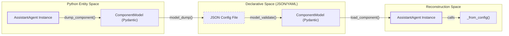
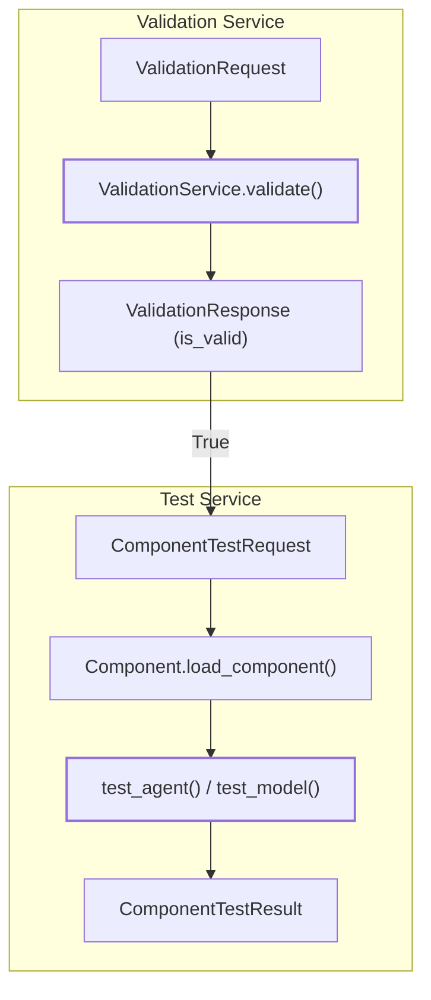

<!-- source: DeepWiki mcp.deepwiki.com · repo microsoft/autogen · page 2.5 Component Configuration System · fetched 2026-10-27 -->

# Component Configuration System

<details>
<summary>Relevant source files</summary>

The following files were used as context for generating this wiki page:

- [python/docs/src/user-guide/autogenstudio-user-guide/installation.md](python/docs/src/user-guide/autogenstudio-user-guide/installation.md)
- [python/packages/autogen-agentchat/tests/test_messages.py](python/packages/autogen-agentchat/tests/test_messages.py)
- [python/packages/autogen-agentchat/tests/test_streaming_message_id_correlation.py](python/packages/autogen-agentchat/tests/test_streaming_message_id_correlation.py)
- [python/packages/autogen-core/src/autogen_core/_component_config.py](python/packages/autogen-core/src/autogen_core/_component_config.py)
- [python/packages/autogen-core/src/autogen_core/_runtime_impl_helpers.py](python/packages/autogen-core/src/autogen_core/_runtime_impl_helpers.py)
- [python/packages/autogen-core/src/autogen_core/_serialization.py](python/packages/autogen-core/src/autogen_core/_serialization.py)
- [python/packages/autogen-core/src/autogen_core/utils/__init__.py](python/packages/autogen-core/src/autogen_core/utils/__init__.py)
- [python/packages/autogen-core/src/autogen_core/utils/_load_json.py](python/packages/autogen-core/src/autogen_core/utils/_load_json.py)
- [python/packages/autogen-core/tests/test_component_config.py](python/packages/autogen-core/tests/test_component_config.py)
- [python/packages/autogen-core/tests/test_json_extraction.py](python/packages/autogen-core/tests/test_json_extraction.py)
- [python/packages/autogen-core/tests/test_serialization.py](python/packages/autogen-core/tests/test_serialization.py)
- [python/packages/autogen-ext/src/autogen_ext/agents/video_surfer/tools.py](python/packages/autogen-ext/src/autogen_ext/agents/video_surfer/tools.py)
- [python/packages/autogen-studio/README.md](python/packages/autogen-studio/README.md)
- [python/packages/autogen-studio/autogenstudio/validation/component_test_service.py](python/packages/autogen-studio/autogenstudio/validation/component_test_service.py)
- [python/packages/autogen-studio/autogenstudio/web/routes/validation.py](python/packages/autogen-studio/autogenstudio/web/routes/validation.py)
- [python/packages/autogen-test-utils/src/autogen_test_utils/__init__.py](python/packages/autogen-test-utils/src/autogen_test_utils/__init__.py)

</details>


The **Component Configuration System** provides a standardized, declarative way to define, serialize, and instantiate complex objects across the AutoGen ecosystem. This system enables cross-platform compatibility, state persistence, and a no-code/low-code interface (as seen in AutoGen Studio) by bridging the gap between Python class instances and static configuration files (JSON/YAML).

## Core Architecture

The system is built around three primary abstractions: `ComponentModel`, `ComponentBase`, and the `Component` protocol. These work together to ensure that any component (Agent, Model Client, Tool, etc.) can be "dumped" into a dictionary and "loaded" back into a functional object.

### ComponentModel
The `ComponentModel` is a Pydantic-based data structure that serves as the "wire format" for any component. It contains the metadata and configuration required for the `ComponentLoader` to reconstruct the original object.

| Field | Type | Description |
| :--- | :--- | :--- |
| `provider` | `str` | The fully qualified class name (e.g., `autogen_ext.models.openai.OpenAIChatCompletionClient`) or a well-known alias [python/packages/autogen-core/src/autogen_core/_component_config.py:21-22](). |
| `component_type` | `ComponentType` | Logical category: `agent`, `model`, `tool`, `termination`, `workbench`, etc [python/packages/autogen-core/src/autogen_core/_component_config.py:24-25](). |
| `version` | `int` | Version of the component specification [python/packages/autogen-core/src/autogen_core/_component_config.py:27-29](). |
| `config` | `dict[str, Any]` | The raw configuration values passed to the class's `_from_config` method [python/packages/autogen-core/src/autogen_core/_component_config.py:39-40](). |

**Sources:** [python/packages/autogen-core/src/autogen_core/_component_config.py:18-42]()

### Component Data Flow
The following diagram illustrates how a Python entity is transformed into a declarative state and back.

**Natural Language to Code Entity Space: Serialization Flow**

**Sources:** [python/packages/autogen-core/src/autogen_core/_component_config.py:145-191](), [python/packages/autogen-core/tests/test_component_config.py:59-64]()

## Implementation Pattern

To make a class part of the configuration system, it must implement the `Component` protocol and optionally inherit from `ComponentBase`.

### ComponentBase and Component Protocol
The `Component` protocol defines the interface for serialization, while `ComponentBase` provides default implementations for schema management.

1.  **`_to_config()`**: Logic to convert the current instance state into a Pydantic model [python/packages/autogen-core/src/autogen_core/_component_config.py:135-143]().
2.  **`_from_config()`**: A class method that takes a Pydantic config model and returns a new instance [python/packages/autogen-core/src/autogen_core/_component_config.py:85-97]().
3.  **`component_config_schema`**: A ClassVar pointing to the Pydantic model used for validation [python/packages/autogen-core/tests/test_component_config.py:22-23]().

### Example Implementation
```python
class MyConfig(BaseModel):
    info: str

class MyComponent(ComponentBase[MyConfig], Component[MyConfig]):
    component_config_schema = MyConfig
    component_type = "custom"

    def _to_config(self) -> MyConfig:
        return MyConfig(info=self.info)

    @classmethod
    def _from_config(cls, config: MyConfig) -> MyComponent:
        return cls(info=config.info)
```
**Sources:** [python/packages/autogen-core/tests/test_component_config.py:17-33]()

## Provider Security and Trust
To prevent arbitrary code execution during deserialization, the system uses a trusted namespace mechanism.

*   **Default Trust**: All first-party packages (`autogen_core`, `autogen_agentchat`, `autogen_ext`, `autogen_studio`) are trusted by default [python/packages/autogen-core/src/autogen_core/_component_config.py:55-62]().
*   **Custom Namespaces**: Users can whitelist additional packages by setting the `AUTOGEN_ALLOWED_PROVIDER_NAMESPACES` environment variable [python/packages/autogen-core/src/autogen_core/_component_config.py:75-81]().
*   **Local Classes**: The system explicitly forbids dumping classes defined within local function scopes (`<locals>`) to ensure they can be imported during reconstruction [python/packages/autogen-core/src/autogen_core/_component_config.py:165-166]().

**Sources:** [python/packages/autogen-core/src/autogen_core/_component_config.py:43-82]()

## Serialization System

While the Component system handles high-level object configuration, the `SerializationRegistry` handles the low-level conversion of messages and data types for gRPC or cross-process communication.

### Message Serializers
The system supports multiple serialization formats via `MessageSerializer` implementations:
*   **`PydanticJsonMessageSerializer`**: For Pydantic models [python/packages/autogen-core/src/autogen_core/_serialization.py:11]().
*   **`DataclassJsonMessageSerializer`**: For standard Python dataclasses [python/packages/autogen-core/src/autogen_core/_serialization.py:9]().
*   **Protobuf**: Supported via the `PROTOBUF_DATA_CONTENT_TYPE` [python/packages/autogen-core/src/autogen_core/_serialization.py:8]().

**Sources:** [python/packages/autogen-core/tests/test_serialization.py:6-14](), [python/packages/autogen-core/tests/test_serialization.py:46-57]()

## Component Validation and Testing

AutoGen Studio utilizes these configuration patterns to provide a `ValidationService` and `ComponentTestService`. This allows users to verify that a JSON configuration is not only syntactically correct but also functionally operational.

**Component Validation Flow**


*   **`ValidationService`**: Checks if the `provider` is importable and if the `config` matches the `component_config_schema` [python/packages/autogen-studio/autogenstudio/web/routes/validation.py:11-19]().
*   **`ComponentTestService`**: Instantiates the component and runs a "dry-run" (e.g., asking an agent "What is 2+2?") to ensure API keys and logic are correct [python/packages/autogen-studio/autogenstudio/validation/component_test_service.py:25-56]().

**Sources:** [python/packages/autogen-studio/autogenstudio/web/routes/validation.py:22-39](), [python/packages/autogen-studio/autogenstudio/validation/component_test_service.py:151-180]()

---

