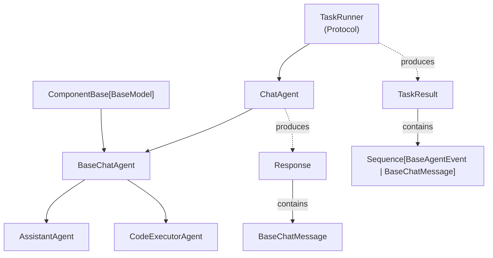
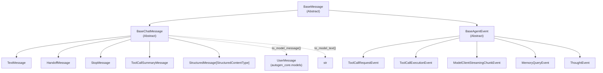
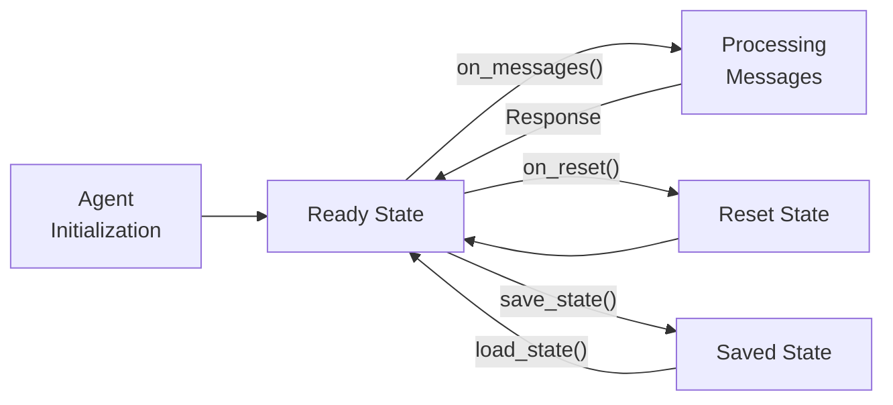

<!-- source: DeepWiki mcp.deepwiki.com · repo microsoft/autogen · page 3 AgentChat API · fetched 2026-10-27 -->

# AgentChat API

Relevant source files

The following files were used as context for generating this wiki page:

- [python/docs/src/user-guide/agentchat-user-guide/magentic-one.md](python/docs/src/user-guide/agentchat-user-guide/magentic-one.md)
- [python/packages/autogen-agentchat/src/autogen_agentchat/agents/__init__.py](python/packages/autogen-agentchat/src/autogen_agentchat/agents/__init__.py)
- [python/packages/autogen-agentchat/src/autogen_agentchat/agents/_assistant_agent.py](python/packages/autogen-agentchat/src/autogen_agentchat/agents/_assistant_agent.py)
- [python/packages/autogen-agentchat/src/autogen_agentchat/agents/_base_chat_agent.py](python/packages/autogen-agentchat/src/autogen_agentchat/agents/_base_chat_agent.py)
- [python/packages/autogen-agentchat/src/autogen_agentchat/agents/_code_executor_agent.py](python/packages/autogen-agentchat/src/autogen_agentchat/agents/_code_executor_agent.py)
- [python/packages/autogen-agentchat/src/autogen_agentchat/base/_chat_agent.py](python/packages/autogen-agentchat/src/autogen_agentchat/base/_chat_agent.py)
- [python/packages/autogen-agentchat/src/autogen_agentchat/base/_task.py](python/packages/autogen-agentchat/src/autogen_agentchat/base/_task.py)
- [python/packages/autogen-agentchat/src/autogen_agentchat/base/_team.py](python/packages/autogen-agentchat/src/autogen_agentchat/base/_team.py)
- [python/packages/autogen-agentchat/src/autogen_agentchat/messages.py](python/packages/autogen-agentchat/src/autogen_agentchat/messages.py)
- [python/packages/autogen-agentchat/src/autogen_agentchat/teams/__init__.py](python/packages/autogen-agentchat/src/autogen_agentchat/teams/__init__.py)
- [python/packages/autogen-agentchat/src/autogen_agentchat/teams/_group_chat/_base_group_chat.py](python/packages/autogen-agentchat/src/autogen_agentchat/teams/_group_chat/_base_group_chat.py)
- [python/packages/autogen-agentchat/src/autogen_agentchat/teams/_group_chat/_base_group_chat_manager.py](python/packages/autogen-agentchat/src/autogen_agentchat/teams/_group_chat/_base_group_chat_manager.py)
- [python/packages/autogen-agentchat/src/autogen_agentchat/teams/_group_chat/_chat_agent_container.py](python/packages/autogen-agentchat/src/autogen_agentchat/teams/_group_chat/_chat_agent_container.py)
- [python/packages/autogen-agentchat/src/autogen_agentchat/teams/_group_chat/_events.py](python/packages/autogen-agentchat/src/autogen_agentchat/teams/_group_chat/_events.py)
- [python/packages/autogen-agentchat/src/autogen_agentchat/teams/_group_chat/_magentic_one/_magentic_one_group_chat.py](python/packages/autogen-agentchat/src/autogen_agentchat/teams/_group_chat/_magentic_one/_magentic_one_group_chat.py)
- [python/packages/autogen-agentchat/src/autogen_agentchat/teams/_group_chat/_magentic_one/_magentic_one_orchestrator.py](python/packages/autogen-agentchat/src/autogen_agentchat/teams/_group_chat/_magentic_one/_magentic_one_orchestrator.py)
- [python/packages/autogen-agentchat/src/autogen_agentchat/teams/_group_chat/_round_robin_group_chat.py](python/packages/autogen-agentchat/src/autogen_agentchat/teams/_group_chat/_round_robin_group_chat.py)
- [python/packages/autogen-agentchat/src/autogen_agentchat/teams/_group_chat/_selector_group_chat.py](python/packages/autogen-agentchat/src/autogen_agentchat/teams/_group_chat/_selector_group_chat.py)
- [python/packages/autogen-agentchat/src/autogen_agentchat/teams/_group_chat/_swarm_group_chat.py](python/packages/autogen-agentchat/src/autogen_agentchat/teams/_group_chat/_swarm_group_chat.py)
- [python/packages/autogen-agentchat/tests/test_assistant_agent.py](python/packages/autogen-agentchat/tests/test_assistant_agent.py)
- [python/packages/autogen-agentchat/tests/test_code_executor_agent.py](python/packages/autogen-agentchat/tests/test_code_executor_agent.py)
- [python/packages/autogen-agentchat/tests/test_group_chat.py](python/packages/autogen-agentchat/tests/test_group_chat.py)
- [python/packages/autogen-ext/src/autogen_ext/agents/magentic_one/_magentic_one_coder_agent.py](python/packages/autogen-ext/src/autogen_ext/agents/magentic_one/_magentic_one_coder_agent.py)
- [python/packages/autogen-ext/src/autogen_ext/code_executors/__init__.py](python/packages/autogen-ext/src/autogen_ext/code_executors/__init__.py)
- [python/packages/autogen-ext/src/autogen_ext/code_executors/docker_jupyter/_docker_jupyter.py](python/packages/autogen-ext/src/autogen_ext/code_executors/docker_jupyter/_docker_jupyter.py)
- [python/packages/autogen-ext/src/autogen_ext/teams/magentic_one.py](python/packages/autogen-ext/src/autogen_ext/teams/magentic_one.py)
- [python/packages/autogen-ext/tests/teams/__init__.py](python/packages/autogen-ext/tests/teams/__init__.py)
- [python/packages/autogen-ext/tests/teams/test_magentic_one.py](python/packages/autogen-ext/tests/teams/test_magentic_one.py)

The AgentChat API provides a high-level interface for rapid prototyping of multi-agent conversations and workflows. This API abstracts the complexity of the underlying runtime systems and provides intuitive classes for creating agents, handling messages, and orchestrating multi-agent interactions.

This document covers the core AgentChat API concepts, agent lifecycle, and message handling patterns. For detailed information about specific agent implementations, see [AssistantAgent](#3.1), [Code Execution Agents](#3.2), and [Specialized Agents](#3.3). For multi-agent orchestration patterns, see [Multi-Agent Teams](#4). For foundational runtime systems, see [Core Foundation](#2).

## Core API Components

The AgentChat API is built around several key abstractions that enable easy agent creation and interaction:

### Agent Hierarchy

The agent hierarchy provides a clear separation between the protocol interface (`ChatAgent`) and concrete implementations. All agents implement the `TaskRunner` protocol, enabling consistent interaction patterns across different agent types. `BaseChatAgent` serves as the primary base class, inheriting from `ComponentBase` to support the configuration system.

Sources: [python/packages/autogen-agentchat/src/autogen_agentchat/agents/_base_chat_agent.py:17-39](), [python/packages/autogen-agentchat/src/autogen_agentchat/agents/_assistant_agent.py:90-91](), [python/packages/autogen-agentchat/src/autogen_agentchat/agents/_code_executor_agent.py:89-89]()

### Message Type System

The message system distinguishes between `BaseChatMessage` types (used for agent-to-agent communication) and `BaseAgentEvent` types (used for observable events and internal processing). Each chat message type provides methods like `to_model_message` to convert AgentChat messages into `LLMMessage` types used by the underlying model clients.

Sources: [python/packages/autogen-agentchat/src/autogen_agentchat/messages.py:26-66](), [python/packages/autogen-agentchat/src/autogen_agentchat/messages.py:68-119](), [python/packages/autogen-agentchat/src/autogen_agentchat/messages.py:142-172](), [python/packages/autogen-agentchat/src/autogen_agentchat/messages.py:178-183]()

## Agent Lifecycle and Execution

### Agent State Management

Agents in the AgentChat API are stateful and maintain their context between interactions. The agent lifecycle follows this pattern:

The `BaseChatAgent` requires implementations for `on_messages` and `on_reset`. Concrete agents like `AssistantAgent` implement `save_state` and `load_state` using specific state models (e.g., `AssistantAgentState`) to persist conversation history and component status.

Sources: [python/packages/autogen-agentchat/src/autogen_agentchat/agents/_base_chat_agent.py:73-86](), [python/packages/autogen-agentchat/src/autogen_agentchat/agents/_assistant_agent.py:730-747](), [python/packages/autogen-agentchat/src/autogen_agentchat/agents/_assistant_agent.py:59-61]()

### Response Generation Flow

Agents can operate in both synchronous (`on_messages`) and streaming (`on_messages_stream`) modes. The `run` and `run_stream` methods provide high-level entry points that handle task initialization and message collection.

- **AssistantAgent**: Orchestrates a loop of model inference and tool execution. For details, see [AssistantAgent](#3.1).
- **CodeExecutorAgent**: Extracts and runs code blocks from messages. For details, see [Code Execution Agents](#3.2).

Sources: [python/packages/autogen-agentchat/src/autogen_agentchat/agents/_base_chat_agent.py:111-161](), [python/packages/autogen-agentchat/src/autogen_agentchat/agents/_assistant_agent.py:138-147]()

## Multi-Agent Orchestration

AgentChat provides a Team-based orchestration layer where multiple agents collaborate under a manager.

| Team Type | Strategy | Key Class |
| :--- | :--- | :--- |
| **Round Robin** | Participants take turns in a fixed sequence. | `RoundRobinGroupChat` |
| **Selector** | An LLM selects the next speaker based on context. | `SelectorGroupChat` |
| **Swarm** | Agents hand off control explicitly via messages. | `Swarm` |
| **MagenticOne** | Hierarchical orchestration with ledger-based planning. | `MagenticOneGroupChat` |

Teams are built using a `BaseGroupChatManager` that handles message routing via a `group_topic_type` and individual `participant_topic_types`.

Sources: [python/packages/autogen-agentchat/src/autogen_agentchat/teams/_group_chat/_round_robin_group_chat.py:96-98](), [python/packages/autogen-agentchat/src/autogen_agentchat/teams/_group_chat/_selector_group_chat.py:50-52](), [python/packages/autogen-agentchat/src/autogen_agentchat/teams/_group_chat/_swarm_group_chat.py:126-127](), [python/packages/autogen-agentchat/src/autogen_agentchat/teams/_group_chat/_base_group_chat.py:117-124]()

## Integration with Core Systems

The AgentChat API bridges high-level agent logic with the `autogen-core` foundation:

- **Model Clients**: Agents use `ChatCompletionClient` for LLM interactions.
- **Context Management**: Agents like `AssistantAgent` utilize `ChatCompletionContext` (e.g., `UnboundedChatCompletionContext`) to manage message windows.
- **Tools**: Integration with `BaseTool` and `Workbench` allows agents to perform actions.
- **Memory**: Support for `Memory` implementations to provide long-term context.

Sources: [python/packages/autogen-agentchat/src/autogen_agentchat/agents/_assistant_agent.py:23-38](), [python/packages/autogen-agentchat/src/autogen_agentchat/agents/_assistant_agent.py:771-780]()

## Specialized Agents

Beyond the standard assistant, the API includes specialized implementations:
- **SocietyOfMindAgent**: Wraps a team of agents to appear as a single agent to a parent team.
- **OpenAIAssistantAgent**: Integrates with the OpenAI Assistants API.
- **MessageFilterAgent**: Applies filtering logic to conversation context.

For more information, see [Specialized Agents](#3.3).

Sources: [python/packages/autogen-agentchat/src/autogen_agentchat/agents/__init__.py:1-25]()

---

