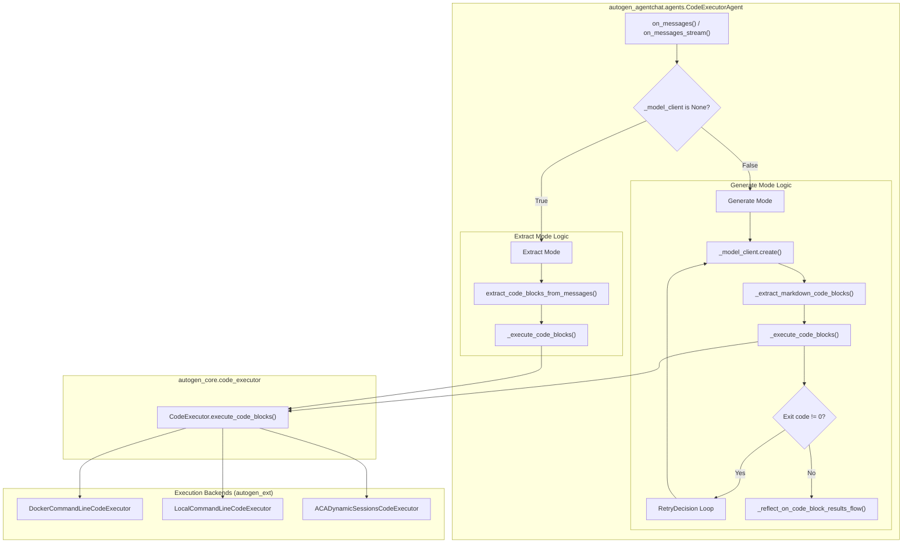
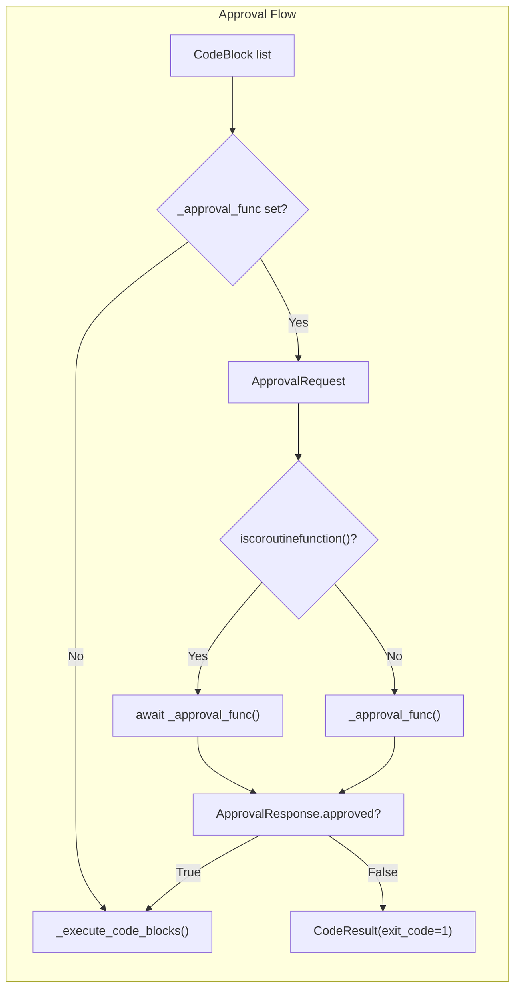
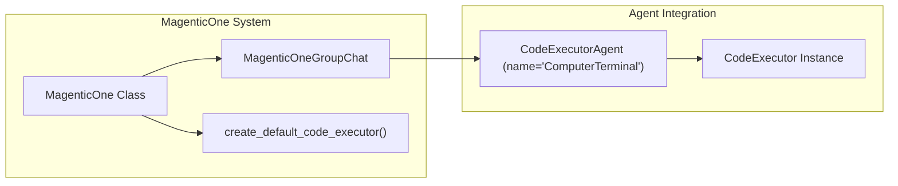

<!-- source: DeepWiki mcp.deepwiki.com · repo microsoft/autogen · page 3.2 Code Execution Agents · fetched 2026-10-27 -->

# Code Execution Agents

Relevant source files

The following files were used as context for generating this wiki page:

- [python/docs/src/user-guide/agentchat-user-guide/magentic-one.md](python/docs/src/user-guide/agentchat-user-guide/magentic-one.md)
- [python/packages/autogen-agentchat/src/autogen_agentchat/agents/__init__.py](python/packages/autogen-agentchat/src/autogen_agentchat/agents/__init__.py)
- [python/packages/autogen-agentchat/src/autogen_agentchat/agents/_code_executor_agent.py](python/packages/autogen-agentchat/src/autogen_agentchat/agents/_code_executor_agent.py)
- [python/packages/autogen-agentchat/src/autogen_agentchat/teams/__init__.py](python/packages/autogen-agentchat/src/autogen_agentchat/teams/__init__.py)
- [python/packages/autogen-agentchat/tests/test_code_executor_agent.py](python/packages/autogen-agentchat/tests/test_code_executor_agent.py)
- [python/packages/autogen-ext/src/autogen_ext/agents/magentic_one/_magentic_one_coder_agent.py](python/packages/autogen-ext/src/autogen_ext/agents/magentic_one/_magentic_one_coder_agent.py)
- [python/packages/autogen-ext/src/autogen_ext/code_executors/__init__.py](python/packages/autogen-ext/src/autogen_ext/code_executors/__init__.py)
- [python/packages/autogen-ext/src/autogen_ext/code_executors/azure/_azure_container_code_executor.py](python/packages/autogen-ext/src/autogen_ext/code_executors/azure/_azure_container_code_executor.py)
- [python/packages/autogen-ext/src/autogen_ext/code_executors/docker/_docker_code_executor.py](python/packages/autogen-ext/src/autogen_ext/code_executors/docker/_docker_code_executor.py)
- [python/packages/autogen-ext/src/autogen_ext/code_executors/docker_jupyter/_docker_jupyter.py](python/packages/autogen-ext/src/autogen_ext/code_executors/docker_jupyter/_docker_jupyter.py)
- [python/packages/autogen-ext/src/autogen_ext/code_executors/jupyter/_jupyter_code_executor.py](python/packages/autogen-ext/src/autogen_ext/code_executors/jupyter/_jupyter_code_executor.py)
- [python/packages/autogen-ext/src/autogen_ext/code_executors/local/__init__.py](python/packages/autogen-ext/src/autogen_ext/code_executors/local/__init__.py)
- [python/packages/autogen-ext/src/autogen_ext/teams/magentic_one.py](python/packages/autogen-ext/src/autogen_ext/teams/magentic_one.py)
- [python/packages/autogen-ext/tests/code_executors/test_aca_dynamic_sessions.py](python/packages/autogen-ext/tests/code_executors/test_aca_dynamic_sessions.py)
- [python/packages/autogen-ext/tests/code_executors/test_aca_user_defined_functions.py](python/packages/autogen-ext/tests/code_executors/test_aca_user_defined_functions.py)
- [python/packages/autogen-ext/tests/code_executors/test_commandline_code_executor.py](python/packages/autogen-ext/tests/code_executors/test_commandline_code_executor.py)
- [python/packages/autogen-ext/tests/code_executors/test_docker_commandline_code_executor.py](python/packages/autogen-ext/tests/code_executors/test_docker_commandline_code_executor.py)
- [python/packages/autogen-ext/tests/code_executors/test_jupyter_code_executor.py](python/packages/autogen-ext/tests/code_executors/test_jupyter_code_executor.py)
- [python/packages/autogen-ext/tests/code_executors/test_user_defined_functions.py](python/packages/autogen-ext/tests/code_executors/test_user_defined_functions.py)
- [python/packages/autogen-ext/tests/teams/__init__.py](python/packages/autogen-ext/tests/teams/__init__.py)
- [python/packages/autogen-ext/tests/teams/test_magentic_one.py](python/packages/autogen-ext/tests/teams/test_magentic_one.py)

This document covers agents in the AgentChat API that specialize in generating and executing code snippets. These agents provide secure, isolated code execution capabilities with approval mechanisms and error handling. For information about basic agent functionality, see [AssistantAgent](3.1). For specialized web and file interaction agents, see [Specialized Agents](3.3).

## Overview

Code execution agents enable AI agents to write, execute, and debug code in response to user requests. The primary agents are:

- `CodeExecutorAgent` - Generates and/or executes code blocks with approval controls [[python/packages/autogen-agentchat/src/autogen_agentchat/agents/_code_executor_agent.py:89-108]()]
- `SocietyOfMindAgent` - Uses an inner team of agents to solve complex problems requiring code execution [[python/packages/autogen-agentchat/src/autogen_agentchat/agents/_society_of_mind_agent.py:39-48]()]

These agents integrate with the broader code execution infrastructure documented in [Code Execution](6.1).

## CodeExecutorAgent Architecture

The `CodeExecutorAgent` operates in two distinct modes depending on whether a `model_client` is provided:

### Code Entity Mapping: Agent to Backend
The following diagram maps high-level agent logic to specific classes and methods within the codebase.

Sources: [python/packages/autogen-agentchat/src/autogen_agentchat/agents/_code_executor_agent.py:497-663](), [python/packages/autogen-ext/src/autogen_ext/code_executors/docker/_docker_code_executor.py:85-135](), [python/packages/autogen-ext/src/autogen_ext/code_executors/local/__init__.py:45-88]()

### Core Components

The `CodeExecutorAgent` integrates several key components:

| Component | Type | Purpose |
|-----------|------|---------|
| `_code_executor` | `CodeExecutor` | Executes code blocks in isolated environments [[python/packages/autogen-agentchat/src/autogen_agentchat/agents/_code_executor_agent.py:431]()] |
| `_model_client` | `ChatCompletionClient` | Generates code and handles retries (optional) [[python/packages/autogen-agentchat/src/autogen_agentchat/agents/_code_executor_agent.py:432]()] |
| `_model_context` | `ChatCompletionContext` | Manages conversation history [[python/packages/autogen-agentchat/src/autogen_agentchat/agents/_code_executor_agent.py:435]()] |
| `_approval_func` | `ApprovalFuncType` | Security gate for code execution [[python/packages/autogen-agentchat/src/autogen_agentchat/agents/_code_executor_agent.py:438]()] |
| `_supported_languages` | `List[str]` | Languages to extract/execute [[python/packages/autogen-agentchat/src/autogen_agentchat/agents/_code_executor_agent.py:437]()] |

Sources: [python/packages/autogen-agentchat/src/autogen_agentchat/agents/_code_executor_agent.py:428-484]()

## Code Approval System

The approval system provides a security layer before code execution:

Sources: [python/packages/autogen-agentchat/src/autogen_agentchat/agents/_code_executor_agent.py:675-704](), [python/packages/autogen-agentchat/src/autogen_agentchat/agents/_code_executor_agent.py:64-86]()

### Approval Structures
- `ApprovalRequest`: Contains the code string and the current `List[LLMMessage]` context [[python/packages/autogen-agentchat/src/autogen_agentchat/agents/_code_executor_agent.py:69-73]()].
- `ApprovalResponse`: Returns a boolean `approved` and a string `reason` [[python/packages/autogen-agentchat/src/autogen_agentchat/agents/_code_executor_agent.py:76-80]()].
- `ApprovalFuncType`: Supports `SyncApprovalFunc` or `AsyncApprovalFunc` signatures [[python/packages/autogen-agentchat/src/autogen_agentchat/agents/_code_executor_agent.py:84-86]()].

## Event System

`CodeExecutorAgent` emits specialized events during the execution lifecycle, which can be captured via `on_messages_stream`:

| Event Class | Purpose | Data Fields |
|-------------|---------|-------------|
| `CodeGenerationEvent` | Emitted when the LLM generates code blocks | `code_blocks`, `content` [[python/packages/autogen-agentchat/src/autogen_agentchat/messages.py:38]() (implied)] |
| `CodeExecutionEvent` | Emitted when the executor completes a run | `result` (`CodeResult`) [[python/packages/autogen-agentchat/src/autogen_agentchat/messages.py:37]() (implied)] |
| `ThoughtEvent` | Emitted for model internal reasoning/reflection | `content` [[python/packages/autogen-agentchat/src/autogen_agentchat/messages.py:42]() (implied)] |
| `ModelClientStreamingChunkEvent` | Emitted during LLM streaming | `content` [[python/packages/autogen-agentchat/src/autogen_agentchat/messages.py:40]() (implied)] |

Sources: [python/packages/autogen-agentchat/src/autogen_agentchat/agents/_code_executor_agent.py:590-612](), [python/packages/autogen-agentchat/src/autogen_agentchat/agents/_code_executor_agent.py:647-652]()

## Code Execution Backends

The agent delegates the actual work to a `CodeExecutor` implementation. 

### Implementation Matrix

| Executor | Isolation | Persistence | Use Case |
|----------|-----------|-------------|----------|
| `DockerCommandLineCodeExecutor` | High (Container) | Stateless per block | **Recommended** for production [[python/packages/autogen-ext/src/autogen_ext/code_executors/docker/_docker_code_executor.py:86-135]()] |
| `LocalCommandLineCodeExecutor` | None (Host) | Stateless per block | Local dev, high risk [[python/packages/autogen-ext/src/autogen_ext/code_executors/local/__init__.py:45-88]()] |
| `ACADynamicSessionsCodeExecutor` | High (Azure) | Stateful (Session) | Azure cloud execution [[python/packages/autogen-ext/src/autogen_ext/code_executors/azure/_azure_container_code_executor.py:46-80]()] |
| `DockerJupyterCodeExecutor` | High (Container) | Stateful (Kernel) | Interactive/Data Science [[python/packages/autogen-ext/src/autogen_ext/code_executors/docker_jupyter/_docker_jupyter.py:41-60]()] |

### The Factory Method
The `create_default_code_executor` factory simplifies selection by attempting to use Docker if available, falling back to local execution with a warning [[python/packages/autogen-ext/src/autogen_ext/code_executors/__init__.py]() (implied by usage in MagenticOne)].

Sources: [python/packages/autogen-ext/src/autogen_ext/teams/magentic_one.py:14](), [python/packages/autogen-ext/src/autogen_ext/teams/magentic_one.py:39]()

## MagenticOne Integration

In the `MagenticOne` team, the `CodeExecutorAgent` is instantiated as the `ComputerTerminal` agent.

Sources: [python/packages/autogen-ext/src/autogen_ext/teams/magentic_one.py:22-69](), [python/packages/autogen-ext/src/autogen_ext/teams/magentic_one.py:83]()

## Configuration and Serialization

### CodeExecutorAgentConfig
The agent supports declarative configuration via `CodeExecutorAgentConfig` [[python/packages/autogen-agentchat/src/autogen_agentchat/agents/_code_executor_agent.py:50-62]()].

| Field | Type | Required | Purpose |
|-------|------|----------|---------|
| `name` | `str` | Yes | Agent name |
| `code_executor` | `ComponentModel` | Yes | Serialized executor config |
| `model_client` | `ComponentModel` | No | Serialized LLM config |
| `sources` | `List[str]` | No | Filter code from specific agents |
| `supported_languages` | `List[str]` | No | Filter code by language |

**Serialization Note**: Agents using a custom `approval_func` cannot be serialized via `dump_component()` because Python functions are not reliably serializable across environments [[python/packages/autogen-agentchat/src/autogen_agentchat/agents/_code_executor_agent.py:143](), [python/packages/autogen-agentchat/src/autogen_agentchat/agents/_code_executor_agent.py:731-751]()].

Sources: [python/packages/autogen-agentchat/src/autogen_agentchat/agents/_code_executor_agent.py:50-62](), [python/packages/autogen-agentchat/src/autogen_agentchat/agents/_code_executor_agent.py:731-751]()

---

