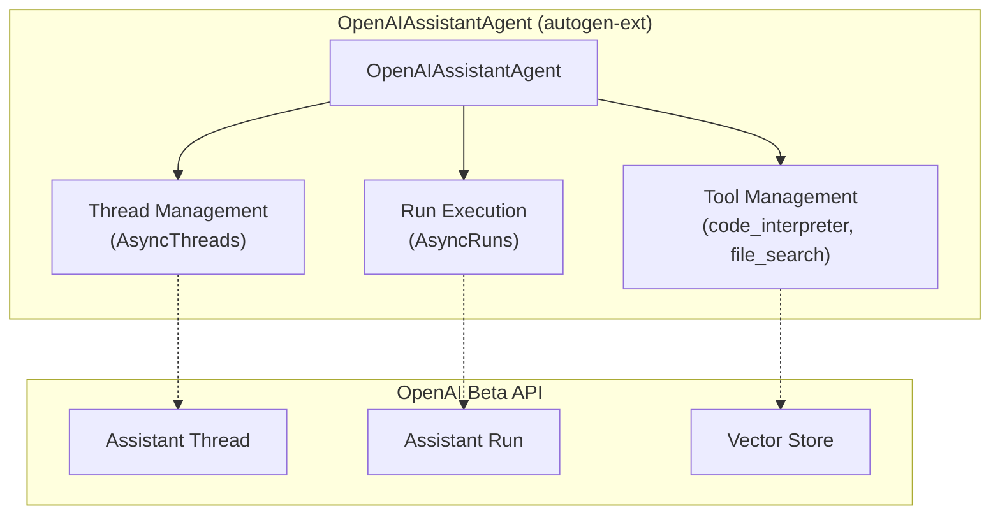
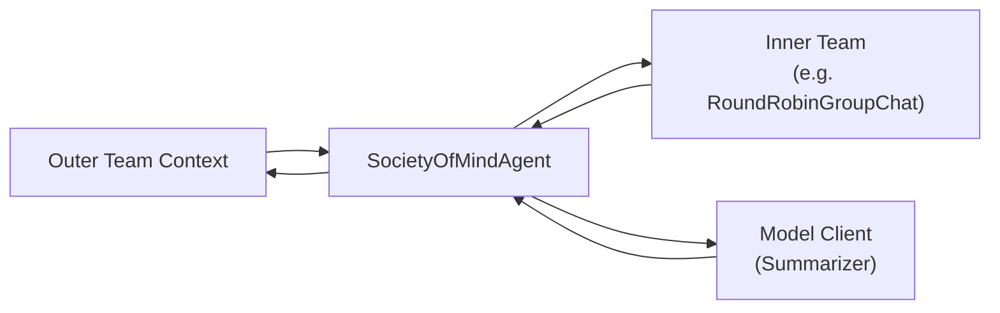
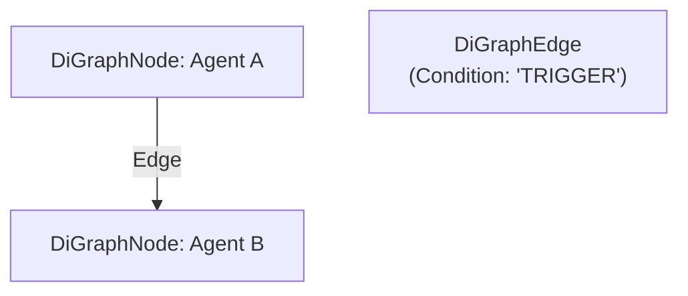

<!-- source: DeepWiki mcp.deepwiki.com · repo microsoft/autogen · page 3.3 Specialized Agents · fetched 2026-10-27 -->

# Specialized Agents

Relevant source files

The following files were used as context for generating this wiki page:

- [python/packages/autogen-agentchat/src/autogen_agentchat/agents/_message_filter_agent.py](python/packages/autogen-agentchat/src/autogen_agentchat/agents/_message_filter_agent.py)
- [python/packages/autogen-agentchat/src/autogen_agentchat/agents/_society_of_mind_agent.py](python/packages/autogen-agentchat/src/autogen_agentchat/agents/_society_of_mind_agent.py)
- [python/packages/autogen-agentchat/src/autogen_agentchat/agents/_user_proxy_agent.py](python/packages/autogen-agentchat/src/autogen_agentchat/agents/_user_proxy_agent.py)
- [python/packages/autogen-agentchat/src/autogen_agentchat/teams/_group_chat/_graph/__init__.py](python/packages/autogen-agentchat/src/autogen_agentchat/teams/_group_chat/_graph/__init__.py)
- [python/packages/autogen-agentchat/src/autogen_agentchat/teams/_group_chat/_graph/_digraph_group_chat.py](python/packages/autogen-agentchat/src/autogen_agentchat/teams/_group_chat/_graph/_digraph_group_chat.py)
- [python/packages/autogen-agentchat/src/autogen_agentchat/teams/_group_chat/_graph/_graph_builder.py](python/packages/autogen-agentchat/src/autogen_agentchat/teams/_group_chat/_graph/_graph_builder.py)
- [python/packages/autogen-agentchat/src/autogen_agentchat/ui/_console.py](python/packages/autogen-agentchat/src/autogen_agentchat/ui/_console.py)
- [python/packages/autogen-agentchat/tests/test_group_chat_endpoint.py](python/packages/autogen-agentchat/tests/test_group_chat_endpoint.py)
- [python/packages/autogen-agentchat/tests/test_group_chat_graph.py](python/packages/autogen-agentchat/tests/test_group_chat_graph.py)
- [python/packages/autogen-agentchat/tests/test_society_of_mind_agent.py](python/packages/autogen-agentchat/tests/test_society_of_mind_agent.py)
- [python/packages/autogen-agentchat/tests/test_userproxy_agent.py](python/packages/autogen-agentchat/tests/test_userproxy_agent.py)
- [python/packages/autogen-agentchat/tests/utils.py](python/packages/autogen-agentchat/tests/utils.py)
- [python/packages/autogen-ext/src/autogen_ext/agents/magentic_one/__init__.py](python/packages/autogen-ext/src/autogen_ext/agents/magentic_one/__init__.py)
- [python/packages/autogen-ext/src/autogen_ext/agents/openai/__init__.py](python/packages/autogen-ext/src/autogen_ext/agents/openai/__init__.py)
- [python/packages/autogen-ext/src/autogen_ext/agents/openai/_openai_agent.py](python/packages/autogen-ext/src/autogen_ext/agents/openai/_openai_agent.py)
- [python/packages/autogen-ext/src/autogen_ext/agents/openai/_openai_assistant_agent.py](python/packages/autogen-ext/src/autogen_ext/agents/openai/_openai_assistant_agent.py)
- [python/packages/autogen-ext/src/autogen_ext/ui/_rich_console.py](python/packages/autogen-ext/src/autogen_ext/ui/_rich_console.py)
- [python/packages/autogen-ext/tests/agents/test_openai_agent_builtin_tool_validation.py](python/packages/autogen-ext/tests/agents/test_openai_agent_builtin_tool_validation.py)
- [python/packages/autogen-ext/tests/test_filesurfer_agent.py](python/packages/autogen-ext/tests/test_filesurfer_agent.py)
- [python/packages/autogen-ext/tests/test_openai_agent.py](python/packages/autogen-ext/tests/test_openai_agent.py)
- [python/packages/autogen-ext/tests/test_openai_assistant_agent.py](python/packages/autogen-ext/tests/test_openai_assistant_agent.py)
- [python/packages/autogen-ext/tests/test_websurfer_agent.py](python/packages/autogen-ext/tests/test_websurfer_agent.py)
- [python/packages/autogen-test-utils/pyproject.toml](python/packages/autogen-test-utils/pyproject.toml)
- [python/packages/component-schema-gen/pyproject.toml](python/packages/component-schema-gen/pyproject.toml)
- [python/packages/magentic-one-cli/pyproject.toml](python/packages/magentic-one-cli/pyproject.toml)
- [python/packages/magentic-one-cli/src/magentic_one_cli/_m1.py](python/packages/magentic-one-cli/src/magentic_one_cli/_m1.py)

This document covers specialized agent implementations that provide domain-specific capabilities beyond basic conversational AI. These agents extend the `BaseChatAgent` foundation to handle specific tasks like OpenAI Assistants API integration, team encapsulation via Society of Mind, context filtering, and human-in-the-loop interaction.

## Overview

AutoGen provides several specialized agents across the `autogen-agentchat` and `autogen-ext` packages:

- **OpenAIAssistantAgent**: Integrates with the OpenAI Assistants API, managing threads, runs, and vector stores.
- **OpenAIAgent**: Uses the OpenAI Responses API with native support for built-in tools like web search and computer use.
- **SocietyOfMindAgent**: Encapsulates an entire team of agents into a single agent interface.
- **MessageFilterAgent**: Provides a layer for filtering or transforming message context before it reaches an agent.
- **UserProxyAgent**: Represents a human user in the conversation, often paired with a Console UI for interactive input.

## OpenAI-Specific Agents

### OpenAIAssistantAgent
The `OpenAIAssistantAgent` leverages the OpenAI Assistants API to provide persistent threads and built-in tool capabilities (Code Interpreter, File Search).

**Key Features:**
- **State Persistence**: Saves and loads `assistant_id`, `thread_id`, and `vector_store_id` via `OpenAIAssistantAgentState` [[python/packages/autogen-ext/src/autogen_ext/agents/openai/_openai_assistant_agent.py:84-90]]().
- **File Management**: Methods for uploading files to the Code Interpreter [[python/packages/autogen-ext/src/autogen_ext/agents/openai/_openai_assistant_agent.py:328-356]]() and Vector Stores [[python/packages/autogen-ext/src/autogen_ext/agents/openai/_openai_assistant_agent.py:382-411]]().
- **Custom Tools**: Converts AutoGen `Tool` objects into OpenAI `FunctionToolParam` [[python/packages/autogen-ext/src/autogen_ext/agents/openai/_openai_assistant_agent.py:63-81]]().

Sources: [[python/packages/autogen-ext/src/autogen_ext/agents/openai/_openai_assistant_agent.py:93-126]]()

### OpenAIAgent
The `OpenAIAgent` utilizes the OpenAI Responses API, specifically designed for built-in tools and high-performance multimodal interactions.

**Supported Built-in Tools:**
- `file_search` [[python/packages/autogen-ext/src/autogen_ext/agents/openai/_openai_agent.py:48-55]]()
- `web_search_preview` [[python/packages/autogen-ext/src/autogen_ext/agents/openai/_openai_agent.py:58-63]]()
- `computer_use_preview` [[python/packages/autogen-ext/src/autogen_ext/agents/openai/_openai_agent.py:66-72]]()
- `code_interpreter` [[python/packages/autogen-ext/src/autogen_ext/agents/openai/_openai_agent.py:86-90]]()

Sources: [[python/packages/autogen-ext/src/autogen_ext/agents/openai/_openai_agent.py:113-121]]()

## SocietyOfMindAgent

The `SocietyOfMindAgent` is a meta-agent that wraps an entire `Team`. When this agent receives messages, it runs its internal team to completion and then uses a `ChatCompletionClient` to summarize or format the team's internal dialogue into a single response [[python/packages/autogen-agentchat/src/autogen_agentchat/agents/_society_of_mind_agent.py:38-45]]().

**Workflow:**
1. **Inner Execution**: Receives messages and triggers `self._team.run_stream()` [[python/packages/autogen-agentchat/src/autogen_agentchat/agents/_society_of_mind_agent.py:175-177]]().
2. **Context Assembly**: Prepends a `DEFAULT_INSTRUCTION` system message to the transcript of the inner team's conversation [[python/packages/autogen-agentchat/src/autogen_agentchat/agents/_society_of_mind_agent.py:111-115]]().
3. **Response Generation**: Calls the model client to produce a standalone response [[python/packages/autogen-agentchat/src/autogen_agentchat/agents/_society_of_mind_agent.py:199-204]]().
4. **Cleanup**: Resets the inner team state for the next turn [[python/packages/autogen-agentchat/src/autogen_agentchat/agents/_society_of_mind_agent.py:215]]().

Sources: [[python/packages/autogen-agentchat/src/autogen_agentchat/agents/_society_of_mind_agent.py:108-146]]()

## User Interaction and UI

### UserProxyAgent
The `UserProxyAgent` represents a human participant. It blocks execution and waits for input via a configurable `input_func` [[python/packages/autogen-agentchat/src/autogen_agentchat/agents/_user_proxy_agent.py:38-41]]().

- **Default Input**: Uses `cancellable_input`, which wraps the standard Python `input()` in a thread to allow for asynchronous cancellation [[python/packages/autogen-agentchat/src/autogen_agentchat/agents/_user_proxy_agent.py:22-26]]().
- **Context Management**: Uses `InputRequestContext` to track unique request IDs, enabling complex UI integrations (like Web or WebSocket-based UIs) [[python/packages/autogen-agentchat/src/autogen_agentchat/agents/_user_proxy_agent.py:133-159]]().

### Console UI
The `Console` function is a utility for rendering agent streams. It specifically handles `UserInputRequestedEvent` to facilitate human-in-the-loop workflows [[python/packages/autogen-agentchat/src/autogen_agentchat/ui/_console.py:82-108]]().

**UserInputManager:**
Coordinates between the `UserProxyAgent` and the `Console` UI. It wraps the input callback and uses `asyncio.Event` to signal when the UI is ready to accept user input for a specific request [[python/packages/autogen-agentchat/src/autogen_agentchat/ui/_console.py:37-77]]().

Sources: [[python/packages/autogen-agentchat/src/autogen_agentchat/ui/_console.py:117-148]]()

## Message Filtering

The `MessageFilterAgent` acts as a proxy that filters or modifies the sequence of messages before passing them to an underlying agent. This is commonly used in `GraphFlow` or complex group chats to scope the context.

- **Filtering Logic**: Can filter based on the message source (e.g., `PerSourceFilter`) or other criteria [[python/packages/autogen-agentchat/src/autogen_agentchat/agents/_message_filter_agent.py:11-14]]().
- **Implementation**: It implements `BaseChatAgent` and delegates the actual processing to a `_inner_agent` after applying filters [[python/packages/autogen-agentchat/src/autogen_agentchat/agents/_message_filter_agent.py:54-68]]().

Sources: [[python/packages/autogen-agentchat/src/autogen_agentchat/agents/_message_filter_agent.py:24-40]]()

## Graph-Based Orchestration

While not an "agent" in the traditional sense, the `GraphFlow` system uses `DiGraph` structures to control agent execution order.

- **DiGraphEdge**: Represents a transition between agents. It can be conditional (based on a string match or a callable) [[python/packages/autogen-agentchat/src/autogen_agentchat/teams/_group_chat/_graph/_digraph_group_chat.py:25-44]]().
- **Activation Groups**: Allows for complex dependencies where a node might require "all" or "any" parent nodes to finish before it activates [[python/packages/autogen-agentchat/src/autogen_agentchat/teams/_group_chat/_graph/_digraph_group_chat.py:48-66]]().
- **Cycle Handling**: Validates that any cycles in the graph have at least one conditional edge to prevent infinite loops [[python/packages/autogen-agentchat/src/autogen_agentchat/teams/_group_chat/_graph/_digraph_group_chat.py:149-159]]().

Sources: [[python/packages/autogen-agentchat/src/autogen_agentchat/teams/_group_chat/_graph/_digraph_group_chat.py:101-113]]()

---

