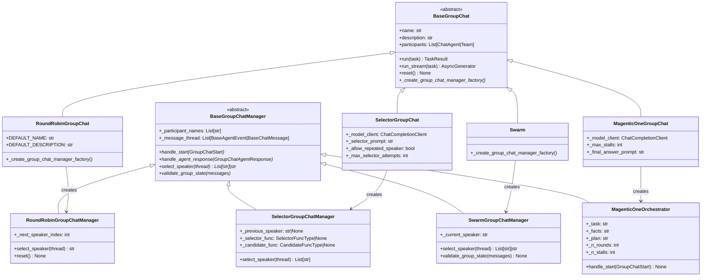
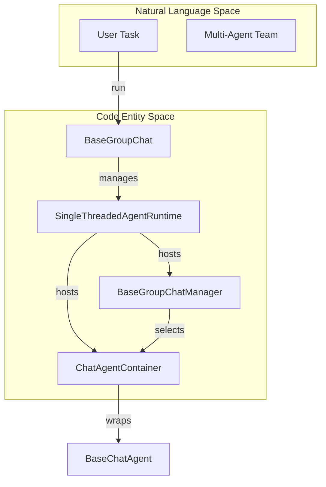
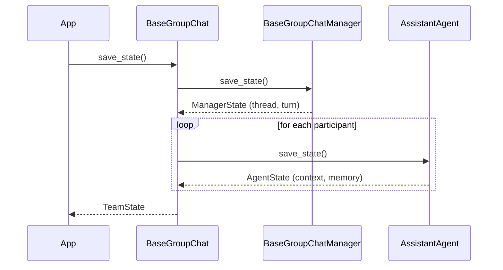

<!-- source: DeepWiki mcp.deepwiki.com · repo microsoft/autogen · page 4.1 Team Orchestration · fetched 2026-10-27 -->

# Team Orchestration

Relevant source files

The following files were used as context for generating this wiki page:

- [python/docs/src/user-guide/agentchat-user-guide/magentic-one.md](python/docs/src/user-guide/agentchat-user-guide/magentic-one.md)
- [python/packages/autogen-agentchat/src/autogen_agentchat/agents/__init__.py](python/packages/autogen-agentchat/src/autogen_agentchat/agents/__init__.py)
- [python/packages/autogen-agentchat/src/autogen_agentchat/agents/_assistant_agent.py](python/packages/autogen-agentchat/src/autogen_agentchat/agents/_assistant_agent.py)
- [python/packages/autogen-agentchat/src/autogen_agentchat/agents/_base_chat_agent.py](python/packages/autogen-agentchat/src/autogen_agentchat/agents/_base_chat_agent.py)
- [python/packages/autogen-agentchat/src/autogen_agentchat/agents/_code_executor_agent.py](python/packages/autogen-agentchat/src/autogen_agentchat/agents/_code_executor_agent.py)
- [python/packages/autogen-agentchat/src/autogen_agentchat/base/_chat_agent.py](python/packages/autogen-agentchat/src/autogen_agentchat/base/_chat_agent.py)
- [python/packages/autogen-agentchat/src/autogen_agentchat/base/_task.py](python/packages/autogen-agentchat/src/autogen_agentchat/base/_task.py)
- [python/packages/autogen-agentchat/src/autogen_agentchat/base/_team.py](python/packages/autogen-agentchat/src/autogen_agentchat/base/_team.py)
- [python/packages/autogen-agentchat/src/autogen_agentchat/messages.py](python/packages/autogen-agentchat/src/autogen_agentchat/messages.py)
- [python/packages/autogen-agentchat/src/autogen_agentchat/teams/__init__.py](python/packages/autogen-agentchat/src/autogen_agentchat/teams/__init__.py)
- [python/packages/autogen-agentchat/src/autogen_agentchat/teams/_group_chat/_base_group_chat.py](python/packages/autogen-agentchat/src/autogen_agentchat/teams/_group_chat/_base_group_chat.py)
- [python/packages/autogen-agentchat/src/autogen_agentchat/teams/_group_chat/_base_group_chat_manager.py](python/packages/autogen-agentchat/src/autogen_agentchat/teams/_group_chat/_base_group_chat_manager.py)
- [python/packages/autogen-agentchat/src/autogen_agentchat/teams/_group_chat/_chat_agent_container.py](python/packages/autogen-agentchat/src/autogen_agentchat/teams/_group_chat/_chat_agent_container.py)
- [python/packages/autogen-agentchat/src/autogen_agentchat/teams/_group_chat/_events.py](python/packages/autogen-agentchat/src/autogen_agentchat/teams/_group_chat/_events.py)
- [python/packages/autogen-agentchat/src/autogen_agentchat/teams/_group_chat/_magentic_one/_magentic_one_group_chat.py](python/packages/autogen-agentchat/src/autogen_agentchat/teams/_group_chat/_magentic_one/_magentic_one_group_chat.py)
- [python/packages/autogen-agentchat/src/autogen_agentchat/teams/_group_chat/_magentic_one/_magentic_one_orchestrator.py](python/packages/autogen-agentchat/src/autogen_agentchat/teams/_group_chat/_magentic_one/_magentic_one_orchestrator.py)
- [python/packages/autogen-agentchat/src/autogen_agentchat/teams/_group_chat/_round_robin_group_chat.py](python/packages/autogen-agentchat/src/autogen_agentchat/teams/_group_chat/_round_robin_group_chat.py)
- [python/packages/autogen-agentchat/src/autogen_agentchat/teams/_group_chat/_selector_group_chat.py](python/packages/autogen-agentchat/src/autogen_agentchat/teams/_group_chat/_selector_group_chat.py)
- [python/packages/autogen-agentchat/src/autogen_agentchat/teams/_group_chat/_swarm_group_chat.py](python/packages/autogen-agentchat/src/autogen_agentchat/teams/_group_chat/_swarm_group_chat.py)
- [python/packages/autogen-agentchat/tests/test_assistant_agent.py](python/packages/autogen-agentchat/tests/test_assistant_agent.py)
- [python/packages/autogen-agentchat/tests/test_code_executor_agent.py](python/packages/autogen-agentchat/tests/test_code_executor_agent.py)
- [python/packages/autogen-agentchat/tests/test_group_chat.py](python/packages/autogen-agentchat/tests/test_group_chat.py)
- [python/packages/autogen-ext/src/autogen_ext/agents/magentic_one/_magentic_one_coder_agent.py](python/packages/autogen-ext/src/autogen_ext/agents/magentic_one/_magentic_one_coder_agent.py)
- [python/packages/autogen-ext/src/autogen_ext/code_executors/__init__.py](python/packages/autogen-ext/src/autogen_ext/code_executors/__init__.py)
- [python/packages/autogen-ext/src/autogen_ext/code_executors/docker_jupyter/_docker_jupyter.py](python/packages/autogen-ext/src/autogen_ext/code_executors/docker_jupyter/_docker_jupyter.py)
- [python/packages/autogen-ext/src/autogen_ext/teams/magentic_one.py](python/packages/autogen-ext/src/autogen_ext/teams/magentic_one.py)
- [python/packages/autogen-ext/tests/teams/__init__.py](python/packages/autogen-ext/tests/teams/__init__.py)
- [python/packages/autogen-ext/tests/teams/test_magentic_one.py](python/packages/autogen-ext/tests/teams/test_magentic_one.py)

Team orchestration in AutoGen enables coordination of multiple agents through various conversation patterns. This document details the `BaseGroupChat` implementation, speaker selection strategies, and the underlying runtime integration that manages how agents take turns and collaborate.

## Architecture Overview

The team orchestration system is built on a layered architecture where abstract base classes define contracts and concrete implementations provide specific orchestration strategies.

### Core Class Hierarchy

**Sources:** [python/packages/autogen-agentchat/src/autogen_agentchat/teams/_group_chat/_base_group_chat.py:40-176](), [python/packages/autogen-agentchat/src/autogen_agentchat/teams/_group_chat/_base_group_chat_manager.py:25-84](), [python/packages/autogen-agentchat/src/autogen_agentchat/teams/_group_chat/_round_robin_group_chat.py:96-224](), [python/packages/autogen-agentchat/src/autogen_agentchat/teams/_group_chat/_selector_group_chat.py:362-486](), [python/packages/autogen-agentchat/src/autogen_agentchat/teams/_group_chat/_swarm_group_chat.py:126-186](), [python/packages/autogen-agentchat/src/autogen_agentchat/teams/_group_chat/_magentic_one/_magentic_one_group_chat.py:36-143]()

### Hub-and-Spoke Topic Model

The group chat utilizes a Hub-and-Spoke communication model based on `autogen_core` topics. This ensures isolated and directed message routing within a team.

| Topic Name | Purpose | Implementation Detail |
| :--- | :--- | :--- |
| `group_topic` | Broadcast communication | All participants and the manager subscribe to this. [python/packages/autogen-agentchat/src/autogen_agentchat/teams/_group_chat/_base_group_chat.py:118-118]() |
| `participant_topic` | Direct messaging to agent | Unique per participant: `{name}_{team_id}`. [python/packages/autogen-agentchat/src/autogen_agentchat/teams/_group_chat/_base_group_chat.py:122-124]() |
| `output_topic` | Streaming/External output | Used for relaying messages to the output queue. [python/packages/autogen-agentchat/src/autogen_agentchat/teams/_group_chat/_base_group_chat.py:127-127]() |

**Sources:** [python/packages/autogen-agentchat/src/autogen_agentchat/teams/_group_chat/_base_group_chat.py:111-127]()

## Orchestration Patterns

### Round Robin Pattern
The `RoundRobinGroupChat` cycles through participants in a fixed order. The `RoundRobinGroupChatManager` maintains a `_next_speaker_index` [python/packages/autogen-agentchat/src/autogen_agentchat/teams/_group_chat/_round_robin_group_chat.py:46-46]() and increments it modulo the participant count during each turn [python/packages/autogen-agentchat/src/autogen_agentchat/teams/_group_chat/_round_robin_group_chat.py:80-80]().

### Selector Pattern
The `SelectorGroupChat` uses a `ChatCompletionClient` to intelligently choose the next speaker.
*   **Selection Logic:** It uses a `_selector_prompt` to provide context (roles, history) to the LLM [python/packages/autogen-agentchat/src/autogen_agentchat/teams/_group_chat/_selector_group_chat.py:90-90]().
*   **Overrides:** A custom `selector_func` can override the LLM if provided [python/packages/autogen-agentchat/src/autogen_agentchat/teams/_group_chat/_selector_group_chat.py:163-170]().
*   **Filtering:** A `candidate_func` can dynamically restrict which agents are available for selection [python/packages/autogen-agentchat/src/autogen_agentchat/teams/_group_chat/_selector_group_chat.py:186-193]().

### Swarm Pattern
The `Swarm` pattern is strictly governed by `HandoffMessage`.
*   **Logic:** The manager looks for the most recent `HandoffMessage` in the thread and sets the `target` agent as the next speaker [python/packages/autogen-agentchat/src/autogen_agentchat/teams/_group_chat/_swarm_group_chat.py:92-97]().
*   **Validation:** It ensures the handoff target is a valid participant during state validation [python/packages/autogen-agentchat/src/autogen_agentchat/teams/_group_chat/_swarm_group_chat.py:52-57]().

### MagenticOne Pattern
`MagenticOneGroupChat` implements a multi-step ledger-based orchestration.
*   **Task Ledger:** Tracks facts and plans [python/packages/autogen-agentchat/src/autogen_agentchat/teams/_group_chat/_magentic_one/_magentic_one_orchestrator.py:107-124]().
*   **Progress Ledger:** Tracks if the request is satisfied or if the team is stalled [python/packages/autogen-agentchat/src/autogen_agentchat/teams/_group_chat/_magentic_one/_magentic_one_orchestrator.py:116-117]().
*   **Stall Detection:** If `_n_stalls` reaches `_max_stalls`, the orchestrator re-plans [python/packages/autogen-agentchat/src/autogen_agentchat/teams/_group_chat/_magentic_one/_magentic_one_orchestrator.py:92-99]().

## Runtime Integration

The `ChatAgentContainer` serves as the bridge between the high-level `ChatAgent` API and the underlying `autogen_core` runtime.

**Sources:** [python/packages/autogen-agentchat/src/autogen_agentchat/teams/_group_chat/_base_group_chat.py:134-142](), [python/packages/autogen-agentchat/src/autogen_agentchat/teams/_group_chat/_chat_agent_container.py:24-55]()

### State Save/Load
Teams support persistence through `save_state` and `load_state`.
*   **Team State:** Includes the state of all participants and the manager [python/packages/autogen-agentchat/src/autogen_agentchat/state.py:27-27]().
*   **Manager State:** Managers typically save the `message_thread` and current turn information [python/packages/autogen-agentchat/src/autogen_agentchat/teams/_group_chat/_round_robin_group_chat.py:58-64]().
*   **Agent State:** `AssistantAgent` saves its `ChatCompletionContext` and tool usage history [python/packages/autogen-agentchat/src/autogen_agentchat/agents/_assistant_agent.py:59-59]().

**Sources:** [python/packages/autogen-agentchat/src/autogen_agentchat/teams/_group_chat/_base_group_chat.py:350-375](), [python/packages/autogen-agentchat/src/autogen_agentchat/teams/_group_chat/_round_robin_group_chat.py:58-64](), [python/packages/autogen-agentchat/src/autogen_agentchat/agents/_assistant_agent.py:476-487]()

---

