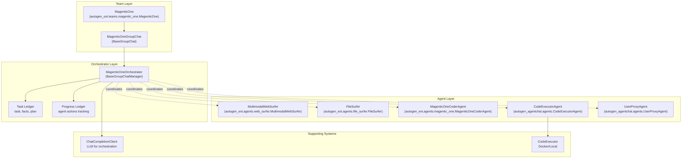
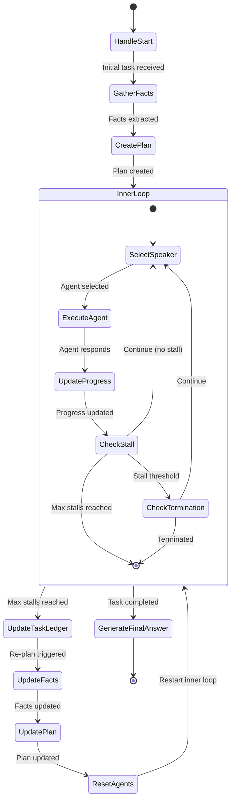
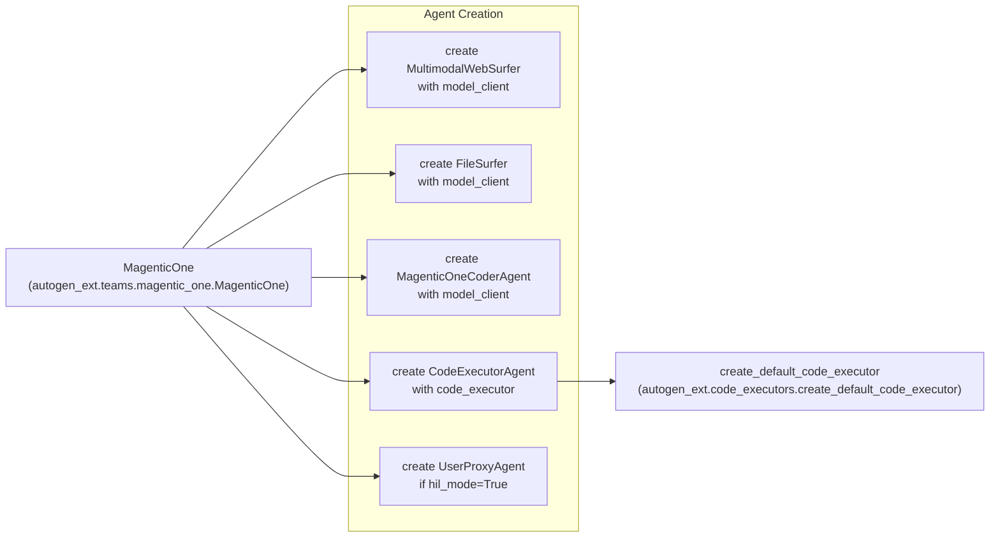
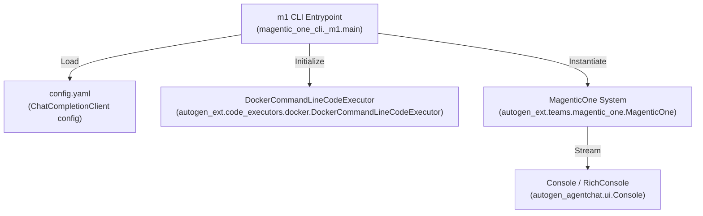

<!-- source: DeepWiki mcp.deepwiki.com · repo microsoft/autogen · page 4.4 MagenticOne System · fetched 2026-10-27 -->

# MagenticOne System

Relevant source files

The following files were used as context for generating this wiki page:

- [python/docs/src/user-guide/agentchat-user-guide/magentic-one.md](python/docs/src/user-guide/agentchat-user-guide/magentic-one.md)
- [python/packages/autogen-agentchat/src/autogen_agentchat/agents/__init__.py](python/packages/autogen-agentchat/src/autogen_agentchat/agents/__init__.py)
- [python/packages/autogen-agentchat/src/autogen_agentchat/agents/_code_executor_agent.py](python/packages/autogen-agentchat/src/autogen_agentchat/agents/_code_executor_agent.py)
- [python/packages/autogen-agentchat/src/autogen_agentchat/agents/_user_proxy_agent.py](python/packages/autogen-agentchat/src/autogen_agentchat/agents/_user_proxy_agent.py)
- [python/packages/autogen-agentchat/src/autogen_agentchat/teams/__init__.py](python/packages/autogen-agentchat/src/autogen_agentchat/teams/__init__.py)
- [python/packages/autogen-agentchat/src/autogen_agentchat/ui/_console.py](python/packages/autogen-agentchat/src/autogen_agentchat/ui/_console.py)
- [python/packages/autogen-agentchat/tests/test_code_executor_agent.py](python/packages/autogen-agentchat/tests/test_code_executor_agent.py)
- [python/packages/autogen-agentchat/tests/test_magentic_one_group_chat.py](python/packages/autogen-agentchat/tests/test_magentic_one_group_chat.py)
- [python/packages/autogen-agentchat/tests/test_userproxy_agent.py](python/packages/autogen-agentchat/tests/test_userproxy_agent.py)
- [python/packages/autogen-ext/src/autogen_ext/agents/file_surfer/__init__.py](python/packages/autogen-ext/src/autogen_ext/agents/file_surfer/__init__.py)
- [python/packages/autogen-ext/src/autogen_ext/agents/file_surfer/_file_surfer.py](python/packages/autogen-ext/src/autogen_ext/agents/file_surfer/_file_surfer.py)
- [python/packages/autogen-ext/src/autogen_ext/agents/file_surfer/_markdown_file_browser.py](python/packages/autogen-ext/src/autogen_ext/agents/file_surfer/_markdown_file_browser.py)
- [python/packages/autogen-ext/src/autogen_ext/agents/file_surfer/_tool_definitions.py](python/packages/autogen-ext/src/autogen_ext/agents/file_surfer/_tool_definitions.py)
- [python/packages/autogen-ext/src/autogen_ext/agents/magentic_one/_magentic_one_coder_agent.py](python/packages/autogen-ext/src/autogen_ext/agents/magentic_one/_magentic_one_coder_agent.py)
- [python/packages/autogen-ext/src/autogen_ext/agents/web_surfer/_events.py](python/packages/autogen-ext/src/autogen_ext/agents/web_surfer/_events.py)
- [python/packages/autogen-ext/src/autogen_ext/agents/web_surfer/_multimodal_web_surfer.py](python/packages/autogen-ext/src/autogen_ext/agents/web_surfer/_multimodal_web_surfer.py)
- [python/packages/autogen-ext/src/autogen_ext/agents/web_surfer/_prompts.py](python/packages/autogen-ext/src/autogen_ext/agents/web_surfer/_prompts.py)
- [python/packages/autogen-ext/src/autogen_ext/agents/web_surfer/_set_of_mark.py](python/packages/autogen-ext/src/autogen_ext/agents/web_surfer/_set_of_mark.py)
- [python/packages/autogen-ext/src/autogen_ext/agents/web_surfer/_tool_definitions.py](python/packages/autogen-ext/src/autogen_ext/agents/web_surfer/_tool_definitions.py)
- [python/packages/autogen-ext/src/autogen_ext/agents/web_surfer/_types.py](python/packages/autogen-ext/src/autogen_ext/agents/web_surfer/_types.py)
- [python/packages/autogen-ext/src/autogen_ext/agents/web_surfer/page_script.js](python/packages/autogen-ext/src/autogen_ext/agents/web_surfer/page_script.js)
- [python/packages/autogen-ext/src/autogen_ext/agents/web_surfer/playwright_controller.py](python/packages/autogen-ext/src/autogen_ext/agents/web_surfer/playwright_controller.py)
- [python/packages/autogen-ext/src/autogen_ext/code_executors/__init__.py](python/packages/autogen-ext/src/autogen_ext/code_executors/__init__.py)
- [python/packages/autogen-ext/src/autogen_ext/code_executors/docker_jupyter/_docker_jupyter.py](python/packages/autogen-ext/src/autogen_ext/code_executors/docker_jupyter/_docker_jupyter.py)
- [python/packages/autogen-ext/src/autogen_ext/teams/magentic_one.py](python/packages/autogen-ext/src/autogen_ext/teams/magentic_one.py)
- [python/packages/autogen-ext/src/autogen_ext/ui/_rich_console.py](python/packages/autogen-ext/src/autogen_ext/ui/_rich_console.py)
- [python/packages/autogen-ext/tests/teams/__init__.py](python/packages/autogen-ext/tests/teams/__init__.py)
- [python/packages/autogen-ext/tests/teams/test_magentic_one.py](python/packages/autogen-ext/tests/teams/test_magentic_one.py)
- [python/packages/autogen-magentic-one/README.md](python/packages/autogen-magentic-one/README.md)
- [python/packages/autogen-test-utils/pyproject.toml](python/packages/autogen-test-utils/pyproject.toml)
- [python/packages/component-schema-gen/pyproject.toml](python/packages/component-schema-gen/pyproject.toml)
- [python/packages/magentic-one-cli/pyproject.toml](python/packages/magentic-one-cli/pyproject.toml)
- [python/packages/magentic-one-cli/src/magentic_one_cli/_m1.py](python/packages/magentic-one-cli/src/magentic_one_cli/_m1.py)

This document explains the MagenticOne multi-agent system, a specialized team orchestration pattern that uses ledger-based coordination to solve complex tasks. MagenticOne is built on top of the group chat framework and uses an orchestrator architecture with specialized agents for web browsing, file operations, code generation, and code execution.

---

## System Architecture

MagenticOne implements a generalist multi-agent system based on research from Microsoft Research. The system consists of three main layers: the group chat team (`MagenticOneGroupChat`), the orchestrator (`MagenticOneOrchestrator`), and specialized agents.

**Architecture Diagram: MagenticOne System Components**

Sources: [python/packages/autogen-ext/src/autogen_ext/teams/magentic_one.py:22-68](), [python/packages/autogen-ext/src/autogen_ext/agents/web_surfer/_multimodal_web_surfer.py:88-111](), [python/packages/autogen-ext/src/autogen_ext/agents/file_surfer/_file_surfer.py:44-59](), [python/packages/autogen-agentchat/src/autogen_agentchat/agents/_code_executor_agent.py:89-108]()

---

## MagenticOneOrchestrator

The `MagenticOneOrchestrator` (managed via `MagenticOneGroupChat`) implements ledger-based coordination using a two-loop architecture: an outer loop for task planning and an inner loop for agent execution.

**Orchestrator Flow Diagram**

Sources: [python/packages/autogen-ext/src/autogen_ext/teams/magentic_one.py:54-68](), [python/packages/autogen-agentchat/src/autogen_agentchat/teams/__init__.py:1-20]()

---

## Specialized Agents

MagenticOne coordinates specialized agents, each with a specific role. The convenience wrapper `MagenticOne` in `autogen-ext` automatically creates these agents.

### Agent Roles and Capabilities

| Agent Class | Purpose | Key Capabilities |
|-------------|---------|-----------------|
| `MultimodalWebSurfer` | Web browsing and information gathering | Playwright-based browser control, page navigation, content extraction [autogen_ext/agents/web_surfer/_multimodal_web_surfer.py:103-111]() |
| `FileSurfer` | File system operations | Directory navigation, file reading/writing, file search [autogen_ext/agents/file_surfer/_file_surfer.py:45-46]() |
| `MagenticOneCoderAgent` | Code generation | Specialized coding assistant with context about available tools [autogen_ext/teams/magentic_one.py:65]() |
| `CodeExecutorAgent` | Code execution | Executes code via Docker/Local, handles approval workflow [autogen_agentchat/agents/_code_executor_agent.py:90-108]() |
| `UserProxyAgent` | Human-in-the-loop | Optional agent for human oversight and input [autogen_agentchat/agents/_user_proxy_agent.py:38-41]() |

Sources: [python/packages/autogen-ext/src/autogen_ext/teams/magentic_one.py:60-68](), [python/packages/autogen-agentchat/src/autogen_agentchat/agents/_code_executor_agent.py:89-108](), [python/packages/autogen-ext/src/autogen_ext/agents/web_surfer/_multimodal_web_surfer.py:88-111]()

### Agent Creation in MagenticOne Wrapper

The `MagenticOne` class bundles the orchestrator and agents with minimal configuration. It uses `create_default_code_executor` to resolve the execution environment, prioritizing Docker for isolation.

**Agent Instantiation Diagram**

Sources: [python/packages/autogen-ext/src/autogen_ext/teams/magentic_one.py:22-41](), [python/packages/autogen-ext/src/autogen_ext/code_executors/__init__.py:1-20]()

---

## MagenticOne CLI (`m1`)

The `magentic-one-cli` package provides a command-line entrypoint `m1` to quickly run tasks using the MagenticOne system.

### Entrypoint and Configuration

The CLI entrypoint is defined in `magentic_one_cli._m1:main` [magentic-one-cli/pyproject.toml:24](). It supports loading model configurations from a YAML file.

**CLI Features:**
- **Human-in-the-loop**: Enabled by default, can be disabled via `--no-hil` [magentic_one_cli/_m1.py:70]().
- **Rich Output**: Optional flag `--rich` to enable `RichConsole` output [magentic_one_cli/_m1.py:72-75]().
- **Config Management**: Loads from `config.yaml` or a specified file via `--config` [magentic_one_cli/_m1.py:77-81]().

**CLI Data Flow Diagram**

Sources: [python/packages/magentic-one-cli/src/magentic_one_cli/_m1.py:33-129](), [python/packages/magentic-one-cli/pyproject.toml:11-24]()

---

## Code Execution and Approval

MagenticOne relies heavily on `CodeExecutorAgent` for task completion. This agent can operate in two modes:
1. **With `model_client`**: Generates code, executes it, and reflects on results [autogen_agentchat/agents/_code_executor_agent.py:100-103]().
2. **Without `model_client`**: Acts as a pure executor for code blocks found in input messages [autogen_agentchat/agents/_code_executor_agent.py:105-107]().

### Stall Detection and Retry
The `CodeExecutorAgent` includes an automatic retry mechanism for failed code execution, provided the model supports structured output [autogen_agentchat/agents/_code_executor_agent.py:120-123]().

### Human-in-the-loop (HIL) Approval
A custom `approval_func` can be provided to the `MagenticOne` constructor or `CodeExecutorAgent`. This function is called before every execution to get human confirmation [autogen_agentchat/agents/_code_executor_agent.py:140-144]().

Sources: [python/packages/autogen-agentchat/src/autogen_agentchat/agents/_code_executor_agent.py:89-144](), [python/packages/autogen-ext/src/autogen_ext/teams/magentic_one.py:37-41]()

---

## Implementation Details

### Web Browsing (`MultimodalWebSurfer`)
The `MultimodalWebSurfer` uses a `PlaywrightController` to interact with a Chromium browser [autogen_ext/agents/web_surfer/_multimodal_web_surfer.py:97-98](). It employs a "Set-of-Mark" (SoM) approach, where interactive elements are visually labeled on screenshots to help the multimodal LLM navigate [autogen_ext/agents/web_surfer/_multimodal_web_surfer.py:106-107]().

### File Browsing (`FileSurfer`)
The `FileSurfer` uses a `MarkdownFileBrowser` to preview local files [autogen_ext/agents/file_surfer/_file_surfer.py:84](). It converts various file types into a markdown-compatible preview for the LLM to process [autogen_ext/agents/file_surfer/_file_surfer.py:45-46]().

Sources: [python/packages/autogen-ext/src/autogen_ext/agents/web_surfer/_multimodal_web_surfer.py:88-111](), [python/packages/autogen-ext/src/autogen_ext/agents/file_surfer/_file_surfer.py:44-59](), [python/packages/autogen-ext/src/autogen_ext/agents/web_surfer/playwright_controller.py:30-66]()

---

