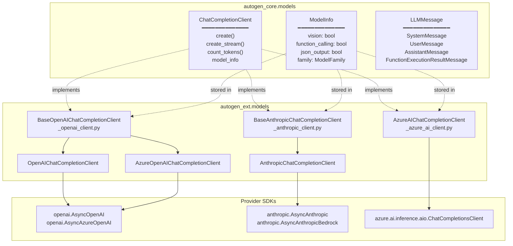
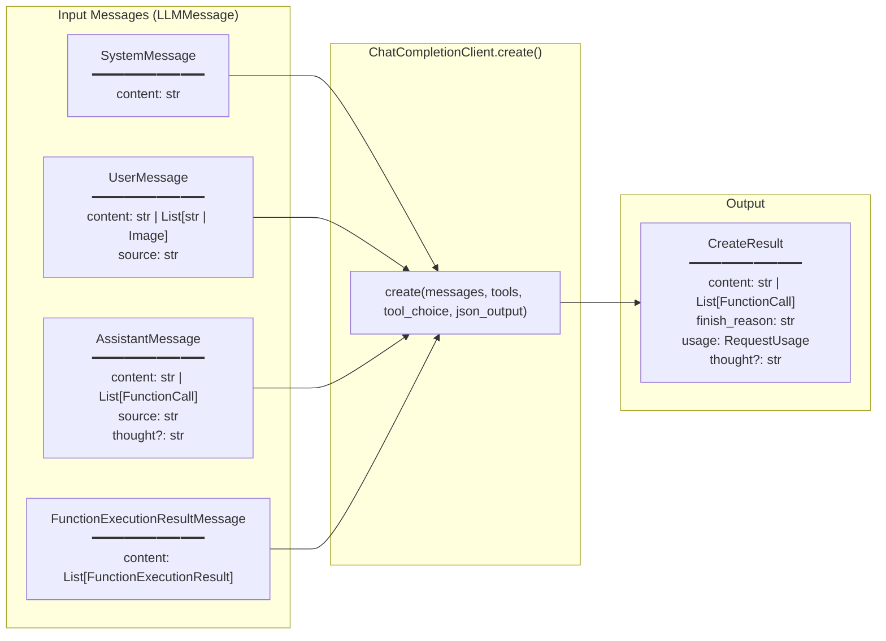
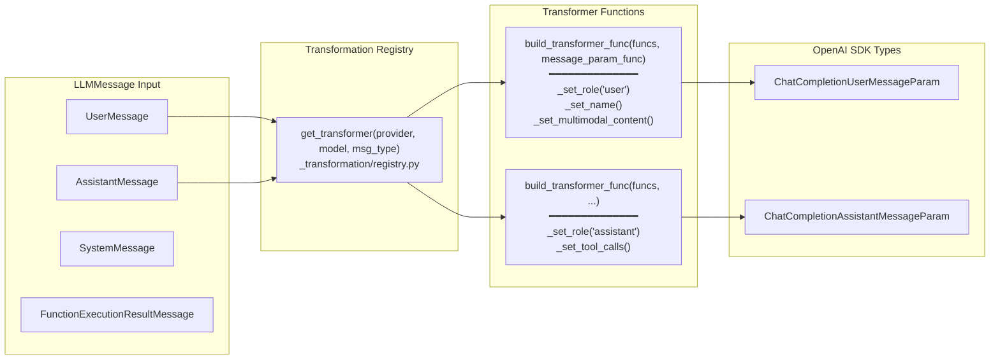

<!-- source: DeepWiki mcp.deepwiki.com · repo microsoft/autogen · page 5 Model Integrations · fetched 2026-10-27 -->

# Model Integrations

Relevant source files

The following files were used as context for generating this wiki page:

- [python/packages/autogen-core/src/autogen_core/models/_model_client.py](python/packages/autogen-core/src/autogen_core/models/_model_client.py)
- [python/packages/autogen-core/tests/test_tool_agent.py](python/packages/autogen-core/tests/test_tool_agent.py)
- [python/packages/autogen-ext/src/autogen_ext/auth/azure/__init__.py](python/packages/autogen-ext/src/autogen_ext/auth/azure/__init__.py)
- [python/packages/autogen-ext/src/autogen_ext/experimental/task_centric_memory/utils/chat_completion_client_recorder.py](python/packages/autogen-ext/src/autogen_ext/experimental/task_centric_memory/utils/chat_completion_client_recorder.py)
- [python/packages/autogen-ext/src/autogen_ext/models/anthropic/__init__.py](python/packages/autogen-ext/src/autogen_ext/models/anthropic/__init__.py)
- [python/packages/autogen-ext/src/autogen_ext/models/anthropic/_anthropic_client.py](python/packages/autogen-ext/src/autogen_ext/models/anthropic/_anthropic_client.py)
- [python/packages/autogen-ext/src/autogen_ext/models/anthropic/_model_info.py](python/packages/autogen-ext/src/autogen_ext/models/anthropic/_model_info.py)
- [python/packages/autogen-ext/src/autogen_ext/models/anthropic/config/__init__.py](python/packages/autogen-ext/src/autogen_ext/models/anthropic/config/__init__.py)
- [python/packages/autogen-ext/src/autogen_ext/models/azure/_azure_ai_client.py](python/packages/autogen-ext/src/autogen_ext/models/azure/_azure_ai_client.py)
- [python/packages/autogen-ext/src/autogen_ext/models/llama_cpp/_llama_cpp_completion_client.py](python/packages/autogen-ext/src/autogen_ext/models/llama_cpp/_llama_cpp_completion_client.py)
- [python/packages/autogen-ext/src/autogen_ext/models/openai/__init__.py](python/packages/autogen-ext/src/autogen_ext/models/openai/__init__.py)
- [python/packages/autogen-ext/src/autogen_ext/models/openai/_message_transform.py](python/packages/autogen-ext/src/autogen_ext/models/openai/_message_transform.py)
- [python/packages/autogen-ext/src/autogen_ext/models/openai/_model_info.py](python/packages/autogen-ext/src/autogen_ext/models/openai/_model_info.py)
- [python/packages/autogen-ext/src/autogen_ext/models/openai/_openai_client.py](python/packages/autogen-ext/src/autogen_ext/models/openai/_openai_client.py)
- [python/packages/autogen-ext/src/autogen_ext/models/openai/_transformation/__init__.py](python/packages/autogen-ext/src/autogen_ext/models/openai/_transformation/__init__.py)
- [python/packages/autogen-ext/src/autogen_ext/models/openai/_transformation/registry.py](python/packages/autogen-ext/src/autogen_ext/models/openai/_transformation/registry.py)
- [python/packages/autogen-ext/src/autogen_ext/models/openai/_transformation/types.py](python/packages/autogen-ext/src/autogen_ext/models/openai/_transformation/types.py)
- [python/packages/autogen-ext/src/autogen_ext/models/openai/_utils.py](python/packages/autogen-ext/src/autogen_ext/models/openai/_utils.py)
- [python/packages/autogen-ext/src/autogen_ext/models/openai/config/__init__.py](python/packages/autogen-ext/src/autogen_ext/models/openai/config/__init__.py)
- [python/packages/autogen-ext/src/autogen_ext/models/replay/_replay_chat_completion_client.py](python/packages/autogen-ext/src/autogen_ext/models/replay/_replay_chat_completion_client.py)
- [python/packages/autogen-ext/tests/models/test_anthropic_model_client.py](python/packages/autogen-ext/tests/models/test_anthropic_model_client.py)
- [python/packages/autogen-ext/tests/models/test_azure_ai_model_client.py](python/packages/autogen-ext/tests/models/test_azure_ai_model_client.py)
- [python/packages/autogen-ext/tests/models/test_openai_model_client.py](python/packages/autogen-ext/tests/models/test_openai_model_client.py)
- [python/packages/component-schema-gen/src/component_schema_gen/__main__.py](python/packages/component-schema-gen/src/component_schema_gen/__main__.py)
- [python/samples/agentchat_dspy/single_agent.py](python/samples/agentchat_dspy/single_agent.py)

This page documents how AutoGen integrates with different LLM providers through the `ChatCompletionClient` interface. All model providers implement this common interface defined in `autogen-core`, with provider-specific clients in `autogen-ext` handling API-specific message formats, authentication, and capabilities.

The integration system consists of:
- **Core Interface**: `ChatCompletionClient` protocol in [python/packages/autogen-core/src/autogen_core/models/_model_client.py:209-301]()
- **Provider Clients**: Implementations in `autogen-ext/models/` for OpenAI, Anthropic, Ollama, Azure AI, and Semantic Kernel
- **Message Types**: `LLMMessage` hierarchy (`SystemMessage`, `UserMessage`, `AssistantMessage`, `FunctionExecutionResultMessage`)
- **Capability System**: `ModelInfo` and `ModelFamily` for runtime feature detection

For detailed OpenAI/Azure OpenAI implementations, see [OpenAI and Azure OpenAI](#5.1). For other providers, see [Other Model Providers](#5.2).

## Architecture Overview

The model integration architecture has three layers:

1. **Core Protocol** (`autogen-core`): `ChatCompletionClient` abstract base class with `create()`, `create_stream()`, `count_tokens()`, and usage tracking methods.
2. **Provider Implementations** (`autogen-ext`): Concrete clients that wrap provider SDKs and implement message transformation.
3. **Provider SDKs**: Third-party libraries (`openai`, `anthropic`, `azure-ai-inference`, etc.) accessed through AutoGen clients.

**Model Integration Architecture**

**Sources:** [python/packages/autogen-core/src/autogen_core/models/_model_client.py:209-301](), [python/packages/autogen-ext/src/autogen_ext/models/openai/_openai_client.py:432-489](), [python/packages/autogen-ext/src/autogen_ext/models/anthropic/_anthropic_client.py:444-468](), [python/packages/autogen-ext/src/autogen_ext/models/azure/_azure_ai_client.py:181-200]()

## Core Interface and Message Types

The `ChatCompletionClient` protocol at [python/packages/autogen-core/src/autogen_core/models/_model_client.py:209-301]() defines required methods for all provider implementations.

**ChatCompletionClient Core Methods**

| Method | Signature | Purpose |
|--------|-----------|---------|
| `create()` | `async (messages, tools, json_output, ...) -> CreateResult` | Single completion request |
| `create_stream()` | `async (messages, tools, ...) -> AsyncGenerator[str \| CreateResult]` | Streaming completion |
| `count_tokens()` | `(messages, tools) -> int` | Token counting for messages |
| `remaining_tokens()` | `(messages, tools) -> int` | Available context window |
| `total_usage()` | `() -> RequestUsage` | Cumulative token usage |
| `actual_usage()` | `() -> RequestUsage` | Actual token usage from API |
| `model_info` | Property returning `ModelInfo` | Model capabilities |

**Message Type Flow**

**Sources:** [python/packages/autogen-core/src/autogen_core/models/_model_client.py:209-301](), [python/packages/autogen-core/src/autogen_core/models/_types.py:1-150]()

## Model Provider Implementations

AutoGen supports multiple model providers through dedicated client implementations. Each client handles provider-specific authentication, API formats, and capabilities while presenting a unified interface.

| Provider | Client Class | Key Features | Configuration |
|----------|--------------|-------------|---------------|
| OpenAI | `OpenAIChatCompletionClient` | Function calling, vision, structured output | `OpenAIClientConfiguration` |
| Azure OpenAI | `AzureOpenAIChatCompletionClient` | Same as OpenAI with Azure endpoints | `AzureOpenAIClientConfiguration` |
| Anthropic | `AnthropicChatCompletionClient` | Function calling, vision, thinking mode | `AnthropicClientConfiguration` |
| Azure AI | `AzureAIChatCompletionClient` | GitHub Models, Azure AI Foundry, R1 family | `AzureAIChatCompletionClientConfig` |
| Replay | `ReplayChatCompletionClient` | Testing and deterministic simulation | List of responses |

**Sources:** [python/packages/autogen-ext/src/autogen_ext/models/openai/_openai_client.py:419-801](), [python/packages/autogen-ext/src/autogen_ext/models/anthropic/_anthropic_client.py:444-800](), [python/packages/autogen-ext/src/autogen_ext/models/azure/_azure_ai_client.py:181-400](), [python/packages/autogen-ext/src/autogen_ext/models/replay/_replay_chat_completion_client.py:16-30]()

## Message Transformation Pipeline

Provider clients transform `LLMMessage` instances into SDK-specific formats. The OpenAI client uses a modular transformer pipeline at [python/packages/autogen-ext/src/autogen_ext/models/openai/_transformation/]() that can be extended for custom models. 

**OpenAI Transformer Pipeline Architecture**

**Transformation Functions**

The transformer pipeline uses mini-transformers at [python/packages/autogen-ext/src/autogen_ext/models/openai/_message_transform.py:186-300]():

| Function | Purpose |
|----------|---------|
| `_set_role(role)` | Sets the `role` field (e.g., "user", "assistant"). |
| `_set_name()` | Adds `name` field from `message.source` [python/packages/autogen-ext/src/autogen_ext/models/openai/_message_transform.py:200-208](). |
| `_set_content_direct()` | Copies `content` directly. |
| `_set_multimodal_content()` | Converts `List[str \| Image]` to OpenAI content parts [python/packages/autogen-ext/src/autogen_ext/models/openai/_message_transform.py:222-249](). |
| `_set_tool_calls()` | Converts `List[FunctionCall]` to OpenAI tool call format. |

For Anthropic/Azure, transformation is direct (e.g., `user_message_to_anthropic()` at [python/packages/autogen-ext/src/autogen_ext/models/anthropic/_anthropic_client.py:199-231]() or `_user_message_to_azure()` at [python/packages/autogen-ext/src/autogen_ext/models/azure/_azure_ai_client.py:116-131]()).

**Sources:** [python/packages/autogen-ext/src/autogen_ext/models/openai/_transformation/registry.py:16-70](), [python/packages/autogen-ext/src/autogen_ext/models/openai/_message_transform.py:186-300](), [python/packages/autogen-ext/src/autogen_ext/models/anthropic/_anthropic_client.py:199-317](), [python/packages/autogen-ext/src/autogen_ext/models/azure/_azure_ai_client.py:112-156]()

## Model Information and Capabilities

The `ModelInfo` TypedDict at [python/packages/autogen-core/src/autogen_core/models/_model_client.py:164-183]() describes model capabilities. Client implementations populate this from internal model databases (e.g., [python/packages/autogen-ext/src/autogen_ext/models/openai/_model_info.py:51-444]()) or accept custom values for unknown models.

**ModelInfo Structure**

| Field | Type | Purpose |
|-------|------|---------|
| `vision` | `bool` (required) | Whether model accepts image inputs. |
| `function_calling` | `bool` (required) | Whether model supports tool/function calls. |
| `json_output` | `bool` (required) | Whether model supports JSON mode. |
| `structured_output` | `bool` (required) | Whether model supports structured output (e.g., Pydantic models). |
| `family` | `ModelFamily.ANY \| str` (required) | Model family constant for family-specific logic. |

**Model Family Constants and Usage**

The `ModelFamily` class at [python/packages/autogen-core/src/autogen_core/models/_model_client.py:16-54]() provides constants for known families like `GPT_4O`, `O1`, `R1`, and `CLAUDE_3_5_SONNET`. These are used for logic branching, such as special handling for DeepSeek R1 reasoning tokens at [python/packages/autogen-ext/src/autogen_ext/models/openai/_openai_client.py:798-799]().

**Sources:** [python/packages/autogen-core/src/autogen_core/models/_model_client.py:164-207](), [python/packages/autogen-core/src/autogen_core/models/_model_client.py:16-155](), [python/packages/autogen-ext/src/autogen_ext/models/openai/_model_info.py:51-444](), [python/packages/autogen-ext/src/autogen_ext/models/anthropic/_model_info.py:8-150]()

## Common Integration Patterns

### Tool/Function Calling
Tool schemas are converted from AutoGen's `Tool` format to provider-specific formats:
- **OpenAI**: `convert_tools()` at [python/packages/autogen-ext/src/autogen_ext/models/openai/_openai_client.py:244-272]().
- **Anthropic**: `convert_tools()` at [python/packages/autogen-ext/src/autogen_ext/models/anthropic/_anthropic_client.py:319-360]().
- **Azure AI**: `convert_tools()` at [python/packages/autogen-ext/src/autogen_ext/models/azure/_azure_ai_client.py:77-103]().

### Token Counting
- **OpenAI**: Uses `tiktoken` and vision token calculation logic at [python/packages/autogen-ext/src/autogen_ext/models/openai/_openai_client.py:188-239]().
- **Anthropic**: Uses `tiktoken` as a proxy for token estimation.

### Streaming Support
All clients implement `create_stream()` yielding chunks. For OpenAI, this involves handling `ChatCompletionChunk` events [python/packages/autogen-ext/src/autogen_ext/models/openai/_openai_client.py:816-1048](). For Anthropic, it uses `AsyncStream` [python/packages/autogen-ext/src/autogen_ext/models/anthropic/_anthropic_client.py:678-868]().

### JSON and Structured Output
- **OpenAI**: Supports `response_format` with `json_schema` for strict adherence [python/packages/autogen-ext/src/autogen_ext/models/openai/config/__init__.py:9-24]().
- **Anthropic**: Supports `json_object` format [python/packages/autogen-ext/src/autogen_ext/models/anthropic/config/__init__.py:8-10]().

**Sources:** [python/packages/autogen-ext/src/autogen_ext/models/openai/_openai_client.py:244-297](), [python/packages/autogen-ext/src/autogen_ext/models/anthropic/_anthropic_client.py:319-360](), [python/packages/autogen-ext/src/autogen_ext/models/azure/_azure_ai_client.py:77-103](), [python/packages/autogen-ext/src/autogen_ext/models/openai/_openai_client.py:188-239]()

---

