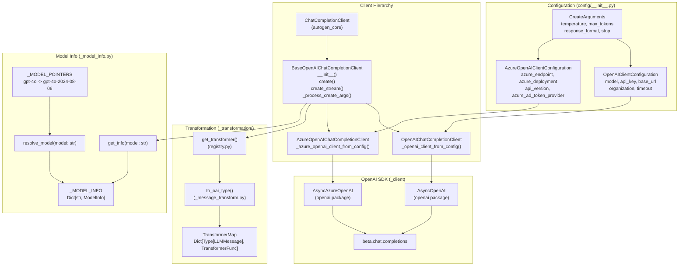
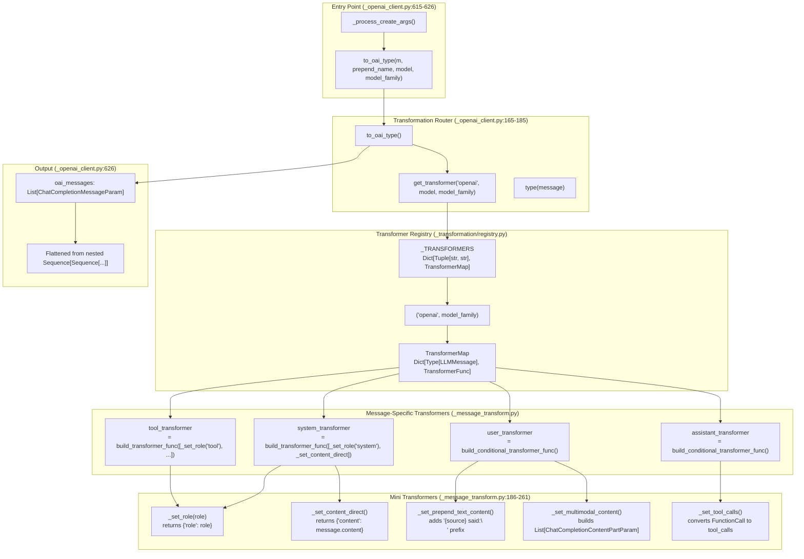
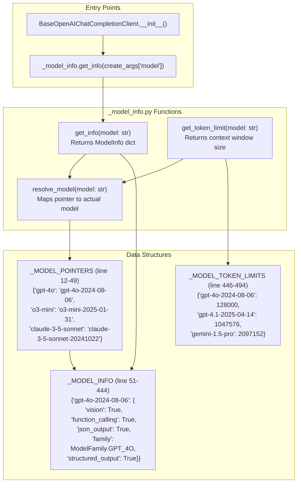
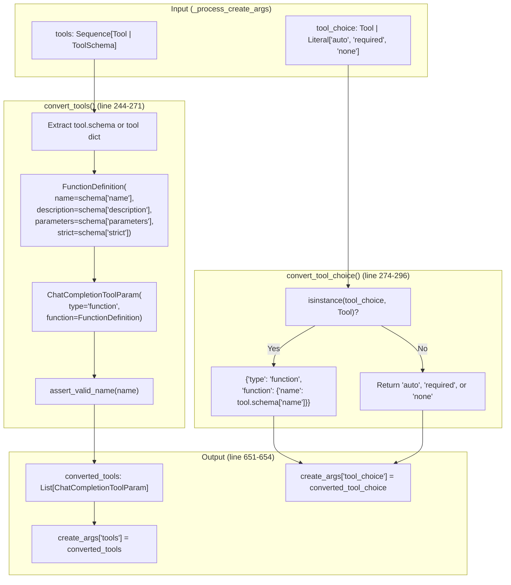

<!-- source: DeepWiki mcp.deepwiki.com · repo microsoft/autogen · page 5.1 OpenAI and Azure OpenAI · fetched 2026-10-27 -->

# OpenAI and Azure OpenAI

Relevant source files

The following files were used as context for generating this wiki page:

- [python/packages/autogen-core/src/autogen_core/_cache_store.py](python/packages/autogen-core/src/autogen_core/_cache_store.py)
- [python/packages/autogen-core/src/autogen_core/models/_model_client.py](python/packages/autogen-core/src/autogen_core/models/_model_client.py)
- [python/packages/autogen-core/tests/test_tool_agent.py](python/packages/autogen-core/tests/test_tool_agent.py)
- [python/packages/autogen-ext/src/autogen_ext/auth/azure/__init__.py](python/packages/autogen-ext/src/autogen_ext/auth/azure/__init__.py)
- [python/packages/autogen-ext/src/autogen_ext/cache_store/diskcache.py](python/packages/autogen-ext/src/autogen_ext/cache_store/diskcache.py)
- [python/packages/autogen-ext/src/autogen_ext/cache_store/redis.py](python/packages/autogen-ext/src/autogen_ext/cache_store/redis.py)
- [python/packages/autogen-ext/src/autogen_ext/experimental/task_centric_memory/utils/chat_completion_client_recorder.py](python/packages/autogen-ext/src/autogen_ext/experimental/task_centric_memory/utils/chat_completion_client_recorder.py)
- [python/packages/autogen-ext/src/autogen_ext/models/anthropic/_model_info.py](python/packages/autogen-ext/src/autogen_ext/models/anthropic/_model_info.py)
- [python/packages/autogen-ext/src/autogen_ext/models/cache/_chat_completion_cache.py](python/packages/autogen-ext/src/autogen_ext/models/cache/_chat_completion_cache.py)
- [python/packages/autogen-ext/src/autogen_ext/models/llama_cpp/_llama_cpp_completion_client.py](python/packages/autogen-ext/src/autogen_ext/models/llama_cpp/_llama_cpp_completion_client.py)
- [python/packages/autogen-ext/src/autogen_ext/models/openai/__init__.py](python/packages/autogen-ext/src/autogen_ext/models/openai/__init__.py)
- [python/packages/autogen-ext/src/autogen_ext/models/openai/_message_transform.py](python/packages/autogen-ext/src/autogen_ext/models/openai/_message_transform.py)
- [python/packages/autogen-ext/src/autogen_ext/models/openai/_model_info.py](python/packages/autogen-ext/src/autogen_ext/models/openai/_model_info.py)
- [python/packages/autogen-ext/src/autogen_ext/models/openai/_openai_client.py](python/packages/autogen-ext/src/autogen_ext/models/openai/_openai_client.py)
- [python/packages/autogen-ext/src/autogen_ext/models/openai/_transformation/__init__.py](python/packages/autogen-ext/src/autogen_ext/models/openai/_transformation/__init__.py)
- [python/packages/autogen-ext/src/autogen_ext/models/openai/_transformation/registry.py](python/packages/autogen-ext/src/autogen_ext/models/openai/_transformation/registry.py)
- [python/packages/autogen-ext/src/autogen_ext/models/openai/_transformation/types.py](python/packages/autogen-ext/src/autogen_ext/models/openai/_transformation/types.py)
- [python/packages/autogen-ext/src/autogen_ext/models/openai/_utils.py](python/packages/autogen-ext/src/autogen_ext/models/openai/_utils.py)
- [python/packages/autogen-ext/src/autogen_ext/models/openai/config/__init__.py](python/packages/autogen-ext/src/autogen_ext/models/openai/config/__init__.py)
- [python/packages/autogen-ext/src/autogen_ext/models/replay/_replay_chat_completion_client.py](python/packages/autogen-ext/src/autogen_ext/models/replay/_replay_chat_completion_client.py)
- [python/packages/autogen-ext/tests/cache_store/test_diskcache_store.py](python/packages/autogen-ext/tests/cache_store/test_diskcache_store.py)
- [python/packages/autogen-ext/tests/cache_store/test_redis_store.py](python/packages/autogen-ext/tests/cache_store/test_redis_store.py)
- [python/packages/autogen-ext/tests/models/test_chat_completion_cache.py](python/packages/autogen-ext/tests/models/test_chat_completion_cache.py)
- [python/packages/autogen-ext/tests/models/test_openai_model_client.py](python/packages/autogen-ext/tests/models/test_openai_model_client.py)
- [python/packages/component-schema-gen/src/component_schema_gen/__main__.py](python/packages/component-schema-gen/src/component_schema_gen/__main__.py)
- [python/samples/agentchat_dspy/single_agent.py](python/samples/agentchat_dspy/single_agent.py)

This document covers the OpenAI and Azure OpenAI model client implementations in AutoGen, including message transformation, tool calling, and advanced features like vision and structured output. These implementations provide the primary interface for working with OpenAI's GPT models and Azure OpenAI services within the AutoGen framework.

For information about other model providers, see [Other Model Providers](#5.2). For the foundational model client system, see [Model Client System](#2.2).

## Architecture Overview

The OpenAI integration consists of several key components that work together to provide a comprehensive interface to OpenAI and Azure OpenAI services.

### Core Client Architecture

OpenAI and Azure OpenAI Integration Architecture

**Sources:** [python/packages/autogen-ext/src/autogen_ext/models/openai/_openai_client.py:432-488](), [python/packages/autogen-ext/src/autogen_ext/models/openai/config/__init__.py:65-138](), [python/packages/autogen-ext/src/autogen_ext/models/openai/_model_info.py:12-49](), [python/packages/autogen-ext/src/autogen_ext/models/openai/_transformation/registry.py:11-38]()

## Client Implementations

### BaseOpenAIChatCompletionClient

The `BaseOpenAIChatCompletionClient` class at [python/packages/autogen-ext/src/autogen_ext/models/openai/_openai_client.py:432]() provides the core functionality shared between OpenAI and Azure OpenAI implementations.

**Instance Variables:**

| Variable | Type | Responsibility |
|----------|------|---------------|
| `_client` | `AsyncOpenAI` or `AsyncAzureOpenAI` | SDK client instance for API calls |
| `_create_args` | `Dict[str, Any]` | Model parameters (temperature, max_tokens, etc.) from config |
| `_model_info` | `ModelInfo` | Model capabilities from `_model_info.get_info()` |
| `_total_usage` | `RequestUsage` | Cumulative prompt and completion tokens |
| `_actual_usage` | `RequestUsage` | Actual usage from API responses |
| `_add_name_prefixes` | `bool` | Whether to prepend `"{source} said:\n"` to messages |
| `_include_name_in_message` | `bool` | Whether to include `name` field in message params |
| `_resolved_model` | `Optional[str]` | Resolved model name via `_model_info.resolve_model()` |

**Key Methods:**

| Method | Purpose | Key Logic |
|--------|---------|-----------|
| `__init__()` | Initialize client | Validates `model_info`, calls `_model_info.get_info()` if not provided |
| `create()` | Synchronous completion | Calls `_client.chat.completions.create()` or `_client.beta.chat.completions.parse()` |
| `create_stream()` | Streaming completion | Yields string chunks, final `CreateResult` with aggregated content |
| `_process_create_args()` | Request preparation | Merges `_create_args` with `extra_create_args`, validates tools, converts messages |
| `count_tokens()` | Token estimation | Uses `tiktoken.encoding_for_model()`, calls `count_tokens_openai()` |

**Sources:** [python/packages/autogen-ext/src/autogen_ext/models/openai/_openai_client.py:432-488](), [python/packages/autogen-ext/src/autogen_ext/models/openai/_openai_client.py:501-661](), [python/packages/autogen-ext/src/autogen_ext/models/openai/_openai_client.py:663-814](), [python/packages/autogen-ext/src/autogen_ext/models/openai/_openai_client.py:816-915]()

### OpenAIChatCompletionClient

The `OpenAIChatCompletionClient` at [python/packages/autogen-ext/src/autogen_ext/models/openai/_openai_client.py:1074]() provides direct integration with OpenAI's API.

**Configuration Parameters:**

| Parameter | Type | Default | Description |
|-----------|------|---------|-------------|
| `model` | `str` | Required | Model name (e.g., "gpt-4o", "gpt-4o-mini") |
| `api_key` | `str` | `None` | OpenAI API key (or from `OPENAI_API_KEY` env var) |
| `base_url` | `str` | `None` | Custom API endpoint (default: OpenAI API) |
| `organization` | `str` | `None` | OpenAI organization ID |
| `timeout` | `float` | `None` | Request timeout in seconds |
| `max_retries` | `int` | `None` | Maximum number of retries |

**Initialization Process:**

1. Calls `_openai_client_from_config()` to create `AsyncOpenAI` instance [python/packages/autogen-ext/src/autogen_ext/models/openai/_openai_client.py:131-134]().
2. Filters kwargs using `openai_init_kwargs` set [python/packages/autogen-ext/src/autogen_ext/models/openai/_openai_client.py:93]().
3. Calls `_create_args_from_config()` to extract model parameters [python/packages/autogen-ext/src/autogen_ext/models/openai/_openai_client.py:137-144]().
4. Passes client and args to `BaseOpenAIChatCompletionClient.__init__()`.

**Sources:** [python/packages/autogen-ext/src/autogen_ext/models/openai/_openai_client.py:1074-1108](), [python/packages/autogen-ext/src/autogen_ext/models/openai/_openai_client.py:131-134](), [python/packages/autogen-ext/src/autogen_ext/models/openai/_openai_client.py:137-144]()

### AzureOpenAIChatCompletionClient

The `AzureOpenAIChatCompletionClient` at [python/packages/autogen-ext/src/autogen_ext/models/openai/_openai_client.py:1110]() integrates with Azure OpenAI services.

**Azure-Specific Configuration:**

| Parameter | Type | Required | Description |
|-----------|------|----------|-------------|
| `azure_endpoint` | `str` | ✅ | Azure OpenAI resource endpoint |
| `azure_deployment` | `str` | ❌ | Deployment name (can differ from model name) |
| `api_version` | `str` | ✅ | Azure OpenAI API version (e.g., "2024-02-01") |
| `api_key` | `str` | ❌* | API key (*or use `azure_ad_token_provider`) |
| `azure_ad_token_provider` | `Callable` | ❌ | Azure AD token provider for managed identity |

**User-Agent Header:**

The Azure client automatically sets a custom User-Agent header via `_azure_openai_client_from_config()` [python/packages/autogen-ext/src/autogen_ext/models/openai/_openai_client.py:112-128]():
- Format: `"autogen-python/{version_info}"`
- Appended to existing User-Agent if present.
- Added to `default_headers` dict [python/packages/autogen-ext/src/autogen_ext/models/openai/_openai_client.py:118-126]().

**Initialization Process:**

1. Calls `_azure_openai_client_from_config()` to create `AsyncAzureOpenAI` instance.
2. Filters kwargs using `aopenai_init_kwargs` set [python/packages/autogen-ext/src/autogen_ext/models/openai/_openai_client.py:94]().
3. Injects User-Agent header into `default_headers`.
4. Calls parent `BaseOpenAIChatCompletionClient.__init__()`.

**Sources:** [python/packages/autogen-ext/src/autogen_ext/models/openai/_openai_client.py:1110-1174](), [python/packages/autogen-ext/src/autogen_ext/models/openai/_openai_client.py:112-128](), [python/packages/autogen-ext/tests/models/test_openai_model_client.py:235-251]()

## Message Transformation System

The OpenAI integration uses a sophisticated message transformation pipeline to convert AutoGen's `LLMMessage` instances into OpenAI-compatible message formats.

### Transformation Pipeline

Message Transformation Flow in _openai_client.py and _message_transform.py

**Sources:** [python/packages/autogen-ext/src/autogen_ext/models/openai/_openai_client.py:165-185](), [python/packages/autogen-ext/src/autogen_ext/models/openai/_openai_client.py:615-626](), [python/packages/autogen-ext/src/autogen_ext/models/openai/_message_transform.py:136-169](), [python/packages/autogen-ext/src/autogen_ext/models/openai/_transformation/registry.py:11-72]()

### Message Type Handling

The transformation system handles different message types with specific logic [python/packages/autogen-ext/src/autogen_ext/models/openai/_message_transform.py:186-261]():

| Message Type | Transformer Functions | Output Format |
|-------------|----------------------|---------------|
| `SystemMessage` | `_set_role("system")`, `_set_content_direct()` | `ChatCompletionSystemMessageParam` |
| `UserMessage` (text) | `_set_role("user")`, `_set_prepend_text_content()` | `ChatCompletionUserMessageParam` |
| `UserMessage` (multimodal) | `_set_role("user")`, `_set_multimodal_content()` | `ChatCompletionUserMessageParam` with content parts |
| `AssistantMessage` (text) | `_set_role("assistant")`, `_set_content_direct()` | `ChatCompletionAssistantMessageParam` |
| `AssistantMessage` (tool calls) | `_set_role("assistant")`, `_set_tool_calls()` | `ChatCompletionAssistantMessageParam` with tool_calls |
| `FunctionExecutionResultMessage` | `_set_role("tool")`, etc. | `ChatCompletionToolMessageParam[]` |

**Sources:** [python/packages/autogen-ext/src/autogen_ext/models/openai/_message_transform.py:186-261](), [python/packages/autogen-ext/src/autogen_ext/models/openai/_message_transform.py:309-425]()

## Model Information and Capabilities

### Model Registry

The `_model_info.py` module at [python/packages/autogen-ext/src/autogen_ext/models/openai/_model_info.py]() maintains model metadata for OpenAI and compatible models.

Model Information Resolution Flow

**Model Pointer Examples:**
The `_MODEL_POINTERS` dict maps user-friendly names to specific versions [python/packages/autogen-ext/src/autogen_ext/models/openai/_model_info.py:12-49]():
- `"gpt-4o"` → `"gpt-4o-2024-08-06"`
- `"o3-mini"` → `"o3-mini-2025-01-31"`
- `"gpt-4.1"` → `"gpt-4.1-2025-04-14"`

**Sources:** [python/packages/autogen-ext/src/autogen_ext/models/openai/_model_info.py:12-49](), [python/packages/autogen-ext/src/autogen_ext/models/openai/_model_info.py:51-444](), [python/packages/autogen-ext/src/autogen_ext/models/openai/_model_info.py:446-494](), [python/packages/autogen-ext/src/autogen_ext/models/openai/_model_info.py:501-530]()

### Model Capabilities Matrix

| Model Family | Vision | Function Calling | JSON Output | Structured Output | Multiple System Messages |
|-------------|--------|------------------|-------------|-------------------|--------------------------|
| GPT-4o | ✅ | ✅ | ✅ | ✅ | ✅ |
| GPT-4.1 | ✅ | ✅ | ✅ | ✅ | ✅ |
| O1 | ❌ | ✅ | ❌ | ✅ | ✅ |
| O3 | ✅ | ✅ | ✅ | ✅ | ✅ |

**Sources:** [python/packages/autogen-ext/src/autogen_ext/models/openai/_model_info.py:172-202](), [python/packages/autogen-ext/src/autogen_ext/models/openai/_model_info.py:68-91]()

## Tool Calling and Function Execution

### Tool Conversion

The OpenAI client converts AutoGen tools to OpenAI's function calling format.

Tool Conversion Flow

**Tool Schema Transformation:**
- `name` → `function.name` (validated via `assert_valid_name()` [python/packages/autogen-ext/src/autogen_ext/models/openai/_openai_client.py:82]())
- `parameters` → `function.parameters` (cast to `FunctionParameters` [python/packages/autogen-ext/src/autogen_ext/models/openai/_openai_client.py:257]())
- `strict` → `function.strict` [python/packages/autogen-ext/src/autogen_ext/models/openai/_openai_client.py:260]()

**Sources:** [python/packages/autogen-ext/src/autogen_ext/models/openai/_openai_client.py:244-271](), [python/packages/autogen-ext/src/autogen_ext/models/openai/_openai_client.py:274-296](), [python/packages/autogen-ext/src/autogen_ext/models/openai/_openai_client.py:631-654]()

## Advanced Features

### Streaming Support

The `create_stream()` method [python/packages/autogen-ext/src/autogen_ext/models/openai/_openai_client.py:816]() provides streaming responses.

**Usage Tracking:**
OpenAI does not return usage by default in streaming. To enable, use `include_usage=True` or `stream_options` in `extra_create_args` [python/packages/autogen-ext/src/autogen_ext/models/openai/config/__init__.py:35-37]().

**Sources:** [python/packages/autogen-ext/src/autogen_ext/models/openai/_openai_client.py:816-1015](), [python/packages/autogen-ext/tests/models/test_openai_model_client.py:266-324]()

### Vision Support

For models with `vision=True`, the client processes image content. `calculate_vision_tokens()` [python/packages/autogen-ext/src/autogen_ext/models/openai/_openai_client.py:188]() estimates token counts based on image dimensions and detail level (`low` vs `auto`).

**Sources:** [python/packages/autogen-ext/src/autogen_ext/models/openai/_openai_client.py:188-234](), [python/packages/autogen-ext/src/autogen_ext/models/openai/_message_transform.py:222-240]()

### Structured Output

Supports JSON mode (`json_output=True`) and structured output via Pydantic models using the OpenAI beta `parse` API [python/packages/autogen-ext/src/autogen_ext/models/openai/_openai_client.py:526-546]().

### Reasoning Models (o1, o3, R1)

Special handling for reasoning models includes:
- `reasoning_effort` parameter [python/packages/autogen-ext/src/autogen_ext/models/openai/config/__init__.py:53-59]().
- Automatic extraction of reasoning content (thought field) [python/packages/autogen-ext/src/autogen_ext/models/openai/_openai_client.py:784-786]().

### Caching

The `ChatCompletionCache` wrapper [python/packages/autogen-ext/src/autogen_ext/models/cache/_chat_completion_cache.py:29]() provides persistence for model responses using backends like `RedisStore` [python/packages/autogen-ext/src/autogen_ext/cache_store/redis.py:25]().

**Sources:** [python/packages/autogen-ext/src/autogen_ext/models/cache/_chat_completion_cache.py:29-162](), [python/packages/autogen-ext/src/autogen_ext/cache_store/redis.py:25-155]()

---

