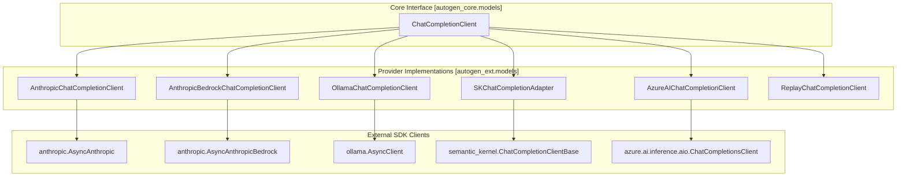
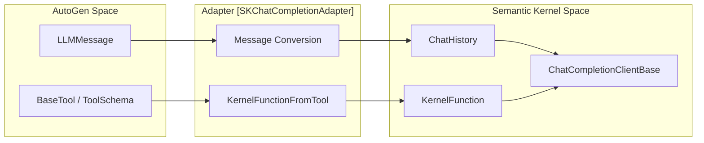

<!-- source: DeepWiki mcp.deepwiki.com · repo microsoft/autogen · page 5.2 Other Model Providers · fetched 2026-10-27 -->

# Other Model Providers

Relevant source files

The following files were used as context for generating this wiki page:

- [dotnet/test/AutoGen.AzureAIInference.Tests/ChatCompletionClientAgentTests.cs](dotnet/test/AutoGen.AzureAIInference.Tests/ChatCompletionClientAgentTests.cs)
- [dotnet/test/AutoGen.AzureAIInference.Tests/ChatRequestMessageTests.cs](dotnet/test/AutoGen.AzureAIInference.Tests/ChatRequestMessageTests.cs)
- [dotnet/test/AutoGen.Tests/Orchestrator/RolePlayOrchestratorTests.cs](dotnet/test/AutoGen.Tests/Orchestrator/RolePlayOrchestratorTests.cs)
- [python/docs/src/user-guide/agentchat-user-guide/tutorial/models.ipynb](python/docs/src/user-guide/agentchat-user-guide/tutorial/models.ipynb)
- [python/packages/autogen-ext/src/autogen_ext/models/__init__.py](python/packages/autogen-ext/src/autogen_ext/models/__init__.py)
- [python/packages/autogen-ext/src/autogen_ext/models/anthropic/__init__.py](python/packages/autogen-ext/src/autogen_ext/models/anthropic/__init__.py)
- [python/packages/autogen-ext/src/autogen_ext/models/anthropic/_anthropic_client.py](python/packages/autogen-ext/src/autogen_ext/models/anthropic/_anthropic_client.py)
- [python/packages/autogen-ext/src/autogen_ext/models/anthropic/config/__init__.py](python/packages/autogen-ext/src/autogen_ext/models/anthropic/config/__init__.py)
- [python/packages/autogen-ext/src/autogen_ext/models/azure/__init__.py](python/packages/autogen-ext/src/autogen_ext/models/azure/__init__.py)
- [python/packages/autogen-ext/src/autogen_ext/models/azure/_azure_ai_client.py](python/packages/autogen-ext/src/autogen_ext/models/azure/_azure_ai_client.py)
- [python/packages/autogen-ext/src/autogen_ext/models/azure/config/__init__.py](python/packages/autogen-ext/src/autogen_ext/models/azure/config/__init__.py)
- [python/packages/autogen-ext/src/autogen_ext/models/ollama/__init__.py](python/packages/autogen-ext/src/autogen_ext/models/ollama/__init__.py)
- [python/packages/autogen-ext/src/autogen_ext/models/ollama/_model_info.py](python/packages/autogen-ext/src/autogen_ext/models/ollama/_model_info.py)
- [python/packages/autogen-ext/src/autogen_ext/models/ollama/_ollama_client.py](python/packages/autogen-ext/src/autogen_ext/models/ollama/_ollama_client.py)
- [python/packages/autogen-ext/src/autogen_ext/models/ollama/config/__init__.py](python/packages/autogen-ext/src/autogen_ext/models/ollama/config/__init__.py)
- [python/packages/autogen-ext/src/autogen_ext/models/semantic_kernel/__init__.py](python/packages/autogen-ext/src/autogen_ext/models/semantic_kernel/__init__.py)
- [python/packages/autogen-ext/src/autogen_ext/models/semantic_kernel/_sk_chat_completion_adapter.py](python/packages/autogen-ext/src/autogen_ext/models/semantic_kernel/_sk_chat_completion_adapter.py)
- [python/packages/autogen-ext/src/autogen_ext/tools/semantic_kernel/__init__.py](python/packages/autogen-ext/src/autogen_ext/tools/semantic_kernel/__init__.py)
- [python/packages/autogen-ext/src/autogen_ext/tools/semantic_kernel/_kernel_function_from_tool.py](python/packages/autogen-ext/src/autogen_ext/tools/semantic_kernel/_kernel_function_from_tool.py)
- [python/packages/autogen-ext/tests/models/test_anthropic_model_client.py](python/packages/autogen-ext/tests/models/test_anthropic_model_client.py)
- [python/packages/autogen-ext/tests/models/test_azure_ai_model_client.py](python/packages/autogen-ext/tests/models/test_azure_ai_model_client.py)
- [python/packages/autogen-ext/tests/models/test_ollama_chat_completion_client.py](python/packages/autogen-ext/tests/models/test_ollama_chat_completion_client.py)
- [python/packages/autogen-ext/tests/models/test_reply_chat_completion_client.py](python/packages/autogen-ext/tests/models/test_reply_chat_completion_client.py)
- [python/packages/autogen-ext/tests/models/test_sk_chat_completion_adapter.py](python/packages/autogen-ext/tests/models/test_sk_chat_completion_adapter.py)

This document covers AutoGen's integrations with model providers beyond OpenAI and Azure OpenAI. It details the implementation of chat completion clients for Anthropic (including Bedrock and Thinking mode), Ollama, Semantic Kernel, Azure AI Foundry (including R1 thought extraction), and specialized clients for testing.

For OpenAI and Azure OpenAI integrations, see [OpenAI and Azure OpenAI](#5.1). For the core model client abstractions that all providers implement, see [Model Client System](#2.2).

## Provider Architecture Overview

AutoGen's model provider system is built around the `ChatCompletionClient` abstract base class. Each provider implementation handles message transformation, tool schema conversion, and specific API communication logic.

**System Architecture and Code Entity Mapping:**

**Sources:** [python/packages/autogen-ext/src/autogen_ext/models/anthropic/_anthropic_client.py:444](), [python/packages/autogen-ext/src/autogen_ext/models/ollama/_ollama_client.py:458](), [python/packages/autogen-ext/src/autogen_ext/models/semantic_kernel/_sk_chat_completion_adapter.py:55](), [python/packages/autogen-ext/src/autogen_ext/models/azure/_azure_ai_client.py:181]()

## Anthropic Integration

The Anthropic integration supports Claude models via the direct Anthropic API and AWS Bedrock. It includes advanced features like "Thinking" mode (Reasoning) and automated message normalization to comply with Anthropic's strict API requirements.

### Thinking Mode and Configuration
Anthropic's "thinking" mode allows models to output internal reasoning. This is configured via `ThinkingConfig` within the client configuration [python/packages/autogen-ext/src/autogen_ext/models/anthropic/config/__init__.py:12-17]().
- **Budget Tokens**: Required when thinking is enabled to limit reasoning length [python/packages/autogen-ext/src/autogen_ext/models/anthropic/config/__init__.py:72]().
- **Create Arguments**: Handled by `_create_args_from_config` to filter valid parameters like `top_k` and `stop_sequences` [python/packages/autogen-ext/src/autogen_ext/models/anthropic/_anthropic_client.py:107-117]().

### Message Transformation and Normalization
Anthropic has strict rules regarding message sequences (e.g., no empty content, specific role alternating).
- **Empty Content**: Handled by `__empty_content_to_whitespace`, which converts empty strings to a single space to prevent API errors [python/packages/autogen-ext/src/autogen_ext/models/anthropic/_anthropic_client.py:186-196]().
- **System Messages**: Anthropic treats system messages as a top-level parameter rather than a message in the history [python/packages/autogen-ext/src/autogen_ext/models/anthropic/_anthropic_client.py:233-234]().
- **Image Handling**: `get_mime_type_from_image` detects signatures for JPEG, PNG, GIF, and WEBP to provide the correct media type to the API [python/packages/autogen-ext/src/autogen_ext/models/anthropic/_anthropic_client.py:131-150]().

**Sources:** [python/packages/autogen-ext/src/autogen_ext/models/anthropic/_anthropic_client.py:12-150](), [python/packages/autogen-ext/src/autogen_ext/models/anthropic/config/__init__.py:12-84]()

## Azure AI Foundry and GitHub Models

The `AzureAIChatCompletionClient` supports models hosted on Azure AI Foundry or GitHub Models. It specifically includes logic for handling the DeepSeek R1 family and extracting thought process blocks.

### R1 Thought Extraction
When using models like DeepSeek-R1, the client utilizes `parse_r1_content` to separate the reasoning/thought blocks from the final answer [python/packages/autogen-ext/src/autogen_ext/models/azure/_azure_ai_client.py:65]().

### Tool Conversion
AutoGen tools are converted to Azure AI Inference format using `convert_tools`, which maps `ToolSchema` to `ChatCompletionsToolDefinition` and strips incompatible fields like `title` from parameter schemas [python/packages/autogen-ext/src/autogen_ext/models/azure/_azure_ai_client.py:77-102]().

**Sources:** [python/packages/autogen-ext/src/autogen_ext/models/azure/_azure_ai_client.py:77-181](), [python/packages/autogen-ext/tests/models/test_azure_ai_model_client.py:85-110]()

## Ollama (Local Inference)

The Ollama client enables the use of local GGUF models. It manages the connection to a local Ollama server and maps AutoGen's standard messages to Ollama's `Message` types.

### Configuration and Options
- **Host**: Configurable via the `host` parameter (defaulting to local Ollama defaults) [python/packages/autogen-ext/src/autogen_ext/models/ollama/_ollama_client.py:62]().
- **LLM Control Parameters**: Parameters like `repeat_penalty`, `mirostat`, and `num_ctx` are moved into the `options` dictionary required by the Ollama API [python/packages/autogen-ext/src/autogen_ext/models/ollama/_ollama_client.py:81-141]().

### Model Capabilities
Ollama model capabilities (vision, function calling) are predefined for common models like `llama3.1`, `phi4`, and `deepseek-r1` in `_model_info.py` [python/packages/autogen-ext/src/autogen_ext/models/ollama/_model_info.py:8-250]().

**Sources:** [python/packages/autogen-ext/src/autogen_ext/models/ollama/_ollama_client.py:81-458](), [python/packages/autogen-ext/src/autogen_ext/models/ollama/_model_info.py:8-250]()

## Semantic Kernel Adapter

The `SKChatCompletionAdapter` allows any Semantic Kernel connector (Google Gemini, Mistral, Hugging Face, etc.) to be used as an AutoGen `ChatCompletionClient`.

### Tool and Function Bridging
The adapter bridges the two ecosystems by:
1. Converting AutoGen `BaseTool` objects into Semantic Kernel `KernelFunction` objects using `KernelFunctionFromTool` [python/packages/autogen-ext/src/autogen_ext/tools/semantic_kernel/_kernel_function_from_tool.py:16-17]().
2. Mapping Pydantic model fields to `KernelParameterMetadata` to maintain type safety across the bridge [python/packages/autogen-ext/src/autogen_ext/tools/semantic_kernel/_kernel_function_from_tool.py:32-49]().

**Data Flow in SK Adapter:**

**Sources:** [python/packages/autogen-ext/src/autogen_ext/models/semantic_kernel/_sk_chat_completion_adapter.py:55-154](), [python/packages/autogen-ext/src/autogen_ext/tools/semantic_kernel/_kernel_function_from_tool.py:16-70]()

## Testing and Development Clients

### ReplayChatCompletionClient
Used for deterministic testing, the `ReplayChatCompletionClient` allows developers to provide a list of predefined `CreateResult` objects that are returned in sequence, bypassing actual LLM calls.

### LlamaCpp
Support for LlamaCpp (GGUF) is provided through integrations that implement the standard `ChatCompletionClient` interface, allowing high-performance local inference on consumer hardware.

**Sources:** [python/packages/autogen-ext/tests/models/test_reply_chat_completion_client.py:1-50](), [python/packages/autogen-ext/src/autogen_ext/models/ollama/_ollama_client.py:458]()

---

