<!-- source: DeepWiki mcp.deepwiki.com · repo microsoft/autogen · page 6.1 Code Execution · fetched 2026-10-27 -->

# Code Execution

Relevant source files

The following files were used as context for generating this wiki page:

- [python/docs/src/user-guide/agentchat-user-guide/magentic-one.md](python/docs/src/user-guide/agentchat-user-guide/magentic-one.md)
- [python/packages/autogen-agentchat/src/autogen_agentchat/agents/__init__.py](python/packages/autogen-agentchat/src/autogen_agentchat/agents/__init__.py)
- [python/packages/autogen-agentchat/src/autogen_agentchat/agents/_code_executor_agent.py](python/packages/autogen-agentchat/src/autogen_agentchat/agents/_code_executor_agent.py)
- [python/packages/autogen-agentchat/src/autogen_agentchat/teams/__init__.py](python/packages/autogen-agentchat/src/autogen_agentchat/teams/__init__.py)
- [python/packages/autogen-agentchat/tests/test_code_executor_agent.py](python/packages/autogen-agentchat/tests/test_code_executor_agent.py)
- [python/packages/autogen-ext/src/autogen_ext/agents/magentic_one/_magentic_one_coder_agent.py](python/packages/autogen-ext/src/autogen_ext/agents/magentic_one/_magentic_one_coder_agent.py)
- [python/packages/autogen-ext/src/autogen_ext/code_executors/__init__.py](python/packages/autogen-ext/src/autogen_ext/code_executors/__init__.py)
- [python/packages/autogen-ext/src/autogen_ext/code_executors/azure/_azure_container_code_executor.py](python/packages/autogen-ext/src/autogen_ext/code_executors/azure/_azure_container_code_executor.py)
- [python/packages/autogen-ext/src/autogen_ext/code_executors/docker/_docker_code_executor.py](python/packages/autogen-ext/src/autogen_ext/code_executors/docker/_docker_code_executor.py)
- [python/packages/autogen-ext/src/autogen_ext/code_executors/docker_jupyter/_docker_jupyter.py](python/packages/autogen-ext/src/autogen_ext/code_executors/docker_jupyter/_docker_jupyter.py)
- [python/packages/autogen-ext/src/autogen_ext/code_executors/jupyter/_jupyter_code_executor.py](python/packages/autogen-ext/src/autogen_ext/code_executors/jupyter/_jupyter_code_executor.py)
- [python/packages/autogen-ext/src/autogen_ext/code_executors/local/__init__.py](python/packages/autogen-ext/src/autogen_ext/code_executors/local/__init__.py)
- [python/packages/autogen-ext/src/autogen_ext/teams/magentic_one.py](python/packages/autogen-ext/src/autogen_ext/teams/magentic_one.py)
- [python/packages/autogen-ext/tests/code_executors/test_aca_dynamic_sessions.py](python/packages/autogen-ext/tests/code_executors/test_aca_dynamic_sessions.py)
- [python/packages/autogen-ext/tests/code_executors/test_aca_user_defined_functions.py](python/packages/autogen-ext/tests/code_executors/test_aca_user_defined_functions.py)
- [python/packages/autogen-ext/tests/code_executors/test_commandline_code_executor.py](python/packages/autogen-ext/tests/code_executors/test_commandline_code_executor.py)
- [python/packages/autogen-ext/tests/code_executors/test_docker_commandline_code_executor.py](python/packages/autogen-ext/tests/code_executors/test_docker_commandline_code_executor.py)
- [python/packages/autogen-ext/tests/code_executors/test_jupyter_code_executor.py](python/packages/autogen-ext/tests/code_executors/test_jupyter_code_executor.py)
- [python/packages/autogen-ext/tests/code_executors/test_user_defined_functions.py](python/packages/autogen-ext/tests/code_executors/test_user_defined_functions.py)
- [python/packages/autogen-ext/tests/teams/__init__.py](python/packages/autogen-ext/tests/teams/__init__.py)
- [python/packages/autogen-ext/tests/teams/test_magentic_one.py](python/packages/autogen-ext/tests/teams/test_magentic_one.py)

The AutoGen code execution system provides multiple `CodeExecutor` implementations for running code in different environments. Each implementation supports isolated execution of Python and shell scripts with configurable timeouts, working directories, and security controls. The framework includes local subprocess execution, Docker containerization, Azure cloud execution, and Jupyter kernel-based execution.

This page documents the primary `CodeExecutor` implementations and their configuration options. For tool integration patterns, see [MCP Integration](6.2). For agent-specific usage, see [Specialized Agents](3.2).

## Executor Overview

AutoGen provides five `CodeExecutor` implementations with different execution environments and isolation levels:

| Executor | Environment | Languages | Key Features |
|----------|-------------|-----------|--------------|
| `LocalCommandLineCodeExecutor` | Local subprocess | Python, bash, sh, pwsh, powershell, ps1 | Virtual environment support, fastest execution |
| `DockerCommandLineCodeExecutor` | Docker container | Python, bash, sh, pwsh, powershell, ps1 | Complete isolation, GPU support |
| `ACADynamicSessionsCodeExecutor` | Azure Container Apps | Python only | Serverless, managed packages |
| `JupyterCodeExecutor` | Local Jupyter kernel | Python only | Stateful execution via nbclient, rich outputs |
| `DockerJupyterCodeExecutor` | Docker Jupyter server | Python only | Stateful execution, Docker isolation, websocket protocol |

Sources: [python/packages/autogen-ext/src/autogen_ext/code_executors/local/__init__.py:130-138](), [python/packages/autogen-ext/src/autogen_ext/code_executors/docker/_docker_code_executor.py:142-150](), [python/packages/autogen-ext/src/autogen_ext/code_executors/azure/_azure_container_code_executor.py:82-84](), [python/packages/autogen-ext/src/autogen_ext/code_executors/jupyter/_jupyter_code_executor.py:48-135](), [python/packages/autogen-ext/src/autogen_ext/code_executors/docker_jupyter/_docker_jupyter.py:41-153]()

## Core Interface

All code executors implement the `CodeExecutor` abstract base class from `autogen_core.code_executor`.

### CodeExecutor Base Class

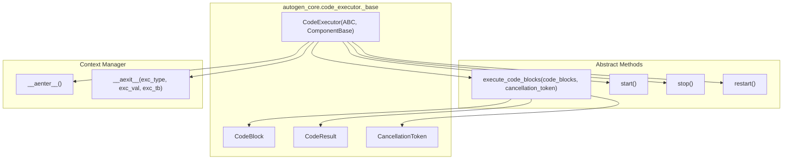

**CodeExecutor Interface**
Sources: [python/packages/autogen-core/src/autogen_core/code_executor/_base.py:34-103]()

### Data Structures

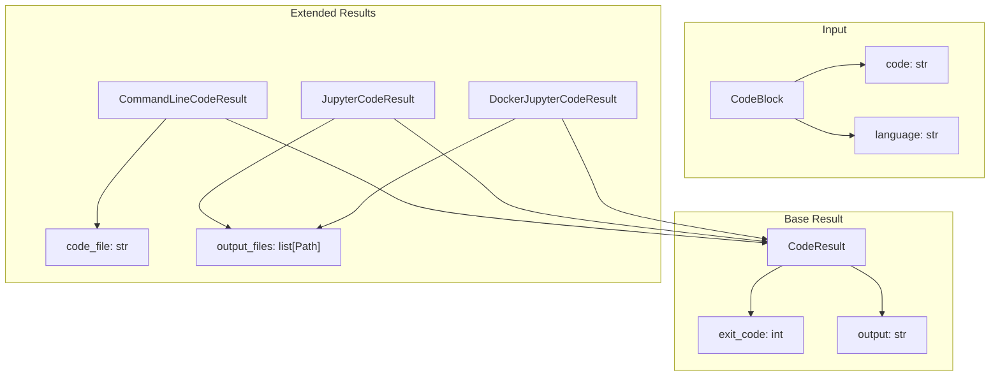

**Data Structures**
Sources: [python/packages/autogen-core/src/autogen_core/code_executor/_base.py:18-32](), [python/packages/autogen-ext/src/autogen_ext/code_executors/_common.py:12-21](), [python/packages/autogen-ext/src/autogen_ext/code_executors/jupyter/_jupyter_code_executor.py:33-38](), [python/packages/autogen-ext/src/autogen_ext/code_executors/docker_jupyter/_docker_jupyter.py:22-27]()

### Cancellation and Timeout

All executors support cancellation via `CancellationToken.link_future()` and configurable timeouts.

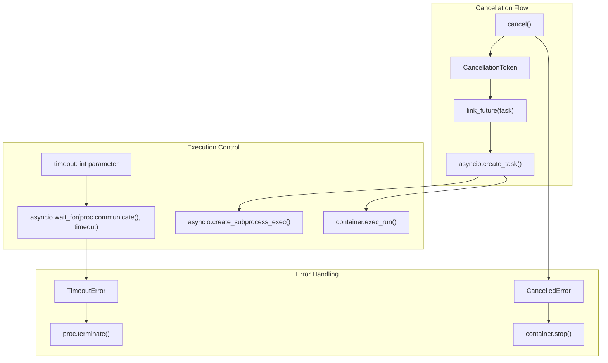

**Cancellation Implementation**
Sources: [python/packages/autogen-ext/src/autogen_ext/code_executors/docker/_docker_code_executor.py:294-327](), [python/packages/autogen-ext/src/autogen_ext/code_executors/local/__init__.py:427-447]()

## Executor Implementations

### LocalCommandLineCodeExecutor

Executes code locally using subprocess with optional virtual environment isolation.

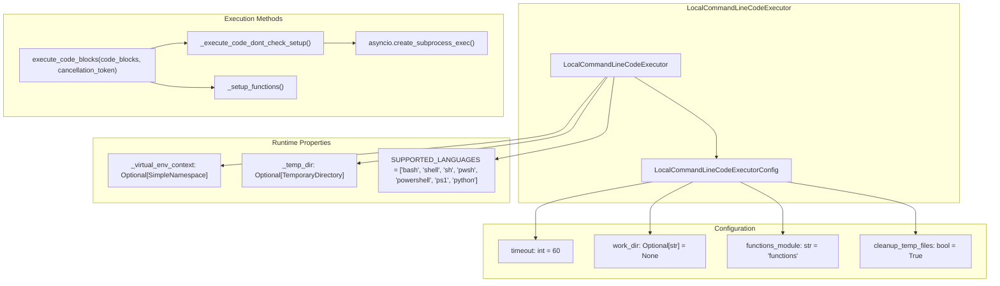

**LocalCommandLineCodeExecutor Implementation**

**Key Features:**
- **Virtual Environment Support**: Configurable via `virtual_env_context` parameter for Python package isolation [python/packages/autogen-ext/src/autogen_ext/code_executors/local/__init__.py:83-125]().
- **Automatic Cleanup**: Controlled by `cleanup_temp_files` boolean flag [python/packages/autogen-ext/src/autogen_ext/code_executors/local/__init__.py:42]().
- **Multi-language Support**: Python, bash, shell, PowerShell execution via `lang_to_cmd()` mapping [python/packages/autogen-ext/src/autogen_ext/code_executors/local/__init__.py:130-138]().
- **Function Integration**: Custom functions loaded via `_setup_functions()` method [python/packages/autogen-ext/src/autogen_ext/code_executors/local/__init__.py:180-194]().

Sources: [python/packages/autogen-ext/src/autogen_ext/code_executors/local/__init__.py:36-43](), [python/packages/autogen-ext/src/autogen_ext/code_executors/local/__init__.py:147-194](), [python/packages/autogen-ext/src/autogen_ext/code_executors/local/__init__.py:130-138]()

### DockerCommandLineCodeExecutor

Executes code in Docker containers for complete OS-level isolation.

```mermaid
graph TD
    subgraph "DockerCommandLineCodeExecutor"
        DCE["DockerCommandLineCodeExecutor"]
        DCEC["DockerCommandLineCodeExecutorConfig"]
    end
    
    subgraph "Configuration"
        image["image: str = 'python:3-slim'"]
        container_name["container_name: Optional[str] = None"]
        timeout["timeout: int = 60"]
        work_dir["work_dir: Optional[str] = None"]
        bind_dir["bind_dir: Optional[str] = None"]
        auto_remove["auto_remove: bool = True"]
        stop_container["stop_container: bool = True"]
        extra_volumes["extra_volumes: Dict[str, Dict[str, str]] = {}"]
        extra_hosts["extra_hosts: Dict[str, str] = {}"]
        init_command["init_command: Optional[str] = None"]
        delete_tmp_files["delete_tmp_files: bool = False"]
    end
    
    subgraph "Docker Integration"
        docker_from_env["docker.from_env()"]
        client_containers_create["client.containers.create()"]
        client_containers_get["client.containers.get()"]
        container_exec_run["container.exec_run()"]
        _wait_for_ready["_wait_for_ready(container, timeout=60)"]
    end
    
    subgraph "Container Lifecycle"
        start["start() -> container.start()"]
        stop["stop() -> container.stop()"]
        restart["restart() -> container.restart()"]
        _execute_command["_execute_command(command, cancellation_token)"]
    end
    
    DCE --> DCEC
    DCEC --> image
    DCEC --> container_name
    DCEC --> timeout
    DCEC --> work_dir
    DCEC --> bind_dir
    DCEC --> auto_remove
    DCEC --> stop_container
    DCEC --> extra_volumes
    DCEC --> extra_hosts
    DCEC --> init_command
    DCEC --> delete_tmp_files
    
    start --> docker_from_env
    docker_from_env --> client_containers_create
    client_containers_create --> _wait_for_ready
    _execute_command --> container_exec_run
```

**DockerCommandLineCodeExecutor Implementation**

**Key Features:**
- **Container Isolation**: Complete OS isolation via Docker containers [python/packages/autogen-ext/src/autogen_ext/code_executors/docker/_docker_code_executor.py:86-135]().
- **Volume Mounting**: Host directory binding via `bind_dir` and `extra_volumes` [python/packages/autogen-ext/src/autogen_ext/code_executors/docker/_docker_code_executor.py:75-79]().
- **GPU Support**: Hardware access via `device_requests` parameter [python/packages/autogen-ext/src/autogen_ext/code_executors/docker/_docker_code_executor.py:120]().
- **Network Control**: Host mapping via `extra_hosts` configuration [python/packages/autogen-ext/src/autogen_ext/code_executors/docker/_docker_code_executor.py:80]().
- **Lifecycle Management**: Automatic container cleanup via `auto_remove` and `stop_container` [python/packages/autogen-ext/src/autogen_ext/code_executors/docker/_docker_code_executor.py:76-77]().

Sources: [python/packages/autogen-ext/src/autogen_ext/code_executors/docker/_docker_code_executor.py:70-85](), [python/packages/autogen-ext/src/autogen_ext/code_executors/docker/_docker_code_executor.py:160-237](), [python/packages/autogen-ext/src/autogen_ext/code_executors/docker/_docker_code_executor.py:497-573]()

### ACADynamicSessionsCodeExecutor

Executes Python code in Azure Container Apps dynamic sessions with serverless isolation.

```mermaid
graph TD
    subgraph "ACADynamicSessionsCodeExecutor"
        ACE["ACADynamicSessionsCodeExecutor"]
        TP["TokenProvider"]
    end
    
    subgraph "Configuration"
        pool_management_endpoint["pool_management_endpoint: str"]
        credential["credential: TokenProvider"]
        timeout["timeout: int = 60"]
        work_dir["work_dir: Union[Path, str, None] = None"]
        functions_module["functions_module: str = 'functions'"]
        suppress_result_output["suppress_result_output: bool = False"]
        session_id["session_id: Optional[str] = None"]
    end
    
    subgraph "Azure API Integration"
        _AZURE_API_VER["_AZURE_API_VER = '2024-02-02-preview'"]
        _construct_url["_construct_url(path) -> str"]
        _ensure_access_token["_ensure_access_token()"]
        aiohttp_ClientSession["aiohttp.ClientSession"]
    end
    
    subgraph "File Management"
        upload_files["upload_files(files, cancellation_token)"]
        download_files["download_files(files, cancellation_token)"]
        get_file_list["get_file_list(cancellation_token)"]
        open_file["anyio.open_file()"]
    end
    
    subgraph "Package Management"
        get_available_packages["get_available_packages(cancellation_token)"]
        _populate_available_packages["_populate_available_packages()"]
        _available_packages["_available_packages: set[str]"]
    end
    
    ACE --> pool_management_endpoint
    ACE --> credential
    ACE --> timeout
    ACE --> work_dir
    ACE --> functions_module
    ACE --> suppress_result_output
    ACE --> session_id
    
    credential --> TP
    _ensure_access_token --> credential
    _construct_url --> _AZURE_API_VER
    
    upload_files --> aiohttp_ClientSession
    download_files --> aiohttp_ClientSession
    get_file_list --> aiohttp_ClientSession
    upload_files --> open_file
    download_files --> open_file
    
    get_available_packages --> _populate_available_packages
    _populate_available_packages --> _available_packages
```

**ACADynamicSessionsCodeExecutor Implementation**

**Key Features:**
- **Serverless Execution**: No infrastructure management required [python/packages/autogen-ext/src/autogen_ext/code_executors/azure/_azure_container_code_executor.py:47-66]().
- **Azure Authentication**: Enterprise security via `TokenProvider.get_token()` [python/packages/autogen-ext/src/autogen_ext/code_executors/azure/_azure_container_code_executor.py:40-43]().
- **File Operations**: Upload/download files via REST API with `aiohttp.ClientSession` [python/packages/autogen-ext/src/autogen_ext/code_executors/azure/_azure_container_code_executor.py:310-391]().
- **Package Validation**: Restricts imports to `get_available_packages()` allowlist [python/packages/autogen-ext/src/autogen_ext/code_executors/azure/_azure_container_code_executor.py:215-231]().
- **Session Isolation**: Unique `session_id` per execution environment [python/packages/autogen-ext/src/autogen_ext/code_executors/azure/_azure_container_code_executor.py:146]().

Sources: [python/packages/autogen-ext/src/autogen_ext/code_executors/azure/_azure_container_code_executor.py:91-150](), [python/packages/autogen-ext/src/autogen_ext/code_executors/azure/_azure_container_code_executor.py:310-391](), [python/packages/autogen-ext/src/autogen_ext/code_executors/azure/_azure_container_code_executor.py:215-231]()

### JupyterCodeExecutor

Executes Python code in Jupyter kernels with stateful execution and rich output handling.

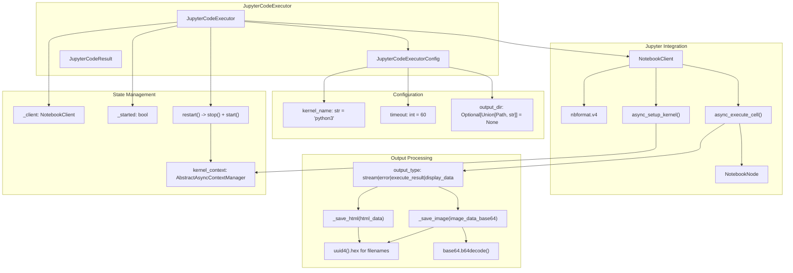

**JupyterCodeExecutor Implementation**

**Key Features:**
- **Stateful Execution**: Maintains variable state across code blocks within same session [python/packages/autogen-ext/src/autogen_ext/code_executors/jupyter/_jupyter_code_executor.py:48-60]().
- **Rich Output Handling**: Saves images and HTML via `_save_image()` and `_save_html()` methods [python/packages/autogen-ext/src/autogen_ext/code_executors/jupyter/_jupyter_code_executor.py:213-267]().
- **Kernel Management**: Lifecycle control via `async_setup_kernel()` and `kernel_context` [python/packages/autogen-ext/src/autogen_ext/code_executors/jupyter/_jupyter_code_executor.py:139-160]().
- **Multiple Output Types**: Handles stream, error, execute_result, and display_data outputs [python/packages/autogen-ext/src/autogen_ext/code_executors/jupyter/_jupyter_code_executor.py:230-245]().
- **File Generation**: Returns `JupyterCodeResult` with `output_files: list[Path]` [python/packages/autogen-ext/src/autogen_ext/code_executors/jupyter/_jupyter_code_executor.py:33-38]().

Sources: [python/packages/autogen-ext/src/autogen_ext/code_executors/jupyter/_jupyter_code_executor.py:40-46](), [python/packages/autogen-ext/src/autogen_ext/code_executors/jupyter/_jupyter_code_executor.py:139-160](), [python/packages/autogen-ext/src/autogen_ext/code_executors/jupyter/_jupyter_code_executor.py:213-267]()

### DockerJupyterCodeExecutor

Executes Python code in a Jupyter server running inside a Docker container, combining Jupyter's stateful execution with Docker's isolation.

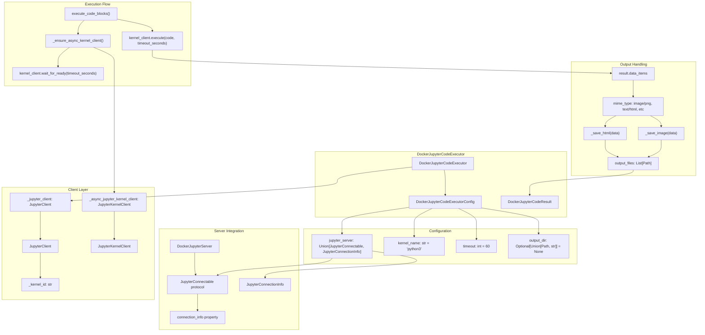

**DockerJupyterCodeExecutor Implementation**

**Key Features:**
- **Docker Isolation**: Combines Jupyter stateful execution with Docker container security [python/packages/autogen-ext/src/autogen_ext/code_executors/docker_jupyter/_docker_jupyter.py:42-46]().
- **Websocket Protocol**: Communicates with Jupyter server via websocket connections managed by `JupyterKernelClient` [python/packages/autogen-ext/src/autogen_ext/code_executors/docker_jupyter/_jupyter_server.py:49-106]().
- **Server Abstraction**: Accepts any `JupyterConnectable` implementation, typically `DockerJupyterServer` [python/packages/autogen-ext/src/autogen_ext/code_executors/docker_jupyter/_docker_jupyter.py:168-173]().
- **Rich Media Output**: Handles image/png and text/html outputs saved to `output_dir` via `_save_image()` and `_save_html()` [python/packages/autogen-ext/src/autogen_ext/code_executors/docker_jupyter/_docker_jupyter.py:220-235]().
- **Async Client Pattern**: Uses `_ensure_async_kernel_client()` for lazy kernel initialization [python/packages/autogen-ext/src/autogen_ext/code_executors/docker_jupyter/_docker_jupyter.py:197-208]().

Sources: [python/packages/autogen-ext/src/autogen_ext/code_executors/docker_jupyter/_docker_jupyter.py:29-39](), [python/packages/autogen-ext/src/autogen_ext/code_executors/docker_jupyter/_docker_jupyter.py:158-186](), [python/packages/autogen-ext/src/autogen_ext/code_executors/docker_jupyter/_docker_jupyter.py:197-246](), [python/packages/autogen-ext/src/autogen_ext/code_executors/docker_jupyter/_jupyter_server.py:26-46](), [python/packages/autogen-ext/src/autogen_ext/code_executors/docker_jupyter/_jupyter_server.py:49-106]()

## Integration Patterns

Code executors integrate into AutoGen workflows through agent composition and tool wrapping patterns that maintain safety controls.

### CodeExecutorAgent Integration

The `CodeExecutorAgent` wraps any `CodeExecutor` implementation with approval workflows and LLM-based code generation capabilities.

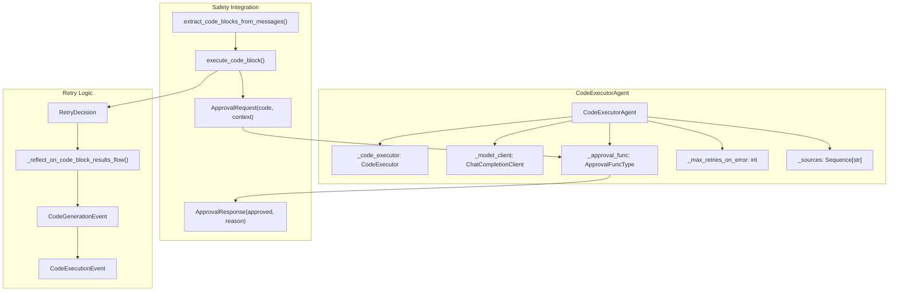

**CodeExecutorAgent Safety Integration**
Sources: [python/packages/autogen-agentchat/src/autogen_agentchat/agents/_code_executor_agent.py:89-769](), [python/packages/autogen-agentchat/src/autogen_agentchat/agents/_code_executor_agent.py:50-62]()

### MagenticOne Integration Pattern

The `MagenticOne` team demonstrates production integration patterns with built-in safety mechanisms.

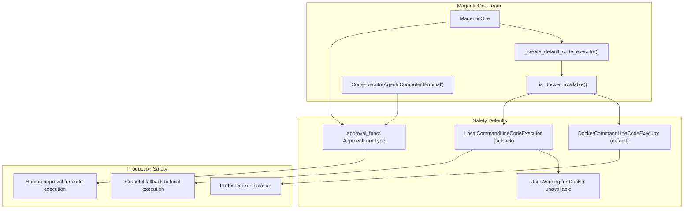

**Production Safety Integration Pattern**
Sources: [python/packages/autogen-ext/src/autogen_ext/teams/magentic_one.py:52-69](), [python/packages/autogen-ext/src/autogen_ext/teams/magentic_one.py:242-271]()

### Tool Wrapping Pattern

The `PythonCodeExecutionTool` wraps executors as standardized tools for use with `AssistantAgent` and other tool-capable agents.

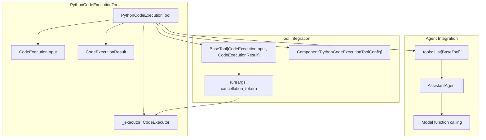

**Tool Integration Architecture**
Sources: [python/packages/autogen-ext/src/autogen_ext/tools/code_execution/_code_execution.py:28-97](), [python/packages/autogen-ext/src/autogen_ext/tools/code_execution/_code_execution.py:8-19]()

---

