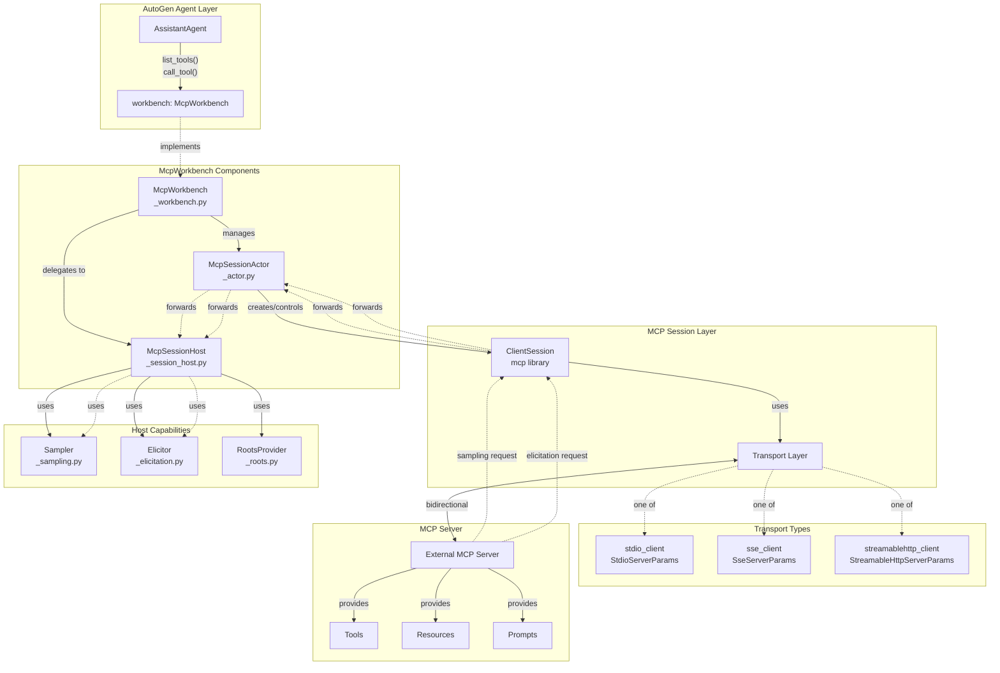
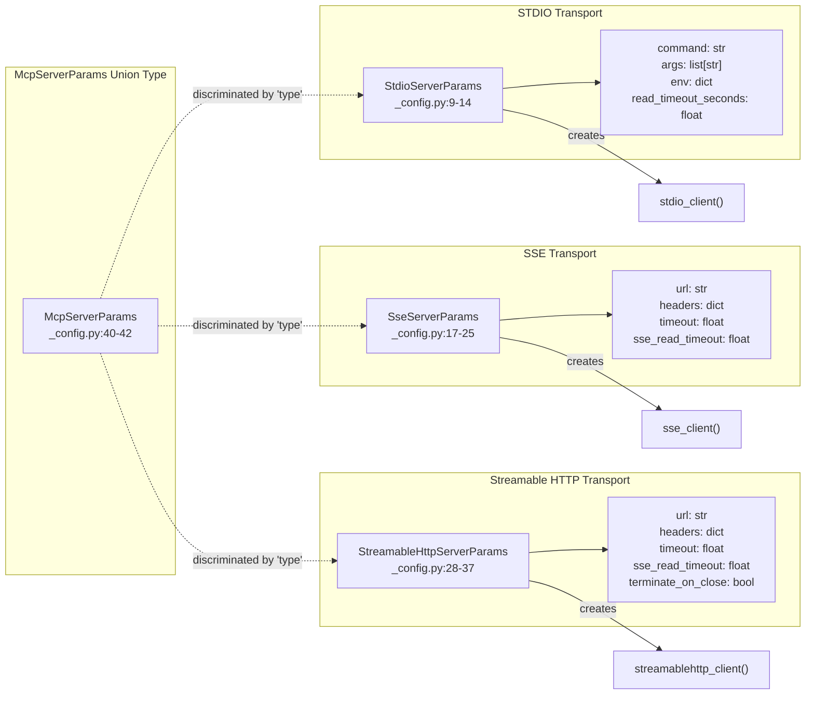
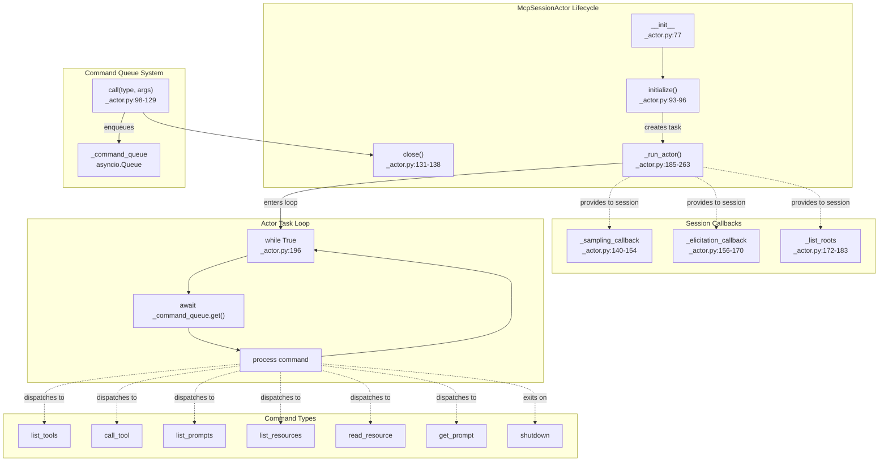
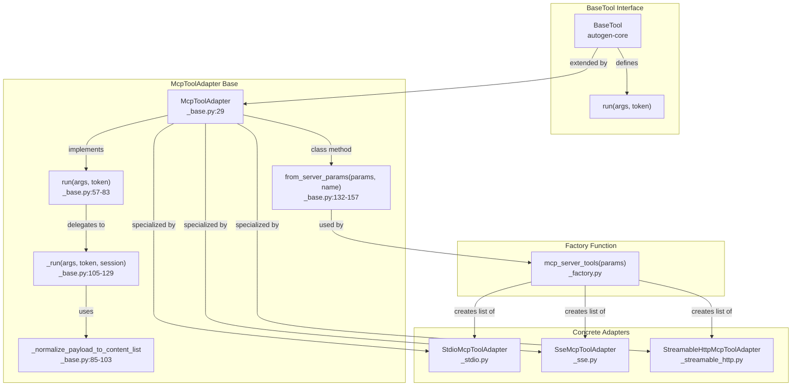
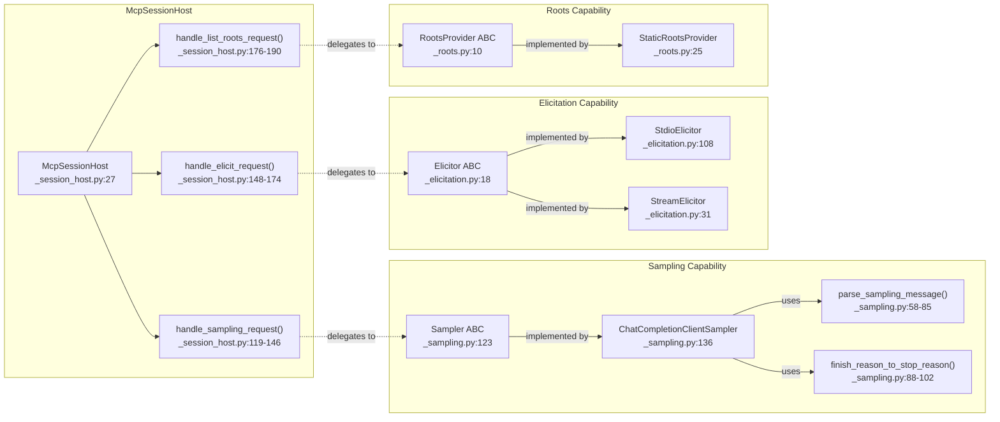

<!-- source: DeepWiki mcp.deepwiki.com · repo microsoft/autogen · page 6.2 MCP Integration · fetched 2026-10-27 -->

# MCP Integration

<details>
<summary>Relevant source files</summary>

The following files were used as context for generating this wiki page:

- [.github/workflows/pytest-redis-memory.yml](.github/workflows/pytest-redis-memory.yml)
- [.gitignore](.gitignore)
- [docs/dotnet/docfx.json](docs/dotnet/docfx.json)
- [python/docs/src/user-guide/agentchat-user-guide/memory.ipynb](python/docs/src/user-guide/agentchat-user-guide/memory.ipynb)
- [python/packages/autogen-core/src/autogen_core/utils/_json_to_pydantic.py](python/packages/autogen-core/src/autogen_core/utils/_json_to_pydantic.py)
- [python/packages/autogen-core/tests/test_json_to_pydantic.py](python/packages/autogen-core/tests/test_json_to_pydantic.py)
- [python/packages/autogen-ext/examples/mcp_example_server.py](python/packages/autogen-ext/examples/mcp_example_server.py)
- [python/packages/autogen-ext/examples/mcp_session_host_example.py](python/packages/autogen-ext/examples/mcp_session_host_example.py)
- [python/packages/autogen-ext/src/autogen_ext/experimental/task_centric_memory/__init__.py](python/packages/autogen-ext/src/autogen_ext/experimental/task_centric_memory/__init__.py)
- [python/packages/autogen-ext/src/autogen_ext/experimental/task_centric_memory/utils/__init__.py](python/packages/autogen-ext/src/autogen_ext/experimental/task_centric_memory/utils/__init__.py)
- [python/packages/autogen-ext/src/autogen_ext/memory/redis/__init__.py](python/packages/autogen-ext/src/autogen_ext/memory/redis/__init__.py)
- [python/packages/autogen-ext/src/autogen_ext/memory/redis/_redis_memory.py](python/packages/autogen-ext/src/autogen_ext/memory/redis/_redis_memory.py)
- [python/packages/autogen-ext/src/autogen_ext/tools/mcp/__init__.py](python/packages/autogen-ext/src/autogen_ext/tools/mcp/__init__.py)
- [python/packages/autogen-ext/src/autogen_ext/tools/mcp/_actor.py](python/packages/autogen-ext/src/autogen_ext/tools/mcp/_actor.py)
- [python/packages/autogen-ext/src/autogen_ext/tools/mcp/_base.py](python/packages/autogen-ext/src/autogen_ext/tools/mcp/_base.py)
- [python/packages/autogen-ext/src/autogen_ext/tools/mcp/_config.py](python/packages/autogen-ext/src/autogen_ext/tools/mcp/_config.py)
- [python/packages/autogen-ext/src/autogen_ext/tools/mcp/_factory.py](python/packages/autogen-ext/src/autogen_ext/tools/mcp/_factory.py)
- [python/packages/autogen-ext/src/autogen_ext/tools/mcp/_host/README.md](python/packages/autogen-ext/src/autogen_ext/tools/mcp/_host/README.md)
- [python/packages/autogen-ext/src/autogen_ext/tools/mcp/_host/__init__.py](python/packages/autogen-ext/src/autogen_ext/tools/mcp/_host/__init__.py)
- [python/packages/autogen-ext/src/autogen_ext/tools/mcp/_host/_elicitation.py](python/packages/autogen-ext/src/autogen_ext/tools/mcp/_host/_elicitation.py)
- [python/packages/autogen-ext/src/autogen_ext/tools/mcp/_host/_roots.py](python/packages/autogen-ext/src/autogen_ext/tools/mcp/_host/_roots.py)
- [python/packages/autogen-ext/src/autogen_ext/tools/mcp/_host/_sampling.py](python/packages/autogen-ext/src/autogen_ext/tools/mcp/_host/_sampling.py)
- [python/packages/autogen-ext/src/autogen_ext/tools/mcp/_host/_session_host.py](python/packages/autogen-ext/src/autogen_ext/tools/mcp/_host/_session_host.py)
- [python/packages/autogen-ext/src/autogen_ext/tools/mcp/_session.py](python/packages/autogen-ext/src/autogen_ext/tools/mcp/_session.py)
- [python/packages/autogen-ext/src/autogen_ext/tools/mcp/_sse.py](python/packages/autogen-ext/src/autogen_ext/tools/mcp/_sse.py)
- [python/packages/autogen-ext/src/autogen_ext/tools/mcp/_stdio.py](python/packages/autogen-ext/src/autogen_ext/tools/mcp/_stdio.py)
- [python/packages/autogen-ext/src/autogen_ext/tools/mcp/_streamable_http.py](python/packages/autogen-ext/src/autogen_ext/tools/mcp/_streamable_http.py)
- [python/packages/autogen-ext/src/autogen_ext/tools/mcp/_workbench.py](python/packages/autogen-ext/src/autogen_ext/tools/mcp/_workbench.py)
- [python/packages/autogen-ext/tests/mcp_server_comprehensive.py](python/packages/autogen-ext/tests/mcp_server_comprehensive.py)
- [python/packages/autogen-ext/tests/memory/test_redis_memory.py](python/packages/autogen-ext/tests/memory/test_redis_memory.py)
- [python/packages/autogen-ext/tests/tools/test_mcp_actor.py](python/packages/autogen-ext/tests/tools/test_mcp_actor.py)
- [python/packages/autogen-ext/tests/tools/test_mcp_tools.py](python/packages/autogen-ext/tests/tools/test_mcp_tools.py)
- [python/packages/autogen-studio/autogenstudio/validation/validation_service.py](python/packages/autogen-studio/autogenstudio/validation/validation_service.py)
- [python/packages/autogen-studio/autogenstudio/web/routes/mcp.py](python/packages/autogen-studio/autogenstudio/web/routes/mcp.py)
- [python/packages/autogen-studio/frontend/src/components/types/component-templates.ts](python/packages/autogen-studio/frontend/src/components/types/component-templates.ts)
- [python/packages/autogen-studio/frontend/src/components/views/teambuilder/builder/component-editor/fields/agent-fields.tsx](python/packages/autogen-studio/frontend/src/components/views/teambuilder/builder/component-editor/fields/agent-fields.tsx)
- [python/packages/autogen-studio/frontend/src/components/views/teambuilder/builder/component-editor/fields/tool-fields.tsx](python/packages/autogen-studio/frontend/src/components/views/teambuilder/builder/component-editor/fields/tool-fields.tsx)
- [python/packages/autogen-studio/frontend/src/components/views/teambuilder/builder/component-editor/fields/workbench/workbench-fields.tsx](python/packages/autogen-studio/frontend/src/components/views/teambuilder/builder/component-editor/fields/workbench/workbench-fields.tsx)

</details>


The MCP (Model Context Protocol) integration enables AutoGen agents to connect to external tool servers that implement the MCP specification. This integration provides a standardized interface for agents to discover and invoke tools, access resources, use prompts, and leverage bidirectional capabilities like sampling and elicitation.

For information about other tool integration approaches, see [Code Execution](#6.1) and [Web and File Interaction](#6.3).

## Purpose and Scope

This page documents the AutoGen implementation of the Model Context Protocol client, which allows agents to:
- Connect to MCP servers via STDIO, SSE, or Streamable HTTP transports.
- Discover and execute tools provided by MCP servers.
- Access resources (files, data) and prompts from servers.
- Support bidirectional capabilities where servers can request sampling (LLM generation) or elicitation (user input) from the host.

The implementation is located in `python/packages/autogen-ext/src/autogen_ext/tools/mcp/` and consists of connection management, tool adaptation, and host capability components.

## Architecture Overview



**Architecture Diagram: MCP Integration Components**

The architecture follows a layered approach where `McpWorkbench` acts as the `Workbench` interface implementation for agents, delegating to `McpSessionActor` for session management and `McpSessionHost` for handling server-to-host requests. The `ClientSession` from the MCP library handles protocol-level communication over one of three transport types.

Sources: [python/packages/autogen-ext/src/autogen_ext/tools/mcp/_workbench.py:47-234](), [python/packages/autogen-ext/src/autogen_ext/tools/mcp/_actor.py:54-303](), [python/packages/autogen-ext/src/autogen_ext/tools/mcp/_session.py:14-64]()

## Connection Types and Server Parameters



**Configuration Types and Transport Selection**

The `McpServerParams` type is a discriminated union that determines which transport protocol to use. The `create_mcp_server_session()` function in `_session.py` pattern-matches on the parameter type to instantiate the appropriate client.

| Transport | Use Case | Connection Method |
|-----------|----------|-------------------|
| **STDIO** | Local subprocess servers (e.g., `npx`, `uvx`, `python`) | Spawns subprocess, pipes stdin/stdout [python/packages/autogen-ext/src/autogen_ext/tools/mcp/_session.py:22-32]() |
| **SSE** | Remote HTTP servers with Server-Sent Events | HTTP connection with SSE for server messages [python/packages/autogen-ext/src/autogen_ext/tools/mcp/_session.py:33-43]() |
| **Streamable HTTP** | Remote HTTP servers with bidirectional streaming | HTTP with persistent connection and SSE [python/packages/autogen-ext/src/autogen_ext/tools/mcp/_session.py:44-64]() |

Sources: [python/packages/autogen-ext/src/autogen_ext/tools/mcp/_config.py:9-42](), [python/packages/autogen-ext/src/autogen_ext/tools/mcp/_session.py:14-64]()

## McpWorkbench Component

`McpWorkbench` implements the `Workbench` interface from `autogen-core` and serves as the primary integration point for agents.

```mermaid
sequenceDiagram
    participant Agent as "AssistantAgent"
    participant WB as "McpWorkbench"
    participant Actor as "McpSessionActor"
    participant Session as "ClientSession"
    participant Server as "MCP Server"
    
    Agent->>WB: "list_tools()"
    
    alt Actor not initialized
        WB->>WB: "start()"
        WB->>Actor: "initialize()"
        Actor->>Session: "create session"
        Actor->>Session: "initialize()"
        Session->>Server: "initialize request"
        Server->>Session: "initialize result"
    end
    
    WB->>Actor: "call('list_tools', None)"
    Actor->>Session: "list_tools()"
    Session->>Server: "list_tools request"
    Server->>Session: "ListToolsResult"
    Session->>Actor: "future resolves"
    Actor->>WB: "ListToolsResult"
    
    WB->>WB: "apply tool_overrides"
    WB->>Agent: "List[ToolSchema]"
    
    Agent->>WB: "call_tool(name, args)"
    WB->>WB: "map override name to original"
    WB->>Actor: "call('call_tool', args)"
    Actor->>Session: "call_tool(name, arguments)"
    Session->>Server: "tool execution request"
    Server->>Session: "CallToolResult"
    Session->>Actor: "future resolves"
    Actor->>WB: "CallToolResult"
    WB->>WB: "convert to ToolResult"
    WB->>Agent: "ToolResult"
```

**McpWorkbench Request Flow**

### Key Methods

| Method | Purpose | Implementation |
|--------|---------|----------------|
| `list_tools()` | Retrieve available tools from server | [python/packages/autogen-ext/src/autogen_ext/tools/mcp/_workbench.py:274-312]() |
| `call_tool()` | Execute a tool with arguments | [python/packages/autogen-ext/src/autogen_ext/tools/mcp/_workbench.py:314-363]() |
| `list_prompts()` | List available prompts | [python/packages/autogen-ext/src/autogen_ext/tools/mcp/_workbench.py:372-385]() |
| `list_resources()` | List available resources | [python/packages/autogen-ext/src/autogen_ext/tools/mcp/_workbench.py:387-400]() |
| `read_resource()` | Read resource content | [python/packages/autogen-ext/src/autogen_ext/tools/mcp/_workbench.py:417-430]() |
| `get_prompt()` | Retrieve prompt with arguments | [python/packages/autogen-ext/src/autogen_ext/tools/mcp/_workbench.py:432-445]() |
| `start()` | Initialize actor and session | [python/packages/autogen-ext/src/autogen_ext/tools/mcp/_workbench.py:460-474]() |
| `stop()` | Cleanup actor and session | [python/packages/autogen-ext/src/autogen_ext/tools/mcp/_workbench.py:476-482]() |

### Tool Overrides

The `tool_overrides` parameter allows customizing tool names and descriptions without modifying the server [python/packages/autogen-ext/src/autogen_ext/tools/mcp/_workbench.py:123-153](). The workbench maintains a reverse mapping (`_override_name_to_original`) to translate override names back to original names when calling tools [python/packages/autogen-ext/src/autogen_ext/tools/mcp/_workbench.py:249-260]().

### Context Manager Support

`McpWorkbench` supports async context manager protocol for automatic lifecycle management [python/packages/autogen-ext/src/autogen_ext/tools/mcp/_workbench.py:114]().

Sources: [python/packages/autogen-ext/src/autogen_ext/tools/mcp/_workbench.py:47-518]()

## McpSessionActor Component



**McpSessionActor Command Processing Architecture**

`McpSessionActor` manages the MCP session lifecycle in a separate async task that processes commands from a queue. This design isolates session management from the caller and allows concurrent operations.

### Command Queue Pattern

Commands are enqueued through the `call()` method [python/packages/autogen-ext/src/autogen_ext/tools/mcp/_actor.py:98-129]() with a future that resolves when the command completes. The actor task dequeues and dispatches commands in `_run_actor()` [python/packages/autogen-ext/src/autogen_ext/tools/mcp/_actor.py:196-242]().

### Exception Handling

The actor implements comprehensive exception handling [python/packages/autogen-ext/src/autogen_ext/tools/mcp/_actor.py:243-263]():
1. **Command-level exceptions**: Set exception on individual command futures [python/packages/autogen-ext/src/autogen_ext/tools/mcp/_actor.py:205-206]().
2. **Session-level exceptions**: Drain pending commands and set exceptions on all futures [python/packages/autogen-ext/src/autogen_ext/tools/mcp/_actor.py:244-256]().
3. **Cleanup**: Always mark actor as inactive and clear task reference [python/packages/autogen-ext/src/autogen_ext/tools/mcp/_actor.py:262-263]().

### Callback Registration

The actor registers callbacks with the MCP session for server-to-host requests [python/packages/autogen-ext/src/autogen_ext/tools/mcp/_actor.py:188-192](). These callbacks delegate to `McpSessionHost` if configured [python/packages/autogen-ext/src/autogen_ext/tools/mcp/_actor.py:140-183]().

Sources: [python/packages/autogen-ext/src/autogen_ext/tools/mcp/_actor.py:54-303]()

## MCP Tool Adapters



**MCP Tool Adapter Class Hierarchy**

### McpToolAdapter Base Class

The `McpToolAdapter` base class [python/packages/autogen-ext/src/autogen_ext/tools/mcp/_base.py:29-198]() wraps MCP `Tool` objects to make them compatible with AutoGen's `BaseTool` interface.

**Key responsibilities:**
- Convert between MCP tool schemas and AutoGen `ParametersSchema` [python/packages/autogen-ext/src/autogen_ext/tools/mcp/_base.py:50]().
- Handle session creation or reuse [python/packages/autogen-ext/src/autogen_ext/tools/mcp/_base.py:76-83]().
- Execute tools through `ClientSession.call_tool()` [python/packages/autogen-ext/src/autogen_ext/tools/mcp/_base.py:116]().
- Normalize MCP content types to AutoGen format [python/packages/autogen-ext/src/autogen_ext/tools/mcp/_base.py:85-103]().
- Handle cancellation via `CancellationToken` [python/packages/autogen-ext/src/autogen_ext/tools/mcp/_base.py:113-117]().

### Content Normalization

The `_normalize_payload_to_content_list()` method [python/packages/autogen-ext/src/autogen_ext/tools/mcp/_base.py:85-103]() converts MCP response content (Text, Image, EmbeddedResource, etc.) to a standard list of `ContentBlock` objects.

### Factory Pattern

The `mcp_server_tools()` function [python/packages/autogen-ext/src/autogen_ext/tools/mcp/_factory.py]() creates tool adapters for all tools provided by a server. This allows agents to easily access all MCP server tools by simply passing the returned list to the agent's `tools` parameter [python/packages/autogen-ext/src/autogen_ext/tools/mcp/_factory.py:77-80]().

Sources: [python/packages/autogen-ext/src/autogen_ext/tools/mcp/_base.py:29-198](), [python/packages/autogen-ext/src/autogen_ext/tools/mcp/_stdio.py](), [python/packages/autogen-ext/src/autogen_ext/tools/mcp/_sse.py](), [python/packages/autogen-ext/src/autogen_ext/tools/mcp/_streamable_http.py](), [python/packages/autogen-ext/src/autogen_ext/tools/mcp/_factory.py]()

## Bidirectional Capabilities: Host Components

MCP supports bidirectional communication where servers can request capabilities from the host. AutoGen implements this through the `McpSessionHost` component and three capability provider types.



**Host Capability Architecture**

### Sampling: ChatCompletionClientSampler

Sampling allows MCP servers to request text generation from the host's language model. `ChatCompletionClientSampler` [python/packages/autogen-ext/src/autogen_ext/tools/mcp/_host/_sampling.py:136-183]() implements this by converting MCP `SamplingMessage` to AutoGen `LLMMessage` [python/packages/autogen-ext/src/autogen_ext/tools/mcp/_host/_sampling.py:58-85]() and calling the provided `ChatCompletionClient` [python/packages/autogen-ext/src/autogen_ext/tools/mcp/_host/_sampling.py:160]().

### Elicitation: StdioElicitor

Elicitation enables servers to prompt for structured user input. `StdioElicitor` [python/packages/autogen-ext/src/autogen_ext/tools/mcp/_host/_elicitation.py:108-127]() implements stdio-based prompting, allowing a server to ask for clarification or confirmation from a human user.

### Roots: StaticRootsProvider

Roots define file system access boundaries for MCP servers. `StaticRootsProvider` [python/packages/autogen-ext/src/autogen_ext/tools/mcp/_host/_roots.py:25-41]() provides a static list of directories the server is permitted to access.

### McpSessionHost Configuration

`McpSessionHost` [python/packages/autogen-ext/src/autogen_ext/tools/mcp/_host/_session_host.py:27-205]() coordinates all capabilities. Each capability is optional; if not provided, requests return `ErrorData` [python/packages/autogen-ext/src/autogen_ext/tools/mcp/_host/_session_host.py:133-137, 162-166, 184-186]().

Sources: [python/packages/autogen-ext/src/autogen_ext/tools/mcp/_host/_session_host.py:27-205](), [python/packages/autogen-ext/src/autogen_ext/tools/mcp/_host/_sampling.py:123-183](), [python/packages/autogen-ext/src/autogen_ext/tools/mcp/_host/_elicitation.py:18-127](), [python/packages/autogen-ext/src/autogen_ext/tools/mcp/_host/_roots.py:10-41]()

## Complete Usage Example

```mermaid
sequenceDiagram
    participant User
    participant Agent as "AssistantAgent"
    participant WB as "McpWorkbench"
    participant Actor as "McpSessionActor"
    participant Server as "MCP Server<br/>(book_table tool)"
    participant Host as "McpSessionHost"
    participant Elicitor as "StdioElicitor"
    
    User->>Agent: "Book a table for 2 at 7pm"
    Agent->>WB: "list_tools()"
    WB->>Actor: "call('list_tools')"
    Actor->>Server: "list_tools request"
    Server->>Actor: "[book_table tool]"
    Actor->>WB: "ListToolsResult"
    WB->>Agent: "List[ToolSchema]"
    
    Agent->>Agent: "Decides to use book_table"
    Agent->>WB: "call_tool('book_table', {'time': '7pm', 'party_size': 2})"
    WB->>Actor: "call('call_tool', args)"
    Actor->>Server: "call_tool(book_table, args)"
    
    Note over Server: "7pm unavailable"
    Server->>Actor: "ElicitRequest: Try another time?"
    Actor->>Host: "handle_elicit_request(params)"
    Host->>Elicitor: "elicit(params)"
    Elicitor->>User: "Prompt: Try another time?<br/>Choices: accept/decline/cancel"
    User->>Elicitor: "accept"
    Elicitor->>User: "Enter JSON with alternativeTime"
    User->>Elicitor: "{'alternativeTime': '8pm'}"
    Elicitor->>Host: "ElicitResult(action='accept', content={...})"
    Host->>Actor: "ElicitResult"
    Actor->>Server: "ElicitResult"
    
    Note over Server: "Books 8pm slot"
    Server->>Actor: "CallToolResult(success)"
    Actor->>WB: "CallToolResult"
    WB->>Agent: "ToolResult"
    Agent->>User: "Booked table for 2 at 8pm"
```

**End-to-End Elicitation Example Flow**

### Basic Setup

```python
# Setup from _workbench.py:155-193 example
from autogen_agentchat.agents import AssistantAgent
from autogen_ext.models.openai import OpenAIChatCompletionClient
from autogen_ext.tools.mcp import McpWorkbench, StdioServerParams

model_client = OpenAIChatCompletionClient(model="gpt-4")
server_params = StdioServerParams(
    command="uvx",
    args=["mcp-server-fetch"],
    read_timeout_seconds=60,
)

async with McpWorkbench(server_params) as workbench:
    agent = AssistantAgent(
        "assistant",
        model_client=model_client,
        workbench=workbench,
    )
    # Agent can now use tools from the workbench
```

Sources: [python/packages/autogen-ext/src/autogen_ext/tools/mcp/_workbench.py:155-233](), [python/packages/autogen-ext/examples/mcp_session_host_example.py:81-160](), [python/packages/autogen-ext/examples/mcp_example_server.py:1-76]()

## Component Serialization

All MCP components implement the `Component` interface for serialization:

| Component | Config Class | Key Fields |
|-----------|--------------|------------|
| `McpWorkbench` | `McpWorkbenchConfig` | `server_params`, `tool_overrides`, `host` [python/packages/autogen-ext/src/autogen_ext/tools/mcp/_workbench.py:37-40]() |
| `McpSessionActor` | `McpSessionActorConfig` | `server_params` [python/packages/autogen-ext/src/autogen_ext/tools/mcp/_actor.py:44-51]() |
| `McpSessionHost` | `McpSessionHostConfig` | `sampler`, `elicitor`, `roots` [python/packages/autogen-ext/src/autogen_ext/tools/mcp/_host/_session_host.py:13-24]() |

Sources: [python/packages/autogen-ext/src/autogen_ext/tools/mcp/_workbench.py:493-504](), [python/packages/autogen-ext/src/autogen_ext/tools/mcp/_actor.py:282-302](), [python/packages/autogen-ext/src/autogen_ext/tools/mcp/_host/_session_host.py:192-205]()

## Supported MCP Capabilities

| Capability | Direction | AutoGen Support | Implementation |
|------------|-----------|-----------------|----------------|
| **Tools** | Server → Client | ✓ Full | `McpWorkbench.list_tools()`, `call_tool()` [python/packages/autogen-ext/src/autogen_ext/tools/mcp/_workbench.py:274-363]() |
| **Resources** | Server → Client | ✓ Full | `McpWorkbench.list_resources()`, `read_resource()` [python/packages/autogen-ext/src/autogen_ext/tools/mcp/_workbench.py:387-430]() |
| **Prompts** | Server → Client | ✓ Full | `McpWorkbench.list_prompts()`, `get_prompt()` [python/packages/autogen-ext/src/autogen_ext/tools/mcp/_workbench.py:372-445]() |
| **Sampling** | Server → Host | ✓ Optional | `ChatCompletionClientSampler` [python/packages/autogen-ext/src/autogen_ext/tools/mcp/_host/_sampling.py:136-183]() |
| **Elicitation** | Server → Host | ✓ Optional | `StdioElicitor`, `StreamElicitor` [python/packages/autogen-ext/src/autogen_ext/tools/mcp/_host/_elicitation.py]() |
| **Roots** | Server → Host | ✓ Optional | `StaticRootsProvider` [python/packages/autogen-ext/src/autogen_ext/tools/mcp/_host/_roots.py:25-41]() |

Sources: [python/packages/autogen-ext/src/autogen_ext/tools/mcp/_workbench.py:59-78](), [python/packages/autogen-ext/src/autogen_ext/tools/mcp/_host/README.md:1-237]()

---

