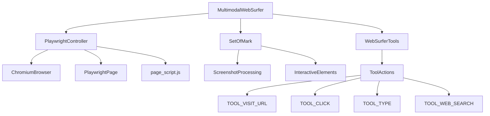
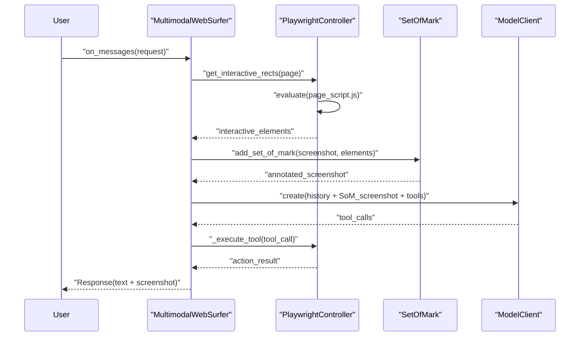
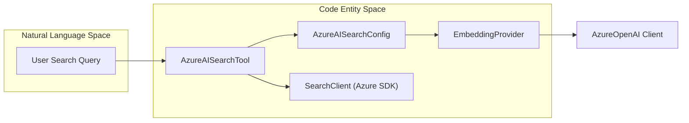

<!-- source: DeepWiki mcp.deepwiki.com · repo microsoft/autogen · page 6.3 Web and File Interaction · fetched 2026-10-27 -->

# Web and File Interaction

Relevant source files

The following files were used as context for generating this wiki page:

- [python/packages/autogen-agentchat/src/autogen_agentchat/base/_handoff.py](python/packages/autogen-agentchat/src/autogen_agentchat/base/_handoff.py)
- [python/packages/autogen-agentchat/tests/test_magentic_one_group_chat.py](python/packages/autogen-agentchat/tests/test_magentic_one_group_chat.py)
- [python/packages/autogen-ext/src/autogen_ext/agents/file_surfer/__init__.py](python/packages/autogen-ext/src/autogen_ext/agents/file_surfer/__init__.py)
- [python/packages/autogen-ext/src/autogen_ext/agents/file_surfer/_file_surfer.py](python/packages/autogen-ext/src/autogen_ext/agents/file_surfer/_file_surfer.py)
- [python/packages/autogen-ext/src/autogen_ext/agents/file_surfer/_markdown_file_browser.py](python/packages/autogen-ext/src/autogen_ext/agents/file_surfer/_markdown_file_browser.py)
- [python/packages/autogen-ext/src/autogen_ext/agents/file_surfer/_tool_definitions.py](python/packages/autogen-ext/src/autogen_ext/agents/file_surfer/_tool_definitions.py)
- [python/packages/autogen-ext/src/autogen_ext/agents/video_surfer/__init__.py](python/packages/autogen-ext/src/autogen_ext/agents/video_surfer/__init__.py)
- [python/packages/autogen-ext/src/autogen_ext/agents/video_surfer/_video_surfer.py](python/packages/autogen-ext/src/autogen_ext/agents/video_surfer/_video_surfer.py)
- [python/packages/autogen-ext/src/autogen_ext/agents/web_surfer/__init__.py](python/packages/autogen-ext/src/autogen_ext/agents/web_surfer/__init__.py)
- [python/packages/autogen-ext/src/autogen_ext/agents/web_surfer/_events.py](python/packages/autogen-ext/src/autogen_ext/agents/web_surfer/_events.py)
- [python/packages/autogen-ext/src/autogen_ext/agents/web_surfer/_multimodal_web_surfer.py](python/packages/autogen-ext/src/autogen_ext/agents/web_surfer/_multimodal_web_surfer.py)
- [python/packages/autogen-ext/src/autogen_ext/agents/web_surfer/_prompts.py](python/packages/autogen-ext/src/autogen_ext/agents/web_surfer/_prompts.py)
- [python/packages/autogen-ext/src/autogen_ext/agents/web_surfer/_set_of_mark.py](python/packages/autogen-ext/src/autogen_ext/agents/web_surfer/_set_of_mark.py)
- [python/packages/autogen-ext/src/autogen_ext/agents/web_surfer/_tool_definitions.py](python/packages/autogen-ext/src/autogen_ext/agents/web_surfer/_tool_definitions.py)
- [python/packages/autogen-ext/src/autogen_ext/agents/web_surfer/_types.py](python/packages/autogen-ext/src/autogen_ext/agents/web_surfer/_types.py)
- [python/packages/autogen-ext/src/autogen_ext/agents/web_surfer/page_script.js](python/packages/autogen-ext/src/autogen_ext/agents/web_surfer/page_script.js)
- [python/packages/autogen-ext/src/autogen_ext/agents/web_surfer/playwright_controller.py](python/packages/autogen-ext/src/autogen_ext/agents/web_surfer/playwright_controller.py)
- [python/packages/autogen-ext/src/autogen_ext/code_executors/_common.py](python/packages/autogen-ext/src/autogen_ext/code_executors/_common.py)
- [python/packages/autogen-ext/src/autogen_ext/tools/azure/__init__.py](python/packages/autogen-ext/src/autogen_ext/tools/azure/__init__.py)
- [python/packages/autogen-ext/src/autogen_ext/tools/azure/_ai_search.py](python/packages/autogen-ext/src/autogen_ext/tools/azure/_ai_search.py)
- [python/packages/autogen-ext/src/autogen_ext/tools/azure/_config.py](python/packages/autogen-ext/src/autogen_ext/tools/azure/_config.py)
- [python/packages/autogen-ext/src/autogen_ext/tools/graphrag/_config.py](python/packages/autogen-ext/src/autogen_ext/tools/graphrag/_config.py)
- [python/packages/autogen-ext/src/autogen_ext/tools/graphrag/_global_search.py](python/packages/autogen-ext/src/autogen_ext/tools/graphrag/_global_search.py)
- [python/packages/autogen-ext/src/autogen_ext/tools/graphrag/_local_search.py](python/packages/autogen-ext/src/autogen_ext/tools/graphrag/_local_search.py)
- [python/packages/autogen-ext/src/autogen_ext/tools/http/__init__.py](python/packages/autogen-ext/src/autogen_ext/tools/http/__init__.py)
- [python/packages/autogen-ext/src/autogen_ext/tools/http/_http_tool.py](python/packages/autogen-ext/src/autogen_ext/tools/http/_http_tool.py)
- [python/packages/autogen-ext/src/autogen_ext/tools/langchain/__init__.py](python/packages/autogen-ext/src/autogen_ext/tools/langchain/__init__.py)
- [python/packages/autogen-ext/src/autogen_ext/tools/langchain/_langchain_adapter.py](python/packages/autogen-ext/src/autogen_ext/tools/langchain/_langchain_adapter.py)
- [python/packages/autogen-ext/tests/__init__.py](python/packages/autogen-ext/tests/__init__.py)
- [python/packages/autogen-ext/tests/conftest.py](python/packages/autogen-ext/tests/conftest.py)
- [python/packages/autogen-ext/tests/test_playwright_controller.py](python/packages/autogen-ext/tests/test_playwright_controller.py)
- [python/packages/autogen-ext/tests/tools/__init__.py](python/packages/autogen-ext/tests/tools/__init__.py)
- [python/packages/autogen-ext/tests/tools/azure/conftest.py](python/packages/autogen-ext/tests/tools/azure/conftest.py)
- [python/packages/autogen-ext/tests/tools/azure/test_ai_search_config.py](python/packages/autogen-ext/tests/tools/azure/test_ai_search_config.py)
- [python/packages/autogen-ext/tests/tools/azure/test_ai_search_tool.py](python/packages/autogen-ext/tests/tools/azure/test_ai_search_tool.py)
- [python/packages/autogen-ext/tests/tools/graphrag/__init__.py](python/packages/autogen-ext/tests/tools/graphrag/__init__.py)
- [python/packages/autogen-ext/tests/tools/graphrag/conftest.py](python/packages/autogen-ext/tests/tools/graphrag/conftest.py)
- [python/packages/autogen-ext/tests/tools/graphrag/test_graphrag_tools.py](python/packages/autogen-ext/tests/tools/graphrag/test_graphrag_tools.py)
- [python/samples/agentchat_graphrag/.gitignore](python/samples/agentchat_graphrag/.gitignore)
- [python/samples/agentchat_graphrag/README.md](python/samples/agentchat_graphrag/README.md)
- [python/samples/agentchat_graphrag/app.py](python/samples/agentchat_graphrag/app.py)
- [python/samples/agentchat_graphrag/settings.yaml](python/samples/agentchat_graphrag/settings.yaml)

This page documents AutoGen's capabilities for web browsing, file system navigation, video processing, and external data retrieval through specialized agents and tools. These capabilities enable agents to interact with digital environments, process multimedia, and query structured data sources.

## Overview

AutoGen provides specialized agents and tools in the `autogen-ext` package to interact with digital content:

- **MultimodalWebSurfer**: Browser interaction via Playwright automation.
- **FileSurfer**: Local file system navigation with markdown rendering.
- **VideoSurfer**: Multimedia analysis for local video files.
- **External Data Tools**: Tools for Azure AI Search, GraphRAG, and REST APIs via HTTP.

## Web Interaction Architecture

### MultimodalWebSurfer Agent

The `MultimodalWebSurfer` provides web browsing capabilities using Playwright. It employs a "Set-of-Mark" (SoM) approach, where interactive elements are identified and labeled on a screenshot to guide the LLM.

**Sources:** [python/packages/autogen-ext/src/autogen_ext/agents/web_surfer/_multimodal_web_surfer.py:88-112](), [python/packages/autogen-ext/src/autogen_ext/agents/web_surfer/playwright_controller.py:30-75]()

### Web Interaction Tool Flow

The agent executes a loop where it captures the page state, processes it for the LLM, and executes requested browser actions.

**Sources:** [python/packages/autogen-ext/src/autogen_ext/agents/web_surfer/_multimodal_web_surfer.py:431-460](), [python/packages/autogen-ext/src/autogen_ext/agents/web_surfer/playwright_controller.py:88-113]()

### Browser Control Components

| Component | Responsibility | Implementation |
|-----------|----------------|----------------|
| `PlaywrightController` | Low-level browser automation and script injection. | [python/packages/autogen-ext/src/autogen_ext/agents/web_surfer/playwright_controller.py:30-41]() |
| `page_script.js` | In-page JavaScript for DOM element extraction and viewport calculations. | [python/packages/autogen-ext/src/autogen_ext/agents/web_surfer/page_script.js:1-10]() |
| `add_set_of_mark` | Image processing to draw bounding boxes and labels on screenshots. | [python/packages/autogen-ext/src/autogen_ext/agents/web_surfer/_set_of_mark.py:12-25]() |

## File and Video Interaction

### FileSurfer Agent

The `FileSurfer` uses a `MarkdownFileBrowser` to navigate local directories and preview files. It leverages `MarkItDown` for converting various formats (PDF, DOCX, etc.) into readable markdown.

| Tool Name | Function | Source |
|-----------|----------|--------|
| `open_path` | Opens a file or directory. | [python/packages/autogen-ext/src/autogen_ext/agents/file_surfer/_file_surfer.py:169-171]() |
| `page_down` / `page_up` | Navigates through paginated content. | [python/packages/autogen-ext/src/autogen_ext/agents/file_surfer/_file_surfer.py:172-175]() |
| `find_on_page_ctrl_f` | Searches for text within the current file. | [python/packages/autogen-ext/src/autogen_ext/agents/file_surfer/_file_surfer.py:176-178]() |

**Sources:** [python/packages/autogen-ext/src/autogen_ext/agents/file_surfer/_markdown_file_browser.py:13-38](), [python/packages/autogen-ext/src/autogen_ext/agents/file_surfer/_file_surfer.py:44-59]()

### VideoSurfer Agent

`VideoSurfer` is an `AssistantAgent` specialized for local video analysis. It uses a suite of tools to extract temporal and visual data.

- **`extract_audio`**: Extracts audio track for transcription.
- **`get_video_length`**: Retrieves total duration.
- **`transcribe_audio_with_timestamps`**: Provides text with time markers.
- **`get_screenshot_at`**: Captures frames at specific timestamps for visual analysis.

**Sources:** [python/packages/autogen-ext/src/autogen_ext/agents/video_surfer/_video_surfer.py:18-38](), [python/packages/autogen-ext/src/autogen_ext/agents/video_surfer/_video_surfer.py:145-159]()

## Data Retrieval Tools

### Azure AI Search Tool

The `AzureAISearchTool` enables agents to query Azure AI Search indexes using full-text, vector, or hybrid search strategies.

**Sources:** [python/packages/autogen-ext/src/autogen_ext/tools/azure/_ai_search.py:75-83](), [python/packages/autogen-ext/src/autogen_ext/tools/azure/_config.py:29-104]()

### GraphRAG and HTTP Tools

- **GraphRAG Tools**: Includes `GlobalSearchTool` and `LocalSearchTool` for interacting with Microsoft GraphRAG knowledge graphs.
- **HttpTool**: A generic wrapper for REST API interactions. It uses `httpx` to send requests and supports path parameter templating from LLM arguments.
- **LangChain Adapter**: Allows using LangChain-native tools within the AutoGen ecosystem via `LangChainToolAdapter`.

**Sources:** [python/packages/autogen-ext/src/autogen_ext/tools/http/_http_tool.py:64-141](), [python/packages/autogen-ext/src/autogen_ext/tools/langchain/_langchain_adapter.py:16-25]()

## Summary of Interaction Components

| Category | Key Class | Primary Backend |
|----------|-----------|-----------------|
| **Web** | `MultimodalWebSurfer` | Playwright (Chromium) |
| **File** | `FileSurfer` | MarkItDown |
| **Video** | `VideoSurfer` | OpenCV / FFmpeg (via tools) |
| **Search** | `AzureAISearchTool` | Azure SDK |
| **API** | `HttpTool` | httpx |

**Sources:** [python/packages/autogen-ext/src/autogen_ext/agents/web_surfer/_multimodal_web_surfer.py:88-91](), [python/packages/autogen-ext/src/autogen_ext/agents/file_surfer/_file_surfer.py:44-45](), [python/packages/autogen-ext/src/autogen_ext/agents/video_surfer/_video_surfer.py:18-20]()

---

