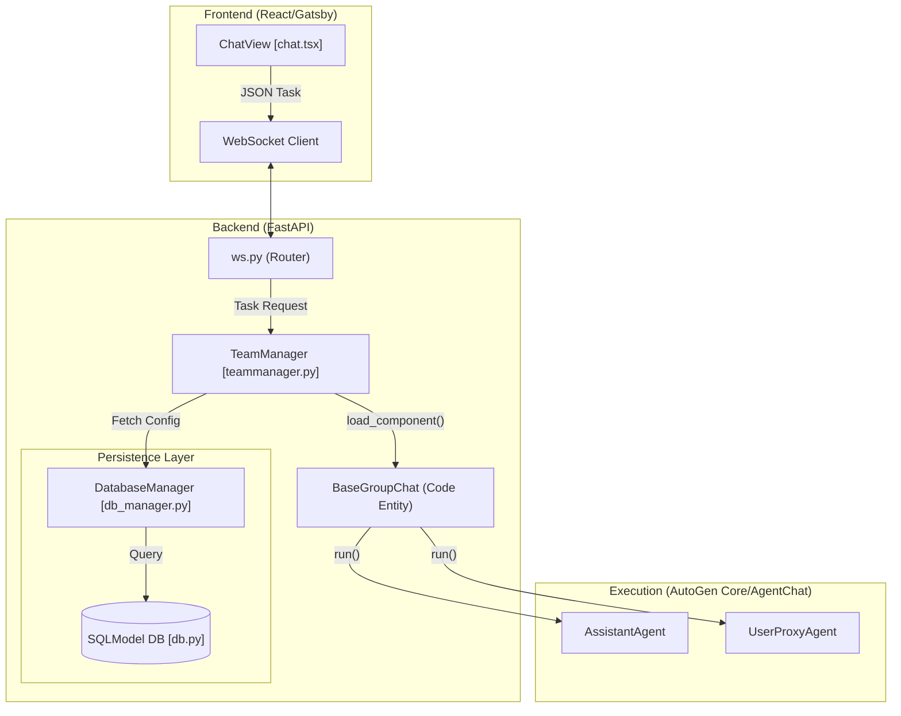
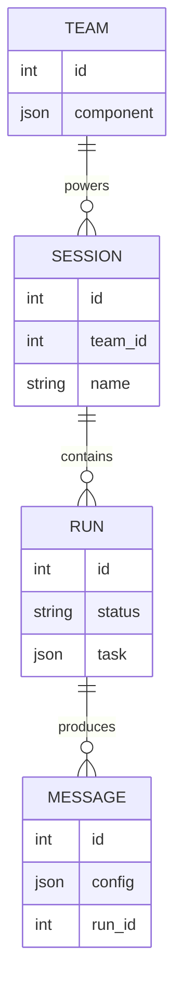

<!-- source: DeepWiki mcp.deepwiki.com · repo microsoft/autogen · page 7 AutoGen Studio · fetched 2026-10-27 -->

# AutoGen Studio

Relevant source files

The following files were used as context for generating this wiki page:

- [python/packages/autogen-studio/autogenstudio/cli.py](python/packages/autogen-studio/autogenstudio/cli.py)
- [python/packages/autogen-studio/autogenstudio/database/schema_manager.py](python/packages/autogen-studio/autogenstudio/database/schema_manager.py)
- [python/packages/autogen-studio/autogenstudio/datamodel/db.py](python/packages/autogen-studio/autogenstudio/datamodel/db.py)
- [python/packages/autogen-studio/autogenstudio/datamodel/types.py](python/packages/autogen-studio/autogenstudio/datamodel/types.py)
- [python/packages/autogen-studio/autogenstudio/gallery/builder.py](python/packages/autogen-studio/autogenstudio/gallery/builder.py)
- [python/packages/autogen-studio/autogenstudio/gallery/tools/__init__.py](python/packages/autogen-studio/autogenstudio/gallery/tools/__init__.py)
- [python/packages/autogen-studio/autogenstudio/teammanager/teammanager.py](python/packages/autogen-studio/autogenstudio/teammanager/teammanager.py)
- [python/packages/autogen-studio/autogenstudio/web/app.py](python/packages/autogen-studio/autogenstudio/web/app.py)
- [python/packages/autogen-studio/autogenstudio/web/initialization.py](python/packages/autogen-studio/autogenstudio/web/initialization.py)
- [python/packages/autogen-studio/autogenstudio/web/routes/runs.py](python/packages/autogen-studio/autogenstudio/web/routes/runs.py)
- [python/packages/autogen-studio/autogenstudio/web/serve.py](python/packages/autogen-studio/autogenstudio/web/serve.py)
- [python/packages/autogen-studio/frontend/src/components/types/datamodel.ts](python/packages/autogen-studio/frontend/src/components/types/datamodel.ts)
- [python/packages/autogen-studio/frontend/src/components/views/atoms.tsx](python/packages/autogen-studio/frontend/src/components/views/atoms.tsx)
- [python/packages/autogen-studio/frontend/src/components/views/gallery/default_gallery.json](python/packages/autogen-studio/frontend/src/components/views/gallery/default_gallery.json)
- [python/packages/autogen-studio/frontend/src/components/views/gallery/store.tsx](python/packages/autogen-studio/frontend/src/components/views/gallery/store.tsx)
- [python/packages/autogen-studio/frontend/src/components/views/playground/chat/agentflow/agentflow.tsx](python/packages/autogen-studio/frontend/src/components/views/playground/chat/agentflow/agentflow.tsx)
- [python/packages/autogen-studio/frontend/src/components/views/playground/chat/agentflow/agentnode.tsx](python/packages/autogen-studio/frontend/src/components/views/playground/chat/agentflow/agentnode.tsx)
- [python/packages/autogen-studio/frontend/src/components/views/playground/chat/agentflow/edge.tsx](python/packages/autogen-studio/frontend/src/components/views/playground/chat/agentflow/edge.tsx)
- [python/packages/autogen-studio/frontend/src/components/views/playground/chat/chat.tsx](python/packages/autogen-studio/frontend/src/components/views/playground/chat/chat.tsx)
- [python/packages/autogen-studio/frontend/src/components/views/playground/chat/rendermessage.tsx](python/packages/autogen-studio/frontend/src/components/views/playground/chat/rendermessage.tsx)
- [python/packages/autogen-studio/frontend/src/components/views/playground/chat/runview.tsx](python/packages/autogen-studio/frontend/src/components/views/playground/chat/runview.tsx)
- [python/packages/autogen-studio/frontend/src/components/views/playground/manager.tsx](python/packages/autogen-studio/frontend/src/components/views/playground/manager.tsx)
- [python/packages/autogen-studio/frontend/src/components/views/playground/newsession.tsx](python/packages/autogen-studio/frontend/src/components/views/playground/newsession.tsx)
- [python/packages/autogen-studio/notebooks/tutorial.ipynb](python/packages/autogen-studio/notebooks/tutorial.ipynb)
- [python/packages/autogen-studio/tests/test_db_manager.py](python/packages/autogen-studio/tests/test_db_manager.py)
- [python/packages/autogen-studio/tests/test_team_manager.py](python/packages/autogen-studio/tests/test_team_manager.py)

AutoGen Studio is a no-code/low-code prototyping interface designed to simplify the creation, testing, and management of multi-agent workflows. It serves as a visual layer atop the `autogen-agentchat` and `autogen-core` libraries, allowing users to define agent teams and conduct experiments through a web-based playground.

The application follows a decoupled architecture with a **FastAPI** backend and a **React/Gatsby** frontend. It leverages a declarative configuration system where agentic components (agents, tools, teams) are serialized as JSON and stored in a database for persistence and portability.

### High-Level System Architecture

The following diagram illustrates how natural language tasks from the UI are transformed into executing code entities within the AutoGen framework.

**From User Input to Multi-Agent Execution**

Sources: [python/packages/autogen-studio/autogenstudio/web/app.py:87-156](), [python/packages/autogen-studio/autogenstudio/teammanager/teammanager.py:23-27](), [python/packages/autogen-studio/frontend/src/components/views/playground/chat/chat.tsx:172-230]()

---

### Core Functionality

AutoGen Studio is organized into three primary functional areas:

| Area | Description | Key Code Entities |
| :--- | :--- | :--- |
| **Team Builder** | A declarative interface for configuring agents, tools, and orchestration strategies. | `Team`, `ComponentModel`, `AgentConfig` |
| **Playground** | A chat interface for running sessions, visualizing agent message flows, and replaying interactions. | `Session`, `Run`, `Message`, `AgentFlow` |
| **Gallery** | A repository of reusable components and reference implementations. | `Gallery`, `GalleryConfig`, `GalleryComponents` |

#### Component Model
The system uses `ComponentModel` [python/packages/autogen-studio/autogenstudio/datamodel/types.py:7]() to wrap AutoGen classes. This allows the UI to treat complex Python objects as serializable data. For example, a `Team` record in the database contains a `component` field which is a JSON representation of a `BaseGroupChat` [python/packages/autogen-studio/autogenstudio/datamodel/db.py:51-53]().

---

### Backend Overview
The backend provides a RESTful API and WebSocket endpoints for real-time agent communication. It manages the lifecycle of "Runs" (individual task executions) within "Sessions" (persistent conversation threads).

**Data Relationships and Code Entities**

Sources: [python/packages/autogen-studio/autogenstudio/datamodel/db.py:51-108](), [python/packages/autogen-studio/autogenstudio/web/routes/runs.py:18-41]()

For more details on the FastAPI structure, database migrations, and the `TeamManager` execution logic, see **[Studio Backend](#7.1)**.

---

### Frontend Overview
The frontend is built using Gatsby and React, providing a stateful interface for managing agent configurations. It features a specialized `AgentFlow` component for visualizing how agents interact during a group chat and a `LogRenderer` for inspecting low-level LLM calls.

Key UI components include:
*   **ChatView**: Manages the WebSocket connection and message streaming [frontend/src/components/views/playground/chat/chat.tsx:45-54]().
*   **RunView**: Renders individual execution attempts, including support for replaying message sequences [frontend/src/components/views/playground/chat/runview.tsx:95-131]().
*   **Component Editor**: A dynamic form generator that maps UI fields to `AgentConfig` or `ToolConfig` properties [frontend/src/components/types/datamodel.ts:246-257]().

For details on the React state management and UI component library, see **[Studio Frontend](#7.2)**.

---

### CLI and Deployment
AutoGen Studio can be launched via a command-line interface, which initializes the web server and the local SQLite database.

| Command | Function |
| :--- | :--- |
| `autogenstudio ui` | Launches the full web interface on a specified host/port [python/packages/autogen-studio/autogenstudio/cli.py:26-36](). |
| `autogenstudio serve` | Serves a specific team configuration as a headless API endpoint [python/packages/autogen-studio/autogenstudio/cli.py:88-95](). |
| `autogenstudio lite` | Launches a simplified version for quick experimentation [python/packages/autogen-studio/autogenstudio/cli.py:135-141](). |

Sources: [python/packages/autogen-studio/autogenstudio/cli.py:11-168]()

---

