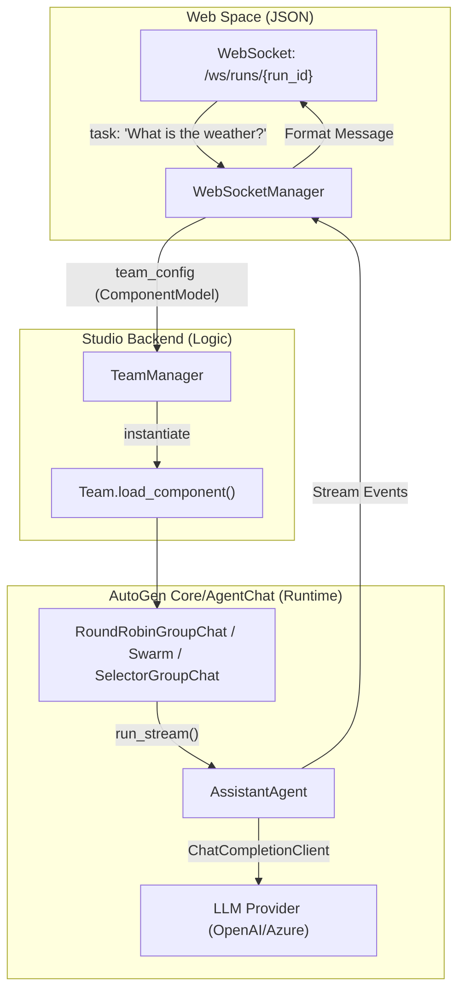
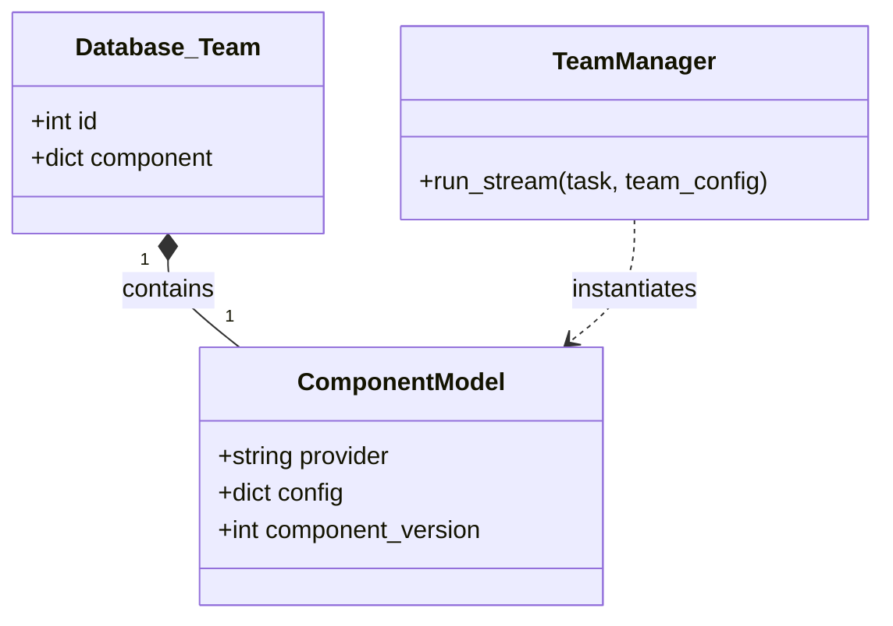

<!-- source: DeepWiki mcp.deepwiki.com · repo microsoft/autogen · page 7.1 Studio Backend · fetched 2026-10-27 -->

# Studio Backend

Relevant source files

The following files were used as context for generating this wiki page:

- [.github/workflows/pytest-redis-memory.yml](.github/workflows/pytest-redis-memory.yml)
- [.gitignore](.gitignore)
- [docs/dotnet/docfx.json](docs/dotnet/docfx.json)
- [python/docs/src/user-guide/agentchat-user-guide/memory.ipynb](python/docs/src/user-guide/agentchat-user-guide/memory.ipynb)
- [python/packages/autogen-ext/src/autogen_ext/memory/redis/__init__.py](python/packages/autogen-ext/src/autogen_ext/memory/redis/__init__.py)
- [python/packages/autogen-ext/src/autogen_ext/memory/redis/_redis_memory.py](python/packages/autogen-ext/src/autogen_ext/memory/redis/_redis_memory.py)
- [python/packages/autogen-ext/tests/memory/test_redis_memory.py](python/packages/autogen-ext/tests/memory/test_redis_memory.py)
- [python/packages/autogen-studio/autogenstudio/cli.py](python/packages/autogen-studio/autogenstudio/cli.py)
- [python/packages/autogen-studio/autogenstudio/database/db_manager.py](python/packages/autogen-studio/autogenstudio/database/db_manager.py)
- [python/packages/autogen-studio/autogenstudio/database/schema_manager.py](python/packages/autogen-studio/autogenstudio/database/schema_manager.py)
- [python/packages/autogen-studio/autogenstudio/datamodel/db.py](python/packages/autogen-studio/autogenstudio/datamodel/db.py)
- [python/packages/autogen-studio/autogenstudio/datamodel/types.py](python/packages/autogen-studio/autogenstudio/datamodel/types.py)
- [python/packages/autogen-studio/autogenstudio/gallery/builder.py](python/packages/autogen-studio/autogenstudio/gallery/builder.py)
- [python/packages/autogen-studio/autogenstudio/gallery/tools/__init__.py](python/packages/autogen-studio/autogenstudio/gallery/tools/__init__.py)
- [python/packages/autogen-studio/autogenstudio/teammanager/teammanager.py](python/packages/autogen-studio/autogenstudio/teammanager/teammanager.py)
- [python/packages/autogen-studio/autogenstudio/validation/validation_service.py](python/packages/autogen-studio/autogenstudio/validation/validation_service.py)
- [python/packages/autogen-studio/autogenstudio/version.py](python/packages/autogen-studio/autogenstudio/version.py)
- [python/packages/autogen-studio/autogenstudio/web/app.py](python/packages/autogen-studio/autogenstudio/web/app.py)
- [python/packages/autogen-studio/autogenstudio/web/initialization.py](python/packages/autogen-studio/autogenstudio/web/initialization.py)
- [python/packages/autogen-studio/autogenstudio/web/managers/connection.py](python/packages/autogen-studio/autogenstudio/web/managers/connection.py)
- [python/packages/autogen-studio/autogenstudio/web/routes/mcp.py](python/packages/autogen-studio/autogenstudio/web/routes/mcp.py)
- [python/packages/autogen-studio/autogenstudio/web/routes/runs.py](python/packages/autogen-studio/autogenstudio/web/routes/runs.py)
- [python/packages/autogen-studio/autogenstudio/web/routes/ws.py](python/packages/autogen-studio/autogenstudio/web/routes/ws.py)
- [python/packages/autogen-studio/autogenstudio/web/serve.py](python/packages/autogen-studio/autogenstudio/web/serve.py)
- [python/packages/autogen-studio/frontend/src/components/sidebar.tsx](python/packages/autogen-studio/frontend/src/components/sidebar.tsx)
- [python/packages/autogen-studio/frontend/src/components/types/component-templates.ts](python/packages/autogen-studio/frontend/src/components/types/component-templates.ts)
- [python/packages/autogen-studio/frontend/src/components/types/datamodel.ts](python/packages/autogen-studio/frontend/src/components/types/datamodel.ts)
- [python/packages/autogen-studio/frontend/src/components/views/atoms.tsx](python/packages/autogen-studio/frontend/src/components/views/atoms.tsx)
- [python/packages/autogen-studio/frontend/src/components/views/gallery/default_gallery.json](python/packages/autogen-studio/frontend/src/components/views/gallery/default_gallery.json)
- [python/packages/autogen-studio/frontend/src/components/views/gallery/store.tsx](python/packages/autogen-studio/frontend/src/components/views/gallery/store.tsx)
- [python/packages/autogen-studio/frontend/src/components/views/playground/chat/agentflow/agentflow.tsx](python/packages/autogen-studio/frontend/src/components/views/playground/chat/agentflow/agentflow.tsx)
- [python/packages/autogen-studio/frontend/src/components/views/playground/chat/agentflow/agentnode.tsx](python/packages/autogen-studio/frontend/src/components/views/playground/chat/agentflow/agentnode.tsx)
- [python/packages/autogen-studio/frontend/src/components/views/playground/chat/agentflow/edge.tsx](python/packages/autogen-studio/frontend/src/components/views/playground/chat/agentflow/edge.tsx)
- [python/packages/autogen-studio/frontend/src/components/views/playground/chat/chat.tsx](python/packages/autogen-studio/frontend/src/components/views/playground/chat/chat.tsx)
- [python/packages/autogen-studio/frontend/src/components/views/playground/chat/rendermessage.tsx](python/packages/autogen-studio/frontend/src/components/views/playground/chat/rendermessage.tsx)
- [python/packages/autogen-studio/frontend/src/components/views/playground/chat/runview.tsx](python/packages/autogen-studio/frontend/src/components/views/playground/chat/runview.tsx)
- [python/packages/autogen-studio/frontend/src/components/views/playground/manager.tsx](python/packages/autogen-studio/frontend/src/components/views/playground/manager.tsx)
- [python/packages/autogen-studio/frontend/src/components/views/playground/newsession.tsx](python/packages/autogen-studio/frontend/src/components/views/playground/newsession.tsx)
- [python/packages/autogen-studio/frontend/src/components/views/teambuilder/builder/component-editor/fields/agent-fields.tsx](python/packages/autogen-studio/frontend/src/components/views/teambuilder/builder/component-editor/fields/agent-fields.tsx)
- [python/packages/autogen-studio/frontend/src/components/views/teambuilder/builder/component-editor/fields/tool-fields.tsx](python/packages/autogen-studio/frontend/src/components/views/teambuilder/builder/component-editor/fields/tool-fields.tsx)
- [python/packages/autogen-studio/frontend/src/components/views/teambuilder/builder/component-editor/fields/workbench/workbench-fields.tsx](python/packages/autogen-studio/frontend/src/components/views/teambuilder/builder/component-editor/fields/workbench/workbench-fields.tsx)
- [python/packages/autogen-studio/notebooks/tutorial.ipynb](python/packages/autogen-studio/notebooks/tutorial.ipynb)
- [python/packages/autogen-studio/tests/test_db_manager.py](python/packages/autogen-studio/tests/test_db_manager.py)
- [python/packages/autogen-studio/tests/test_team_manager.py](python/packages/autogen-studio/tests/test_team_manager.py)

The AutoGen Studio backend is a **FastAPI-based** web application that provides a management layer for agents, teams, and conversation sessions. It handles persistent storage via **SQLModel**, manages real-time execution of agent teams through **WebSockets**, and provides a validation layer for agent configurations.

## CLI Entrypoint and Initialization

The backend is typically launched via the `autogenstudio` CLI. The primary command `autogenstudio ui` configures the environment and spawns a **Uvicorn** server.

### CLI Entrypoint
The `ui` command in [python/packages/autogen-studio/autogenstudio/cli.py:26-85]() allows users to specify the host, port, and database URI. It writes these configurations to a temporary environment file at `~/.autogenstudio/temp_env_vars.env` [python/packages/autogen-studio/autogenstudio/cli.py:18-22]() to ensure consistency across Uvicorn worker processes.

### App Initialization
The FastAPI application is defined in [python/packages/autogen-studio/autogenstudio/web/app.py](). During startup, it:
1.  **Database Setup**: Initializes the `DatabaseManager` and runs migrations via `SchemaManager` [python/packages/autogen-studio/autogenstudio/database/db_manager.py:63-107]().
2.  **Route Registration**: Mounts modular routers for different entities:
    *   `/runs`: Execution lifecycle management.
    *   `/sessions`: Conversation history.
    *   `/teams`: Team and agent configurations.
    *   `/gallery`: Pre-configured components.
    *   `/mcp`: Model Context Protocol server management.
    *   `/ws`: WebSocket endpoints for real-time interaction.

**Sources:**
*   [python/packages/autogen-studio/autogenstudio/cli.py:26-85]()
*   [python/packages/autogen-studio/autogenstudio/web/app.py]()
*   [python/packages/autogen-studio/autogenstudio/database/db_manager.py:63-107]()

---

## Data Flow: Web Request to Agent Execution

The backend bridges the gap between the React frontend (JSON configurations) and the Pythonic `autogen-agentchat` runtime.

### Natural Language to Code Entity Mapping
The following diagram illustrates how a user request flows through backend entities into the agent runtime.

**Sources:**
*   [python/packages/autogen-studio/autogenstudio/web/managers/connection.py:85-165]()
*   [python/packages/autogen-studio/autogenstudio/teammanager/teammanager.py]()
*   [python/packages/autogen-studio/autogenstudio/datamodel/types.py:19-23]()

---

## Database Layer

The backend uses **SQLModel** (which combines SQLAlchemy and Pydantic) to manage persistence.

### DatabaseManager and SchemaManager
The `DatabaseManager` handles the engine lifecycle and CRUD operations [python/packages/autogen-studio/autogenstudio/database/db_manager.py:31-54](). It utilizes a `SchemaManager` to handle **Alembic** migrations and auto-upgrades [python/packages/autogen-studio/autogenstudio/database/schema_manager.py]().

| Entity | Role | Key Fields |
| :--- | :--- | :--- |
| `Team` | Stores team topology | `component` (JSON), `user_id` |
| `Session` | Groups related runs | `team_id`, `user_id`, `name` |
| `Run` | A single execution task | `status`, `task` (JSON), `team_result` |
| `Message` | Individual agent messages | `config` (JSON), `run_id`, `session_id` |

### Cascade Deletion Logic
The system implements strict foreign key constraints. Deleting a `Session` triggers a cascade delete of all associated `Run` objects, which in turn deletes all `Message` objects [python/packages/autogen-studio/tests/test_db_manager.py:109-169]().

**Sources:**
*   [python/packages/autogen-studio/autogenstudio/database/db_manager.py:31-54]()
*   [python/packages/autogen-studio/autogenstudio/datamodel/db.py]()
*   [python/packages/autogen-studio/tests/test_db_manager.py:109-169]()

---

## Real-time Execution: WebSocketManager

The `WebSocketManager` is the orchestrator for active agent runs. It manages the lifecycle of a `CancellationToken` and handles the mapping of internal events to frontend-compatible JSON.

### Execution Loop
When a client connects to a run:
1.  **Context Population**: It uses `RunContext.populate_context(run_id=run_id)` to track execution state [python/packages/autogen-studio/autogenstudio/web/managers/connection.py:94]().
2.  **Stream Processing**: It iterates over `TeamManager.run_stream(...)` [python/packages/autogen-studio/autogenstudio/web/managers/connection.py:115-121]().
3.  **Message Transformation**: Every `BaseAgentEvent` or `ChatMessage` is formatted via `_format_message` before being sent to the socket [python/packages/autogen-studio/autogenstudio/web/managers/connection.py:126-146]().
4.  **Persistence**: Final `TeamResult` objects and intermediate messages are saved to the database [python/packages/autogen-studio/autogenstudio/web/managers/connection.py:143-149]().

**Sources:**
*   [python/packages/autogen-studio/autogenstudio/web/managers/connection.py:42-172]()
*   [python/packages/autogen-studio/autogenstudio/datamodel/types.py:122-126]()

---

## Validation Service

The `ValidationService` ensures that the JSON configurations sent from the UI can be successfully instantiated into functional Python objects before a run begins.

### Validation Workflow
1.  **Schema Validation**: Checks if the JSON matches the expected `ComponentModel` or specific agent/tool schemas.
2.  **Provider Import**: Attempts to import the specified provider (e.g., `autogen_agentchat.agents.AssistantAgent`) [python/packages/autogen-studio/autogenstudio/validation/validation_service.py]().
3.  **Dry-run Instantiation**: Attempts to instantiate the component in a sandboxed way to catch configuration errors (like missing API keys or invalid tool signatures).

**Sources:**
*   [python/packages/autogen-studio/autogenstudio/validation/validation_service.py]()
*   [python/packages/autogen-studio/autogenstudio/teammanager/teammanager.py]()

---

## Component System and Gallery

Studio treats Agents, Teams, Tools, and Models as **Components**.

### Component Hierarchy
The following diagram shows the relationship between database storage and the `autogen-core` component model.

The `Gallery` module provides a set of default `ComponentModel` definitions stored in `default_gallery.json` [python/packages/autogen-studio/frontend/src/components/views/gallery/default_gallery.json](), which are loaded into the database during the first initialization [python/packages/autogen-studio/autogenstudio/gallery/builder.py]().

**Sources:**
*   [python/packages/autogen-studio/autogenstudio/datamodel/db.py]()
*   [python/packages/autogen-studio/autogenstudio/datamodel/types.py:67-75]()
*   [python/packages/autogen-studio/autogenstudio/gallery/builder.py]()

---

