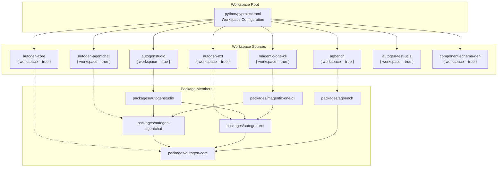
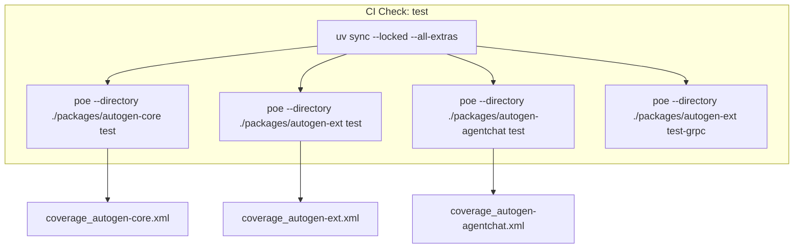

<!-- source: DeepWiki mcp.deepwiki.com · repo microsoft/autogen · page 9.1 Python Workspace · fetched 2026-10-27 -->

# Python Workspace

<details>
<summary>Relevant source files</summary>

The following files were used as context for generating this wiki page:

- [.github/workflows/checks.yml](.github/workflows/checks.yml)
- [.github/workflows/codeql.yml](.github/workflows/codeql.yml)
- [.github/workflows/dotnet-build.yml](.github/workflows/dotnet-build.yml)
- [.github/workflows/integration.yml](.github/workflows/integration.yml)
- [.github/workflows/single-python-package.yml](.github/workflows/single-python-package.yml)
- [CONTRIBUTING.md](CONTRIBUTING.md)
- [python/.gitignore](python/.gitignore)
- [python/README.md](python/README.md)
- [python/docs/src/conf.py](python/docs/src/conf.py)
- [python/packages/agbench/pyproject.toml](python/packages/agbench/pyproject.toml)
- [python/packages/pyautogen/LICENSE-CODE](python/packages/pyautogen/LICENSE-CODE)
- [python/packages/pyautogen/README.md](python/packages/pyautogen/README.md)
- [python/packages/pyautogen/pyproject.toml](python/packages/pyautogen/pyproject.toml)
- [python/packages/pyautogen/src/pyautogen/__init__.py](python/packages/pyautogen/src/pyautogen/__init__.py)
- [python/pyproject.toml](python/pyproject.toml)
- [python/templates/new-package/cookiecutter.json](python/templates/new-package/cookiecutter.json)
- [python/templates/new-package/hooks/post_gen_project.py](python/templates/new-package/hooks/post_gen_project.py)
- [python/templates/new-package/hooks/pre_gen_project.py](python/templates/new-package/hooks/pre_gen_project.py)
- [python/templates/new-package/{{cookiecutter.package_name}}/README.md](python/templates/new-package/{{cookiecutter.package_name}}/README.md)
- [python/templates/new-package/{{cookiecutter.package_name}}/pyproject.toml](python/templates/new-package/{{cookiecutter.package_name}}/pyproject.toml)
- [python/templates/new-package/{{cookiecutter.package_name}}/src/{{cookiecutter.__project_slug}}/__init__.py](python/templates/new-package/{{cookiecutter.package_name}}/src/{{cookiecutter.__project_slug}}/__init__.py)
- [python/templates/new-package/{{cookiecutter.package_name}}/src/{{cookiecutter.__project_slug}}/py.typed](python/templates/new-package/{{cookiecutter.package_name}}/src/{{cookiecutter.__project_slug}}/py.typed)
- [python/templates/new-package/{{cookiecutter.package_name}}/tests/test_example.py](python/templates/new-package/{{cookiecutter.package_name}}/tests/test_example.py)

</details>


## Overview

This document describes the Python workspace structure and development tooling for contributors to the AutoGen repository. It covers the monorepo organization, dependency management with `uv`, task automation with `poethepoet`, code quality enforcement through `ruff`, `mypy`, and `pyright`, testing with `pytest`, and protobuf code generation.

For information about the DevContainer setup and environment configuration, see [Development Containers](#9.2). For CI/CD pipeline details, see [CI/CD Workflows](#9.3). For package architecture and installation, see [Package Architecture](#1.1).

## Monorepo Structure

The Python workspace is organized as a monorepo located at `python/` in the repository root. All Python packages are managed as workspace members through `uv`'s workspace feature.

### Workspace Members

The workspace is configured in [python/pyproject.toml:47-49]():

```toml
[tool.uv.workspace]
members = ["packages/*"]
exclude = ["packages/autogen-magentic-one"]
```

| Package | Purpose | Location |
|---------|---------|----------|
| `autogen-core` | Interface definitions and reference implementations of agent runtime, model, tool, workbench, memory, and tracing. | `packages/autogen-core` |
| `autogen-agentchat` | Single and multi-agent workflows built on top of `autogen-core`. | `packages/autogen-agentchat` |
| `autogen-ext` | Implementations for ecosystem integrations (e.g., OpenAI, Docker). | `packages/autogen-ext` |
| `agbench` | Benchmarking tools for AutoGen. | `packages/agbench` |
| `autogenstudio` | Web-based IDE for building and running AutoGen agents. | `packages/autogenstudio` |
| `magentic-one-cli` | CLI for the MagenticOne multi-agent system. | `packages/magentic-one-cli` |
| `autogen-test-utils` | Shared testing utilities. | `packages/autogen-test-utils` |
| `component-schema-gen` | Tooling for generating component schemas. | `packages/component-schema-gen` |
| `pyautogen` | Proxy package for backward compatibility. | `packages/pyautogen` |

**Sources:** [python/pyproject.toml:47-60](), [python/README.md:7-13]()

### Workspace Dependency Resolution

The workspace uses `uv.sources` to ensure packages reference their workspace versions rather than PyPI releases:



**Sources:** [python/pyproject.toml:51-59]()

## Package Management with uv

The workspace uses `uv` as its primary package manager, replacing traditional `pip` and `venv` workflows.

### Installation and Synchronization

To set up the development environment, developers install `uv` and run the sync command from the `python/` directory [python/README.md:32-49]():

```bash
# Sync all dependencies and create .venv
uv sync --all-extras

# Activate the environment
source .venv/bin/activate
```

The `--all-extras` flag ensures that optional dependencies for all workspace members are installed [python/README.md:51-52]().

### Dependency Groups

Development dependencies are organized in the `dev` dependency group at the workspace root [python/pyproject.toml:1-38]():

| Category | Tools |
|----------|-------|
| Type Checking | `pyright==1.1.389`, `mypy==1.13.0`, `mypy-protobuf` |
| Linting/Formatting | `ruff==0.4.8` |
| Testing | `pytest`, `pytest-asyncio`, `pytest-cov`, `pytest-xdist`, `pytest_mock` |
| Task Automation | `poethepoet` |
| Protobuf | `grpcio-tools~=1.70.0` |
| Documentation | `sphinx`, `myst-nb==1.1.2`, `pydata-sphinx-theme==0.16.0`, `autodoc_pydantic~=2.2` |

### Dependency Overrides

The workspace enforces minimum versions for certain dependencies to resolve conflicts across packages [python/pyproject.toml:40-46]():

```toml
[tool.uv]
override-dependencies = [
    "tenacity>=9.0.0",
    "aiofiles>=24.1.0",
    "chainlit>=2.0.1",
    "httpx>=0.27.0",
]
```

**Sources:** [python/pyproject.toml:1-46](), [python/README.md:28-52]()

## Task Automation with poethepoet

Development tasks are automated using `poethepoet` (invoked as `poe`). The root `pyproject.toml` delegates many tasks to individual packages using a helper script `run_task_in_pkgs_if_exist.py` [python/pyproject.toml:110-116]().

### Common Tasks

| Task | Command | Purpose |
|------|---------|---------|
| `fmt` | `poe fmt` | Format code with ruff [python/pyproject.toml:111]() |
| `lint` | `poe lint` | Lint code with ruff [python/pyproject.toml:113]() |
| `pyright` | `poe pyright` | Strict type checking with pyright [python/pyproject.toml:114]() |
| `mypy` | `poe mypy` | Strict type checking with mypy [python/pyproject.toml:115]() |
| `test` | `poe test` | Run pytest across packages [python/pyproject.toml:116]() |
| `check` | `poe check` | Run all formatting, linting, type-checking, and tests [python/pyproject.toml:120]() |

### Protobuf Generation

Protobuf generation is handled by the `gen-proto` task, which runs `protoc` and a fixup script to correct generated imports [python/pyproject.toml:130-133]():

```toml
gen-proto = [
    { cmd = "python -m grpc_tools.protoc --python_out=./packages/autogen-ext/src/autogen_ext/runtimes/grpc/protos --grpc_python_out=./packages/autogen-ext/src/autogen_ext/runtimes/grpc/protos --mypy_out=./packages/autogen-ext/src/autogen_ext/runtimes/grpc/protos --mypy_grpc_out=./packages/autogen-ext/src/autogen_ext/runtimes/grpc/protos --proto_path ../protos/ agent_worker.proto --proto_path ../protos/ cloudevent.proto" },
    { script = "fixup_generated_files:main" }
]
```

**Sources:** [python/pyproject.toml:110-143](), [python/README.md:54-70]()

## Code Quality Tools

### Ruff

Ruff is used for both linting and formatting. It is configured with a line length of 120 and targets Python 3.10 [python/pyproject.toml:61-65]().

```toml
[tool.ruff.lint]
select = ["E", "F", "W", "B", "Q", "I", "ASYNC", "T20"]
ignore = ["F401", "E501"]
```

The configuration includes rules for bugbear (`B`), import sorting (`I`), and prohibits `unittest` in favor of `pytest` via `banned-api` [python/pyproject.toml:71-79]().

### Mypy

Mypy is configured for "strict" type checking [python/pyproject.toml:81-82](). Key enforcements include:
- `disallow_untyped_defs = true` [python/pyproject.toml:87]()
- `no_implicit_optional = true` [python/pyproject.toml:88]()
- `disallow_any_unimported = true` [python/pyproject.toml:96]()

### Pyright

Pyright also runs in "strict" mode and is configured to include `src`, `tests`, and `samples` [python/pyproject.toml:98-101]().

**Sources:** [python/pyproject.toml:61-103]()

## Testing with Pytest

Tests are executed using `pytest`. The workspace root configuration includes custom markers for gRPC functionality [python/pyproject.toml:144-147]().

### CI Test Execution

The CI pipeline runs tests in a matrix across major packages using `uv` to sync the environment and `poe` to trigger the tests [.github/workflows/checks.yml:124-152]().



**Sources:** [python/pyproject.toml:144-147](), [.github/workflows/checks.yml:124-195]()

## Cookiecutter Template

A `cookiecutter` template is provided in `python/templates/new-package/` to standardize the creation of new packages within the monorepo.

### Template Structure
The template generates a standard `pyproject.toml` that extends the root workspace configuration [python/templates/new-package/{{cookiecutter.package_name}}/pyproject.toml:27-33]():

```toml
[tool.ruff]
extend = "../../pyproject.toml"

[tool.pyright]
extends = "../../pyproject.toml"
```

It also sets up standard tasks like `test = "pytest -n auto"` [python/templates/new-package/{{cookiecutter.package_name}}/pyproject.toml:43]().

**Sources:** [python/templates/new-package/{{cookiecutter.package_name}}/pyproject.toml:1-44]()

## Summary of Quality Gates

| Gate | Tool | Configuration |
|------|------|---------------|
| Formatting | `ruff format` | `docstring-code-format = true` [python/pyproject.toml:68]() |
| Linting | `ruff check` | `select = ["E", "F", "W", "B", "Q", "I", "ASYNC", "T20"]` [python/pyproject.toml:71]() |
| Type Safety | `mypy` | `strict = true`, `disallow_untyped_defs = true` [python/pyproject.toml:82-87]() |
| Type Safety | `pyright` | `typeCheckingMode = "strict"` [python/pyproject.toml:101]() |
| Logic | `pytest` | `pytest-asyncio`, `pytest-xdist` [python/pyproject.toml:7-9]() |

**Sources:** [python/pyproject.toml:61-148]()

---

