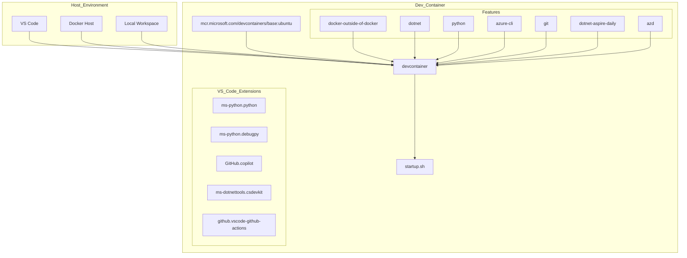
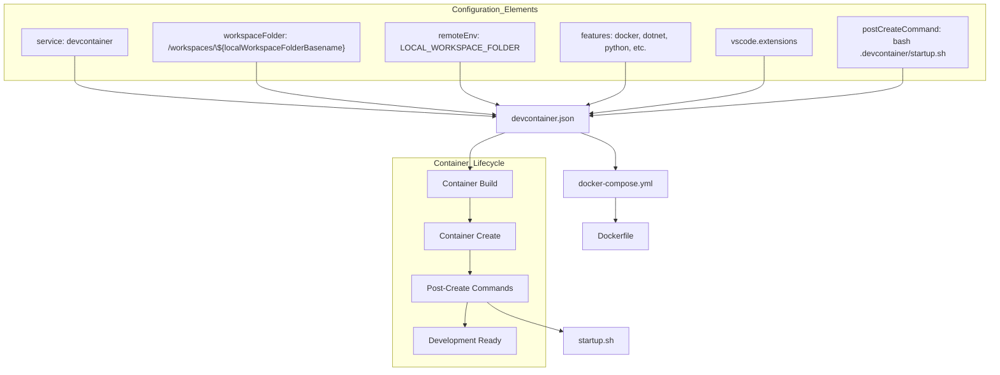
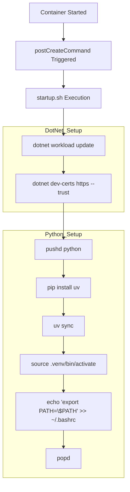
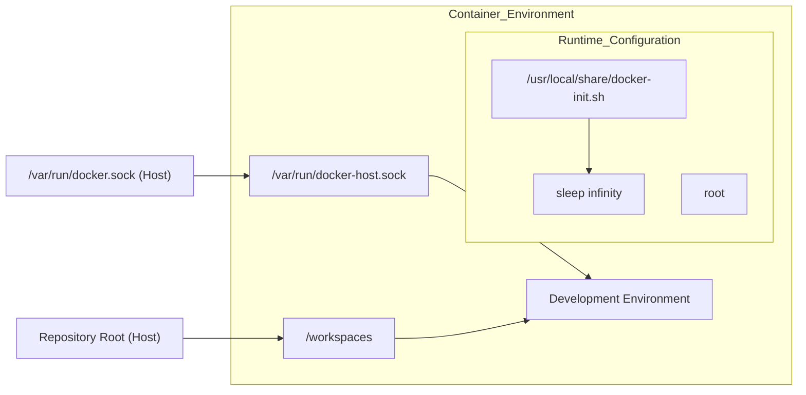

<!-- source: DeepWiki mcp.deepwiki.com · repo microsoft/autogen · page 9.2 Development Containers · fetched 2026-10-27 -->

# Development Containers

Relevant source files

The following files were used as context for generating this wiki page:

- [.devcontainer/Dockerfile](.devcontainer/Dockerfile)
- [.devcontainer/devcontainer.json](.devcontainer/devcontainer.json)
- [.devcontainer/docker-compose.yml](.devcontainer/docker-compose.yml)
- [.devcontainer/startup.sh](.devcontainer/startup.sh)

This document covers the development container configuration that provides a consistent, isolated development environment for AutoGen contributors. The dev container setup includes both Python and .NET development tools, along with Docker support and pre-configured VS Code extensions.

For information about the broader development environment setup, see [Python Workspace](9.1). For CI/CD automation workflows, see [CI/CD Workflows](9.3).

## Container Architecture

The AutoGen development container is built using a multi-component architecture that combines Docker Compose orchestration with VS Code dev container features.

### Development Container Components

Title: "DevContainer Architecture and Host Integration"

Sources: [.devcontainer/devcontainer.json:1-48](), [.devcontainer/Dockerfile:1-7](), [.devcontainer/docker-compose.yml:1-27]()

## Configuration Structure

The dev container configuration follows a layered approach where Docker Compose manages the container lifecycle, while the `devcontainer.json` defines development-specific features and customizations.

### Configuration Flow

Title: "Configuration and Initialization Flow"

Sources: [.devcontainer/devcontainer.json:4-7](), [.devcontainer/devcontainer.json:32](), [.devcontainer/docker-compose.yml:4-7]()

## Features and Extensions

The dev container includes a comprehensive set of pre-configured features and VS Code extensions to support AutoGen development across multiple technologies.

### Installed Features

| Feature | Version | Purpose |
|---------|---------|---------|
| `docker-outside-of-docker` | latest | Enables Docker commands from within container via `moby` and `installDockerBuildx` [.devcontainer/devcontainer.json:15-18]() |
| `dotnet` | 2 | .NET SDK and runtime for AutoGen .NET development [.devcontainer/devcontainer.json:24]() |
| `python` | 1 | Python runtime for core AutoGen development [.devcontainer/devcontainer.json:26]() |
| `azure-cli` | 1 | Azure service integration and deployment [.devcontainer/devcontainer.json:22]() |
| `git` | 1 | Version control operations [.devcontainer/devcontainer.json:23]() |
| `dotnet-aspire-daily` | 1 | .NET Aspire framework for cloud-native apps [.devcontainer/devcontainer.json:21]() |
| `azd` | 0 | Azure Developer CLI for deployment [.devcontainer/devcontainer.json:25]() |

### VS Code Extensions

The following extensions are automatically installed in the container environment:
- `ms-python.python` and `ms-python.debugpy` for Python development [.devcontainer/devcontainer.json:39-40]()
- `GitHub.copilot` for AI assistance [.devcontainer/devcontainer.json:41]()
- `ms-dotnettools.csdevkit` and `ms-dotnettools.vscodeintellicode-csharp` for C# and .NET support [.devcontainer/devcontainer.json:42-43]()
- `github.vscode-github-actions` for workflow management [.devcontainer/devcontainer.json:44]()

Sources: [.devcontainer/devcontainer.json:14-27](), [.devcontainer/devcontainer.json:38-45]()

## Setup Process

The development container follows a structured setup process that initializes both .NET and Python development environments after container creation using the `postCreateCommand` [.devcontainer/devcontainer.json:32]().

### Startup Script Workflow

Title: "startup.sh Execution Logic"

The script specifically installs `uv` to manage the Python workspace and synchronizes dependencies via `uv sync` [.devcontainer/startup.sh:9-10]().

Sources: [.devcontainer/startup.sh:1-14](), [.devcontainer/devcontainer.json:32]()

## Volume Mounting and Development Workflow

The dev container uses Docker Compose to manage volume mounts that enable seamless development between the host system and container environment.

### Volume Configuration

The container mounts two critical volumes:
- **Docker Socket**: `/var/run/docker.sock:/var/run/docker-host.sock` enables Docker-in-Docker capabilities [.devcontainer/docker-compose.yml:11]().
- **Workspace**: `../..:/workspaces:cached` mounts the repository root into the container with cached performance optimization [.devcontainer/docker-compose.yml:13]().

### Container Lifecycle Management

Title: "Container Runtime and Resource Mapping"

The container uses `sleep infinity` as the command to keep it running indefinitely [.devcontainer/docker-compose.yml:17](), while the Docker init script handles proper initialization [.devcontainer/docker-compose.yml:16]().

Sources: [.devcontainer/docker-compose.yml:10-13](), [.devcontainer/docker-compose.yml:16-17](), [.devcontainer/devcontainer.json:35]()

## Environment Variables

The dev container configures specific environment variables to support development workflows:

- **`LOCAL_WORKSPACE_FOLDER`**: Set to `${localWorkspaceFolder}` to enable bind mounting local source code into new containers [.devcontainer/devcontainer.json:10-12]().
- **`PATH`**: Extended during Python setup in `startup.sh` to include the virtual environment path in the shell configuration [.devcontainer/startup.sh:12]().

The `remoteUser` is configured as `root` to ensure proper permissions for Docker operations and development tool access [.devcontainer/devcontainer.json:35]().

Sources: [.devcontainer/devcontainer.json:10-12](), [.devcontainer/devcontainer.json:35](), [.devcontainer/startup.sh:12]()

---

