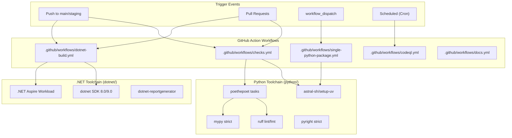
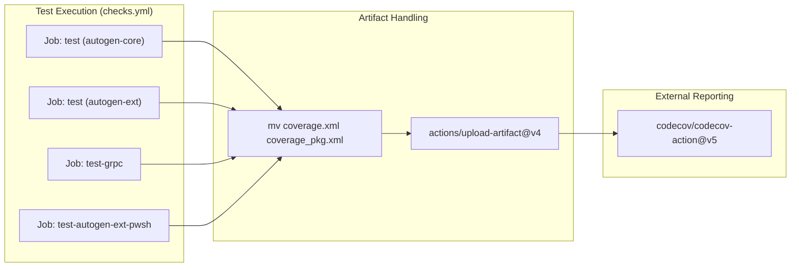
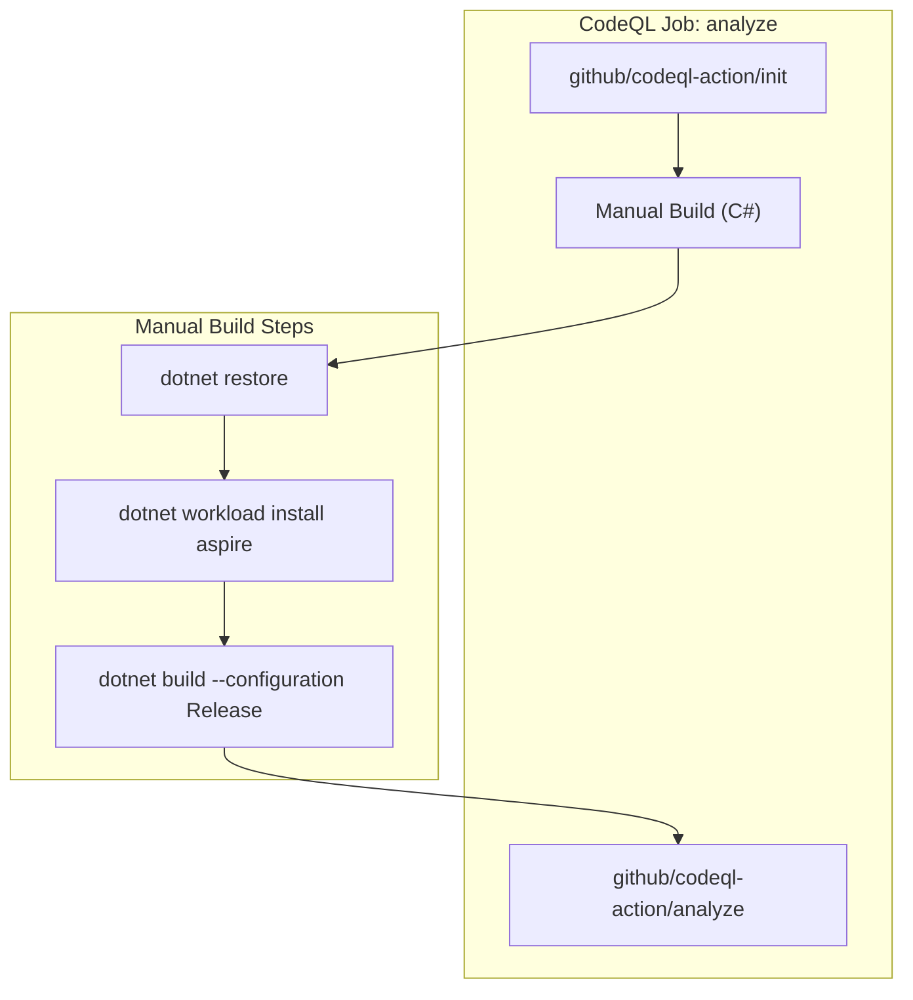

<!-- source: DeepWiki mcp.deepwiki.com · repo microsoft/autogen · page 9.3 CI/CD Workflows · fetched 2026-10-27 -->

# CI/CD Workflows

Relevant source files

The following files were used as context for generating this wiki page:

- [.azure/pipelines/build.yaml](.azure/pipelines/build.yaml)
- [.azure/pipelines/templates/build.yaml](.azure/pipelines/templates/build.yaml)
- [.azure/pipelines/templates/vars.yaml](.azure/pipelines/templates/vars.yaml)
- [.github/workflows/checks.yml](.github/workflows/checks.yml)
- [.github/workflows/codeql.yml](.github/workflows/codeql.yml)
- [.github/workflows/dotnet-build.yml](.github/workflows/dotnet-build.yml)
- [.github/workflows/dotnet-release.yml](.github/workflows/dotnet-release.yml)
- [.github/workflows/integration.yml](.github/workflows/integration.yml)
- [.github/workflows/single-python-package.yml](.github/workflows/single-python-package.yml)
- [dotnet/PACKAGING.md](dotnet/PACKAGING.md)
- [dotnet/nuget/README.md](dotnet/nuget/README.md)
- [dotnet/src/AutoGen.DotnetInteractive/AutoGen.DotnetInteractive.csproj](dotnet/src/AutoGen.DotnetInteractive/AutoGen.DotnetInteractive.csproj)
- [dotnet/src/AutoGen.DotnetInteractive/Extension/AgentExtension.cs](dotnet/src/AutoGen.DotnetInteractive/Extension/AgentExtension.cs)
- [dotnet/src/AutoGen.DotnetInteractive/Extension/KernelExtension.cs](dotnet/src/AutoGen.DotnetInteractive/Extension/KernelExtension.cs)
- [dotnet/src/AutoGen.DotnetInteractive/InteractiveService.cs](dotnet/src/AutoGen.DotnetInteractive/InteractiveService.cs)
- [dotnet/src/AutoGen.SourceGenerator/AutoGen.SourceGenerator.csproj](dotnet/src/AutoGen.SourceGenerator/AutoGen.SourceGenerator.csproj)
- [dotnet/test/AutoGen.DotnetInteractive.Tests/AutoGen.DotnetInteractive.Tests.csproj](dotnet/test/AutoGen.DotnetInteractive.Tests/AutoGen.DotnetInteractive.Tests.csproj)
- [dotnet/test/AutoGen.Gemini.Tests/ApprovalTests/FunctionContractExtensionTests.ItGenerateGetWeatherToolTest.approved.txt](dotnet/test/AutoGen.Gemini.Tests/ApprovalTests/FunctionContractExtensionTests.ItGenerateGetWeatherToolTest.approved.txt)
- [dotnet/test/Microsoft.AutoGen.AgentChat.Tests/Microsoft.AutoGen.AgentChat.Tests.csproj](dotnet/test/Microsoft.AutoGen.AgentChat.Tests/Microsoft.AutoGen.AgentChat.Tests.csproj)
- [dotnet/test/Microsoft.AutoGen.Integration.Tests/HelloAppHostIntegrationTests.cs](dotnet/test/Microsoft.AutoGen.Integration.Tests/HelloAppHostIntegrationTests.cs)
- [dotnet/test/Microsoft.AutoGen.Integration.Tests/InMemoryRuntimeIntegrationTests.cs](dotnet/test/Microsoft.AutoGen.Integration.Tests/InMemoryRuntimeIntegrationTests.cs)
- [dotnet/test/Microsoft.AutoGen.Integration.Tests/Infrastructure/DistributedApplicationExtension.cs](dotnet/test/Microsoft.AutoGen.Integration.Tests/Infrastructure/DistributedApplicationExtension.cs)
- [dotnet/test/Microsoft.AutoGen.Integration.Tests/Infrastructure/DistributedApplicationTestFactory.cs](dotnet/test/Microsoft.AutoGen.Integration.Tests/Infrastructure/DistributedApplicationTestFactory.cs)
- [dotnet/test/Microsoft.AutoGen.Integration.Tests/Microsoft.AutoGen.Integration.Tests.csproj](dotnet/test/Microsoft.AutoGen.Integration.Tests/Microsoft.AutoGen.Integration.Tests.csproj)
- [dotnet/test/Microsoft.AutoGen.RuntimeGateway.Grpc.Tests/Microsoft.AutoGen.RuntimeGateway.Grpc.Tests.csproj](dotnet/test/Microsoft.AutoGen.RuntimeGateway.Grpc.Tests/Microsoft.AutoGen.RuntimeGateway.Grpc.Tests.csproj)
- [dotnet/website/articles/Run-dotnet-code.md](dotnet/website/articles/Run-dotnet-code.md)
- [python/.gitignore](python/.gitignore)
- [python/docs/src/conf.py](python/docs/src/conf.py)
- [python/packages/pyautogen/LICENSE-CODE](python/packages/pyautogen/LICENSE-CODE)
- [python/packages/pyautogen/README.md](python/packages/pyautogen/README.md)
- [python/packages/pyautogen/pyproject.toml](python/packages/pyautogen/pyproject.toml)
- [python/packages/pyautogen/src/pyautogen/__init__.py](python/packages/pyautogen/src/pyautogen/__init__.py)
- [python/pyproject.toml](python/pyproject.toml)

This document covers the Continuous Integration and Continuous Deployment (CI/CD) infrastructure that ensures code quality, testing, and automated releases across the AutoGen ecosystem. The CI/CD system handles Python packages, the .NET SDK, and documentation through automated GitHub Actions and Azure Pipelines.

## Overview

The AutoGen CI/CD system consists of several interconnected workflows that handle different aspects of the development lifecycle. The system is designed to maintain code quality across multiple programming languages and deployment targets.

### CI/CD Workflow Architecture

The following diagram maps the high-level CI/CD concepts to the specific GitHub Actions workflow files and the underlying code entities they manage.

**Sources:** [.github/workflows/checks.yml:1-12](), [.github/workflows/dotnet-build.yml:1-14](), [.github/workflows/single-python-package.yml:1-5](), [.github/workflows/codeql.yml:14-21](), [python/pyproject.toml:110-120]()

---

## Python CI Pipeline (`checks.yml`)

The primary Python CI pipeline is implemented in `checks.yml`. It utilizes a matrix strategy to run checks across the package hierarchy defined in the `uv` workspace.

### Key Pipeline Components

| Job Name | Implementation | Purpose |
| :--- | :--- | :--- |
| `format` | `poe fmt --check` | Validates code style using `ruff` [python/pyproject.toml:111-112]() |
| `lint` | `poe lint` | Runs `ruff` linter with strict rules [python/pyproject.toml:70-71]() |
| `mypy` | `poe --directory <pkg> mypy` | Strict type checking per package [python/pyproject.toml:81-96]() |
| `pyright` | `poe --directory <pkg> pyright` | Secondary type validation in strict mode [python/pyproject.toml:98-103]() |
| `test` | `poe --directory <pkg> test` | Executes `pytest` and generates `coverage.xml` [python/pyproject.toml:116]() |
| `test-grpc` | `poe --directory ./packages/autogen-ext test-grpc` | Tests gRPC worker runtimes [python/pyproject.toml:145-147]() |

**Sources:** [.github/workflows/checks.yml:14-184](), [python/pyproject.toml:110-120]()

### Test Coverage Flow

The pipeline collects coverage from multiple OS environments and package suites, merging them for a unified view.

**Sources:** [.github/workflows/checks.yml:154-164](), [.github/workflows/checks.yml:185-195](), [.github/workflows/checks.yml:222-232](), [.github/workflows/checks.yml:233-261]()

---

## .NET SDK Pipeline (`dotnet-build.yml`)

The .NET pipeline manages the lifecycle of the Microsoft.AutoGen SDK, ensuring cross-platform compatibility and AOT (Ahead-of-Time) readiness.

### Build and Validation Stages

1.  **Paths Filter**: Optimizes CI by checking if changes occurred in `dotnet/**` or `protos/**` [.github/workflows/dotnet-build.yml:24-49]().
2.  **Cross-Platform Build**: Compiles the solution on `ubuntu-latest` and `macos-latest` using .NET 8.0 and 9.0 [.github/workflows/dotnet-build.yml:60-86]().
3.  **Categorized Testing**:
    *   **UnitV1/V2**: Standard unit tests [.github/workflows/dotnet-build.yml:98-101]().
    *   **GRPC**: Tests for the gRPC-based agent runtime, requiring `dotnet dev-certs` [.github/workflows/dotnet-build.yml:102-107]().
    *   **Integration**: Uses .NET Aspire (`aspire` workload) to test multi-agent interactions [.github/workflows/dotnet-build.yml:175-187]().
4.  **AOT Compatibility**: Validates that `AutoGen.Core` can be published with `<PublishAot>true</PublishAot>` [.github/workflows/dotnet-build.yml:191-218]().

### Coverage Merging

The .NET pipeline uses `dotnet-reportgenerator-globaltool` to merge Cobertura reports from disparate test runs (V2 and GRPC) into a single artifact [.github/workflows/dotnet-build.yml:108-120]().

**Sources:** [.github/workflows/dotnet-build.yml:50-218](), [dotnet/test/Microsoft.AutoGen.Integration.Tests/Microsoft.AutoGen.Integration.Tests.csproj:11-23]()

---

## Deployment Workflows

### Python Package Deployment

Deployment to PyPI is triggered manually via `workflow_dispatch` in `single-python-package.yml`. It requires a git tag as the `ref` input [.github/workflows/single-python-package.yml:3-21]().

*   **Build Engine**: `uv build --package <pkg_name>` [.github/workflows/single-python-package.yml:39]().
*   **Publishing**: `pypa/gh-action-pypi-publish` using Trusted Publishing (OIDC) [.github/workflows/single-python-package.yml:41-45]().

### .NET Release Pipeline

The `dotnet-release.yml` workflow handles production NuGet releases [.github/workflows/dotnet-release.yml:4-11]().
*   **Signing**: Assemblies are signed during build via `/p:SignAssembly=true` [.github/workflows/dotnet-release.yml:54]().
*   **Packing**: `dotnet pack` generates release artifacts in `dotnet/output/release` [.github/workflows/dotnet-release.yml:63-66]().
*   **Nuget Push**: Pushes to `api.nuget.org` using `AUTOGEN_NUGET_API_KEY` [.github/workflows/dotnet-release.yml:70-77]().

**Sources:** [.github/workflows/single-python-package.yml:1-45](), [.github/workflows/dotnet-release.yml:1-78]()

---

## Documentation and Security

### Documentation Pipeline

Documentation is managed through Sphinx for Python and DocFX for .NET.
*   **Sphinx Configuration**: `python/docs/src/conf.py` manages extensions like `myst_nb` for notebooks and `sphinxcontrib.autodoc_pydantic` for component schemas [python/docs/src/conf.py:33-48]().
*   **API Generation**: `generate_api_reference()` is called during build to programmatically create reference docs [python/docs/src/conf.py:186-213]().
*   **Version Switcher**: A JSON-based switcher allows users to toggle between `dev`, `0.2`, and stable docs [python/docs/src/conf.py:128-131]().

### CodeQL Security Scanning

The `codeql.yml` workflow performs static analysis for C#, JavaScript/TypeScript, and Python.

**Sources:** [.github/workflows/codeql.yml:22-51](), [.github/workflows/codeql.yml:103-125](), [python/docs/src/conf.py:1-213]()

---

