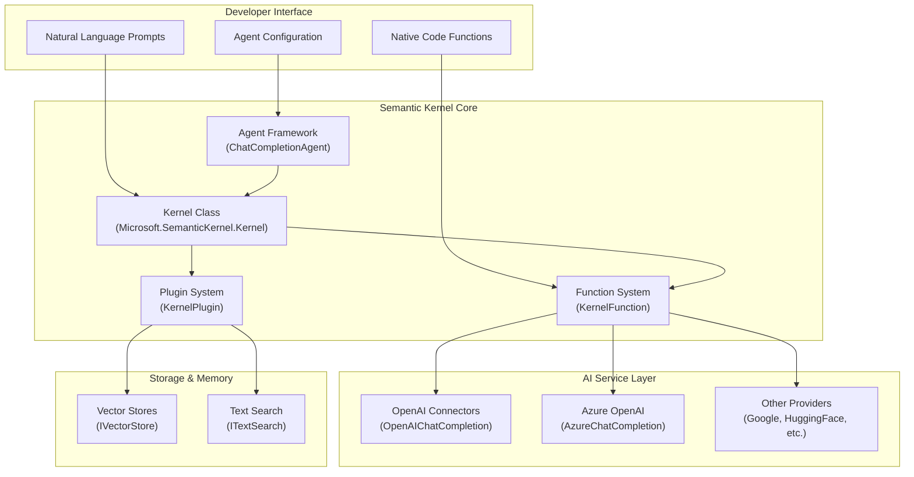
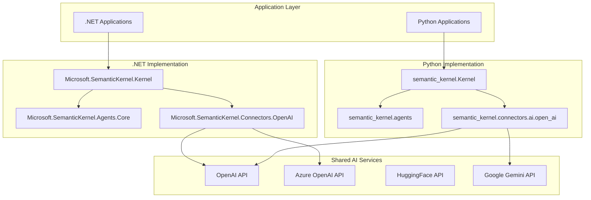
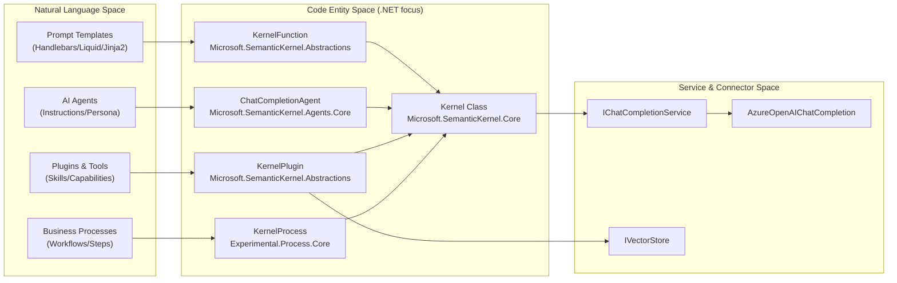
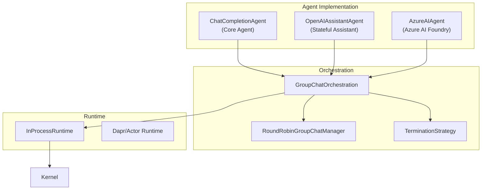

<!-- source: DeepWiki mcp.deepwiki.com · repo microsoft/semantic-kernel · page 1 Overview · fetched 2026-10-27 -->

# Overview

Relevant source files

The following files were used as context for generating this wiki page:

- [.github/_typos.toml](.github/_typos.toml)
- [FEATURE_MATRIX.md](FEATURE_MATRIX.md)
- [README.md](README.md)
- [docs/decisions/0033-kernel-filters.md](docs/decisions/0033-kernel-filters.md)
- [docs/decisions/0034-rag-in-sk.md](docs/decisions/0034-rag-in-sk.md)
- [docs/decisions/0071-multi-agent-orchestration.md](docs/decisions/0071-multi-agent-orchestration.md)
- [docs/images/sk_logo.png](docs/images/sk_logo.png)
- [dotnet/Directory.Packages.props](dotnet/Directory.Packages.props)
- [dotnet/README.md](dotnet/README.md)
- [dotnet/docs/EXPERIMENTS.md](dotnet/docs/EXPERIMENTS.md)
- [dotnet/notebooks/05-using-function-calling.ipynb](dotnet/notebooks/05-using-function-calling.ipynb)
- [dotnet/notebooks/README.md](dotnet/notebooks/README.md)
- [dotnet/samples/Concepts/Concepts.csproj](dotnet/samples/Concepts/Concepts.csproj)
- [dotnet/samples/Concepts/FunctionCalling/FunctionCalling_SharedState.cs](dotnet/samples/Concepts/FunctionCalling/FunctionCalling_SharedState.cs)
- [dotnet/samples/Concepts/README.md](dotnet/samples/Concepts/README.md)
- [dotnet/samples/Concepts/Resources/travel-destination-overview.txt](dotnet/samples/Concepts/Resources/travel-destination-overview.txt)
- [dotnet/samples/GettingStartedWithAgents/GettingStartedWithAgents.csproj](dotnet/samples/GettingStartedWithAgents/GettingStartedWithAgents.csproj)
- [dotnet/samples/GettingStartedWithAgents/README.md](dotnet/samples/GettingStartedWithAgents/README.md)
- [dotnet/src/Agents/UnitTests/Agents.UnitTests.csproj](dotnet/src/Agents/UnitTests/Agents.UnitTests.csproj)
- [dotnet/src/IntegrationTests/IntegrationTests.csproj](dotnet/src/IntegrationTests/IntegrationTests.csproj)
- [dotnet/src/InternalUtilities/samples/InternalUtilities/TestConfiguration.cs](dotnet/src/InternalUtilities/samples/InternalUtilities/TestConfiguration.cs)
- [dotnet/src/Plugins/Plugins.AI.UnitTests/Plugins.AI.UnitTests.csproj](dotnet/src/Plugins/Plugins.AI.UnitTests/Plugins.AI.UnitTests.csproj)
- [dotnet/src/Plugins/Plugins.AI/Plugins.AI.csproj](dotnet/src/Plugins/Plugins.AI/Plugins.AI.csproj)
- [dotnet/src/Plugins/Plugins.Memory/TextMemoryPlugin.cs](dotnet/src/Plugins/Plugins.Memory/TextMemoryPlugin.cs)
- [dotnet/src/SemanticKernel.UnitTests/SemanticKernel.UnitTests.csproj](dotnet/src/SemanticKernel.UnitTests/SemanticKernel.UnitTests.csproj)
- [python/.coveragerc](python/.coveragerc)
- [python/.env.example](python/.env.example)
- [python/.vscode/tasks.json](python/.vscode/tasks.json)
- [python/DEV_SETUP.md](python/DEV_SETUP.md)
- [python/README.md](python/README.md)
- [python/mypy.ini](python/mypy.ini)
- [python/samples/__init__.py](python/samples/__init__.py)
- [python/samples/getting_started/.env.example](python/samples/getting_started/.env.example)
- [python/samples/getting_started/third_party/.env.example](python/samples/getting_started/third_party/.env.example)
- [python/samples/learn_resources/.env.example](python/samples/learn_resources/.env.example)
- [python/samples/learn_resources/README.md](python/samples/learn_resources/README.md)
- [python/samples/learn_resources/ai_services.py](python/samples/learn_resources/ai_services.py)
- [python/samples/learn_resources/configuring_prompts.py](python/samples/learn_resources/configuring_prompts.py)
- [python/samples/learn_resources/creating_functions.py](python/samples/learn_resources/creating_functions.py)
- [python/samples/learn_resources/evaluate_with_prompt_flow.py](python/samples/learn_resources/evaluate_with_prompt_flow.py)
- [python/samples/learn_resources/functions_within_prompts.py](python/samples/learn_resources/functions_within_prompts.py)
- [python/samples/learn_resources/plugin.py](python/samples/learn_resources/plugin.py)
- [python/samples/learn_resources/plugins/MathPlugin/Math.py](python/samples/learn_resources/plugins/MathPlugin/Math.py)
- [python/samples/learn_resources/serializing_prompts.py](python/samples/learn_resources/serializing_prompts.py)
- [python/samples/learn_resources/templates.py](python/samples/learn_resources/templates.py)
- [python/samples/learn_resources/using_the_kernel.py](python/samples/learn_resources/using_the_kernel.py)
- [python/samples/learn_resources/your_first_prompt.py](python/samples/learn_resources/your_first_prompt.py)
- [python/semantic_kernel/__init__.py](python/semantic_kernel/__init__.py)
- [python/semantic_kernel/connectors/ai/function_choice_behavior.py](python/semantic_kernel/connectors/ai/function_choice_behavior.py)
- [python/tests/unit/contents/test_function_call_content.py](python/tests/unit/contents/test_function_call_content.py)

This document introduces the Semantic Kernel repository, summarizing its purpose as a multi-language AI orchestration framework for building intelligent agents and multi-agent systems. It covers the core architecture, key concepts, and how natural language capabilities map to concrete code entities across the supported programming languages.

Semantic Kernel has evolved into the **Microsoft Agent Framework**, providing enterprise-ready multi-agent orchestration, multi-provider model support, and cross-runtime interoperability [README.md:4-8]().

## What is Semantic Kernel

Semantic Kernel is a model-agnostic SDK that empowers developers to build, orchestrate, and deploy AI agents and multi-agent systems. It provides enterprise-grade reliability and flexibility for applications ranging from simple chatbots to complex multi-agent workflows [README.md:15-18]().

**Core Architecture Overview**

Sources: [README.md:26-36](), [dotnet/README.md:117-124](), [python/README.md:9-15]()

## Multi-Language Implementation Architecture

Semantic Kernel supports multiple programming languages with consistent conceptual models but language-specific implementations. The primary languages are .NET and Python, with Java support in development [README.md:19-24]().

**Language Implementation Matrix**

| Component | .NET Implementation | Python Implementation |
|-----------|-------------------|---------------------|
| Core Kernel | `Microsoft.SemanticKernel.Kernel` [dotnet/src/SemanticKernel.Core/Kernel.cs]() | `semantic_kernel.Kernel` [python/semantic_kernel/kernel.py:3-3]() |
| Chat Completion | `IChatCompletionService` [dotnet/src/SemanticKernel.Abstractions/AI/ChatCompletion/IChatCompletionService.cs:49-49]() | `ChatCompletionClientBase` |
| Function System | `KernelFunction` [dotnet/src/SemanticKernel.Abstractions/Functions/KernelFunction.cs]() | `@kernel_function` decorator [python/semantic_kernel/functions/kernel_function.py]() |
| Agent Framework | `ChatCompletionAgent` [dotnet/src/Agents/Core/ChatCompletionAgent.cs]() | `ChatCompletionAgent` [python/semantic_kernel/agents/chat_completion_agent.py]() |
| Package Manager | NuGet (Central Package Management) [dotnet/Directory.Packages.props:5-5]() | uv (uv.lock / pyproject.toml) [python/DEV_SETUP.md:16-20]() |

**Cross-Language Architecture Diagram**

Sources: [README.md:52-63](), [dotnet/README.md:115-124](), [python/README.md:17-24](), [dotnet/Directory.Packages.props:85-87]()

## Core Concepts to Code Entity Mapping

The following diagram shows how high-level concepts in Semantic Kernel map to specific code entities within the repository:

**Concept to Code Mapping**

Sources: [dotnet/README.md:33-45](), [python/README.md:67-68](), [dotnet/src/SemanticKernel.Abstractions/Functions/KernelFunction.cs](), [dotnet/src/Agents/Core/ChatCompletionAgent.cs]()

## Key System Capabilities

### Function and Plugin System
The function system allows developers to extend AI capabilities with custom code. Functions can be created from prompts or native code [python/README.md:120-132]().

| Function Type | .NET Implementation | Python Implementation | Usage |
|---------------|-------------------|---------------------|-------|
| Prompt Functions | `kernel.CreateFunctionFromPrompt()` [dotnet/README.md:51-51]() | `kernel.invoke_prompt()` [python/README.md:79-79]() | AI-powered text processing |
| Native Functions | `[KernelFunction]` attribute | `@kernel_function` decorator [python/README.md:136-136]() | Custom business logic |
| Structured Output | `OpenAIPromptExecutionSettings` | `Pydantic` models [python/README.md:151-154]() | Type-safe AI responses |

### Agent Framework Architecture
The Agent Framework supports complex multi-agent orchestration, including group chats and automated handoffs [python/README.md:183-192]().

Sources: [python/README.md:188-192](), [dotnet/samples/Concepts/README.md:21-30](), [docs/decisions/0071-multi-agent-orchestration.md]()

### AI Service Integration
The framework provides a unified interface for multiple AI providers via connectors [README.md:28-34]().

| Provider | .NET Connector | Python Connector | Key Features |
|----------|---------------|------------------|--------------|
| OpenAI | `Connectors.OpenAI` | `open_ai` | GPT-4o, Structured Outputs |
| Azure OpenAI | `AddAzureOpenAIChatCompletion` [dotnet/README.md:35-38]() | `AzureChatCompletion` [python/README.md:47-52]() | Enterprise security, OOD |
| Google | `Connectors.Google` | `google_ai` | Gemini 1.5, Thinking Budget |
| Local/ONNX | `Connectors.Onnx` | `onnx` | Local execution, Ollama [README.md:34-34]() |

## Development and Usage Patterns

### Basic Kernel Setup Pattern
The typical initialization pattern follows a builder approach in .NET or direct instantiation in Python:

1.  **Initialize**: `Kernel.CreateBuilder()` (.NET) [dotnet/README.md:33-33]() or `Kernel()` (Python) [python/README.md:67-67]().
2.  **Add Services**: Register AI services like `AddAzureOpenAIChatCompletion` [dotnet/README.md:35-38]().
3.  **Register Plugins**: Add native or prompt-based plugins [python/README.md:167-167]().
4.  **Invoke**: Use `kernel.InvokeAsync()` or `agent.InvokeAsync()` to execute logic [dotnet/README.md:63-65]().

### Memory and Vector Stores
Semantic Kernel provides a standard way to interact with vector databases for RAG (Retrieval-Augmented Generation) [README.md:32-32]().
- **Connectors**: Azure AI Search, Redis, Qdrant, Milvus, MongoDB, etc. [dotnet/Directory.Packages.props:8-15](), [dotnet/src/IntegrationTests/IntegrationTests.csproj:57-58]().
- **Abstractions**: `IVectorStore` and `IMemoryStore` provide model-agnostic access to vector data [dotnet/src/Plugins/Plugins.Memory/TextMemoryPlugin.cs]().

Sources: [README.md:15-37](), [dotnet/README.md:29-70](), [python/README.md:57-86](), [dotnet/samples/Concepts/README.md:1-102]()

---

