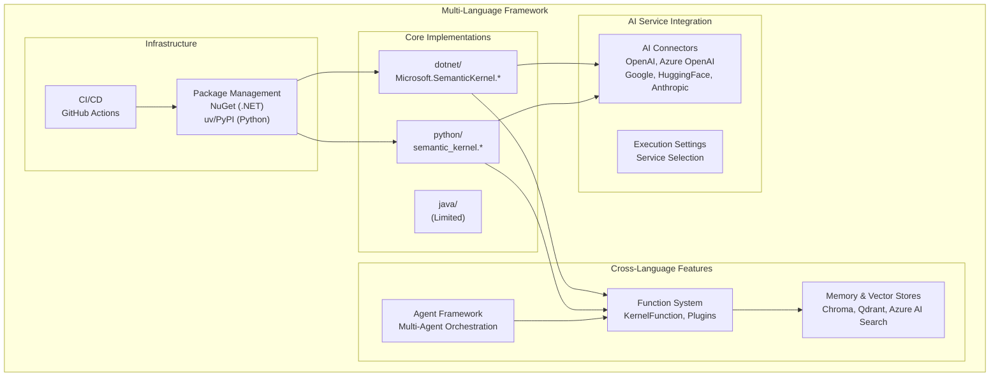
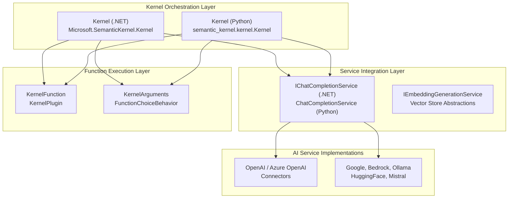
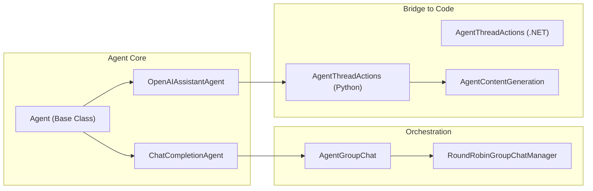

<!-- source: DeepWiki mcp.deepwiki.com · repo microsoft/semantic-kernel · page 2 Architecture · fetched 2026-10-27 -->

# Architecture

Relevant source files

The following files were used as context for generating this wiki page:

- [.github/_typos.toml](.github/_typos.toml)
- [FEATURE_MATRIX.md](FEATURE_MATRIX.md)
- [README.md](README.md)
- [docs/decisions/0033-kernel-filters.md](docs/decisions/0033-kernel-filters.md)
- [docs/decisions/0034-rag-in-sk.md](docs/decisions/0034-rag-in-sk.md)
- [docs/decisions/0071-multi-agent-orchestration.md](docs/decisions/0071-multi-agent-orchestration.md)
- [docs/images/sk_logo.png](docs/images/sk_logo.png)
- [dotnet/Directory.Packages.props](dotnet/Directory.Packages.props)
- [dotnet/README.md](dotnet/README.md)
- [dotnet/docs/EXPERIMENTS.md](dotnet/docs/EXPERIMENTS.md)
- [dotnet/notebooks/05-using-function-calling.ipynb](dotnet/notebooks/05-using-function-calling.ipynb)
- [dotnet/notebooks/README.md](dotnet/notebooks/README.md)
- [dotnet/samples/Concepts/Concepts.csproj](dotnet/samples/Concepts/Concepts.csproj)
- [dotnet/samples/Concepts/FunctionCalling/FunctionCalling_SharedState.cs](dotnet/samples/Concepts/FunctionCalling/FunctionCalling_SharedState.cs)
- [dotnet/samples/Concepts/README.md](dotnet/samples/Concepts/README.md)
- [dotnet/samples/Concepts/Resources/travel-destination-overview.txt](dotnet/samples/Concepts/Resources/travel-destination-overview.txt)
- [dotnet/samples/GettingStartedWithAgents/GettingStartedWithAgents.csproj](dotnet/samples/GettingStartedWithAgents/GettingStartedWithAgents.csproj)
- [dotnet/samples/GettingStartedWithAgents/README.md](dotnet/samples/GettingStartedWithAgents/README.md)
- [dotnet/src/Agents/UnitTests/Agents.UnitTests.csproj](dotnet/src/Agents/UnitTests/Agents.UnitTests.csproj)
- [dotnet/src/IntegrationTests/IntegrationTests.csproj](dotnet/src/IntegrationTests/IntegrationTests.csproj)
- [dotnet/src/InternalUtilities/samples/InternalUtilities/TestConfiguration.cs](dotnet/src/InternalUtilities/samples/InternalUtilities/TestConfiguration.cs)
- [dotnet/src/Plugins/Plugins.AI.UnitTests/Plugins.AI.UnitTests.csproj](dotnet/src/Plugins/Plugins.AI.UnitTests/Plugins.AI.UnitTests.csproj)
- [dotnet/src/Plugins/Plugins.AI/Plugins.AI.csproj](dotnet/src/Plugins/Plugins.AI/Plugins.AI.csproj)
- [dotnet/src/Plugins/Plugins.Memory/TextMemoryPlugin.cs](dotnet/src/Plugins/Plugins.Memory/TextMemoryPlugin.cs)
- [dotnet/src/SemanticKernel.UnitTests/SemanticKernel.UnitTests.csproj](dotnet/src/SemanticKernel.UnitTests/SemanticKernel.UnitTests.csproj)
- [python/.coveragerc](python/.coveragerc)
- [python/.vscode/tasks.json](python/.vscode/tasks.json)
- [python/DEV_SETUP.md](python/DEV_SETUP.md)
- [python/README.md](python/README.md)
- [python/mypy.ini](python/mypy.ini)
- [python/pyproject.toml](python/pyproject.toml)
- [python/samples/concepts/README.md](python/samples/concepts/README.md)
- [python/samples/concepts/agents/azure_ai_agent/azure_ai_agent_azure_ai_search.py](python/samples/concepts/agents/azure_ai_agent/azure_ai_agent_azure_ai_search.py)
- [python/samples/concepts/agents/azure_ai_agent/azure_ai_agent_file_manipulation.py](python/samples/concepts/agents/azure_ai_agent/azure_ai_agent_file_manipulation.py)
- [python/samples/concepts/agents/azure_ai_agent/azure_ai_agent_streaming.py](python/samples/concepts/agents/azure_ai_agent/azure_ai_agent_streaming.py)
- [python/samples/getting_started_with_agents/azure_ai_agent/README.md](python/samples/getting_started_with_agents/azure_ai_agent/README.md)
- [python/samples/getting_started_with_agents/openai_assistant/README.md](python/samples/getting_started_with_agents/openai_assistant/README.md)
- [python/semantic_kernel/agents/azure_ai/agent_content_generation.py](python/semantic_kernel/agents/azure_ai/agent_content_generation.py)
- [python/semantic_kernel/agents/azure_ai/agent_thread_actions.py](python/semantic_kernel/agents/azure_ai/agent_thread_actions.py)
- [python/semantic_kernel/agents/azure_ai/azure_ai_agent.py](python/semantic_kernel/agents/azure_ai/azure_ai_agent.py)
- [python/semantic_kernel/agents/open_ai/assistant_thread_actions.py](python/semantic_kernel/agents/open_ai/assistant_thread_actions.py)
- [python/semantic_kernel/agents/open_ai/openai_assistant_agent.py](python/semantic_kernel/agents/open_ai/openai_assistant_agent.py)
- [python/semantic_kernel/agents/open_ai/openai_responses_agent.py](python/semantic_kernel/agents/open_ai/openai_responses_agent.py)
- [python/semantic_kernel/connectors/ai/function_choice_behavior.py](python/semantic_kernel/connectors/ai/function_choice_behavior.py)
- [python/tests/samples/test_concepts.py](python/tests/samples/test_concepts.py)
- [python/tests/unit/agents/azure_ai_agent/test_agent_content_generation.py](python/tests/unit/agents/azure_ai_agent/test_agent_content_generation.py)
- [python/tests/unit/agents/azure_ai_agent/test_agent_thread_actions.py](python/tests/unit/agents/azure_ai_agent/test_agent_thread_actions.py)
- [python/tests/unit/agents/azure_ai_agent/test_azure_ai_agent.py](python/tests/unit/agents/azure_ai_agent/test_azure_ai_agent.py)
- [python/tests/unit/agents/openai_assistant/test_assistant_thread_actions.py](python/tests/unit/agents/openai_assistant/test_assistant_thread_actions.py)
- [python/tests/unit/agents/openai_assistant/test_openai_assistant_agent.py](python/tests/unit/agents/openai_assistant/test_openai_assistant_agent.py)
- [python/tests/unit/contents/test_function_call_content.py](python/tests/unit/contents/test_function_call_content.py)
- [python/tests/unit/data/conftest.py](python/tests/unit/data/conftest.py)
- [python/tests/unit/data/test_vector_search_base.py](python/tests/unit/data/test_vector_search_base.py)
- [python/tests/unit/data/test_vector_store_record_collection.py](python/tests/unit/data/test_vector_store_record_collection.py)
- [python/uv.lock](python/uv.lock)

## Purpose and Scope

The Semantic Kernel repository implements a multi-language AI orchestration framework—recently evolving into the **Microsoft Agent Framework**—that provides consistent abstractions for integrating with AI services across .NET, Python, and Java platforms [README.md:1-6](). This document describes the high-level architectural patterns, core components, and cross-language design decisions that enable unified AI application development.

For implementation-specific details, see [.NET Implementation](#2.1) and [Python Implementation](#2.2). For dependency management strategies, see [Package Management and Dependencies](#2.3).

## Overall Repository Architecture

The Semantic Kernel repository is organized as a multi-language framework with shared architectural patterns and independent language-specific implementations.

**Sources:** [dotnet/Directory.Packages.props:1-100](), [python/pyproject.toml:1-60](), [README.md:26-37]()

## Framework Component Architecture

The architecture implements consistent patterns across languages while maintaining language-specific idioms. The `Kernel` acts as the central hub for service registration and function orchestration.

**Sources:** [dotnet/README.md:33-45](), [python/README.md:61-85](), [python/semantic_kernel/connectors/ai/function_choice_behavior.py:1-20]()

## Package and Dependency Architecture

The framework maintains separate package ecosystems for each language. .NET utilizes **Central Package Management (CPM)** to ensure version consistency across its many sub-projects [dotnet/Directory.Packages.props:1-5](). Python uses `uv` for lightning-fast dependency resolution and deterministic builds via `uv.lock` [python/pyproject.toml:175-181](), [python/uv.lock:1-30]().

| Component | .NET Package Structure | Python Package Structure |
|-----------|----------------------|--------------------------|
| **Core Kernel** | `Microsoft.SemanticKernel.Core` `Microsoft.SemanticKernel.Abstractions` | `semantic-kernel` (main package) |
| **AI Connectors** | `Microsoft.SemanticKernel.Connectors.*` | Optional extras: `[openai]`, `[google]`, `[aws]` |
| **Agent Framework** | `Microsoft.SemanticKernel.Agents.*` | Included in `semantic_kernel.agents` |
| **Vector Stores** | Separate NuGet packages per provider | Optional extras: `[chroma]`, `[milvus]`, `[redis]` |

**Sources:** [dotnet/Directory.Packages.props:85-88](), [python/pyproject.toml:63-157](), [README.md:52-63]()

## Cross-Language Agent Architecture

The Agent Framework is a significant architectural pillar, providing a unified way to build single-agent and multi-agent systems. It bridges high-level agent definitions with low-level kernel functions and AI services.

**Sources:** [python/semantic_kernel/agents/azure_ai/agent_thread_actions.py:98-131](), [python/semantic_kernel/agents/azure_ai/azure_ai_agent.py:1-50](), [README.md:71-132]()

## Build and CI/CD Architecture

The repository implements language-specific build pipelines. .NET projects target modern runtimes like `.NET 10.0` [dotnet/src/IntegrationTests/IntegrationTests.csproj:5](), while Python maintains compatibility with `3.10+` [python/pyproject.toml:8]().

- **.NET Pipeline**: Uses `dotnet test` with filtered runs for specific concepts [dotnet/samples/Concepts/README.md:7-18]().
- **Python Pipeline**: Uses `pytest` with markers for specialized services like `ollama` or `onnx` [python/pyproject.toml:183-195]().
- **Shared Infrastructure**: Centralized `Directory.Packages.props` for .NET [dotnet/Directory.Packages.props:1-20]() and `uv.lock` for Python [python/uv.lock:1-10]() ensure reproducible environments across CI/CD agents.

**Sources:** [dotnet/Directory.Packages.props:1-20](), [python/pyproject.toml:175-195](), [python/uv.lock:1-23]()

---

