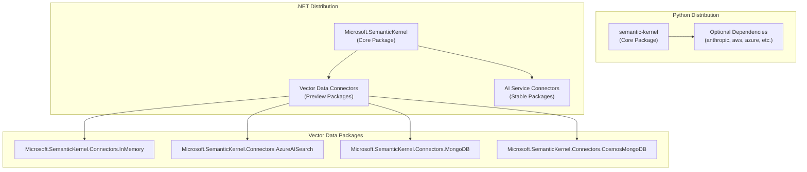
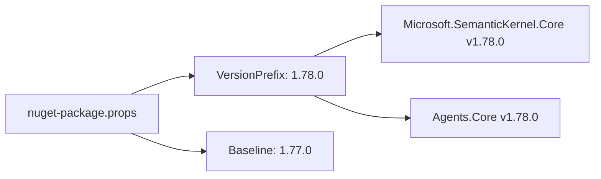
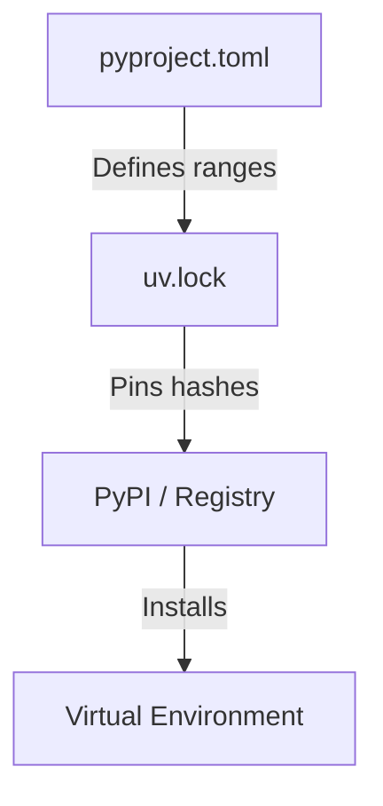

<!-- source: DeepWiki mcp.deepwiki.com · repo microsoft/semantic-kernel · page 2.3 Package Management and Dependencies · fetched 2026-10-27 -->

# Package Management and Dependencies

<details>
<summary>Relevant source files</summary>

The following files were used as context for generating this wiki page:

- [.github/_typos.toml](.github/_typos.toml)
- [docs/decisions/0071-multi-agent-orchestration.md](docs/decisions/0071-multi-agent-orchestration.md)
- [dotnet/Directory.Packages.props](dotnet/Directory.Packages.props)
- [dotnet/SK-dotnet.slnx](dotnet/SK-dotnet.slnx)
- [dotnet/docs/EXPERIMENTS.md](dotnet/docs/EXPERIMENTS.md)
- [dotnet/nuget/nuget-package.props](dotnet/nuget/nuget-package.props)
- [dotnet/samples/AgentFrameworkMigration/AzureOpenAI/Step04_ToolCall_WithOpenAPI/AzureOpenAI_Step04_ToolCall_WithOpenAPI.csproj](dotnet/samples/AgentFrameworkMigration/AzureOpenAI/Step04_ToolCall_WithOpenAPI/AzureOpenAI_Step04_ToolCall_WithOpenAPI.csproj)
- [dotnet/samples/AgentFrameworkMigration/AzureOpenAI/Step04_ToolCall_WithOpenAPI/OpenAPISpec.json](dotnet/samples/AgentFrameworkMigration/AzureOpenAI/Step04_ToolCall_WithOpenAPI/OpenAPISpec.json)
- [dotnet/samples/AgentFrameworkMigration/AzureOpenAI/Step04_ToolCall_WithOpenAPI/Program.cs](dotnet/samples/AgentFrameworkMigration/AzureOpenAI/Step04_ToolCall_WithOpenAPI/Program.cs)
- [dotnet/samples/Concepts/Concepts.csproj](dotnet/samples/Concepts/Concepts.csproj)
- [dotnet/samples/Concepts/FunctionCalling/FunctionCalling_SharedState.cs](dotnet/samples/Concepts/FunctionCalling/FunctionCalling_SharedState.cs)
- [dotnet/samples/Concepts/Memory/OpenAI_EmbeddingGeneration.cs](dotnet/samples/Concepts/Memory/OpenAI_EmbeddingGeneration.cs)
- [dotnet/samples/Concepts/README.md](dotnet/samples/Concepts/README.md)
- [dotnet/samples/Concepts/Resources/travel-destination-overview.txt](dotnet/samples/Concepts/Resources/travel-destination-overview.txt)
- [dotnet/samples/GettingStartedWithAgents/GettingStartedWithAgents.csproj](dotnet/samples/GettingStartedWithAgents/GettingStartedWithAgents.csproj)
- [dotnet/samples/GettingStartedWithAgents/README.md](dotnet/samples/GettingStartedWithAgents/README.md)
- [dotnet/src/Agents/UnitTests/Agents.UnitTests.csproj](dotnet/src/Agents/UnitTests/Agents.UnitTests.csproj)
- [dotnet/src/Functions/Functions.OpenApi/CompatibilitySuppressions.xml](dotnet/src/Functions/Functions.OpenApi/CompatibilitySuppressions.xml)
- [dotnet/src/Functions/Functions.OpenApi/Extensions/OpenApiFunctionExecutionParameters.cs](dotnet/src/Functions/Functions.OpenApi/Extensions/OpenApiFunctionExecutionParameters.cs)
- [dotnet/src/Functions/Functions.OpenApi/Extensions/RestApiOperationExtensions.cs](dotnet/src/Functions/Functions.OpenApi/Extensions/RestApiOperationExtensions.cs)
- [dotnet/src/Functions/Functions.OpenApi/Model/RestApiOperation.cs](dotnet/src/Functions/Functions.OpenApi/Model/RestApiOperation.cs)
- [dotnet/src/Functions/Functions.OpenApi/OpenApi/OpenApiDocumentParser.cs](dotnet/src/Functions/Functions.OpenApi/OpenApi/OpenApiDocumentParser.cs)
- [dotnet/src/Functions/Functions.OpenApi/OpenApiKernelPluginFactory.cs](dotnet/src/Functions/Functions.OpenApi/OpenApiKernelPluginFactory.cs)
- [dotnet/src/Functions/Functions.OpenApi/RestApiOperationRunner.cs](dotnet/src/Functions/Functions.OpenApi/RestApiOperationRunner.cs)
- [dotnet/src/Functions/Functions.OpenApi/RestApiOperationServerUrlValidationOptions.cs](dotnet/src/Functions/Functions.OpenApi/RestApiOperationServerUrlValidationOptions.cs)
- [dotnet/src/Functions/Functions.OpenApi/ServerUrlValidator.cs](dotnet/src/Functions/Functions.OpenApi/ServerUrlValidator.cs)
- [dotnet/src/Functions/Functions.Prompty/Functions.Prompty.csproj](dotnet/src/Functions/Functions.Prompty/Functions.Prompty.csproj)
- [dotnet/src/Functions/Functions.UnitTests/OpenApi/Extensions/OpenApiKernelExtensionsTests.cs](dotnet/src/Functions/Functions.UnitTests/OpenApi/Extensions/OpenApiKernelExtensionsTests.cs)
- [dotnet/src/Functions/Functions.UnitTests/OpenApi/Extensions/RestApiOperationExtensionsTests.cs](dotnet/src/Functions/Functions.UnitTests/OpenApi/Extensions/RestApiOperationExtensionsTests.cs)
- [dotnet/src/Functions/Functions.UnitTests/OpenApi/OpenApiDocumentParserExtensionsTests.cs](dotnet/src/Functions/Functions.UnitTests/OpenApi/OpenApiDocumentParserExtensionsTests.cs)
- [dotnet/src/Functions/Functions.UnitTests/OpenApi/OpenApiDocumentParserV20Tests.cs](dotnet/src/Functions/Functions.UnitTests/OpenApi/OpenApiDocumentParserV20Tests.cs)
- [dotnet/src/Functions/Functions.UnitTests/OpenApi/OpenApiDocumentParserV30Tests.cs](dotnet/src/Functions/Functions.UnitTests/OpenApi/OpenApiDocumentParserV30Tests.cs)
- [dotnet/src/Functions/Functions.UnitTests/OpenApi/OpenApiDocumentParserV31Tests.cs](dotnet/src/Functions/Functions.UnitTests/OpenApi/OpenApiDocumentParserV31Tests.cs)
- [dotnet/src/Functions/Functions.UnitTests/OpenApi/OpenApiKernelPluginFactoryTests.cs](dotnet/src/Functions/Functions.UnitTests/OpenApi/OpenApiKernelPluginFactoryTests.cs)
- [dotnet/src/Functions/Functions.UnitTests/OpenApi/RestApiOperationRunnerTests.cs](dotnet/src/Functions/Functions.UnitTests/OpenApi/RestApiOperationRunnerTests.cs)
- [dotnet/src/Functions/Functions.UnitTests/OpenApi/RestApiOperationTests.cs](dotnet/src/Functions/Functions.UnitTests/OpenApi/RestApiOperationTests.cs)
- [dotnet/src/Functions/Functions.UnitTests/OpenApi/ServerUrlValidatorTests.cs](dotnet/src/Functions/Functions.UnitTests/OpenApi/ServerUrlValidatorTests.cs)
- [dotnet/src/Functions/Functions.UnitTests/OpenApi/TestPlugins/documentV2_0.json](dotnet/src/Functions/Functions.UnitTests/OpenApi/TestPlugins/documentV2_0.json)
- [dotnet/src/Functions/Functions.UnitTests/OpenApi/TestPlugins/documentV3_0.json](dotnet/src/Functions/Functions.UnitTests/OpenApi/TestPlugins/documentV3_0.json)
- [dotnet/src/Functions/Functions.UnitTests/OpenApi/TestPlugins/documentV3_1.yaml](dotnet/src/Functions/Functions.UnitTests/OpenApi/TestPlugins/documentV3_1.yaml)
- [dotnet/src/IntegrationTests/CrossLanguage/OpenApiTest.cs](dotnet/src/IntegrationTests/CrossLanguage/OpenApiTest.cs)
- [dotnet/src/IntegrationTests/IntegrationTests.csproj](dotnet/src/IntegrationTests/IntegrationTests.csproj)
- [dotnet/src/InternalUtilities/samples/InternalUtilities/TestConfiguration.cs](dotnet/src/InternalUtilities/samples/InternalUtilities/TestConfiguration.cs)
- [dotnet/src/Plugins/Plugins.AI.UnitTests/Plugins.AI.UnitTests.csproj](dotnet/src/Plugins/Plugins.AI.UnitTests/Plugins.AI.UnitTests.csproj)
- [dotnet/src/Plugins/Plugins.AI/Plugins.AI.csproj](dotnet/src/Plugins/Plugins.AI/Plugins.AI.csproj)
- [dotnet/src/SemanticKernel.UnitTests/SemanticKernel.UnitTests.csproj](dotnet/src/SemanticKernel.UnitTests/SemanticKernel.UnitTests.csproj)
- [dotnet/src/VectorData/AzureAISearch/AzureAISearch.csproj](dotnet/src/VectorData/AzureAISearch/AzureAISearch.csproj)
- [dotnet/src/VectorData/CosmosMongoDB/CosmosMongoDB.csproj](dotnet/src/VectorData/CosmosMongoDB/CosmosMongoDB.csproj)
- [dotnet/src/VectorData/CosmosNoSql/CosmosNoSql.csproj](dotnet/src/VectorData/CosmosNoSql/CosmosNoSql.csproj)
- [dotnet/src/VectorData/InMemory/InMemory.csproj](dotnet/src/VectorData/InMemory/InMemory.csproj)
- [dotnet/src/VectorData/MongoDB/MongoDB.csproj](dotnet/src/VectorData/MongoDB/MongoDB.csproj)
- [dotnet/src/VectorData/PgVector/PgVector.csproj](dotnet/src/VectorData/PgVector/PgVector.csproj)
- [dotnet/src/VectorData/Pinecone/Pinecone.csproj](dotnet/src/VectorData/Pinecone/Pinecone.csproj)
- [dotnet/src/VectorData/Qdrant/Qdrant.csproj](dotnet/src/VectorData/Qdrant/Qdrant.csproj)
- [dotnet/src/VectorData/Redis/Redis.csproj](dotnet/src/VectorData/Redis/Redis.csproj)
- [dotnet/src/VectorData/SqlServer/SqlServer.csproj](dotnet/src/VectorData/SqlServer/SqlServer.csproj)
- [python/pyproject.toml](python/pyproject.toml)
- [python/samples/concepts/README.md](python/samples/concepts/README.md)
- [python/samples/concepts/agents/azure_ai_agent/azure_ai_agent_azure_ai_search.py](python/samples/concepts/agents/azure_ai_agent/azure_ai_agent_azure_ai_search.py)
- [python/samples/concepts/agents/azure_ai_agent/azure_ai_agent_file_manipulation.py](python/samples/concepts/agents/azure_ai_agent/azure_ai_agent_file_manipulation.py)
- [python/samples/concepts/agents/azure_ai_agent/azure_ai_agent_streaming.py](python/samples/concepts/agents/azure_ai_agent/azure_ai_agent_streaming.py)
- [python/samples/getting_started_with_agents/azure_ai_agent/README.md](python/samples/getting_started_with_agents/azure_ai_agent/README.md)
- [python/samples/getting_started_with_agents/openai_assistant/README.md](python/samples/getting_started_with_agents/openai_assistant/README.md)
- [python/semantic_kernel/agents/azure_ai/agent_content_generation.py](python/semantic_kernel/agents/azure_ai/agent_content_generation.py)
- [python/semantic_kernel/agents/azure_ai/agent_thread_actions.py](python/semantic_kernel/agents/azure_ai/agent_thread_actions.py)
- [python/semantic_kernel/agents/azure_ai/azure_ai_agent.py](python/semantic_kernel/agents/azure_ai/azure_ai_agent.py)
- [python/semantic_kernel/agents/open_ai/assistant_thread_actions.py](python/semantic_kernel/agents/open_ai/assistant_thread_actions.py)
- [python/semantic_kernel/agents/open_ai/openai_assistant_agent.py](python/semantic_kernel/agents/open_ai/openai_assistant_agent.py)
- [python/semantic_kernel/agents/open_ai/openai_responses_agent.py](python/semantic_kernel/agents/open_ai/openai_responses_agent.py)
- [python/tests/samples/test_concepts.py](python/tests/samples/test_concepts.py)
- [python/tests/unit/agents/azure_ai_agent/test_agent_content_generation.py](python/tests/unit/agents/azure_ai_agent/test_agent_content_generation.py)
- [python/tests/unit/agents/azure_ai_agent/test_agent_thread_actions.py](python/tests/unit/agents/azure_ai_agent/test_agent_thread_actions.py)
- [python/tests/unit/agents/azure_ai_agent/test_azure_ai_agent.py](python/tests/unit/agents/azure_ai_agent/test_azure_ai_agent.py)
- [python/tests/unit/agents/openai_assistant/test_assistant_thread_actions.py](python/tests/unit/agents/openai_assistant/test_assistant_thread_actions.py)
- [python/tests/unit/agents/openai_assistant/test_openai_assistant_agent.py](python/tests/unit/agents/openai_assistant/test_openai_assistant_agent.py)
- [python/tests/unit/data/conftest.py](python/tests/unit/data/conftest.py)
- [python/tests/unit/data/test_vector_search_base.py](python/tests/unit/data/test_vector_search_base.py)
- [python/tests/unit/data/test_vector_store_record_collection.py](python/tests/unit/data/test_vector_store_record_collection.py)
- [python/uv.lock](python/uv.lock)

</details>


This document covers the package distribution, dependency management, and build configuration across the Semantic Kernel implementations. It details the use of .NET Central Package Management (CPM), NuGet versioning strategies, and the Python `pyproject.toml` structure with `uv` lockfile integration.

## Package Structure Overview

Semantic Kernel employs a modular architecture to separate core orchestration from specialized connectors and experimental features. This allows developers to maintain a lightweight footprint by only including necessary dependencies.

### Package Hierarchy



**Sources:** [python/pyproject.toml:1-61](), [dotnet/nuget/nuget-package.props:1-70](), [dotnet/src/VectorData/MongoDB/MongoDB.csproj:1-20](), [dotnet/src/VectorData/CosmosMongoDB/CosmosMongoDB.csproj:1-20]()

## .NET Package Management

### Central Package Management (CPM)

The .NET implementation utilizes Central Package Management via `Directory.Packages.props`. This ensures that all projects within the solution use consistent versions of external libraries, mitigating "dependency hell" and security vulnerabilities.

| Feature | Implementation |
| :--- | :--- |
| **Enforcement** | `ManagePackageVersionsCentrally` set to `true` [dotnet/Directory.Packages.props:5-5]() |
| **Core Versions** | `Microsoft.SemanticKernel.Core` v1.71.0 [dotnet/Directory.Packages.props:87-87]() |
| **AI Connectors** | `Azure.AI.OpenAI` v2.9.0-beta.1 [dotnet/Directory.Packages.props:26-26]() |
| **Security** | `NuGetAudit` enabled with `low` level reporting [dotnet/nuget/nuget-package.props:19-25]() |

**Sources:** [dotnet/Directory.Packages.props:1-100](), [dotnet/nuget/nuget-package.props:18-26]()

### NuGet Versioning Strategy

The repository uses a centralized property file to manage the `VersionPrefix` and `VersionSuffix` across all produced NuGet packages.



- **VersionPrefix**: Currently set to `1.78.0` [dotnet/nuget/nuget-package.props:4-4]().
- **Package Validation**: The `PackageValidationBaselineVersion` (set to `1.77.0`) is used to ensure backward compatibility during the build process [dotnet/nuget/nuget-package.props:12-12]().
- **SourceLink**: Enabled to allow developers to step through Semantic Kernel source code during debugging [dotnet/nuget/nuget-package.props:58-58]().

**Sources:** [dotnet/nuget/nuget-package.props:1-53]()

## Python Package Management

### Dependency Configuration

The Python implementation uses `pyproject.toml` as the primary configuration for the `semantic-kernel` package. It leverages `flit` as the build backend [python/pyproject.toml:257-257]().

**Core Dependencies:**
- **Pydantic**: Heavily utilized for data validation and settings management (v2.0+) [python/pyproject.toml:31-31]().
- **OpenAI**: Core connector dependency (v2.0.0+) [python/pyproject.toml:40-40]().
- **Azure AI**: Integrated via `azure-ai-projects` and `azure-ai-agents` [python/pyproject.toml:27-28]().

### Optional Dependency Groups (Extras)

Python extras allow users to install only the dependencies required for specific connectors or features.

| Group | Key Dependencies |
| :--- | :--- |
| `anthropic` | `anthropic ~= 0.32` [python/pyproject.toml:64-66]() |
| `aws` | `boto3 >= 1.36.4` [python/pyproject.toml:70-72]() |
| `google` | `google-genai >= 1.51` [python/pyproject.toml:89-92]() |
| `onnx` | `onnxruntime-genai == 0.9.0` [python/pyproject.toml:118-123]() |
| `postgres` | `psycopg[binary,pool] ~= 3.2` [python/pyproject.toml:133-135]() |

**Sources:** [python/pyproject.toml:63-157]()

### Reproducible Builds with uv

The Python project uses `uv` for high-performance dependency resolution and locking. The `uv.lock` file ensures that development, CI, and production environments use identical dependency trees.



The `uv.lock` file contains precise versioning and hashes for all transitive dependencies, such as `aiohttp` (v3.13.3) and `accelerate` (v1.13.0) [python/uv.lock:31-71]().

**Sources:** [python/uv.lock:1-80](), [python/pyproject.toml:175-181]()

## Cross-Language Dependency Mapping

The framework maintains functional parity across languages by aligning external library integrations.

```mermaid
graph LR
    subgraph ".NET Space"
        NetOpenAI["Azure.AI.OpenAI"]
        NetAgent["Azure.AI.Agents.Persistent"]
        NetMCP["ModelContextProtocol"]
    end

    subgraph "Python Space"
        PyOpenAI["openai-python"]
        PyAgent["azure-ai-agents"]
        PyMCP["mcp"]
    end

    NetOpenAI <--- "Functional Parity" ---> PyOpenAI
    NetAgent <--- "Functional Parity" ---> PyAgent
    NetMCP <--- "Functional Parity" ---> PyMCP
```

**Code Entity Associations:**
- **.NET Agent Implementation**: `Azure.AI.Agents.Persistent` version managed in `Directory.Packages.props` [dotnet/Directory.Packages.props:24-24]().
- **Python Agent Implementation**: `azure-ai-agents` defined in `pyproject.toml` [python/pyproject.toml:28-28]() and utilized in `AgentThreadActions` [python/semantic_kernel/agents/azure_ai/agent_thread_actions.py:8-38]().
- **REST/OpenAPI**: .NET uses `RestApiOperationRunner` [dotnet/src/Functions/Functions.OpenApi/RestApiOperationRunner.cs:23-23]() while Python uses `openapi_core` and `prance` [python/pyproject.toml:42-48]().

**Sources:** [dotnet/Directory.Packages.props:24-91](), [python/pyproject.toml:25-60](), [python/semantic_kernel/agents/azure_ai/agent_thread_actions.py:8-38](), [dotnet/src/Functions/Functions.OpenApi/RestApiOperationRunner.cs:23-49]()

---

