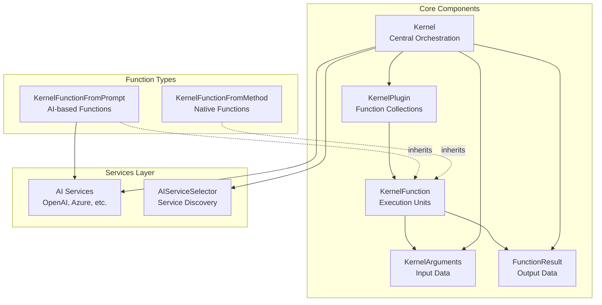
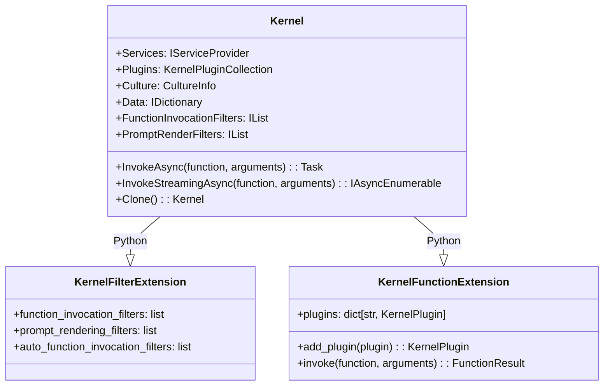
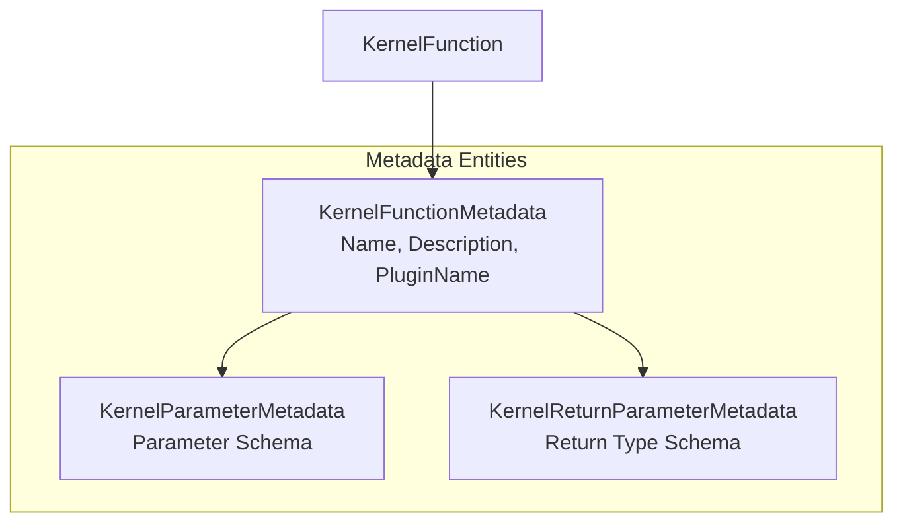

<!-- source: DeepWiki mcp.deepwiki.com · repo microsoft/semantic-kernel · page 3 Core Components · fetched 2026-10-27 -->

# Core Components

Relevant source files

The following files were used as context for generating this wiki page:

- [dotnet/src/Connectors/Connectors.OpenAI.UnitTests/Core/AutoFunctionInvocationFilterTests.cs](dotnet/src/Connectors/Connectors.OpenAI.UnitTests/Core/AutoFunctionInvocationFilterTests.cs)
- [dotnet/src/InternalUtilities/planning/PlannerInstrumentation.cs](dotnet/src/InternalUtilities/planning/PlannerInstrumentation.cs)
- [dotnet/src/SemanticKernel.Abstractions/AI/PromptNode.cs](dotnet/src/SemanticKernel.Abstractions/AI/PromptNode.cs)
- [dotnet/src/SemanticKernel.Abstractions/Events/CancelKernelEventArgs.cs](dotnet/src/SemanticKernel.Abstractions/Events/CancelKernelEventArgs.cs)
- [dotnet/src/SemanticKernel.Abstractions/Events/FunctionInvokedEventArgs.cs](dotnet/src/SemanticKernel.Abstractions/Events/FunctionInvokedEventArgs.cs)
- [dotnet/src/SemanticKernel.Abstractions/Events/FunctionInvokingEventArgs.cs](dotnet/src/SemanticKernel.Abstractions/Events/FunctionInvokingEventArgs.cs)
- [dotnet/src/SemanticKernel.Abstractions/Events/KernelEventArgs.cs](dotnet/src/SemanticKernel.Abstractions/Events/KernelEventArgs.cs)
- [dotnet/src/SemanticKernel.Abstractions/Events/PromptRenderedEventArgs.cs](dotnet/src/SemanticKernel.Abstractions/Events/PromptRenderedEventArgs.cs)
- [dotnet/src/SemanticKernel.Abstractions/Events/PromptRenderingEventArgs.cs](dotnet/src/SemanticKernel.Abstractions/Events/PromptRenderingEventArgs.cs)
- [dotnet/src/SemanticKernel.Abstractions/Filters/AutoFunctionInvocation/AutoFunctionInvocationContext.cs](dotnet/src/SemanticKernel.Abstractions/Filters/AutoFunctionInvocation/AutoFunctionInvocationContext.cs)
- [dotnet/src/SemanticKernel.Abstractions/Filters/AutoFunctionInvocation/IAutoFunctionInvocationFilter.cs](dotnet/src/SemanticKernel.Abstractions/Filters/AutoFunctionInvocation/IAutoFunctionInvocationFilter.cs)
- [dotnet/src/SemanticKernel.Abstractions/Filters/Function/FunctionInvocationContext.cs](dotnet/src/SemanticKernel.Abstractions/Filters/Function/FunctionInvocationContext.cs)
- [dotnet/src/SemanticKernel.Abstractions/Filters/Prompt/PromptRenderContext.cs](dotnet/src/SemanticKernel.Abstractions/Filters/Prompt/PromptRenderContext.cs)
- [dotnet/src/SemanticKernel.Abstractions/Functions/FunctionResult.cs](dotnet/src/SemanticKernel.Abstractions/Functions/FunctionResult.cs)
- [dotnet/src/SemanticKernel.Abstractions/Functions/KernelFunction.cs](dotnet/src/SemanticKernel.Abstractions/Functions/KernelFunction.cs)
- [dotnet/src/SemanticKernel.Abstractions/Functions/KernelFunctionLogMessages.cs](dotnet/src/SemanticKernel.Abstractions/Functions/KernelFunctionLogMessages.cs)
- [dotnet/src/SemanticKernel.Abstractions/Kernel.cs](dotnet/src/SemanticKernel.Abstractions/Kernel.cs)
- [dotnet/src/SemanticKernel.Core/Contents/StreamingMethodContent.cs](dotnet/src/SemanticKernel.Core/Contents/StreamingMethodContent.cs)
- [dotnet/src/SemanticKernel.Core/Functions/KernelFunctionFromMethod.cs](dotnet/src/SemanticKernel.Core/Functions/KernelFunctionFromMethod.cs)
- [dotnet/src/SemanticKernel.Core/Functions/KernelFunctionFromPrompt.cs](dotnet/src/SemanticKernel.Core/Functions/KernelFunctionFromPrompt.cs)
- [dotnet/src/SemanticKernel.Core/KernelExtensions.cs](dotnet/src/SemanticKernel.Core/KernelExtensions.cs)
- [dotnet/src/SemanticKernel.UnitTests/Filters/FunctionInvocationFilterTests.cs](dotnet/src/SemanticKernel.UnitTests/Filters/FunctionInvocationFilterTests.cs)
- [dotnet/src/SemanticKernel.UnitTests/Filters/PromptRenderFilterTests.cs](dotnet/src/SemanticKernel.UnitTests/Filters/PromptRenderFilterTests.cs)
- [dotnet/src/SemanticKernel.UnitTests/Functions/FunctionFromMethodTests.cs](dotnet/src/SemanticKernel.UnitTests/Functions/FunctionFromMethodTests.cs)
- [dotnet/src/SemanticKernel.UnitTests/Functions/FunctionResultTests.cs](dotnet/src/SemanticKernel.UnitTests/Functions/FunctionResultTests.cs)
- [dotnet/src/SemanticKernel.UnitTests/Functions/KernelBuilderTests.cs](dotnet/src/SemanticKernel.UnitTests/Functions/KernelBuilderTests.cs)
- [dotnet/src/SemanticKernel.UnitTests/Functions/KernelFunctionLogMessagesTests.cs](dotnet/src/SemanticKernel.UnitTests/Functions/KernelFunctionLogMessagesTests.cs)
- [dotnet/src/SemanticKernel.UnitTests/KernelTests.cs](dotnet/src/SemanticKernel.UnitTests/KernelTests.cs)
- [python/samples/concepts/mcp/README.md](python/samples/concepts/mcp/README.md)
- [python/samples/concepts/mcp/agent_with_mcp_plugin.py](python/samples/concepts/mcp/agent_with_mcp_plugin.py)
- [python/samples/concepts/mcp/agent_with_mcp_sampling.py](python/samples/concepts/mcp/agent_with_mcp_sampling.py)
- [python/samples/concepts/mcp/azure_ai_agent_with_mcp_plugin.py](python/samples/concepts/mcp/azure_ai_agent_with_mcp_plugin.py)
- [python/samples/concepts/mcp/mcp_as_plugin.py](python/samples/concepts/mcp/mcp_as_plugin.py)
- [python/samples/concepts/realtime/README.md](python/samples/concepts/realtime/README.md)
- [python/samples/concepts/realtime/realtime_agent_with_function_calling_webrtc.py](python/samples/concepts/realtime/realtime_agent_with_function_calling_webrtc.py)
- [python/samples/concepts/realtime/realtime_agent_with_function_calling_websocket.py](python/samples/concepts/realtime/realtime_agent_with_function_calling_websocket.py)
- [python/samples/concepts/realtime/simple_realtime_chat_webrtc.py](python/samples/concepts/realtime/simple_realtime_chat_webrtc.py)
- [python/samples/concepts/realtime/simple_realtime_chat_websocket.py](python/samples/concepts/realtime/simple_realtime_chat_websocket.py)
- [python/samples/concepts/realtime/utils.py](python/samples/concepts/realtime/utils.py)
- [python/semantic_kernel/connectors/ai/open_ai/prompt_execution_settings/open_ai_realtime_execution_settings.py](python/semantic_kernel/connectors/ai/open_ai/prompt_execution_settings/open_ai_realtime_execution_settings.py)
- [python/semantic_kernel/connectors/ai/open_ai/services/_open_ai_realtime.py](python/semantic_kernel/connectors/ai/open_ai/services/_open_ai_realtime.py)
- [python/semantic_kernel/connectors/ai/open_ai/services/azure_realtime.py](python/semantic_kernel/connectors/ai/open_ai/services/azure_realtime.py)
- [python/semantic_kernel/connectors/ai/open_ai/settings/open_ai_settings.py](python/semantic_kernel/connectors/ai/open_ai/settings/open_ai_settings.py)
- [python/semantic_kernel/connectors/mcp.py](python/semantic_kernel/connectors/mcp.py)
- [python/semantic_kernel/functions/kernel_function_extension.py](python/semantic_kernel/functions/kernel_function_extension.py)
- [python/semantic_kernel/functions/kernel_plugin.py](python/semantic_kernel/functions/kernel_plugin.py)
- [python/semantic_kernel/kernel.py](python/semantic_kernel/kernel.py)
- [python/tests/unit/connectors/ai/open_ai/services/test_openai_realtime.py](python/tests/unit/connectors/ai/open_ai/services/test_openai_realtime.py)
- [python/tests/unit/connectors/mcp/test_mcp.py](python/tests/unit/connectors/mcp/test_mcp.py)
- [python/tests/unit/functions/test_kernel_plugins.py](python/tests/unit/functions/test_kernel_plugins.py)
- [python/tests/unit/kernel/test_kernel.py](python/tests/unit/kernel/test_kernel.py)

This document covers the fundamental building blocks that comprise the Semantic Kernel framework. These core components provide the essential abstractions and orchestration mechanisms for AI function execution across .NET and Python implementations.

For information about AI service integration and connectors, see [AI Service Integration](#4). For details about agent frameworks and multi-agent orchestration, see [Agent Framework](#5).

## Component Architecture Overview

The Semantic Kernel framework is built around five primary core components that work together to enable AI-powered function orchestration:

**Sources:** [python/semantic_kernel/kernel.py:62-102](), [dotnet/src/SemanticKernel.Abstractions/Kernel.cs:26-85](), [dotnet/src/SemanticKernel.Abstractions/Functions/KernelFunction.cs:30-31]()

## Kernel: Central Orchestration Engine

The `Kernel` class serves as the primary orchestration engine that coordinates all framework operations. It manages services, plugins, filters, and provides the execution context for all function invocations.

### Core Responsibilities

| Responsibility | Description | Implementation |
|---|---|---|
| **Service Management** | Registers and manages AI services via `KernelServicesExtension` | [python/semantic_kernel/kernel.py:73-74](), [dotnet/src/SemanticKernel.Abstractions/Kernel.cs:60-61]() |
| **Plugin Management** | Maintains collections of function plugins via `KernelPluginCollection` | [dotnet/src/SemanticKernel.Abstractions/Kernel.cs:124-128](), [python/semantic_kernel/kernel.py:72-72]() |
| **Function Execution** | Orchestrates function invocation and streaming | [python/semantic_kernel/kernel.py:104-133](), [dotnet/src/SemanticKernel.Abstractions/Kernel.cs:111-119]() |
| **Filter Pipeline** | Manages invocation, prompt rendering, and auto-invocation filters | [dotnet/src/SemanticKernel.Abstractions/Kernel.cs:130-151](), [python/semantic_kernel/kernel.py:69-71]() |

### Kernel Class Structure

**Sources:** [python/semantic_kernel/kernel.py:62-102](), [dotnet/src/SemanticKernel.Abstractions/Kernel.cs:26-151]()

## KernelFunction: Executable Function Abstraction

`KernelFunction` is the base abstraction for all executable units within the framework. It provides a unified interface for both AI-powered prompt functions and native method functions.

### Function Hierarchy

The framework provides two primary concrete implementations of the `KernelFunction` abstraction:

- **KernelFunctionFromPrompt**: Represents a function defined by a prompt template and AI service settings. [dotnet/src/SemanticKernel.Core/Functions/KernelFunctionFromPrompt.cs:27-28](), [python/semantic_kernel/kernel.py:36-36]()
- **KernelFunctionFromMethod**: Represents a function backed by native code (e.g., a C# method or Python function). [dotnet/src/SemanticKernel.Core/Functions/KernelFunctionFromMethod.cs:30-30](), [dotnet/src/SemanticKernel.Core/KernelExtensions.cs:35-47]()

### Metadata System

Functions are described using a metadata system that allows the Kernel and AI models to understand their purpose and requirements:

**Sources:** [dotnet/src/SemanticKernel.Abstractions/Functions/KernelFunction.cs:82-100](), [dotnet/src/SemanticKernel.Abstractions/Functions/KernelFunction.cs:123-136]()

## KernelPlugin: Function Collections

`KernelPlugin` organizes related functions into logical collections, providing discoverability and namespace management.

### Plugin Management

A `KernelPlugin` behaves similarly to a dictionary, where functions are indexed by their names. [python/semantic_kernel/functions/kernel_plugin.py:39-42](). Plugins can be created from various sources:

- **Native Objects**: Using `from_object` to wrap class methods annotated with `@kernel_function`. [python/semantic_kernel/functions/kernel_plugin.py:63-64]()
- **Directories**: Using `from_directory` to load prompt templates and configuration files. [python/semantic_kernel/functions/kernel_plugin.py:65-67]()
- **OpenAPI**: Using `from_openapi` to generate functions from REST API specifications. [python/semantic_kernel/functions/kernel_plugin.py:68-73]()
- **MCP**: Using `MCPPlugin` to integrate Model Context Protocol servers. [python/semantic_kernel/connectors/mcp.py:36-41]()

**Sources:** [python/semantic_kernel/functions/kernel_plugin.py:36-102](), [dotnet/src/SemanticKernel.Abstractions/Kernel.cs:124-128]()

## Data Flow and Results

### Function Results

The `FunctionResult` class encapsulates the output of a function invocation, including the resulting value, metadata, and the culture used during execution. [dotnet/src/SemanticKernel.Abstractions/Functions/FunctionResult.cs:14-31]().

### Content Abstractions

Semantic Kernel uses a unified content model to bridge natural language and code entities:

| Entity | Code Class | Purpose |
|---|---|---|
| **Chat Message** | `ChatMessageContent` | Represents a turn in a conversation. |
| **Function Call** | `FunctionCallContent` | Represents a request from a model to call a tool. |
| **Function Result** | `FunctionResultContent` | Represents the output of a tool call sent back to the model. |
| **Streaming Content** | `StreamingChatMessageContent` | Represents partial updates for real-time responses. |

**Sources:** [python/semantic_kernel/kernel.py:11-15](), [dotnet/src/SemanticKernel.Abstractions/Functions/FunctionResult.cs:95-122]()

## Child Pages

For detailed information on specific core subsystems, see:

- [Kernel Orchestration](#3.1) — Pipeline details, service registration, and filter logic.
- [Functions and Plugins](#3.2) — Implementation of native and prompt-based functions.
- [Memory and Vector Stores](#3.3) — RAG patterns and vector database abstractions.

**Sources:** [python/semantic_kernel/kernel.py:62-75](), [dotnet/src/SemanticKernel.Abstractions/Kernel.cs:26-58]()

---

