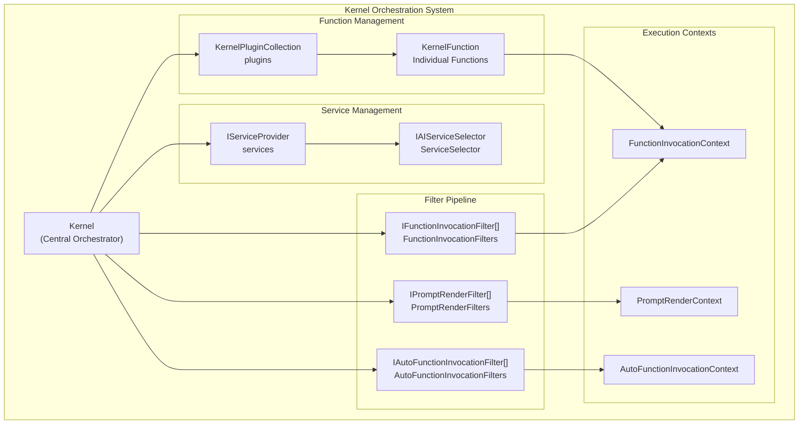
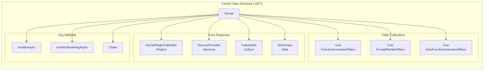
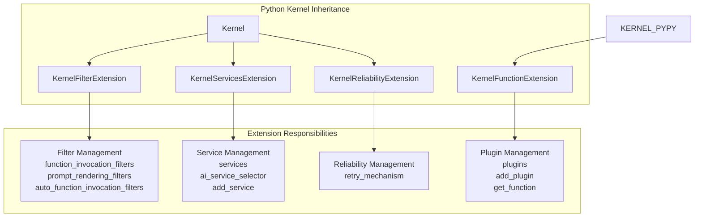
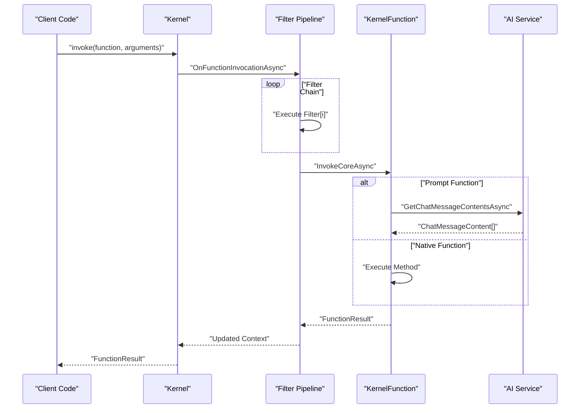
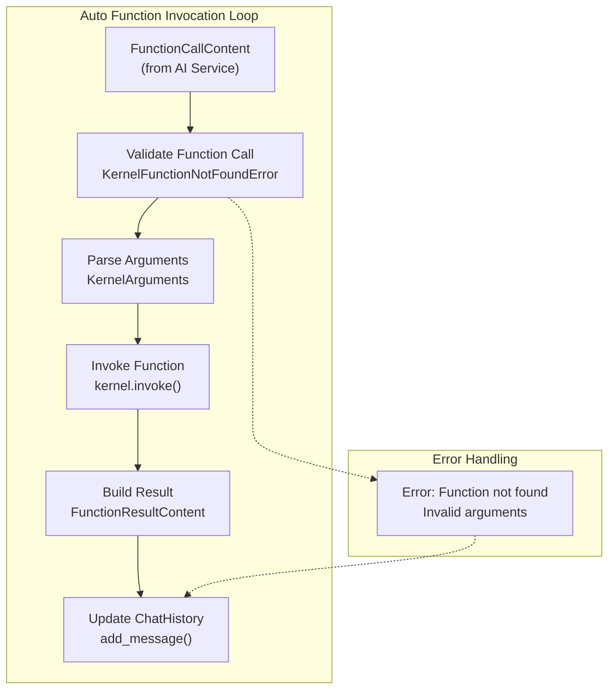
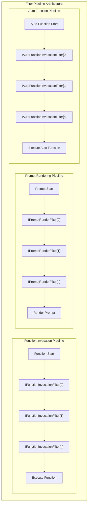
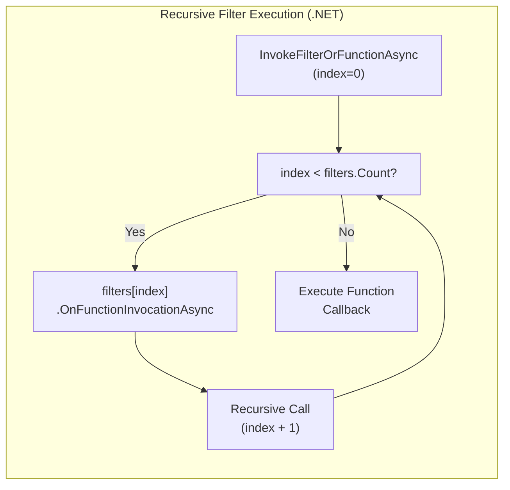
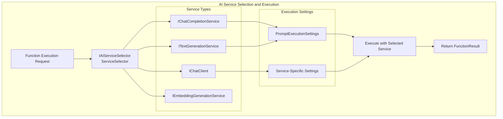
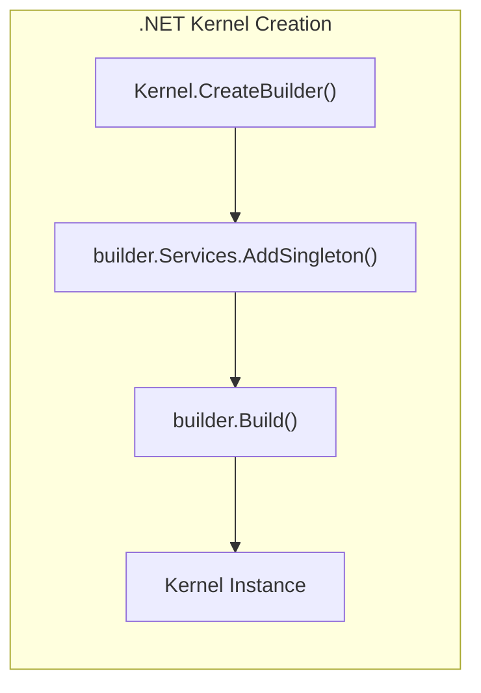
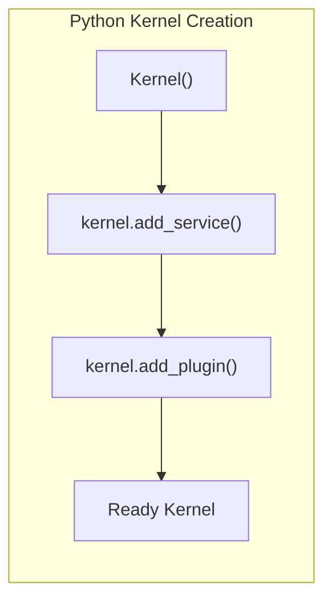

<!-- source: DeepWiki mcp.deepwiki.com · repo microsoft/semantic-kernel · page 3.1 Kernel Orchestration · fetched 2026-10-27 -->

# Kernel Orchestration

Relevant source files

The following files were used as context for generating this wiki page:

- [dotnet/src/Agents/Bedrock/Extensions/BedrockAgentInvokeExtensions.cs](dotnet/src/Agents/Bedrock/Extensions/BedrockAgentInvokeExtensions.cs)
- [dotnet/src/Agents/OpenAI/Internal/AssistantMessageFactory.cs](dotnet/src/Agents/OpenAI/Internal/AssistantMessageFactory.cs)
- [dotnet/src/Agents/OpenAI/Internal/ResponseThreadActions.cs](dotnet/src/Agents/OpenAI/Internal/ResponseThreadActions.cs)
- [dotnet/src/Agents/UnitTests/OpenAI/Internal/AssistantMessageFactoryTests.cs](dotnet/src/Agents/UnitTests/OpenAI/Internal/AssistantMessageFactoryTests.cs)
- [dotnet/src/Agents/UnitTests/OpenAI/Internal/ResponseThreadActionsTests.cs](dotnet/src/Agents/UnitTests/OpenAI/Internal/ResponseThreadActionsTests.cs)
- [dotnet/src/Connectors/Connectors.Google/Core/Gemini/Models/GeminiPart.cs](dotnet/src/Connectors/Connectors.Google/Core/Gemini/Models/GeminiPart.cs)
- [dotnet/src/Connectors/Connectors.OpenAI.UnitTests/Core/AutoFunctionInvocationFilterTests.cs](dotnet/src/Connectors/Connectors.OpenAI.UnitTests/Core/AutoFunctionInvocationFilterTests.cs)
- [dotnet/src/InternalUtilities/connectors/AI/FunctionCalling/FunctionCallsProcessor.cs](dotnet/src/InternalUtilities/connectors/AI/FunctionCalling/FunctionCallsProcessor.cs)
- [dotnet/src/InternalUtilities/planning/Extensions/KernelFunctionMetadataExtensions.cs](dotnet/src/InternalUtilities/planning/Extensions/KernelFunctionMetadataExtensions.cs)
- [dotnet/src/InternalUtilities/planning/PlannerInstrumentation.cs](dotnet/src/InternalUtilities/planning/PlannerInstrumentation.cs)
- [dotnet/src/SemanticKernel.Abstractions/AI/PromptExecutionSettings.cs](dotnet/src/SemanticKernel.Abstractions/AI/PromptExecutionSettings.cs)
- [dotnet/src/SemanticKernel.Abstractions/AI/PromptNode.cs](dotnet/src/SemanticKernel.Abstractions/AI/PromptNode.cs)
- [dotnet/src/SemanticKernel.Abstractions/Events/CancelKernelEventArgs.cs](dotnet/src/SemanticKernel.Abstractions/Events/CancelKernelEventArgs.cs)
- [dotnet/src/SemanticKernel.Abstractions/Events/FunctionInvokedEventArgs.cs](dotnet/src/SemanticKernel.Abstractions/Events/FunctionInvokedEventArgs.cs)
- [dotnet/src/SemanticKernel.Abstractions/Events/FunctionInvokingEventArgs.cs](dotnet/src/SemanticKernel.Abstractions/Events/FunctionInvokingEventArgs.cs)
- [dotnet/src/SemanticKernel.Abstractions/Events/KernelEventArgs.cs](dotnet/src/SemanticKernel.Abstractions/Events/KernelEventArgs.cs)
- [dotnet/src/SemanticKernel.Abstractions/Events/PromptRenderedEventArgs.cs](dotnet/src/SemanticKernel.Abstractions/Events/PromptRenderedEventArgs.cs)
- [dotnet/src/SemanticKernel.Abstractions/Events/PromptRenderingEventArgs.cs](dotnet/src/SemanticKernel.Abstractions/Events/PromptRenderingEventArgs.cs)
- [dotnet/src/SemanticKernel.Abstractions/Filters/AutoFunctionInvocation/AutoFunctionInvocationContext.cs](dotnet/src/SemanticKernel.Abstractions/Filters/AutoFunctionInvocation/AutoFunctionInvocationContext.cs)
- [dotnet/src/SemanticKernel.Abstractions/Filters/AutoFunctionInvocation/IAutoFunctionInvocationFilter.cs](dotnet/src/SemanticKernel.Abstractions/Filters/AutoFunctionInvocation/IAutoFunctionInvocationFilter.cs)
- [dotnet/src/SemanticKernel.Abstractions/Filters/Function/FunctionInvocationContext.cs](dotnet/src/SemanticKernel.Abstractions/Filters/Function/FunctionInvocationContext.cs)
- [dotnet/src/SemanticKernel.Abstractions/Filters/Prompt/PromptRenderContext.cs](dotnet/src/SemanticKernel.Abstractions/Filters/Prompt/PromptRenderContext.cs)
- [dotnet/src/SemanticKernel.Abstractions/Functions/FunctionResult.cs](dotnet/src/SemanticKernel.Abstractions/Functions/FunctionResult.cs)
- [dotnet/src/SemanticKernel.Abstractions/Functions/KernelArguments.cs](dotnet/src/SemanticKernel.Abstractions/Functions/KernelArguments.cs)
- [dotnet/src/SemanticKernel.Abstractions/Functions/KernelFunction.cs](dotnet/src/SemanticKernel.Abstractions/Functions/KernelFunction.cs)
- [dotnet/src/SemanticKernel.Abstractions/Functions/KernelFunctionLogMessages.cs](dotnet/src/SemanticKernel.Abstractions/Functions/KernelFunctionLogMessages.cs)
- [dotnet/src/SemanticKernel.Abstractions/Functions/KernelFunctionMetadata.cs](dotnet/src/SemanticKernel.Abstractions/Functions/KernelFunctionMetadata.cs)
- [dotnet/src/SemanticKernel.Abstractions/Functions/KernelParameterMetadata.cs](dotnet/src/SemanticKernel.Abstractions/Functions/KernelParameterMetadata.cs)
- [dotnet/src/SemanticKernel.Abstractions/Functions/KernelReturnParameterMetadata.cs](dotnet/src/SemanticKernel.Abstractions/Functions/KernelReturnParameterMetadata.cs)
- [dotnet/src/SemanticKernel.Abstractions/Kernel.cs](dotnet/src/SemanticKernel.Abstractions/Kernel.cs)
- [dotnet/src/SemanticKernel.Abstractions/Services/AIServiceExtensions.cs](dotnet/src/SemanticKernel.Abstractions/Services/AIServiceExtensions.cs)
- [dotnet/src/SemanticKernel.Abstractions/Services/OrderedAIServiceSelector.cs](dotnet/src/SemanticKernel.Abstractions/Services/OrderedAIServiceSelector.cs)
- [dotnet/src/SemanticKernel.Core/Contents/StreamingMethodContent.cs](dotnet/src/SemanticKernel.Core/Contents/StreamingMethodContent.cs)
- [dotnet/src/SemanticKernel.Core/Functions/KernelFunctionFactory.cs](dotnet/src/SemanticKernel.Core/Functions/KernelFunctionFactory.cs)
- [dotnet/src/SemanticKernel.Core/Functions/KernelFunctionFromMethod.cs](dotnet/src/SemanticKernel.Core/Functions/KernelFunctionFromMethod.cs)
- [dotnet/src/SemanticKernel.Core/Functions/KernelFunctionFromMethodOptions.cs](dotnet/src/SemanticKernel.Core/Functions/KernelFunctionFromMethodOptions.cs)
- [dotnet/src/SemanticKernel.Core/Functions/KernelFunctionFromPrompt.cs](dotnet/src/SemanticKernel.Core/Functions/KernelFunctionFromPrompt.cs)
- [dotnet/src/SemanticKernel.Core/KernelExtensions.cs](dotnet/src/SemanticKernel.Core/KernelExtensions.cs)
- [dotnet/src/SemanticKernel.UnitTests/AI/PromptExecutionSettingsTests.cs](dotnet/src/SemanticKernel.UnitTests/AI/PromptExecutionSettingsTests.cs)
- [dotnet/src/SemanticKernel.UnitTests/Filters/FunctionInvocationFilterTests.cs](dotnet/src/SemanticKernel.UnitTests/Filters/FunctionInvocationFilterTests.cs)
- [dotnet/src/SemanticKernel.UnitTests/Filters/PromptRenderFilterTests.cs](dotnet/src/SemanticKernel.UnitTests/Filters/PromptRenderFilterTests.cs)
- [dotnet/src/SemanticKernel.UnitTests/Functions/FunctionFromMethodTests.cs](dotnet/src/SemanticKernel.UnitTests/Functions/FunctionFromMethodTests.cs)
- [dotnet/src/SemanticKernel.UnitTests/Functions/FunctionResultTests.cs](dotnet/src/SemanticKernel.UnitTests/Functions/FunctionResultTests.cs)
- [dotnet/src/SemanticKernel.UnitTests/Functions/KernelArgumentsTests.cs](dotnet/src/SemanticKernel.UnitTests/Functions/KernelArgumentsTests.cs)
- [dotnet/src/SemanticKernel.UnitTests/Functions/KernelBuilderTests.cs](dotnet/src/SemanticKernel.UnitTests/Functions/KernelBuilderTests.cs)
- [dotnet/src/SemanticKernel.UnitTests/Functions/KernelFunctionFromPromptTests.cs](dotnet/src/SemanticKernel.UnitTests/Functions/KernelFunctionFromPromptTests.cs)
- [dotnet/src/SemanticKernel.UnitTests/Functions/KernelFunctionLogMessagesTests.cs](dotnet/src/SemanticKernel.UnitTests/Functions/KernelFunctionLogMessagesTests.cs)
- [dotnet/src/SemanticKernel.UnitTests/Functions/MultipleModelTests.cs](dotnet/src/SemanticKernel.UnitTests/Functions/MultipleModelTests.cs)
- [dotnet/src/SemanticKernel.UnitTests/Functions/OrderedAIServiceSelectorTests.cs](dotnet/src/SemanticKernel.UnitTests/Functions/OrderedAIServiceSelectorTests.cs)
- [dotnet/src/SemanticKernel.UnitTests/KernelTests.cs](dotnet/src/SemanticKernel.UnitTests/KernelTests.cs)
- [dotnet/src/SemanticKernel.UnitTests/Utilities/AIConnectors/FunctionCallsProcessorTests.cs](dotnet/src/SemanticKernel.UnitTests/Utilities/AIConnectors/FunctionCallsProcessorTests.cs)
- [python/samples/concepts/mcp/README.md](python/samples/concepts/mcp/README.md)
- [python/samples/concepts/mcp/agent_with_mcp_plugin.py](python/samples/concepts/mcp/agent_with_mcp_plugin.py)
- [python/samples/concepts/mcp/agent_with_mcp_sampling.py](python/samples/concepts/mcp/agent_with_mcp_sampling.py)
- [python/samples/concepts/mcp/azure_ai_agent_with_mcp_plugin.py](python/samples/concepts/mcp/azure_ai_agent_with_mcp_plugin.py)
- [python/samples/concepts/mcp/mcp_as_plugin.py](python/samples/concepts/mcp/mcp_as_plugin.py)
- [python/samples/concepts/realtime/README.md](python/samples/concepts/realtime/README.md)
- [python/samples/concepts/realtime/realtime_agent_with_function_calling_webrtc.py](python/samples/concepts/realtime/realtime_agent_with_function_calling_webrtc.py)
- [python/samples/concepts/realtime/realtime_agent_with_function_calling_websocket.py](python/samples/concepts/realtime/realtime_agent_with_function_calling_websocket.py)
- [python/samples/concepts/realtime/simple_realtime_chat_webrtc.py](python/samples/concepts/realtime/simple_realtime_chat_webrtc.py)
- [python/samples/concepts/realtime/simple_realtime_chat_websocket.py](python/samples/concepts/realtime/simple_realtime_chat_websocket.py)
- [python/samples/concepts/realtime/utils.py](python/samples/concepts/realtime/utils.py)
- [python/semantic_kernel/connectors/ai/open_ai/prompt_execution_settings/open_ai_realtime_execution_settings.py](python/semantic_kernel/connectors/ai/open_ai/prompt_execution_settings/open_ai_realtime_execution_settings.py)
- [python/semantic_kernel/connectors/ai/open_ai/services/_open_ai_realtime.py](python/semantic_kernel/connectors/ai/open_ai/services/_open_ai_realtime.py)
- [python/semantic_kernel/connectors/ai/open_ai/services/azure_realtime.py](python/semantic_kernel/connectors/ai/open_ai/services/azure_realtime.py)
- [python/semantic_kernel/connectors/ai/open_ai/settings/open_ai_settings.py](python/semantic_kernel/connectors/ai/open_ai/settings/open_ai_settings.py)
- [python/semantic_kernel/connectors/mcp.py](python/semantic_kernel/connectors/mcp.py)
- [python/semantic_kernel/functions/kernel_function_extension.py](python/semantic_kernel/functions/kernel_function_extension.py)
- [python/semantic_kernel/functions/kernel_plugin.py](python/semantic_kernel/functions/kernel_plugin.py)
- [python/semantic_kernel/kernel.py](python/semantic_kernel/kernel.py)
- [python/tests/unit/connectors/ai/open_ai/services/test_openai_realtime.py](python/tests/unit/connectors/ai/open_ai/services/test_openai_realtime.py)
- [python/tests/unit/connectors/mcp/test_mcp.py](python/tests/unit/connectors/mcp/test_mcp.py)
- [python/tests/unit/functions/test_kernel_plugins.py](python/tests/unit/functions/test_kernel_plugins.py)
- [python/tests/unit/kernel/test_kernel.py](python/tests/unit/kernel/test_kernel.py)

This document covers the central orchestration system in Semantic Kernel that coordinates the execution of AI functions, plugins, and services. The Kernel serves as the primary entry point and orchestrator for all AI-powered operations, managing the execution flow, service selection, filtering, and coordination between different components.

For information about specific function implementations, see [Functions and Plugins](#3.2). For AI service integration details, see [AI Service Integration](#4).

## Core Architecture Overview

The Kernel orchestration system follows a hub-and-spoke architecture where the `Kernel` class acts as the central coordinator for all operations. It manages plugins, services, filters, and execution contexts while providing both synchronous and asynchronous execution patterns.

### High-Level Orchestration Architecture

**Sources:** [dotnet/src/SemanticKernel.Abstractions/Kernel.cs:26-156](), [python/semantic_kernel/kernel.py:62-102]()

## Kernel Class and Core Components

### .NET Kernel Implementation

The .NET `Kernel` class provides the central orchestration functionality with the following key components:

**Sources:** [dotnet/src/SemanticKernel.Abstractions/Kernel.cs:44-204]()

### Python Kernel Implementation

The Python `Kernel` class extends multiple extension classes to provide orchestration capabilities:

**Sources:** [python/semantic_kernel/kernel.py:62-75](), [python/semantic_kernel/functions/kernel_function_extension.py:45-63]()

## Function Orchestration Patterns

The Kernel provides several orchestration patterns for function execution, each serving different use cases and execution models.

### Function Invocation Flow

**Sources:** [dotnet/src/SemanticKernel.Abstractions/Functions/KernelFunction.cs:234-286](), [python/semantic_kernel/kernel.py:167-213]()

### Streaming Orchestration

The Kernel supports streaming execution for real-time AI responses:

| Pattern | .NET Method | Python Method | Use Case |
|---------|-------------|---------------|-----------|
| Function Streaming | `InvokeStreamingAsync<T>` | `invoke_stream` | Real-time AI responses |
| Prompt Streaming | `KernelFunction.InvokeStreamingAsync` | `invoke_prompt_stream` | Streaming prompt execution |
| Function Results | Return streaming content | `return_function_results` | Complete results after streaming |

**Sources:** [dotnet/src/SemanticKernel.Abstractions/Functions/KernelFunction.cs:318-422](), [python/semantic_kernel/kernel.py:104-166]()

### Auto Function Invocation Pattern

For AI function calling scenarios, the Kernel orchestrates automatic function invocation loops. In .NET, this is handled via `FunctionChoiceBehavior` [dotnet/src/SemanticKernel.Abstractions/AI/PromptExecutionSettings.cs:92-101](). In Python, the `Kernel` manages the loop by checking for `FunctionCallContent` and invoking the corresponding registered functions [python/semantic_kernel/kernel.py:326-456]().

**Sources:** [python/semantic_kernel/kernel.py:326-456](), [dotnet/src/SemanticKernel.Abstractions/Kernel.cs:398-523]()

## Filter System and Execution Pipeline

The Kernel implements a sophisticated filter pipeline system that allows for cross-cutting concerns like logging, caching, retry logic, and validation.

### Filter Types and Pipeline

The framework provides three primary filter interfaces:
1.  **IFunctionInvocationFilter / function_invocation_filters**: Applied during function execution [dotnet/src/SemanticKernel.Abstractions/Kernel.cs:38](), [python/semantic_kernel/kernel.py:69]().
2.  **IPromptRenderFilter / prompt_rendering_filters**: Applied during prompt template rendering [dotnet/src/SemanticKernel.Abstractions/Kernel.cs:40](), [python/semantic_kernel/kernel.py:70]().
3.  **IAutoFunctionInvocationFilter / auto_function_invocation_filters**: Applied during the auto-function invocation loop [dotnet/src/SemanticKernel.Abstractions/Kernel.cs:42](), [python/semantic_kernel/kernel.py:71]().

**Sources:** [dotnet/src/SemanticKernel.Abstractions/Kernel.cs:335-394](), [python/semantic_kernel/kernel.py:69-71]()

### Filter Execution Implementation

The filter execution follows a recursive pattern in .NET using the `InvokeFilterOrFunctionAsync` pattern to wrap the function call within the filter chain [dotnet/src/SemanticKernel.Abstractions/Kernel.cs:335-350]().

**Sources:** [dotnet/src/SemanticKernel.Abstractions/Kernel.cs:335-350]()

## Service Integration and Selection

The Kernel orchestrates AI service selection and execution through a pluggable service architecture. It uses an `AIServiceSelector` to determine which service to use based on the `PromptExecutionSettings` provided [python/semantic_kernel/kernel.py:74](), [dotnet/src/SemanticKernel.Abstractions/Services/OrderedAIServiceSelector.cs:15-20]().

### Service Selection Flow

**Sources:** [dotnet/src/SemanticKernel.Core/Functions/KernelFunctionFromPrompt.cs:560-606](), [python/semantic_kernel/kernel.py:74](), [dotnet/src/SemanticKernel.Abstractions/AI/PromptExecutionSettings.cs:21-40]()

## Cross-Language Implementation Consistency

Both .NET and Python implementations maintain consistent orchestration patterns while leveraging language-specific features.

### Implementation Comparison

| Component | .NET Implementation | Python Implementation | Key Differences |
|-----------|-------------------|---------------------|-----------------|
| Base Class | `Kernel` [dotnet/src/SemanticKernel.Abstractions/Kernel.cs:26]() | `Kernel` [python/semantic_kernel/kernel.py:62]() | Python uses multiple inheritance for extensions. |
| Function Invocation | `InvokeAsync` [dotnet/src/SemanticKernel.Abstractions/Kernel.cs:175]() | `invoke` [python/semantic_kernel/kernel.py:167]() | Similar async patterns. |
| Service Registration | `IServiceProvider` [dotnet/src/SemanticKernel.Abstractions/Kernel.cs:61]() | `services: dict` [python/semantic_kernel/kernel.py:81]() | .NET uses DI container. |
| Filter Pipeline | Recursive execution | Generator-based | Different execution models. |
| Plugin Management | `KernelPluginCollection` [dotnet/src/SemanticKernel.Abstractions/Kernel.cs:124]() | `plugins: dict` [python/semantic_kernel/kernel.py:72]() | Similar interface, different storage. |

### Kernel Creation Patterns

**.NET Kernel Builder:**

**Python Kernel Creation:**

**Sources:** [dotnet/src/SemanticKernel.Abstractions/Kernel.cs:84-85](), [python/semantic_kernel/kernel.py:77-102]()

---

