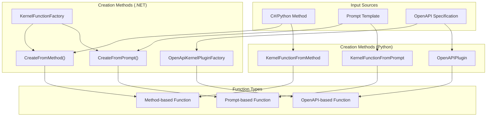
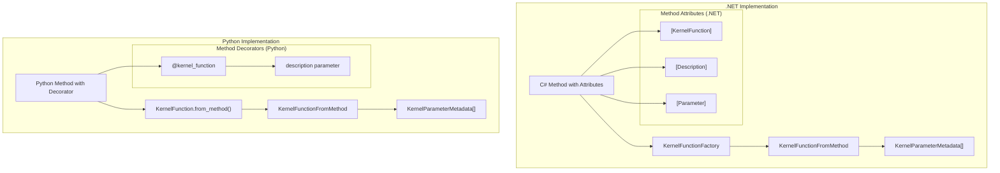
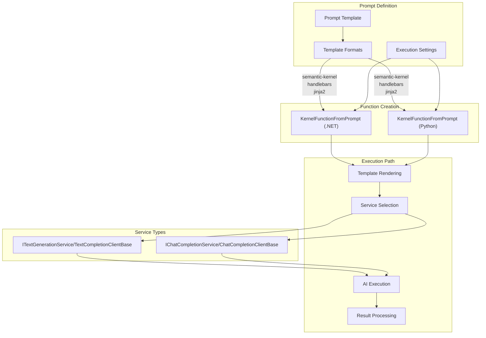
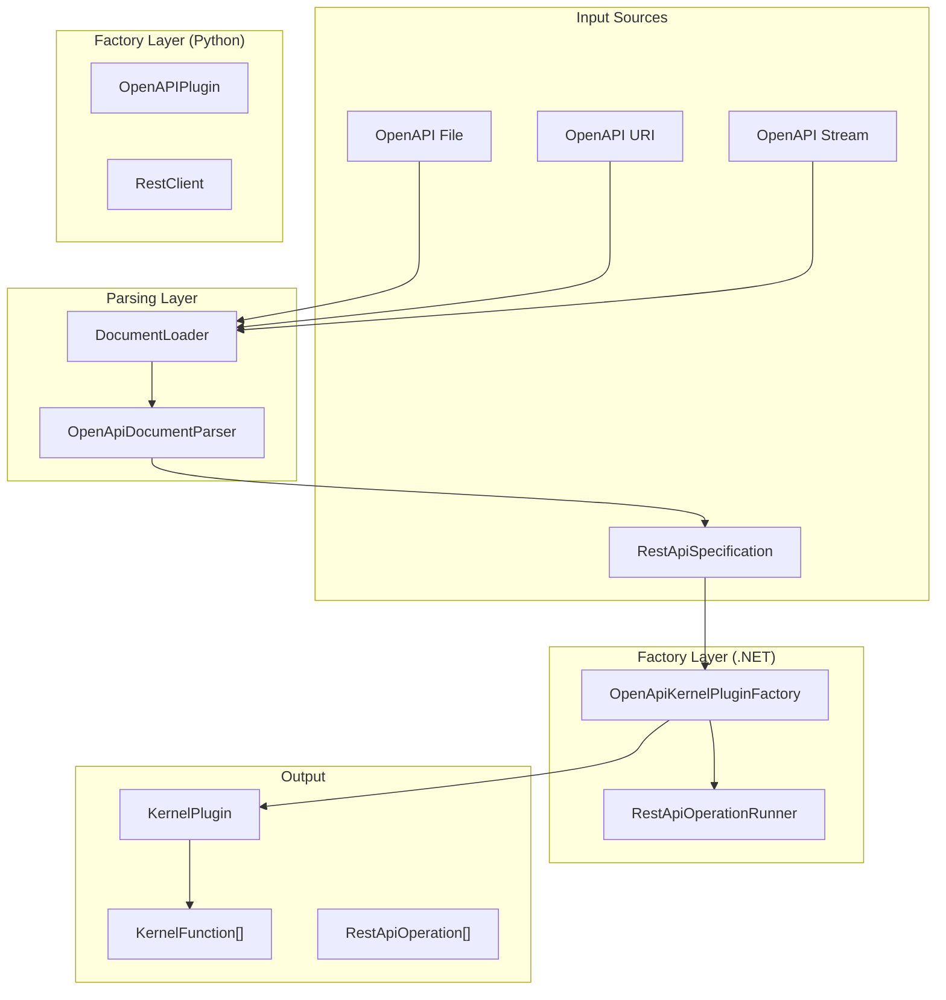
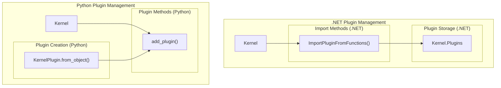

<!-- source: DeepWiki mcp.deepwiki.com · repo microsoft/semantic-kernel · page 3.2 Functions and Plugins · fetched 2026-10-27 -->

# Functions and Plugins

Relevant source files

The following files were used as context for generating this wiki page:

- [docs/decisions/0037-audio-naming.md](docs/decisions/0037-audio-naming.md)
- [dotnet/samples/Concepts/Functions/MethodFunctions_Advanced.cs](dotnet/samples/Concepts/Functions/MethodFunctions_Advanced.cs)
- [dotnet/samples/Concepts/Plugins/CreatePluginFromOpenApiSpec_RepairService.cs](dotnet/samples/Concepts/Plugins/CreatePluginFromOpenApiSpec_RepairService.cs)
- [dotnet/samples/Concepts/Plugins/OpenApiPlugin_Customization.cs](dotnet/samples/Concepts/Plugins/OpenApiPlugin_Customization.cs)
- [dotnet/samples/Concepts/Resources/Plugins/ProductsPlugin/openapi.json](dotnet/samples/Concepts/Resources/Plugins/ProductsPlugin/openapi.json)
- [dotnet/samples/Demos/OllamaFunctionCalling/Program.cs](dotnet/samples/Demos/OllamaFunctionCalling/Program.cs)
- [dotnet/src/Extensions/Extensions.UnitTests/Extensions.UnitTests.csproj](dotnet/src/Extensions/Extensions.UnitTests/Extensions.UnitTests.csproj)
- [dotnet/src/Extensions/Extensions.UnitTests/PromptTemplates/Handlebars/HandlebarsPromptTemplateFactoryTests.cs](dotnet/src/Extensions/Extensions.UnitTests/PromptTemplates/Handlebars/HandlebarsPromptTemplateFactoryTests.cs)
- [dotnet/src/Extensions/Extensions.UnitTests/PromptTemplates/Handlebars/HandlebarsPromptTemplateTests.cs](dotnet/src/Extensions/Extensions.UnitTests/PromptTemplates/Handlebars/HandlebarsPromptTemplateTests.cs)
- [dotnet/src/Extensions/Extensions.UnitTests/PromptTemplates/Handlebars/Helpers/KernelFunctionHelpersTests.cs](dotnet/src/Extensions/Extensions.UnitTests/PromptTemplates/Handlebars/Helpers/KernelFunctionHelpersTests.cs)
- [dotnet/src/Extensions/Extensions.UnitTests/PromptTemplates/Handlebars/Helpers/KernelHelperUtilsTests.cs](dotnet/src/Extensions/Extensions.UnitTests/PromptTemplates/Handlebars/Helpers/KernelHelperUtilsTests.cs)
- [dotnet/src/Extensions/Extensions.UnitTests/PromptTemplates/Handlebars/Helpers/KernelSystemHelpersTests.cs](dotnet/src/Extensions/Extensions.UnitTests/PromptTemplates/Handlebars/Helpers/KernelSystemHelpersTests.cs)
- [dotnet/src/Extensions/PromptTemplates.Handlebars/Extensions/HandlebarsKernelExtensions.cs](dotnet/src/Extensions/PromptTemplates.Handlebars/Extensions/HandlebarsKernelExtensions.cs)
- [dotnet/src/Extensions/PromptTemplates.Handlebars/HandlebarsPromptTemplate.cs](dotnet/src/Extensions/PromptTemplates.Handlebars/HandlebarsPromptTemplate.cs)
- [dotnet/src/Extensions/PromptTemplates.Handlebars/HandlebarsPromptTemplateFactory.cs](dotnet/src/Extensions/PromptTemplates.Handlebars/HandlebarsPromptTemplateFactory.cs)
- [dotnet/src/Extensions/PromptTemplates.Handlebars/HandlebarsPromptTemplateOptions.cs](dotnet/src/Extensions/PromptTemplates.Handlebars/HandlebarsPromptTemplateOptions.cs)
- [dotnet/src/Extensions/PromptTemplates.Handlebars/Helpers/KernelHelperUtils.cs](dotnet/src/Extensions/PromptTemplates.Handlebars/Helpers/KernelHelperUtils.cs)
- [dotnet/src/Extensions/PromptTemplates.Handlebars/Helpers/KernelHelpers/KernelFunctionHelpers.cs](dotnet/src/Extensions/PromptTemplates.Handlebars/Helpers/KernelHelpers/KernelFunctionHelpers.cs)
- [dotnet/src/Extensions/PromptTemplates.Handlebars/Helpers/KernelHelpers/KernelSystemHelpers.cs](dotnet/src/Extensions/PromptTemplates.Handlebars/Helpers/KernelHelpers/KernelSystemHelpers.cs)
- [dotnet/src/Extensions/PromptTemplates.Handlebars/PromptTemplates.Handlebars.csproj](dotnet/src/Extensions/PromptTemplates.Handlebars/PromptTemplates.Handlebars.csproj)
- [dotnet/src/Extensions/PromptTemplates.Liquid.UnitTests/LiquidTemplateTest.cs](dotnet/src/Extensions/PromptTemplates.Liquid.UnitTests/LiquidTemplateTest.cs)
- [dotnet/src/Extensions/PromptTemplates.Liquid/LiquidPromptTemplate.cs](dotnet/src/Extensions/PromptTemplates.Liquid/LiquidPromptTemplate.cs)
- [dotnet/src/Extensions/PromptTemplates.Liquid/LiquidPromptTemplateFactory.cs](dotnet/src/Extensions/PromptTemplates.Liquid/LiquidPromptTemplateFactory.cs)
- [dotnet/src/Extensions/PromptTemplates.Liquid/PromptTemplates.Liquid.csproj](dotnet/src/Extensions/PromptTemplates.Liquid/PromptTemplates.Liquid.csproj)
- [dotnet/src/Functions/Functions.Markdown/KernelFunctionMarkdown.cs](dotnet/src/Functions/Functions.Markdown/KernelFunctionMarkdown.cs)
- [dotnet/src/Functions/Functions.Markdown/MarkdownKernelExtensions.cs](dotnet/src/Functions/Functions.Markdown/MarkdownKernelExtensions.cs)
- [dotnet/src/Functions/Functions.UnitTests/Yaml/Functions/KernelFunctionYamlTests.cs](dotnet/src/Functions/Functions.UnitTests/Yaml/Functions/KernelFunctionYamlTests.cs)
- [dotnet/src/Functions/Functions.UnitTests/Yaml/Plugins/CreateKernelPluginYamlTests.cs](dotnet/src/Functions/Functions.UnitTests/Yaml/Plugins/CreateKernelPluginYamlTests.cs)
- [dotnet/src/Functions/Functions.Yaml/Functions.Yaml.csproj](dotnet/src/Functions/Functions.Yaml/Functions.Yaml.csproj)
- [dotnet/src/Functions/Functions.Yaml/KernelFunctionYaml.cs](dotnet/src/Functions/Functions.Yaml/KernelFunctionYaml.cs)
- [dotnet/src/Functions/Functions.Yaml/PromptYamlKernelExtensions.cs](dotnet/src/Functions/Functions.Yaml/PromptYamlKernelExtensions.cs)
- [dotnet/src/IntegrationTests/Plugins/OpenApi/RepairServiceTests.cs](dotnet/src/IntegrationTests/Plugins/OpenApi/RepairServiceTests.cs)
- [dotnet/src/InternalUtilities/src/Diagnostics/KernelVerify.cs](dotnet/src/InternalUtilities/src/Diagnostics/KernelVerify.cs)
- [dotnet/src/InternalUtilities/src/Diagnostics/Verify.cs](dotnet/src/InternalUtilities/src/Diagnostics/Verify.cs)
- [dotnet/src/InternalUtilities/src/System/InternalTypeConverter.cs](dotnet/src/InternalUtilities/src/System/InternalTypeConverter.cs)
- [dotnet/src/InternalUtilities/src/System/TypeConverterFactory.cs](dotnet/src/InternalUtilities/src/System/TypeConverterFactory.cs)
- [dotnet/src/SemanticKernel.Abstractions/AI/FunctionChoiceBehaviors/AutoFunctionChoiceBehavior.cs](dotnet/src/SemanticKernel.Abstractions/AI/FunctionChoiceBehaviors/AutoFunctionChoiceBehavior.cs)
- [dotnet/src/SemanticKernel.Abstractions/AI/FunctionChoiceBehaviors/FunctionChoice.cs](dotnet/src/SemanticKernel.Abstractions/AI/FunctionChoiceBehaviors/FunctionChoice.cs)
- [dotnet/src/SemanticKernel.Abstractions/AI/FunctionChoiceBehaviors/FunctionChoiceBehavior.cs](dotnet/src/SemanticKernel.Abstractions/AI/FunctionChoiceBehaviors/FunctionChoiceBehavior.cs)
- [dotnet/src/SemanticKernel.Abstractions/AI/FunctionChoiceBehaviors/FunctionChoiceBehaviorConfiguration.cs](dotnet/src/SemanticKernel.Abstractions/AI/FunctionChoiceBehaviors/FunctionChoiceBehaviorConfiguration.cs)
- [dotnet/src/SemanticKernel.Abstractions/AI/FunctionChoiceBehaviors/FunctionChoiceBehaviorConfigurationContext.cs](dotnet/src/SemanticKernel.Abstractions/AI/FunctionChoiceBehaviors/FunctionChoiceBehaviorConfigurationContext.cs)
- [dotnet/src/SemanticKernel.Abstractions/AI/FunctionChoiceBehaviors/NoneFunctionChoiceBehavior.cs](dotnet/src/SemanticKernel.Abstractions/AI/FunctionChoiceBehaviors/NoneFunctionChoiceBehavior.cs)
- [dotnet/src/SemanticKernel.Abstractions/AI/FunctionChoiceBehaviors/RequiredFunctionChoiceBehavior.cs](dotnet/src/SemanticKernel.Abstractions/AI/FunctionChoiceBehaviors/RequiredFunctionChoiceBehavior.cs)
- [dotnet/src/SemanticKernel.Abstractions/Functions/FromKernelServicesAttribute.cs](dotnet/src/SemanticKernel.Abstractions/Functions/FromKernelServicesAttribute.cs)
- [dotnet/src/SemanticKernel.Abstractions/Functions/KernelFunctionAttribute.cs](dotnet/src/SemanticKernel.Abstractions/Functions/KernelFunctionAttribute.cs)
- [dotnet/src/SemanticKernel.Abstractions/Functions/KernelJsonSchema.cs](dotnet/src/SemanticKernel.Abstractions/Functions/KernelJsonSchema.cs)
- [dotnet/src/SemanticKernel.Abstractions/PromptTemplate/IPromptTemplate.cs](dotnet/src/SemanticKernel.Abstractions/PromptTemplate/IPromptTemplate.cs)
- [dotnet/src/SemanticKernel.Abstractions/PromptTemplate/InputVariable.cs](dotnet/src/SemanticKernel.Abstractions/PromptTemplate/InputVariable.cs)
- [dotnet/src/SemanticKernel.Abstractions/PromptTemplate/OutputVariable.cs](dotnet/src/SemanticKernel.Abstractions/PromptTemplate/OutputVariable.cs)
- [dotnet/src/SemanticKernel.Abstractions/PromptTemplate/PromptTemplateConfig.cs](dotnet/src/SemanticKernel.Abstractions/PromptTemplate/PromptTemplateConfig.cs)
- [dotnet/src/SemanticKernel.Core/Functions/KernelFunctionMetadataFactory.cs](dotnet/src/SemanticKernel.Core/Functions/KernelFunctionMetadataFactory.cs)
- [dotnet/src/SemanticKernel.Core/Functions/KernelPluginFactory.cs](dotnet/src/SemanticKernel.Core/Functions/KernelPluginFactory.cs)
- [dotnet/src/SemanticKernel.Core/PromptTemplate/KernelPromptTemplate.cs](dotnet/src/SemanticKernel.Core/PromptTemplate/KernelPromptTemplate.cs)
- [dotnet/src/SemanticKernel.Core/PromptTemplate/KernelPromptTemplateFactory.cs](dotnet/src/SemanticKernel.Core/PromptTemplate/KernelPromptTemplateFactory.cs)
- [dotnet/src/SemanticKernel.Core/TemplateEngine/Blocks/CodeBlock.cs](dotnet/src/SemanticKernel.Core/TemplateEngine/Blocks/CodeBlock.cs)
- [dotnet/src/SemanticKernel.Core/TemplateEngine/Blocks/FunctionIdBlock.cs](dotnet/src/SemanticKernel.Core/TemplateEngine/Blocks/FunctionIdBlock.cs)
- [dotnet/src/SemanticKernel.Core/TemplateEngine/Blocks/ICodeRendering.cs](dotnet/src/SemanticKernel.Core/TemplateEngine/Blocks/ICodeRendering.cs)
- [dotnet/src/SemanticKernel.Core/TemplateEngine/Blocks/ITextRendering.cs](dotnet/src/SemanticKernel.Core/TemplateEngine/Blocks/ITextRendering.cs)
- [dotnet/src/SemanticKernel.Core/TemplateEngine/Blocks/NamedArgBlock.cs](dotnet/src/SemanticKernel.Core/TemplateEngine/Blocks/NamedArgBlock.cs)
- [dotnet/src/SemanticKernel.Core/TemplateEngine/Blocks/TextBlock.cs](dotnet/src/SemanticKernel.Core/TemplateEngine/Blocks/TextBlock.cs)
- [dotnet/src/SemanticKernel.Core/TemplateEngine/Blocks/ValBlock.cs](dotnet/src/SemanticKernel.Core/TemplateEngine/Blocks/ValBlock.cs)
- [dotnet/src/SemanticKernel.Core/TemplateEngine/Blocks/VarBlock.cs](dotnet/src/SemanticKernel.Core/TemplateEngine/Blocks/VarBlock.cs)
- [dotnet/src/SemanticKernel.Core/TemplateEngine/CodeTokenizer.cs](dotnet/src/SemanticKernel.Core/TemplateEngine/CodeTokenizer.cs)
- [dotnet/src/SemanticKernel.UnitTests/Functions/KernelFunctionFromMethodTests1.cs](dotnet/src/SemanticKernel.UnitTests/Functions/KernelFunctionFromMethodTests1.cs)
- [dotnet/src/SemanticKernel.UnitTests/Functions/KernelFunctionFromMethodTests2.cs](dotnet/src/SemanticKernel.UnitTests/Functions/KernelFunctionFromMethodTests2.cs)
- [dotnet/src/SemanticKernel.UnitTests/Functions/KernelFunctionMetadataFactoryTests.cs](dotnet/src/SemanticKernel.UnitTests/Functions/KernelFunctionMetadataFactoryTests.cs)
- [dotnet/src/SemanticKernel.UnitTests/Functions/KernelFunctionMetadataTests.cs](dotnet/src/SemanticKernel.UnitTests/Functions/KernelFunctionMetadataTests.cs)
- [dotnet/src/SemanticKernel.UnitTests/Functions/KernelPluginFactoryTests.cs](dotnet/src/SemanticKernel.UnitTests/Functions/KernelPluginFactoryTests.cs)
- [dotnet/src/SemanticKernel.UnitTests/PromptTemplate/AggregatorPromptTemplateFactoryTests.cs](dotnet/src/SemanticKernel.UnitTests/PromptTemplate/AggregatorPromptTemplateFactoryTests.cs)
- [dotnet/src/SemanticKernel.UnitTests/PromptTemplate/KernelPromptTemplateFactoryTests.cs](dotnet/src/SemanticKernel.UnitTests/PromptTemplate/KernelPromptTemplateFactoryTests.cs)
- [dotnet/src/SemanticKernel.UnitTests/PromptTemplate/KernelPromptTemplateTests.cs](dotnet/src/SemanticKernel.UnitTests/PromptTemplate/KernelPromptTemplateTests.cs)
- [dotnet/src/SemanticKernel.UnitTests/TemplateEngine/Blocks/CodeBlockTests.cs](dotnet/src/SemanticKernel.UnitTests/TemplateEngine/Blocks/CodeBlockTests.cs)
- [dotnet/src/SemanticKernel.UnitTests/TemplateEngine/Blocks/FunctionIdBlockTests.cs](dotnet/src/SemanticKernel.UnitTests/TemplateEngine/Blocks/FunctionIdBlockTests.cs)
- [dotnet/src/SemanticKernel.UnitTests/TemplateEngine/Blocks/NamedArgBlockTests.cs](dotnet/src/SemanticKernel.UnitTests/TemplateEngine/Blocks/NamedArgBlockTests.cs)
- [dotnet/src/SemanticKernel.UnitTests/TemplateEngine/Blocks/TextBlockTests.cs](dotnet/src/SemanticKernel.UnitTests/TemplateEngine/Blocks/TextBlockTests.cs)
- [dotnet/src/SemanticKernel.UnitTests/TemplateEngine/Blocks/ValBlockTests.cs](dotnet/src/SemanticKernel.UnitTests/TemplateEngine/Blocks/ValBlockTests.cs)
- [dotnet/src/SemanticKernel.UnitTests/TemplateEngine/Blocks/VarBlockTests.cs](dotnet/src/SemanticKernel.UnitTests/TemplateEngine/Blocks/VarBlockTests.cs)
- [dotnet/src/SemanticKernel.UnitTests/TemplateEngine/CodeTokenizerTests.cs](dotnet/src/SemanticKernel.UnitTests/TemplateEngine/CodeTokenizerTests.cs)
- [dotnet/src/SemanticKernel.UnitTests/TemplateEngine/TemplateTokenizerTests.cs](dotnet/src/SemanticKernel.UnitTests/TemplateEngine/TemplateTokenizerTests.cs)
- [dotnet/src/SemanticKernel.UnitTests/Utilities/InternalTypeConverterTests.cs](dotnet/src/SemanticKernel.UnitTests/Utilities/InternalTypeConverterTests.cs)
- [python/samples/concepts/filtering/auto_function_invoke_filters.py](python/samples/concepts/filtering/auto_function_invoke_filters.py)
- [python/samples/concepts/filtering/prompt_filters.py](python/samples/concepts/filtering/prompt_filters.py)
- [python/samples/concepts/filtering/resources/chat/chat.yaml](python/samples/concepts/filtering/resources/chat/chat.yaml)
- [python/samples/concepts/grounding/grounded.py](python/samples/concepts/grounding/grounded.py)
- [python/samples/concepts/plugins/openai_function_calling_with_custom_plugin.py](python/samples/concepts/plugins/openai_function_calling_with_custom_plugin.py)
- [python/samples/concepts/prompt_templates/azure_chat_gpt_api_handlebars.py](python/samples/concepts/prompt_templates/azure_chat_gpt_api_handlebars.py)
- [python/samples/concepts/prompt_templates/azure_chat_gpt_api_jinja2.py](python/samples/concepts/prompt_templates/azure_chat_gpt_api_jinja2.py)
- [python/samples/concepts/prompt_templates/configuring_prompts.py](python/samples/concepts/prompt_templates/configuring_prompts.py)
- [python/samples/concepts/prompt_templates/load_yaml_prompt.py](python/samples/concepts/prompt_templates/load_yaml_prompt.py)
- [python/samples/concepts/resources/function_choice_json/ChatBot/config.json](python/samples/concepts/resources/function_choice_json/ChatBot/config.json)
- [python/samples/concepts/resources/function_choice_yaml/defined_function.yaml](python/samples/concepts/resources/function_choice_yaml/defined_function.yaml)
- [python/semantic_kernel/connectors/ai/function_calling_utils.py](python/semantic_kernel/connectors/ai/function_calling_utils.py)
- [python/semantic_kernel/connectors/ai/hugging_face/hf_prompt_execution_settings.py](python/semantic_kernel/connectors/ai/hugging_face/hf_prompt_execution_settings.py)
- [python/semantic_kernel/connectors/ai/hugging_face/services/__init__.py](python/semantic_kernel/connectors/ai/hugging_face/services/__init__.py)
- [python/semantic_kernel/connectors/ai/prompt_execution_settings.py](python/semantic_kernel/connectors/ai/prompt_execution_settings.py)
- [python/semantic_kernel/const.py](python/semantic_kernel/const.py)
- [python/semantic_kernel/exceptions/function_exceptions.py](python/semantic_kernel/exceptions/function_exceptions.py)
- [python/semantic_kernel/exceptions/kernel_exceptions.py](python/semantic_kernel/exceptions/kernel_exceptions.py)
- [python/semantic_kernel/functions/kernel_function.py](python/semantic_kernel/functions/kernel_function.py)
- [python/semantic_kernel/functions/kernel_function_decorator.py](python/semantic_kernel/functions/kernel_function_decorator.py)
- [python/semantic_kernel/functions/kernel_function_from_method.py](python/semantic_kernel/functions/kernel_function_from_method.py)
- [python/semantic_kernel/functions/kernel_function_from_prompt.py](python/semantic_kernel/functions/kernel_function_from_prompt.py)
- [python/semantic_kernel/functions/kernel_parameter_metadata.py](python/semantic_kernel/functions/kernel_parameter_metadata.py)
- [python/semantic_kernel/prompt_template/handlebars_prompt_template.py](python/semantic_kernel/prompt_template/handlebars_prompt_template.py)
- [python/semantic_kernel/prompt_template/input_variable.py](python/semantic_kernel/prompt_template/input_variable.py)
- [python/semantic_kernel/prompt_template/jinja2_prompt_template.py](python/semantic_kernel/prompt_template/jinja2_prompt_template.py)
- [python/semantic_kernel/prompt_template/kernel_prompt_template.py](python/semantic_kernel/prompt_template/kernel_prompt_template.py)
- [python/semantic_kernel/prompt_template/prompt_template_base.py](python/semantic_kernel/prompt_template/prompt_template_base.py)
- [python/semantic_kernel/prompt_template/prompt_template_config.py](python/semantic_kernel/prompt_template/prompt_template_config.py)
- [python/semantic_kernel/prompt_template/utils/handlebars_system_helpers.py](python/semantic_kernel/prompt_template/utils/handlebars_system_helpers.py)
- [python/semantic_kernel/prompt_template/utils/jinja2_system_helpers.py](python/semantic_kernel/prompt_template/utils/jinja2_system_helpers.py)
- [python/semantic_kernel/prompt_template/utils/template_function_helpers.py](python/semantic_kernel/prompt_template/utils/template_function_helpers.py)
- [python/semantic_kernel/schema/kernel_json_schema_builder.py](python/semantic_kernel/schema/kernel_json_schema_builder.py)
- [python/semantic_kernel/services/ai_service_selector.py](python/semantic_kernel/services/ai_service_selector.py)
- [python/semantic_kernel/template_engine/blocks/block.py](python/semantic_kernel/template_engine/blocks/block.py)
- [python/semantic_kernel/template_engine/blocks/code_block.py](python/semantic_kernel/template_engine/blocks/code_block.py)
- [python/semantic_kernel/template_engine/blocks/function_id_block.py](python/semantic_kernel/template_engine/blocks/function_id_block.py)
- [python/semantic_kernel/template_engine/blocks/text_block.py](python/semantic_kernel/template_engine/blocks/text_block.py)
- [python/semantic_kernel/template_engine/blocks/val_block.py](python/semantic_kernel/template_engine/blocks/val_block.py)
- [python/semantic_kernel/template_engine/blocks/var_block.py](python/semantic_kernel/template_engine/blocks/var_block.py)
- [python/semantic_kernel/template_engine/code_tokenizer.py](python/semantic_kernel/template_engine/code_tokenizer.py)
- [python/semantic_kernel/template_engine/template_tokenizer.py](python/semantic_kernel/template_engine/template_tokenizer.py)
- [python/semantic_kernel/text/text_chunker.py](python/semantic_kernel/text/text_chunker.py)
- [python/tests/unit/functions/test_kernel_function_decorators.py](python/tests/unit/functions/test_kernel_function_decorators.py)
- [python/tests/unit/functions/test_kernel_function_from_method.py](python/tests/unit/functions/test_kernel_function_from_method.py)
- [python/tests/unit/functions/test_kernel_function_from_prompt.py](python/tests/unit/functions/test_kernel_function_from_prompt.py)
- [python/tests/unit/functions/test_kernel_parameter_metadata.py](python/tests/unit/functions/test_kernel_parameter_metadata.py)
- [python/tests/unit/prompt_template/test_handlebars_prompt_template.py](python/tests/unit/prompt_template/test_handlebars_prompt_template.py)
- [python/tests/unit/prompt_template/test_handlebars_prompt_template_e2e.py](python/tests/unit/prompt_template/test_handlebars_prompt_template_e2e.py)
- [python/tests/unit/prompt_template/test_jinja2_prompt_template.py](python/tests/unit/prompt_template/test_jinja2_prompt_template.py)
- [python/tests/unit/prompt_template/test_jinja2_prompt_template_e2e.py](python/tests/unit/prompt_template/test_jinja2_prompt_template_e2e.py)
- [python/tests/unit/prompt_template/test_prompt_templates.py](python/tests/unit/prompt_template/test_prompt_templates.py)
- [python/tests/unit/prompt_template/test_template_helper.py](python/tests/unit/prompt_template/test_template_helper.py)
- [python/tests/unit/schema/test_schema_builder.py](python/tests/unit/schema/test_schema_builder.py)
- [python/tests/unit/services/test_service_utils.py](python/tests/unit/services/test_service_utils.py)
- [python/tests/unit/template_engine/blocks/test_code_block.py](python/tests/unit/template_engine/blocks/test_code_block.py)
- [python/tests/unit/template_engine/blocks/test_text_block.py](python/tests/unit/template_engine/blocks/test_text_block.py)
- [python/tests/unit/template_engine/blocks/test_var_block.py](python/tests/unit/template_engine/blocks/test_var_block.py)
- [python/tests/unit/test_serialization.py](python/tests/unit/test_serialization.py)
- [python/tests/unit/text/test_text_chunker.py](python/tests/unit/text/test_text_chunker.py)

Functions and plugins are the core building blocks that enable Semantic Kernel to execute both AI-powered operations and deterministic code. This document covers the function and plugin system, including how to create functions from methods, prompts, and OpenAPI specifications, as well as how plugins organize and manage collections of functions.

For information about kernel orchestration and service management, see [Kernel Orchestration](3.1). For details about AI service integration and execution settings, see [AI Service Integration](4).

## Function Types and Creation

Semantic Kernel supports three primary types of functions, each created through different factory methods and serving distinct purposes in AI orchestration workflows.

### Function Creation Overview

Sources: [python/semantic_kernel/functions/kernel_function.py:127-166](), [python/semantic_kernel/functions/kernel_function_from_prompt.py:55-140](), [dotnet/src/SemanticKernel.UnitTests/Functions/KernelFunctionFromMethodTests1.cs:24-50]()

### Method-based Functions

Method-based functions wrap native methods and enable them to be called by AI models. In .NET, the `KernelFunctionFactory` uses reflection to inspect method signatures and attributes. In Python, the `@kernel_function` decorator is used to mark functions and extract metadata.

Sources: [python/semantic_kernel/functions/kernel_function_decorator.py:13-84](), [python/tests/unit/functions/test_kernel_function_decorators.py:24-92](), [dotnet/src/SemanticKernel.UnitTests/Functions/KernelFunctionFromMethodTests2.cs:23-55]()

### Prompt-based Functions

Prompt-based functions are created from templates. Semantic Kernel supports multiple template formats, including the native SK format, Handlebars, and Jinja2.

Sources: [python/semantic_kernel/functions/kernel_function.py:55-59](), [python/semantic_kernel/functions/kernel_function_from_prompt.py:61-138](), [dotnet/src/SemanticKernel.Core/PromptTemplate/KernelPromptTemplate.cs:94-126]()

## Template Rendering Engine

The template engine parses strings containing variables and function calls, resolving them before sending the final prompt to the AI service.

### Block-based Tokenization
Templates are decomposed into `Block` types:
*   **`ITextRendering`**: Static text blocks.
*   **`ICodeRendering`**: Dynamic blocks like `CodeBlock`, `VarBlock`, or `ValBlock`.

In the .NET implementation, `KernelPromptTemplate` iterates through these blocks, calling `RenderCodeAsync` for dynamic elements [dotnet/src/SemanticKernel.Core/PromptTemplate/KernelPromptTemplate.cs:97-123]().

### Variable Resolution
The `KernelPromptTemplate` ensures all referenced variables are accounted for by calling `AddMissingInputVariables` during initialization [dotnet/src/SemanticKernel.Core/PromptTemplate/KernelPromptTemplate.cs:45](). If a variable is missing during rendering, it defaults to an empty string [dotnet/src/SemanticKernel.UnitTests/PromptTemplate/KernelPromptTemplateTests.cs:146-159]().

### Function Calling in Templates
Templates can invoke other kernel functions using the `{{plugin.function $argument}}` syntax. The `CodeBlock` class handles this by cloning `KernelArguments` to avoid side effects and calling `kernel.InvokeAsync` [dotnet/src/SemanticKernel.Core/TemplateEngine/Blocks/CodeBlock.cs:102-122]().

Sources: [dotnet/src/SemanticKernel.Core/TemplateEngine/Blocks/CodeBlock.cs:15-44](), [dotnet/src/SemanticKernel.UnitTests/TemplateEngine/Blocks/CodeBlockTests.cs:123-149]()

## OpenAPI Plugin System

The OpenAPI integration allows automatic creation of plugins from REST API specifications, converting API operations into callable kernel functions with full parameter validation and response handling.

### OpenAPI Plugin Architecture

Sources: [python/semantic_kernel/functions/kernel_function_from_prompt.py:44-52](), [dotnet/src/SemanticKernel.UnitTests/Functions/KernelFunctionFromMethodTests2.cs:136-167]()

## Plugin Management and Organization

Plugins serve as containers for related functions and provide organizational structure for kernel capabilities. They can be created manually from function collections or automatically from external specifications.

### Plugin Management Architecture

Sources: [dotnet/src/SemanticKernel.UnitTests/Functions/KernelFunctionFromMethodTests2.cs:44-55](), [python/semantic_kernel/functions/kernel_function.py:152-166]()

## Function Execution and Results

### Invocation Pipeline
When a function is invoked, it passes through an execution pipeline that includes:
1.  **Argument Enrichment**: Merging provided arguments with default values and template variables [dotnet/src/SemanticKernel.Core/TemplateEngine/Blocks/CodeBlock.cs:164-180]().
2.  **Filter Execution**: Running pre- and post-invocation filters (e.g., `FunctionInvocationContext`) [python/semantic_kernel/functions/kernel_function.py:17-18]().
3.  **Core Logic**: Executing the underlying method or rendering the prompt template.

### Result Handling
Function results are encapsulated in a `FunctionResult` object, which contains the return value and associated metadata [python/semantic_kernel/functions/function_result.py]().

Sources: [dotnet/src/SemanticKernel.UnitTests/Functions/KernelFunctionFromMethodTests1.cs:73-79](), [python/semantic_kernel/functions/kernel_function.py:19-21]()

---

