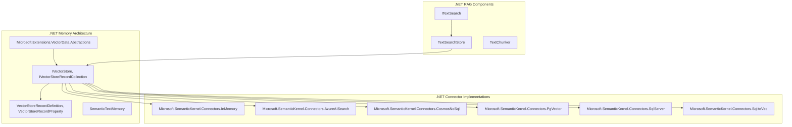
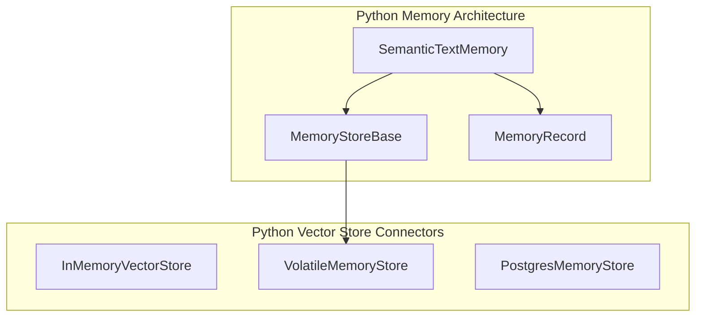
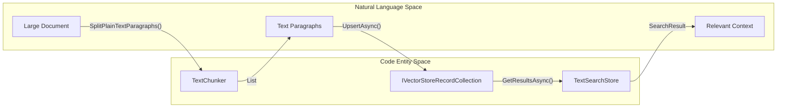
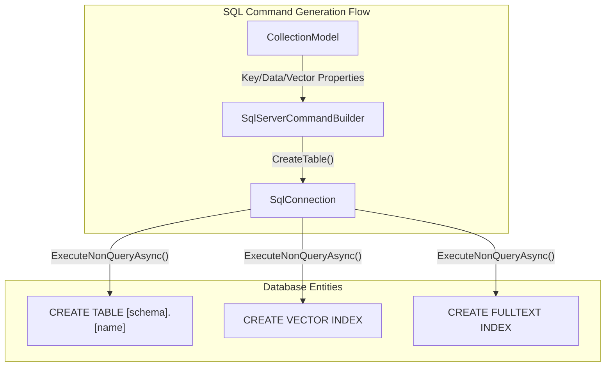

<!-- source: DeepWiki mcp.deepwiki.com · repo microsoft/semantic-kernel · page 3.3 Memory and Vector Stores · fetched 2026-10-27 -->

# Memory and Vector Stores

Relevant source files

The following files were used as context for generating this wiki page:

- [.gitignore](.gitignore)
- [docs/decisions/0072-agents-with-memory.md](docs/decisions/0072-agents-with-memory.md)
- [dotnet/samples/Concepts/Agents/ChatCompletion_Mem0.cs](dotnet/samples/Concepts/Agents/ChatCompletion_Mem0.cs)
- [dotnet/samples/Concepts/Agents/ChatCompletion_Rag.cs](dotnet/samples/Concepts/Agents/ChatCompletion_Rag.cs)
- [dotnet/samples/Concepts/Agents/ChatCompletion_Whiteboard.cs](dotnet/samples/Concepts/Agents/ChatCompletion_Whiteboard.cs)
- [dotnet/samples/Concepts/Memory/TextChunkerUsage.cs](dotnet/samples/Concepts/Memory/TextChunkerUsage.cs)
- [dotnet/samples/Concepts/Memory/TextChunkingAndEmbedding.cs](dotnet/samples/Concepts/Memory/TextChunkingAndEmbedding.cs)
- [dotnet/src/Agents/Bedrock/Agents.Bedrock.csproj](dotnet/src/Agents/Bedrock/Agents.Bedrock.csproj)
- [dotnet/src/Experimental/Orchestration.Flow.IntegrationTests/Experimental.Orchestration.Flow.IntegrationTests.csproj](dotnet/src/Experimental/Orchestration.Flow.IntegrationTests/Experimental.Orchestration.Flow.IntegrationTests.csproj)
- [dotnet/src/Experimental/Orchestration.Flow.UnitTests/Experimental.Orchestration.Flow.UnitTests.csproj](dotnet/src/Experimental/Orchestration.Flow.UnitTests/Experimental.Orchestration.Flow.UnitTests.csproj)
- [dotnet/src/Experimental/Process.Abstractions/KernelProcess.cs](dotnet/src/Experimental/Process.Abstractions/KernelProcess.cs)
- [dotnet/src/Experimental/Process.UnitTests/KernelProcessTests.cs](dotnet/src/Experimental/Process.UnitTests/KernelProcessTests.cs)
- [dotnet/src/IntegrationTests/Agents/CommonInterfaceConformance/AgentWithTextSearchProviderConformance/AgentWithTextSearchProvider.cs](dotnet/src/IntegrationTests/Agents/CommonInterfaceConformance/AgentWithTextSearchProviderConformance/AgentWithTextSearchProvider.cs)
- [dotnet/src/IntegrationTests/Memory/Mem0ProviderTests.cs](dotnet/src/IntegrationTests/Memory/Mem0ProviderTests.cs)
- [dotnet/src/InternalUtilities/connectors/Memory/MongoDB/MongoModelBuilder.cs](dotnet/src/InternalUtilities/connectors/Memory/MongoDB/MongoModelBuilder.cs)
- [dotnet/src/SemanticKernel.Core/Data/TextSearchBehavior/TextSearchProvider.cs](dotnet/src/SemanticKernel.Core/Data/TextSearchBehavior/TextSearchProvider.cs)
- [dotnet/src/SemanticKernel.Core/Data/TextSearchBehavior/TextSearchProviderOptions.cs](dotnet/src/SemanticKernel.Core/Data/TextSearchBehavior/TextSearchProviderOptions.cs)
- [dotnet/src/SemanticKernel.Core/Data/TextSearchStore/TextSearchStore.cs](dotnet/src/SemanticKernel.Core/Data/TextSearchStore/TextSearchStore.cs)
- [dotnet/src/SemanticKernel.Core/Data/TextSearchStore/TextSearchStoreOptions.cs](dotnet/src/SemanticKernel.Core/Data/TextSearchStore/TextSearchStoreOptions.cs)
- [dotnet/src/SemanticKernel.Core/Memory/Mem0/Mem0Provider.cs](dotnet/src/SemanticKernel.Core/Memory/Mem0/Mem0Provider.cs)
- [dotnet/src/SemanticKernel.Core/Memory/Whiteboard/WhiteboardProvider.cs](dotnet/src/SemanticKernel.Core/Memory/Whiteboard/WhiteboardProvider.cs)
- [dotnet/src/SemanticKernel.Core/Text/TextChunker.cs](dotnet/src/SemanticKernel.Core/Text/TextChunker.cs)
- [dotnet/src/SemanticKernel.UnitTests/Data/TextSearchProviderTests.cs](dotnet/src/SemanticKernel.UnitTests/Data/TextSearchProviderTests.cs)
- [dotnet/src/SemanticKernel.UnitTests/Data/TextSearchStoreTests.cs](dotnet/src/SemanticKernel.UnitTests/Data/TextSearchStoreTests.cs)
- [dotnet/src/SemanticKernel.UnitTests/Memory/Mem0ProviderTests.cs](dotnet/src/SemanticKernel.UnitTests/Memory/Mem0ProviderTests.cs)
- [dotnet/src/SemanticKernel.UnitTests/Memory/WhiteboardProviderTests.cs](dotnet/src/SemanticKernel.UnitTests/Memory/WhiteboardProviderTests.cs)
- [dotnet/src/SemanticKernel.UnitTests/Text/TextChunkerInternationalTests.cs](dotnet/src/SemanticKernel.UnitTests/Text/TextChunkerInternationalTests.cs)
- [dotnet/src/SemanticKernel.UnitTests/Text/TextChunkerTests.cs](dotnet/src/SemanticKernel.UnitTests/Text/TextChunkerTests.cs)
- [dotnet/src/VectorData/AzureAISearch/AzureAISearchCollection.cs](dotnet/src/VectorData/AzureAISearch/AzureAISearchCollection.cs)
- [dotnet/src/VectorData/AzureAISearch/AzureAISearchDynamicModelBuilder.cs](dotnet/src/VectorData/AzureAISearch/AzureAISearchDynamicModelBuilder.cs)
- [dotnet/src/VectorData/AzureAISearch/AzureAISearchFilterTranslator.cs](dotnet/src/VectorData/AzureAISearch/AzureAISearchFilterTranslator.cs)
- [dotnet/src/VectorData/AzureAISearch/AzureAISearchModelBuilder.cs](dotnet/src/VectorData/AzureAISearch/AzureAISearchModelBuilder.cs)
- [dotnet/src/VectorData/Common/SqlFilterTranslator.cs](dotnet/src/VectorData/Common/SqlFilterTranslator.cs)
- [dotnet/src/VectorData/CosmosMongoDB/CosmosMongoCollection.cs](dotnet/src/VectorData/CosmosMongoDB/CosmosMongoCollection.cs)
- [dotnet/src/VectorData/CosmosMongoDB/CosmosMongoFilterTranslator.cs](dotnet/src/VectorData/CosmosMongoDB/CosmosMongoFilterTranslator.cs)
- [dotnet/src/VectorData/CosmosNoSql/CosmosNoSqlCollection.cs](dotnet/src/VectorData/CosmosNoSql/CosmosNoSqlCollection.cs)
- [dotnet/src/VectorData/CosmosNoSql/CosmosNoSqlCollectionQueryBuilder.cs](dotnet/src/VectorData/CosmosNoSql/CosmosNoSqlCollectionQueryBuilder.cs)
- [dotnet/src/VectorData/CosmosNoSql/CosmosNoSqlFilterTranslator.cs](dotnet/src/VectorData/CosmosNoSql/CosmosNoSqlFilterTranslator.cs)
- [dotnet/src/VectorData/CosmosNoSql/CosmosNoSqlMapper.cs](dotnet/src/VectorData/CosmosNoSql/CosmosNoSqlMapper.cs)
- [dotnet/src/VectorData/CosmosNoSql/CosmosNoSqlModelBuilder.cs](dotnet/src/VectorData/CosmosNoSql/CosmosNoSqlModelBuilder.cs)
- [dotnet/src/VectorData/InMemory/InMemoryCollection.cs](dotnet/src/VectorData/InMemory/InMemoryCollection.cs)
- [dotnet/src/VectorData/InMemory/InMemoryModelBuilder.cs](dotnet/src/VectorData/InMemory/InMemoryModelBuilder.cs)
- [dotnet/src/VectorData/InMemory/InMemoryRecordWrapper.cs](dotnet/src/VectorData/InMemory/InMemoryRecordWrapper.cs)
- [dotnet/src/VectorData/InMemory/InMemoryVectorStoreExtensions.cs](dotnet/src/VectorData/InMemory/InMemoryVectorStoreExtensions.cs)
- [dotnet/src/VectorData/MongoDB/MongoCollection.cs](dotnet/src/VectorData/MongoDB/MongoCollection.cs)
- [dotnet/src/VectorData/MongoDB/MongoFilterTranslator.cs](dotnet/src/VectorData/MongoDB/MongoFilterTranslator.cs)
- [dotnet/src/VectorData/PgVector/PostgresCollection.cs](dotnet/src/VectorData/PgVector/PostgresCollection.cs)
- [dotnet/src/VectorData/PgVector/PostgresFilterTranslator.cs](dotnet/src/VectorData/PgVector/PostgresFilterTranslator.cs)
- [dotnet/src/VectorData/PgVector/PostgresModelBuilder.cs](dotnet/src/VectorData/PgVector/PostgresModelBuilder.cs)
- [dotnet/src/VectorData/PgVector/PostgresPropertyExtensions.cs](dotnet/src/VectorData/PgVector/PostgresPropertyExtensions.cs)
- [dotnet/src/VectorData/PgVector/PostgresPropertyMapping.cs](dotnet/src/VectorData/PgVector/PostgresPropertyMapping.cs)
- [dotnet/src/VectorData/PgVector/PostgresSqlBuilder.cs](dotnet/src/VectorData/PgVector/PostgresSqlBuilder.cs)
- [dotnet/src/VectorData/Pinecone/PineconeCollection.cs](dotnet/src/VectorData/Pinecone/PineconeCollection.cs)
- [dotnet/src/VectorData/Pinecone/PineconeFilterTranslator.cs](dotnet/src/VectorData/Pinecone/PineconeFilterTranslator.cs)
- [dotnet/src/VectorData/Pinecone/PineconeModelBuilder.cs](dotnet/src/VectorData/Pinecone/PineconeModelBuilder.cs)
- [dotnet/src/VectorData/Qdrant/QdrantCollection.cs](dotnet/src/VectorData/Qdrant/QdrantCollection.cs)
- [dotnet/src/VectorData/Qdrant/QdrantFilterTranslator.cs](dotnet/src/VectorData/Qdrant/QdrantFilterTranslator.cs)
- [dotnet/src/VectorData/Qdrant/QdrantModelBuilder.cs](dotnet/src/VectorData/Qdrant/QdrantModelBuilder.cs)
- [dotnet/src/VectorData/Redis/RedisFilterTranslator.cs](dotnet/src/VectorData/Redis/RedisFilterTranslator.cs)
- [dotnet/src/VectorData/Redis/RedisHashSetCollection.cs](dotnet/src/VectorData/Redis/RedisHashSetCollection.cs)
- [dotnet/src/VectorData/Redis/RedisJsonCollection.cs](dotnet/src/VectorData/Redis/RedisJsonCollection.cs)
- [dotnet/src/VectorData/Redis/RedisJsonModelBuilder.cs](dotnet/src/VectorData/Redis/RedisJsonModelBuilder.cs)
- [dotnet/src/VectorData/Redis/RedisModelBuilder.cs](dotnet/src/VectorData/Redis/RedisModelBuilder.cs)
- [dotnet/src/VectorData/SqlServer/SqlServerCollection.cs](dotnet/src/VectorData/SqlServer/SqlServerCollection.cs)
- [dotnet/src/VectorData/SqlServer/SqlServerCommandBuilder.cs](dotnet/src/VectorData/SqlServer/SqlServerCommandBuilder.cs)
- [dotnet/src/VectorData/SqlServer/SqlServerFilterTranslator.cs](dotnet/src/VectorData/SqlServer/SqlServerFilterTranslator.cs)
- [dotnet/src/VectorData/SqlServer/SqlServerJsonSerializerContext.cs](dotnet/src/VectorData/SqlServer/SqlServerJsonSerializerContext.cs)
- [dotnet/src/VectorData/SqlServer/SqlServerMapper.cs](dotnet/src/VectorData/SqlServer/SqlServerMapper.cs)
- [dotnet/src/VectorData/SqlServer/SqlServerModelBuilder.cs](dotnet/src/VectorData/SqlServer/SqlServerModelBuilder.cs)
- [dotnet/src/VectorData/SqliteVec/SqliteCollection.cs](dotnet/src/VectorData/SqliteVec/SqliteCollection.cs)
- [dotnet/src/VectorData/SqliteVec/SqliteColumn.cs](dotnet/src/VectorData/SqliteVec/SqliteColumn.cs)
- [dotnet/src/VectorData/SqliteVec/SqliteCommandBuilder.cs](dotnet/src/VectorData/SqliteVec/SqliteCommandBuilder.cs)
- [dotnet/src/VectorData/SqliteVec/SqliteFilterTranslator.cs](dotnet/src/VectorData/SqliteVec/SqliteFilterTranslator.cs)
- [dotnet/src/VectorData/SqliteVec/SqliteModelBuilder.cs](dotnet/src/VectorData/SqliteVec/SqliteModelBuilder.cs)
- [dotnet/src/VectorData/SqliteVec/SqlitePropertyMapping.cs](dotnet/src/VectorData/SqliteVec/SqlitePropertyMapping.cs)
- [dotnet/src/VectorData/Weaviate/WeaviateFilterTranslator.cs](dotnet/src/VectorData/Weaviate/WeaviateFilterTranslator.cs)
- [dotnet/src/VectorData/Weaviate/WeaviateModelBuilder.cs](dotnet/src/VectorData/Weaviate/WeaviateModelBuilder.cs)
- [dotnet/src/VectorData/Weaviate/WeaviateQueryBuilder.cs](dotnet/src/VectorData/Weaviate/WeaviateQueryBuilder.cs)
- [dotnet/test/VectorData/CosmosMongoDB.ConformanceTests/TypeTests/CosmosMongoKeyTypeTests.cs](dotnet/test/VectorData/CosmosMongoDB.ConformanceTests/TypeTests/CosmosMongoKeyTypeTests.cs)
- [dotnet/test/VectorData/CosmosNoSql.UnitTests/CosmosNoSqlCollectionQueryBuilderTests.cs](dotnet/test/VectorData/CosmosNoSql.UnitTests/CosmosNoSqlCollectionQueryBuilderTests.cs)
- [dotnet/test/VectorData/InMemory.ConformanceTests/TypeTests/InMemoryKeyTypeTests.cs](dotnet/test/VectorData/InMemory.ConformanceTests/TypeTests/InMemoryKeyTypeTests.cs)
- [dotnet/test/VectorData/InMemory.UnitTests/InMemoryVectorStoreExtensionsTests.cs](dotnet/test/VectorData/InMemory.UnitTests/InMemoryVectorStoreExtensionsTests.cs)
- [dotnet/test/VectorData/MongoDB.ConformanceTests/MongoFilterTests.cs](dotnet/test/VectorData/MongoDB.ConformanceTests/MongoFilterTests.cs)
- [dotnet/test/VectorData/MongoDB.ConformanceTests/TypeTests/MongoKeyTypeTests.cs](dotnet/test/VectorData/MongoDB.ConformanceTests/TypeTests/MongoKeyTypeTests.cs)
- [dotnet/test/VectorData/PgVector.ConformanceTests/TypeTests/PostgresDataTypeTests.cs](dotnet/test/VectorData/PgVector.ConformanceTests/TypeTests/PostgresDataTypeTests.cs)
- [dotnet/test/VectorData/PgVector.ConformanceTests/TypeTests/PostgresKeyTypeTests.cs](dotnet/test/VectorData/PgVector.ConformanceTests/TypeTests/PostgresKeyTypeTests.cs)
- [dotnet/test/VectorData/PgVector.UnitTests/PostgresFilterTranslatorTests.cs](dotnet/test/VectorData/PgVector.UnitTests/PostgresFilterTranslatorTests.cs)
- [dotnet/test/VectorData/PgVector.UnitTests/PostgresPropertyExtensionsTests.cs](dotnet/test/VectorData/PgVector.UnitTests/PostgresPropertyExtensionsTests.cs)
- [dotnet/test/VectorData/PgVector.UnitTests/PostgresPropertyMappingTests.cs](dotnet/test/VectorData/PgVector.UnitTests/PostgresPropertyMappingTests.cs)
- [dotnet/test/VectorData/PgVector.UnitTests/PostgresSqlBuilderTests.cs](dotnet/test/VectorData/PgVector.UnitTests/PostgresSqlBuilderTests.cs)
- [dotnet/test/VectorData/Pinecone.ConformanceTests/PineconeFilterTests.cs](dotnet/test/VectorData/Pinecone.ConformanceTests/PineconeFilterTests.cs)
- [dotnet/test/VectorData/Qdrant.ConformanceTests/TypeTests/QdrantKeyTypeTests.cs](dotnet/test/VectorData/Qdrant.ConformanceTests/TypeTests/QdrantKeyTypeTests.cs)
- [dotnet/test/VectorData/Redis.ConformanceTests/RedisFilterTests.cs](dotnet/test/VectorData/Redis.ConformanceTests/RedisFilterTests.cs)
- [dotnet/test/VectorData/Redis.ConformanceTests/TypeTests/RedisHashSetKeyTypeTests.cs](dotnet/test/VectorData/Redis.ConformanceTests/TypeTests/RedisHashSetKeyTypeTests.cs)
- [dotnet/test/VectorData/Redis.ConformanceTests/TypeTests/RedisJsonKeyTypeTests.cs](dotnet/test/VectorData/Redis.ConformanceTests/TypeTests/RedisJsonKeyTypeTests.cs)
- [dotnet/test/VectorData/Redis.UnitTests/RedisFilterTranslatorTests.cs](dotnet/test/VectorData/Redis.UnitTests/RedisFilterTranslatorTests.cs)
- [dotnet/test/VectorData/SqlServer.ConformanceTests/SqlServerCommandBuilderTests.cs](dotnet/test/VectorData/SqlServer.ConformanceTests/SqlServerCommandBuilderTests.cs)
- [dotnet/test/VectorData/SqlServer.ConformanceTests/SqlServerIndexKindTests.cs](dotnet/test/VectorData/SqlServer.ConformanceTests/SqlServerIndexKindTests.cs)
- [dotnet/test/VectorData/SqlServer.ConformanceTests/Support/AzureSqlRequiredAttribute.cs](dotnet/test/VectorData/SqlServer.ConformanceTests/Support/AzureSqlRequiredAttribute.cs)
- [dotnet/test/VectorData/SqlServer.ConformanceTests/TypeTests/SqlServerKeyTypeTests.cs](dotnet/test/VectorData/SqlServer.ConformanceTests/TypeTests/SqlServerKeyTypeTests.cs)
- [dotnet/test/VectorData/SqliteVec.ConformanceTests/SqliteFilterTests.cs](dotnet/test/VectorData/SqliteVec.ConformanceTests/SqliteFilterTests.cs)
- [dotnet/test/VectorData/SqliteVec.UnitTests/SqliteCommandBuilderTests.cs](dotnet/test/VectorData/SqliteVec.UnitTests/SqliteCommandBuilderTests.cs)
- [dotnet/test/VectorData/SqliteVec.UnitTests/SqlitePropertyMappingTests.cs](dotnet/test/VectorData/SqliteVec.UnitTests/SqlitePropertyMappingTests.cs)
- [dotnet/test/VectorData/VectorData.ConformanceTests/FilterTests.cs](dotnet/test/VectorData/VectorData.ConformanceTests/FilterTests.cs)
- [dotnet/test/VectorData/VectorData.ConformanceTests/TypeTests/DataTypeTests.cs](dotnet/test/VectorData/VectorData.ConformanceTests/TypeTests/DataTypeTests.cs)
- [dotnet/test/VectorData/VectorData.ConformanceTests/TypeTests/KeyTypeTests.cs](dotnet/test/VectorData/VectorData.ConformanceTests/TypeTests/KeyTypeTests.cs)
- [dotnet/test/VectorData/Weaviate.UnitTests/WeaviateQueryBuilderTests.cs](dotnet/test/VectorData/Weaviate.UnitTests/WeaviateQueryBuilderTests.cs)
- [python/semantic_kernel/connectors/azure_cosmos_db.py](python/semantic_kernel/connectors/azure_cosmos_db.py)
- [python/semantic_kernel/connectors/in_memory.py](python/semantic_kernel/connectors/in_memory.py)
- [python/semantic_kernel/contents/utils/data_uri.py](python/semantic_kernel/contents/utils/data_uri.py)
- [python/semantic_kernel/core_plugins/text_memory_plugin.py](python/semantic_kernel/core_plugins/text_memory_plugin.py)
- [python/semantic_kernel/data/_shared.py](python/semantic_kernel/data/_shared.py)
- [python/semantic_kernel/memory/memory_query_result.py](python/semantic_kernel/memory/memory_query_result.py)
- [python/semantic_kernel/memory/memory_record.py](python/semantic_kernel/memory/memory_record.py)
- [python/semantic_kernel/memory/memory_store_base.py](python/semantic_kernel/memory/memory_store_base.py)
- [python/semantic_kernel/memory/null_memory.py](python/semantic_kernel/memory/null_memory.py)
- [python/semantic_kernel/memory/semantic_text_memory.py](python/semantic_kernel/memory/semantic_text_memory.py)
- [python/semantic_kernel/memory/semantic_text_memory_base.py](python/semantic_kernel/memory/semantic_text_memory_base.py)
- [python/semantic_kernel/memory/volatile_memory_store.py](python/semantic_kernel/memory/volatile_memory_store.py)
- [python/tests/unit/connectors/memory/azure_cosmos_db/test_azure_cosmos_db_no_sql_collection.py](python/tests/unit/connectors/memory/azure_cosmos_db/test_azure_cosmos_db_no_sql_collection.py)
- [python/tests/unit/connectors/memory/test_in_memory.py](python/tests/unit/connectors/memory/test_in_memory.py)
- [python/tests/unit/core_plugins/test_conversation_summary_plugin_unit.py](python/tests/unit/core_plugins/test_conversation_summary_plugin_unit.py)

This page documents Semantic Kernel's memory system and vector store integrations across both .NET and Python implementations. The memory subsystem enables semantic search, retrieval-augmented generation (RAG), and long-term memory scenarios through abstractions that connect to various vector databases.

## Overview

Semantic Kernel provides memory abstractions and vector store integrations in both .NET and Python implementations. The architecture separates concerns between memory interfaces, embedding generation, and specific vector database connectors.

### .NET Memory Architecture

In .NET, the memory system is built on top of `Microsoft.Extensions.VectorData.Abstractions`, providing a standardized interface for working with vector databases.

Sources: [dotnet/src/VectorData/PgVector/PostgresCollection.cs:27-31](), [dotnet/src/VectorData/SqlServer/SqlServerCollection.cs:25-31](), [dotnet/src/SemanticKernel.Core/Data/TextSearchStore/TextSearchStore.cs:17-25](), [dotnet/src/SemanticKernel.Core/Text/TextChunker.cs:12-18]()

### Python Memory Architecture

In Python, the memory system uses a modular architecture focused on memory stores, embedding generation, and vector collections.

Sources: [python/semantic_kernel/memory/semantic_text_memory.py:21-38](), [python/semantic_kernel/memory/memory_store_base.py:11-15](), [python/semantic_kernel/connectors/in_memory.py:24-27]()

## Memory Abstractions and Data Flow

Semantic Kernel provides memory abstractions that define contracts for vector stores and record collections.

### .NET Vector Store Model
In .NET, collections are defined using a `CollectionModel` [dotnet/src/VectorData/SqlServer/SqlServerCommandBuilder.cs:21-26](). This model contains:
- **KeyProperty**: The primary key for the record [dotnet/src/VectorData/SqlServer/SqlServerCommandBuilder.cs:42-43]().
- **DataProperties**: Metadata and content fields [dotnet/src/VectorData/SqlServer/SqlServerCommandBuilder.cs:63-65]().
- **VectorProperties**: Embedding fields with dimensions and index types [dotnet/src/VectorData/SqlServer/SqlServerCommandBuilder.cs:73-75]().

### Filter Translators
To enable efficient server-side filtering, Semantic Kernel uses `FilterTranslatorBase`. These components translate C# `LambdaExpression` filters into database-specific query languages.

| Database | Translator Class | Target Syntax |
| :--- | :--- | :--- |
| **Redis** | `RedisFilterTranslator` | Redis Search Query Syntax (e.g., `@property == value`) [dotnet/src/VectorData/Redis/RedisFilterTranslator.cs:15-19]() |
| **Qdrant** | `QdrantFilterTranslator` | gRPC `Filter` objects [dotnet/src/VectorData/Qdrant/QdrantFilterTranslator.cs:22-25]() |
| **PostgreSQL** | `PostgresFilterTranslator` | SQL WHERE clauses [dotnet/src/VectorData/PgVector/PostgresFilterTranslator.cs:15-20]() |
| **SQL Server** | `SqlServerFilterTranslator` | T-SQL WHERE clauses [dotnet/src/VectorData/SqlServer/SqlServerFilterTranslator.cs:15-20]() |

Sources: [dotnet/src/VectorData/Redis/RedisFilterTranslator.cs:111-130](), [dotnet/src/VectorData/Qdrant/QdrantFilterTranslator.cs:78-93]()

## Vector Store Connectors

### SQL Server & Azure SQL
The `SqlServerCollection` provides integration with SQL Server 2025 and Azure SQL. It supports the new `VECTOR` data type and `DISKANN` indexing [dotnet/src/VectorData/SqlServer/SqlServerCollection.cs:87-95]().

**Command Building Logic:**
The `SqlServerCommandBuilder` handles the generation of DDL (Data Definition Language) for tables and indexes:
- **Vector Indexing**: Generates `CREATE VECTOR INDEX` for properties using `DiskAnn` [dotnet/src/VectorData/SqlServer/SqlServerCommandBuilder.cs:174-179]().
- **Full-Text Search**: Automatically creates Full-Text Catalogs and Indexes for properties marked as `IsFullTextIndexed` [dotnet/src/VectorData/SqlServer/SqlServerCommandBuilder.cs:105-122]().

### PostgreSQL (pgvector)
The `PostgresCollection` utilizes the `pgvector` extension for PostgreSQL.
- **Index Support**: Supports `HNSW` and `IVFFlat` via `PostgresSqlBuilder` [dotnet/src/VectorData/PgVector/PostgresSqlBuilder.cs:152-156]().
- **Key Generation**: Supports `UUIDv7` for PostgreSQL 18+ and `gen_random_uuid()` for older versions [dotnet/src/VectorData/PgVector/PostgresSqlBuilder.cs:82-85]().

### In-Memory Vector Store
For local development and testing, Semantic Kernel provides an in-memory implementation.
- **Python**: `InMemoryVectorStore` uses `scipy.spatial.distance` for vector operations (Cosine, Euclidean, Manhattan, Hamming) [python/semantic_kernel/connectors/in_memory.py:42-51]().
- **Filtering**: Uses a `_SafeFilterEvaluator` to evaluate AST nodes without using `eval()`, ensuring security [python/semantic_kernel/connectors/in_memory.py:118-134]().

Sources: [dotnet/src/VectorData/SqlServer/SqlServerCommandBuilder.cs:21-84](), [dotnet/src/VectorData/PgVector/PostgresSqlBuilder.cs:124-141](), [python/semantic_kernel/connectors/in_memory.py:118-134]()

## Retrieval-Augmented Generation (RAG) and TextSearch

Semantic Kernel provides specialized components for RAG patterns through the `TextSearch` abstractions.

### TextSearchStore
The `TextSearchStore` wraps an `IVectorStoreRecordCollection` to provide high-level search capabilities tailored for text-based retrieval [dotnet/src/SemanticKernel.Core/Data/TextSearchStore/TextSearchStore.cs:17-25]().

### TextChunker
The `TextChunker` utility is used to split large documents into manageable segments for embedding generation and storage.
- **Plain Text**: `SplitPlainTextLines` and `SplitPlainTextParagraphs` [dotnet/src/SemanticKernel.Core/Text/TextChunker.cs:23-26]().
- **Markdown**: `SplitMarkDownLines` and `SplitMarkdownParagraphs` [dotnet/src/SemanticKernel.Core/Text/TextChunker.cs:43-46]().
- **Overlap**: Supports token-based overlap to preserve context between chunks [dotnet/src/SemanticKernel.UnitTests/Text/TextChunkerTests.cs:49-69]().

Sources: [dotnet/src/SemanticKernel.Core/Text/TextChunker.cs:23-46](), [dotnet/src/SemanticKernel.Core/Data/TextSearchStore/TextSearchStore.cs:17-25]()

## Implementation Details: SQL Generation

When creating a collection in a relational database, Semantic Kernel maps C# types to database-specific types.

### SQL Server Type Mapping
| C# Type | SQL Server Type |
| :--- | :--- |
| `int` | `INT` |
| `long` | `BIGINT` |
| `string` | `NVARCHAR(MAX)` |
| `bool` | `BIT` |
| `ReadOnlyMemory<float>` | `VECTOR(n)` |

Sources: [dotnet/test/VectorData/SqlServer.ConformanceTests/SqlServerCommandBuilderTests.cs:158-170]()

### PostgreSQL Type Mapping
| C# Type | PostgreSQL Type |
| :--- | :--- |
| `DateTime` | `TIMESTAMPTZ` |
| `List<string>` | `TEXT[]` |
| `float` | `REAL` |
| `ReadOnlyMemory<float>` | `VECTOR(n)` |

Sources: [dotnet/test/VectorData/PgVector.UnitTests/PostgresSqlBuilderTests.cs:58-69](), [dotnet/test/VectorData/PgVector.UnitTests/PostgresSqlBuilderTests.cs:98-100]()

Sources: [dotnet/src/VectorData/SqlServer/SqlServerCommandBuilder.cs:21-84](), [dotnet/src/VectorData/SqlServer/SqlServerCollection.cs:141-158]()

---

