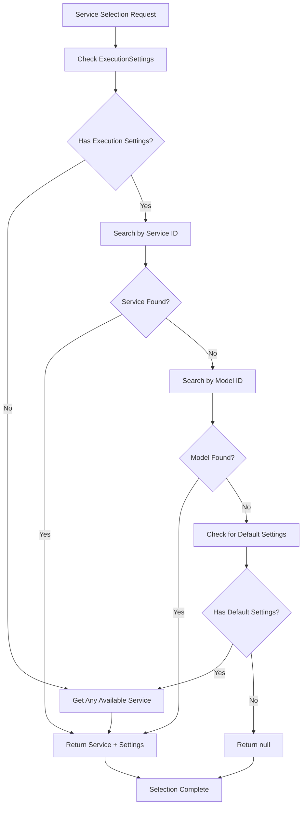
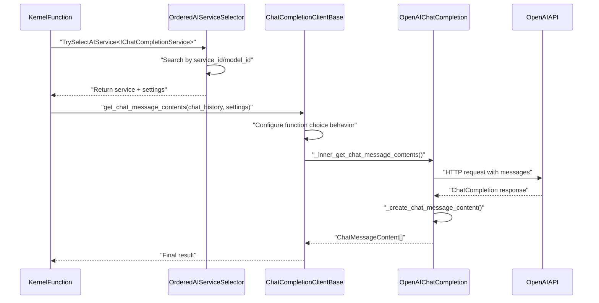
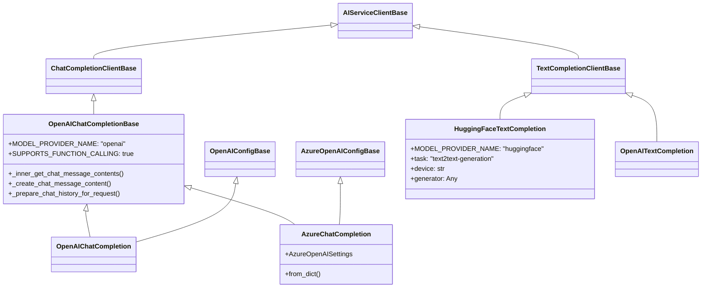
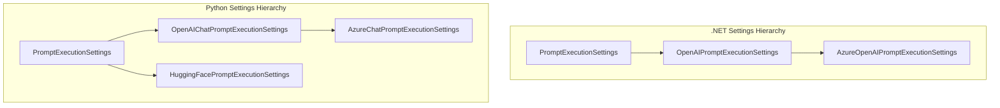
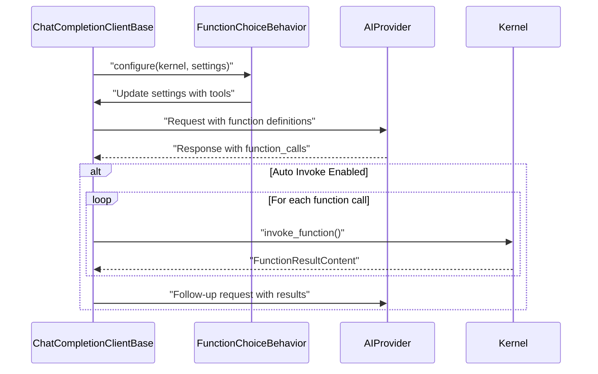

<!-- source: DeepWiki mcp.deepwiki.com · repo microsoft/semantic-kernel · page 4 AI Service Integration · fetched 2026-10-27 -->

# AI Service Integration

Relevant source files

The following files were used as context for generating this wiki page:

- [dotnet/docs/OPENAI-CONNECTOR-MIGRATION.md](dotnet/docs/OPENAI-CONNECTOR-MIGRATION.md)
- [dotnet/samples/Concepts/ChatCompletion/OpenAI_ChatCompletionExtraBody.cs](dotnet/samples/Concepts/ChatCompletion/OpenAI_ChatCompletionExtraBody.cs)
- [dotnet/src/Connectors/Connectors.AzureOpenAI.UnitTests/Services/AzureOpenAIChatCompletionExtraBodyTests.cs](dotnet/src/Connectors/Connectors.AzureOpenAI.UnitTests/Services/AzureOpenAIChatCompletionExtraBodyTests.cs)
- [dotnet/src/Connectors/Connectors.AzureOpenAI.UnitTests/Services/AzureOpenAIChatCompletionServiceTests.cs](dotnet/src/Connectors/Connectors.AzureOpenAI.UnitTests/Services/AzureOpenAIChatCompletionServiceTests.cs)
- [dotnet/src/Connectors/Connectors.AzureOpenAI.UnitTests/Settings/AzureOpenAIPromptExecutionSettingsTests.cs](dotnet/src/Connectors/Connectors.AzureOpenAI.UnitTests/Settings/AzureOpenAIPromptExecutionSettingsTests.cs)
- [dotnet/src/Connectors/Connectors.AzureOpenAI/Core/AzureClientCore.ChatCompletion.cs](dotnet/src/Connectors/Connectors.AzureOpenAI/Core/AzureClientCore.ChatCompletion.cs)
- [dotnet/src/Connectors/Connectors.AzureOpenAI/Settings/AzureOpenAIPromptExecutionSettings.cs](dotnet/src/Connectors/Connectors.AzureOpenAI/Settings/AzureOpenAIPromptExecutionSettings.cs)
- [dotnet/src/Connectors/Connectors.OpenAI.UnitTests/Core/ClientCoreTests.cs](dotnet/src/Connectors/Connectors.OpenAI.UnitTests/Core/ClientCoreTests.cs)
- [dotnet/src/Connectors/Connectors.OpenAI.UnitTests/Services/OpenAIChatCompletionExtraBodyTests.cs](dotnet/src/Connectors/Connectors.OpenAI.UnitTests/Services/OpenAIChatCompletionExtraBodyTests.cs)
- [dotnet/src/Connectors/Connectors.OpenAI.UnitTests/Services/OpenAIChatCompletionServiceTests.cs](dotnet/src/Connectors/Connectors.OpenAI.UnitTests/Services/OpenAIChatCompletionServiceTests.cs)
- [dotnet/src/Connectors/Connectors.OpenAI.UnitTests/Settings/OpenAIPromptExecutionSettingsTests.cs](dotnet/src/Connectors/Connectors.OpenAI.UnitTests/Settings/OpenAIPromptExecutionSettingsTests.cs)
- [dotnet/src/Connectors/Connectors.OpenAI/Core/ClientCore.ChatCompletion.cs](dotnet/src/Connectors/Connectors.OpenAI/Core/ClientCore.ChatCompletion.cs)
- [dotnet/src/Connectors/Connectors.OpenAI/Core/ClientCore.TextToAudio.cs](dotnet/src/Connectors/Connectors.OpenAI/Core/ClientCore.TextToAudio.cs)
- [dotnet/src/Connectors/Connectors.OpenAI/Services/OpenAIChatCompletionService.cs](dotnet/src/Connectors/Connectors.OpenAI/Services/OpenAIChatCompletionService.cs)
- [dotnet/src/Connectors/Connectors.OpenAI/Settings/OpenAIPromptExecutionSettings.cs](dotnet/src/Connectors/Connectors.OpenAI/Settings/OpenAIPromptExecutionSettings.cs)
- [dotnet/src/SemanticKernel.Abstractions/AI/PromptExecutionSettingsExtensions.cs](dotnet/src/SemanticKernel.Abstractions/AI/PromptExecutionSettingsExtensions.cs)
- [python/semantic_kernel/connectors/ai/chat_completion_client_base.py](python/semantic_kernel/connectors/ai/chat_completion_client_base.py)
- [python/semantic_kernel/connectors/ai/embeddings/embedding_generator_base.py](python/semantic_kernel/connectors/ai/embeddings/embedding_generator_base.py)
- [python/semantic_kernel/connectors/ai/hugging_face/services/hf_text_completion.py](python/semantic_kernel/connectors/ai/hugging_face/services/hf_text_completion.py)
- [python/semantic_kernel/connectors/ai/hugging_face/services/hf_text_embedding.py](python/semantic_kernel/connectors/ai/hugging_face/services/hf_text_embedding.py)
- [python/semantic_kernel/connectors/ai/ollama/services/ollama_chat_completion.py](python/semantic_kernel/connectors/ai/ollama/services/ollama_chat_completion.py)
- [python/semantic_kernel/connectors/ai/ollama/services/ollama_text_completion.py](python/semantic_kernel/connectors/ai/ollama/services/ollama_text_completion.py)
- [python/semantic_kernel/connectors/ai/ollama/services/ollama_text_embedding.py](python/semantic_kernel/connectors/ai/ollama/services/ollama_text_embedding.py)
- [python/semantic_kernel/connectors/ai/open_ai/prompt_execution_settings/azure_chat_prompt_execution_settings.py](python/semantic_kernel/connectors/ai/open_ai/prompt_execution_settings/azure_chat_prompt_execution_settings.py)
- [python/semantic_kernel/connectors/ai/open_ai/prompt_execution_settings/open_ai_prompt_execution_settings.py](python/semantic_kernel/connectors/ai/open_ai/prompt_execution_settings/open_ai_prompt_execution_settings.py)
- [python/semantic_kernel/connectors/ai/open_ai/services/azure_chat_completion.py](python/semantic_kernel/connectors/ai/open_ai/services/azure_chat_completion.py)
- [python/semantic_kernel/connectors/ai/open_ai/services/azure_text_completion.py](python/semantic_kernel/connectors/ai/open_ai/services/azure_text_completion.py)
- [python/semantic_kernel/connectors/ai/open_ai/services/azure_text_embedding.py](python/semantic_kernel/connectors/ai/open_ai/services/azure_text_embedding.py)
- [python/semantic_kernel/connectors/ai/open_ai/services/open_ai_chat_completion.py](python/semantic_kernel/connectors/ai/open_ai/services/open_ai_chat_completion.py)
- [python/semantic_kernel/connectors/ai/open_ai/services/open_ai_chat_completion_base.py](python/semantic_kernel/connectors/ai/open_ai/services/open_ai_chat_completion_base.py)
- [python/semantic_kernel/connectors/ai/open_ai/services/open_ai_handler.py](python/semantic_kernel/connectors/ai/open_ai/services/open_ai_handler.py)
- [python/semantic_kernel/connectors/ai/open_ai/services/open_ai_text_completion.py](python/semantic_kernel/connectors/ai/open_ai/services/open_ai_text_completion.py)
- [python/semantic_kernel/connectors/ai/open_ai/services/open_ai_text_embedding.py](python/semantic_kernel/connectors/ai/open_ai/services/open_ai_text_embedding.py)
- [python/semantic_kernel/connectors/ai/open_ai/services/open_ai_text_embedding_base.py](python/semantic_kernel/connectors/ai/open_ai/services/open_ai_text_embedding_base.py)
- [python/semantic_kernel/connectors/ai/text_completion_client_base.py](python/semantic_kernel/connectors/ai/text_completion_client_base.py)
- [python/tests/integration/completions/test_azure_oai_chat_service_extensions.py](python/tests/integration/completions/test_azure_oai_chat_service_extensions.py)
- [python/tests/unit/connectors/ai/open_ai/services/test_azure_chat_completion.py](python/tests/unit/connectors/ai/open_ai/services/test_azure_chat_completion.py)
- [python/tests/unit/connectors/ai/open_ai/services/test_openai_chat_completion_base.py](python/tests/unit/connectors/ai/open_ai/services/test_openai_chat_completion_base.py)
- [python/tests/unit/connectors/ai/test_function_choice_behavior.py](python/tests/unit/connectors/ai/test_function_choice_behavior.py)

This page documents how Semantic Kernel integrates with various AI services across multiple platforms. The AI service integration layer provides abstractions for connecting to different AI providers including OpenAI, Azure OpenAI, Google Gemini, HuggingFace, Anthropic, and others. The architecture supports text completion, chat completion, and embedding services with consistent interfaces while accommodating provider-specific features.

The integration system consists of base client abstractions, concrete provider implementations, service selection mechanisms, and execution settings that configure AI requests. Both .NET and Python implementations follow similar architectural patterns with language-specific optimizations.

## AI Service Architecture Overview

The AI service integration architecture provides multiple abstraction layers for consistent interaction with different AI providers. The system separates service abstractions, concrete implementations, configuration, and kernel integration.

### Service Integration Architecture

```mermaid
graph TB
    subgraph "Service Selection Layer"
        OrderedAIServiceSelector["OrderedAIServiceSelector"]
        IAIServiceSelector["IAIServiceSelector"]
        IChatClientSelector["IChatClientSelector"]
    end

    subgraph "Base Service Abstractions"
        AIServiceClientBase["AIServiceClientBase"]
        ChatCompletionClientBase["ChatCompletionClientBase"] 
        TextCompletionClientBase["TextCompletionClientBase"]
        IChatCompletionService["IChatCompletionService"]
        ITextGenerationService["ITextGenerationService"]
    end

    subgraph "Provider Implementations"
        OpenAIChatCompletion["OpenAIChatCompletion"]
        AzureChatCompletion["AzureChatCompletion"]
        OpenAITextCompletion["OpenAITextCompletion"]
        HuggingFaceTextCompletion["HuggingFaceTextCompletion"]
        OpenAITextEmbedding["OpenAITextEmbedding"]
    end

    subgraph "Configuration Layer"
        PromptExecutionSettings["PromptExecutionSettings"]
        OpenAIPromptExecutionSettings["OpenAIPromptExecutionSettings"]
        FunctionChoiceBehavior["FunctionChoiceBehavior"]
        ToolCallBehavior["ToolCallBehavior"]
    end

    subgraph "Kernel Integration"
        Kernel["Kernel"]
        KernelFunction["KernelFunction"]
        KernelArguments["KernelArguments"]
    end

    OrderedAIServiceSelector --> IAIServiceSelector
    OrderedAIServiceSelector --> IChatClientSelector
    
    AIServiceClientBase --> ChatCompletionClientBase
    AIServiceClientBase --> TextCompletionClientBase
    ChatCompletionClientBase --> IChatCompletionService
    TextCompletionClientBase --> ITextGenerationService

    IChatCompletionService --> OpenAIChatCompletion
    IChatCompletionService --> AzureChatCompletion
    ITextGenerationService --> OpenAITextCompletion
    ITextGenerationService --> HuggingFaceTextCompletion

    PromptExecutionSettings --> OpenAIPromptExecutionSettings
    FunctionChoiceBehavior --> OpenAIPromptExecutionSettings
    ToolCallBehavior --> OpenAIPromptExecutionSettings

    Kernel --> OrderedAIServiceSelector
    Kernel --> PromptExecutionSettings
    KernelFunction --> KernelArguments
    KernelArguments --> PromptExecutionSettings
```

Sources:
- [dotnet/src/SemanticKernel.Abstractions/Services/OrderedAIServiceSelector.cs:16-129]()
- [python/semantic_kernel/connectors/ai/chat_completion_client_base.py:35-39]()
- [python/semantic_kernel/connectors/ai/text_completion_client_base.py:15-16]()
- [dotnet/src/SemanticKernel.Abstractions/AI/PromptExecutionSettings.cs:20-194]()
- [dotnet/src/Connectors/Connectors.OpenAI/Settings/OpenAIPromptExecutionSettings.cs:20-591]()

## Service Selection and Configuration

The AI service integration includes sophisticated service selection mechanisms that determine which AI service to use based on execution settings, service IDs, and model IDs. For details, see [Service Selection and Configuration](#4.2).

### OrderedAIServiceSelector

The `OrderedAIServiceSelector` class implements the core service selection logic in .NET. It searches for services in a specific order: by service ID first, then by model ID, and finally falls back to any available service [dotnet/src/SemanticKernel.Abstractions/Services/OrderedAIServiceSelector.cs:16-129]().

Key selection methods:
- `TrySelectAIService<T>`: Selects AI services implementing `IAIService`.
- `TrySelectChatClient<T>`: Selects chat clients implementing `IChatClient`.

Sources:
- [dotnet/src/SemanticKernel.Abstractions/Services/OrderedAIServiceSelector.cs:16-129]()
- [dotnet/src/SemanticKernel.UnitTests/Functions/OrderedAIServiceSelectorTests.cs:26-31]()

## Base Service Abstractions

The service abstractions provide consistent interfaces across different AI service types while maintaining flexibility for provider-specific implementations.

### Python Service Abstractions

#### AIServiceClientBase
The root abstract class for all AI service clients, defining common properties like `service_id`, `ai_model_id`, and execution settings methods [python/semantic_kernel/services/ai_service_client_base.py:20-20]().

#### ChatCompletionClientBase
Extends `AIServiceClientBase` with chat completion capabilities [python/semantic_kernel/connectors/ai/chat_completion_client_base.py:35-39]():

- `get_chat_message_contents()`: Returns multiple chat message completions [python/semantic_kernel/connectors/ai/chat_completion_client_base.py:85-101]().
- `get_streaming_chat_message_contents()`: Returns streaming completions.
- `SUPPORTS_FUNCTION_CALLING`: Class variable indicating function calling support [python/semantic_kernel/connectors/ai/chat_completion_client_base.py:39-39]().

#### TextCompletionClientBase  
Extends `AIServiceClientBase` with text completion capabilities [python/semantic_kernel/connectors/ai/text_completion_client_base.py:15-16]().

### Service Execution Flow

Sources:
- [python/semantic_kernel/connectors/ai/chat_completion_client_base.py:35-39]()
- [python/semantic_kernel/connectors/ai/open_ai/services/open_ai_chat_completion_base.py:54-58]()

## Provider Implementations

AI service implementations extend the base abstractions with provider-specific functionality. For primary providers, see [OpenAI and Azure OpenAI Connectors](#4.1). For others, see [Other AI Service Connectors](#4.3).

### OpenAI Service Implementations

#### OpenAIChatCompletionBase
The core implementation for OpenAI-compatible chat completion services [python/semantic_kernel/connectors/ai/open_ai/services/open_ai_chat_completion_base.py:54-58](). Key capabilities:

- `_inner_get_chat_message_contents()`: Core non-streaming chat completion [python/semantic_kernel/connectors/ai/open_ai/services/open_ai_chat_completion_base.py:75-91]().
- `_inner_get_streaming_chat_message_contents()`: Streaming chat completion [python/semantic_kernel/connectors/ai/open_ai/services/open_ai_chat_completion_base.py:95-139]().
- `SUPPORTS_FUNCTION_CALLING = True`: Enables tool/function calling [python/semantic_kernel/connectors/ai/open_ai/services/open_ai_chat_completion_base.py:58-58]().

#### AzureChatCompletion  
Azure OpenAI implementation with additional features [python/semantic_kernel/connectors/ai/open_ai/services/azure_chat_completion.py:40-40]():
- Deployment-based model access [python/semantic_kernel/connectors/ai/open_ai/services/azure_chat_completion.py:105-105]().
- Azure "On Your Data" RAG integration via `AzureChatDataSource` [dotnet/src/Connectors/Connectors.AzureOpenAI/Settings/AzureOpenAIPromptExecutionSettings.cs:64-68]().

### Provider Implementation Hierarchy

### HuggingFace Implementation
The `HuggingFaceTextCompletion` provides local model execution [python/semantic_kernel/connectors/ai/hugging_face/services/hf_text_completion.py:31-31]():

- Uses `transformers.pipeline()` for model loading [python/semantic_kernel/connectors/ai/hugging_face/services/hf_text_completion.py:72-78]().
- Supports multiple tasks: `summarization`, `text-generation`, `text2text-generation` [python/semantic_kernel/connectors/ai/hugging_face/services/hf_text_completion.py:59-63]().
- Streaming support via `TextIteratorStreamer` [python/semantic_kernel/connectors/ai/hugging_face/services/hf_text_completion.py:132-132]().

Sources:
- [python/semantic_kernel/connectors/ai/open_ai/services/open_ai_chat_completion_base.py:54-139]()
- [python/semantic_kernel/connectors/ai/open_ai/services/azure_chat_completion.py:40-120]()
- [python/semantic_kernel/connectors/ai/hugging_face/services/hf_text_completion.py:31-149]()

## Prompt Execution Settings

Execution settings control AI service behavior for specific requests. The settings hierarchy provides base functionality with provider-specific extensions. For detailed advanced tool calling, see [Prompt Execution Settings and Tool Calling](#6.2).

### OpenAI Execution Settings

The `OpenAIPromptExecutionSettings` extends base settings with OpenAI-specific options [dotnet/src/Connectors/Connectors.OpenAI/Settings/OpenAIPromptExecutionSettings.cs:20-21]():

| Property | Type | Description |
|----------|------|-------------|
| `Temperature` | `double?` | Controls randomness (0.0-2.0) [dotnet/src/Connectors/Connectors.OpenAI/Settings/OpenAIPromptExecutionSettings.cs:51-51]() |
| `MaxTokens` | `int?` | Maximum tokens to generate [dotnet/src/Connectors/Connectors.OpenAI/Settings/OpenAIPromptExecutionSettings.cs:121-121]() |
| `ResponseFormat` | `object` | JSON schema, "json_object", or Type [dotnet/src/Connectors/Connectors.OpenAI/Settings/OpenAIPromptExecutionSettings.cs:180-180]() |
| `ReasoningEffort` | `object` | Effort level for reasoning models (o1/o3) [dotnet/src/Connectors/Connectors.OpenAI/Settings/OpenAIPromptExecutionSettings.cs:34-34]() |

### Settings Hierarchy and Conversion

Sources:
- [dotnet/src/Connectors/Connectors.OpenAI/Settings/OpenAIPromptExecutionSettings.cs:20-206]()
- [python/semantic_kernel/connectors/ai/open_ai/prompt_execution_settings/open_ai_prompt_execution_settings.py:14-148]()

## Function Calling Support

AI service integration provides comprehensive support for function/tool calling, allowing models to invoke kernel functions. Both .NET and Python implementations support function calling with different configuration approaches.

### .NET ToolCallBehavior

The .NET implementation uses `ToolCallBehavior` to configure function calling [dotnet/src/Connectors/Connectors.OpenAI/ToolCallBehavior.cs:14-14]():

- `AutoInvokeKernelFunctions`: Provide and auto-invoke kernel functions [dotnet/src/Connectors/Connectors.OpenAI/ToolCallBehavior.cs:49-49]().
- `RequireFunction`: Force model to use specific function [dotnet/src/Connectors/Connectors.OpenAI/ToolCallBehavior.cs:81-81]().

### Python FunctionChoiceBehavior  

The Python implementation uses `FunctionChoiceBehavior` for function calling configuration [python/semantic_kernel/connectors/ai/function_choice_behavior.py:23-23]():

- `FunctionChoiceBehavior.Auto()`: Allow model to choose functions automatically.
- `FunctionChoiceBehavior.Required()`: Force function calling.

### Function Calling Flow

Sources:
- [python/semantic_kernel/connectors/ai/chat_completion_client_base.py:114-174]()
- [dotnet/src/Connectors/Connectors.OpenAI/Core/ClientCore.ChatCompletion.cs:58-58]()

## Error Handling and Content Filtering

AI service integrations include comprehensive error handling with specialized support for Azure OpenAI content filtering policies.

### Content Filter Exception Handling

The `ContentFilterAIException` provides detailed information about content policy violations [python/semantic_kernel/connectors/ai/open_ai/exceptions/content_filter_ai_exception.py:12-12](). It captures filter results and severity levels for categories like violence or hate speech [python/semantic_kernel/connectors/ai/open_ai/exceptions/content_filter_ai_exception.py:61-91]().

Sources:
- [python/semantic_kernel/connectors/ai/open_ai/exceptions/content_filter_ai_exception.py:12-91]()
- [python/semantic_kernel/connectors/ai/open_ai/services/open_ai_handler.py:94-99]()

## Python Code Execution Tool

The `SessionsPythonTool` provides secure Python code execution through Azure Container Apps sessions [python/semantic_kernel/core_plugins/sessions_python_tool/sessions_python_plugin.py:34-34](). This tool integrates with the function calling system to enable AI models to execute Python code dynamically. For details, see [Python Code Execution Tools](#6.4).

Sources:
- [python/semantic_kernel/core_plugins/sessions_python_tool/sessions_python_plugin.py:34-348]()

---

