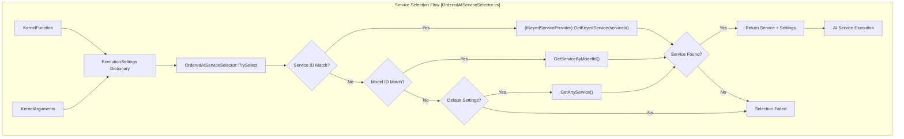
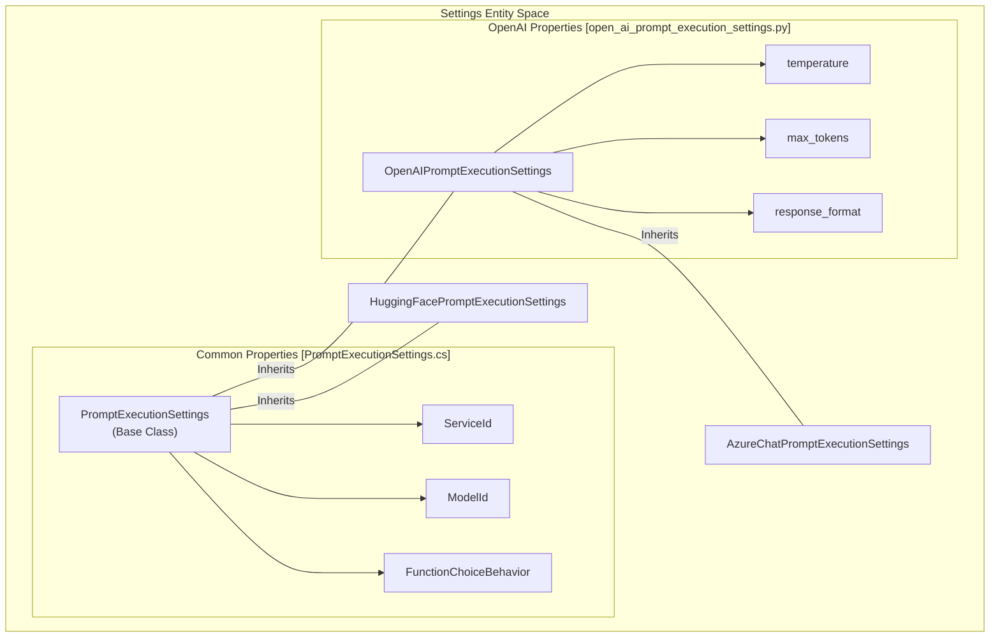
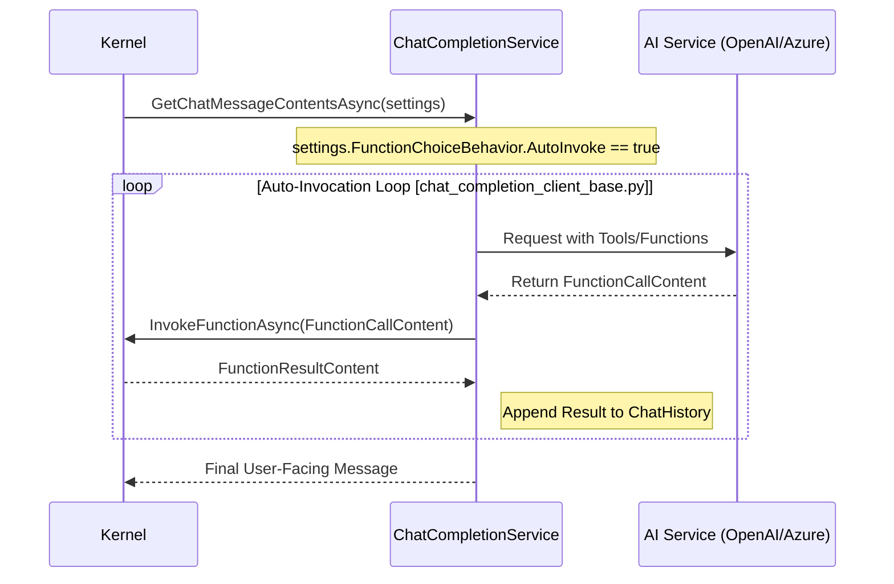

<!-- source: DeepWiki mcp.deepwiki.com · repo microsoft/semantic-kernel · page 4.2 Service Selection and Configuration · fetched 2026-10-27 -->

# Service Selection and Configuration

Relevant source files

The following files were used as context for generating this wiki page:

- [dotnet/samples/Concepts/FunctionCalling/FunctionCalling.cs](dotnet/samples/Concepts/FunctionCalling/FunctionCalling.cs)
- [dotnet/src/Connectors/Connectors.Google.UnitTests/Core/Gemini/Clients/GeminiChatClientFunctionCallingTests.cs](dotnet/src/Connectors/Connectors.Google.UnitTests/Core/Gemini/Clients/GeminiChatClientFunctionCallingTests.cs)
- [dotnet/src/Connectors/Connectors.Google.UnitTests/Core/Gemini/Clients/GeminiChatGenerationFunctionCallingTests.cs](dotnet/src/Connectors/Connectors.Google.UnitTests/Core/Gemini/Clients/GeminiChatGenerationFunctionCallingTests.cs)
- [dotnet/src/Connectors/Connectors.Google.UnitTests/Core/Gemini/Clients/GeminiChatStreamingFunctionCallingTests.cs](dotnet/src/Connectors/Connectors.Google.UnitTests/Core/Gemini/Clients/GeminiChatStreamingFunctionCallingTests.cs)
- [dotnet/src/Connectors/Connectors.Google.UnitTests/Core/Gemini/GeminiFunctionToolCallTests.cs](dotnet/src/Connectors/Connectors.Google.UnitTests/Core/Gemini/GeminiFunctionToolCallTests.cs)
- [dotnet/src/Connectors/Connectors.Google.UnitTests/Core/Gemini/GeminiMetadataTests.cs](dotnet/src/Connectors/Connectors.Google.UnitTests/Core/Gemini/GeminiMetadataTests.cs)
- [dotnet/src/Connectors/Connectors.Google.UnitTests/Core/Gemini/GeminiPartTests.cs](dotnet/src/Connectors/Connectors.Google.UnitTests/Core/Gemini/GeminiPartTests.cs)
- [dotnet/src/Connectors/Connectors.Google.UnitTests/GeminiToolCallBehaviorTests.cs](dotnet/src/Connectors/Connectors.Google.UnitTests/GeminiToolCallBehaviorTests.cs)
- [dotnet/src/Connectors/Connectors.Google.UnitTests/TestData/chat_function_with_thought_signature_response.json](dotnet/src/Connectors/Connectors.Google.UnitTests/TestData/chat_function_with_thought_signature_response.json)
- [dotnet/src/Connectors/Connectors.Google.UnitTests/TestData/chat_one_function_response.json](dotnet/src/Connectors/Connectors.Google.UnitTests/TestData/chat_one_function_response.json)
- [dotnet/src/Connectors/Connectors.Google.UnitTests/TestData/chat_text_with_thought_signature_response.json](dotnet/src/Connectors/Connectors.Google.UnitTests/TestData/chat_text_with_thought_signature_response.json)
- [dotnet/src/Connectors/Connectors.Google/Extensions/GeminiKernelFunctionMetadataExtensions.cs](dotnet/src/Connectors/Connectors.Google/Extensions/GeminiKernelFunctionMetadataExtensions.cs)
- [dotnet/src/Connectors/Connectors.Google/GeminiToolCallBehavior.cs](dotnet/src/Connectors/Connectors.Google/GeminiToolCallBehavior.cs)
- [dotnet/src/Connectors/Connectors.Google/Models/Gemini/GeminiChatMessageContent.cs](dotnet/src/Connectors/Connectors.Google/Models/Gemini/GeminiChatMessageContent.cs)
- [dotnet/src/Connectors/Connectors.Google/Models/Gemini/GeminiFunctionToolCall.cs](dotnet/src/Connectors/Connectors.Google/Models/Gemini/GeminiFunctionToolCall.cs)
- [dotnet/src/Connectors/Connectors.Google/Models/Gemini/GeminiMetadata.cs](dotnet/src/Connectors/Connectors.Google/Models/Gemini/GeminiMetadata.cs)
- [dotnet/src/Connectors/Connectors.OpenAI/ToolCallBehavior.cs](dotnet/src/Connectors/Connectors.OpenAI/ToolCallBehavior.cs)
- [dotnet/src/Functions/Functions.UnitTests/Yaml/PromptExecutionSettingsTypeConverterTests.cs](dotnet/src/Functions/Functions.UnitTests/Yaml/PromptExecutionSettingsTypeConverterTests.cs)
- [dotnet/src/IntegrationTests/BaseIntegrationTest.cs](dotnet/src/IntegrationTests/BaseIntegrationTest.cs)
- [dotnet/src/IntegrationTests/Connectors/AzureOpenAI/AzureOpenAIChatClient_AutoFunctionChoiceBehaviorTests.cs](dotnet/src/IntegrationTests/Connectors/AzureOpenAI/AzureOpenAIChatClient_AutoFunctionChoiceBehaviorTests.cs)
- [dotnet/src/IntegrationTests/Connectors/AzureOpenAI/AzureOpenAIChatClient_NoneFunctionChoiceBehaviorTests.cs](dotnet/src/IntegrationTests/Connectors/AzureOpenAI/AzureOpenAIChatClient_NoneFunctionChoiceBehaviorTests.cs)
- [dotnet/src/IntegrationTests/Connectors/AzureOpenAI/AzureOpenAIChatClient_RequiredFunctionChoiceBehaviorTests.cs](dotnet/src/IntegrationTests/Connectors/AzureOpenAI/AzureOpenAIChatClient_RequiredFunctionChoiceBehaviorTests.cs)
- [dotnet/src/IntegrationTests/Connectors/AzureOpenAI/AzureOpenAIChatCompletionFunctionCallingTests.cs](dotnet/src/IntegrationTests/Connectors/AzureOpenAI/AzureOpenAIChatCompletionFunctionCallingTests.cs)
- [dotnet/src/IntegrationTests/Connectors/AzureOpenAI/AzureOpenAIChatCompletion_AutoFunctionChoiceBehaviorTests.cs](dotnet/src/IntegrationTests/Connectors/AzureOpenAI/AzureOpenAIChatCompletion_AutoFunctionChoiceBehaviorTests.cs)
- [dotnet/src/IntegrationTests/Connectors/AzureOpenAI/AzureOpenAIChatCompletion_NoneFunctionChoiceBehaviorTests.cs](dotnet/src/IntegrationTests/Connectors/AzureOpenAI/AzureOpenAIChatCompletion_NoneFunctionChoiceBehaviorTests.cs)
- [dotnet/src/IntegrationTests/Connectors/AzureOpenAI/AzureOpenAIChatCompletion_RequiredFunctionChoiceBehaviorTests.cs](dotnet/src/IntegrationTests/Connectors/AzureOpenAI/AzureOpenAIChatCompletion_RequiredFunctionChoiceBehaviorTests.cs)
- [dotnet/src/IntegrationTests/Connectors/OpenAI/OpenAIChatClient_AutoFunctionChoiceBehaviorTests.cs](dotnet/src/IntegrationTests/Connectors/OpenAI/OpenAIChatClient_AutoFunctionChoiceBehaviorTests.cs)
- [dotnet/src/IntegrationTests/Connectors/OpenAI/OpenAIChatClient_NoneFunctionChoiceBehaviorTests.cs](dotnet/src/IntegrationTests/Connectors/OpenAI/OpenAIChatClient_NoneFunctionChoiceBehaviorTests.cs)
- [dotnet/src/IntegrationTests/Connectors/OpenAI/OpenAIChatClient_RequiredFunctionChoiceBehaviorTests.cs](dotnet/src/IntegrationTests/Connectors/OpenAI/OpenAIChatClient_RequiredFunctionChoiceBehaviorTests.cs)
- [dotnet/src/IntegrationTests/Connectors/OpenAI/OpenAIChatCompletion_AutoFunctionChoiceBehaviorTests.cs](dotnet/src/IntegrationTests/Connectors/OpenAI/OpenAIChatCompletion_AutoFunctionChoiceBehaviorTests.cs)
- [dotnet/src/IntegrationTests/Connectors/OpenAI/OpenAIChatCompletion_FunctionCallingTests.cs](dotnet/src/IntegrationTests/Connectors/OpenAI/OpenAIChatCompletion_FunctionCallingTests.cs)
- [dotnet/src/IntegrationTests/Connectors/OpenAI/OpenAIChatCompletion_NonStreamingTests.cs](dotnet/src/IntegrationTests/Connectors/OpenAI/OpenAIChatCompletion_NonStreamingTests.cs)
- [dotnet/src/IntegrationTests/Connectors/OpenAI/OpenAIChatCompletion_RequiredFunctionChoiceBehaviorTests.cs](dotnet/src/IntegrationTests/Connectors/OpenAI/OpenAIChatCompletion_RequiredFunctionChoiceBehaviorTests.cs)
- [dotnet/src/InternalUtilities/planning/Extensions/KernelFunctionMetadataExtensions.cs](dotnet/src/InternalUtilities/planning/Extensions/KernelFunctionMetadataExtensions.cs)
- [dotnet/src/SemanticKernel.Abstractions/AI/ChatClient/KernelFunctionInvokingChatClient.cs](dotnet/src/SemanticKernel.Abstractions/AI/ChatClient/KernelFunctionInvokingChatClient.cs)
- [dotnet/src/SemanticKernel.Abstractions/AI/FunctionChoiceBehaviors/FunctionChoiceBehaviorOptions.cs](dotnet/src/SemanticKernel.Abstractions/AI/FunctionChoiceBehaviors/FunctionChoiceBehaviorOptions.cs)
- [dotnet/src/SemanticKernel.Abstractions/AI/PromptExecutionSettings.cs](dotnet/src/SemanticKernel.Abstractions/AI/PromptExecutionSettings.cs)
- [dotnet/src/SemanticKernel.Abstractions/Functions/KernelArguments.cs](dotnet/src/SemanticKernel.Abstractions/Functions/KernelArguments.cs)
- [dotnet/src/SemanticKernel.Abstractions/Functions/KernelFunctionMetadata.cs](dotnet/src/SemanticKernel.Abstractions/Functions/KernelFunctionMetadata.cs)
- [dotnet/src/SemanticKernel.Abstractions/Functions/KernelParameterMetadata.cs](dotnet/src/SemanticKernel.Abstractions/Functions/KernelParameterMetadata.cs)
- [dotnet/src/SemanticKernel.Abstractions/Functions/KernelReturnParameterMetadata.cs](dotnet/src/SemanticKernel.Abstractions/Functions/KernelReturnParameterMetadata.cs)
- [dotnet/src/SemanticKernel.Abstractions/Services/AIServiceExtensions.cs](dotnet/src/SemanticKernel.Abstractions/Services/AIServiceExtensions.cs)
- [dotnet/src/SemanticKernel.Abstractions/Services/OrderedAIServiceSelector.cs](dotnet/src/SemanticKernel.Abstractions/Services/OrderedAIServiceSelector.cs)
- [dotnet/src/SemanticKernel.Core/Functions/DefaultKernelPlugin.cs](dotnet/src/SemanticKernel.Core/Functions/DefaultKernelPlugin.cs)
- [dotnet/src/SemanticKernel.Core/Functions/KernelFunctionFactory.cs](dotnet/src/SemanticKernel.Core/Functions/KernelFunctionFactory.cs)
- [dotnet/src/SemanticKernel.Core/Functions/KernelFunctionFromMethodOptions.cs](dotnet/src/SemanticKernel.Core/Functions/KernelFunctionFromMethodOptions.cs)
- [dotnet/src/SemanticKernel.UnitTests/AI/FunctionChoiceBehaviors/AutoFunctionChoiceBehaviorTests.cs](dotnet/src/SemanticKernel.UnitTests/AI/FunctionChoiceBehaviors/AutoFunctionChoiceBehaviorTests.cs)
- [dotnet/src/SemanticKernel.UnitTests/AI/FunctionChoiceBehaviors/FunctionChoiceBehaviorDeserializationTests.cs](dotnet/src/SemanticKernel.UnitTests/AI/FunctionChoiceBehaviors/FunctionChoiceBehaviorDeserializationTests.cs)
- [dotnet/src/SemanticKernel.UnitTests/AI/FunctionChoiceBehaviors/RequiredFunctionChoiceBehaviorTests.cs](dotnet/src/SemanticKernel.UnitTests/AI/FunctionChoiceBehaviors/RequiredFunctionChoiceBehaviorTests.cs)
- [dotnet/src/SemanticKernel.UnitTests/AI/PromptExecutionSettingsTests.cs](dotnet/src/SemanticKernel.UnitTests/AI/PromptExecutionSettingsTests.cs)
- [dotnet/src/SemanticKernel.UnitTests/Functions/DefaultKernelPluginTests.cs](dotnet/src/SemanticKernel.UnitTests/Functions/DefaultKernelPluginTests.cs)
- [dotnet/src/SemanticKernel.UnitTests/Functions/KernelArgumentsTests.cs](dotnet/src/SemanticKernel.UnitTests/Functions/KernelArgumentsTests.cs)
- [dotnet/src/SemanticKernel.UnitTests/Functions/KernelFunctionFromPromptTests.cs](dotnet/src/SemanticKernel.UnitTests/Functions/KernelFunctionFromPromptTests.cs)
- [dotnet/src/SemanticKernel.UnitTests/Functions/MultipleModelTests.cs](dotnet/src/SemanticKernel.UnitTests/Functions/MultipleModelTests.cs)
- [dotnet/src/SemanticKernel.UnitTests/Functions/OrderedAIServiceSelectorTests.cs](dotnet/src/SemanticKernel.UnitTests/Functions/OrderedAIServiceSelectorTests.cs)
- [dotnet/src/SemanticKernel.UnitTests/PromptTemplate/PromptTemplateConfigTests.cs](dotnet/src/SemanticKernel.UnitTests/PromptTemplate/PromptTemplateConfigTests.cs)
- [python/semantic_kernel/connectors/ai/chat_completion_client_base.py](python/semantic_kernel/connectors/ai/chat_completion_client_base.py)
- [python/semantic_kernel/connectors/ai/embeddings/embedding_generator_base.py](python/semantic_kernel/connectors/ai/embeddings/embedding_generator_base.py)
- [python/semantic_kernel/connectors/ai/hugging_face/services/hf_text_completion.py](python/semantic_kernel/connectors/ai/hugging_face/services/hf_text_completion.py)
- [python/semantic_kernel/connectors/ai/hugging_face/services/hf_text_embedding.py](python/semantic_kernel/connectors/ai/hugging_face/services/hf_text_embedding.py)
- [python/semantic_kernel/connectors/ai/ollama/services/ollama_chat_completion.py](python/semantic_kernel/connectors/ai/ollama/services/ollama_chat_completion.py)
- [python/semantic_kernel/connectors/ai/ollama/services/ollama_text_completion.py](python/semantic_kernel/connectors/ai/ollama/services/ollama_text_completion.py)
- [python/semantic_kernel/connectors/ai/ollama/services/ollama_text_embedding.py](python/semantic_kernel/connectors/ai/ollama/services/ollama_text_embedding.py)
- [python/semantic_kernel/connectors/ai/open_ai/prompt_execution_settings/azure_chat_prompt_execution_settings.py](python/semantic_kernel/connectors/ai/open_ai/prompt_execution_settings/azure_chat_prompt_execution_settings.py)
- [python/semantic_kernel/connectors/ai/open_ai/prompt_execution_settings/open_ai_prompt_execution_settings.py](python/semantic_kernel/connectors/ai/open_ai/prompt_execution_settings/open_ai_prompt_execution_settings.py)
- [python/semantic_kernel/connectors/ai/open_ai/services/azure_chat_completion.py](python/semantic_kernel/connectors/ai/open_ai/services/azure_chat_completion.py)
- [python/semantic_kernel/connectors/ai/open_ai/services/azure_text_completion.py](python/semantic_kernel/connectors/ai/open_ai/services/azure_text_completion.py)
- [python/semantic_kernel/connectors/ai/open_ai/services/azure_text_embedding.py](python/semantic_kernel/connectors/ai/open_ai/services/azure_text_embedding.py)
- [python/semantic_kernel/connectors/ai/open_ai/services/open_ai_chat_completion.py](python/semantic_kernel/connectors/ai/open_ai/services/open_ai_chat_completion.py)
- [python/semantic_kernel/connectors/ai/open_ai/services/open_ai_chat_completion_base.py](python/semantic_kernel/connectors/ai/open_ai/services/open_ai_chat_completion_base.py)
- [python/semantic_kernel/connectors/ai/open_ai/services/open_ai_handler.py](python/semantic_kernel/connectors/ai/open_ai/services/open_ai_handler.py)
- [python/semantic_kernel/connectors/ai/open_ai/services/open_ai_text_completion.py](python/semantic_kernel/connectors/ai/open_ai/services/open_ai_text_completion.py)
- [python/semantic_kernel/connectors/ai/open_ai/services/open_ai_text_embedding.py](python/semantic_kernel/connectors/ai/open_ai/services/open_ai_text_embedding.py)
- [python/semantic_kernel/connectors/ai/open_ai/services/open_ai_text_embedding_base.py](python/semantic_kernel/connectors/ai/open_ai/services/open_ai_text_embedding_base.py)
- [python/semantic_kernel/connectors/ai/text_completion_client_base.py](python/semantic_kernel/connectors/ai/text_completion_client_base.py)
- [python/tests/integration/completions/test_azure_oai_chat_service_extensions.py](python/tests/integration/completions/test_azure_oai_chat_service_extensions.py)
- [python/tests/unit/connectors/ai/open_ai/services/test_azure_chat_completion.py](python/tests/unit/connectors/ai/open_ai/services/test_azure_chat_completion.py)
- [python/tests/unit/connectors/ai/open_ai/services/test_openai_chat_completion_base.py](python/tests/unit/connectors/ai/open_ai/services/test_openai_chat_completion_base.py)
- [python/tests/unit/connectors/ai/test_function_choice_behavior.py](python/tests/unit/connectors/ai/test_function_choice_behavior.py)

This document describes the AI service selection and configuration mechanisms within Semantic Kernel. These systems handle how the framework chooses appropriate AI services and configures their execution parameters based on user requirements, service availability, and execution context.

## Service Selection Architecture

The service selection system determines which AI service to use when multiple services are available. In .NET, this is primarily handled by the `OrderedAIServiceSelector`, which implements `IAIServiceSelector`. It uses a priority-based approach that considers service IDs, model IDs, and execution settings.

### Service Selection Flow
The following diagram illustrates how the `OrderedAIServiceSelector` resolves a service from the `Kernel` based on `KernelArguments` and `KernelFunction` metadata.

**Service Selection Priority Order:**
1.  **Service ID Match**: Direct lookup in the service provider using the key provided in the settings dictionary [dotnet/src/SemanticKernel.Abstractions/Services/OrderedAIServiceSelector.cs:49-66]().
2.  **Model ID Match**: Iterates through all registered services of type `T` and checks if `aiService.GetModelId()` matches the requested `ModelId` [dotnet/src/SemanticKernel.Abstractions/Services/OrderedAIServiceSelector.cs:68-82]().
3.  **Default Service**: Fallback to the service marked as "default" or the last registered service if no specific ID is requested [dotnet/src/SemanticKernel.Abstractions/Services/OrderedAIServiceSelector.cs:84-93]().

Sources: [dotnet/src/SemanticKernel.Abstractions/Services/OrderedAIServiceSelector.cs:16-129](), [dotnet/src/SemanticKernel.UnitTests/Functions/OrderedAIServiceSelectorTests.cs:1-100]()

## Execution Settings Hierarchy

The configuration system uses a hierarchical approach where specialized settings inherit from the `PromptExecutionSettings` base class. This allows service-specific customization (like OpenAI's `seed` or `logit_bias`) while maintaining common properties like `FunctionChoiceBehavior`.

### Settings Class Hierarchy
This diagram maps the code entities involved in prompt configuration across different providers.

**Key Classes:**
*   **`PromptExecutionSettings`**: The base class containing the `ServiceId`, `ModelId`, and `FunctionChoiceBehavior` [dotnet/src/SemanticKernel.Abstractions/AI/PromptExecutionSettings.cs:21-101]().
*   **`OpenAIPromptExecutionSettings`**: Adds OpenAI-specific parameters like `Temperature`, `TopP`, and `PresencePenalty` [python/semantic_kernel/connectors/ai/open_ai/prompt_execution_settings/open_ai_prompt_execution_settings.py:14-31]().
*   **`FunctionChoiceBehavior`**: Defines how the LLM should select and invoke functions (Auto, Required, or None) [dotnet/src/SemanticKernel.Abstractions/AI/PromptExecutionSettings.cs:92-101]().

Sources: [dotnet/src/SemanticKernel.Abstractions/AI/PromptExecutionSettings.cs:21-182](), [python/semantic_kernel/connectors/ai/open_ai/prompt_execution_settings/open_ai_prompt_execution_settings.py:14-149]()

## Function Choice and Tool Call Behavior

Semantic Kernel supports advanced function calling patterns through `FunctionChoiceBehavior` (.NET/Python) and `ToolCallBehavior` (.NET OpenAI). These settings instruct the AI connector whether to automatically invoke functions discovered in the kernel.

### Auto-Function Invocation Loop
When `FunctionChoiceBehavior.Auto(autoInvoke: true)` is used, the `ChatCompletionClientBase` enters an internal loop to resolve tool calls.

**Behavior Modes:**
*   **Auto**: The model decides if any functions should be called. If `autoInvoke` is true, the kernel executes them and feeds results back to the LLM [dotnet/src/IntegrationTests/Connectors/AzureOpenAI/AzureOpenAIChatCompletion_AutoFunctionChoiceBehaviorTests.cs:53-65]().
*   **Required**: Forces the model to call one or more specific functions [dotnet/src/SemanticKernel.Abstractions/AI/PromptExecutionSettings.cs:78-80]().
*   **None**: The model can see the functions but is instructed not to call them [dotnet/src/SemanticKernel.Abstractions/AI/PromptExecutionSettings.cs:82-83]().

Sources: [python/semantic_kernel/connectors/ai/chat_completion_client_base.py:137-154](), [dotnet/src/SemanticKernel.Abstractions/AI/PromptExecutionSettings.cs:68-90](), [dotnet/src/IntegrationTests/Connectors/AzureOpenAI/AzureOpenAIChatCompletion_AutoFunctionChoiceBehaviorTests.cs:102-135]()

## Microsoft.Extensions.AI Interoperability

The .NET implementation of Semantic Kernel provides an interoperability layer with `Microsoft.Extensions.AI` (MEAI). This allows `IChatClient` implementations to be used within the Semantic Kernel ecosystem.

*   **`IChatClientSelector`**: The `OrderedAIServiceSelector` also implements `IChatClientSelector` to allow the kernel to select MEAI-based chat clients [dotnet/src/SemanticKernel.Abstractions/Services/OrderedAIServiceSelector.cs:16-23]().
*   **`KernelFunctionInvokingChatClient`**: A wrapper that enables auto-function invocation for any standard `IChatClient`.

Sources: [dotnet/src/SemanticKernel.Abstractions/Services/OrderedAIServiceSelector.cs:16-28](), [dotnet/src/SemanticKernel.Abstractions/AI/ChatClient/KernelFunctionInvokingChatClient.cs:1-50]()

## Python Service Configuration

In Python, services are initialized with specific `service_id` and `ai_model_id` values. The `ChatCompletionClientBase` manages the mapping between generic `PromptExecutionSettings` and provider-specific subclasses.

**Implementation Details:**
*   **`get_prompt_execution_settings_class()`**: Every service (e.g., `OpenAIChatCompletion`) must override this to return its specific settings type [python/semantic_kernel/connectors/ai/open_ai/services/open_ai_chat_completion_base.py:64-66]().
*   **Structured Outputs**: The `OpenAIHandler` handles the conversion of Python types or Pydantic models into the `response_format` JSON schema required by OpenAI [python/semantic_kernel/connectors/ai/open_ai/services/open_ai_handler.py:85-88]().

Sources: [python/semantic_kernel/connectors/ai/open_ai/services/open_ai_chat_completion_base.py:54-139](), [python/semantic_kernel/connectors/ai/open_ai/services/open_ai_handler.py:47-109](), [python/semantic_kernel/connectors/ai/hugging_face/services/hf_text_completion.py:31-94]()

---

