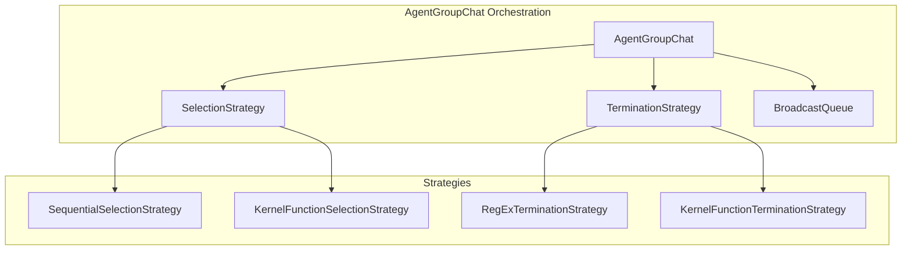
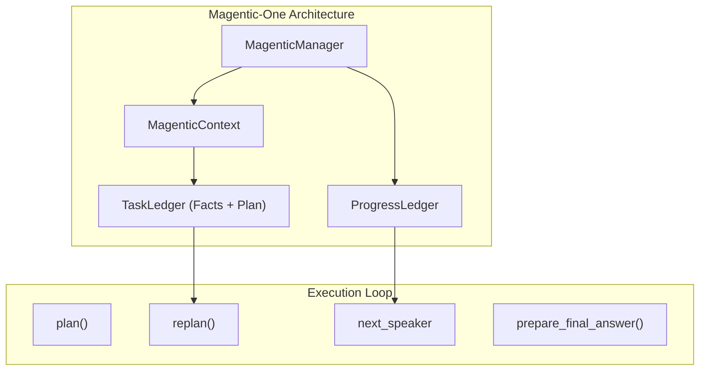
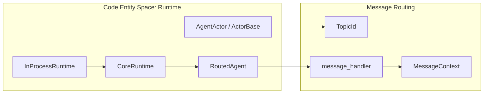

<!-- source: DeepWiki mcp.deepwiki.com · repo microsoft/semantic-kernel · page 5.4 Multi-Agent Orchestration · fetched 2026-10-27 -->

# Multi-Agent Orchestration

Relevant source files

The following files were used as context for generating this wiki page:

- [.github/_typos.toml](.github/_typos.toml)
- [docs/decisions/0071-multi-agent-orchestration.md](docs/decisions/0071-multi-agent-orchestration.md)
- [dotnet/Directory.Packages.props](dotnet/Directory.Packages.props)
- [dotnet/docs/EXPERIMENTS.md](dotnet/docs/EXPERIMENTS.md)
- [dotnet/samples/Concepts/Concepts.csproj](dotnet/samples/Concepts/Concepts.csproj)
- [dotnet/samples/Concepts/FunctionCalling/FunctionCalling_SharedState.cs](dotnet/samples/Concepts/FunctionCalling/FunctionCalling_SharedState.cs)
- [dotnet/samples/Concepts/README.md](dotnet/samples/Concepts/README.md)
- [dotnet/samples/Concepts/Resources/travel-destination-overview.txt](dotnet/samples/Concepts/Resources/travel-destination-overview.txt)
- [dotnet/samples/GettingStartedWithAgents/GettingStartedWithAgents.csproj](dotnet/samples/GettingStartedWithAgents/GettingStartedWithAgents.csproj)
- [dotnet/samples/GettingStartedWithAgents/README.md](dotnet/samples/GettingStartedWithAgents/README.md)
- [dotnet/samples/GettingStartedWithAgents/Step04_KernelFunctionStrategies.cs](dotnet/samples/GettingStartedWithAgents/Step04_KernelFunctionStrategies.cs)
- [dotnet/src/Agents/Abstractions/AgentChannel.cs](dotnet/src/Agents/Abstractions/AgentChannel.cs)
- [dotnet/src/Agents/Abstractions/AgentChat.cs](dotnet/src/Agents/Abstractions/AgentChat.cs)
- [dotnet/src/Agents/Abstractions/AggregatorAgent.cs](dotnet/src/Agents/Abstractions/AggregatorAgent.cs)
- [dotnet/src/Agents/Abstractions/AggregatorChannel.cs](dotnet/src/Agents/Abstractions/AggregatorChannel.cs)
- [dotnet/src/Agents/Abstractions/Internal/BroadcastQueue.cs](dotnet/src/Agents/Abstractions/Internal/BroadcastQueue.cs)
- [dotnet/src/Agents/Abstractions/Logging/AgentChatLogMessages.cs](dotnet/src/Agents/Abstractions/Logging/AgentChatLogMessages.cs)
- [dotnet/src/Agents/Core/AgentGroupChat.cs](dotnet/src/Agents/Core/AgentGroupChat.cs)
- [dotnet/src/Agents/Core/Chat/AgentGroupChatSettings.cs](dotnet/src/Agents/Core/Chat/AgentGroupChatSettings.cs)
- [dotnet/src/Agents/Core/Chat/AggregatorTerminationStrategy.cs](dotnet/src/Agents/Core/Chat/AggregatorTerminationStrategy.cs)
- [dotnet/src/Agents/Core/Chat/KernelFunctionSelectionStrategy.cs](dotnet/src/Agents/Core/Chat/KernelFunctionSelectionStrategy.cs)
- [dotnet/src/Agents/Core/Chat/KernelFunctionTerminationStrategy.cs](dotnet/src/Agents/Core/Chat/KernelFunctionTerminationStrategy.cs)
- [dotnet/src/Agents/Core/Chat/RegExTerminationStrategy.cs](dotnet/src/Agents/Core/Chat/RegExTerminationStrategy.cs)
- [dotnet/src/Agents/Core/Chat/SelectionStrategy.cs](dotnet/src/Agents/Core/Chat/SelectionStrategy.cs)
- [dotnet/src/Agents/Core/Chat/SequentialSelectionStrategy.cs](dotnet/src/Agents/Core/Chat/SequentialSelectionStrategy.cs)
- [dotnet/src/Agents/Core/Chat/TerminationStrategy.cs](dotnet/src/Agents/Core/Chat/TerminationStrategy.cs)
- [dotnet/src/Agents/Core/Internal/ChatMessageForPrompt.cs](dotnet/src/Agents/Core/Internal/ChatMessageForPrompt.cs)
- [dotnet/src/Agents/Core/Logging/AgentGroupChatLogMessages.cs](dotnet/src/Agents/Core/Logging/AgentGroupChatLogMessages.cs)
- [dotnet/src/Agents/Core/Logging/ChatCompletionAgentLogMessages.cs](dotnet/src/Agents/Core/Logging/ChatCompletionAgentLogMessages.cs)
- [dotnet/src/Agents/Core/Logging/SequentialSelectionStrategyLogMessages.cs](dotnet/src/Agents/Core/Logging/SequentialSelectionStrategyLogMessages.cs)
- [dotnet/src/Agents/Core/Logging/TerminationStrategyLogMessages.cs](dotnet/src/Agents/Core/Logging/TerminationStrategyLogMessages.cs)
- [dotnet/src/Agents/Orchestration/AgentActor.cs](dotnet/src/Agents/Orchestration/AgentActor.cs)
- [dotnet/src/Agents/Orchestration/AgentOrchestration.cs](dotnet/src/Agents/Orchestration/AgentOrchestration.cs)
- [dotnet/src/Agents/Orchestration/Handoff/HandoffActor.cs](dotnet/src/Agents/Orchestration/Handoff/HandoffActor.cs)
- [dotnet/src/Agents/Orchestration/OrchestrationContext.cs](dotnet/src/Agents/Orchestration/OrchestrationContext.cs)
- [dotnet/src/Agents/Orchestration/OrchestrationResult.cs](dotnet/src/Agents/Orchestration/OrchestrationResult.cs)
- [dotnet/src/Agents/UnitTests/AgentChannelTests.cs](dotnet/src/Agents/UnitTests/AgentChannelTests.cs)
- [dotnet/src/Agents/UnitTests/AgentChatTests.cs](dotnet/src/Agents/UnitTests/AgentChatTests.cs)
- [dotnet/src/Agents/UnitTests/Agents.UnitTests.csproj](dotnet/src/Agents/UnitTests/Agents.UnitTests.csproj)
- [dotnet/src/Agents/UnitTests/AggregatorAgentTests.cs](dotnet/src/Agents/UnitTests/AggregatorAgentTests.cs)
- [dotnet/src/Agents/UnitTests/Core/AgentGroupChatTests.cs](dotnet/src/Agents/UnitTests/Core/AgentGroupChatTests.cs)
- [dotnet/src/Agents/UnitTests/Core/Chat/KernelFunctionSelectionStrategyTests.cs](dotnet/src/Agents/UnitTests/Core/Chat/KernelFunctionSelectionStrategyTests.cs)
- [dotnet/src/Agents/UnitTests/Core/Chat/RegExTerminationStrategyTests.cs](dotnet/src/Agents/UnitTests/Core/Chat/RegExTerminationStrategyTests.cs)
- [dotnet/src/Agents/UnitTests/Core/Chat/SequentialSelectionStrategyTests.cs](dotnet/src/Agents/UnitTests/Core/Chat/SequentialSelectionStrategyTests.cs)
- [dotnet/src/Agents/UnitTests/Core/Internal/ChatMessageForPromptTests.cs](dotnet/src/Agents/UnitTests/Core/Internal/ChatMessageForPromptTests.cs)
- [dotnet/src/Agents/UnitTests/Internal/BroadcastQueueTests.cs](dotnet/src/Agents/UnitTests/Internal/BroadcastQueueTests.cs)
- [dotnet/src/Agents/UnitTests/Orchestration/OrchestrationResultTests.cs](dotnet/src/Agents/UnitTests/Orchestration/OrchestrationResultTests.cs)
- [dotnet/src/IntegrationTests/Agents/AggregatorAgentTests.cs](dotnet/src/IntegrationTests/Agents/AggregatorAgentTests.cs)
- [dotnet/src/IntegrationTests/IntegrationTests.csproj](dotnet/src/IntegrationTests/IntegrationTests.csproj)
- [dotnet/src/InternalUtilities/samples/InternalUtilities/TestConfiguration.cs](dotnet/src/InternalUtilities/samples/InternalUtilities/TestConfiguration.cs)
- [dotnet/src/Plugins/Plugins.AI.UnitTests/Plugins.AI.UnitTests.csproj](dotnet/src/Plugins/Plugins.AI.UnitTests/Plugins.AI.UnitTests.csproj)
- [dotnet/src/Plugins/Plugins.AI/Plugins.AI.csproj](dotnet/src/Plugins/Plugins.AI/Plugins.AI.csproj)
- [dotnet/src/SemanticKernel.UnitTests/SemanticKernel.UnitTests.csproj](dotnet/src/SemanticKernel.UnitTests/SemanticKernel.UnitTests.csproj)
- [dotnet/src/VectorData/SqliteVec/SqliteMapper.cs](dotnet/src/VectorData/SqliteVec/SqliteMapper.cs)
- [python/samples/getting_started_with_agents/multi_agent_orchestration/step2b_sequential_streaming_agent_response_callback.py](python/samples/getting_started_with_agents/multi_agent_orchestration/step2b_sequential_streaming_agent_response_callback.py)
- [python/samples/getting_started_with_agents/multi_agent_orchestration/step4_handoff.py](python/samples/getting_started_with_agents/multi_agent_orchestration/step4_handoff.py)
- [python/samples/getting_started_with_agents/multi_agent_orchestration/step4b_handoff_streaming_agent_response_callback.py](python/samples/getting_started_with_agents/multi_agent_orchestration/step4b_handoff_streaming_agent_response_callback.py)
- [python/semantic_kernel/agents/orchestration/agent_actor_base.py](python/semantic_kernel/agents/orchestration/agent_actor_base.py)
- [python/semantic_kernel/agents/orchestration/concurrent.py](python/semantic_kernel/agents/orchestration/concurrent.py)
- [python/semantic_kernel/agents/orchestration/group_chat.py](python/semantic_kernel/agents/orchestration/group_chat.py)
- [python/semantic_kernel/agents/orchestration/handoffs.py](python/semantic_kernel/agents/orchestration/handoffs.py)
- [python/semantic_kernel/agents/orchestration/magentic.py](python/semantic_kernel/agents/orchestration/magentic.py)
- [python/semantic_kernel/agents/orchestration/orchestration_base.py](python/semantic_kernel/agents/orchestration/orchestration_base.py)
- [python/semantic_kernel/agents/orchestration/sequential.py](python/semantic_kernel/agents/orchestration/sequential.py)
- [python/tests/unit/agents/orchestration/conftest.py](python/tests/unit/agents/orchestration/conftest.py)
- [python/tests/unit/agents/orchestration/test_concurrent.py](python/tests/unit/agents/orchestration/test_concurrent.py)
- [python/tests/unit/agents/orchestration/test_group_chat.py](python/tests/unit/agents/orchestration/test_group_chat.py)
- [python/tests/unit/agents/orchestration/test_handoff.py](python/tests/unit/agents/orchestration/test_handoff.py)
- [python/tests/unit/agents/orchestration/test_magentic.py](python/tests/unit/agents/orchestration/test_magentic.py)
- [python/tests/unit/agents/orchestration/test_sequential.py](python/tests/unit/agents/orchestration/test_sequential.py)

Multi-agent orchestration in Semantic Kernel enables complex workflows where multiple AI agents collaborate, communicate, and coordinate their actions to solve problems that require diverse skills or perspectives. This system provides patterns for managing conversations between multiple agents, handling shared state, and orchestrating agent interactions in both synchronous and streaming scenarios.

For information about individual agent types and their capabilities, see [.NET Agent Implementations](#5.2) and [Python Agent Implementations](#5.3). For core agent architecture concepts, see [Agent Architecture and Base Classes](#5.1).

## Orchestration Patterns

Semantic Kernel supports several distinct orchestration patterns for managing agent interactions, ranging from simple handoffs to complex group dynamics.

### Group Chat Orchestration
Managed via `AgentGroupChat`, this pattern facilitates multi-turn conversations where a `SelectionStrategy` determines the next speaker and a `TerminationStrategy` decides when the goal is reached.

Sources: [dotnet/src/Agents/Core/AgentGroupChat.cs:16-50](), [dotnet/src/Agents/Core/Chat/SequentialSelectionStrategy.cs:11-20](), [dotnet/src/Agents/Core/Chat/KernelFunctionSelectionStrategy.cs:13-25](), [dotnet/src/Agents/Core/Chat/RegExTerminationStrategy.cs:12-20]()

### Handoff and Sequential Orchestration
*   **HandoffOrchestration**: Explicitly transfers control from one agent to another, often used in routing scenarios (e.g., a "Tier 1" agent handing off to a "Specialist").
*   **SequentialOrchestration**: Executes agents in a pre-defined or dynamically generated linear sequence.

| Pattern | Description | Key Classes |
| :--- | :--- | :--- |
| **Handoff** | Explicit transfer of context and control. | `HandoffActor`, `handoffs.py` |
| **Sequential** | Linear execution flow. | `SequentialSelectionStrategy`, `sequential.py` |
| **Concurrent** | Multiple agents processing tasks in parallel. | `ConcurrentOrchestration`, `concurrent.py` |

Sources: [python/semantic_kernel/agents/orchestration/handoffs.py:1-50](), [python/semantic_kernel/agents/orchestration/sequential.py:1-40](), [dotnet/src/Agents/Orchestration/Handoff/HandoffActor.cs:10-30]()

## Magentic-One Pattern

The Magentic-One pattern is a sophisticated orchestration model where a central manager (Orchestrator) maintains a "Task Ledger" to track progress, facts, and plans. It coordinates specialized agents to complete complex, multi-step tasks.

Sources: [python/semantic_kernel/agents/orchestration/magentic.py:134-203](), [python/semantic_kernel/agents/orchestration/magentic.py:55-127]()

## Actor Model and Runtime

Semantic Kernel leverages an actor-based model for distributed or isolated agent execution. This is implemented via the `AgentActor` and `RoutedAgent` abstractions.

### Agent Runtime Space
The `AgentRuntime` (e.g., `InProcessRuntime`) provides the environment where agents exist as actors, receiving messages through a `CoreRuntime`.

Sources: [python/semantic_kernel/agents/orchestration/agent_actor_base.py:14-40](), [python/semantic_kernel/agents/runtime/core/routed_agent.py:10-30](), [python/semantic_kernel/agents/orchestration/magentic.py:25-30]()

## Execution and Results

### OrchestrationResult
The result of a multi-agent workflow is captured in an `OrchestrationResult`, which aggregates messages and execution metadata.

*   **Data Flow**:
    1.  `AgentChat.InvokeAsync` starts the loop [dotnet/src/Agents/Abstractions/AgentChat.cs:66-74]().
    2.  `AgentChannel` synchronizes history across different agent types (e.g., `ChatHistoryChannel`, `OpenAIAssistantChannel`) [dotnet/src/Agents/Abstractions/AgentChannel.cs:12-40]().
    3.  `BroadcastQueue` ensures all participants receive updates [dotnet/src/Agents/Abstractions/Internal/BroadcastQueue.cs:15-35]().
    4.  Final output is packaged into `OrchestrationResult` [dotnet/src/Agents/Orchestration/OrchestrationResult.cs:10-25]().

### Communication Channels

| Channel Class | Purpose | Source |
| :--- | :--- | :--- |
| `AgentChannel` | Base abstraction for agent communication. | [dotnet/src/Agents/Abstractions/AgentChannel.cs:12-25]() |
| `AggregatorChannel` | Aggregates results from multiple sub-channels. | [dotnet/src/Agents/Abstractions/AggregatorChannel.cs:15-30]() |
| `ChatHistoryChannel` | Standard channel for `ChatCompletionAgent`. | [dotnet/src/Agents/Core/ChatHistoryChannel.cs:15-40]() |

Sources: [dotnet/src/Agents/Abstractions/AgentChat.cs:18-134](), [dotnet/src/Agents/Orchestration/OrchestrationResult.cs:1-30](), [dotnet/src/Agents/Abstractions/AggregatorAgent.cs:15-45]()

---

