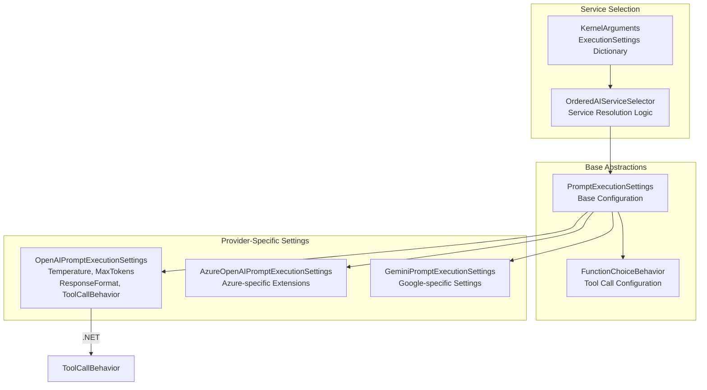
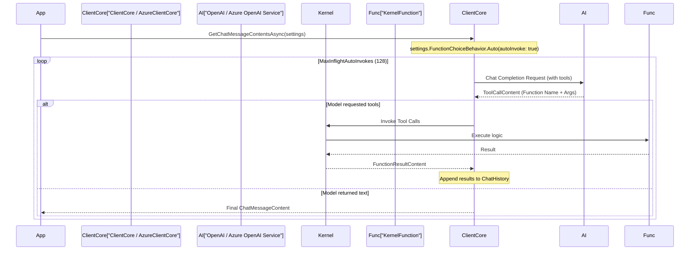
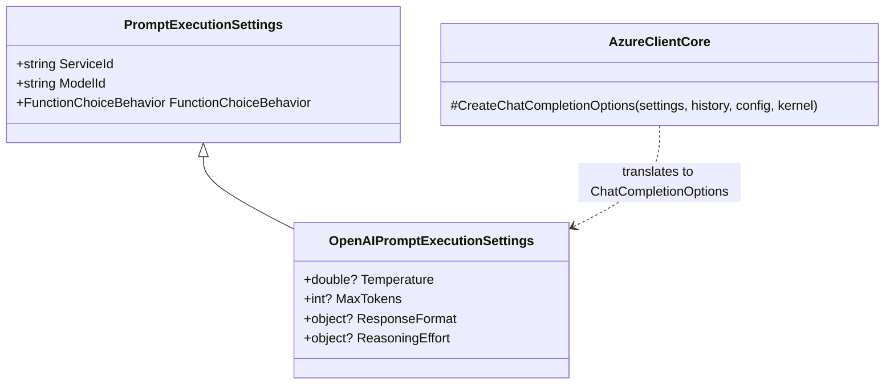
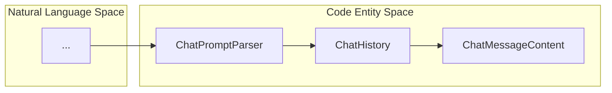

<!-- source: DeepWiki mcp.deepwiki.com · repo microsoft/semantic-kernel · page 6.2 Prompt Execution Settings and Tool Calling · fetched 2026-10-27 -->

# Prompt Execution Settings and Tool Calling

Relevant source files

The following files were used as context for generating this wiki page:

- [dotnet/docs/OPENAI-CONNECTOR-MIGRATION.md](dotnet/docs/OPENAI-CONNECTOR-MIGRATION.md)
- [dotnet/samples/Concepts/ChatCompletion/OpenAI_ChatCompletionExtraBody.cs](dotnet/samples/Concepts/ChatCompletion/OpenAI_ChatCompletionExtraBody.cs)
- [dotnet/samples/Concepts/FunctionCalling/FunctionCalling.cs](dotnet/samples/Concepts/FunctionCalling/FunctionCalling.cs)
- [dotnet/samples/Concepts/PromptTemplates/ChatPromptWithAudio.cs](dotnet/samples/Concepts/PromptTemplates/ChatPromptWithAudio.cs)
- [dotnet/samples/Concepts/PromptTemplates/ChatPromptWithBinary.cs](dotnet/samples/Concepts/PromptTemplates/ChatPromptWithBinary.cs)
- [dotnet/samples/Concepts/PromptTemplates/HandlebarsVisionPrompts.cs](dotnet/samples/Concepts/PromptTemplates/HandlebarsVisionPrompts.cs)
- [dotnet/src/Connectors/Connectors.AzureOpenAI.UnitTests/Services/AzureOpenAIChatCompletionExtraBodyTests.cs](dotnet/src/Connectors/Connectors.AzureOpenAI.UnitTests/Services/AzureOpenAIChatCompletionExtraBodyTests.cs)
- [dotnet/src/Connectors/Connectors.AzureOpenAI.UnitTests/Services/AzureOpenAIChatCompletionServiceTests.cs](dotnet/src/Connectors/Connectors.AzureOpenAI.UnitTests/Services/AzureOpenAIChatCompletionServiceTests.cs)
- [dotnet/src/Connectors/Connectors.AzureOpenAI.UnitTests/Settings/AzureOpenAIPromptExecutionSettingsTests.cs](dotnet/src/Connectors/Connectors.AzureOpenAI.UnitTests/Settings/AzureOpenAIPromptExecutionSettingsTests.cs)
- [dotnet/src/Connectors/Connectors.AzureOpenAI/Core/AzureClientCore.ChatCompletion.cs](dotnet/src/Connectors/Connectors.AzureOpenAI/Core/AzureClientCore.ChatCompletion.cs)
- [dotnet/src/Connectors/Connectors.AzureOpenAI/Settings/AzureOpenAIPromptExecutionSettings.cs](dotnet/src/Connectors/Connectors.AzureOpenAI/Settings/AzureOpenAIPromptExecutionSettings.cs)
- [dotnet/src/Connectors/Connectors.Google.UnitTests/Core/Gemini/Clients/GeminiChatClientFunctionCallingTests.cs](dotnet/src/Connectors/Connectors.Google.UnitTests/Core/Gemini/Clients/GeminiChatClientFunctionCallingTests.cs)
- [dotnet/src/Connectors/Connectors.Google.UnitTests/Core/Gemini/Clients/GeminiChatGenerationFunctionCallingTests.cs](dotnet/src/Connectors/Connectors.Google.UnitTests/Core/Gemini/Clients/GeminiChatGenerationFunctionCallingTests.cs)
- [dotnet/src/Connectors/Connectors.Google.UnitTests/Core/Gemini/Clients/GeminiChatStreamingFunctionCallingTests.cs](dotnet/src/Connectors/Connectors.Google.UnitTests/Core/Gemini/Clients/GeminiChatStreamingFunctionCallingTests.cs)
- [dotnet/src/Connectors/Connectors.Google.UnitTests/Core/Gemini/GeminiFunctionToolCallTests.cs](dotnet/src/Connectors/Connectors.Google.UnitTests/Core/Gemini/GeminiFunctionToolCallTests.cs)
- [dotnet/src/Connectors/Connectors.Google.UnitTests/Core/Gemini/GeminiMetadataTests.cs](dotnet/src/Connectors/Connectors.Google.UnitTests/Core/Gemini/GeminiMetadataTests.cs)
- [dotnet/src/Connectors/Connectors.Google.UnitTests/Core/Gemini/GeminiPartTests.cs](dotnet/src/Connectors/Connectors.Google.UnitTests/Core/Gemini/GeminiPartTests.cs)
- [dotnet/src/Connectors/Connectors.Google.UnitTests/GeminiToolCallBehaviorTests.cs](dotnet/src/Connectors/Connectors.Google.UnitTests/GeminiToolCallBehaviorTests.cs)
- [dotnet/src/Connectors/Connectors.Google.UnitTests/TestData/chat_function_with_thought_signature_response.json](dotnet/src/Connectors/Connectors.Google.UnitTests/TestData/chat_function_with_thought_signature_response.json)
- [dotnet/src/Connectors/Connectors.Google.UnitTests/TestData/chat_one_function_response.json](dotnet/src/Connectors/Connectors.Google.UnitTests/TestData/chat_one_function_response.json)
- [dotnet/src/Connectors/Connectors.Google.UnitTests/TestData/chat_text_with_thought_signature_response.json](dotnet/src/Connectors/Connectors.Google.UnitTests/TestData/chat_text_with_thought_signature_response.json)
- [dotnet/src/Connectors/Connectors.Google/Extensions/GeminiKernelFunctionMetadataExtensions.cs](dotnet/src/Connectors/Connectors.Google/Extensions/GeminiKernelFunctionMetadataExtensions.cs)
- [dotnet/src/Connectors/Connectors.Google/GeminiToolCallBehavior.cs](dotnet/src/Connectors/Connectors.Google/GeminiToolCallBehavior.cs)
- [dotnet/src/Connectors/Connectors.Google/Models/Gemini/GeminiChatMessageContent.cs](dotnet/src/Connectors/Connectors.Google/Models/Gemini/GeminiChatMessageContent.cs)
- [dotnet/src/Connectors/Connectors.Google/Models/Gemini/GeminiFunctionToolCall.cs](dotnet/src/Connectors/Connectors.Google/Models/Gemini/GeminiFunctionToolCall.cs)
- [dotnet/src/Connectors/Connectors.Google/Models/Gemini/GeminiMetadata.cs](dotnet/src/Connectors/Connectors.Google/Models/Gemini/GeminiMetadata.cs)
- [dotnet/src/Connectors/Connectors.OpenAI.UnitTests/Core/ClientCoreTests.cs](dotnet/src/Connectors/Connectors.OpenAI.UnitTests/Core/ClientCoreTests.cs)
- [dotnet/src/Connectors/Connectors.OpenAI.UnitTests/Services/OpenAIChatCompletionExtraBodyTests.cs](dotnet/src/Connectors/Connectors.OpenAI.UnitTests/Services/OpenAIChatCompletionExtraBodyTests.cs)
- [dotnet/src/Connectors/Connectors.OpenAI.UnitTests/Services/OpenAIChatCompletionServiceTests.cs](dotnet/src/Connectors/Connectors.OpenAI.UnitTests/Services/OpenAIChatCompletionServiceTests.cs)
- [dotnet/src/Connectors/Connectors.OpenAI.UnitTests/Settings/OpenAIPromptExecutionSettingsTests.cs](dotnet/src/Connectors/Connectors.OpenAI.UnitTests/Settings/OpenAIPromptExecutionSettingsTests.cs)
- [dotnet/src/Connectors/Connectors.OpenAI/Core/ClientCore.ChatCompletion.cs](dotnet/src/Connectors/Connectors.OpenAI/Core/ClientCore.ChatCompletion.cs)
- [dotnet/src/Connectors/Connectors.OpenAI/Core/ClientCore.TextToAudio.cs](dotnet/src/Connectors/Connectors.OpenAI/Core/ClientCore.TextToAudio.cs)
- [dotnet/src/Connectors/Connectors.OpenAI/Services/OpenAIChatCompletionService.cs](dotnet/src/Connectors/Connectors.OpenAI/Services/OpenAIChatCompletionService.cs)
- [dotnet/src/Connectors/Connectors.OpenAI/Settings/OpenAIPromptExecutionSettings.cs](dotnet/src/Connectors/Connectors.OpenAI/Settings/OpenAIPromptExecutionSettings.cs)
- [dotnet/src/Connectors/Connectors.OpenAI/ToolCallBehavior.cs](dotnet/src/Connectors/Connectors.OpenAI/ToolCallBehavior.cs)
- [dotnet/src/Functions/Functions.UnitTests/Yaml/PromptExecutionSettingsTypeConverterTests.cs](dotnet/src/Functions/Functions.UnitTests/Yaml/PromptExecutionSettingsTypeConverterTests.cs)
- [dotnet/src/IntegrationTests/BaseIntegrationTest.cs](dotnet/src/IntegrationTests/BaseIntegrationTest.cs)
- [dotnet/src/IntegrationTests/Connectors/AzureOpenAI/AzureOpenAIChatClient_AutoFunctionChoiceBehaviorTests.cs](dotnet/src/IntegrationTests/Connectors/AzureOpenAI/AzureOpenAIChatClient_AutoFunctionChoiceBehaviorTests.cs)
- [dotnet/src/IntegrationTests/Connectors/AzureOpenAI/AzureOpenAIChatClient_NoneFunctionChoiceBehaviorTests.cs](dotnet/src/IntegrationTests/Connectors/AzureOpenAI/AzureOpenAIChatClient_NoneFunctionChoiceBehaviorTests.cs)
- [dotnet/src/IntegrationTests/Connectors/AzureOpenAI/AzureOpenAIChatClient_RequiredFunctionChoiceBehaviorTests.cs](dotnet/src/IntegrationTests/Connectors/AzureOpenAI/AzureOpenAIChatClient_RequiredFunctionChoiceBehaviorTests.cs)
- [dotnet/src/IntegrationTests/Connectors/AzureOpenAI/AzureOpenAIChatCompletionFunctionCallingTests.cs](dotnet/src/IntegrationTests/Connectors/AzureOpenAI/AzureOpenAIChatCompletionFunctionCallingTests.cs)
- [dotnet/src/IntegrationTests/Connectors/AzureOpenAI/AzureOpenAIChatCompletion_AutoFunctionChoiceBehaviorTests.cs](dotnet/src/IntegrationTests/Connectors/AzureOpenAI/AzureOpenAIChatCompletion_AutoFunctionChoiceBehaviorTests.cs)
- [dotnet/src/IntegrationTests/Connectors/AzureOpenAI/AzureOpenAIChatCompletion_NoneFunctionChoiceBehaviorTests.cs](dotnet/src/IntegrationTests/Connectors/AzureOpenAI/AzureOpenAIChatCompletion_NoneFunctionChoiceBehaviorTests.cs)
- [dotnet/src/IntegrationTests/Connectors/AzureOpenAI/AzureOpenAIChatCompletion_RequiredFunctionChoiceBehaviorTests.cs](dotnet/src/IntegrationTests/Connectors/AzureOpenAI/AzureOpenAIChatCompletion_RequiredFunctionChoiceBehaviorTests.cs)
- [dotnet/src/IntegrationTests/Connectors/OpenAI/OpenAIChatClient_AutoFunctionChoiceBehaviorTests.cs](dotnet/src/IntegrationTests/Connectors/OpenAI/OpenAIChatClient_AutoFunctionChoiceBehaviorTests.cs)
- [dotnet/src/IntegrationTests/Connectors/OpenAI/OpenAIChatClient_NoneFunctionChoiceBehaviorTests.cs](dotnet/src/IntegrationTests/Connectors/OpenAI/OpenAIChatClient_NoneFunctionChoiceBehaviorTests.cs)
- [dotnet/src/IntegrationTests/Connectors/OpenAI/OpenAIChatClient_RequiredFunctionChoiceBehaviorTests.cs](dotnet/src/IntegrationTests/Connectors/OpenAI/OpenAIChatClient_RequiredFunctionChoiceBehaviorTests.cs)
- [dotnet/src/IntegrationTests/Connectors/OpenAI/OpenAIChatCompletion_AutoFunctionChoiceBehaviorTests.cs](dotnet/src/IntegrationTests/Connectors/OpenAI/OpenAIChatCompletion_AutoFunctionChoiceBehaviorTests.cs)
- [dotnet/src/IntegrationTests/Connectors/OpenAI/OpenAIChatCompletion_FunctionCallingTests.cs](dotnet/src/IntegrationTests/Connectors/OpenAI/OpenAIChatCompletion_FunctionCallingTests.cs)
- [dotnet/src/IntegrationTests/Connectors/OpenAI/OpenAIChatCompletion_NonStreamingTests.cs](dotnet/src/IntegrationTests/Connectors/OpenAI/OpenAIChatCompletion_NonStreamingTests.cs)
- [dotnet/src/IntegrationTests/Connectors/OpenAI/OpenAIChatCompletion_RequiredFunctionChoiceBehaviorTests.cs](dotnet/src/IntegrationTests/Connectors/OpenAI/OpenAIChatCompletion_RequiredFunctionChoiceBehaviorTests.cs)
- [dotnet/src/SemanticKernel.Abstractions/AI/ChatClient/KernelFunctionInvokingChatClient.cs](dotnet/src/SemanticKernel.Abstractions/AI/ChatClient/KernelFunctionInvokingChatClient.cs)
- [dotnet/src/SemanticKernel.Abstractions/AI/ChatCompletion/ChatPromptParser.cs](dotnet/src/SemanticKernel.Abstractions/AI/ChatCompletion/ChatPromptParser.cs)
- [dotnet/src/SemanticKernel.Abstractions/AI/FunctionChoiceBehaviors/FunctionChoiceBehaviorOptions.cs](dotnet/src/SemanticKernel.Abstractions/AI/FunctionChoiceBehaviors/FunctionChoiceBehaviorOptions.cs)
- [dotnet/src/SemanticKernel.Abstractions/AI/PromptExecutionSettingsExtensions.cs](dotnet/src/SemanticKernel.Abstractions/AI/PromptExecutionSettingsExtensions.cs)
- [dotnet/src/SemanticKernel.Abstractions/AI/TextGeneration/TextGenerationExtensions.cs](dotnet/src/SemanticKernel.Abstractions/AI/TextGeneration/TextGenerationExtensions.cs)
- [dotnet/src/SemanticKernel.Abstractions/AI/XmlPromptParser.cs](dotnet/src/SemanticKernel.Abstractions/AI/XmlPromptParser.cs)
- [dotnet/src/SemanticKernel.Core/Functions/DefaultKernelPlugin.cs](dotnet/src/SemanticKernel.Core/Functions/DefaultKernelPlugin.cs)
- [dotnet/src/SemanticKernel.UnitTests/AI/FunctionChoiceBehaviors/AutoFunctionChoiceBehaviorTests.cs](dotnet/src/SemanticKernel.UnitTests/AI/FunctionChoiceBehaviors/AutoFunctionChoiceBehaviorTests.cs)
- [dotnet/src/SemanticKernel.UnitTests/AI/FunctionChoiceBehaviors/FunctionChoiceBehaviorDeserializationTests.cs](dotnet/src/SemanticKernel.UnitTests/AI/FunctionChoiceBehaviors/FunctionChoiceBehaviorDeserializationTests.cs)
- [dotnet/src/SemanticKernel.UnitTests/AI/FunctionChoiceBehaviors/RequiredFunctionChoiceBehaviorTests.cs](dotnet/src/SemanticKernel.UnitTests/AI/FunctionChoiceBehaviors/RequiredFunctionChoiceBehaviorTests.cs)
- [dotnet/src/SemanticKernel.UnitTests/Functions/DefaultKernelPluginTests.cs](dotnet/src/SemanticKernel.UnitTests/Functions/DefaultKernelPluginTests.cs)
- [dotnet/src/SemanticKernel.UnitTests/Prompt/ChatPromptParserTests.cs](dotnet/src/SemanticKernel.UnitTests/Prompt/ChatPromptParserTests.cs)
- [dotnet/src/SemanticKernel.UnitTests/Prompt/XmlPromptParserTests.cs](dotnet/src/SemanticKernel.UnitTests/Prompt/XmlPromptParserTests.cs)
- [dotnet/src/SemanticKernel.UnitTests/PromptTemplate/PromptTemplateConfigTests.cs](dotnet/src/SemanticKernel.UnitTests/PromptTemplate/PromptTemplateConfigTests.cs)

This document covers the advanced configuration mechanisms for controlling AI service behavior through prompt execution settings and enabling AI models to invoke external tools and functions. These systems provide fine-grained control over model parameters, response formats, and automatic function invocation capabilities.

For basic AI service integration concepts, see [AI Service Integration](#4). For agent-specific tool calling patterns, see [Agent Framework](#5).

## Overview of Prompt Execution Settings

Prompt execution settings are configuration objects that control how AI services process and respond to requests. They provide a standardized way to specify model parameters, response constraints, and execution behaviors across different AI providers.

**Sources:** [dotnet/src/Connectors/Connectors.OpenAI/Settings/OpenAIPromptExecutionSettings.cs:20-21](), [dotnet/src/Connectors/Connectors.AzureOpenAI/Settings/AzureOpenAIPromptExecutionSettings.cs:1-15](), [dotnet/src/SemanticKernel.Abstractions/AI/PromptExecutionSettings.cs:1-101]()

### Core Configuration Properties

The `PromptExecutionSettings` base class and its OpenAI-specific derivatives provide a wide range of parameters to tune model performance and behavior.

| Property | Description | Implementation Detail |
|----------|-------------|----------------------|
| `Temperature` | Controls randomness | [dotnet/src/Connectors/Connectors.OpenAI/Settings/OpenAIPromptExecutionSettings.cs:49-60]() |
| `MaxTokens` | Response length limit | [dotnet/src/Connectors/Connectors.OpenAI/Settings/OpenAIPromptExecutionSettings.cs:119-130]() |
| `ResponseFormat` | Enforces output structure (JSON, Schema) | [dotnet/src/Connectors/Connectors.OpenAI/Settings/OpenAIPromptExecutionSettings.cs:180-189]() |
| `ReasoningEffort` | Constraints effort for o1/o3 models | [dotnet/src/Connectors/Connectors.OpenAI/Settings/OpenAIPromptExecutionSettings.cs:32-42]() |
| `ToolCallBehavior` | Legacy tool calling configuration | [dotnet/src/Connectors/Connectors.OpenAI/Settings/OpenAIPromptExecutionSettings.cs:275-285]() |
| `FunctionChoiceBehavior` | Modern tool calling configuration | [dotnet/src/Connectors/Connectors.OpenAI/Settings/OpenAIPromptExecutionSettings.cs:302-311]() |

**Sources:** [dotnet/src/Connectors/Connectors.OpenAI/Settings/OpenAIPromptExecutionSettings.cs:20-311]()

### Structured Outputs and JSON Schema
Semantic Kernel supports "Structured Outputs" by allowing developers to pass a `Type` or a `JsonElement` to the `ResponseFormat` property. When a `Type` is provided, the framework automatically generates a JSON schema to ensure the model output matches the specified structure.

**Sources:** [dotnet/src/Connectors/Connectors.OpenAI/Settings/OpenAIPromptExecutionSettings.cs:166-177](), [dotnet/src/SemanticKernel.Abstractions/AI/PromptExecutionSettingsExtensions.cs:117-118]()

## Tool Calling and Function Invocation

Tool calling enables AI models to request the execution of specific code (functions) to retrieve real-time data or perform actions.

### Function Choice Behavior Modes
The `FunctionChoiceBehavior` class defines how the model should interact with available kernel functions.

*   **Auto**: The model can choose to call zero, one, or multiple functions. It can also be configured for `autoInvoke: true` to let the Semantic Kernel loop handle execution automatically.
*   **Required**: The model is forced to call at least one function.
*   **None**: The model is prevented from calling any functions, even if tools are provided.

**Sources:** [dotnet/src/IntegrationTests/Connectors/AzureOpenAI/AzureOpenAIChatCompletion_AutoFunctionChoiceBehaviorTests.cs:53-53](), [dotnet/src/IntegrationTests/Connectors/AzureOpenAI/AzureOpenAIChatCompletion_RequiredFunctionChoiceBehaviorTests.cs:1-20](), [dotnet/src/IntegrationTests/Connectors/AzureOpenAI/AzureOpenAIChatCompletion_NoneFunctionChoiceBehaviorTests.cs:1-20]()

### The Auto-Invocation Loop
When `autoInvoke` is enabled, the connector enters a loop where it sends the model's tool requests to the `Kernel`, executes the functions, and sends the results back to the model for a final response.

**Sources:** [dotnet/src/Connectors/Connectors.OpenAI/Core/ClientCore.ChatCompletion.cs:43-58](), [dotnet/src/Connectors/Connectors.OpenAI/Core/ClientCore.ChatCompletion.cs:138-143](), [dotnet/src/Connectors/Connectors.OpenAI/ToolCallBehavior.cs:26-40]()

### Safety and Limits
To prevent infinite loops (e.g., a function calling a prompt that calls the same function), Semantic Kernel enforces a hard limit of **128** auto-invocation attempts per request via `MaxInflightAutoInvokes`.

**Sources:** [dotnet/src/Connectors/Connectors.OpenAI/Core/ClientCore.ChatCompletion.cs:43-58](), [dotnet/src/Connectors/Connectors.OpenAI/ToolCallBehavior.cs:40-40]()

## Implementation Details

### Mapping to Provider Options
The `ClientCore` and `AzureClientCore` classes are responsible for translating Semantic Kernel's `PromptExecutionSettings` into the underlying SDK options (e.g., `ChatCompletionOptions` for OpenAI).

**Sources:** [dotnet/src/Connectors/Connectors.AzureOpenAI/Core/AzureClientCore.ChatCompletion.cs:32-56](), [dotnet/src/Connectors/Connectors.OpenAI/Settings/OpenAIPromptExecutionSettings.cs:20-42]()

### Chat Prompt Parsing
The `ChatPromptParser` enables defining chat structures (including roles like `system`, `user`, and `assistant`) directly within XML-based prompt templates. This allows for complex multi-turn prompts that include multimodal content like images or audio.

**Sources:** [dotnet/src/SemanticKernel.Abstractions/AI/ChatCompletion/ChatPromptParser.cs:13-21](), [dotnet/src/SemanticKernel.Abstractions/AI/ChatCompletion/ChatPromptParser.cs:66-89]()

### Metrics and Telemetry
The OpenAI connectors track token usage via `Meter` and `Counter` instances for prompt, completion, and total tokens.

| Metric Name | Unit | Description |
|-------------|------|-------------|
| `semantic_kernel.connectors.openai.tokens.prompt` | {token} | Number of prompt tokens used |
| `semantic_kernel.connectors.openai.tokens.completion` | {token} | Number of completion tokens used |
| `semantic_kernel.connectors.openai.tokens.total` | {token} | Total number of tokens used |

**Sources:** [dotnet/src/Connectors/Connectors.OpenAI/Core/ClientCore.ChatCompletion.cs:69-96]()

---

