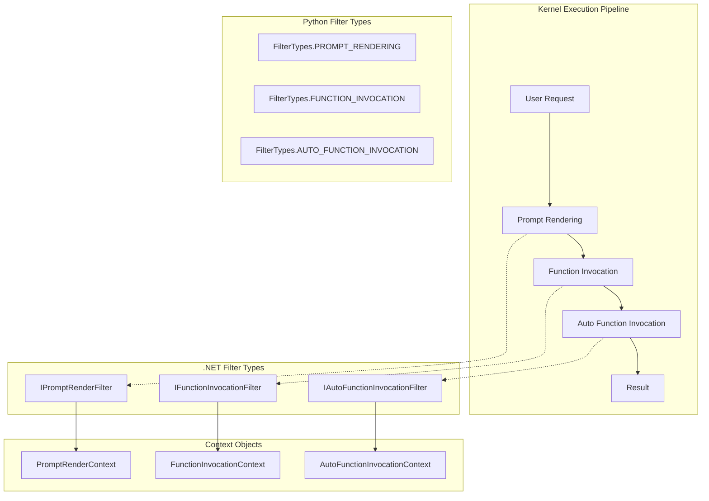
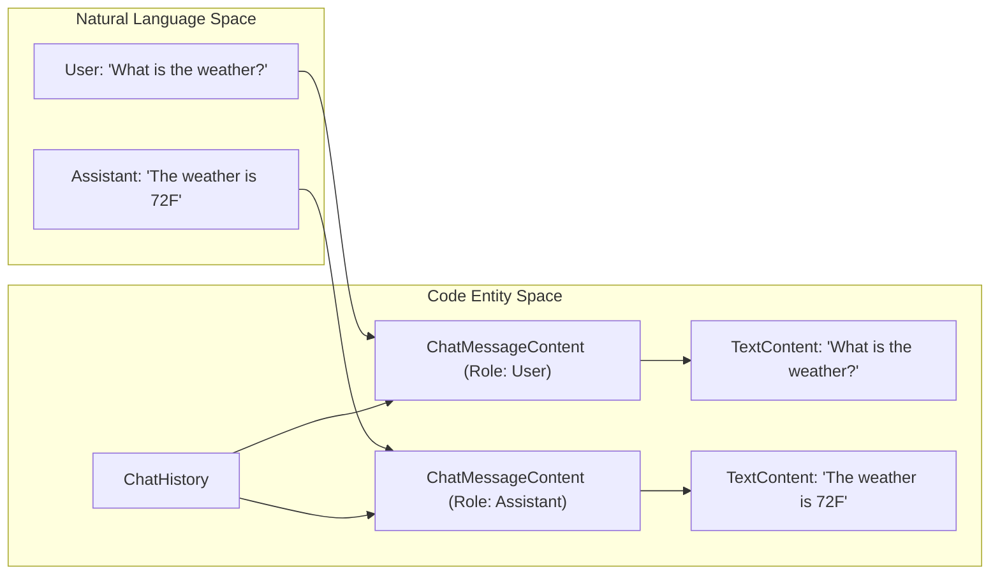
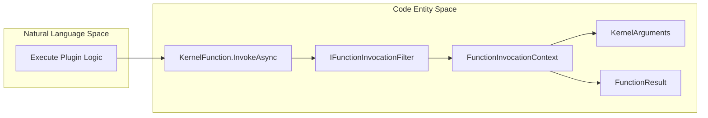

<!-- source: DeepWiki mcp.deepwiki.com · repo microsoft/semantic-kernel · page 6.3 Filtering and Extensibility · fetched 2026-10-27 -->

# Filtering and Extensibility

Relevant source files

The following files were used as context for generating this wiki page:

- [dotnet/samples/Concepts/AudioToText/OpenAI_AudioToText.cs](dotnet/samples/Concepts/AudioToText/OpenAI_AudioToText.cs)
- [dotnet/samples/Concepts/ChatCompletion/ChatHistorySerialization.cs](dotnet/samples/Concepts/ChatCompletion/ChatHistorySerialization.cs)
- [dotnet/samples/Concepts/ChatCompletion/OpenAI_ChatCompletionWithVision.cs](dotnet/samples/Concepts/ChatCompletion/OpenAI_ChatCompletionWithVision.cs)
- [dotnet/samples/Concepts/ImageToText/HuggingFace_ImageToText.cs](dotnet/samples/Concepts/ImageToText/HuggingFace_ImageToText.cs)
- [dotnet/samples/Concepts/Resources/what-is-semantic-kernel.json](dotnet/samples/Concepts/Resources/what-is-semantic-kernel.json)
- [dotnet/src/Connectors/Connectors.OpenAI.UnitTests/Core/AutoFunctionInvocationFilterTests.cs](dotnet/src/Connectors/Connectors.OpenAI.UnitTests/Core/AutoFunctionInvocationFilterTests.cs)
- [dotnet/src/InternalUtilities/planning/PlannerInstrumentation.cs](dotnet/src/InternalUtilities/planning/PlannerInstrumentation.cs)
- [dotnet/src/SemanticKernel.Abstractions/AI/ChatCompletion/AuthorRole.cs](dotnet/src/SemanticKernel.Abstractions/AI/ChatCompletion/AuthorRole.cs)
- [dotnet/src/SemanticKernel.Abstractions/AI/ChatCompletion/ChatHistory.cs](dotnet/src/SemanticKernel.Abstractions/AI/ChatCompletion/ChatHistory.cs)
- [dotnet/src/SemanticKernel.Abstractions/AI/ChatCompletion/StreamingKernelContentItemCollection.cs](dotnet/src/SemanticKernel.Abstractions/AI/ChatCompletion/StreamingKernelContentItemCollection.cs)
- [dotnet/src/SemanticKernel.Abstractions/AI/PromptNode.cs](dotnet/src/SemanticKernel.Abstractions/AI/PromptNode.cs)
- [dotnet/src/SemanticKernel.Abstractions/Contents/BinaryContent.cs](dotnet/src/SemanticKernel.Abstractions/Contents/BinaryContent.cs)
- [dotnet/src/SemanticKernel.Abstractions/Contents/ChatMessageContent.cs](dotnet/src/SemanticKernel.Abstractions/Contents/ChatMessageContent.cs)
- [dotnet/src/SemanticKernel.Abstractions/Contents/FunctionCallContentBuilder.cs](dotnet/src/SemanticKernel.Abstractions/Contents/FunctionCallContentBuilder.cs)
- [dotnet/src/SemanticKernel.Abstractions/Contents/ImageContent.cs](dotnet/src/SemanticKernel.Abstractions/Contents/ImageContent.cs)
- [dotnet/src/SemanticKernel.Abstractions/Contents/KernelContent.cs](dotnet/src/SemanticKernel.Abstractions/Contents/KernelContent.cs)
- [dotnet/src/SemanticKernel.Abstractions/Contents/StreamingChatMessageContent.cs](dotnet/src/SemanticKernel.Abstractions/Contents/StreamingChatMessageContent.cs)
- [dotnet/src/SemanticKernel.Abstractions/Contents/StreamingFunctionCallUpdateContent.cs](dotnet/src/SemanticKernel.Abstractions/Contents/StreamingFunctionCallUpdateContent.cs)
- [dotnet/src/SemanticKernel.Abstractions/Contents/StreamingKernelContent.cs](dotnet/src/SemanticKernel.Abstractions/Contents/StreamingKernelContent.cs)
- [dotnet/src/SemanticKernel.Abstractions/Contents/StreamingTextContent.cs](dotnet/src/SemanticKernel.Abstractions/Contents/StreamingTextContent.cs)
- [dotnet/src/SemanticKernel.Abstractions/Contents/TextContent.cs](dotnet/src/SemanticKernel.Abstractions/Contents/TextContent.cs)
- [dotnet/src/SemanticKernel.Abstractions/Events/CancelKernelEventArgs.cs](dotnet/src/SemanticKernel.Abstractions/Events/CancelKernelEventArgs.cs)
- [dotnet/src/SemanticKernel.Abstractions/Events/FunctionInvokedEventArgs.cs](dotnet/src/SemanticKernel.Abstractions/Events/FunctionInvokedEventArgs.cs)
- [dotnet/src/SemanticKernel.Abstractions/Events/FunctionInvokingEventArgs.cs](dotnet/src/SemanticKernel.Abstractions/Events/FunctionInvokingEventArgs.cs)
- [dotnet/src/SemanticKernel.Abstractions/Events/KernelEventArgs.cs](dotnet/src/SemanticKernel.Abstractions/Events/KernelEventArgs.cs)
- [dotnet/src/SemanticKernel.Abstractions/Events/PromptRenderedEventArgs.cs](dotnet/src/SemanticKernel.Abstractions/Events/PromptRenderedEventArgs.cs)
- [dotnet/src/SemanticKernel.Abstractions/Events/PromptRenderingEventArgs.cs](dotnet/src/SemanticKernel.Abstractions/Events/PromptRenderingEventArgs.cs)
- [dotnet/src/SemanticKernel.Abstractions/Filters/AutoFunctionInvocation/AutoFunctionInvocationContext.cs](dotnet/src/SemanticKernel.Abstractions/Filters/AutoFunctionInvocation/AutoFunctionInvocationContext.cs)
- [dotnet/src/SemanticKernel.Abstractions/Filters/AutoFunctionInvocation/IAutoFunctionInvocationFilter.cs](dotnet/src/SemanticKernel.Abstractions/Filters/AutoFunctionInvocation/IAutoFunctionInvocationFilter.cs)
- [dotnet/src/SemanticKernel.Abstractions/Filters/Function/FunctionInvocationContext.cs](dotnet/src/SemanticKernel.Abstractions/Filters/Function/FunctionInvocationContext.cs)
- [dotnet/src/SemanticKernel.Abstractions/Filters/Prompt/PromptRenderContext.cs](dotnet/src/SemanticKernel.Abstractions/Filters/Prompt/PromptRenderContext.cs)
- [dotnet/src/SemanticKernel.Abstractions/Functions/FunctionResult.cs](dotnet/src/SemanticKernel.Abstractions/Functions/FunctionResult.cs)
- [dotnet/src/SemanticKernel.Abstractions/Functions/KernelFunction.cs](dotnet/src/SemanticKernel.Abstractions/Functions/KernelFunction.cs)
- [dotnet/src/SemanticKernel.Abstractions/Functions/KernelFunctionLogMessages.cs](dotnet/src/SemanticKernel.Abstractions/Functions/KernelFunctionLogMessages.cs)
- [dotnet/src/SemanticKernel.Abstractions/Kernel.cs](dotnet/src/SemanticKernel.Abstractions/Kernel.cs)
- [dotnet/src/SemanticKernel.Core/Contents/StreamingMethodContent.cs](dotnet/src/SemanticKernel.Core/Contents/StreamingMethodContent.cs)
- [dotnet/src/SemanticKernel.Core/Functions/KernelFunctionFromMethod.cs](dotnet/src/SemanticKernel.Core/Functions/KernelFunctionFromMethod.cs)
- [dotnet/src/SemanticKernel.Core/Functions/KernelFunctionFromPrompt.cs](dotnet/src/SemanticKernel.Core/Functions/KernelFunctionFromPrompt.cs)
- [dotnet/src/SemanticKernel.Core/KernelExtensions.cs](dotnet/src/SemanticKernel.Core/KernelExtensions.cs)
- [dotnet/src/SemanticKernel.UnitTests/AI/ChatCompletion/ChatHistoryTests.cs](dotnet/src/SemanticKernel.UnitTests/AI/ChatCompletion/ChatHistoryTests.cs)
- [dotnet/src/SemanticKernel.UnitTests/Contents/ChatMessageContentTests.cs](dotnet/src/SemanticKernel.UnitTests/Contents/ChatMessageContentTests.cs)
- [dotnet/src/SemanticKernel.UnitTests/Contents/FunctionCallBuilder/FunctionCallContentBuilderTests.cs](dotnet/src/SemanticKernel.UnitTests/Contents/FunctionCallBuilder/FunctionCallContentBuilderTests.cs)
- [dotnet/src/SemanticKernel.UnitTests/Contents/ImageContentTests.cs](dotnet/src/SemanticKernel.UnitTests/Contents/ImageContentTests.cs)
- [dotnet/src/SemanticKernel.UnitTests/Contents/StreamingChatMessageContentTests.cs](dotnet/src/SemanticKernel.UnitTests/Contents/StreamingChatMessageContentTests.cs)
- [dotnet/src/SemanticKernel.UnitTests/Filters/FunctionInvocationFilterTests.cs](dotnet/src/SemanticKernel.UnitTests/Filters/FunctionInvocationFilterTests.cs)
- [dotnet/src/SemanticKernel.UnitTests/Filters/PromptRenderFilterTests.cs](dotnet/src/SemanticKernel.UnitTests/Filters/PromptRenderFilterTests.cs)
- [dotnet/src/SemanticKernel.UnitTests/Functions/FunctionFromMethodTests.cs](dotnet/src/SemanticKernel.UnitTests/Functions/FunctionFromMethodTests.cs)
- [dotnet/src/SemanticKernel.UnitTests/Functions/FunctionResultTests.cs](dotnet/src/SemanticKernel.UnitTests/Functions/FunctionResultTests.cs)
- [dotnet/src/SemanticKernel.UnitTests/Functions/KernelBuilderTests.cs](dotnet/src/SemanticKernel.UnitTests/Functions/KernelBuilderTests.cs)
- [dotnet/src/SemanticKernel.UnitTests/Functions/KernelFunctionLogMessagesTests.cs](dotnet/src/SemanticKernel.UnitTests/Functions/KernelFunctionLogMessagesTests.cs)
- [dotnet/src/SemanticKernel.UnitTests/KernelTests.cs](dotnet/src/SemanticKernel.UnitTests/KernelTests.cs)
- [python/samples/concepts/filtering/auto_function_invoke_filters.py](python/samples/concepts/filtering/auto_function_invoke_filters.py)
- [python/samples/concepts/filtering/prompt_filters.py](python/samples/concepts/filtering/prompt_filters.py)
- [python/samples/concepts/filtering/resources/chat/chat.yaml](python/samples/concepts/filtering/resources/chat/chat.yaml)
- [python/samples/concepts/grounding/grounded.py](python/samples/concepts/grounding/grounded.py)
- [python/samples/concepts/plugins/openai_function_calling_with_custom_plugin.py](python/samples/concepts/plugins/openai_function_calling_with_custom_plugin.py)
- [python/samples/concepts/prompt_templates/azure_chat_gpt_api_handlebars.py](python/samples/concepts/prompt_templates/azure_chat_gpt_api_handlebars.py)
- [python/samples/concepts/prompt_templates/azure_chat_gpt_api_jinja2.py](python/samples/concepts/prompt_templates/azure_chat_gpt_api_jinja2.py)
- [python/samples/concepts/prompt_templates/configuring_prompts.py](python/samples/concepts/prompt_templates/configuring_prompts.py)
- [python/samples/concepts/prompt_templates/load_yaml_prompt.py](python/samples/concepts/prompt_templates/load_yaml_prompt.py)
- [python/samples/concepts/resources/function_choice_json/ChatBot/config.json](python/samples/concepts/resources/function_choice_json/ChatBot/config.json)
- [python/samples/concepts/resources/function_choice_yaml/defined_function.yaml](python/samples/concepts/resources/function_choice_yaml/defined_function.yaml)
- [python/semantic_kernel/contents/chat_history.py](python/semantic_kernel/contents/chat_history.py)
- [python/semantic_kernel/contents/chat_message_content.py](python/semantic_kernel/contents/chat_message_content.py)
- [python/semantic_kernel/contents/function_call_content.py](python/semantic_kernel/contents/function_call_content.py)
- [python/semantic_kernel/contents/function_result_content.py](python/semantic_kernel/contents/function_result_content.py)
- [python/semantic_kernel/contents/streaming_chat_message_content.py](python/semantic_kernel/contents/streaming_chat_message_content.py)
- [python/semantic_kernel/contents/streaming_content_mixin.py](python/semantic_kernel/contents/streaming_content_mixin.py)
- [python/semantic_kernel/contents/streaming_text_content.py](python/semantic_kernel/contents/streaming_text_content.py)
- [python/semantic_kernel/contents/text_content.py](python/semantic_kernel/contents/text_content.py)
- [python/semantic_kernel/contents/utils/hashing.py](python/semantic_kernel/contents/utils/hashing.py)
- [python/semantic_kernel/processes/kernel_process/__init__.py](python/semantic_kernel/processes/kernel_process/__init__.py)
- [python/semantic_kernel/processes/process_step_builder.py](python/semantic_kernel/processes/process_step_builder.py)
- [python/semantic_kernel/prompt_template/utils/handlebars_system_helpers.py](python/semantic_kernel/prompt_template/utils/handlebars_system_helpers.py)
- [python/semantic_kernel/prompt_template/utils/jinja2_system_helpers.py](python/semantic_kernel/prompt_template/utils/jinja2_system_helpers.py)
- [python/tests/unit/contents/test_chat_history.py](python/tests/unit/contents/test_chat_history.py)
- [python/tests/unit/contents/test_chat_message_content.py](python/tests/unit/contents/test_chat_message_content.py)
- [python/tests/unit/contents/test_function_result_content.py](python/tests/unit/contents/test_function_result_content.py)
- [python/tests/unit/contents/test_hashing_utils.py](python/tests/unit/contents/test_hashing_utils.py)
- [python/tests/unit/contents/test_streaming_chat_message_content.py](python/tests/unit/contents/test_streaming_chat_message_content.py)
- [python/tests/unit/processes/test_process_step_builder.py](python/tests/unit/processes/test_process_step_builder.py)
- [python/tests/unit/prompt_template/test_handlebars_prompt_template.py](python/tests/unit/prompt_template/test_handlebars_prompt_template.py)
- [python/tests/unit/prompt_template/test_handlebars_prompt_template_e2e.py](python/tests/unit/prompt_template/test_handlebars_prompt_template_e2e.py)
- [python/tests/unit/prompt_template/test_jinja2_prompt_template.py](python/tests/unit/prompt_template/test_jinja2_prompt_template.py)
- [python/tests/unit/prompt_template/test_jinja2_prompt_template_e2e.py](python/tests/unit/prompt_template/test_jinja2_prompt_template_e2e.py)

This document covers the filtering and extensibility mechanisms in Semantic Kernel that allow developers to intercept, modify, and extend kernel operations at various points in the execution pipeline. The filter system provides hooks for customizing prompt rendering, function invocation, and automatic function calling behavior across both .NET and Python implementations.

For information about function creation and execution patterns, see [Functions and Plugins](#3.2). For details about AI service integration and selection, see [Service Selection and Configuration](#4.2).

## Filter System Overview

Semantic Kernel implements a comprehensive filter system that enables extensibility through interceptor patterns. The system supports three primary filter types that operate at different stages of the kernel execution pipeline.

### Filter Architecture

Sources: [dotnet/src/SemanticKernel.Abstractions/Kernel.cs:37-42](), [dotnet/src/SemanticKernel.Abstractions/Kernel.cs:114-116](), [dotnet/src/SemanticKernel.Abstractions/Kernel.cs:281-307]()

## Content Model and ChatHistory

The filter system frequently interacts with the Semantic Kernel content model, particularly during `IPromptRenderFilter` and `IAutoFunctionInvocationFilter` execution.

### Chat Message Content Model

The `ChatMessageContent` class is the primary data structure for exchanging information with AI services. It is a collection-based model where a single message can contain multiple items (text, images, function calls, etc.).

| Class | Role | Key Properties |
|-------|------|----------------|
| `ChatMessageContent` | Represents a complete message in a conversation. | `Role`, `Items`, `AuthorName`, `Metadata` |
| `StreamingChatMessageContent` | Represents a chunk of a message during streaming. | `Role`, `Content`, `ChoiceIndex` |
| `FunctionCallContent` | Represents a request from the AI to call a specific function. | `FunctionName`, `PluginName`, `Arguments`, `Id` |
| `FunctionResultContent` | Represents the result of a function execution sent back to the AI. | `Result`, `CallId`, `FunctionName` |

### ChatHistory Management

`ChatHistory` maintains the sequence of `ChatMessageContent` objects. In .NET, it is a specialized list, while in Python, it uses Pydantic validation to ensure message integrity.

Sources: [dotnet/src/SemanticKernel.Abstractions/Contents/ChatMessageContent.cs:15-31](), [python/semantic_kernel/contents/chat_message_content.py:75-102](), [python/semantic_kernel/contents/chat_history.py:26-41](), [python/semantic_kernel/contents/function_call_content.py:12-25](), [python/semantic_kernel/contents/function_result_content.py:12-25]()

## Filter Types and Contexts

### Function Invocation Filters

Function invocation filters intercept `KernelFunction.InvokeAsync`. They have access to the `FunctionInvocationContext`, which allows them to inspect and modify arguments before execution or modify the `FunctionResult` after execution.

Sources: [dotnet/src/SemanticKernel.Abstractions/Functions/KernelFunction.cs:25-31](), [dotnet/src/SemanticKernel.Abstractions/Filters/Function/FunctionInvocationContext.cs:12-25](), [dotnet/src/SemanticKernel.Abstractions/Functions/FunctionResult.cs:14-23]()

### Prompt Rendering Filters

Prompt rendering filters allow interception and modification of prompt templates before they are sent to AI services. They are triggered within `KernelFunctionFromPrompt`.

Sources: [dotnet/src/SemanticKernel.Core/Functions/KernelFunctionFromPrompt.cs:27-35](), [dotnet/src/SemanticKernel.Abstractions/Filters/Prompt/PromptRenderContext.cs:12-20]()

### Auto Function Invocation Filters

These filters are specialized for the "Auto Function Invocation" loop, where the kernel automatically executes tool calls returned by an LLM. The `AutoFunctionInvocationContext` includes a `Terminate` flag to stop the loop early.

Sources: [dotnet/src/SemanticKernel.Abstractions/Filters/AutoFunctionInvocation/AutoFunctionInvocationContext.cs:12-30](), [python/semantic_kernel/kernel.py:326-350]()

## Filter Pipeline Architecture

### .NET Filter Pipeline

The .NET implementation uses a recursive approach to build and execute filter chains. Filters are registered in the `Kernel` and stored in `NonNullCollection<T>` containers.

Sources: [dotnet/src/SemanticKernel.Abstractions/Kernel.cs:37-43](), [dotnet/src/SemanticKernel.Abstractions/Kernel.cs:114-116](), [dotnet/src/SemanticKernel.Abstractions/Kernel.cs:335-350]()

### Python Filter Pipeline

The Python implementation uses a call stack construction approach. Filters are registered via the `Kernel` class and managed by the `KernelFilterExtension`.

Sources: [python/semantic_kernel/kernel.py:69-71](), [python/semantic_kernel/filters/kernel_filters_extension.py:117-140]()

## Extensibility Patterns

### Service Provider Integration

In .NET, filters are typically registered in the `IServiceCollection` and resolved by the `Kernel` during construction.

Sources: [dotnet/src/SemanticKernel.Abstractions/Kernel.cs:68-80](), [dotnet/src/SemanticKernel.UnitTests/KernelTests.cs:195-205]()

### Context Modification Patterns

Filters can modify execution context at various stages:
- **Arguments**: Change values in `KernelArguments` before a function runs.
- **Result**: Override the `FunctionResult` after execution.
- **Metadata**: Add telemetry or tracking data to the context.

Sources: [dotnet/src/SemanticKernel.Abstractions/Functions/FunctionResult.cs:55-57](), [dotnet/src/SemanticKernel.Abstractions/Filters/Function/FunctionInvocationContext.cs:30-45]()

## Implementation Details

### Thread Safety and Immutability

The `Kernel` supports a `Clone()` method that creates a new instance with a new plugin collection and filter collections, while sharing the same `IServiceProvider`. This allows for per-request customization of filters without affecting other kernel instances.

Sources: [dotnet/src/SemanticKernel.Abstractions/Kernel.cs:111-119](), [dotnet/src/SemanticKernel.UnitTests/KernelTests.cs:192-220]()

### Performance Considerations

- **Metrics and Instrumentation**: Function invocations are instrumented using `ActivitySource` and `Meter` for performance tracking.
- **Lazy Initialization**: Filter collections are only initialized if filters are present.

Sources: [dotnet/src/SemanticKernel.Abstractions/Functions/KernelFunction.cs:34-44](), [dotnet/src/SemanticKernel.Abstractions/Kernel.cs:124-127](), [dotnet/src/InternalUtilities/planning/PlannerInstrumentation.cs:17-33]()

---

