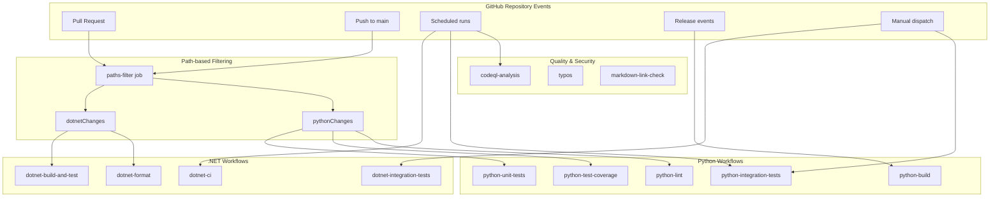
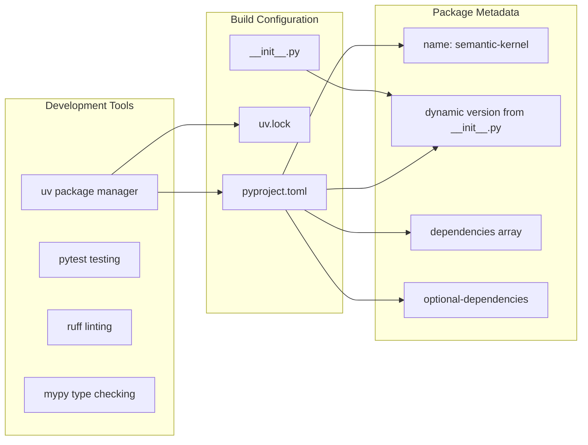
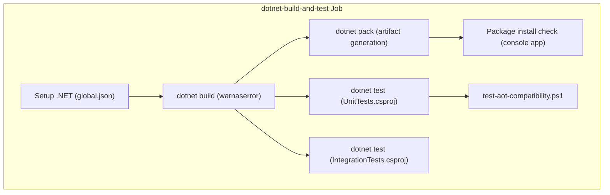

<!-- source: DeepWiki mcp.deepwiki.com · repo microsoft/semantic-kernel · page 7.1 CI/CD and Build System · fetched 2026-10-27 -->

# CI/CD and Build System

Relevant source files

The following files were used as context for generating this wiki page:

- [.github/.linkspector.yml](.github/.linkspector.yml)
- [.github/dependabot.yml](.github/dependabot.yml)
- [.github/workflows/codeql-analysis.yml](.github/workflows/codeql-analysis.yml)
- [.github/workflows/dotnet-build-and-test.yml](.github/workflows/dotnet-build-and-test.yml)
- [.github/workflows/dotnet-ci.yml](.github/workflows/dotnet-ci.yml)
- [.github/workflows/dotnet-format.yml](.github/workflows/dotnet-format.yml)
- [.github/workflows/dotnet-integration-tests.yml](.github/workflows/dotnet-integration-tests.yml)
- [.github/workflows/label-title-prefix.yml](.github/workflows/label-title-prefix.yml)
- [.github/workflows/markdown-link-check.yml](.github/workflows/markdown-link-check.yml)
- [.github/workflows/python-build.yml](.github/workflows/python-build.yml)
- [.github/workflows/python-integration-tests.yml](.github/workflows/python-integration-tests.yml)
- [.github/workflows/python-lint.yml](.github/workflows/python-lint.yml)
- [.github/workflows/python-manual-release.yml](.github/workflows/python-manual-release.yml)
- [.github/workflows/python-test-coverage-report.yml](.github/workflows/python-test-coverage-report.yml)
- [.github/workflows/python-test-coverage.yml](.github/workflows/python-test-coverage.yml)
- [.github/workflows/python-unit-tests.yml](.github/workflows/python-unit-tests.yml)
- [.github/workflows/typos.yaml](.github/workflows/typos.yaml)
- [docs/COSINE_SIMILARITY.md](docs/COSINE_SIMILARITY.md)
- [docs/DOT_PRODUCT.md](docs/DOT_PRODUCT.md)
- [docs/EMBEDDINGS.md](docs/EMBEDDINGS.md)
- [docs/EUCLIDEAN_DISTANCE.md](docs/EUCLIDEAN_DISTANCE.md)
- [docs/GLOSSARY.md](docs/GLOSSARY.md)
- [docs/PLANNERS.md](docs/PLANNERS.md)
- [docs/PLUGINS.md](docs/PLUGINS.md)
- [docs/PROMPT_TEMPLATE_LANGUAGE.md](docs/PROMPT_TEMPLATE_LANGUAGE.md)
- [docs/decisions/0044-OTel-semantic-convention.md](docs/decisions/0044-OTel-semantic-convention.md)
- [dotnet/docs/TELEMETRY.md](dotnet/docs/TELEMETRY.md)
- [dotnet/nuget/NUGET.md](dotnet/nuget/NUGET.md)
- [dotnet/samples/Demos/BookingRestaurant/README.md](dotnet/samples/Demos/BookingRestaurant/README.md)
- [dotnet/samples/Demos/TimePlugin/Program.cs](dotnet/samples/Demos/TimePlugin/Program.cs)
- [dotnet/samples/Demos/TimePlugin/README.md](dotnet/samples/Demos/TimePlugin/README.md)
- [dotnet/samples/Demos/TimePlugin/TimePlugin.csproj](dotnet/samples/Demos/TimePlugin/TimePlugin.csproj)
- [python/samples/demos/call_automation/.env.example](python/samples/demos/call_automation/.env.example)
- [python/samples/demos/call_automation/readme.md](python/samples/demos/call_automation/readme.md)
- [python/tests/conftest.py](python/tests/conftest.py)

This document covers the continuous integration, continuous delivery, and build systems that support the Semantic Kernel multi-language repository. It details the GitHub Actions workflows, build configurations, testing strategies, and release processes for both .NET and Python implementations.

For information about package management and dependencies, see [Package Management and Dependencies](#2.3). For development environment setup and configuration, see [Configuration and Setup](#7.3).

## Overview

The Semantic Kernel repository employs a comprehensive CI/CD system built on GitHub Actions that supports multiple programming languages with language-specific build pipelines, shared quality gates, and coordinated release processes.

### CI/CD Architecture

**Sources:** [.github/workflows/python-integration-tests.yml:82-102](), [.github/workflows/dotnet-build-and-test.yml:27-54]()

The system uses path-based filtering to trigger language-specific workflows only when relevant files change, optimizing build times and resource usage. For example, the `paths-filter` job in the .NET workflow detects changes in the `dotnet/` directory or specific build scripts [ .github/workflows/dotnet-build-and-test.yml:38-43]().

## Python Build System

The Python build system uses `uv` as the package manager and build tool, with `pyproject.toml` defining project configuration and dependencies.

### Python Project Configuration

**Sources:** [python/pyproject.toml:1-60](), [python/semantic_kernel/__init__.py:5-7]()

The Python workflows leverage `uv` for high-performance dependency resolution and synchronization [ .github/workflows/python-unit-tests.yml:43-55]().

### Python Testing Workflows

The Python implementation features a multi-tiered testing strategy including unit tests, integration tests, and coverage reporting.

| Workflow | Purpose | Implementation Detail |
|----------|---------|-----------------------|
| `python-unit-tests` | Runs core logic tests across OS/Python versions | Uses matrix for Python 3.10-3.13 [ .github/workflows/python-unit-tests.yml:19-33]() |
| `python-integration-tests` | Validates AI service connectors and plugins | Runs daily at midnight; uses secrets for provider keys [ .github/workflows/python-integration-tests.yml:14-79]() |
| `python-test-coverage` | Measures code coverage of unit tests | Runs `pytest --cov=semantic_kernel` [ .github/workflows/python-test-coverage.yml:38-39]() |
| `python-test-coverage-report` | Posts coverage results to PRs | Triggered on completion of coverage workflow [ .github/workflows/python-test-coverage-report.yml:4-7]() |

**Sources:** [.github/workflows/python-unit-tests.yml:1-75](), [.github/workflows/python-integration-tests.yml:1-160](), [.github/workflows/python-test-coverage.yml:1-50]()

### Python Code Quality

Code quality is enforced through linting and type checking. The `python-lint` workflow executes `ruff` and `mypy` checks to ensure adherence to standards [ .github/workflows/python-lint.yml:10-42]().

## .NET Build System

The .NET build system uses solution files (`.slnx`) and the `dotnet` CLI, targeting multiple SDK versions (9.0, 10.0) across Windows and Ubuntu.

### .NET Build and Test Workflow

The primary pipeline for .NET is `dotnet-build-and-test.yml`, which performs building, packaging, and testing.

**Sources:** [.github/workflows/dotnet-build-and-test.yml:76-142]()

A unique "Package install check" step creates a temporary console application, adds the locally built `Microsoft.SemanticKernel` package, and attempts a build to ensure the generated NuGet package is valid [ .github/workflows/dotnet-build-and-test.yml:89-109]().

### .NET Code Formatting

The `dotnet-format` workflow ensures consistent code style by running `dotnet format` in a Docker container [ .github/workflows/dotnet-format.yml:83-94](). It dynamically identifies changed projects to minimize execution time [ .github/workflows/dotnet-format.yml:53-82]().

## Security and Dependency Management

### CodeQL Analysis
The `codeql-analysis.yml` workflow automates security checks for both C# and Python. It runs on pushes to main and on a weekly schedule [ .github/workflows/codeql-analysis.yml:7-13]().

### Dependabot
Dependabot is configured to provide weekly updates for:
- **NuGet**: Targets the `dotnet/` directory, ignoring major version updates for core System/Microsoft extensions to maintain stability [ .github/dependabot.yml:8-21]().
- **Pip**: Targets the `python/` directory [ .github/dependabot.yml:28-35]().
- **GitHub Actions**: Updates workflow dependencies [ .github/dependabot.yml:38-45]().

### Utility Workflows
- **Typos**: A dedicated workflow checks for spelling errors across the repository [ .github/workflows/typos.yaml:1-31]().
- **Label Title Prefix**: Automatically prepends labels like "Python:" or ".Net:" to PR and Issue titles based on their labels to improve repository organization [ .github/workflows/label-title-prefix.yml:1-73]().

## Integration Testing Strategy

Integration tests are separated from unit tests to manage costs and environment requirements.

### Integration Test Configuration
Both languages rely on environment variables and GitHub Secrets to configure AI service endpoints:
- **Azure OpenAI**: Endpoints and deployment names for chat, embeddings, and audio [ .github/workflows/python-integration-tests.yml:25-34]().
- **Other Providers**: API keys for Anthropic, Google Gemini, Mistral AI, and Pinecone [ .github/workflows/python-integration-tests.yml:46-71]().

### Data Stores
Integration tests cover various vector stores and databases, including:
- **PostgreSQL**: `POSTGRES_CONNECTION_STRING` [ .github/workflows/python-integration-tests.yml:48]().
- **Redis**: `REDIS_CONNECTION_STRING` [ .github/workflows/python-integration-tests.yml:75]().
- **Azure AI Search**: `AZURE_AI_SEARCH_ENDPOINT` [ .github/workflows/python-integration-tests.yml:51]().

**Sources:** [.github/workflows/python-integration-tests.yml:20-80](), [.github/workflows/dotnet-build-and-test.yml:144-165]()

---

