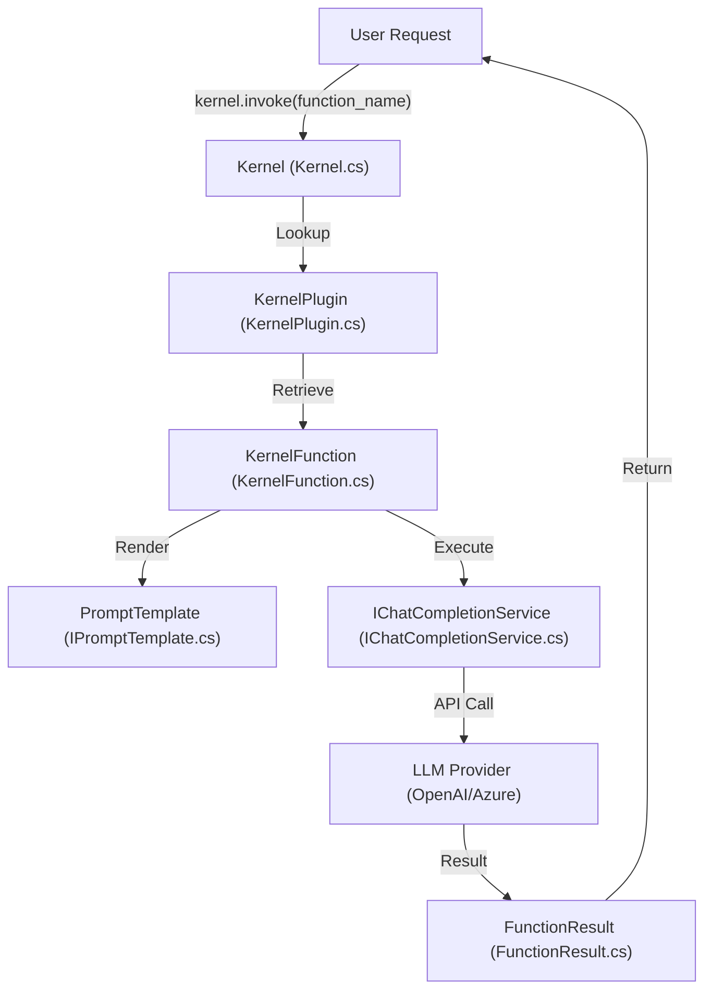
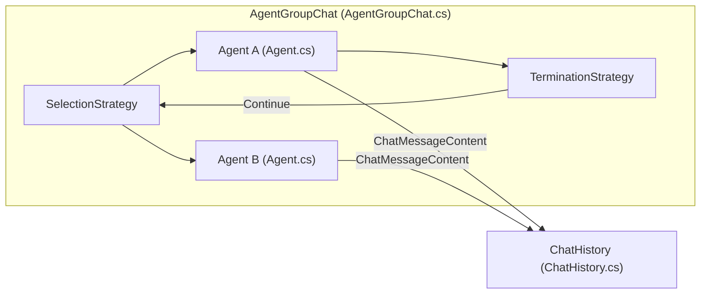

<!-- source: DeepWiki mcp.deepwiki.com · repo microsoft/semantic-kernel · page 8 Glossary · fetched 2026-10-27 -->

# Glossary

Relevant source files

The following files were used as context for generating this wiki page:

- [.github/.linkspector.yml](.github/.linkspector.yml)
- [.github/_typos.toml](.github/_typos.toml)
- [FEATURE_MATRIX.md](FEATURE_MATRIX.md)
- [README.md](README.md)
- [docs/COSINE_SIMILARITY.md](docs/COSINE_SIMILARITY.md)
- [docs/DOT_PRODUCT.md](docs/DOT_PRODUCT.md)
- [docs/EMBEDDINGS.md](docs/EMBEDDINGS.md)
- [docs/EUCLIDEAN_DISTANCE.md](docs/EUCLIDEAN_DISTANCE.md)
- [docs/GLOSSARY.md](docs/GLOSSARY.md)
- [docs/PLANNERS.md](docs/PLANNERS.md)
- [docs/PLUGINS.md](docs/PLUGINS.md)
- [docs/PROMPT_TEMPLATE_LANGUAGE.md](docs/PROMPT_TEMPLATE_LANGUAGE.md)
- [docs/decisions/0004-error-handling.md](docs/decisions/0004-error-handling.md)
- [docs/decisions/0006-open-api-dynamic-payload-and-namespaces.md](docs/decisions/0006-open-api-dynamic-payload-and-namespaces.md)
- [docs/decisions/0007-prompt-extract-template-engine.md](docs/decisions/0007-prompt-extract-template-engine.md)
- [docs/decisions/0008-support-generic-llm-request-settings.md](docs/decisions/0008-support-generic-llm-request-settings.md)
- [docs/decisions/0009-support-multiple-named-args-in-template-function-calls.md](docs/decisions/0009-support-multiple-named-args-in-template-function-calls.md)
- [docs/decisions/0010-dotnet-project-structure.md](docs/decisions/0010-dotnet-project-structure.md)
- [docs/decisions/0011-function-and-kernel-result-types.md](docs/decisions/0011-function-and-kernel-result-types.md)
- [docs/decisions/0012-kernel-service-registration.md](docs/decisions/0012-kernel-service-registration.md)
- [docs/decisions/0013-memory-as-plugin.md](docs/decisions/0013-memory-as-plugin.md)
- [docs/decisions/0014-chat-completion-roles-in-prompt.md](docs/decisions/0014-chat-completion-roles-in-prompt.md)
- [docs/decisions/0015-completion-service-selection.md](docs/decisions/0015-completion-service-selection.md)
- [docs/decisions/0016-custom-prompt-template-formats.md](docs/decisions/0016-custom-prompt-template-formats.md)
- [docs/decisions/0017-openai-function-calling.md](docs/decisions/0017-openai-function-calling.md)
- [docs/decisions/0033-kernel-filters.md](docs/decisions/0033-kernel-filters.md)
- [docs/decisions/0034-rag-in-sk.md](docs/decisions/0034-rag-in-sk.md)
- [docs/decisions/0038-completion-service-selection.md](docs/decisions/0038-completion-service-selection.md)
- [docs/decisions/0044-OTel-semantic-convention.md](docs/decisions/0044-OTel-semantic-convention.md)
- [docs/decisions/0071-multi-agent-orchestration.md](docs/decisions/0071-multi-agent-orchestration.md)
- [docs/images/sk_logo.png](docs/images/sk_logo.png)
- [dotnet/Directory.Packages.props](dotnet/Directory.Packages.props)
- [dotnet/README.md](dotnet/README.md)
- [dotnet/docs/EXPERIMENTS.md](dotnet/docs/EXPERIMENTS.md)
- [dotnet/docs/TELEMETRY.md](dotnet/docs/TELEMETRY.md)
- [dotnet/notebooks/05-using-function-calling.ipynb](dotnet/notebooks/05-using-function-calling.ipynb)
- [dotnet/notebooks/README.md](dotnet/notebooks/README.md)
- [dotnet/nuget/NUGET.md](dotnet/nuget/NUGET.md)
- [dotnet/samples/Concepts/Concepts.csproj](dotnet/samples/Concepts/Concepts.csproj)
- [dotnet/samples/Concepts/FunctionCalling/FunctionCalling_SharedState.cs](dotnet/samples/Concepts/FunctionCalling/FunctionCalling_SharedState.cs)
- [dotnet/samples/Concepts/README.md](dotnet/samples/Concepts/README.md)
- [dotnet/samples/Concepts/Resources/travel-destination-overview.txt](dotnet/samples/Concepts/Resources/travel-destination-overview.txt)
- [dotnet/samples/Demos/BookingRestaurant/README.md](dotnet/samples/Demos/BookingRestaurant/README.md)
- [dotnet/samples/Demos/TimePlugin/Program.cs](dotnet/samples/Demos/TimePlugin/Program.cs)
- [dotnet/samples/Demos/TimePlugin/README.md](dotnet/samples/Demos/TimePlugin/README.md)
- [dotnet/samples/Demos/TimePlugin/TimePlugin.csproj](dotnet/samples/Demos/TimePlugin/TimePlugin.csproj)
- [dotnet/samples/GettingStartedWithAgents/GettingStartedWithAgents.csproj](dotnet/samples/GettingStartedWithAgents/GettingStartedWithAgents.csproj)
- [dotnet/samples/GettingStartedWithAgents/README.md](dotnet/samples/GettingStartedWithAgents/README.md)
- [dotnet/src/Agents/UnitTests/Agents.UnitTests.csproj](dotnet/src/Agents/UnitTests/Agents.UnitTests.csproj)
- [dotnet/src/Connectors/Connectors.OpenAI.UnitTests/Core/AutoFunctionInvocationFilterTests.cs](dotnet/src/Connectors/Connectors.OpenAI.UnitTests/Core/AutoFunctionInvocationFilterTests.cs)
- [dotnet/src/IntegrationTests/IntegrationTests.csproj](dotnet/src/IntegrationTests/IntegrationTests.csproj)
- [dotnet/src/InternalUtilities/planning/PlannerInstrumentation.cs](dotnet/src/InternalUtilities/planning/PlannerInstrumentation.cs)
- [dotnet/src/InternalUtilities/samples/InternalUtilities/TestConfiguration.cs](dotnet/src/InternalUtilities/samples/InternalUtilities/TestConfiguration.cs)
- [dotnet/src/Plugins/Plugins.AI.UnitTests/Plugins.AI.UnitTests.csproj](dotnet/src/Plugins/Plugins.AI.UnitTests/Plugins.AI.UnitTests.csproj)
- [dotnet/src/Plugins/Plugins.AI/Plugins.AI.csproj](dotnet/src/Plugins/Plugins.AI/Plugins.AI.csproj)
- [dotnet/src/Plugins/Plugins.Memory/TextMemoryPlugin.cs](dotnet/src/Plugins/Plugins.Memory/TextMemoryPlugin.cs)
- [dotnet/src/SemanticKernel.Abstractions/AI/PromptNode.cs](dotnet/src/SemanticKernel.Abstractions/AI/PromptNode.cs)
- [dotnet/src/SemanticKernel.Abstractions/Events/CancelKernelEventArgs.cs](dotnet/src/SemanticKernel.Abstractions/Events/CancelKernelEventArgs.cs)
- [dotnet/src/SemanticKernel.Abstractions/Events/FunctionInvokedEventArgs.cs](dotnet/src/SemanticKernel.Abstractions/Events/FunctionInvokedEventArgs.cs)
- [dotnet/src/SemanticKernel.Abstractions/Events/FunctionInvokingEventArgs.cs](dotnet/src/SemanticKernel.Abstractions/Events/FunctionInvokingEventArgs.cs)
- [dotnet/src/SemanticKernel.Abstractions/Events/KernelEventArgs.cs](dotnet/src/SemanticKernel.Abstractions/Events/KernelEventArgs.cs)
- [dotnet/src/SemanticKernel.Abstractions/Events/PromptRenderedEventArgs.cs](dotnet/src/SemanticKernel.Abstractions/Events/PromptRenderedEventArgs.cs)
- [dotnet/src/SemanticKernel.Abstractions/Events/PromptRenderingEventArgs.cs](dotnet/src/SemanticKernel.Abstractions/Events/PromptRenderingEventArgs.cs)
- [dotnet/src/SemanticKernel.Abstractions/Filters/AutoFunctionInvocation/AutoFunctionInvocationContext.cs](dotnet/src/SemanticKernel.Abstractions/Filters/AutoFunctionInvocation/AutoFunctionInvocationContext.cs)
- [dotnet/src/SemanticKernel.Abstractions/Filters/AutoFunctionInvocation/IAutoFunctionInvocationFilter.cs](dotnet/src/SemanticKernel.Abstractions/Filters/AutoFunctionInvocation/IAutoFunctionInvocationFilter.cs)
- [dotnet/src/SemanticKernel.Abstractions/Filters/Function/FunctionInvocationContext.cs](dotnet/src/SemanticKernel.Abstractions/Filters/Function/FunctionInvocationContext.cs)
- [dotnet/src/SemanticKernel.Abstractions/Filters/Prompt/PromptRenderContext.cs](dotnet/src/SemanticKernel.Abstractions/Filters/Prompt/PromptRenderContext.cs)
- [dotnet/src/SemanticKernel.Abstractions/Functions/FunctionResult.cs](dotnet/src/SemanticKernel.Abstractions/Functions/FunctionResult.cs)
- [dotnet/src/SemanticKernel.Abstractions/Functions/KernelFunction.cs](dotnet/src/SemanticKernel.Abstractions/Functions/KernelFunction.cs)
- [dotnet/src/SemanticKernel.Abstractions/Functions/KernelFunctionLogMessages.cs](dotnet/src/SemanticKernel.Abstractions/Functions/KernelFunctionLogMessages.cs)
- [dotnet/src/SemanticKernel.Abstractions/Kernel.cs](dotnet/src/SemanticKernel.Abstractions/Kernel.cs)
- [dotnet/src/SemanticKernel.Core/Contents/StreamingMethodContent.cs](dotnet/src/SemanticKernel.Core/Contents/StreamingMethodContent.cs)
- [dotnet/src/SemanticKernel.Core/Functions/KernelFunctionFromMethod.cs](dotnet/src/SemanticKernel.Core/Functions/KernelFunctionFromMethod.cs)
- [dotnet/src/SemanticKernel.Core/Functions/KernelFunctionFromPrompt.cs](dotnet/src/SemanticKernel.Core/Functions/KernelFunctionFromPrompt.cs)
- [dotnet/src/SemanticKernel.Core/KernelExtensions.cs](dotnet/src/SemanticKernel.Core/KernelExtensions.cs)
- [dotnet/src/SemanticKernel.UnitTests/Filters/FunctionInvocationFilterTests.cs](dotnet/src/SemanticKernel.UnitTests/Filters/FunctionInvocationFilterTests.cs)
- [dotnet/src/SemanticKernel.UnitTests/Filters/PromptRenderFilterTests.cs](dotnet/src/SemanticKernel.UnitTests/Filters/PromptRenderFilterTests.cs)
- [dotnet/src/SemanticKernel.UnitTests/Functions/FunctionFromMethodTests.cs](dotnet/src/SemanticKernel.UnitTests/Functions/FunctionFromMethodTests.cs)
- [dotnet/src/SemanticKernel.UnitTests/Functions/FunctionResultTests.cs](dotnet/src/SemanticKernel.UnitTests/Functions/FunctionResultTests.cs)
- [dotnet/src/SemanticKernel.UnitTests/Functions/KernelBuilderTests.cs](dotnet/src/SemanticKernel.UnitTests/Functions/KernelBuilderTests.cs)
- [dotnet/src/SemanticKernel.UnitTests/Functions/KernelFunctionLogMessagesTests.cs](dotnet/src/SemanticKernel.UnitTests/Functions/KernelFunctionLogMessagesTests.cs)
- [dotnet/src/SemanticKernel.UnitTests/KernelTests.cs](dotnet/src/SemanticKernel.UnitTests/KernelTests.cs)
- [dotnet/src/SemanticKernel.UnitTests/SemanticKernel.UnitTests.csproj](dotnet/src/SemanticKernel.UnitTests/SemanticKernel.UnitTests.csproj)
- [python/.coveragerc](python/.coveragerc)
- [python/.env.example](python/.env.example)
- [python/.vscode/tasks.json](python/.vscode/tasks.json)
- [python/DEV_SETUP.md](python/DEV_SETUP.md)
- [python/README.md](python/README.md)
- [python/mypy.ini](python/mypy.ini)
- [python/samples/__init__.py](python/samples/__init__.py)
- [python/samples/concepts/mcp/README.md](python/samples/concepts/mcp/README.md)
- [python/samples/concepts/mcp/agent_with_mcp_plugin.py](python/samples/concepts/mcp/agent_with_mcp_plugin.py)
- [python/samples/concepts/mcp/agent_with_mcp_sampling.py](python/samples/concepts/mcp/agent_with_mcp_sampling.py)
- [python/samples/concepts/mcp/azure_ai_agent_with_mcp_plugin.py](python/samples/concepts/mcp/azure_ai_agent_with_mcp_plugin.py)
- [python/samples/concepts/mcp/mcp_as_plugin.py](python/samples/concepts/mcp/mcp_as_plugin.py)
- [python/samples/concepts/realtime/README.md](python/samples/concepts/realtime/README.md)
- [python/samples/concepts/realtime/realtime_agent_with_function_calling_webrtc.py](python/samples/concepts/realtime/realtime_agent_with_function_calling_webrtc.py)
- [python/samples/concepts/realtime/realtime_agent_with_function_calling_websocket.py](python/samples/concepts/realtime/realtime_agent_with_function_calling_websocket.py)
- [python/samples/concepts/realtime/simple_realtime_chat_webrtc.py](python/samples/concepts/realtime/simple_realtime_chat_webrtc.py)
- [python/samples/concepts/realtime/simple_realtime_chat_websocket.py](python/samples/concepts/realtime/simple_realtime_chat_websocket.py)
- [python/samples/concepts/realtime/utils.py](python/samples/concepts/realtime/utils.py)
- [python/samples/getting_started/.env.example](python/samples/getting_started/.env.example)
- [python/samples/getting_started/third_party/.env.example](python/samples/getting_started/third_party/.env.example)
- [python/samples/learn_resources/.env.example](python/samples/learn_resources/.env.example)
- [python/samples/learn_resources/README.md](python/samples/learn_resources/README.md)
- [python/samples/learn_resources/ai_services.py](python/samples/learn_resources/ai_services.py)
- [python/samples/learn_resources/configuring_prompts.py](python/samples/learn_resources/configuring_prompts.py)
- [python/samples/learn_resources/creating_functions.py](python/samples/learn_resources/creating_functions.py)
- [python/samples/learn_resources/evaluate_with_prompt_flow.py](python/samples/learn_resources/evaluate_with_prompt_flow.py)
- [python/samples/learn_resources/functions_within_prompts.py](python/samples/learn_resources/functions_within_prompts.py)
- [python/samples/learn_resources/plugin.py](python/samples/learn_resources/plugin.py)
- [python/samples/learn_resources/plugins/MathPlugin/Math.py](python/samples/learn_resources/plugins/MathPlugin/Math.py)
- [python/samples/learn_resources/serializing_prompts.py](python/samples/learn_resources/serializing_prompts.py)
- [python/samples/learn_resources/templates.py](python/samples/learn_resources/templates.py)
- [python/samples/learn_resources/using_the_kernel.py](python/samples/learn_resources/using_the_kernel.py)
- [python/samples/learn_resources/your_first_prompt.py](python/samples/learn_resources/your_first_prompt.py)
- [python/semantic_kernel/__init__.py](python/semantic_kernel/__init__.py)
- [python/semantic_kernel/connectors/ai/function_choice_behavior.py](python/semantic_kernel/connectors/ai/function_choice_behavior.py)
- [python/semantic_kernel/connectors/ai/open_ai/prompt_execution_settings/open_ai_realtime_execution_settings.py](python/semantic_kernel/connectors/ai/open_ai/prompt_execution_settings/open_ai_realtime_execution_settings.py)
- [python/semantic_kernel/connectors/ai/open_ai/services/_open_ai_realtime.py](python/semantic_kernel/connectors/ai/open_ai/services/_open_ai_realtime.py)
- [python/semantic_kernel/connectors/ai/open_ai/services/azure_realtime.py](python/semantic_kernel/connectors/ai/open_ai/services/azure_realtime.py)
- [python/semantic_kernel/connectors/ai/open_ai/settings/open_ai_settings.py](python/semantic_kernel/connectors/ai/open_ai/settings/open_ai_settings.py)
- [python/semantic_kernel/connectors/mcp.py](python/semantic_kernel/connectors/mcp.py)
- [python/semantic_kernel/functions/kernel_function_extension.py](python/semantic_kernel/functions/kernel_function_extension.py)
- [python/semantic_kernel/functions/kernel_plugin.py](python/semantic_kernel/functions/kernel_plugin.py)
- [python/semantic_kernel/kernel.py](python/semantic_kernel/kernel.py)
- [python/tests/unit/connectors/ai/open_ai/services/test_openai_realtime.py](python/tests/unit/connectors/ai/open_ai/services/test_openai_realtime.py)
- [python/tests/unit/connectors/mcp/test_mcp.py](python/tests/unit/connectors/mcp/test_mcp.py)
- [python/tests/unit/contents/test_function_call_content.py](python/tests/unit/contents/test_function_call_content.py)
- [python/tests/unit/functions/test_kernel_plugins.py](python/tests/unit/functions/test_kernel_plugins.py)
- [python/tests/unit/kernel/test_kernel.py](python/tests/unit/kernel/test_kernel.py)

This page provides definitions and technical implementation details for core terms, jargon, and domain-specific concepts within the Semantic Kernel (SK) repository. It serves as a reference for onboarding engineers to understand the relationship between high-level AI orchestration concepts and their specific class representations in the .NET and Python implementations.

## Core Orchestration Terms

### Kernel
The central hub and entry point for Semantic Kernel. It maintains the state of registered AI services, plugins, and filters. In both .NET and Python, the `Kernel` orchestrates the execution of functions and manages the lifecycle of dependencies.

*   **.NET Implementation**: `Microsoft.SemanticKernel.Kernel` [dotnet/src/SemanticKernel.Abstractions/Kernel.cs:22-22](). It uses a builder pattern via `IKernelBuilder` for configuration.
*   **Python Implementation**: `semantic_kernel.kernel.Kernel` [python/semantic_kernel/kernel.py:62-62](). It inherits from several extension classes like `KernelFunctionExtension` and `KernelServicesExtension` to modularize its capabilities [python/semantic_kernel/kernel.py:62-62]().

### Plugin
A collection of functions that extend the Kernel's capabilities. Plugins can wrap native code (C# or Python), REST APIs (OpenAPI), or prompt-based logic.

*   **.NET Implementation**: `KernelPlugin` [dotnet/src/SemanticKernel.Abstractions/Functions/KernelPlugin.cs:15-15](). Plugins are typically registered via `kernel.Plugins.Add()`.
*   **Python Implementation**: `KernelPlugin` [python/semantic_kernel/functions/kernel_plugin.py:22-22]().

### Kernel Function
The smallest unit of execution in the SK ecosystem. A function can be "Native" (code-based) or "Semantic" (prompt-based).

*   **.NET Implementation**: `KernelFunction` is an abstract base class [dotnet/src/SemanticKernel.Abstractions/Functions/KernelFunction.cs:30-30]().
    *   **Native**: Created from .NET methods using `KernelFunctionFactory.CreateFromMethod` [dotnet/src/SemanticKernel.Core/Functions/KernelFunctionFromMethod.cs:62-62]().
    *   **Semantic**: Created from prompt templates using `KernelFunctionFromPrompt.Create` [dotnet/src/SemanticKernel.Core/Functions/KernelFunctionFromPrompt.cs:43-43]().
*   **Python Implementation**: Defined in `semantic_kernel.functions.kernel_function` [python/semantic_kernel/kernel.py:53-53](). Native functions are identified by the `@kernel_function` decorator [python/semantic_kernel/kernel.py:37-37]().

### Kernel Arguments
A dictionary-like structure used to pass parameters to functions and execution settings to AI services.

*   **.NET Implementation**: `KernelArguments` [dotnet/src/SemanticKernel.Abstractions/Functions/KernelArguments.cs:17-17]().
*   **Python Implementation**: `KernelArguments` [python/semantic_kernel/functions/kernel_arguments.py:20-20]().

---

## Technical Concept Mapping

### Natural Language Space to Code Entity Space: Function Invocation
The following diagram bridges the conceptual "Request" to the specific code entities involved in executing a function within the Kernel.

**Diagram: Function Invocation Flow**

**Sources:** [dotnet/src/SemanticKernel.Abstractions/Kernel.cs:22-22](), [dotnet/src/SemanticKernel.Abstractions/Functions/KernelFunction.cs:30-30](), [python/semantic_kernel/kernel.py:104-113]().

---

## Specialized Jargon

### Auto-Function Invocation (Tool Calling)
The process where an LLM decides which functions (tools) to call based on the user's prompt. The Kernel manages a loop that detects these requests, executes the functions, and sends the results back to the LLM.

*   **Context**: Managed via `AutoFunctionInvocationContext` [dotnet/src/SemanticKernel.Abstractions/Filters/AutoFunctionInvocation/AutoFunctionInvocationContext.cs:13-13]().
*   **Behavior**: Controlled by `FunctionChoiceBehavior` (e.g., `Auto`, `Required`, `None`) [python/semantic_kernel/kernel.py:51-51]().

### Filters
Hooks that allow developers to intercept and modify Kernel operations.
1.  **Function Invocation Filter**: Runs before and after a function is executed (`IFunctionInvocationFilter`).
2.  **Prompt Render Filter**: Runs before and after a prompt is rendered from a template (`IPromptRenderFilter`).
3.  **Auto Function Invocation Filter**: Intercepts the tool-calling loop (`IAutoFunctionInvocationFilter`).

*   **.NET Implementation**: Found in `Microsoft.SemanticKernel.Filters` [dotnet/src/SemanticKernel.Abstractions/Filters/Prompt/PromptRenderContext.cs:11-11]().
*   **Python Implementation**: Managed via `KernelFilterExtension` [python/semantic_kernel/kernel.py:29-30]().

### Content Model
The structured representation of data flowing through the kernel, specifically within chat interactions.
*   `ChatMessageContent`: Represents a single message in a conversation [python/semantic_kernel/kernel.py:20-20]().
*   `FunctionCallContent`: Represents a request from the model to call a specific tool [python/semantic_kernel/kernel.py:12-12]().
*   `FunctionResultContent`: Represents the output of a tool execution sent back to the model [python/semantic_kernel/kernel.py:13-13]().

---

## Agent Framework Terms

### Agent
An autonomous entity built on top of the Kernel that has specific instructions and access to tools.
*   **ChatCompletionAgent**: An agent that uses chat completion services to respond [python/README.md:130-130]().
*   **OpenAIAssistantAgent**: An agent backed by the OpenAI Assistants API.

### Multi-Agent Orchestration
Patterns for managing multiple agents.
*   **GroupChat**: A shared space where multiple agents collaborate [python/README.md:189-189]().
*   **SelectionStrategy**: Logic that determines which agent speaks next in a group chat.
*   **TerminationStrategy**: Logic that determines when a multi-agent conversation should end.

**Diagram: Multi-Agent Interaction**

**Sources:** [python/README.md:189-191](), [python/semantic_kernel/contents/chat_history.py:11-11]().

---

## Infrastructure & Tooling

### Model Context Protocol (MCP)
An open standard that allows agents to connect to external tools and data sources. SK can act as both an MCP client (consuming tools) and an MCP server (exposing SK functions as MCP tools).
*   **Implementation**: `MCPPluginBase` and `kernel.as_mcp_server()` [python/semantic_kernel/kernel.py:49-50]().

### Central Package Management (CPM)
A .NET feature used in this repository to manage NuGet package versions in a single file (`Directory.Packages.props`) to ensure consistency across all projects.
*   **File**: `dotnet/Directory.Packages.props` [dotnet/Directory.Packages.props:1-5]().

### Feature Matrix
A document tracking parity between .NET, Python, and Java implementations.
*   **File**: `FEATURE_MATRIX.md` [FEATURE_MATRIX.md:1-1]().

**Sources:**
- Kernel & Functions: [dotnet/src/SemanticKernel.Abstractions/Kernel.cs:22-22](), [python/semantic_kernel/kernel.py:62-62](), [dotnet/src/SemanticKernel.Abstractions/Functions/KernelFunction.cs:30-30]().
- Arguments & Results: [dotnet/src/SemanticKernel.Abstractions/Functions/KernelArguments.cs:17-17](), [dotnet/src/SemanticKernel.Abstractions/Functions/FunctionResult.cs:15-15]().
- Agents: [python/README.md:130-130](), [python/README.md:189-191]().
- Build System: [dotnet/Directory.Packages.props:1-5]().