# Page: Overview

# Overview

<details>
<summary>Relevant source files</summary>

The following files were used as context for generating this wiki page:

- [.github/_typos.toml](.github/_typos.toml)
- [FEATURE_MATRIX.md](FEATURE_MATRIX.md)
- [README.md](README.md)
- [docs/decisions/0033-kernel-filters.md](docs/decisions/0033-kernel-filters.md)
- [docs/decisions/0034-rag-in-sk.md](docs/decisions/0034-rag-in-sk.md)
- [docs/decisions/0071-multi-agent-orchestration.md](docs/decisions/0071-multi-agent-orchestration.md)
- [docs/images/sk_logo.png](docs/images/sk_logo.png)
- [dotnet/Directory.Packages.props](dotnet/Directory.Packages.props)
- [dotnet/README.md](dotnet/README.md)
- [dotnet/docs/EXPERIMENTS.md](dotnet/docs/EXPERIMENTS.md)
- [dotnet/notebooks/05-using-function-calling.ipynb](dotnet/notebooks/05-using-function-calling.ipynb)
- [dotnet/notebooks/README.md](dotnet/notebooks/README.md)
- [dotnet/samples/Concepts/Concepts.csproj](dotnet/samples/Concepts/Concepts.csproj)
- [dotnet/samples/Concepts/FunctionCalling/FunctionCalling_SharedState.cs](dotnet/samples/Concepts/FunctionCalling/FunctionCalling_SharedState.cs)
- [dotnet/samples/Concepts/README.md](dotnet/samples/Concepts/README.md)
- [dotnet/samples/Concepts/Resources/travel-destination-overview.txt](dotnet/samples/Concepts/Resources/travel-destination-overview.txt)
- [dotnet/samples/GettingStartedWithAgents/GettingStartedWithAgents.csproj](dotnet/samples/GettingStartedWithAgents/GettingStartedWithAgents.csproj)
- [dotnet/samples/GettingStartedWithAgents/README.md](dotnet/samples/GettingStartedWithAgents/README.md)
- [dotnet/src/Agents/UnitTests/Agents.UnitTests.csproj](dotnet/src/Agents/UnitTests/Agents.UnitTests.csproj)
- [dotnet/src/IntegrationTests/IntegrationTests.csproj](dotnet/src/IntegrationTests/IntegrationTests.csproj)
- [dotnet/src/InternalUtilities/samples/InternalUtilities/TestConfiguration.cs](dotnet/src/InternalUtilities/samples/InternalUtilities/TestConfiguration.cs)
- [dotnet/src/Plugins/Plugins.AI.UnitTests/Plugins.AI.UnitTests.csproj](dotnet/src/Plugins/Plugins.AI.UnitTests/Plugins.AI.UnitTests.csproj)
- [dotnet/src/Plugins/Plugins.AI/Plugins.AI.csproj](dotnet/src/Plugins/Plugins.AI/Plugins.AI.csproj)
- [dotnet/src/Plugins/Plugins.Memory/TextMemoryPlugin.cs](dotnet/src/Plugins/Plugins.Memory/TextMemoryPlugin.cs)
- [dotnet/src/SemanticKernel.UnitTests/SemanticKernel.UnitTests.csproj](dotnet/src/SemanticKernel.UnitTests/SemanticKernel.UnitTests.csproj)
- [python/.coveragerc](python/.coveragerc)
- [python/.env.example](python/.env.example)
- [python/.vscode/tasks.json](python/.vscode/tasks.json)
- [python/DEV_SETUP.md](python/DEV_SETUP.md)
- [python/README.md](python/README.md)
- [python/mypy.ini](python/mypy.ini)
- [python/samples/__init__.py](python/samples/__init__.py)
- [python/samples/getting_started/.env.example](python/samples/getting_started/.env.example)
- [python/samples/getting_started/third_party/.env.example](python/samples/getting_started/third_party/.env.example)
- [python/samples/learn_resources/.env.example](python/samples/learn_resources/.env.example)
- [python/samples/learn_resources/README.md](python/samples/learn_resources/README.md)
- [python/samples/learn_resources/ai_services.py](python/samples/learn_resources/ai_services.py)
- [python/samples/learn_resources/configuring_prompts.py](python/samples/learn_resources/configuring_prompts.py)
- [python/samples/learn_resources/creating_functions.py](python/samples/learn_resources/creating_functions.py)
- [python/samples/learn_resources/evaluate_with_prompt_flow.py](python/samples/learn_resources/evaluate_with_prompt_flow.py)
- [python/samples/learn_resources/functions_within_prompts.py](python/samples/learn_resources/functions_within_prompts.py)
- [python/samples/learn_resources/plugin.py](python/samples/learn_resources/plugin.py)
- [python/samples/learn_resources/plugins/MathPlugin/Math.py](python/samples/learn_resources/plugins/MathPlugin/Math.py)
- [python/samples/learn_resources/serializing_prompts.py](python/samples/learn_resources/serializing_prompts.py)
- [python/samples/learn_resources/templates.py](python/samples/learn_resources/templates.py)
- [python/samples/learn_resources/using_the_kernel.py](python/samples/learn_resources/using_the_kernel.py)
- [python/samples/learn_resources/your_first_prompt.py](python/samples/learn_resources/your_first_prompt.py)
- [python/semantic_kernel/__init__.py](python/semantic_kernel/__init__.py)
- [python/semantic_kernel/connectors/ai/function_choice_behavior.py](python/semantic_kernel/connectors/ai/function_choice_behavior.py)
- [python/tests/unit/contents/test_function_call_content.py](python/tests/unit/contents/test_function_call_content.py)

</details>


This document introduces the Semantic Kernel repository, summarizing its purpose as a multi-language AI orchestration framework for building intelligent agents and multi-agent systems. It covers the core architecture, key concepts, and how natural language capabilities map to concrete code entities across the supported programming languages.

Semantic Kernel has evolved into the **Microsoft Agent Framework**, providing enterprise-ready multi-agent orchestration, multi-provider model support, and cross-runtime interoperability [README.md:4-8]().

## What is Semantic Kernel

Semantic Kernel is a model-agnostic SDK that empowers developers to build, orchestrate, and deploy AI agents and multi-agent systems. It provides enterprise-grade reliability and flexibility for applications ranging from simple chatbots to complex multi-agent workflows [README.md:15-18]().

**Core Architecture Overview**

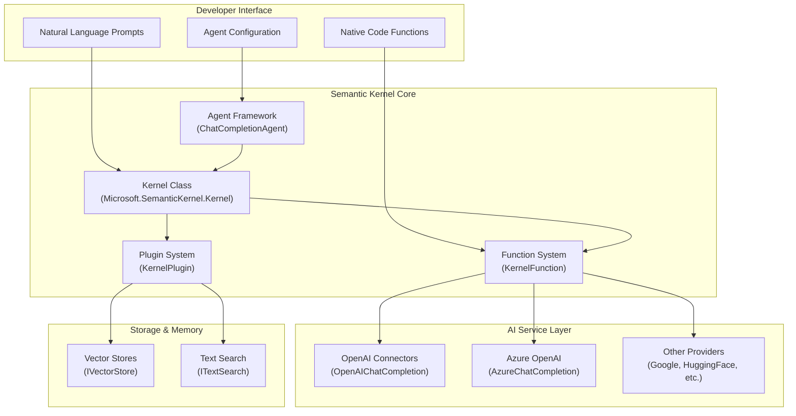

Sources: [README.md:26-36](), [dotnet/README.md:117-124](), [python/README.md:9-15]()

## Multi-Language Implementation Architecture

Semantic Kernel supports multiple programming languages with consistent conceptual models but language-specific implementations. The primary languages are .NET and Python, with Java support in development [README.md:19-24]().

**Language Implementation Matrix**

| Component | .NET Implementation | Python Implementation |
|-----------|-------------------|---------------------|
| Core Kernel | `Microsoft.SemanticKernel.Kernel` [dotnet/src/SemanticKernel.Core/Kernel.cs]() | `semantic_kernel.Kernel` [python/semantic_kernel/kernel.py:3-3]() |
| Chat Completion | `IChatCompletionService` [dotnet/src/SemanticKernel.Abstractions/AI/ChatCompletion/IChatCompletionService.cs:49-49]() | `ChatCompletionClientBase` |
| Function System | `KernelFunction` [dotnet/src/SemanticKernel.Abstractions/Functions/KernelFunction.cs]() | `@kernel_function` decorator [python/semantic_kernel/functions/kernel_function.py]() |
| Agent Framework | `ChatCompletionAgent` [dotnet/src/Agents/Core/ChatCompletionAgent.cs]() | `ChatCompletionAgent` [python/semantic_kernel/agents/chat_completion_agent.py]() |
| Package Manager | NuGet (Central Package Management) [dotnet/Directory.Packages.props:5-5]() | uv (uv.lock / pyproject.toml) [python/DEV_SETUP.md:16-20]() |

**Cross-Language Architecture Diagram**

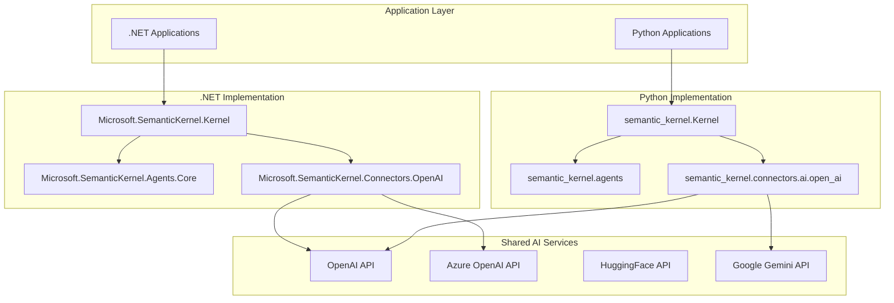

Sources: [README.md:52-63](), [dotnet/README.md:115-124](), [python/README.md:17-24](), [dotnet/Directory.Packages.props:85-87]()

## Core Concepts to Code Entity Mapping

The following diagram shows how high-level concepts in Semantic Kernel map to specific code entities within the repository:

**Concept to Code Mapping**

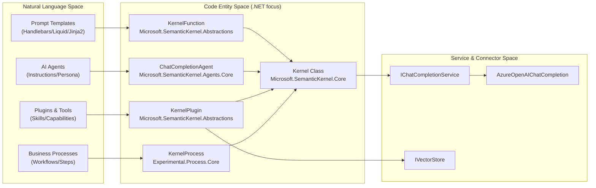

Sources: [dotnet/README.md:33-45](), [python/README.md:67-68](), [dotnet/src/SemanticKernel.Abstractions/Functions/KernelFunction.cs](), [dotnet/src/Agents/Core/ChatCompletionAgent.cs]()

## Key System Capabilities

### Function and Plugin System
The function system allows developers to extend AI capabilities with custom code. Functions can be created from prompts or native code [python/README.md:120-132]().

| Function Type | .NET Implementation | Python Implementation | Usage |
|---------------|-------------------|---------------------|-------|
| Prompt Functions | `kernel.CreateFunctionFromPrompt()` [dotnet/README.md:51-51]() | `kernel.invoke_prompt()` [python/README.md:79-79]() | AI-powered text processing |
| Native Functions | `[KernelFunction]` attribute | `@kernel_function` decorator [python/README.md:136-136]() | Custom business logic |
| Structured Output | `OpenAIPromptExecutionSettings` | `Pydantic` models [python/README.md:151-154]() | Type-safe AI responses |

### Agent Framework Architecture
The Agent Framework supports complex multi-agent orchestration, including group chats and automated handoffs [python/README.md:183-192]().

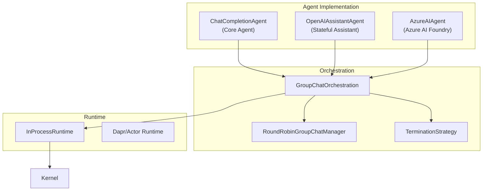

Sources: [python/README.md:188-192](), [dotnet/samples/Concepts/README.md:21-30](), [docs/decisions/0071-multi-agent-orchestration.md]()

### AI Service Integration
The framework provides a unified interface for multiple AI providers via connectors [README.md:28-34]().

| Provider | .NET Connector | Python Connector | Key Features |
|----------|---------------|------------------|--------------|
| OpenAI | `Connectors.OpenAI` | `open_ai` | GPT-4o, Structured Outputs |
| Azure OpenAI | `AddAzureOpenAIChatCompletion` [dotnet/README.md:35-38]() | `AzureChatCompletion` [python/README.md:47-52]() | Enterprise security, OOD |
| Google | `Connectors.Google` | `google_ai` | Gemini 1.5, Thinking Budget |
| Local/ONNX | `Connectors.Onnx` | `onnx` | Local execution, Ollama [README.md:34-34]() |

## Development and Usage Patterns

### Basic Kernel Setup Pattern
The typical initialization pattern follows a builder approach in .NET or direct instantiation in Python:

1.  **Initialize**: `Kernel.CreateBuilder()` (.NET) [dotnet/README.md:33-33]() or `Kernel()` (Python) [python/README.md:67-67]().
2.  **Add Services**: Register AI services like `AddAzureOpenAIChatCompletion` [dotnet/README.md:35-38]().
3.  **Register Plugins**: Add native or prompt-based plugins [python/README.md:167-167]().
4.  **Invoke**: Use `kernel.InvokeAsync()` or `agent.InvokeAsync()` to execute logic [dotnet/README.md:63-65]().

### Memory and Vector Stores
Semantic Kernel provides a standard way to interact with vector databases for RAG (Retrieval-Augmented Generation) [README.md:32-32]().
- **Connectors**: Azure AI Search, Redis, Qdrant, Milvus, MongoDB, etc. [dotnet/Directory.Packages.props:8-15](), [dotnet/src/IntegrationTests/IntegrationTests.csproj:57-58]().
- **Abstractions**: `IVectorStore` and `IMemoryStore` provide model-agnostic access to vector data [dotnet/src/Plugins/Plugins.Memory/TextMemoryPlugin.cs]().

Sources: [README.md:15-37](), [dotnet/README.md:29-70](), [python/README.md:57-86](), [dotnet/samples/Concepts/README.md:1-102]()

---

# Page: Architecture

# Architecture

<details>
<summary>Relevant source files</summary>

The following files were used as context for generating this wiki page:

- [.github/_typos.toml](.github/_typos.toml)
- [FEATURE_MATRIX.md](FEATURE_MATRIX.md)
- [README.md](README.md)
- [docs/decisions/0033-kernel-filters.md](docs/decisions/0033-kernel-filters.md)
- [docs/decisions/0034-rag-in-sk.md](docs/decisions/0034-rag-in-sk.md)
- [docs/decisions/0071-multi-agent-orchestration.md](docs/decisions/0071-multi-agent-orchestration.md)
- [docs/images/sk_logo.png](docs/images/sk_logo.png)
- [dotnet/Directory.Packages.props](dotnet/Directory.Packages.props)
- [dotnet/README.md](dotnet/README.md)
- [dotnet/docs/EXPERIMENTS.md](dotnet/docs/EXPERIMENTS.md)
- [dotnet/notebooks/05-using-function-calling.ipynb](dotnet/notebooks/05-using-function-calling.ipynb)
- [dotnet/notebooks/README.md](dotnet/notebooks/README.md)
- [dotnet/samples/Concepts/Concepts.csproj](dotnet/samples/Concepts/Concepts.csproj)
- [dotnet/samples/Concepts/FunctionCalling/FunctionCalling_SharedState.cs](dotnet/samples/Concepts/FunctionCalling/FunctionCalling_SharedState.cs)
- [dotnet/samples/Concepts/README.md](dotnet/samples/Concepts/README.md)
- [dotnet/samples/Concepts/Resources/travel-destination-overview.txt](dotnet/samples/Concepts/Resources/travel-destination-overview.txt)
- [dotnet/samples/GettingStartedWithAgents/GettingStartedWithAgents.csproj](dotnet/samples/GettingStartedWithAgents/GettingStartedWithAgents.csproj)
- [dotnet/samples/GettingStartedWithAgents/README.md](dotnet/samples/GettingStartedWithAgents/README.md)
- [dotnet/src/Agents/UnitTests/Agents.UnitTests.csproj](dotnet/src/Agents/UnitTests/Agents.UnitTests.csproj)
- [dotnet/src/IntegrationTests/IntegrationTests.csproj](dotnet/src/IntegrationTests/IntegrationTests.csproj)
- [dotnet/src/InternalUtilities/samples/InternalUtilities/TestConfiguration.cs](dotnet/src/InternalUtilities/samples/InternalUtilities/TestConfiguration.cs)
- [dotnet/src/Plugins/Plugins.AI.UnitTests/Plugins.AI.UnitTests.csproj](dotnet/src/Plugins/Plugins.AI.UnitTests/Plugins.AI.UnitTests.csproj)
- [dotnet/src/Plugins/Plugins.AI/Plugins.AI.csproj](dotnet/src/Plugins/Plugins.AI/Plugins.AI.csproj)
- [dotnet/src/Plugins/Plugins.Memory/TextMemoryPlugin.cs](dotnet/src/Plugins/Plugins.Memory/TextMemoryPlugin.cs)
- [dotnet/src/SemanticKernel.UnitTests/SemanticKernel.UnitTests.csproj](dotnet/src/SemanticKernel.UnitTests/SemanticKernel.UnitTests.csproj)
- [python/.coveragerc](python/.coveragerc)
- [python/.vscode/tasks.json](python/.vscode/tasks.json)
- [python/DEV_SETUP.md](python/DEV_SETUP.md)
- [python/README.md](python/README.md)
- [python/mypy.ini](python/mypy.ini)
- [python/pyproject.toml](python/pyproject.toml)
- [python/samples/concepts/README.md](python/samples/concepts/README.md)
- [python/samples/concepts/agents/azure_ai_agent/azure_ai_agent_azure_ai_search.py](python/samples/concepts/agents/azure_ai_agent/azure_ai_agent_azure_ai_search.py)
- [python/samples/concepts/agents/azure_ai_agent/azure_ai_agent_file_manipulation.py](python/samples/concepts/agents/azure_ai_agent/azure_ai_agent_file_manipulation.py)
- [python/samples/concepts/agents/azure_ai_agent/azure_ai_agent_streaming.py](python/samples/concepts/agents/azure_ai_agent/azure_ai_agent_streaming.py)
- [python/samples/getting_started_with_agents/azure_ai_agent/README.md](python/samples/getting_started_with_agents/azure_ai_agent/README.md)
- [python/samples/getting_started_with_agents/openai_assistant/README.md](python/samples/getting_started_with_agents/openai_assistant/README.md)
- [python/semantic_kernel/agents/azure_ai/agent_content_generation.py](python/semantic_kernel/agents/azure_ai/agent_content_generation.py)
- [python/semantic_kernel/agents/azure_ai/agent_thread_actions.py](python/semantic_kernel/agents/azure_ai/agent_thread_actions.py)
- [python/semantic_kernel/agents/azure_ai/azure_ai_agent.py](python/semantic_kernel/agents/azure_ai/azure_ai_agent.py)
- [python/semantic_kernel/agents/open_ai/assistant_thread_actions.py](python/semantic_kernel/agents/open_ai/assistant_thread_actions.py)
- [python/semantic_kernel/agents/open_ai/openai_assistant_agent.py](python/semantic_kernel/agents/open_ai/openai_assistant_agent.py)
- [python/semantic_kernel/agents/open_ai/openai_responses_agent.py](python/semantic_kernel/agents/open_ai/openai_responses_agent.py)
- [python/semantic_kernel/connectors/ai/function_choice_behavior.py](python/semantic_kernel/connectors/ai/function_choice_behavior.py)
- [python/tests/samples/test_concepts.py](python/tests/samples/test_concepts.py)
- [python/tests/unit/agents/azure_ai_agent/test_agent_content_generation.py](python/tests/unit/agents/azure_ai_agent/test_agent_content_generation.py)
- [python/tests/unit/agents/azure_ai_agent/test_agent_thread_actions.py](python/tests/unit/agents/azure_ai_agent/test_agent_thread_actions.py)
- [python/tests/unit/agents/azure_ai_agent/test_azure_ai_agent.py](python/tests/unit/agents/azure_ai_agent/test_azure_ai_agent.py)
- [python/tests/unit/agents/openai_assistant/test_assistant_thread_actions.py](python/tests/unit/agents/openai_assistant/test_assistant_thread_actions.py)
- [python/tests/unit/agents/openai_assistant/test_openai_assistant_agent.py](python/tests/unit/agents/openai_assistant/test_openai_assistant_agent.py)
- [python/tests/unit/contents/test_function_call_content.py](python/tests/unit/contents/test_function_call_content.py)
- [python/tests/unit/data/conftest.py](python/tests/unit/data/conftest.py)
- [python/tests/unit/data/test_vector_search_base.py](python/tests/unit/data/test_vector_search_base.py)
- [python/tests/unit/data/test_vector_store_record_collection.py](python/tests/unit/data/test_vector_store_record_collection.py)
- [python/uv.lock](python/uv.lock)

</details>


## Purpose and Scope

The Semantic Kernel repository implements a multi-language AI orchestration framework—recently evolving into the **Microsoft Agent Framework**—that provides consistent abstractions for integrating with AI services across .NET, Python, and Java platforms [README.md:1-6](). This document describes the high-level architectural patterns, core components, and cross-language design decisions that enable unified AI application development.

For implementation-specific details, see [.NET Implementation](#2.1) and [Python Implementation](#2.2). For dependency management strategies, see [Package Management and Dependencies](#2.3).

## Overall Repository Architecture

The Semantic Kernel repository is organized as a multi-language framework with shared architectural patterns and independent language-specific implementations.

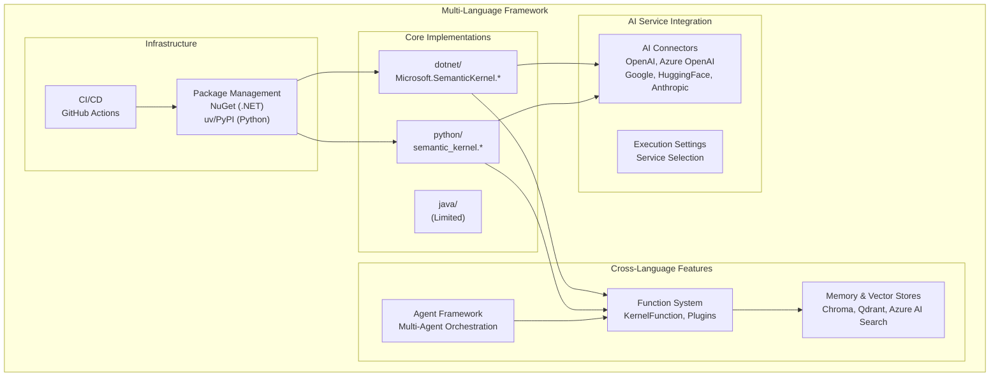

**Sources:** [dotnet/Directory.Packages.props:1-100](), [python/pyproject.toml:1-60](), [README.md:26-37]()

## Framework Component Architecture

The architecture implements consistent patterns across languages while maintaining language-specific idioms. The `Kernel` acts as the central hub for service registration and function orchestration.

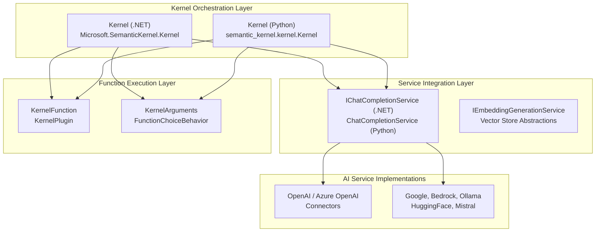

**Sources:** [dotnet/README.md:33-45](), [python/README.md:61-85](), [python/semantic_kernel/connectors/ai/function_choice_behavior.py:1-20]()

## Package and Dependency Architecture

The framework maintains separate package ecosystems for each language. .NET utilizes **Central Package Management (CPM)** to ensure version consistency across its many sub-projects [dotnet/Directory.Packages.props:1-5](). Python uses `uv` for lightning-fast dependency resolution and deterministic builds via `uv.lock` [python/pyproject.toml:175-181](), [python/uv.lock:1-30]().

| Component | .NET Package Structure | Python Package Structure |
|-----------|----------------------|--------------------------|
| **Core Kernel** | `Microsoft.SemanticKernel.Core`<br/>`Microsoft.SemanticKernel.Abstractions` | `semantic-kernel` (main package) |
| **AI Connectors** | `Microsoft.SemanticKernel.Connectors.*` | Optional extras: `[openai]`, `[google]`, `[aws]` |
| **Agent Framework** | `Microsoft.SemanticKernel.Agents.*` | Included in `semantic_kernel.agents` |
| **Vector Stores** | Separate NuGet packages per provider | Optional extras: `[chroma]`, `[milvus]`, `[redis]` |

**Sources:** [dotnet/Directory.Packages.props:85-88](), [python/pyproject.toml:63-157](), [README.md:52-63]()

## Cross-Language Agent Architecture

The Agent Framework is a significant architectural pillar, providing a unified way to build single-agent and multi-agent systems. It bridges high-level agent definitions with low-level kernel functions and AI services.

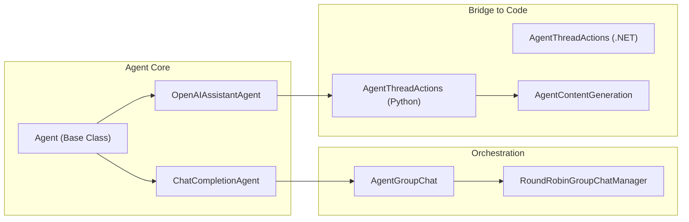

**Sources:** [python/semantic_kernel/agents/azure_ai/agent_thread_actions.py:98-131](), [python/semantic_kernel/agents/azure_ai/azure_ai_agent.py:1-50](), [README.md:71-132]()

## Build and CI/CD Architecture

The repository implements language-specific build pipelines. .NET projects target modern runtimes like `.NET 10.0` [dotnet/src/IntegrationTests/IntegrationTests.csproj:5](), while Python maintains compatibility with `3.10+` [python/pyproject.toml:8]().

- **.NET Pipeline**: Uses `dotnet test` with filtered runs for specific concepts [dotnet/samples/Concepts/README.md:7-18]().
- **Python Pipeline**: Uses `pytest` with markers for specialized services like `ollama` or `onnx` [python/pyproject.toml:183-195]().
- **Shared Infrastructure**: Centralized `Directory.Packages.props` for .NET [dotnet/Directory.Packages.props:1-20]() and `uv.lock` for Python [python/uv.lock:1-10]() ensure reproducible environments across CI/CD agents.

**Sources:** [dotnet/Directory.Packages.props:1-20](), [python/pyproject.toml:175-195](), [python/uv.lock:1-23]()

---

# Page: .NET Implementation

# .NET Implementation

<details>
<summary>Relevant source files</summary>

The following files were used as context for generating this wiki page:

- [docs/decisions/0004-error-handling.md](docs/decisions/0004-error-handling.md)
- [docs/decisions/0006-open-api-dynamic-payload-and-namespaces.md](docs/decisions/0006-open-api-dynamic-payload-and-namespaces.md)
- [docs/decisions/0007-prompt-extract-template-engine.md](docs/decisions/0007-prompt-extract-template-engine.md)
- [docs/decisions/0008-support-generic-llm-request-settings.md](docs/decisions/0008-support-generic-llm-request-settings.md)
- [docs/decisions/0009-support-multiple-named-args-in-template-function-calls.md](docs/decisions/0009-support-multiple-named-args-in-template-function-calls.md)
- [docs/decisions/0010-dotnet-project-structure.md](docs/decisions/0010-dotnet-project-structure.md)
- [docs/decisions/0011-function-and-kernel-result-types.md](docs/decisions/0011-function-and-kernel-result-types.md)
- [docs/decisions/0012-kernel-service-registration.md](docs/decisions/0012-kernel-service-registration.md)
- [docs/decisions/0013-memory-as-plugin.md](docs/decisions/0013-memory-as-plugin.md)
- [docs/decisions/0014-chat-completion-roles-in-prompt.md](docs/decisions/0014-chat-completion-roles-in-prompt.md)
- [docs/decisions/0015-completion-service-selection.md](docs/decisions/0015-completion-service-selection.md)
- [docs/decisions/0016-custom-prompt-template-formats.md](docs/decisions/0016-custom-prompt-template-formats.md)
- [docs/decisions/0017-openai-function-calling.md](docs/decisions/0017-openai-function-calling.md)
- [docs/decisions/0038-completion-service-selection.md](docs/decisions/0038-completion-service-selection.md)
- [dotnet/samples/Concepts/ChatCompletion/HybridCompletion_Fallback.cs](dotnet/samples/Concepts/ChatCompletion/HybridCompletion_Fallback.cs)
- [dotnet/samples/Concepts/ChatCompletion/OpenAI_StructuredOutputs.cs](dotnet/samples/Concepts/ChatCompletion/OpenAI_StructuredOutputs.cs)
- [dotnet/samples/Concepts/Resources/Plugins/MoviePlugins/MoviePluginPrompt/TopMovies/config.json](dotnet/samples/Concepts/Resources/Plugins/MoviePlugins/MoviePluginPrompt/TopMovies/config.json)
- [dotnet/samples/Concepts/Resources/Plugins/MoviePlugins/MoviePluginPrompt/TopMovies/skprompt.txt](dotnet/samples/Concepts/Resources/Plugins/MoviePlugins/MoviePluginPrompt/TopMovies/skprompt.txt)
- [dotnet/samples/Concepts/Resources/Plugins/MoviePlugins/MoviePluginYaml/TopMovies.yaml](dotnet/samples/Concepts/Resources/Plugins/MoviePlugins/MoviePluginYaml/TopMovies.yaml)
- [dotnet/samples/Demos/OpenAIRealtime/OpenAIRealtime.csproj](dotnet/samples/Demos/OpenAIRealtime/OpenAIRealtime.csproj)
- [dotnet/samples/Demos/OpenAIRealtime/Program.cs](dotnet/samples/Demos/OpenAIRealtime/Program.cs)
- [dotnet/samples/GettingStartedWithProcesses/GettingStartedWithProcesses.csproj](dotnet/samples/GettingStartedWithProcesses/GettingStartedWithProcesses.csproj)
- [dotnet/samples/GettingStartedWithProcesses/Step04/SchemaGenerator.cs](dotnet/samples/GettingStartedWithProcesses/Step04/SchemaGenerator.cs)
- [dotnet/samples/GettingStartedWithProcesses/Step04/Steps/ManagerAgentStep.cs](dotnet/samples/GettingStartedWithProcesses/Step04/Steps/ManagerAgentStep.cs)
- [dotnet/samples/GettingStartedWithProcesses/Utilities/MermaidRenderer.cs](dotnet/samples/GettingStartedWithProcesses/Utilities/MermaidRenderer.cs)
- [dotnet/samples/LearnResources/LearnResources.csproj](dotnet/samples/LearnResources/LearnResources.csproj)
- [dotnet/src/Connectors/Connectors.AzureOpenAI.UnitTests/Connectors.AzureOpenAI.UnitTests.csproj](dotnet/src/Connectors/Connectors.AzureOpenAI.UnitTests/Connectors.AzureOpenAI.UnitTests.csproj)
- [dotnet/src/Connectors/Connectors.AzureOpenAI/Connectors.AzureOpenAI.csproj](dotnet/src/Connectors/Connectors.AzureOpenAI/Connectors.AzureOpenAI.csproj)
- [dotnet/src/Connectors/Connectors.Google.UnitTests/Extensions/KernelFunctionMetadataExtensionsTests.cs](dotnet/src/Connectors/Connectors.Google.UnitTests/Extensions/KernelFunctionMetadataExtensionsTests.cs)
- [dotnet/src/Connectors/Connectors.OpenAI.UnitTests/Connectors.OpenAI.UnitTests.csproj](dotnet/src/Connectors/Connectors.OpenAI.UnitTests/Connectors.OpenAI.UnitTests.csproj)
- [dotnet/src/Connectors/Connectors.OpenAI.UnitTests/Core/AutoFunctionInvocationFilterTests.cs](dotnet/src/Connectors/Connectors.OpenAI.UnitTests/Core/AutoFunctionInvocationFilterTests.cs)
- [dotnet/src/Connectors/Connectors.OpenAI.UnitTests/Core/OpenAIJsonSchemaTransformerTests.cs](dotnet/src/Connectors/Connectors.OpenAI.UnitTests/Core/OpenAIJsonSchemaTransformerTests.cs)
- [dotnet/src/Connectors/Connectors.OpenAI.UnitTests/Extensions/KernelFunctionMetadataExtensionsTests.cs](dotnet/src/Connectors/Connectors.OpenAI.UnitTests/Extensions/KernelFunctionMetadataExtensionsTests.cs)
- [dotnet/src/Connectors/Connectors.OpenAI.UnitTests/Helpers/OpenAIChatResponseFormatBuilderTests.cs](dotnet/src/Connectors/Connectors.OpenAI.UnitTests/Helpers/OpenAIChatResponseFormatBuilderTests.cs)
- [dotnet/src/Connectors/Connectors.OpenAI/Connectors.OpenAI.csproj](dotnet/src/Connectors/Connectors.OpenAI/Connectors.OpenAI.csproj)
- [dotnet/src/Connectors/Connectors.OpenAI/Helpers/OpenAIChatResponseFormatBuilder.cs](dotnet/src/Connectors/Connectors.OpenAI/Helpers/OpenAIChatResponseFormatBuilder.cs)
- [dotnet/src/Experimental/Process.Core/Tools/ProcessVisualizationExtensions.cs](dotnet/src/Experimental/Process.Core/Tools/ProcessVisualizationExtensions.cs)
- [dotnet/src/InternalUtilities/planning/PlannerInstrumentation.cs](dotnet/src/InternalUtilities/planning/PlannerInstrumentation.cs)
- [dotnet/src/InternalUtilities/src/Schema/KernelJsonSchemaBuilder.cs](dotnet/src/InternalUtilities/src/Schema/KernelJsonSchemaBuilder.cs)
- [dotnet/src/SemanticKernel.Abstractions/AI/ChatClient/ChatClientExtensions.cs](dotnet/src/SemanticKernel.Abstractions/AI/ChatClient/ChatClientExtensions.cs)
- [dotnet/src/SemanticKernel.Abstractions/AI/ChatClient/KernelFunctionInvokingChatClientBuilderExtensions.cs](dotnet/src/SemanticKernel.Abstractions/AI/ChatClient/KernelFunctionInvokingChatClientBuilderExtensions.cs)
- [dotnet/src/SemanticKernel.Abstractions/AI/ChatCompletion/AIFunctionExtensions.cs](dotnet/src/SemanticKernel.Abstractions/AI/ChatCompletion/AIFunctionExtensions.cs)
- [dotnet/src/SemanticKernel.Abstractions/AI/ChatCompletion/AIFunctionKernelFunction.cs](dotnet/src/SemanticKernel.Abstractions/AI/ChatCompletion/AIFunctionKernelFunction.cs)
- [dotnet/src/SemanticKernel.Abstractions/AI/ChatCompletion/ChatClientChatCompletionService.cs](dotnet/src/SemanticKernel.Abstractions/AI/ChatCompletion/ChatClientChatCompletionService.cs)
- [dotnet/src/SemanticKernel.Abstractions/AI/ChatCompletion/ChatCompletionServiceChatClient.cs](dotnet/src/SemanticKernel.Abstractions/AI/ChatCompletion/ChatCompletionServiceChatClient.cs)
- [dotnet/src/SemanticKernel.Abstractions/AI/ChatCompletion/ChatCompletionServiceExtensions.cs](dotnet/src/SemanticKernel.Abstractions/AI/ChatCompletion/ChatCompletionServiceExtensions.cs)
- [dotnet/src/SemanticKernel.Abstractions/AI/Embeddings/EmbeddingGenerationServiceExtensions.cs](dotnet/src/SemanticKernel.Abstractions/AI/Embeddings/EmbeddingGenerationServiceExtensions.cs)
- [dotnet/src/SemanticKernel.Abstractions/AI/PromptNode.cs](dotnet/src/SemanticKernel.Abstractions/AI/PromptNode.cs)
- [dotnet/src/SemanticKernel.Abstractions/AbstractionsJsonContext.cs](dotnet/src/SemanticKernel.Abstractions/AbstractionsJsonContext.cs)
- [dotnet/src/SemanticKernel.Abstractions/Events/CancelKernelEventArgs.cs](dotnet/src/SemanticKernel.Abstractions/Events/CancelKernelEventArgs.cs)
- [dotnet/src/SemanticKernel.Abstractions/Events/FunctionInvokedEventArgs.cs](dotnet/src/SemanticKernel.Abstractions/Events/FunctionInvokedEventArgs.cs)
- [dotnet/src/SemanticKernel.Abstractions/Events/FunctionInvokingEventArgs.cs](dotnet/src/SemanticKernel.Abstractions/Events/FunctionInvokingEventArgs.cs)
- [dotnet/src/SemanticKernel.Abstractions/Events/KernelEventArgs.cs](dotnet/src/SemanticKernel.Abstractions/Events/KernelEventArgs.cs)
- [dotnet/src/SemanticKernel.Abstractions/Events/PromptRenderedEventArgs.cs](dotnet/src/SemanticKernel.Abstractions/Events/PromptRenderedEventArgs.cs)
- [dotnet/src/SemanticKernel.Abstractions/Events/PromptRenderingEventArgs.cs](dotnet/src/SemanticKernel.Abstractions/Events/PromptRenderingEventArgs.cs)
- [dotnet/src/SemanticKernel.Abstractions/Filters/AutoFunctionInvocation/AutoFunctionInvocationContext.cs](dotnet/src/SemanticKernel.Abstractions/Filters/AutoFunctionInvocation/AutoFunctionInvocationContext.cs)
- [dotnet/src/SemanticKernel.Abstractions/Filters/AutoFunctionInvocation/IAutoFunctionInvocationFilter.cs](dotnet/src/SemanticKernel.Abstractions/Filters/AutoFunctionInvocation/IAutoFunctionInvocationFilter.cs)
- [dotnet/src/SemanticKernel.Abstractions/Filters/Function/FunctionInvocationContext.cs](dotnet/src/SemanticKernel.Abstractions/Filters/Function/FunctionInvocationContext.cs)
- [dotnet/src/SemanticKernel.Abstractions/Filters/Prompt/PromptRenderContext.cs](dotnet/src/SemanticKernel.Abstractions/Filters/Prompt/PromptRenderContext.cs)
- [dotnet/src/SemanticKernel.Abstractions/Functions/FunctionResult.cs](dotnet/src/SemanticKernel.Abstractions/Functions/FunctionResult.cs)
- [dotnet/src/SemanticKernel.Abstractions/Functions/KernelFunction.cs](dotnet/src/SemanticKernel.Abstractions/Functions/KernelFunction.cs)
- [dotnet/src/SemanticKernel.Abstractions/Functions/KernelFunctionExtensions.cs](dotnet/src/SemanticKernel.Abstractions/Functions/KernelFunctionExtensions.cs)
- [dotnet/src/SemanticKernel.Abstractions/Functions/KernelFunctionLogMessages.cs](dotnet/src/SemanticKernel.Abstractions/Functions/KernelFunctionLogMessages.cs)
- [dotnet/src/SemanticKernel.Abstractions/Functions/KernelPlugin.cs](dotnet/src/SemanticKernel.Abstractions/Functions/KernelPlugin.cs)
- [dotnet/src/SemanticKernel.Abstractions/Functions/KernelPluginExtensions.cs](dotnet/src/SemanticKernel.Abstractions/Functions/KernelPluginExtensions.cs)
- [dotnet/src/SemanticKernel.Abstractions/Kernel.cs](dotnet/src/SemanticKernel.Abstractions/Kernel.cs)
- [dotnet/src/SemanticKernel.Abstractions/SemanticKernel.Abstractions.csproj](dotnet/src/SemanticKernel.Abstractions/SemanticKernel.Abstractions.csproj)
- [dotnet/src/SemanticKernel.Core/Contents/StreamingMethodContent.cs](dotnet/src/SemanticKernel.Core/Contents/StreamingMethodContent.cs)
- [dotnet/src/SemanticKernel.Core/Functions/KernelFunctionFromMethod.cs](dotnet/src/SemanticKernel.Core/Functions/KernelFunctionFromMethod.cs)
- [dotnet/src/SemanticKernel.Core/Functions/KernelFunctionFromPrompt.cs](dotnet/src/SemanticKernel.Core/Functions/KernelFunctionFromPrompt.cs)
- [dotnet/src/SemanticKernel.Core/KernelExtensions.cs](dotnet/src/SemanticKernel.Core/KernelExtensions.cs)
- [dotnet/src/SemanticKernel.Core/SemanticKernel.Core.csproj](dotnet/src/SemanticKernel.Core/SemanticKernel.Core.csproj)
- [dotnet/src/SemanticKernel.UnitTests/AI/ChatCompletion/AIFunctionKernelFunctionTests.cs](dotnet/src/SemanticKernel.UnitTests/AI/ChatCompletion/AIFunctionKernelFunctionTests.cs)
- [dotnet/src/SemanticKernel.UnitTests/AI/ServiceConversionExtensionsTests.cs](dotnet/src/SemanticKernel.UnitTests/AI/ServiceConversionExtensionsTests.cs)
- [dotnet/src/SemanticKernel.UnitTests/Filters/FunctionInvocationFilterTests.cs](dotnet/src/SemanticKernel.UnitTests/Filters/FunctionInvocationFilterTests.cs)
- [dotnet/src/SemanticKernel.UnitTests/Filters/PromptRenderFilterTests.cs](dotnet/src/SemanticKernel.UnitTests/Filters/PromptRenderFilterTests.cs)
- [dotnet/src/SemanticKernel.UnitTests/Functions/AIFunctionExtensionsTests.cs](dotnet/src/SemanticKernel.UnitTests/Functions/AIFunctionExtensionsTests.cs)
- [dotnet/src/SemanticKernel.UnitTests/Functions/FunctionFromMethodTests.cs](dotnet/src/SemanticKernel.UnitTests/Functions/FunctionFromMethodTests.cs)
- [dotnet/src/SemanticKernel.UnitTests/Functions/FunctionResultTests.cs](dotnet/src/SemanticKernel.UnitTests/Functions/FunctionResultTests.cs)
- [dotnet/src/SemanticKernel.UnitTests/Functions/KernelBuilderTests.cs](dotnet/src/SemanticKernel.UnitTests/Functions/KernelBuilderTests.cs)
- [dotnet/src/SemanticKernel.UnitTests/Functions/KernelFunctionLogMessagesTests.cs](dotnet/src/SemanticKernel.UnitTests/Functions/KernelFunctionLogMessagesTests.cs)
- [dotnet/src/SemanticKernel.UnitTests/Functions/KernelPluginCollectionTests.cs](dotnet/src/SemanticKernel.UnitTests/Functions/KernelPluginCollectionTests.cs)
- [dotnet/src/SemanticKernel.UnitTests/Functions/KernelPluginTests.cs](dotnet/src/SemanticKernel.UnitTests/Functions/KernelPluginTests.cs)
- [dotnet/src/SemanticKernel.UnitTests/KernelTests.cs](dotnet/src/SemanticKernel.UnitTests/KernelTests.cs)

</details>


This page provides a detailed overview of the .NET Semantic Kernel implementation, covering its core architecture, key classes, and execution model. It details the `SemanticKernel.Abstractions` and `SemanticKernel.Core` projects, the `IKernelBuilder` pattern, dependency injection integration, and `Microsoft.Extensions.AI` interoperability.

## Core Architecture

The .NET implementation of Semantic Kernel is built around a modular architecture with clear separation of concerns. At its center is the `Kernel` class, which orchestrates the interaction between plugins, functions, and AI services.

### Key Components and Relationships

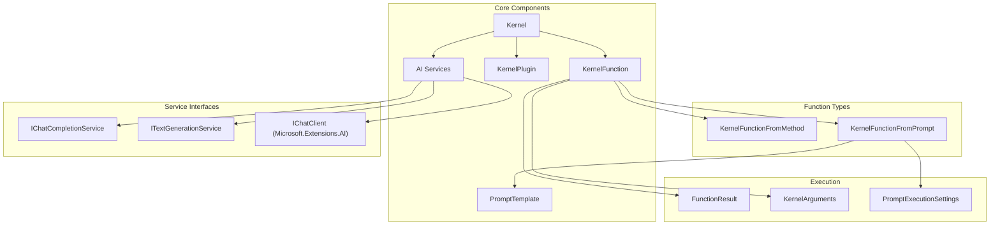

Sources: [dotnet/src/SemanticKernel.Abstractions/Kernel.cs:26-27](), [dotnet/src/SemanticKernel.Abstractions/Functions/KernelFunction.cs:30-31](), [dotnet/src/SemanticKernel.Core/Functions/KernelFunctionFromPrompt.cs:27-28](), [dotnet/src/SemanticKernel.Core/Functions/KernelFunctionFromMethod.cs:30-31]()

### Core Classes and Execution Model

The .NET implementation centers around several key classes that work together to provide the Semantic Kernel functionality:

#### Kernel Class

The `Kernel` class serves as the central orchestrator for the entire system. It provides access to registered plugins, functions, and a service provider for dependency injection.

```csharp
public sealed class Kernel
{
    public KernelPluginCollection Plugins { get; }
    public IServiceProvider Services { get; }
    public CultureInfo Culture { get; set; }
    public ILoggerFactory LoggerFactory { get; }
    public IDictionary<string, object?> Data { get; }
    
    // Function invocation methods
    public Task<FunctionResult> InvokeAsync(KernelFunction function, KernelArguments? arguments = null, CancellationToken cancellationToken = default);
    public Task<T?> InvokeAsync<T>(KernelFunction function, KernelArguments? arguments = null, CancellationToken cancellationToken = default);
}
```

Sources: [dotnet/src/SemanticKernel.Abstractions/Kernel.cs:26-167](), [dotnet/src/SemanticKernel.Abstractions/Kernel.cs:124-128]()

#### KernelFunction Class

The `KernelFunction` abstract class represents a function that can be invoked. It inherits from `FullyQualifiedAIFunction`, providing interoperability with `Microsoft.Extensions.AI`.

```csharp
public abstract class KernelFunction : FullyQualifiedAIFunction
{
    public new virtual string Name => this.Metadata.Name;
    public virtual string? PluginName => this.Metadata.PluginName;
    public override string Description => this.Metadata.Description;
    public IReadOnlyDictionary<string, PromptExecutionSettings>? ExecutionSettings { get; }
    
    // Invocation methods
    public Task<FunctionResult> InvokeAsync(Kernel kernel, KernelArguments? arguments = null, CancellationToken cancellationToken = default);
}
```

Sources: [dotnet/src/SemanticKernel.Abstractions/Functions/KernelFunction.cs:30-108]()

#### Function Execution Flow

The following diagram maps the Natural Language Space (Prompts) to the Code Entity Space (Classes and Methods) within the .NET implementation.

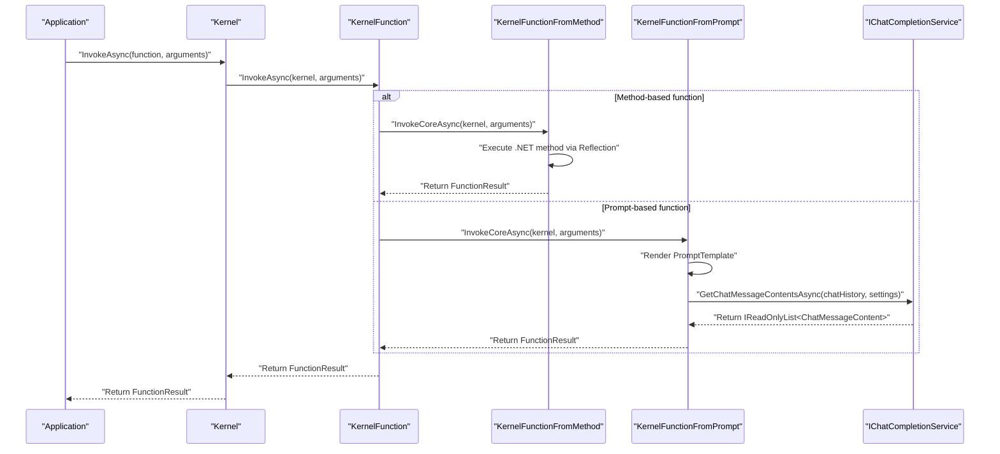

Sources: [dotnet/src/SemanticKernel.Abstractions/Kernel.cs:26-119](), [dotnet/src/SemanticKernel.Abstractions/Functions/KernelFunction.cs:30-108](), [dotnet/src/SemanticKernel.Core/Functions/KernelFunctionFromPrompt.cs:27-28](), [dotnet/src/SemanticKernel.Core/Functions/KernelFunctionFromMethod.cs:30-31]()

## Function Types and Implementation

The .NET implementation provides two primary types of functions: method-based functions and prompt-based functions.

### Method-Based Functions

`KernelFunctionFromMethod` wraps .NET methods as kernel functions. It uses reflection to map `KernelArguments` to method parameters.

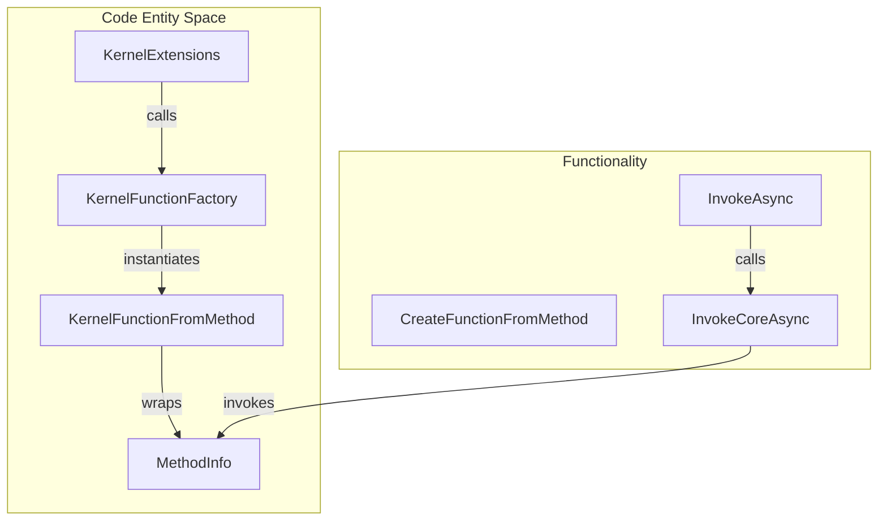

Sources: [dotnet/src/SemanticKernel.Core/Functions/KernelFunctionFromMethod.cs:30-69](), [dotnet/src/SemanticKernel.Core/KernelExtensions.cs:35-47](), [dotnet/src/SemanticKernel.Core/KernelExtensions.cs:89-102]()

### Prompt-Based Functions

`KernelFunctionFromPrompt` creates a function from a prompt template. It handles template rendering and interacts with AI services like `IChatCompletionService`.

Sources: [dotnet/src/SemanticKernel.Core/Functions/KernelFunctionFromPrompt.cs:43-87](), [dotnet/src/SemanticKernel.Core/Functions/KernelFunctionFromPrompt.cs:102-148]()

## Microsoft.Extensions.AI Interoperability

Semantic Kernel .NET implementation provides deep integration with `Microsoft.Extensions.AI` (MEAI) abstractions.

### Service Bridging

The framework allows wrapping `IChatClient` (MEAI) as `IChatCompletionService` (SK) and vice versa.

| SK Type | MEAI Type | Adapter Class |
| :--- | :--- | :--- |
| `IChatCompletionService` | `IChatClient` | `ChatClientChatCompletionService` |
| `KernelFunction` | `AIFunction` | `AIFunctionKernelFunction` |

Sources: [dotnet/src/SemanticKernel.Abstractions/AI/ChatCompletion/ChatClientChatCompletionService.cs:16-22](), [dotnet/src/SemanticKernel.Abstractions/AI/ChatCompletion/AIFunctionKernelFunction.cs:17-30]()

### Content Conversion

The `FunctionResult.GetValue<T>()` method includes logic to automatically convert between SK `ChatMessageContent` and MEAI `ChatMessage` or `ChatResponse`.

Sources: [dotnet/src/SemanticKernel.Abstractions/Functions/FunctionResult.cs:107-122](), [dotnet/src/SemanticKernel.Abstractions/Functions/FunctionResult.cs:144-163]()

## Dependency Injection and Builder Pattern

The `IKernelBuilder` provides a fluent API for constructing `Kernel` instances and registering services.

```csharp
// Example using IKernelBuilder
IKernelBuilder builder = Kernel.CreateBuilder();
builder.Services.AddLogging(c => c.AddConsole());
builder.AddOpenAIChatCompletion("model-id", "api-key");
Kernel kernel = builder.Build();
```

Sources: [dotnet/src/SemanticKernel.Abstractions/Kernel.cs:85-85](), [dotnet/src/SemanticKernel.Abstractions/Kernel.cs:56-81]()

## Telemetry and Instrumentation

Function execution is instrumented with `ActivitySource` and `Meter` for distributed tracing and metrics.

- **Metrics**: `semantic_kernel.function.invocation.duration` (Histogram)
- **Activities**: `Microsoft.SemanticKernel` ActivitySource

Sources: [dotnet/src/SemanticKernel.Abstractions/Functions/KernelFunction.cs:41-44](), [dotnet/src/SemanticKernel.Abstractions/Functions/KernelFunction.cs:59-62](), [dotnet/src/InternalUtilities/planning/PlannerInstrumentation.cs:18-21]()

---

# Page: Python Implementation

# Python Implementation

<details>
<summary>Relevant source files</summary>

The following files were used as context for generating this wiki page:

- [docs/decisions/0037-audio-naming.md](docs/decisions/0037-audio-naming.md)
- [python/.env.example](python/.env.example)
- [python/pyproject.toml](python/pyproject.toml)
- [python/samples/__init__.py](python/samples/__init__.py)
- [python/samples/concepts/README.md](python/samples/concepts/README.md)
- [python/samples/concepts/agents/azure_ai_agent/azure_ai_agent_azure_ai_search.py](python/samples/concepts/agents/azure_ai_agent/azure_ai_agent_azure_ai_search.py)
- [python/samples/concepts/agents/azure_ai_agent/azure_ai_agent_file_manipulation.py](python/samples/concepts/agents/azure_ai_agent/azure_ai_agent_file_manipulation.py)
- [python/samples/concepts/agents/azure_ai_agent/azure_ai_agent_streaming.py](python/samples/concepts/agents/azure_ai_agent/azure_ai_agent_streaming.py)
- [python/samples/concepts/mcp/README.md](python/samples/concepts/mcp/README.md)
- [python/samples/concepts/mcp/agent_with_mcp_plugin.py](python/samples/concepts/mcp/agent_with_mcp_plugin.py)
- [python/samples/concepts/mcp/agent_with_mcp_sampling.py](python/samples/concepts/mcp/agent_with_mcp_sampling.py)
- [python/samples/concepts/mcp/azure_ai_agent_with_mcp_plugin.py](python/samples/concepts/mcp/azure_ai_agent_with_mcp_plugin.py)
- [python/samples/concepts/mcp/mcp_as_plugin.py](python/samples/concepts/mcp/mcp_as_plugin.py)
- [python/samples/concepts/realtime/README.md](python/samples/concepts/realtime/README.md)
- [python/samples/concepts/realtime/realtime_agent_with_function_calling_webrtc.py](python/samples/concepts/realtime/realtime_agent_with_function_calling_webrtc.py)
- [python/samples/concepts/realtime/realtime_agent_with_function_calling_websocket.py](python/samples/concepts/realtime/realtime_agent_with_function_calling_websocket.py)
- [python/samples/concepts/realtime/simple_realtime_chat_webrtc.py](python/samples/concepts/realtime/simple_realtime_chat_webrtc.py)
- [python/samples/concepts/realtime/simple_realtime_chat_websocket.py](python/samples/concepts/realtime/simple_realtime_chat_websocket.py)
- [python/samples/concepts/realtime/utils.py](python/samples/concepts/realtime/utils.py)
- [python/samples/getting_started/.env.example](python/samples/getting_started/.env.example)
- [python/samples/getting_started/third_party/.env.example](python/samples/getting_started/third_party/.env.example)
- [python/samples/getting_started_with_agents/azure_ai_agent/README.md](python/samples/getting_started_with_agents/azure_ai_agent/README.md)
- [python/samples/getting_started_with_agents/openai_assistant/README.md](python/samples/getting_started_with_agents/openai_assistant/README.md)
- [python/samples/learn_resources/.env.example](python/samples/learn_resources/.env.example)
- [python/samples/learn_resources/README.md](python/samples/learn_resources/README.md)
- [python/samples/learn_resources/ai_services.py](python/samples/learn_resources/ai_services.py)
- [python/samples/learn_resources/configuring_prompts.py](python/samples/learn_resources/configuring_prompts.py)
- [python/samples/learn_resources/creating_functions.py](python/samples/learn_resources/creating_functions.py)
- [python/samples/learn_resources/evaluate_with_prompt_flow.py](python/samples/learn_resources/evaluate_with_prompt_flow.py)
- [python/samples/learn_resources/functions_within_prompts.py](python/samples/learn_resources/functions_within_prompts.py)
- [python/samples/learn_resources/plugin.py](python/samples/learn_resources/plugin.py)
- [python/samples/learn_resources/plugins/MathPlugin/Math.py](python/samples/learn_resources/plugins/MathPlugin/Math.py)
- [python/samples/learn_resources/serializing_prompts.py](python/samples/learn_resources/serializing_prompts.py)
- [python/samples/learn_resources/templates.py](python/samples/learn_resources/templates.py)
- [python/samples/learn_resources/using_the_kernel.py](python/samples/learn_resources/using_the_kernel.py)
- [python/samples/learn_resources/your_first_prompt.py](python/samples/learn_resources/your_first_prompt.py)
- [python/semantic_kernel/__init__.py](python/semantic_kernel/__init__.py)
- [python/semantic_kernel/agents/azure_ai/agent_content_generation.py](python/semantic_kernel/agents/azure_ai/agent_content_generation.py)
- [python/semantic_kernel/agents/azure_ai/agent_thread_actions.py](python/semantic_kernel/agents/azure_ai/agent_thread_actions.py)
- [python/semantic_kernel/agents/azure_ai/azure_ai_agent.py](python/semantic_kernel/agents/azure_ai/azure_ai_agent.py)
- [python/semantic_kernel/agents/open_ai/assistant_thread_actions.py](python/semantic_kernel/agents/open_ai/assistant_thread_actions.py)
- [python/semantic_kernel/agents/open_ai/openai_assistant_agent.py](python/semantic_kernel/agents/open_ai/openai_assistant_agent.py)
- [python/semantic_kernel/agents/open_ai/openai_responses_agent.py](python/semantic_kernel/agents/open_ai/openai_responses_agent.py)
- [python/semantic_kernel/connectors/ai/function_calling_utils.py](python/semantic_kernel/connectors/ai/function_calling_utils.py)
- [python/semantic_kernel/connectors/ai/hugging_face/hf_prompt_execution_settings.py](python/semantic_kernel/connectors/ai/hugging_face/hf_prompt_execution_settings.py)
- [python/semantic_kernel/connectors/ai/hugging_face/services/__init__.py](python/semantic_kernel/connectors/ai/hugging_face/services/__init__.py)
- [python/semantic_kernel/connectors/ai/open_ai/prompt_execution_settings/open_ai_realtime_execution_settings.py](python/semantic_kernel/connectors/ai/open_ai/prompt_execution_settings/open_ai_realtime_execution_settings.py)
- [python/semantic_kernel/connectors/ai/open_ai/services/_open_ai_realtime.py](python/semantic_kernel/connectors/ai/open_ai/services/_open_ai_realtime.py)
- [python/semantic_kernel/connectors/ai/open_ai/services/azure_realtime.py](python/semantic_kernel/connectors/ai/open_ai/services/azure_realtime.py)
- [python/semantic_kernel/connectors/ai/open_ai/settings/open_ai_settings.py](python/semantic_kernel/connectors/ai/open_ai/settings/open_ai_settings.py)
- [python/semantic_kernel/connectors/ai/prompt_execution_settings.py](python/semantic_kernel/connectors/ai/prompt_execution_settings.py)
- [python/semantic_kernel/connectors/mcp.py](python/semantic_kernel/connectors/mcp.py)
- [python/semantic_kernel/const.py](python/semantic_kernel/const.py)
- [python/semantic_kernel/exceptions/function_exceptions.py](python/semantic_kernel/exceptions/function_exceptions.py)
- [python/semantic_kernel/exceptions/kernel_exceptions.py](python/semantic_kernel/exceptions/kernel_exceptions.py)
- [python/semantic_kernel/functions/kernel_function.py](python/semantic_kernel/functions/kernel_function.py)
- [python/semantic_kernel/functions/kernel_function_decorator.py](python/semantic_kernel/functions/kernel_function_decorator.py)
- [python/semantic_kernel/functions/kernel_function_extension.py](python/semantic_kernel/functions/kernel_function_extension.py)
- [python/semantic_kernel/functions/kernel_function_from_method.py](python/semantic_kernel/functions/kernel_function_from_method.py)
- [python/semantic_kernel/functions/kernel_function_from_prompt.py](python/semantic_kernel/functions/kernel_function_from_prompt.py)
- [python/semantic_kernel/functions/kernel_parameter_metadata.py](python/semantic_kernel/functions/kernel_parameter_metadata.py)
- [python/semantic_kernel/functions/kernel_plugin.py](python/semantic_kernel/functions/kernel_plugin.py)
- [python/semantic_kernel/kernel.py](python/semantic_kernel/kernel.py)
- [python/semantic_kernel/schema/kernel_json_schema_builder.py](python/semantic_kernel/schema/kernel_json_schema_builder.py)
- [python/semantic_kernel/services/ai_service_selector.py](python/semantic_kernel/services/ai_service_selector.py)
- [python/semantic_kernel/text/text_chunker.py](python/semantic_kernel/text/text_chunker.py)
- [python/tests/samples/test_concepts.py](python/tests/samples/test_concepts.py)
- [python/tests/unit/agents/azure_ai_agent/test_agent_content_generation.py](python/tests/unit/agents/azure_ai_agent/test_agent_content_generation.py)
- [python/tests/unit/agents/azure_ai_agent/test_agent_thread_actions.py](python/tests/unit/agents/azure_ai_agent/test_agent_thread_actions.py)
- [python/tests/unit/agents/azure_ai_agent/test_azure_ai_agent.py](python/tests/unit/agents/azure_ai_agent/test_azure_ai_agent.py)
- [python/tests/unit/agents/openai_assistant/test_assistant_thread_actions.py](python/tests/unit/agents/openai_assistant/test_assistant_thread_actions.py)
- [python/tests/unit/agents/openai_assistant/test_openai_assistant_agent.py](python/tests/unit/agents/openai_assistant/test_openai_assistant_agent.py)
- [python/tests/unit/connectors/ai/open_ai/services/test_openai_realtime.py](python/tests/unit/connectors/ai/open_ai/services/test_openai_realtime.py)
- [python/tests/unit/connectors/mcp/test_mcp.py](python/tests/unit/connectors/mcp/test_mcp.py)
- [python/tests/unit/data/conftest.py](python/tests/unit/data/conftest.py)
- [python/tests/unit/data/test_vector_search_base.py](python/tests/unit/data/test_vector_search_base.py)
- [python/tests/unit/data/test_vector_store_record_collection.py](python/tests/unit/data/test_vector_store_record_collection.py)
- [python/tests/unit/functions/test_kernel_function_decorators.py](python/tests/unit/functions/test_kernel_function_decorators.py)
- [python/tests/unit/functions/test_kernel_function_from_method.py](python/tests/unit/functions/test_kernel_function_from_method.py)
- [python/tests/unit/functions/test_kernel_function_from_prompt.py](python/tests/unit/functions/test_kernel_function_from_prompt.py)
- [python/tests/unit/functions/test_kernel_parameter_metadata.py](python/tests/unit/functions/test_kernel_parameter_metadata.py)
- [python/tests/unit/functions/test_kernel_plugins.py](python/tests/unit/functions/test_kernel_plugins.py)
- [python/tests/unit/kernel/test_kernel.py](python/tests/unit/kernel/test_kernel.py)
- [python/tests/unit/schema/test_schema_builder.py](python/tests/unit/schema/test_schema_builder.py)
- [python/tests/unit/services/test_service_utils.py](python/tests/unit/services/test_service_utils.py)
- [python/tests/unit/text/test_text_chunker.py](python/tests/unit/text/test_text_chunker.py)
- [python/uv.lock](python/uv.lock)

</details>


This document covers the Python implementation of Semantic Kernel, focusing on the core architecture, orchestration patterns, and key components that make up the Python SDK. The Python implementation provides a comprehensive framework for AI orchestration, function execution, plugin management, and agent-based workflows.

For information about the .NET implementation, see [.NET Implementation](#2.1). For cross-language architecture concepts, see [Architecture](#2).

## Core Architecture Overview

The Python implementation is built around several key architectural components that work together to provide AI orchestration capabilities. The central `Kernel` class serves as the orchestration hub, managing plugins, services, and execution contexts.

### Python Kernel Architecture

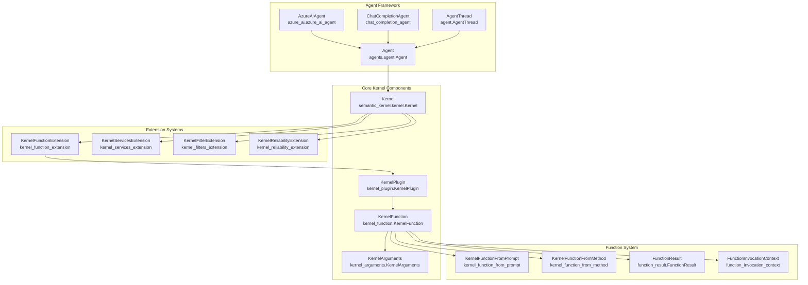

**Sources:** [python/semantic_kernel/kernel.py:62-75](), [python/semantic_kernel/functions/kernel_function.py:75-104](), [python/semantic_kernel/functions/kernel_plugin.py:36-79](), [python/semantic_kernel/agents/azure_ai/azure_ai_agent.py:29-41]()

## Kernel Orchestration

The `Kernel` class is the central orchestration component that manages AI services, plugins, and execution contexts. It inherits from multiple extension classes to provide comprehensive functionality.

### Kernel Class Structure

The `Kernel` class uses a mixin pattern to combine multiple extension capabilities:

```mermaid
graph TB
    subgraph "Kernel Inheritance Hierarchy"
        Kernel["Kernel"]
        KernelFilterExtension["KernelFilterExtension<br/>filters management"]
        KernelFunctionExtension["KernelFunctionExtension<br/>plugin & function management"]
        KernelServicesExtension["KernelServicesExtension<br/>AI service management"]
        KernelReliabilityExtension["KernelReliabilityExtension<br/>retry mechanisms"]
    end

    subgraph "Core Invocation Methods"
        invoke["invoke()<br/>Execute single function"]
        invoke_stream["invoke_stream()<br/>Stream function results"]
        invoke_prompt["invoke_prompt()<br/>Execute from prompt"]
    end

    subgraph "Management Operations"
        add_plugin["add_plugin()<br/>Register plugins"]
        add_service["add_service()<br/>Register AI services"]
        get_function["get_function()<br/>Retrieve functions"]
    end

    Kernel --|> KernelFilterExtension
    Kernel --|> KernelFunctionExtension
    Kernel --|> KernelServicesExtension
    Kernel --|> KernelReliabilityExtension
    
    Kernel --> invoke
    Kernel --> invoke_stream
    Kernel --> invoke_prompt
    
    Kernel --> add_plugin
    Kernel --> add_service
    Kernel --> get_function
```

The kernel provides both synchronous and streaming invocation patterns. Key invocation methods include:

- `invoke()` - Executes a function and returns a `FunctionResult`. [python/semantic_kernel/kernel.py:165-214]()
- `invoke_stream()` - Provides streaming execution with `AsyncGenerator` results. [python/semantic_kernel/kernel.py:104-163]()

**Sources:** [python/semantic_kernel/kernel.py:62-163](), [python/semantic_kernel/functions/kernel_function_extension.py:1-50](), [python/semantic_kernel/services/kernel_services_extension.py:1-50]()

## Dependency Structure and Models

The Python implementation relies heavily on `Pydantic` for data validation and model management, ensuring strict typing and schema enforcement across the SDK.

### Dependency Configuration

The project uses `pyproject.toml` for dependency management, specifying a minimum Python version of `3.10`. [python/pyproject.toml:8-8]()

| Category | Key Dependencies |
| :--- | :--- |
| **Core** | `pydantic`, `aiohttp`, `typing-extensions` |
| **AI Services** | `openai`, `azure-ai-projects`, `azure-ai-agents` |
| **Templating** | `jinja2`, `pybars4` |
| **Optional** | `anthropic`, `google-genai`, `mistralai`, `ollama`, `transformers` |

**Sources:** [python/pyproject.toml:25-60](), [python/pyproject.toml:63-157]()

## Functions and Plugins

The Python implementation provides a flexible function and plugin system that supports both prompt-based and method-based functions.

### Function Creation Patterns

Functions can be created through multiple pathways:

1. **Prompt-based functions** using `KernelFunctionFromPrompt`. [python/semantic_kernel/functions/kernel_function_from_prompt.py:55-138]()
2. **Method-based functions** using the `@kernel_function` decorator. [python/semantic_kernel/functions/kernel_function_decorator.py:1-50]()
3. **Plugin loading** from objects or classes using `KernelPlugin.from_object`. [python/semantic_kernel/functions/kernel_plugin.py:105-135]()

The `KernelPlugin` class acts as a container for functions, supporting registration and lookup by name. [python/semantic_kernel/functions/kernel_plugin.py:36-79]()

**Sources:** [python/semantic_kernel/functions/kernel_function.py:75-202](), [python/semantic_kernel/functions/kernel_plugin.py:36-210]()

## Agent Framework

The Python implementation includes a comprehensive agent framework supporting multiple agent types and orchestration patterns.

### Agent Class Hierarchy

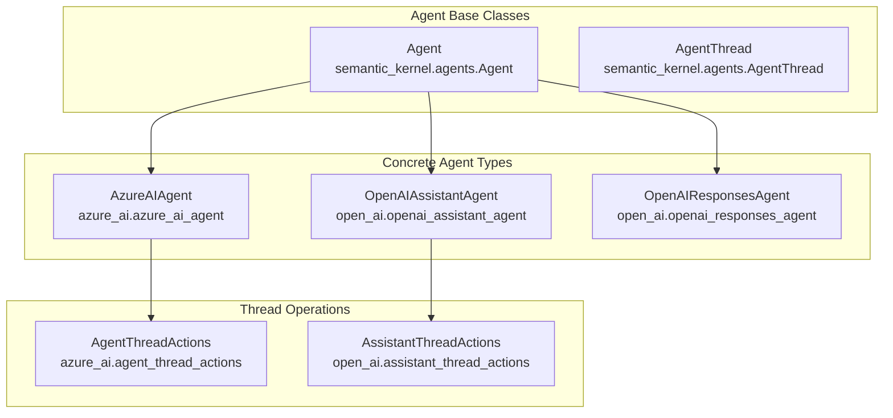

### Agent Execution Patterns

Agents support both streaming and non-streaming execution patterns. The `AgentThreadActions` and `AssistantThreadActions` classes provide core operations for thread management, including function calling and message processing.

- `AzureAIAgent.invoke()` triggers the `AgentThreadActions.invoke` logic. [python/semantic_kernel/agents/azure_ai/agent_thread_actions.py:107-165]()
- `OpenAIAssistantAgent.invoke()` triggers the `AssistantThreadActions.invoke` logic. [python/semantic_kernel/agents/open_ai/assistant_thread_actions.py:137-161]()

**Sources:** [python/semantic_kernel/agents/azure_ai/azure_ai_agent.py:29-58](), [python/semantic_kernel/agents/azure_ai/agent_thread_actions.py:98-165](), [python/semantic_kernel/agents/open_ai/assistant_thread_actions.py:71-161]()

## AI Service Integration

The Python implementation provides extensive AI service integration through a layered connector architecture.

### Service Selection

The `AIServiceSelector` is responsible for choosing the appropriate AI service based on the kernel's registered services and the requested execution settings. [python/semantic_kernel/services/ai_service_selector.py:1-50]()

Primary connectors include:
- **OpenAI/Azure OpenAI**: `OpenAIChatCompletion`, `AzureChatCompletion`. [python/semantic_kernel/connectors/ai/open_ai/services/open_ai_chat_completion.py:1-50]()
- **Realtime API**: `OpenAIRealtime`, `AzureRealtime`. [python/semantic_kernel/connectors/ai/open_ai/services/_open_ai_realtime.py:1-50]()
- **MCP**: Integration via `mcp` library for Model Context Protocol servers. [python/semantic_kernel/connectors/mcp.py:1-50]()

**Sources:** [python/semantic_kernel/kernel.py:77-85](), [python/semantic_kernel/connectors/mcp.py:76-154](), [python/semantic_kernel/connectors/ai/open_ai/services/azure_realtime.py:1-50]()

## Filtering and Extensibility

The Python implementation includes a filtering system for customizing execution behavior at multiple levels via `KernelFilterExtension`. [python/semantic_kernel/filters/kernel_filters_extension.py:1-50]()

### Filter Types
- **Function Invocation Filters**: Applied during function execution.
- **Prompt Rendering Filters**: Applied during prompt rendering.
- **Auto Function Invocation Filters**: Applied during the auto-invocation loop for tool calling.

**Sources:** [python/semantic_kernel/kernel.py:68-75](), [python/semantic_kernel/filters/filter_types.py:1-30]()

---

# Page: Package Management and Dependencies

# Package Management and Dependencies

<details>
<summary>Relevant source files</summary>

The following files were used as context for generating this wiki page:

- [.github/_typos.toml](.github/_typos.toml)
- [docs/decisions/0071-multi-agent-orchestration.md](docs/decisions/0071-multi-agent-orchestration.md)
- [dotnet/Directory.Packages.props](dotnet/Directory.Packages.props)
- [dotnet/SK-dotnet.slnx](dotnet/SK-dotnet.slnx)
- [dotnet/docs/EXPERIMENTS.md](dotnet/docs/EXPERIMENTS.md)
- [dotnet/nuget/nuget-package.props](dotnet/nuget/nuget-package.props)
- [dotnet/samples/AgentFrameworkMigration/AzureOpenAI/Step04_ToolCall_WithOpenAPI/AzureOpenAI_Step04_ToolCall_WithOpenAPI.csproj](dotnet/samples/AgentFrameworkMigration/AzureOpenAI/Step04_ToolCall_WithOpenAPI/AzureOpenAI_Step04_ToolCall_WithOpenAPI.csproj)
- [dotnet/samples/AgentFrameworkMigration/AzureOpenAI/Step04_ToolCall_WithOpenAPI/OpenAPISpec.json](dotnet/samples/AgentFrameworkMigration/AzureOpenAI/Step04_ToolCall_WithOpenAPI/OpenAPISpec.json)
- [dotnet/samples/AgentFrameworkMigration/AzureOpenAI/Step04_ToolCall_WithOpenAPI/Program.cs](dotnet/samples/AgentFrameworkMigration/AzureOpenAI/Step04_ToolCall_WithOpenAPI/Program.cs)
- [dotnet/samples/Concepts/Concepts.csproj](dotnet/samples/Concepts/Concepts.csproj)
- [dotnet/samples/Concepts/FunctionCalling/FunctionCalling_SharedState.cs](dotnet/samples/Concepts/FunctionCalling/FunctionCalling_SharedState.cs)
- [dotnet/samples/Concepts/Memory/OpenAI_EmbeddingGeneration.cs](dotnet/samples/Concepts/Memory/OpenAI_EmbeddingGeneration.cs)
- [dotnet/samples/Concepts/README.md](dotnet/samples/Concepts/README.md)
- [dotnet/samples/Concepts/Resources/travel-destination-overview.txt](dotnet/samples/Concepts/Resources/travel-destination-overview.txt)
- [dotnet/samples/GettingStartedWithAgents/GettingStartedWithAgents.csproj](dotnet/samples/GettingStartedWithAgents/GettingStartedWithAgents.csproj)
- [dotnet/samples/GettingStartedWithAgents/README.md](dotnet/samples/GettingStartedWithAgents/README.md)
- [dotnet/src/Agents/UnitTests/Agents.UnitTests.csproj](dotnet/src/Agents/UnitTests/Agents.UnitTests.csproj)
- [dotnet/src/Functions/Functions.OpenApi/CompatibilitySuppressions.xml](dotnet/src/Functions/Functions.OpenApi/CompatibilitySuppressions.xml)
- [dotnet/src/Functions/Functions.OpenApi/Extensions/OpenApiFunctionExecutionParameters.cs](dotnet/src/Functions/Functions.OpenApi/Extensions/OpenApiFunctionExecutionParameters.cs)
- [dotnet/src/Functions/Functions.OpenApi/Extensions/RestApiOperationExtensions.cs](dotnet/src/Functions/Functions.OpenApi/Extensions/RestApiOperationExtensions.cs)
- [dotnet/src/Functions/Functions.OpenApi/Model/RestApiOperation.cs](dotnet/src/Functions/Functions.OpenApi/Model/RestApiOperation.cs)
- [dotnet/src/Functions/Functions.OpenApi/OpenApi/OpenApiDocumentParser.cs](dotnet/src/Functions/Functions.OpenApi/OpenApi/OpenApiDocumentParser.cs)
- [dotnet/src/Functions/Functions.OpenApi/OpenApiKernelPluginFactory.cs](dotnet/src/Functions/Functions.OpenApi/OpenApiKernelPluginFactory.cs)
- [dotnet/src/Functions/Functions.OpenApi/RestApiOperationRunner.cs](dotnet/src/Functions/Functions.OpenApi/RestApiOperationRunner.cs)
- [dotnet/src/Functions/Functions.OpenApi/RestApiOperationServerUrlValidationOptions.cs](dotnet/src/Functions/Functions.OpenApi/RestApiOperationServerUrlValidationOptions.cs)
- [dotnet/src/Functions/Functions.OpenApi/ServerUrlValidator.cs](dotnet/src/Functions/Functions.OpenApi/ServerUrlValidator.cs)
- [dotnet/src/Functions/Functions.Prompty/Functions.Prompty.csproj](dotnet/src/Functions/Functions.Prompty/Functions.Prompty.csproj)
- [dotnet/src/Functions/Functions.UnitTests/OpenApi/Extensions/OpenApiKernelExtensionsTests.cs](dotnet/src/Functions/Functions.UnitTests/OpenApi/Extensions/OpenApiKernelExtensionsTests.cs)
- [dotnet/src/Functions/Functions.UnitTests/OpenApi/Extensions/RestApiOperationExtensionsTests.cs](dotnet/src/Functions/Functions.UnitTests/OpenApi/Extensions/RestApiOperationExtensionsTests.cs)
- [dotnet/src/Functions/Functions.UnitTests/OpenApi/OpenApiDocumentParserExtensionsTests.cs](dotnet/src/Functions/Functions.UnitTests/OpenApi/OpenApiDocumentParserExtensionsTests.cs)
- [dotnet/src/Functions/Functions.UnitTests/OpenApi/OpenApiDocumentParserV20Tests.cs](dotnet/src/Functions/Functions.UnitTests/OpenApi/OpenApiDocumentParserV20Tests.cs)
- [dotnet/src/Functions/Functions.UnitTests/OpenApi/OpenApiDocumentParserV30Tests.cs](dotnet/src/Functions/Functions.UnitTests/OpenApi/OpenApiDocumentParserV30Tests.cs)
- [dotnet/src/Functions/Functions.UnitTests/OpenApi/OpenApiDocumentParserV31Tests.cs](dotnet/src/Functions/Functions.UnitTests/OpenApi/OpenApiDocumentParserV31Tests.cs)
- [dotnet/src/Functions/Functions.UnitTests/OpenApi/OpenApiKernelPluginFactoryTests.cs](dotnet/src/Functions/Functions.UnitTests/OpenApi/OpenApiKernelPluginFactoryTests.cs)
- [dotnet/src/Functions/Functions.UnitTests/OpenApi/RestApiOperationRunnerTests.cs](dotnet/src/Functions/Functions.UnitTests/OpenApi/RestApiOperationRunnerTests.cs)
- [dotnet/src/Functions/Functions.UnitTests/OpenApi/RestApiOperationTests.cs](dotnet/src/Functions/Functions.UnitTests/OpenApi/RestApiOperationTests.cs)
- [dotnet/src/Functions/Functions.UnitTests/OpenApi/ServerUrlValidatorTests.cs](dotnet/src/Functions/Functions.UnitTests/OpenApi/ServerUrlValidatorTests.cs)
- [dotnet/src/Functions/Functions.UnitTests/OpenApi/TestPlugins/documentV2_0.json](dotnet/src/Functions/Functions.UnitTests/OpenApi/TestPlugins/documentV2_0.json)
- [dotnet/src/Functions/Functions.UnitTests/OpenApi/TestPlugins/documentV3_0.json](dotnet/src/Functions/Functions.UnitTests/OpenApi/TestPlugins/documentV3_0.json)
- [dotnet/src/Functions/Functions.UnitTests/OpenApi/TestPlugins/documentV3_1.yaml](dotnet/src/Functions/Functions.UnitTests/OpenApi/TestPlugins/documentV3_1.yaml)
- [dotnet/src/IntegrationTests/CrossLanguage/OpenApiTest.cs](dotnet/src/IntegrationTests/CrossLanguage/OpenApiTest.cs)
- [dotnet/src/IntegrationTests/IntegrationTests.csproj](dotnet/src/IntegrationTests/IntegrationTests.csproj)
- [dotnet/src/InternalUtilities/samples/InternalUtilities/TestConfiguration.cs](dotnet/src/InternalUtilities/samples/InternalUtilities/TestConfiguration.cs)
- [dotnet/src/Plugins/Plugins.AI.UnitTests/Plugins.AI.UnitTests.csproj](dotnet/src/Plugins/Plugins.AI.UnitTests/Plugins.AI.UnitTests.csproj)
- [dotnet/src/Plugins/Plugins.AI/Plugins.AI.csproj](dotnet/src/Plugins/Plugins.AI/Plugins.AI.csproj)
- [dotnet/src/SemanticKernel.UnitTests/SemanticKernel.UnitTests.csproj](dotnet/src/SemanticKernel.UnitTests/SemanticKernel.UnitTests.csproj)
- [dotnet/src/VectorData/AzureAISearch/AzureAISearch.csproj](dotnet/src/VectorData/AzureAISearch/AzureAISearch.csproj)
- [dotnet/src/VectorData/CosmosMongoDB/CosmosMongoDB.csproj](dotnet/src/VectorData/CosmosMongoDB/CosmosMongoDB.csproj)
- [dotnet/src/VectorData/CosmosNoSql/CosmosNoSql.csproj](dotnet/src/VectorData/CosmosNoSql/CosmosNoSql.csproj)
- [dotnet/src/VectorData/InMemory/InMemory.csproj](dotnet/src/VectorData/InMemory/InMemory.csproj)
- [dotnet/src/VectorData/MongoDB/MongoDB.csproj](dotnet/src/VectorData/MongoDB/MongoDB.csproj)
- [dotnet/src/VectorData/PgVector/PgVector.csproj](dotnet/src/VectorData/PgVector/PgVector.csproj)
- [dotnet/src/VectorData/Pinecone/Pinecone.csproj](dotnet/src/VectorData/Pinecone/Pinecone.csproj)
- [dotnet/src/VectorData/Qdrant/Qdrant.csproj](dotnet/src/VectorData/Qdrant/Qdrant.csproj)
- [dotnet/src/VectorData/Redis/Redis.csproj](dotnet/src/VectorData/Redis/Redis.csproj)
- [dotnet/src/VectorData/SqlServer/SqlServer.csproj](dotnet/src/VectorData/SqlServer/SqlServer.csproj)
- [python/pyproject.toml](python/pyproject.toml)
- [python/samples/concepts/README.md](python/samples/concepts/README.md)
- [python/samples/concepts/agents/azure_ai_agent/azure_ai_agent_azure_ai_search.py](python/samples/concepts/agents/azure_ai_agent/azure_ai_agent_azure_ai_search.py)
- [python/samples/concepts/agents/azure_ai_agent/azure_ai_agent_file_manipulation.py](python/samples/concepts/agents/azure_ai_agent/azure_ai_agent_file_manipulation.py)
- [python/samples/concepts/agents/azure_ai_agent/azure_ai_agent_streaming.py](python/samples/concepts/agents/azure_ai_agent/azure_ai_agent_streaming.py)
- [python/samples/getting_started_with_agents/azure_ai_agent/README.md](python/samples/getting_started_with_agents/azure_ai_agent/README.md)
- [python/samples/getting_started_with_agents/openai_assistant/README.md](python/samples/getting_started_with_agents/openai_assistant/README.md)
- [python/semantic_kernel/agents/azure_ai/agent_content_generation.py](python/semantic_kernel/agents/azure_ai/agent_content_generation.py)
- [python/semantic_kernel/agents/azure_ai/agent_thread_actions.py](python/semantic_kernel/agents/azure_ai/agent_thread_actions.py)
- [python/semantic_kernel/agents/azure_ai/azure_ai_agent.py](python/semantic_kernel/agents/azure_ai/azure_ai_agent.py)
- [python/semantic_kernel/agents/open_ai/assistant_thread_actions.py](python/semantic_kernel/agents/open_ai/assistant_thread_actions.py)
- [python/semantic_kernel/agents/open_ai/openai_assistant_agent.py](python/semantic_kernel/agents/open_ai/openai_assistant_agent.py)
- [python/semantic_kernel/agents/open_ai/openai_responses_agent.py](python/semantic_kernel/agents/open_ai/openai_responses_agent.py)
- [python/tests/samples/test_concepts.py](python/tests/samples/test_concepts.py)
- [python/tests/unit/agents/azure_ai_agent/test_agent_content_generation.py](python/tests/unit/agents/azure_ai_agent/test_agent_content_generation.py)
- [python/tests/unit/agents/azure_ai_agent/test_agent_thread_actions.py](python/tests/unit/agents/azure_ai_agent/test_agent_thread_actions.py)
- [python/tests/unit/agents/azure_ai_agent/test_azure_ai_agent.py](python/tests/unit/agents/azure_ai_agent/test_azure_ai_agent.py)
- [python/tests/unit/agents/openai_assistant/test_assistant_thread_actions.py](python/tests/unit/agents/openai_assistant/test_assistant_thread_actions.py)
- [python/tests/unit/agents/openai_assistant/test_openai_assistant_agent.py](python/tests/unit/agents/openai_assistant/test_openai_assistant_agent.py)
- [python/tests/unit/data/conftest.py](python/tests/unit/data/conftest.py)
- [python/tests/unit/data/test_vector_search_base.py](python/tests/unit/data/test_vector_search_base.py)
- [python/tests/unit/data/test_vector_store_record_collection.py](python/tests/unit/data/test_vector_store_record_collection.py)
- [python/uv.lock](python/uv.lock)

</details>


This document covers the package distribution, dependency management, and build configuration across the Semantic Kernel implementations. It details the use of .NET Central Package Management (CPM), NuGet versioning strategies, and the Python `pyproject.toml` structure with `uv` lockfile integration.

## Package Structure Overview

Semantic Kernel employs a modular architecture to separate core orchestration from specialized connectors and experimental features. This allows developers to maintain a lightweight footprint by only including necessary dependencies.

### Package Hierarchy

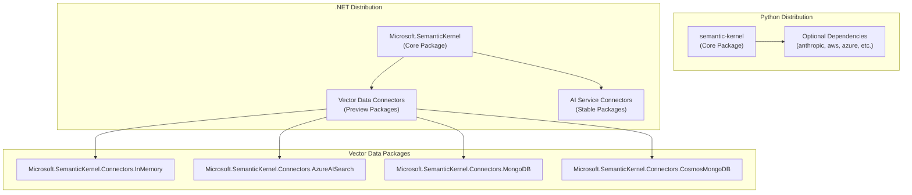

**Sources:** [python/pyproject.toml:1-61](), [dotnet/nuget/nuget-package.props:1-70](), [dotnet/src/VectorData/MongoDB/MongoDB.csproj:1-20](), [dotnet/src/VectorData/CosmosMongoDB/CosmosMongoDB.csproj:1-20]()

## .NET Package Management

### Central Package Management (CPM)

The .NET implementation utilizes Central Package Management via `Directory.Packages.props`. This ensures that all projects within the solution use consistent versions of external libraries, mitigating "dependency hell" and security vulnerabilities.

| Feature | Implementation |
| :--- | :--- |
| **Enforcement** | `ManagePackageVersionsCentrally` set to `true` [dotnet/Directory.Packages.props:5-5]() |
| **Core Versions** | `Microsoft.SemanticKernel.Core` v1.71.0 [dotnet/Directory.Packages.props:87-87]() |
| **AI Connectors** | `Azure.AI.OpenAI` v2.9.0-beta.1 [dotnet/Directory.Packages.props:26-26]() |
| **Security** | `NuGetAudit` enabled with `low` level reporting [dotnet/nuget/nuget-package.props:19-25]() |

**Sources:** [dotnet/Directory.Packages.props:1-100](), [dotnet/nuget/nuget-package.props:18-26]()

### NuGet Versioning Strategy

The repository uses a centralized property file to manage the `VersionPrefix` and `VersionSuffix` across all produced NuGet packages.

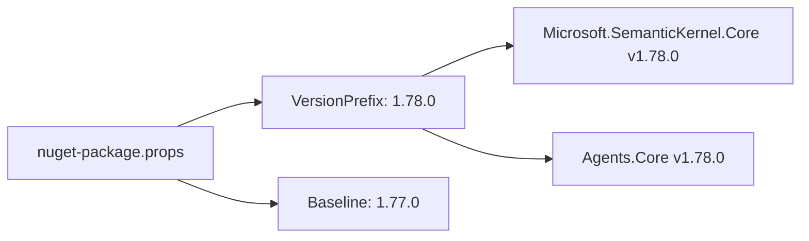

- **VersionPrefix**: Currently set to `1.78.0` [dotnet/nuget/nuget-package.props:4-4]().
- **Package Validation**: The `PackageValidationBaselineVersion` (set to `1.77.0`) is used to ensure backward compatibility during the build process [dotnet/nuget/nuget-package.props:12-12]().
- **SourceLink**: Enabled to allow developers to step through Semantic Kernel source code during debugging [dotnet/nuget/nuget-package.props:58-58]().

**Sources:** [dotnet/nuget/nuget-package.props:1-53]()

## Python Package Management

### Dependency Configuration

The Python implementation uses `pyproject.toml` as the primary configuration for the `semantic-kernel` package. It leverages `flit` as the build backend [python/pyproject.toml:257-257]().

**Core Dependencies:**
- **Pydantic**: Heavily utilized for data validation and settings management (v2.0+) [python/pyproject.toml:31-31]().
- **OpenAI**: Core connector dependency (v2.0.0+) [python/pyproject.toml:40-40]().
- **Azure AI**: Integrated via `azure-ai-projects` and `azure-ai-agents` [python/pyproject.toml:27-28]().

### Optional Dependency Groups (Extras)

Python extras allow users to install only the dependencies required for specific connectors or features.

| Group | Key Dependencies |
| :--- | :--- |
| `anthropic` | `anthropic ~= 0.32` [python/pyproject.toml:64-66]() |
| `aws` | `boto3 >= 1.36.4` [python/pyproject.toml:70-72]() |
| `google` | `google-genai >= 1.51` [python/pyproject.toml:89-92]() |
| `onnx` | `onnxruntime-genai == 0.9.0` [python/pyproject.toml:118-123]() |
| `postgres` | `psycopg[binary,pool] ~= 3.2` [python/pyproject.toml:133-135]() |

**Sources:** [python/pyproject.toml:63-157]()

### Reproducible Builds with uv

The Python project uses `uv` for high-performance dependency resolution and locking. The `uv.lock` file ensures that development, CI, and production environments use identical dependency trees.

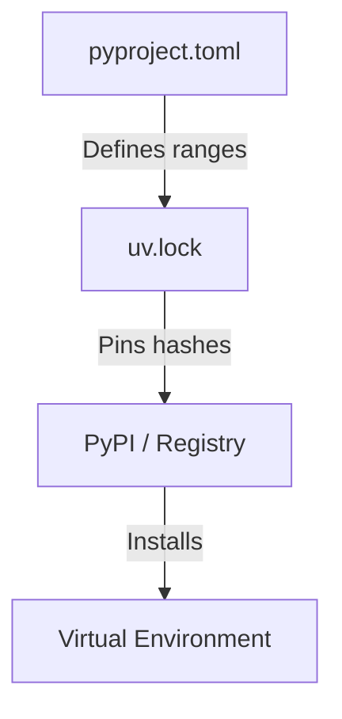

The `uv.lock` file contains precise versioning and hashes for all transitive dependencies, such as `aiohttp` (v3.13.3) and `accelerate` (v1.13.0) [python/uv.lock:31-71]().

**Sources:** [python/uv.lock:1-80](), [python/pyproject.toml:175-181]()

## Cross-Language Dependency Mapping

The framework maintains functional parity across languages by aligning external library integrations.

```mermaid
graph LR
    subgraph ".NET Space"
        NetOpenAI["Azure.AI.OpenAI"]
        NetAgent["Azure.AI.Agents.Persistent"]
        NetMCP["ModelContextProtocol"]
    end

    subgraph "Python Space"
        PyOpenAI["openai-python"]
        PyAgent["azure-ai-agents"]
        PyMCP["mcp"]
    end

    NetOpenAI <--- "Functional Parity" ---> PyOpenAI
    NetAgent <--- "Functional Parity" ---> PyAgent
    NetMCP <--- "Functional Parity" ---> PyMCP
```

**Code Entity Associations:**
- **.NET Agent Implementation**: `Azure.AI.Agents.Persistent` version managed in `Directory.Packages.props` [dotnet/Directory.Packages.props:24-24]().
- **Python Agent Implementation**: `azure-ai-agents` defined in `pyproject.toml` [python/pyproject.toml:28-28]() and utilized in `AgentThreadActions` [python/semantic_kernel/agents/azure_ai/agent_thread_actions.py:8-38]().
- **REST/OpenAPI**: .NET uses `RestApiOperationRunner` [dotnet/src/Functions/Functions.OpenApi/RestApiOperationRunner.cs:23-23]() while Python uses `openapi_core` and `prance` [python/pyproject.toml:42-48]().

**Sources:** [dotnet/Directory.Packages.props:24-91](), [python/pyproject.toml:25-60](), [python/semantic_kernel/agents/azure_ai/agent_thread_actions.py:8-38](), [dotnet/src/Functions/Functions.OpenApi/RestApiOperationRunner.cs:23-49]()

---

# Page: Core Components

# Core Components

<details>
<summary>Relevant source files</summary>

The following files were used as context for generating this wiki page:

- [dotnet/src/Connectors/Connectors.OpenAI.UnitTests/Core/AutoFunctionInvocationFilterTests.cs](dotnet/src/Connectors/Connectors.OpenAI.UnitTests/Core/AutoFunctionInvocationFilterTests.cs)
- [dotnet/src/InternalUtilities/planning/PlannerInstrumentation.cs](dotnet/src/InternalUtilities/planning/PlannerInstrumentation.cs)
- [dotnet/src/SemanticKernel.Abstractions/AI/PromptNode.cs](dotnet/src/SemanticKernel.Abstractions/AI/PromptNode.cs)
- [dotnet/src/SemanticKernel.Abstractions/Events/CancelKernelEventArgs.cs](dotnet/src/SemanticKernel.Abstractions/Events/CancelKernelEventArgs.cs)
- [dotnet/src/SemanticKernel.Abstractions/Events/FunctionInvokedEventArgs.cs](dotnet/src/SemanticKernel.Abstractions/Events/FunctionInvokedEventArgs.cs)
- [dotnet/src/SemanticKernel.Abstractions/Events/FunctionInvokingEventArgs.cs](dotnet/src/SemanticKernel.Abstractions/Events/FunctionInvokingEventArgs.cs)
- [dotnet/src/SemanticKernel.Abstractions/Events/KernelEventArgs.cs](dotnet/src/SemanticKernel.Abstractions/Events/KernelEventArgs.cs)
- [dotnet/src/SemanticKernel.Abstractions/Events/PromptRenderedEventArgs.cs](dotnet/src/SemanticKernel.Abstractions/Events/PromptRenderedEventArgs.cs)
- [dotnet/src/SemanticKernel.Abstractions/Events/PromptRenderingEventArgs.cs](dotnet/src/SemanticKernel.Abstractions/Events/PromptRenderingEventArgs.cs)
- [dotnet/src/SemanticKernel.Abstractions/Filters/AutoFunctionInvocation/AutoFunctionInvocationContext.cs](dotnet/src/SemanticKernel.Abstractions/Filters/AutoFunctionInvocation/AutoFunctionInvocationContext.cs)
- [dotnet/src/SemanticKernel.Abstractions/Filters/AutoFunctionInvocation/IAutoFunctionInvocationFilter.cs](dotnet/src/SemanticKernel.Abstractions/Filters/AutoFunctionInvocation/IAutoFunctionInvocationFilter.cs)
- [dotnet/src/SemanticKernel.Abstractions/Filters/Function/FunctionInvocationContext.cs](dotnet/src/SemanticKernel.Abstractions/Filters/Function/FunctionInvocationContext.cs)
- [dotnet/src/SemanticKernel.Abstractions/Filters/Prompt/PromptRenderContext.cs](dotnet/src/SemanticKernel.Abstractions/Filters/Prompt/PromptRenderContext.cs)
- [dotnet/src/SemanticKernel.Abstractions/Functions/FunctionResult.cs](dotnet/src/SemanticKernel.Abstractions/Functions/FunctionResult.cs)
- [dotnet/src/SemanticKernel.Abstractions/Functions/KernelFunction.cs](dotnet/src/SemanticKernel.Abstractions/Functions/KernelFunction.cs)
- [dotnet/src/SemanticKernel.Abstractions/Functions/KernelFunctionLogMessages.cs](dotnet/src/SemanticKernel.Abstractions/Functions/KernelFunctionLogMessages.cs)
- [dotnet/src/SemanticKernel.Abstractions/Kernel.cs](dotnet/src/SemanticKernel.Abstractions/Kernel.cs)
- [dotnet/src/SemanticKernel.Core/Contents/StreamingMethodContent.cs](dotnet/src/SemanticKernel.Core/Contents/StreamingMethodContent.cs)
- [dotnet/src/SemanticKernel.Core/Functions/KernelFunctionFromMethod.cs](dotnet/src/SemanticKernel.Core/Functions/KernelFunctionFromMethod.cs)
- [dotnet/src/SemanticKernel.Core/Functions/KernelFunctionFromPrompt.cs](dotnet/src/SemanticKernel.Core/Functions/KernelFunctionFromPrompt.cs)
- [dotnet/src/SemanticKernel.Core/KernelExtensions.cs](dotnet/src/SemanticKernel.Core/KernelExtensions.cs)
- [dotnet/src/SemanticKernel.UnitTests/Filters/FunctionInvocationFilterTests.cs](dotnet/src/SemanticKernel.UnitTests/Filters/FunctionInvocationFilterTests.cs)
- [dotnet/src/SemanticKernel.UnitTests/Filters/PromptRenderFilterTests.cs](dotnet/src/SemanticKernel.UnitTests/Filters/PromptRenderFilterTests.cs)
- [dotnet/src/SemanticKernel.UnitTests/Functions/FunctionFromMethodTests.cs](dotnet/src/SemanticKernel.UnitTests/Functions/FunctionFromMethodTests.cs)
- [dotnet/src/SemanticKernel.UnitTests/Functions/FunctionResultTests.cs](dotnet/src/SemanticKernel.UnitTests/Functions/FunctionResultTests.cs)
- [dotnet/src/SemanticKernel.UnitTests/Functions/KernelBuilderTests.cs](dotnet/src/SemanticKernel.UnitTests/Functions/KernelBuilderTests.cs)
- [dotnet/src/SemanticKernel.UnitTests/Functions/KernelFunctionLogMessagesTests.cs](dotnet/src/SemanticKernel.UnitTests/Functions/KernelFunctionLogMessagesTests.cs)
- [dotnet/src/SemanticKernel.UnitTests/KernelTests.cs](dotnet/src/SemanticKernel.UnitTests/KernelTests.cs)
- [python/samples/concepts/mcp/README.md](python/samples/concepts/mcp/README.md)
- [python/samples/concepts/mcp/agent_with_mcp_plugin.py](python/samples/concepts/mcp/agent_with_mcp_plugin.py)
- [python/samples/concepts/mcp/agent_with_mcp_sampling.py](python/samples/concepts/mcp/agent_with_mcp_sampling.py)
- [python/samples/concepts/mcp/azure_ai_agent_with_mcp_plugin.py](python/samples/concepts/mcp/azure_ai_agent_with_mcp_plugin.py)
- [python/samples/concepts/mcp/mcp_as_plugin.py](python/samples/concepts/mcp/mcp_as_plugin.py)
- [python/samples/concepts/realtime/README.md](python/samples/concepts/realtime/README.md)
- [python/samples/concepts/realtime/realtime_agent_with_function_calling_webrtc.py](python/samples/concepts/realtime/realtime_agent_with_function_calling_webrtc.py)
- [python/samples/concepts/realtime/realtime_agent_with_function_calling_websocket.py](python/samples/concepts/realtime/realtime_agent_with_function_calling_websocket.py)
- [python/samples/concepts/realtime/simple_realtime_chat_webrtc.py](python/samples/concepts/realtime/simple_realtime_chat_webrtc.py)
- [python/samples/concepts/realtime/simple_realtime_chat_websocket.py](python/samples/concepts/realtime/simple_realtime_chat_websocket.py)
- [python/samples/concepts/realtime/utils.py](python/samples/concepts/realtime/utils.py)
- [python/semantic_kernel/connectors/ai/open_ai/prompt_execution_settings/open_ai_realtime_execution_settings.py](python/semantic_kernel/connectors/ai/open_ai/prompt_execution_settings/open_ai_realtime_execution_settings.py)
- [python/semantic_kernel/connectors/ai/open_ai/services/_open_ai_realtime.py](python/semantic_kernel/connectors/ai/open_ai/services/_open_ai_realtime.py)
- [python/semantic_kernel/connectors/ai/open_ai/services/azure_realtime.py](python/semantic_kernel/connectors/ai/open_ai/services/azure_realtime.py)
- [python/semantic_kernel/connectors/ai/open_ai/settings/open_ai_settings.py](python/semantic_kernel/connectors/ai/open_ai/settings/open_ai_settings.py)
- [python/semantic_kernel/connectors/mcp.py](python/semantic_kernel/connectors/mcp.py)
- [python/semantic_kernel/functions/kernel_function_extension.py](python/semantic_kernel/functions/kernel_function_extension.py)
- [python/semantic_kernel/functions/kernel_plugin.py](python/semantic_kernel/functions/kernel_plugin.py)
- [python/semantic_kernel/kernel.py](python/semantic_kernel/kernel.py)
- [python/tests/unit/connectors/ai/open_ai/services/test_openai_realtime.py](python/tests/unit/connectors/ai/open_ai/services/test_openai_realtime.py)
- [python/tests/unit/connectors/mcp/test_mcp.py](python/tests/unit/connectors/mcp/test_mcp.py)
- [python/tests/unit/functions/test_kernel_plugins.py](python/tests/unit/functions/test_kernel_plugins.py)
- [python/tests/unit/kernel/test_kernel.py](python/tests/unit/kernel/test_kernel.py)

</details>


This document covers the fundamental building blocks that comprise the Semantic Kernel framework. These core components provide the essential abstractions and orchestration mechanisms for AI function execution across .NET and Python implementations.

For information about AI service integration and connectors, see [AI Service Integration](#4). For details about agent frameworks and multi-agent orchestration, see [Agent Framework](#5).

## Component Architecture Overview

The Semantic Kernel framework is built around five primary core components that work together to enable AI-powered function orchestration:

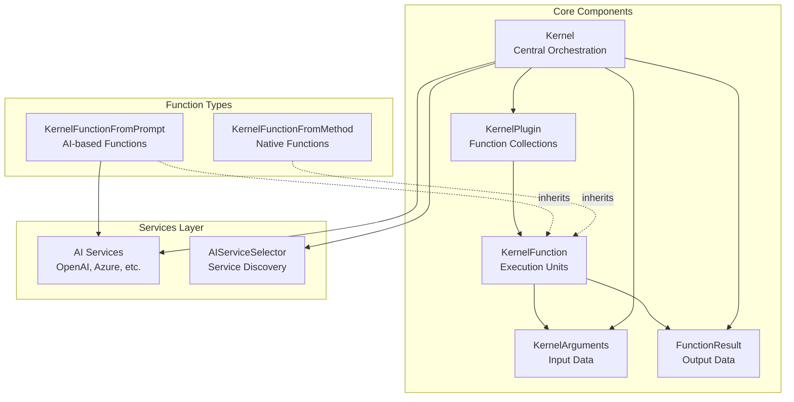

**Sources:** [python/semantic_kernel/kernel.py:62-102](), [dotnet/src/SemanticKernel.Abstractions/Kernel.cs:26-85](), [dotnet/src/SemanticKernel.Abstractions/Functions/KernelFunction.cs:30-31]()

## Kernel: Central Orchestration Engine

The `Kernel` class serves as the primary orchestration engine that coordinates all framework operations. It manages services, plugins, filters, and provides the execution context for all function invocations.

### Core Responsibilities

| Responsibility | Description | Implementation |
|---|---|---|
| **Service Management** | Registers and manages AI services via `KernelServicesExtension` | [python/semantic_kernel/kernel.py:73-74](), [dotnet/src/SemanticKernel.Abstractions/Kernel.cs:60-61]() |
| **Plugin Management** | Maintains collections of function plugins via `KernelPluginCollection` | [dotnet/src/SemanticKernel.Abstractions/Kernel.cs:124-128](), [python/semantic_kernel/kernel.py:72-72]() |
| **Function Execution** | Orchestrates function invocation and streaming | [python/semantic_kernel/kernel.py:104-133](), [dotnet/src/SemanticKernel.Abstractions/Kernel.cs:111-119]() |
| **Filter Pipeline** | Manages invocation, prompt rendering, and auto-invocation filters | [dotnet/src/SemanticKernel.Abstractions/Kernel.cs:130-151](), [python/semantic_kernel/kernel.py:69-71]() |

### Kernel Class Structure

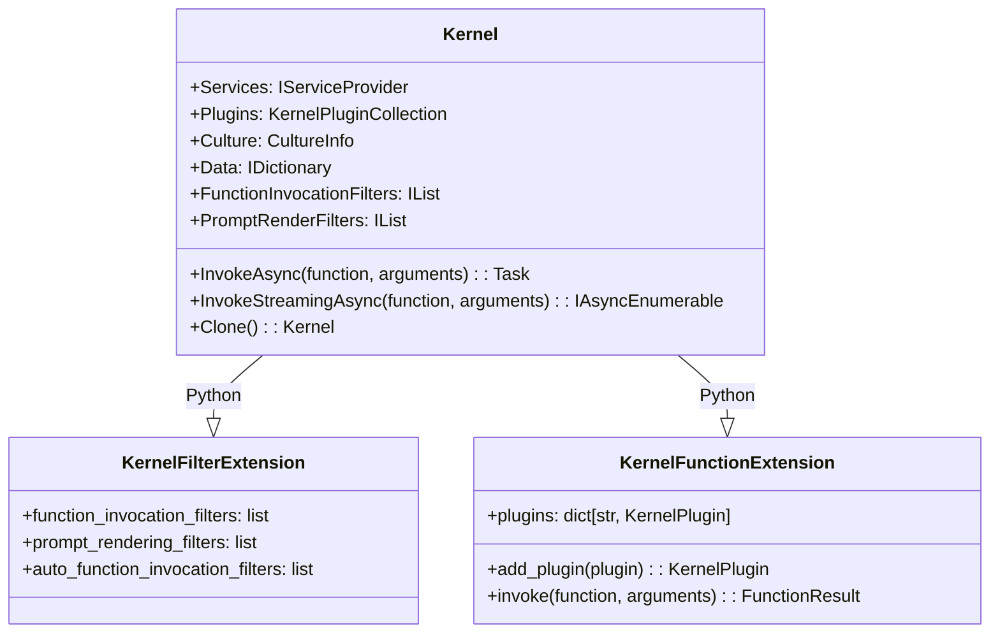

**Sources:** [python/semantic_kernel/kernel.py:62-102](), [dotnet/src/SemanticKernel.Abstractions/Kernel.cs:26-151]()

## KernelFunction: Executable Function Abstraction

`KernelFunction` is the base abstraction for all executable units within the framework. It provides a unified interface for both AI-powered prompt functions and native method functions.

### Function Hierarchy

The framework provides two primary concrete implementations of the `KernelFunction` abstraction:

- **KernelFunctionFromPrompt**: Represents a function defined by a prompt template and AI service settings. [dotnet/src/SemanticKernel.Core/Functions/KernelFunctionFromPrompt.cs:27-28](), [python/semantic_kernel/kernel.py:36-36]()
- **KernelFunctionFromMethod**: Represents a function backed by native code (e.g., a C# method or Python function). [dotnet/src/SemanticKernel.Core/Functions/KernelFunctionFromMethod.cs:30-30](), [dotnet/src/SemanticKernel.Core/KernelExtensions.cs:35-47]()

### Metadata System

Functions are described using a metadata system that allows the Kernel and AI models to understand their purpose and requirements:

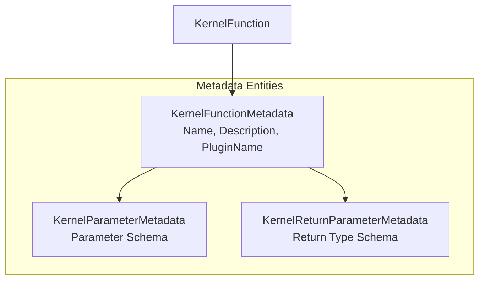

**Sources:** [dotnet/src/SemanticKernel.Abstractions/Functions/KernelFunction.cs:82-100](), [dotnet/src/SemanticKernel.Abstractions/Functions/KernelFunction.cs:123-136]()

## KernelPlugin: Function Collections

`KernelPlugin` organizes related functions into logical collections, providing discoverability and namespace management.

### Plugin Management

A `KernelPlugin` behaves similarly to a dictionary, where functions are indexed by their names. [python/semantic_kernel/functions/kernel_plugin.py:39-42](). Plugins can be created from various sources:

- **Native Objects**: Using `from_object` to wrap class methods annotated with `@kernel_function`. [python/semantic_kernel/functions/kernel_plugin.py:63-64]()
- **Directories**: Using `from_directory` to load prompt templates and configuration files. [python/semantic_kernel/functions/kernel_plugin.py:65-67]()
- **OpenAPI**: Using `from_openapi` to generate functions from REST API specifications. [python/semantic_kernel/functions/kernel_plugin.py:68-73]()
- **MCP**: Using `MCPPlugin` to integrate Model Context Protocol servers. [python/semantic_kernel/connectors/mcp.py:36-41]()

**Sources:** [python/semantic_kernel/functions/kernel_plugin.py:36-102](), [dotnet/src/SemanticKernel.Abstractions/Kernel.cs:124-128]()

## Data Flow and Results

### Function Results

The `FunctionResult` class encapsulates the output of a function invocation, including the resulting value, metadata, and the culture used during execution. [dotnet/src/SemanticKernel.Abstractions/Functions/FunctionResult.cs:14-31]().

### Content Abstractions

Semantic Kernel uses a unified content model to bridge natural language and code entities:

| Entity | Code Class | Purpose |
|---|---|---|
| **Chat Message** | `ChatMessageContent` | Represents a turn in a conversation. |
| **Function Call** | `FunctionCallContent` | Represents a request from a model to call a tool. |
| **Function Result** | `FunctionResultContent` | Represents the output of a tool call sent back to the model. |
| **Streaming Content** | `StreamingChatMessageContent` | Represents partial updates for real-time responses. |

**Sources:** [python/semantic_kernel/kernel.py:11-15](), [dotnet/src/SemanticKernel.Abstractions/Functions/FunctionResult.cs:95-122]()

## Child Pages

For detailed information on specific core subsystems, see:

- [Kernel Orchestration](#3.1) — Pipeline details, service registration, and filter logic.
- [Functions and Plugins](#3.2) — Implementation of native and prompt-based functions.
- [Memory and Vector Stores](#3.3) — RAG patterns and vector database abstractions.

**Sources:** [python/semantic_kernel/kernel.py:62-75](), [dotnet/src/SemanticKernel.Abstractions/Kernel.cs:26-58]()

---

# Page: Kernel Orchestration

# Kernel Orchestration

<details>
<summary>Relevant source files</summary>

The following files were used as context for generating this wiki page:

- [dotnet/src/Agents/Bedrock/Extensions/BedrockAgentInvokeExtensions.cs](dotnet/src/Agents/Bedrock/Extensions/BedrockAgentInvokeExtensions.cs)
- [dotnet/src/Agents/OpenAI/Internal/AssistantMessageFactory.cs](dotnet/src/Agents/OpenAI/Internal/AssistantMessageFactory.cs)
- [dotnet/src/Agents/OpenAI/Internal/ResponseThreadActions.cs](dotnet/src/Agents/OpenAI/Internal/ResponseThreadActions.cs)
- [dotnet/src/Agents/UnitTests/OpenAI/Internal/AssistantMessageFactoryTests.cs](dotnet/src/Agents/UnitTests/OpenAI/Internal/AssistantMessageFactoryTests.cs)
- [dotnet/src/Agents/UnitTests/OpenAI/Internal/ResponseThreadActionsTests.cs](dotnet/src/Agents/UnitTests/OpenAI/Internal/ResponseThreadActionsTests.cs)
- [dotnet/src/Connectors/Connectors.Google/Core/Gemini/Models/GeminiPart.cs](dotnet/src/Connectors/Connectors.Google/Core/Gemini/Models/GeminiPart.cs)
- [dotnet/src/Connectors/Connectors.OpenAI.UnitTests/Core/AutoFunctionInvocationFilterTests.cs](dotnet/src/Connectors/Connectors.OpenAI.UnitTests/Core/AutoFunctionInvocationFilterTests.cs)
- [dotnet/src/InternalUtilities/connectors/AI/FunctionCalling/FunctionCallsProcessor.cs](dotnet/src/InternalUtilities/connectors/AI/FunctionCalling/FunctionCallsProcessor.cs)
- [dotnet/src/InternalUtilities/planning/Extensions/KernelFunctionMetadataExtensions.cs](dotnet/src/InternalUtilities/planning/Extensions/KernelFunctionMetadataExtensions.cs)
- [dotnet/src/InternalUtilities/planning/PlannerInstrumentation.cs](dotnet/src/InternalUtilities/planning/PlannerInstrumentation.cs)
- [dotnet/src/SemanticKernel.Abstractions/AI/PromptExecutionSettings.cs](dotnet/src/SemanticKernel.Abstractions/AI/PromptExecutionSettings.cs)
- [dotnet/src/SemanticKernel.Abstractions/AI/PromptNode.cs](dotnet/src/SemanticKernel.Abstractions/AI/PromptNode.cs)
- [dotnet/src/SemanticKernel.Abstractions/Events/CancelKernelEventArgs.cs](dotnet/src/SemanticKernel.Abstractions/Events/CancelKernelEventArgs.cs)
- [dotnet/src/SemanticKernel.Abstractions/Events/FunctionInvokedEventArgs.cs](dotnet/src/SemanticKernel.Abstractions/Events/FunctionInvokedEventArgs.cs)
- [dotnet/src/SemanticKernel.Abstractions/Events/FunctionInvokingEventArgs.cs](dotnet/src/SemanticKernel.Abstractions/Events/FunctionInvokingEventArgs.cs)
- [dotnet/src/SemanticKernel.Abstractions/Events/KernelEventArgs.cs](dotnet/src/SemanticKernel.Abstractions/Events/KernelEventArgs.cs)
- [dotnet/src/SemanticKernel.Abstractions/Events/PromptRenderedEventArgs.cs](dotnet/src/SemanticKernel.Abstractions/Events/PromptRenderedEventArgs.cs)
- [dotnet/src/SemanticKernel.Abstractions/Events/PromptRenderingEventArgs.cs](dotnet/src/SemanticKernel.Abstractions/Events/PromptRenderingEventArgs.cs)
- [dotnet/src/SemanticKernel.Abstractions/Filters/AutoFunctionInvocation/AutoFunctionInvocationContext.cs](dotnet/src/SemanticKernel.Abstractions/Filters/AutoFunctionInvocation/AutoFunctionInvocationContext.cs)
- [dotnet/src/SemanticKernel.Abstractions/Filters/AutoFunctionInvocation/IAutoFunctionInvocationFilter.cs](dotnet/src/SemanticKernel.Abstractions/Filters/AutoFunctionInvocation/IAutoFunctionInvocationFilter.cs)
- [dotnet/src/SemanticKernel.Abstractions/Filters/Function/FunctionInvocationContext.cs](dotnet/src/SemanticKernel.Abstractions/Filters/Function/FunctionInvocationContext.cs)
- [dotnet/src/SemanticKernel.Abstractions/Filters/Prompt/PromptRenderContext.cs](dotnet/src/SemanticKernel.Abstractions/Filters/Prompt/PromptRenderContext.cs)
- [dotnet/src/SemanticKernel.Abstractions/Functions/FunctionResult.cs](dotnet/src/SemanticKernel.Abstractions/Functions/FunctionResult.cs)
- [dotnet/src/SemanticKernel.Abstractions/Functions/KernelArguments.cs](dotnet/src/SemanticKernel.Abstractions/Functions/KernelArguments.cs)
- [dotnet/src/SemanticKernel.Abstractions/Functions/KernelFunction.cs](dotnet/src/SemanticKernel.Abstractions/Functions/KernelFunction.cs)
- [dotnet/src/SemanticKernel.Abstractions/Functions/KernelFunctionLogMessages.cs](dotnet/src/SemanticKernel.Abstractions/Functions/KernelFunctionLogMessages.cs)
- [dotnet/src/SemanticKernel.Abstractions/Functions/KernelFunctionMetadata.cs](dotnet/src/SemanticKernel.Abstractions/Functions/KernelFunctionMetadata.cs)
- [dotnet/src/SemanticKernel.Abstractions/Functions/KernelParameterMetadata.cs](dotnet/src/SemanticKernel.Abstractions/Functions/KernelParameterMetadata.cs)
- [dotnet/src/SemanticKernel.Abstractions/Functions/KernelReturnParameterMetadata.cs](dotnet/src/SemanticKernel.Abstractions/Functions/KernelReturnParameterMetadata.cs)
- [dotnet/src/SemanticKernel.Abstractions/Kernel.cs](dotnet/src/SemanticKernel.Abstractions/Kernel.cs)
- [dotnet/src/SemanticKernel.Abstractions/Services/AIServiceExtensions.cs](dotnet/src/SemanticKernel.Abstractions/Services/AIServiceExtensions.cs)
- [dotnet/src/SemanticKernel.Abstractions/Services/OrderedAIServiceSelector.cs](dotnet/src/SemanticKernel.Abstractions/Services/OrderedAIServiceSelector.cs)
- [dotnet/src/SemanticKernel.Core/Contents/StreamingMethodContent.cs](dotnet/src/SemanticKernel.Core/Contents/StreamingMethodContent.cs)
- [dotnet/src/SemanticKernel.Core/Functions/KernelFunctionFactory.cs](dotnet/src/SemanticKernel.Core/Functions/KernelFunctionFactory.cs)
- [dotnet/src/SemanticKernel.Core/Functions/KernelFunctionFromMethod.cs](dotnet/src/SemanticKernel.Core/Functions/KernelFunctionFromMethod.cs)
- [dotnet/src/SemanticKernel.Core/Functions/KernelFunctionFromMethodOptions.cs](dotnet/src/SemanticKernel.Core/Functions/KernelFunctionFromMethodOptions.cs)
- [dotnet/src/SemanticKernel.Core/Functions/KernelFunctionFromPrompt.cs](dotnet/src/SemanticKernel.Core/Functions/KernelFunctionFromPrompt.cs)
- [dotnet/src/SemanticKernel.Core/KernelExtensions.cs](dotnet/src/SemanticKernel.Core/KernelExtensions.cs)
- [dotnet/src/SemanticKernel.UnitTests/AI/PromptExecutionSettingsTests.cs](dotnet/src/SemanticKernel.UnitTests/AI/PromptExecutionSettingsTests.cs)
- [dotnet/src/SemanticKernel.UnitTests/Filters/FunctionInvocationFilterTests.cs](dotnet/src/SemanticKernel.UnitTests/Filters/FunctionInvocationFilterTests.cs)
- [dotnet/src/SemanticKernel.UnitTests/Filters/PromptRenderFilterTests.cs](dotnet/src/SemanticKernel.UnitTests/Filters/PromptRenderFilterTests.cs)
- [dotnet/src/SemanticKernel.UnitTests/Functions/FunctionFromMethodTests.cs](dotnet/src/SemanticKernel.UnitTests/Functions/FunctionFromMethodTests.cs)
- [dotnet/src/SemanticKernel.UnitTests/Functions/FunctionResultTests.cs](dotnet/src/SemanticKernel.UnitTests/Functions/FunctionResultTests.cs)
- [dotnet/src/SemanticKernel.UnitTests/Functions/KernelArgumentsTests.cs](dotnet/src/SemanticKernel.UnitTests/Functions/KernelArgumentsTests.cs)
- [dotnet/src/SemanticKernel.UnitTests/Functions/KernelBuilderTests.cs](dotnet/src/SemanticKernel.UnitTests/Functions/KernelBuilderTests.cs)
- [dotnet/src/SemanticKernel.UnitTests/Functions/KernelFunctionFromPromptTests.cs](dotnet/src/SemanticKernel.UnitTests/Functions/KernelFunctionFromPromptTests.cs)
- [dotnet/src/SemanticKernel.UnitTests/Functions/KernelFunctionLogMessagesTests.cs](dotnet/src/SemanticKernel.UnitTests/Functions/KernelFunctionLogMessagesTests.cs)
- [dotnet/src/SemanticKernel.UnitTests/Functions/MultipleModelTests.cs](dotnet/src/SemanticKernel.UnitTests/Functions/MultipleModelTests.cs)
- [dotnet/src/SemanticKernel.UnitTests/Functions/OrderedAIServiceSelectorTests.cs](dotnet/src/SemanticKernel.UnitTests/Functions/OrderedAIServiceSelectorTests.cs)
- [dotnet/src/SemanticKernel.UnitTests/KernelTests.cs](dotnet/src/SemanticKernel.UnitTests/KernelTests.cs)
- [dotnet/src/SemanticKernel.UnitTests/Utilities/AIConnectors/FunctionCallsProcessorTests.cs](dotnet/src/SemanticKernel.UnitTests/Utilities/AIConnectors/FunctionCallsProcessorTests.cs)
- [python/samples/concepts/mcp/README.md](python/samples/concepts/mcp/README.md)
- [python/samples/concepts/mcp/agent_with_mcp_plugin.py](python/samples/concepts/mcp/agent_with_mcp_plugin.py)
- [python/samples/concepts/mcp/agent_with_mcp_sampling.py](python/samples/concepts/mcp/agent_with_mcp_sampling.py)
- [python/samples/concepts/mcp/azure_ai_agent_with_mcp_plugin.py](python/samples/concepts/mcp/azure_ai_agent_with_mcp_plugin.py)
- [python/samples/concepts/mcp/mcp_as_plugin.py](python/samples/concepts/mcp/mcp_as_plugin.py)
- [python/samples/concepts/realtime/README.md](python/samples/concepts/realtime/README.md)
- [python/samples/concepts/realtime/realtime_agent_with_function_calling_webrtc.py](python/samples/concepts/realtime/realtime_agent_with_function_calling_webrtc.py)
- [python/samples/concepts/realtime/realtime_agent_with_function_calling_websocket.py](python/samples/concepts/realtime/realtime_agent_with_function_calling_websocket.py)
- [python/samples/concepts/realtime/simple_realtime_chat_webrtc.py](python/samples/concepts/realtime/simple_realtime_chat_webrtc.py)
- [python/samples/concepts/realtime/simple_realtime_chat_websocket.py](python/samples/concepts/realtime/simple_realtime_chat_websocket.py)
- [python/samples/concepts/realtime/utils.py](python/samples/concepts/realtime/utils.py)
- [python/semantic_kernel/connectors/ai/open_ai/prompt_execution_settings/open_ai_realtime_execution_settings.py](python/semantic_kernel/connectors/ai/open_ai/prompt_execution_settings/open_ai_realtime_execution_settings.py)
- [python/semantic_kernel/connectors/ai/open_ai/services/_open_ai_realtime.py](python/semantic_kernel/connectors/ai/open_ai/services/_open_ai_realtime.py)
- [python/semantic_kernel/connectors/ai/open_ai/services/azure_realtime.py](python/semantic_kernel/connectors/ai/open_ai/services/azure_realtime.py)
- [python/semantic_kernel/connectors/ai/open_ai/settings/open_ai_settings.py](python/semantic_kernel/connectors/ai/open_ai/settings/open_ai_settings.py)
- [python/semantic_kernel/connectors/mcp.py](python/semantic_kernel/connectors/mcp.py)
- [python/semantic_kernel/functions/kernel_function_extension.py](python/semantic_kernel/functions/kernel_function_extension.py)
- [python/semantic_kernel/functions/kernel_plugin.py](python/semantic_kernel/functions/kernel_plugin.py)
- [python/semantic_kernel/kernel.py](python/semantic_kernel/kernel.py)
- [python/tests/unit/connectors/ai/open_ai/services/test_openai_realtime.py](python/tests/unit/connectors/ai/open_ai/services/test_openai_realtime.py)
- [python/tests/unit/connectors/mcp/test_mcp.py](python/tests/unit/connectors/mcp/test_mcp.py)
- [python/tests/unit/functions/test_kernel_plugins.py](python/tests/unit/functions/test_kernel_plugins.py)
- [python/tests/unit/kernel/test_kernel.py](python/tests/unit/kernel/test_kernel.py)

</details>


This document covers the central orchestration system in Semantic Kernel that coordinates the execution of AI functions, plugins, and services. The Kernel serves as the primary entry point and orchestrator for all AI-powered operations, managing the execution flow, service selection, filtering, and coordination between different components.

For information about specific function implementations, see [Functions and Plugins](#3.2). For AI service integration details, see [AI Service Integration](#4).

## Core Architecture Overview

The Kernel orchestration system follows a hub-and-spoke architecture where the `Kernel` class acts as the central coordinator for all operations. It manages plugins, services, filters, and execution contexts while providing both synchronous and asynchronous execution patterns.

### High-Level Orchestration Architecture

```mermaid
graph TB
    subgraph "Kernel Orchestration System"
        KERNEL["Kernel<br/>(Central Orchestrator)"]
        
        subgraph "Function Management"
            PLUGINS["KernelPluginCollection<br/>plugins"]
            FUNCTIONS["KernelFunction<br/>Individual Functions"]
        end
        
        subgraph "Service Management"
            SERVICES["IServiceProvider<br/>services"]
            SELECTOR["IAIServiceSelector<br/>ServiceSelector"]
        end
        
        subgraph "Filter Pipeline"
            FUNC_FILTERS["IFunctionInvocationFilter[]<br/>FunctionInvocationFilters"]
            PROMPT_FILTERS["IPromptRenderFilter[]<br/>PromptRenderFilters"]
            AUTO_FILTERS["IAutoFunctionInvocationFilter[]<br/>AutoFunctionInvocationFilters"]
        end
        
        subgraph "Execution Contexts"
            FUNC_CTX["FunctionInvocationContext"]
            PROMPT_CTX["PromptRenderContext"]
            AUTO_CTX["AutoFunctionInvocationContext"]
        end
    end
    
    KERNEL --> PLUGINS
    KERNEL --> SERVICES
    KERNEL --> FUNC_FILTERS
    KERNEL --> PROMPT_FILTERS
    KERNEL --> AUTO_FILTERS
    
    PLUGINS --> FUNCTIONS
    SERVICES --> SELECTOR
    
    FUNC_FILTERS --> FUNC_CTX
    PROMPT_FILTERS --> PROMPT_CTX
    AUTO_FILTERS --> AUTO_CTX
    
    FUNCTIONS --> FUNC_CTX
```

**Sources:** [dotnet/src/SemanticKernel.Abstractions/Kernel.cs:26-156](), [python/semantic_kernel/kernel.py:62-102]()

## Kernel Class and Core Components

### .NET Kernel Implementation

The .NET `Kernel` class provides the central orchestration functionality with the following key components:

```mermaid
graph LR
    subgraph "Kernel Class Structure (.NET)"
        KERNEL_NET["Kernel"]
        
        subgraph "Core Properties"
            PLUGINS_NET["KernelPluginCollection<br/>Plugins"]
            SERVICES_NET["IServiceProvider<br/>Services"]
            CULTURE_NET["CultureInfo<br/>Culture"]
            DATA_NET["IDictionary<br/>Data"]
        end
        
        subgraph "Filter Collections"
            FUNC_FILTER_NET["IList<IFunctionInvocationFilter><br/>FunctionInvocationFilters"]
            PROMPT_FILTER_NET["IList<IPromptRenderFilter><br/>PromptRenderFilters"]
            AUTO_FILTER_NET["IList<IAutoFunctionInvocationFilter><br/>AutoFunctionInvocationFilters"]
        end
        
        subgraph "Key Methods"
            INVOKE_NET["InvokeAsync"]
            INVOKE_STREAM_NET["InvokeStreamingAsync"]
            CLONE_NET["Clone"]
        end
    end
    
    KERNEL_NET --> PLUGINS_NET
    KERNEL_NET --> SERVICES_NET
    KERNEL_NET --> CULTURE_NET
    KERNEL_NET --> DATA_NET
    KERNEL_NET --> FUNC_FILTER_NET
    KERNEL_NET --> PROMPT_FILTER_NET
    KERNEL_NET --> AUTO_FILTER_NET
    KERNEL_NET --> INVOKE_NET
    KERNEL_NET --> INVOKE_STREAM_NET
    KERNEL_NET --> CLONE_NET
```

**Sources:** [dotnet/src/SemanticKernel.Abstractions/Kernel.cs:44-204]()

### Python Kernel Implementation

The Python `Kernel` class extends multiple extension classes to provide orchestration capabilities:

```mermaid
graph TB
    subgraph "Python Kernel Inheritance"
        KERNEL_PY["Kernel"]
        FILTER_EXT["KernelFilterExtension"]
        FUNCTION_EXT["KernelFunctionExtension"]
        SERVICES_EXT["KernelServicesExtension"]
        RELIABILITY_EXT["KernelReliabilityExtension"]
    end
    
    KERNEL_PY --> FILTER_EXT
    KERNEL_PYPY --> FUNCTION_EXT
    KERNEL_PY --> SERVICES_EXT
    KERNEL_PY --> RELIABILITY_EXT
    
    subgraph "Extension Responsibilities"
        FILTER_EXT --> FILTER_MGMT["Filter Management<br/>function_invocation_filters<br/>prompt_rendering_filters<br/>auto_function_invocation_filters"]
        FUNCTION_EXT --> PLUGIN_MGMT["Plugin Management<br/>plugins<br/>add_plugin<br/>get_function"]
        SERVICES_EXT --> SERVICE_MGMT["Service Management<br/>services<br/>ai_service_selector<br/>add_service"]
        RELIABILITY_EXT --> RETRY_MGMT["Reliability Management<br/>retry_mechanism"]
    end
```

**Sources:** [python/semantic_kernel/kernel.py:62-75](), [python/semantic_kernel/functions/kernel_function_extension.py:45-63]()

## Function Orchestration Patterns

The Kernel provides several orchestration patterns for function execution, each serving different use cases and execution models.

### Function Invocation Flow

```mermaid
sequenceDiagram
    participant CLIENT as "Client Code"
    participant KERNEL as "Kernel"
    participant FILTERS as "Filter Pipeline"
    participant FUNCTION as "KernelFunction"
    participant SERVICE as "AI Service"
    
    CLIENT->>KERNEL: "invoke(function, arguments)"
    KERNEL->>FILTERS: "OnFunctionInvocationAsync"
    
    loop "Filter Chain"
        FILTERS->>FILTERS: "Execute Filter[i]"
    end
    
    FILTERS->>FUNCTION: "InvokeCoreAsync"
    
    alt "Prompt Function"
        FUNCTION->>SERVICE: "GetChatMessageContentsAsync"
        SERVICE-->>FUNCTION: "ChatMessageContent[]"
    else "Native Function"
        FUNCTION->>FUNCTION: "Execute Method"
    end
    
    FUNCTION-->>FILTERS: "FunctionResult"
    FILTERS-->>KERNEL: "Updated Context"
    KERNEL-->>CLIENT: "FunctionResult"
```

**Sources:** [dotnet/src/SemanticKernel.Abstractions/Functions/KernelFunction.cs:234-286](), [python/semantic_kernel/kernel.py:167-213]()

### Streaming Orchestration

The Kernel supports streaming execution for real-time AI responses:

| Pattern | .NET Method | Python Method | Use Case |
|---------|-------------|---------------|-----------|
| Function Streaming | `InvokeStreamingAsync<T>` | `invoke_stream` | Real-time AI responses |
| Prompt Streaming | `KernelFunction.InvokeStreamingAsync` | `invoke_prompt_stream` | Streaming prompt execution |
| Function Results | Return streaming content | `return_function_results` | Complete results after streaming |

**Sources:** [dotnet/src/SemanticKernel.Abstractions/Functions/KernelFunction.cs:318-422](), [python/semantic_kernel/kernel.py:104-166]()

### Auto Function Invocation Pattern

For AI function calling scenarios, the Kernel orchestrates automatic function invocation loops. In .NET, this is handled via `FunctionChoiceBehavior` [dotnet/src/SemanticKernel.Abstractions/AI/PromptExecutionSettings.cs:92-101](). In Python, the `Kernel` manages the loop by checking for `FunctionCallContent` and invoking the corresponding registered functions [python/semantic_kernel/kernel.py:326-456]().

```mermaid
graph TB
    subgraph "Auto Function Invocation Loop"
        FC_CONTENT["FunctionCallContent<br/>(from AI Service)"]
        VALIDATE["Validate Function Call<br/>KernelFunctionNotFoundError"]
        PARSE_ARGS["Parse Arguments<br/>KernelArguments"]
        INVOKE_FUNC["Invoke Function<br/>kernel.invoke()"]
        BUILD_RESULT["Build Result<br/>FunctionResultContent"]
        UPDATE_CHAT["Update ChatHistory<br/>add_message()"]
    end
    
    FC_CONTENT --> VALIDATE
    VALIDATE --> PARSE_ARGS
    PARSE_ARGS --> INVOKE_FUNC
    INVOKE_FUNC --> BUILD_RESULT
    BUILD_RESULT --> UPDATE_CHAT
    
    subgraph "Error Handling"
        VALIDATE -.-> ERROR_MSG["Error: Function not found<br/>Invalid arguments"]
        ERROR_MSG -.-> UPDATE_CHAT
    end
```

**Sources:** [python/semantic_kernel/kernel.py:326-456](), [dotnet/src/SemanticKernel.Abstractions/Kernel.cs:398-523]()

## Filter System and Execution Pipeline

The Kernel implements a sophisticated filter pipeline system that allows for cross-cutting concerns like logging, caching, retry logic, and validation.

### Filter Types and Pipeline

The framework provides three primary filter interfaces:
1.  **IFunctionInvocationFilter / function_invocation_filters**: Applied during function execution [dotnet/src/SemanticKernel.Abstractions/Kernel.cs:38](), [python/semantic_kernel/kernel.py:69]().
2.  **IPromptRenderFilter / prompt_rendering_filters**: Applied during prompt template rendering [dotnet/src/SemanticKernel.Abstractions/Kernel.cs:40](), [python/semantic_kernel/kernel.py:70]().
3.  **IAutoFunctionInvocationFilter / auto_function_invocation_filters**: Applied during the auto-function invocation loop [dotnet/src/SemanticKernel.Abstractions/Kernel.cs:42](), [python/semantic_kernel/kernel.py:71]().

```mermaid
graph TB
    subgraph "Filter Pipeline Architecture"
        subgraph "Function Invocation Pipeline"
            FI_START["Function Start"]
            FI_FILTER1["IFunctionInvocationFilter[0]"]
            FI_FILTER2["IFunctionInvocationFilter[1]"]
            FI_FILTERN["IFunctionInvocationFilter[n]"]
            FI_EXECUTE["Execute Function"]
        end
        
        subgraph "Prompt Rendering Pipeline"
            PR_START["Prompt Start"]
            PR_FILTER1["IPromptRenderFilter[0]"]
            PR_FILTER2["IPromptRenderFilter[1]"]
            PR_FILTERN["IPromptRenderFilter[n]"]
            PR_RENDER["Render Prompt"]
        end
        
        subgraph "Auto Function Pipeline"
            AF_START["Auto Function Start"]
            AF_FILTER1["IAutoFunctionInvocationFilter[0]"]
            AF_FILTER2["IAutoFunctionInvocationFilter[1]"]
            AF_FILTERN["IAutoFunctionInvocationFilter[n]"]
            AF_EXECUTE["Execute Auto Function"]
        end
    end
    
    FI_START --> FI_FILTER1 --> FI_FILTER2 --> FI_FILTERN --> FI_EXECUTE
    PR_START --> PR_FILTER1 --> PR_FILTER2 --> PR_FILTERN --> PR_RENDER
    AF_START --> AF_FILTER1 --> AF_FILTER2 --> AF_FILTERN --> AF_EXECUTE
```

**Sources:** [dotnet/src/SemanticKernel.Abstractions/Kernel.cs:335-394](), [python/semantic_kernel/kernel.py:69-71]()

### Filter Execution Implementation

The filter execution follows a recursive pattern in .NET using the `InvokeFilterOrFunctionAsync` pattern to wrap the function call within the filter chain [dotnet/src/SemanticKernel.Abstractions/Kernel.cs:335-350]().

```mermaid
graph LR
    subgraph "Recursive Filter Execution (.NET)"
        INVOKE_START["InvokeFilterOrFunctionAsync<br/>(index=0)"]
        CHECK_INDEX["index < filters.Count?"]
        EXEC_FILTER["filters[index]<br/>.OnFunctionInvocationAsync"]
        RECURSE["Recursive Call<br/>(index + 1)"]
        EXEC_FUNC["Execute Function<br/>Callback"]
    end
    
    INVOKE_START --> CHECK_INDEX
    CHECK_INDEX -->|"Yes"| EXEC_FILTER
    CHECK_INDEX -->|"No"| EXEC_FUNC
    EXEC_FILTER --> RECURSE
    RECURSE --> CHECK_INDEX
```

**Sources:** [dotnet/src/SemanticKernel.Abstractions/Kernel.cs:335-350]()

## Service Integration and Selection

The Kernel orchestrates AI service selection and execution through a pluggable service architecture. It uses an `AIServiceSelector` to determine which service to use based on the `PromptExecutionSettings` provided [python/semantic_kernel/kernel.py:74](), [dotnet/src/SemanticKernel.Abstractions/Services/OrderedAIServiceSelector.cs:15-20]().

### Service Selection Flow

```mermaid
graph TB
    subgraph "AI Service Selection and Execution"
        REQUEST["Function Execution Request"]
        SELECTOR["IAIServiceSelector<br/>ServiceSelector"]
        
        subgraph "Service Types"
            CHAT_SERVICE["IChatCompletionService"]
            TEXT_SERVICE["ITextGenerationService"]
            CHAT_CLIENT["IChatClient"]
            EMBED_SERVICE["IEmbeddingGenerationService"]
        end
        
        subgraph "Execution Settings"
            PROMPT_SETTINGS["PromptExecutionSettings"]
            SERVICE_SETTINGS["Service-Specific Settings"]
        end
        
        EXECUTE["Execute with Selected Service"]
        RESULT["Return FunctionResult"]
    end
    
    REQUEST --> SELECTOR
    SELECTOR --> CHAT_SERVICE
    SELECTOR --> TEXT_SERVICE  
    SELECTOR --> CHAT_CLIENT
    SELECTOR --> EMBED_SERVICE
    
    CHAT_SERVICE --> PROMPT_SETTINGS
    TEXT_SERVICE --> PROMPT_SETTINGS
    CHAT_CLIENT --> SERVICE_SETTINGS
    
    PROMPT_SETTINGS --> EXECUTE
    SERVICE_SETTINGS --> EXECUTE
    EXECUTE --> RESULT
```

**Sources:** [dotnet/src/SemanticKernel.Core/Functions/KernelFunctionFromPrompt.cs:560-606](), [python/semantic_kernel/kernel.py:74](), [dotnet/src/SemanticKernel.Abstractions/AI/PromptExecutionSettings.cs:21-40]()

## Cross-Language Implementation Consistency

Both .NET and Python implementations maintain consistent orchestration patterns while leveraging language-specific features.

### Implementation Comparison

| Component | .NET Implementation | Python Implementation | Key Differences |
|-----------|-------------------|---------------------|-----------------|
| Base Class | `Kernel` [dotnet/src/SemanticKernel.Abstractions/Kernel.cs:26]() | `Kernel` [python/semantic_kernel/kernel.py:62]() | Python uses multiple inheritance for extensions. |
| Function Invocation | `InvokeAsync` [dotnet/src/SemanticKernel.Abstractions/Kernel.cs:175]() | `invoke` [python/semantic_kernel/kernel.py:167]() | Similar async patterns. |
| Service Registration | `IServiceProvider` [dotnet/src/SemanticKernel.Abstractions/Kernel.cs:61]() | `services: dict` [python/semantic_kernel/kernel.py:81]() | .NET uses DI container. |
| Filter Pipeline | Recursive execution | Generator-based | Different execution models. |
| Plugin Management | `KernelPluginCollection` [dotnet/src/SemanticKernel.Abstractions/Kernel.cs:124]() | `plugins: dict` [python/semantic_kernel/kernel.py:72]() | Similar interface, different storage. |

### Kernel Creation Patterns

**.NET Kernel Builder:**
```mermaid
graph LR
    subgraph ".NET Kernel Creation"
        BUILDER["Kernel.CreateBuilder()"]
        ADD_SERVICE["builder.Services.AddSingleton<T>()"]
        BUILD["builder.Build()"]
        KERNEL_INST["Kernel Instance"]
    end
    
    BUILDER --> ADD_SERVICE --> BUILD --> KERNEL_INST
```

**Python Kernel Creation:**
```mermaid
graph LR
    subgraph "Python Kernel Creation"
        INIT["Kernel()"]
        ADD_SERV["kernel.add_service()"]
        ADD_PLUG["kernel.add_plugin()"]
        READY["Ready Kernel"]
    end
    
    INIT --> ADD_SERV --> ADD_PLUG --> READY
```

**Sources:** [dotnet/src/SemanticKernel.Abstractions/Kernel.cs:84-85](), [python/semantic_kernel/kernel.py:77-102]()

---

# Page: Functions and Plugins

# Functions and Plugins

<details>
<summary>Relevant source files</summary>

The following files were used as context for generating this wiki page:

- [docs/decisions/0037-audio-naming.md](docs/decisions/0037-audio-naming.md)
- [dotnet/samples/Concepts/Functions/MethodFunctions_Advanced.cs](dotnet/samples/Concepts/Functions/MethodFunctions_Advanced.cs)
- [dotnet/samples/Concepts/Plugins/CreatePluginFromOpenApiSpec_RepairService.cs](dotnet/samples/Concepts/Plugins/CreatePluginFromOpenApiSpec_RepairService.cs)
- [dotnet/samples/Concepts/Plugins/OpenApiPlugin_Customization.cs](dotnet/samples/Concepts/Plugins/OpenApiPlugin_Customization.cs)
- [dotnet/samples/Concepts/Resources/Plugins/ProductsPlugin/openapi.json](dotnet/samples/Concepts/Resources/Plugins/ProductsPlugin/openapi.json)
- [dotnet/samples/Demos/OllamaFunctionCalling/Program.cs](dotnet/samples/Demos/OllamaFunctionCalling/Program.cs)
- [dotnet/src/Extensions/Extensions.UnitTests/Extensions.UnitTests.csproj](dotnet/src/Extensions/Extensions.UnitTests/Extensions.UnitTests.csproj)
- [dotnet/src/Extensions/Extensions.UnitTests/PromptTemplates/Handlebars/HandlebarsPromptTemplateFactoryTests.cs](dotnet/src/Extensions/Extensions.UnitTests/PromptTemplates/Handlebars/HandlebarsPromptTemplateFactoryTests.cs)
- [dotnet/src/Extensions/Extensions.UnitTests/PromptTemplates/Handlebars/HandlebarsPromptTemplateTests.cs](dotnet/src/Extensions/Extensions.UnitTests/PromptTemplates/Handlebars/HandlebarsPromptTemplateTests.cs)
- [dotnet/src/Extensions/Extensions.UnitTests/PromptTemplates/Handlebars/Helpers/KernelFunctionHelpersTests.cs](dotnet/src/Extensions/Extensions.UnitTests/PromptTemplates/Handlebars/Helpers/KernelFunctionHelpersTests.cs)
- [dotnet/src/Extensions/Extensions.UnitTests/PromptTemplates/Handlebars/Helpers/KernelHelperUtilsTests.cs](dotnet/src/Extensions/Extensions.UnitTests/PromptTemplates/Handlebars/Helpers/KernelHelperUtilsTests.cs)
- [dotnet/src/Extensions/Extensions.UnitTests/PromptTemplates/Handlebars/Helpers/KernelSystemHelpersTests.cs](dotnet/src/Extensions/Extensions.UnitTests/PromptTemplates/Handlebars/Helpers/KernelSystemHelpersTests.cs)
- [dotnet/src/Extensions/PromptTemplates.Handlebars/Extensions/HandlebarsKernelExtensions.cs](dotnet/src/Extensions/PromptTemplates.Handlebars/Extensions/HandlebarsKernelExtensions.cs)
- [dotnet/src/Extensions/PromptTemplates.Handlebars/HandlebarsPromptTemplate.cs](dotnet/src/Extensions/PromptTemplates.Handlebars/HandlebarsPromptTemplate.cs)
- [dotnet/src/Extensions/PromptTemplates.Handlebars/HandlebarsPromptTemplateFactory.cs](dotnet/src/Extensions/PromptTemplates.Handlebars/HandlebarsPromptTemplateFactory.cs)
- [dotnet/src/Extensions/PromptTemplates.Handlebars/HandlebarsPromptTemplateOptions.cs](dotnet/src/Extensions/PromptTemplates.Handlebars/HandlebarsPromptTemplateOptions.cs)
- [dotnet/src/Extensions/PromptTemplates.Handlebars/Helpers/KernelHelperUtils.cs](dotnet/src/Extensions/PromptTemplates.Handlebars/Helpers/KernelHelperUtils.cs)
- [dotnet/src/Extensions/PromptTemplates.Handlebars/Helpers/KernelHelpers/KernelFunctionHelpers.cs](dotnet/src/Extensions/PromptTemplates.Handlebars/Helpers/KernelHelpers/KernelFunctionHelpers.cs)
- [dotnet/src/Extensions/PromptTemplates.Handlebars/Helpers/KernelHelpers/KernelSystemHelpers.cs](dotnet/src/Extensions/PromptTemplates.Handlebars/Helpers/KernelHelpers/KernelSystemHelpers.cs)
- [dotnet/src/Extensions/PromptTemplates.Handlebars/PromptTemplates.Handlebars.csproj](dotnet/src/Extensions/PromptTemplates.Handlebars/PromptTemplates.Handlebars.csproj)
- [dotnet/src/Extensions/PromptTemplates.Liquid.UnitTests/LiquidTemplateTest.cs](dotnet/src/Extensions/PromptTemplates.Liquid.UnitTests/LiquidTemplateTest.cs)
- [dotnet/src/Extensions/PromptTemplates.Liquid/LiquidPromptTemplate.cs](dotnet/src/Extensions/PromptTemplates.Liquid/LiquidPromptTemplate.cs)
- [dotnet/src/Extensions/PromptTemplates.Liquid/LiquidPromptTemplateFactory.cs](dotnet/src/Extensions/PromptTemplates.Liquid/LiquidPromptTemplateFactory.cs)
- [dotnet/src/Extensions/PromptTemplates.Liquid/PromptTemplates.Liquid.csproj](dotnet/src/Extensions/PromptTemplates.Liquid/PromptTemplates.Liquid.csproj)
- [dotnet/src/Functions/Functions.Markdown/KernelFunctionMarkdown.cs](dotnet/src/Functions/Functions.Markdown/KernelFunctionMarkdown.cs)
- [dotnet/src/Functions/Functions.Markdown/MarkdownKernelExtensions.cs](dotnet/src/Functions/Functions.Markdown/MarkdownKernelExtensions.cs)
- [dotnet/src/Functions/Functions.UnitTests/Yaml/Functions/KernelFunctionYamlTests.cs](dotnet/src/Functions/Functions.UnitTests/Yaml/Functions/KernelFunctionYamlTests.cs)
- [dotnet/src/Functions/Functions.UnitTests/Yaml/Plugins/CreateKernelPluginYamlTests.cs](dotnet/src/Functions/Functions.UnitTests/Yaml/Plugins/CreateKernelPluginYamlTests.cs)
- [dotnet/src/Functions/Functions.Yaml/Functions.Yaml.csproj](dotnet/src/Functions/Functions.Yaml/Functions.Yaml.csproj)
- [dotnet/src/Functions/Functions.Yaml/KernelFunctionYaml.cs](dotnet/src/Functions/Functions.Yaml/KernelFunctionYaml.cs)
- [dotnet/src/Functions/Functions.Yaml/PromptYamlKernelExtensions.cs](dotnet/src/Functions/Functions.Yaml/PromptYamlKernelExtensions.cs)
- [dotnet/src/IntegrationTests/Plugins/OpenApi/RepairServiceTests.cs](dotnet/src/IntegrationTests/Plugins/OpenApi/RepairServiceTests.cs)
- [dotnet/src/InternalUtilities/src/Diagnostics/KernelVerify.cs](dotnet/src/InternalUtilities/src/Diagnostics/KernelVerify.cs)
- [dotnet/src/InternalUtilities/src/Diagnostics/Verify.cs](dotnet/src/InternalUtilities/src/Diagnostics/Verify.cs)
- [dotnet/src/InternalUtilities/src/System/InternalTypeConverter.cs](dotnet/src/InternalUtilities/src/System/InternalTypeConverter.cs)
- [dotnet/src/InternalUtilities/src/System/TypeConverterFactory.cs](dotnet/src/InternalUtilities/src/System/TypeConverterFactory.cs)
- [dotnet/src/SemanticKernel.Abstractions/AI/FunctionChoiceBehaviors/AutoFunctionChoiceBehavior.cs](dotnet/src/SemanticKernel.Abstractions/AI/FunctionChoiceBehaviors/AutoFunctionChoiceBehavior.cs)
- [dotnet/src/SemanticKernel.Abstractions/AI/FunctionChoiceBehaviors/FunctionChoice.cs](dotnet/src/SemanticKernel.Abstractions/AI/FunctionChoiceBehaviors/FunctionChoice.cs)
- [dotnet/src/SemanticKernel.Abstractions/AI/FunctionChoiceBehaviors/FunctionChoiceBehavior.cs](dotnet/src/SemanticKernel.Abstractions/AI/FunctionChoiceBehaviors/FunctionChoiceBehavior.cs)
- [dotnet/src/SemanticKernel.Abstractions/AI/FunctionChoiceBehaviors/FunctionChoiceBehaviorConfiguration.cs](dotnet/src/SemanticKernel.Abstractions/AI/FunctionChoiceBehaviors/FunctionChoiceBehaviorConfiguration.cs)
- [dotnet/src/SemanticKernel.Abstractions/AI/FunctionChoiceBehaviors/FunctionChoiceBehaviorConfigurationContext.cs](dotnet/src/SemanticKernel.Abstractions/AI/FunctionChoiceBehaviors/FunctionChoiceBehaviorConfigurationContext.cs)
- [dotnet/src/SemanticKernel.Abstractions/AI/FunctionChoiceBehaviors/NoneFunctionChoiceBehavior.cs](dotnet/src/SemanticKernel.Abstractions/AI/FunctionChoiceBehaviors/NoneFunctionChoiceBehavior.cs)
- [dotnet/src/SemanticKernel.Abstractions/AI/FunctionChoiceBehaviors/RequiredFunctionChoiceBehavior.cs](dotnet/src/SemanticKernel.Abstractions/AI/FunctionChoiceBehaviors/RequiredFunctionChoiceBehavior.cs)
- [dotnet/src/SemanticKernel.Abstractions/Functions/FromKernelServicesAttribute.cs](dotnet/src/SemanticKernel.Abstractions/Functions/FromKernelServicesAttribute.cs)
- [dotnet/src/SemanticKernel.Abstractions/Functions/KernelFunctionAttribute.cs](dotnet/src/SemanticKernel.Abstractions/Functions/KernelFunctionAttribute.cs)
- [dotnet/src/SemanticKernel.Abstractions/Functions/KernelJsonSchema.cs](dotnet/src/SemanticKernel.Abstractions/Functions/KernelJsonSchema.cs)
- [dotnet/src/SemanticKernel.Abstractions/PromptTemplate/IPromptTemplate.cs](dotnet/src/SemanticKernel.Abstractions/PromptTemplate/IPromptTemplate.cs)
- [dotnet/src/SemanticKernel.Abstractions/PromptTemplate/InputVariable.cs](dotnet/src/SemanticKernel.Abstractions/PromptTemplate/InputVariable.cs)
- [dotnet/src/SemanticKernel.Abstractions/PromptTemplate/OutputVariable.cs](dotnet/src/SemanticKernel.Abstractions/PromptTemplate/OutputVariable.cs)
- [dotnet/src/SemanticKernel.Abstractions/PromptTemplate/PromptTemplateConfig.cs](dotnet/src/SemanticKernel.Abstractions/PromptTemplate/PromptTemplateConfig.cs)
- [dotnet/src/SemanticKernel.Core/Functions/KernelFunctionMetadataFactory.cs](dotnet/src/SemanticKernel.Core/Functions/KernelFunctionMetadataFactory.cs)
- [dotnet/src/SemanticKernel.Core/Functions/KernelPluginFactory.cs](dotnet/src/SemanticKernel.Core/Functions/KernelPluginFactory.cs)
- [dotnet/src/SemanticKernel.Core/PromptTemplate/KernelPromptTemplate.cs](dotnet/src/SemanticKernel.Core/PromptTemplate/KernelPromptTemplate.cs)
- [dotnet/src/SemanticKernel.Core/PromptTemplate/KernelPromptTemplateFactory.cs](dotnet/src/SemanticKernel.Core/PromptTemplate/KernelPromptTemplateFactory.cs)
- [dotnet/src/SemanticKernel.Core/TemplateEngine/Blocks/CodeBlock.cs](dotnet/src/SemanticKernel.Core/TemplateEngine/Blocks/CodeBlock.cs)
- [dotnet/src/SemanticKernel.Core/TemplateEngine/Blocks/FunctionIdBlock.cs](dotnet/src/SemanticKernel.Core/TemplateEngine/Blocks/FunctionIdBlock.cs)
- [dotnet/src/SemanticKernel.Core/TemplateEngine/Blocks/ICodeRendering.cs](dotnet/src/SemanticKernel.Core/TemplateEngine/Blocks/ICodeRendering.cs)
- [dotnet/src/SemanticKernel.Core/TemplateEngine/Blocks/ITextRendering.cs](dotnet/src/SemanticKernel.Core/TemplateEngine/Blocks/ITextRendering.cs)
- [dotnet/src/SemanticKernel.Core/TemplateEngine/Blocks/NamedArgBlock.cs](dotnet/src/SemanticKernel.Core/TemplateEngine/Blocks/NamedArgBlock.cs)
- [dotnet/src/SemanticKernel.Core/TemplateEngine/Blocks/TextBlock.cs](dotnet/src/SemanticKernel.Core/TemplateEngine/Blocks/TextBlock.cs)
- [dotnet/src/SemanticKernel.Core/TemplateEngine/Blocks/ValBlock.cs](dotnet/src/SemanticKernel.Core/TemplateEngine/Blocks/ValBlock.cs)
- [dotnet/src/SemanticKernel.Core/TemplateEngine/Blocks/VarBlock.cs](dotnet/src/SemanticKernel.Core/TemplateEngine/Blocks/VarBlock.cs)
- [dotnet/src/SemanticKernel.Core/TemplateEngine/CodeTokenizer.cs](dotnet/src/SemanticKernel.Core/TemplateEngine/CodeTokenizer.cs)
- [dotnet/src/SemanticKernel.UnitTests/Functions/KernelFunctionFromMethodTests1.cs](dotnet/src/SemanticKernel.UnitTests/Functions/KernelFunctionFromMethodTests1.cs)
- [dotnet/src/SemanticKernel.UnitTests/Functions/KernelFunctionFromMethodTests2.cs](dotnet/src/SemanticKernel.UnitTests/Functions/KernelFunctionFromMethodTests2.cs)
- [dotnet/src/SemanticKernel.UnitTests/Functions/KernelFunctionMetadataFactoryTests.cs](dotnet/src/SemanticKernel.UnitTests/Functions/KernelFunctionMetadataFactoryTests.cs)
- [dotnet/src/SemanticKernel.UnitTests/Functions/KernelFunctionMetadataTests.cs](dotnet/src/SemanticKernel.UnitTests/Functions/KernelFunctionMetadataTests.cs)
- [dotnet/src/SemanticKernel.UnitTests/Functions/KernelPluginFactoryTests.cs](dotnet/src/SemanticKernel.UnitTests/Functions/KernelPluginFactoryTests.cs)
- [dotnet/src/SemanticKernel.UnitTests/PromptTemplate/AggregatorPromptTemplateFactoryTests.cs](dotnet/src/SemanticKernel.UnitTests/PromptTemplate/AggregatorPromptTemplateFactoryTests.cs)
- [dotnet/src/SemanticKernel.UnitTests/PromptTemplate/KernelPromptTemplateFactoryTests.cs](dotnet/src/SemanticKernel.UnitTests/PromptTemplate/KernelPromptTemplateFactoryTests.cs)
- [dotnet/src/SemanticKernel.UnitTests/PromptTemplate/KernelPromptTemplateTests.cs](dotnet/src/SemanticKernel.UnitTests/PromptTemplate/KernelPromptTemplateTests.cs)
- [dotnet/src/SemanticKernel.UnitTests/TemplateEngine/Blocks/CodeBlockTests.cs](dotnet/src/SemanticKernel.UnitTests/TemplateEngine/Blocks/CodeBlockTests.cs)
- [dotnet/src/SemanticKernel.UnitTests/TemplateEngine/Blocks/FunctionIdBlockTests.cs](dotnet/src/SemanticKernel.UnitTests/TemplateEngine/Blocks/FunctionIdBlockTests.cs)
- [dotnet/src/SemanticKernel.UnitTests/TemplateEngine/Blocks/NamedArgBlockTests.cs](dotnet/src/SemanticKernel.UnitTests/TemplateEngine/Blocks/NamedArgBlockTests.cs)
- [dotnet/src/SemanticKernel.UnitTests/TemplateEngine/Blocks/TextBlockTests.cs](dotnet/src/SemanticKernel.UnitTests/TemplateEngine/Blocks/TextBlockTests.cs)
- [dotnet/src/SemanticKernel.UnitTests/TemplateEngine/Blocks/ValBlockTests.cs](dotnet/src/SemanticKernel.UnitTests/TemplateEngine/Blocks/ValBlockTests.cs)
- [dotnet/src/SemanticKernel.UnitTests/TemplateEngine/Blocks/VarBlockTests.cs](dotnet/src/SemanticKernel.UnitTests/TemplateEngine/Blocks/VarBlockTests.cs)
- [dotnet/src/SemanticKernel.UnitTests/TemplateEngine/CodeTokenizerTests.cs](dotnet/src/SemanticKernel.UnitTests/TemplateEngine/CodeTokenizerTests.cs)
- [dotnet/src/SemanticKernel.UnitTests/TemplateEngine/TemplateTokenizerTests.cs](dotnet/src/SemanticKernel.UnitTests/TemplateEngine/TemplateTokenizerTests.cs)
- [dotnet/src/SemanticKernel.UnitTests/Utilities/InternalTypeConverterTests.cs](dotnet/src/SemanticKernel.UnitTests/Utilities/InternalTypeConverterTests.cs)
- [python/samples/concepts/filtering/auto_function_invoke_filters.py](python/samples/concepts/filtering/auto_function_invoke_filters.py)
- [python/samples/concepts/filtering/prompt_filters.py](python/samples/concepts/filtering/prompt_filters.py)
- [python/samples/concepts/filtering/resources/chat/chat.yaml](python/samples/concepts/filtering/resources/chat/chat.yaml)
- [python/samples/concepts/grounding/grounded.py](python/samples/concepts/grounding/grounded.py)
- [python/samples/concepts/plugins/openai_function_calling_with_custom_plugin.py](python/samples/concepts/plugins/openai_function_calling_with_custom_plugin.py)
- [python/samples/concepts/prompt_templates/azure_chat_gpt_api_handlebars.py](python/samples/concepts/prompt_templates/azure_chat_gpt_api_handlebars.py)
- [python/samples/concepts/prompt_templates/azure_chat_gpt_api_jinja2.py](python/samples/concepts/prompt_templates/azure_chat_gpt_api_jinja2.py)
- [python/samples/concepts/prompt_templates/configuring_prompts.py](python/samples/concepts/prompt_templates/configuring_prompts.py)
- [python/samples/concepts/prompt_templates/load_yaml_prompt.py](python/samples/concepts/prompt_templates/load_yaml_prompt.py)
- [python/samples/concepts/resources/function_choice_json/ChatBot/config.json](python/samples/concepts/resources/function_choice_json/ChatBot/config.json)
- [python/samples/concepts/resources/function_choice_yaml/defined_function.yaml](python/samples/concepts/resources/function_choice_yaml/defined_function.yaml)
- [python/semantic_kernel/connectors/ai/function_calling_utils.py](python/semantic_kernel/connectors/ai/function_calling_utils.py)
- [python/semantic_kernel/connectors/ai/hugging_face/hf_prompt_execution_settings.py](python/semantic_kernel/connectors/ai/hugging_face/hf_prompt_execution_settings.py)
- [python/semantic_kernel/connectors/ai/hugging_face/services/__init__.py](python/semantic_kernel/connectors/ai/hugging_face/services/__init__.py)
- [python/semantic_kernel/connectors/ai/prompt_execution_settings.py](python/semantic_kernel/connectors/ai/prompt_execution_settings.py)
- [python/semantic_kernel/const.py](python/semantic_kernel/const.py)
- [python/semantic_kernel/exceptions/function_exceptions.py](python/semantic_kernel/exceptions/function_exceptions.py)
- [python/semantic_kernel/exceptions/kernel_exceptions.py](python/semantic_kernel/exceptions/kernel_exceptions.py)
- [python/semantic_kernel/functions/kernel_function.py](python/semantic_kernel/functions/kernel_function.py)
- [python/semantic_kernel/functions/kernel_function_decorator.py](python/semantic_kernel/functions/kernel_function_decorator.py)
- [python/semantic_kernel/functions/kernel_function_from_method.py](python/semantic_kernel/functions/kernel_function_from_method.py)
- [python/semantic_kernel/functions/kernel_function_from_prompt.py](python/semantic_kernel/functions/kernel_function_from_prompt.py)
- [python/semantic_kernel/functions/kernel_parameter_metadata.py](python/semantic_kernel/functions/kernel_parameter_metadata.py)
- [python/semantic_kernel/prompt_template/handlebars_prompt_template.py](python/semantic_kernel/prompt_template/handlebars_prompt_template.py)
- [python/semantic_kernel/prompt_template/input_variable.py](python/semantic_kernel/prompt_template/input_variable.py)
- [python/semantic_kernel/prompt_template/jinja2_prompt_template.py](python/semantic_kernel/prompt_template/jinja2_prompt_template.py)
- [python/semantic_kernel/prompt_template/kernel_prompt_template.py](python/semantic_kernel/prompt_template/kernel_prompt_template.py)
- [python/semantic_kernel/prompt_template/prompt_template_base.py](python/semantic_kernel/prompt_template/prompt_template_base.py)
- [python/semantic_kernel/prompt_template/prompt_template_config.py](python/semantic_kernel/prompt_template/prompt_template_config.py)
- [python/semantic_kernel/prompt_template/utils/handlebars_system_helpers.py](python/semantic_kernel/prompt_template/utils/handlebars_system_helpers.py)
- [python/semantic_kernel/prompt_template/utils/jinja2_system_helpers.py](python/semantic_kernel/prompt_template/utils/jinja2_system_helpers.py)
- [python/semantic_kernel/prompt_template/utils/template_function_helpers.py](python/semantic_kernel/prompt_template/utils/template_function_helpers.py)
- [python/semantic_kernel/schema/kernel_json_schema_builder.py](python/semantic_kernel/schema/kernel_json_schema_builder.py)
- [python/semantic_kernel/services/ai_service_selector.py](python/semantic_kernel/services/ai_service_selector.py)
- [python/semantic_kernel/template_engine/blocks/block.py](python/semantic_kernel/template_engine/blocks/block.py)
- [python/semantic_kernel/template_engine/blocks/code_block.py](python/semantic_kernel/template_engine/blocks/code_block.py)
- [python/semantic_kernel/template_engine/blocks/function_id_block.py](python/semantic_kernel/template_engine/blocks/function_id_block.py)
- [python/semantic_kernel/template_engine/blocks/text_block.py](python/semantic_kernel/template_engine/blocks/text_block.py)
- [python/semantic_kernel/template_engine/blocks/val_block.py](python/semantic_kernel/template_engine/blocks/val_block.py)
- [python/semantic_kernel/template_engine/blocks/var_block.py](python/semantic_kernel/template_engine/blocks/var_block.py)
- [python/semantic_kernel/template_engine/code_tokenizer.py](python/semantic_kernel/template_engine/code_tokenizer.py)
- [python/semantic_kernel/template_engine/template_tokenizer.py](python/semantic_kernel/template_engine/template_tokenizer.py)
- [python/semantic_kernel/text/text_chunker.py](python/semantic_kernel/text/text_chunker.py)
- [python/tests/unit/functions/test_kernel_function_decorators.py](python/tests/unit/functions/test_kernel_function_decorators.py)
- [python/tests/unit/functions/test_kernel_function_from_method.py](python/tests/unit/functions/test_kernel_function_from_method.py)
- [python/tests/unit/functions/test_kernel_function_from_prompt.py](python/tests/unit/functions/test_kernel_function_from_prompt.py)
- [python/tests/unit/functions/test_kernel_parameter_metadata.py](python/tests/unit/functions/test_kernel_parameter_metadata.py)
- [python/tests/unit/prompt_template/test_handlebars_prompt_template.py](python/tests/unit/prompt_template/test_handlebars_prompt_template.py)
- [python/tests/unit/prompt_template/test_handlebars_prompt_template_e2e.py](python/tests/unit/prompt_template/test_handlebars_prompt_template_e2e.py)
- [python/tests/unit/prompt_template/test_jinja2_prompt_template.py](python/tests/unit/prompt_template/test_jinja2_prompt_template.py)
- [python/tests/unit/prompt_template/test_jinja2_prompt_template_e2e.py](python/tests/unit/prompt_template/test_jinja2_prompt_template_e2e.py)
- [python/tests/unit/prompt_template/test_prompt_templates.py](python/tests/unit/prompt_template/test_prompt_templates.py)
- [python/tests/unit/prompt_template/test_template_helper.py](python/tests/unit/prompt_template/test_template_helper.py)
- [python/tests/unit/schema/test_schema_builder.py](python/tests/unit/schema/test_schema_builder.py)
- [python/tests/unit/services/test_service_utils.py](python/tests/unit/services/test_service_utils.py)
- [python/tests/unit/template_engine/blocks/test_code_block.py](python/tests/unit/template_engine/blocks/test_code_block.py)
- [python/tests/unit/template_engine/blocks/test_text_block.py](python/tests/unit/template_engine/blocks/test_text_block.py)
- [python/tests/unit/template_engine/blocks/test_var_block.py](python/tests/unit/template_engine/blocks/test_var_block.py)
- [python/tests/unit/test_serialization.py](python/tests/unit/test_serialization.py)
- [python/tests/unit/text/test_text_chunker.py](python/tests/unit/text/test_text_chunker.py)

</details>


Functions and plugins are the core building blocks that enable Semantic Kernel to execute both AI-powered operations and deterministic code. This document covers the function and plugin system, including how to create functions from methods, prompts, and OpenAPI specifications, as well as how plugins organize and manage collections of functions.

For information about kernel orchestration and service management, see [Kernel Orchestration](3.1). For details about AI service integration and execution settings, see [AI Service Integration](4).

## Function Types and Creation

Semantic Kernel supports three primary types of functions, each created through different factory methods and serving distinct purposes in AI orchestration workflows.

### Function Creation Overview

```mermaid
graph TB
    subgraph "Function Types"
        MethodFunction["Method-based Function"]
        PromptFunction["Prompt-based Function"] 
        OpenAPIFunction["OpenAPI-based Function"]
    end
    
    subgraph "Creation Methods (.NET)"
        KernelFunctionFactory["KernelFunctionFactory"]
        CreateFromMethod["CreateFromMethod()"]
        CreateFromPrompt["CreateFromPrompt()"]
        OpenApiPluginFactory["OpenApiKernelPluginFactory"]
    end
    
    subgraph "Creation Methods (Python)"
        KernelFunctionFromMethod["KernelFunctionFromMethod"]
        KernelFunctionFromPrompt["KernelFunctionFromPrompt"]
        OpenAPIPlugin["OpenAPIPlugin"]
    end
    
    subgraph "Input Sources"
        CSharpMethod["C#/Python Method"]
        PromptTemplate["Prompt Template"]
        OpenAPISpec["OpenAPI Specification"]
    end
    
    CSharpMethod --> CreateFromMethod
    CSharpMethod --> KernelFunctionFromMethod
    PromptTemplate --> CreateFromPrompt
    PromptTemplate --> KernelFunctionFromPrompt
    OpenAPISpec --> OpenApiPluginFactory
    OpenAPISpec --> OpenAPIPlugin
    
    CreateFromMethod --> MethodFunction
    KernelFunctionFromMethod --> MethodFunction
    CreateFromPrompt --> PromptFunction
    KernelFunctionFromPrompt --> PromptFunction
    OpenApiPluginFactory --> OpenAPIFunction
    OpenAPIPlugin --> OpenAPIFunction
    
    KernelFunctionFactory --> CreateFromMethod
    KernelFunctionFactory --> CreateFromPrompt
```

Sources: [python/semantic_kernel/functions/kernel_function.py:127-166](), [python/semantic_kernel/functions/kernel_function_from_prompt.py:55-140](), [dotnet/src/SemanticKernel.UnitTests/Functions/KernelFunctionFromMethodTests1.cs:24-50]()

### Method-based Functions

Method-based functions wrap native methods and enable them to be called by AI models. In .NET, the `KernelFunctionFactory` uses reflection to inspect method signatures and attributes. In Python, the `@kernel_function` decorator is used to mark functions and extract metadata.

```mermaid
graph TB
    subgraph ".NET Implementation"
        CSharpMethod["C# Method with Attributes"]
        KernelFunctionFactory["KernelFunctionFactory"]
        KernelFunctionFromMethod["KernelFunctionFromMethod"]
        ParameterMetadata["KernelParameterMetadata[]"]
        
        CSharpMethod --> KernelFunctionFactory
        KernelFunctionFactory --> KernelFunctionFromMethod
        KernelFunctionFromMethod --> ParameterMetadata
        
        subgraph "Method Attributes (.NET)"
            KernelFunctionAttr["[KernelFunction]"]
            DescriptionAttr["[Description]"]
            ParameterAttr["[Parameter]"]
        end
        
        CSharpMethod --> KernelFunctionAttr
        CSharpMethod --> DescriptionAttr
        CSharpMethod --> ParameterAttr
    end
    
    subgraph "Python Implementation"
        PythonMethod["Python Method with Decorator"]
        KernelFunctionMethod["KernelFunction.from_method()"]
        PyKernelFunctionFromMethod["KernelFunctionFromMethod"]
        PyParameterMetadata["KernelParameterMetadata[]"]
        
        PythonMethod --> KernelFunctionMethod
        KernelFunctionMethod --> PyKernelFunctionFromMethod
        PyKernelFunctionFromMethod --> PyParameterMetadata
        
        subgraph "Method Decorators (Python)"
            KernelFunctionDecorator["@kernel_function"]
            DescriptionDecorator["description parameter"]
        end
        
        PythonMethod --> KernelFunctionDecorator
        KernelFunctionDecorator --> DescriptionDecorator
    end
```

Sources: [python/semantic_kernel/functions/kernel_function_decorator.py:13-84](), [python/tests/unit/functions/test_kernel_function_decorators.py:24-92](), [dotnet/src/SemanticKernel.UnitTests/Functions/KernelFunctionFromMethodTests2.cs:23-55]()

### Prompt-based Functions

Prompt-based functions are created from templates. Semantic Kernel supports multiple template formats, including the native SK format, Handlebars, and Jinja2.

```mermaid
graph TB
    subgraph "Prompt Definition"
        PromptTemplate["Prompt Template"]
        TemplateFormats["Template Formats"]
        ExecutionSettings["Execution Settings"]
    end
    
    subgraph "Function Creation"
        DotNetFromPrompt["KernelFunctionFromPrompt (.NET)"]
        PythonFromPrompt["KernelFunctionFromPrompt (Python)"]
    end
    
    subgraph "Execution Path"
        TemplateRendering["Template Rendering"]
        ServiceSelection["Service Selection"]
        AIExecution["AI Execution"]
        ResultProcessing["Result Processing"]
    end
    
    subgraph "Service Types"
        TextGeneration["ITextGenerationService/TextCompletionClientBase"]
        ChatCompletion["IChatCompletionService/ChatCompletionClientBase"]
    end
    
    PromptTemplate --> TemplateFormats
    TemplateFormats --> |"semantic-kernel\nhandlebars\njinja2"| DotNetFromPrompt
    TemplateFormats --> |"semantic-kernel\nhandlebars\njinja2"| PythonFromPrompt
    ExecutionSettings --> DotNetFromPrompt
    ExecutionSettings --> PythonFromPrompt
    
    DotNetFromPrompt --> TemplateRendering
    PythonFromPrompt --> TemplateRendering
    TemplateRendering --> ServiceSelection
    ServiceSelection --> TextGeneration
    ServiceSelection --> ChatCompletion
    
    TextGeneration --> AIExecution
    ChatCompletion --> AIExecution
    AIExecution --> ResultProcessing
```

Sources: [python/semantic_kernel/functions/kernel_function.py:55-59](), [python/semantic_kernel/functions/kernel_function_from_prompt.py:61-138](), [dotnet/src/SemanticKernel.Core/PromptTemplate/KernelPromptTemplate.cs:94-126]()

## Template Rendering Engine

The template engine parses strings containing variables and function calls, resolving them before sending the final prompt to the AI service.

### Block-based Tokenization
Templates are decomposed into `Block` types:
*   **`ITextRendering`**: Static text blocks.
*   **`ICodeRendering`**: Dynamic blocks like `CodeBlock`, `VarBlock`, or `ValBlock`.

In the .NET implementation, `KernelPromptTemplate` iterates through these blocks, calling `RenderCodeAsync` for dynamic elements [dotnet/src/SemanticKernel.Core/PromptTemplate/KernelPromptTemplate.cs:97-123]().

### Variable Resolution
The `KernelPromptTemplate` ensures all referenced variables are accounted for by calling `AddMissingInputVariables` during initialization [dotnet/src/SemanticKernel.Core/PromptTemplate/KernelPromptTemplate.cs:45](). If a variable is missing during rendering, it defaults to an empty string [dotnet/src/SemanticKernel.UnitTests/PromptTemplate/KernelPromptTemplateTests.cs:146-159]().

### Function Calling in Templates
Templates can invoke other kernel functions using the `{{plugin.function $argument}}` syntax. The `CodeBlock` class handles this by cloning `KernelArguments` to avoid side effects and calling `kernel.InvokeAsync` [dotnet/src/SemanticKernel.Core/TemplateEngine/Blocks/CodeBlock.cs:102-122]().

Sources: [dotnet/src/SemanticKernel.Core/TemplateEngine/Blocks/CodeBlock.cs:15-44](), [dotnet/src/SemanticKernel.UnitTests/TemplateEngine/Blocks/CodeBlockTests.cs:123-149]()

## OpenAPI Plugin System

The OpenAPI integration allows automatic creation of plugins from REST API specifications, converting API operations into callable kernel functions with full parameter validation and response handling.

### OpenAPI Plugin Architecture

```mermaid
graph TB
    subgraph "Input Sources"
        OpenAPIFile["OpenAPI File"]
        OpenAPIUri["OpenAPI URI"]
        OpenAPIStream["OpenAPI Stream"]
        RestApiSpec["RestApiSpecification"]
    end
    
    subgraph "Parsing Layer"
        OpenApiDocumentParser["OpenApiDocumentParser"]
        DocumentLoader["DocumentLoader"]
    end
    
    subgraph "Factory Layer (.NET)"
        OpenApiKernelPluginFactory["OpenApiKernelPluginFactory"]
        RestApiOperationRunner["RestApiOperationRunner"]
    end
    
    subgraph "Factory Layer (Python)"
        OpenAPIPluginFactory["OpenAPIPlugin"]
        RestClientFactory["RestClient"]
    end
    
    subgraph "Output"
        KernelPlugin["KernelPlugin"]
        KernelFunction["KernelFunction[]"]
        RestApiOperation["RestApiOperation[]"]
    end
    
    OpenAPIFile --> DocumentLoader
    OpenAPIUri --> DocumentLoader
    OpenAPIStream --> DocumentLoader
    
    DocumentLoader --> OpenApiDocumentParser
    OpenApiDocumentParser --> RestApiSpec
    RestApiSpec --> OpenApiKernelPluginFactory
    
    OpenApiKernelPluginFactory --> KernelPlugin
    OpenApiKernelPluginFactory --> RestApiOperationRunner
    
    KernelPlugin --> KernelFunction
```

Sources: [python/semantic_kernel/functions/kernel_function_from_prompt.py:44-52](), [dotnet/src/SemanticKernel.UnitTests/Functions/KernelFunctionFromMethodTests2.cs:136-167]()

## Plugin Management and Organization

Plugins serve as containers for related functions and provide organizational structure for kernel capabilities. They can be created manually from function collections or automatically from external specifications.

### Plugin Management Architecture

```mermaid
graph TB
    subgraph ".NET Plugin Management"
        DotNetKernel["Kernel"]
        
        subgraph "Import Methods (.NET)"
            ImportFromFunctions["ImportPluginFromFunctions()"]
        end
        
        subgraph "Plugin Storage (.NET)"
            KernelPlugins["Kernel.Plugins"]
        end
    end
    
    subgraph "Python Plugin Management"
        PythonKernel["Kernel"]
        
        subgraph "Plugin Methods (Python)"
            AddPlugin["add_plugin()"]
        end
        
        subgraph "Plugin Creation (Python)"
            FromObject["KernelPlugin.from_object()"]
        end
    end
    
    DotNetKernel --> ImportFromFunctions
    ImportFromFunctions --> KernelPlugins
    
    PythonKernel --> AddPlugin
    FromObject --> AddPlugin
```

Sources: [dotnet/src/SemanticKernel.UnitTests/Functions/KernelFunctionFromMethodTests2.cs:44-55](), [python/semantic_kernel/functions/kernel_function.py:152-166]()

## Function Execution and Results

### Invocation Pipeline
When a function is invoked, it passes through an execution pipeline that includes:
1.  **Argument Enrichment**: Merging provided arguments with default values and template variables [dotnet/src/SemanticKernel.Core/TemplateEngine/Blocks/CodeBlock.cs:164-180]().
2.  **Filter Execution**: Running pre- and post-invocation filters (e.g., `FunctionInvocationContext`) [python/semantic_kernel/functions/kernel_function.py:17-18]().
3.  **Core Logic**: Executing the underlying method or rendering the prompt template.

### Result Handling
Function results are encapsulated in a `FunctionResult` object, which contains the return value and associated metadata [python/semantic_kernel/functions/function_result.py]().

Sources: [dotnet/src/SemanticKernel.UnitTests/Functions/KernelFunctionFromMethodTests1.cs:73-79](), [python/semantic_kernel/functions/kernel_function.py:19-21]()

---

# Page: Memory and Vector Stores

# Memory and Vector Stores

<details>
<summary>Relevant source files</summary>

The following files were used as context for generating this wiki page:

- [.gitignore](.gitignore)
- [docs/decisions/0072-agents-with-memory.md](docs/decisions/0072-agents-with-memory.md)
- [dotnet/samples/Concepts/Agents/ChatCompletion_Mem0.cs](dotnet/samples/Concepts/Agents/ChatCompletion_Mem0.cs)
- [dotnet/samples/Concepts/Agents/ChatCompletion_Rag.cs](dotnet/samples/Concepts/Agents/ChatCompletion_Rag.cs)
- [dotnet/samples/Concepts/Agents/ChatCompletion_Whiteboard.cs](dotnet/samples/Concepts/Agents/ChatCompletion_Whiteboard.cs)
- [dotnet/samples/Concepts/Memory/TextChunkerUsage.cs](dotnet/samples/Concepts/Memory/TextChunkerUsage.cs)
- [dotnet/samples/Concepts/Memory/TextChunkingAndEmbedding.cs](dotnet/samples/Concepts/Memory/TextChunkingAndEmbedding.cs)
- [dotnet/src/Agents/Bedrock/Agents.Bedrock.csproj](dotnet/src/Agents/Bedrock/Agents.Bedrock.csproj)
- [dotnet/src/Experimental/Orchestration.Flow.IntegrationTests/Experimental.Orchestration.Flow.IntegrationTests.csproj](dotnet/src/Experimental/Orchestration.Flow.IntegrationTests/Experimental.Orchestration.Flow.IntegrationTests.csproj)
- [dotnet/src/Experimental/Orchestration.Flow.UnitTests/Experimental.Orchestration.Flow.UnitTests.csproj](dotnet/src/Experimental/Orchestration.Flow.UnitTests/Experimental.Orchestration.Flow.UnitTests.csproj)
- [dotnet/src/Experimental/Process.Abstractions/KernelProcess.cs](dotnet/src/Experimental/Process.Abstractions/KernelProcess.cs)
- [dotnet/src/Experimental/Process.UnitTests/KernelProcessTests.cs](dotnet/src/Experimental/Process.UnitTests/KernelProcessTests.cs)
- [dotnet/src/IntegrationTests/Agents/CommonInterfaceConformance/AgentWithTextSearchProviderConformance/AgentWithTextSearchProvider.cs](dotnet/src/IntegrationTests/Agents/CommonInterfaceConformance/AgentWithTextSearchProviderConformance/AgentWithTextSearchProvider.cs)
- [dotnet/src/IntegrationTests/Memory/Mem0ProviderTests.cs](dotnet/src/IntegrationTests/Memory/Mem0ProviderTests.cs)
- [dotnet/src/InternalUtilities/connectors/Memory/MongoDB/MongoModelBuilder.cs](dotnet/src/InternalUtilities/connectors/Memory/MongoDB/MongoModelBuilder.cs)
- [dotnet/src/SemanticKernel.Core/Data/TextSearchBehavior/TextSearchProvider.cs](dotnet/src/SemanticKernel.Core/Data/TextSearchBehavior/TextSearchProvider.cs)
- [dotnet/src/SemanticKernel.Core/Data/TextSearchBehavior/TextSearchProviderOptions.cs](dotnet/src/SemanticKernel.Core/Data/TextSearchBehavior/TextSearchProviderOptions.cs)
- [dotnet/src/SemanticKernel.Core/Data/TextSearchStore/TextSearchStore.cs](dotnet/src/SemanticKernel.Core/Data/TextSearchStore/TextSearchStore.cs)
- [dotnet/src/SemanticKernel.Core/Data/TextSearchStore/TextSearchStoreOptions.cs](dotnet/src/SemanticKernel.Core/Data/TextSearchStore/TextSearchStoreOptions.cs)
- [dotnet/src/SemanticKernel.Core/Memory/Mem0/Mem0Provider.cs](dotnet/src/SemanticKernel.Core/Memory/Mem0/Mem0Provider.cs)
- [dotnet/src/SemanticKernel.Core/Memory/Whiteboard/WhiteboardProvider.cs](dotnet/src/SemanticKernel.Core/Memory/Whiteboard/WhiteboardProvider.cs)
- [dotnet/src/SemanticKernel.Core/Text/TextChunker.cs](dotnet/src/SemanticKernel.Core/Text/TextChunker.cs)
- [dotnet/src/SemanticKernel.UnitTests/Data/TextSearchProviderTests.cs](dotnet/src/SemanticKernel.UnitTests/Data/TextSearchProviderTests.cs)
- [dotnet/src/SemanticKernel.UnitTests/Data/TextSearchStoreTests.cs](dotnet/src/SemanticKernel.UnitTests/Data/TextSearchStoreTests.cs)
- [dotnet/src/SemanticKernel.UnitTests/Memory/Mem0ProviderTests.cs](dotnet/src/SemanticKernel.UnitTests/Memory/Mem0ProviderTests.cs)
- [dotnet/src/SemanticKernel.UnitTests/Memory/WhiteboardProviderTests.cs](dotnet/src/SemanticKernel.UnitTests/Memory/WhiteboardProviderTests.cs)
- [dotnet/src/SemanticKernel.UnitTests/Text/TextChunkerInternationalTests.cs](dotnet/src/SemanticKernel.UnitTests/Text/TextChunkerInternationalTests.cs)
- [dotnet/src/SemanticKernel.UnitTests/Text/TextChunkerTests.cs](dotnet/src/SemanticKernel.UnitTests/Text/TextChunkerTests.cs)
- [dotnet/src/VectorData/AzureAISearch/AzureAISearchCollection.cs](dotnet/src/VectorData/AzureAISearch/AzureAISearchCollection.cs)
- [dotnet/src/VectorData/AzureAISearch/AzureAISearchDynamicModelBuilder.cs](dotnet/src/VectorData/AzureAISearch/AzureAISearchDynamicModelBuilder.cs)
- [dotnet/src/VectorData/AzureAISearch/AzureAISearchFilterTranslator.cs](dotnet/src/VectorData/AzureAISearch/AzureAISearchFilterTranslator.cs)
- [dotnet/src/VectorData/AzureAISearch/AzureAISearchModelBuilder.cs](dotnet/src/VectorData/AzureAISearch/AzureAISearchModelBuilder.cs)
- [dotnet/src/VectorData/Common/SqlFilterTranslator.cs](dotnet/src/VectorData/Common/SqlFilterTranslator.cs)
- [dotnet/src/VectorData/CosmosMongoDB/CosmosMongoCollection.cs](dotnet/src/VectorData/CosmosMongoDB/CosmosMongoCollection.cs)
- [dotnet/src/VectorData/CosmosMongoDB/CosmosMongoFilterTranslator.cs](dotnet/src/VectorData/CosmosMongoDB/CosmosMongoFilterTranslator.cs)
- [dotnet/src/VectorData/CosmosNoSql/CosmosNoSqlCollection.cs](dotnet/src/VectorData/CosmosNoSql/CosmosNoSqlCollection.cs)
- [dotnet/src/VectorData/CosmosNoSql/CosmosNoSqlCollectionQueryBuilder.cs](dotnet/src/VectorData/CosmosNoSql/CosmosNoSqlCollectionQueryBuilder.cs)
- [dotnet/src/VectorData/CosmosNoSql/CosmosNoSqlFilterTranslator.cs](dotnet/src/VectorData/CosmosNoSql/CosmosNoSqlFilterTranslator.cs)
- [dotnet/src/VectorData/CosmosNoSql/CosmosNoSqlMapper.cs](dotnet/src/VectorData/CosmosNoSql/CosmosNoSqlMapper.cs)
- [dotnet/src/VectorData/CosmosNoSql/CosmosNoSqlModelBuilder.cs](dotnet/src/VectorData/CosmosNoSql/CosmosNoSqlModelBuilder.cs)
- [dotnet/src/VectorData/InMemory/InMemoryCollection.cs](dotnet/src/VectorData/InMemory/InMemoryCollection.cs)
- [dotnet/src/VectorData/InMemory/InMemoryModelBuilder.cs](dotnet/src/VectorData/InMemory/InMemoryModelBuilder.cs)
- [dotnet/src/VectorData/InMemory/InMemoryRecordWrapper.cs](dotnet/src/VectorData/InMemory/InMemoryRecordWrapper.cs)
- [dotnet/src/VectorData/InMemory/InMemoryVectorStoreExtensions.cs](dotnet/src/VectorData/InMemory/InMemoryVectorStoreExtensions.cs)
- [dotnet/src/VectorData/MongoDB/MongoCollection.cs](dotnet/src/VectorData/MongoDB/MongoCollection.cs)
- [dotnet/src/VectorData/MongoDB/MongoFilterTranslator.cs](dotnet/src/VectorData/MongoDB/MongoFilterTranslator.cs)
- [dotnet/src/VectorData/PgVector/PostgresCollection.cs](dotnet/src/VectorData/PgVector/PostgresCollection.cs)
- [dotnet/src/VectorData/PgVector/PostgresFilterTranslator.cs](dotnet/src/VectorData/PgVector/PostgresFilterTranslator.cs)
- [dotnet/src/VectorData/PgVector/PostgresModelBuilder.cs](dotnet/src/VectorData/PgVector/PostgresModelBuilder.cs)
- [dotnet/src/VectorData/PgVector/PostgresPropertyExtensions.cs](dotnet/src/VectorData/PgVector/PostgresPropertyExtensions.cs)
- [dotnet/src/VectorData/PgVector/PostgresPropertyMapping.cs](dotnet/src/VectorData/PgVector/PostgresPropertyMapping.cs)
- [dotnet/src/VectorData/PgVector/PostgresSqlBuilder.cs](dotnet/src/VectorData/PgVector/PostgresSqlBuilder.cs)
- [dotnet/src/VectorData/Pinecone/PineconeCollection.cs](dotnet/src/VectorData/Pinecone/PineconeCollection.cs)
- [dotnet/src/VectorData/Pinecone/PineconeFilterTranslator.cs](dotnet/src/VectorData/Pinecone/PineconeFilterTranslator.cs)
- [dotnet/src/VectorData/Pinecone/PineconeModelBuilder.cs](dotnet/src/VectorData/Pinecone/PineconeModelBuilder.cs)
- [dotnet/src/VectorData/Qdrant/QdrantCollection.cs](dotnet/src/VectorData/Qdrant/QdrantCollection.cs)
- [dotnet/src/VectorData/Qdrant/QdrantFilterTranslator.cs](dotnet/src/VectorData/Qdrant/QdrantFilterTranslator.cs)
- [dotnet/src/VectorData/Qdrant/QdrantModelBuilder.cs](dotnet/src/VectorData/Qdrant/QdrantModelBuilder.cs)
- [dotnet/src/VectorData/Redis/RedisFilterTranslator.cs](dotnet/src/VectorData/Redis/RedisFilterTranslator.cs)
- [dotnet/src/VectorData/Redis/RedisHashSetCollection.cs](dotnet/src/VectorData/Redis/RedisHashSetCollection.cs)
- [dotnet/src/VectorData/Redis/RedisJsonCollection.cs](dotnet/src/VectorData/Redis/RedisJsonCollection.cs)
- [dotnet/src/VectorData/Redis/RedisJsonModelBuilder.cs](dotnet/src/VectorData/Redis/RedisJsonModelBuilder.cs)
- [dotnet/src/VectorData/Redis/RedisModelBuilder.cs](dotnet/src/VectorData/Redis/RedisModelBuilder.cs)
- [dotnet/src/VectorData/SqlServer/SqlServerCollection.cs](dotnet/src/VectorData/SqlServer/SqlServerCollection.cs)
- [dotnet/src/VectorData/SqlServer/SqlServerCommandBuilder.cs](dotnet/src/VectorData/SqlServer/SqlServerCommandBuilder.cs)
- [dotnet/src/VectorData/SqlServer/SqlServerFilterTranslator.cs](dotnet/src/VectorData/SqlServer/SqlServerFilterTranslator.cs)
- [dotnet/src/VectorData/SqlServer/SqlServerJsonSerializerContext.cs](dotnet/src/VectorData/SqlServer/SqlServerJsonSerializerContext.cs)
- [dotnet/src/VectorData/SqlServer/SqlServerMapper.cs](dotnet/src/VectorData/SqlServer/SqlServerMapper.cs)
- [dotnet/src/VectorData/SqlServer/SqlServerModelBuilder.cs](dotnet/src/VectorData/SqlServer/SqlServerModelBuilder.cs)
- [dotnet/src/VectorData/SqliteVec/SqliteCollection.cs](dotnet/src/VectorData/SqliteVec/SqliteCollection.cs)
- [dotnet/src/VectorData/SqliteVec/SqliteColumn.cs](dotnet/src/VectorData/SqliteVec/SqliteColumn.cs)
- [dotnet/src/VectorData/SqliteVec/SqliteCommandBuilder.cs](dotnet/src/VectorData/SqliteVec/SqliteCommandBuilder.cs)
- [dotnet/src/VectorData/SqliteVec/SqliteFilterTranslator.cs](dotnet/src/VectorData/SqliteVec/SqliteFilterTranslator.cs)
- [dotnet/src/VectorData/SqliteVec/SqliteModelBuilder.cs](dotnet/src/VectorData/SqliteVec/SqliteModelBuilder.cs)
- [dotnet/src/VectorData/SqliteVec/SqlitePropertyMapping.cs](dotnet/src/VectorData/SqliteVec/SqlitePropertyMapping.cs)
- [dotnet/src/VectorData/Weaviate/WeaviateFilterTranslator.cs](dotnet/src/VectorData/Weaviate/WeaviateFilterTranslator.cs)
- [dotnet/src/VectorData/Weaviate/WeaviateModelBuilder.cs](dotnet/src/VectorData/Weaviate/WeaviateModelBuilder.cs)
- [dotnet/src/VectorData/Weaviate/WeaviateQueryBuilder.cs](dotnet/src/VectorData/Weaviate/WeaviateQueryBuilder.cs)
- [dotnet/test/VectorData/CosmosMongoDB.ConformanceTests/TypeTests/CosmosMongoKeyTypeTests.cs](dotnet/test/VectorData/CosmosMongoDB.ConformanceTests/TypeTests/CosmosMongoKeyTypeTests.cs)
- [dotnet/test/VectorData/CosmosNoSql.UnitTests/CosmosNoSqlCollectionQueryBuilderTests.cs](dotnet/test/VectorData/CosmosNoSql.UnitTests/CosmosNoSqlCollectionQueryBuilderTests.cs)
- [dotnet/test/VectorData/InMemory.ConformanceTests/TypeTests/InMemoryKeyTypeTests.cs](dotnet/test/VectorData/InMemory.ConformanceTests/TypeTests/InMemoryKeyTypeTests.cs)
- [dotnet/test/VectorData/InMemory.UnitTests/InMemoryVectorStoreExtensionsTests.cs](dotnet/test/VectorData/InMemory.UnitTests/InMemoryVectorStoreExtensionsTests.cs)
- [dotnet/test/VectorData/MongoDB.ConformanceTests/MongoFilterTests.cs](dotnet/test/VectorData/MongoDB.ConformanceTests/MongoFilterTests.cs)
- [dotnet/test/VectorData/MongoDB.ConformanceTests/TypeTests/MongoKeyTypeTests.cs](dotnet/test/VectorData/MongoDB.ConformanceTests/TypeTests/MongoKeyTypeTests.cs)
- [dotnet/test/VectorData/PgVector.ConformanceTests/TypeTests/PostgresDataTypeTests.cs](dotnet/test/VectorData/PgVector.ConformanceTests/TypeTests/PostgresDataTypeTests.cs)
- [dotnet/test/VectorData/PgVector.ConformanceTests/TypeTests/PostgresKeyTypeTests.cs](dotnet/test/VectorData/PgVector.ConformanceTests/TypeTests/PostgresKeyTypeTests.cs)
- [dotnet/test/VectorData/PgVector.UnitTests/PostgresFilterTranslatorTests.cs](dotnet/test/VectorData/PgVector.UnitTests/PostgresFilterTranslatorTests.cs)
- [dotnet/test/VectorData/PgVector.UnitTests/PostgresPropertyExtensionsTests.cs](dotnet/test/VectorData/PgVector.UnitTests/PostgresPropertyExtensionsTests.cs)
- [dotnet/test/VectorData/PgVector.UnitTests/PostgresPropertyMappingTests.cs](dotnet/test/VectorData/PgVector.UnitTests/PostgresPropertyMappingTests.cs)
- [dotnet/test/VectorData/PgVector.UnitTests/PostgresSqlBuilderTests.cs](dotnet/test/VectorData/PgVector.UnitTests/PostgresSqlBuilderTests.cs)
- [dotnet/test/VectorData/Pinecone.ConformanceTests/PineconeFilterTests.cs](dotnet/test/VectorData/Pinecone.ConformanceTests/PineconeFilterTests.cs)
- [dotnet/test/VectorData/Qdrant.ConformanceTests/TypeTests/QdrantKeyTypeTests.cs](dotnet/test/VectorData/Qdrant.ConformanceTests/TypeTests/QdrantKeyTypeTests.cs)
- [dotnet/test/VectorData/Redis.ConformanceTests/RedisFilterTests.cs](dotnet/test/VectorData/Redis.ConformanceTests/RedisFilterTests.cs)
- [dotnet/test/VectorData/Redis.ConformanceTests/TypeTests/RedisHashSetKeyTypeTests.cs](dotnet/test/VectorData/Redis.ConformanceTests/TypeTests/RedisHashSetKeyTypeTests.cs)
- [dotnet/test/VectorData/Redis.ConformanceTests/TypeTests/RedisJsonKeyTypeTests.cs](dotnet/test/VectorData/Redis.ConformanceTests/TypeTests/RedisJsonKeyTypeTests.cs)
- [dotnet/test/VectorData/Redis.UnitTests/RedisFilterTranslatorTests.cs](dotnet/test/VectorData/Redis.UnitTests/RedisFilterTranslatorTests.cs)
- [dotnet/test/VectorData/SqlServer.ConformanceTests/SqlServerCommandBuilderTests.cs](dotnet/test/VectorData/SqlServer.ConformanceTests/SqlServerCommandBuilderTests.cs)
- [dotnet/test/VectorData/SqlServer.ConformanceTests/SqlServerIndexKindTests.cs](dotnet/test/VectorData/SqlServer.ConformanceTests/SqlServerIndexKindTests.cs)
- [dotnet/test/VectorData/SqlServer.ConformanceTests/Support/AzureSqlRequiredAttribute.cs](dotnet/test/VectorData/SqlServer.ConformanceTests/Support/AzureSqlRequiredAttribute.cs)
- [dotnet/test/VectorData/SqlServer.ConformanceTests/TypeTests/SqlServerKeyTypeTests.cs](dotnet/test/VectorData/SqlServer.ConformanceTests/TypeTests/SqlServerKeyTypeTests.cs)
- [dotnet/test/VectorData/SqliteVec.ConformanceTests/SqliteFilterTests.cs](dotnet/test/VectorData/SqliteVec.ConformanceTests/SqliteFilterTests.cs)
- [dotnet/test/VectorData/SqliteVec.UnitTests/SqliteCommandBuilderTests.cs](dotnet/test/VectorData/SqliteVec.UnitTests/SqliteCommandBuilderTests.cs)
- [dotnet/test/VectorData/SqliteVec.UnitTests/SqlitePropertyMappingTests.cs](dotnet/test/VectorData/SqliteVec.UnitTests/SqlitePropertyMappingTests.cs)
- [dotnet/test/VectorData/VectorData.ConformanceTests/FilterTests.cs](dotnet/test/VectorData/VectorData.ConformanceTests/FilterTests.cs)
- [dotnet/test/VectorData/VectorData.ConformanceTests/TypeTests/DataTypeTests.cs](dotnet/test/VectorData/VectorData.ConformanceTests/TypeTests/DataTypeTests.cs)
- [dotnet/test/VectorData/VectorData.ConformanceTests/TypeTests/KeyTypeTests.cs](dotnet/test/VectorData/VectorData.ConformanceTests/TypeTests/KeyTypeTests.cs)
- [dotnet/test/VectorData/Weaviate.UnitTests/WeaviateQueryBuilderTests.cs](dotnet/test/VectorData/Weaviate.UnitTests/WeaviateQueryBuilderTests.cs)
- [python/semantic_kernel/connectors/azure_cosmos_db.py](python/semantic_kernel/connectors/azure_cosmos_db.py)
- [python/semantic_kernel/connectors/in_memory.py](python/semantic_kernel/connectors/in_memory.py)
- [python/semantic_kernel/contents/utils/data_uri.py](python/semantic_kernel/contents/utils/data_uri.py)
- [python/semantic_kernel/core_plugins/text_memory_plugin.py](python/semantic_kernel/core_plugins/text_memory_plugin.py)
- [python/semantic_kernel/data/_shared.py](python/semantic_kernel/data/_shared.py)
- [python/semantic_kernel/memory/memory_query_result.py](python/semantic_kernel/memory/memory_query_result.py)
- [python/semantic_kernel/memory/memory_record.py](python/semantic_kernel/memory/memory_record.py)
- [python/semantic_kernel/memory/memory_store_base.py](python/semantic_kernel/memory/memory_store_base.py)
- [python/semantic_kernel/memory/null_memory.py](python/semantic_kernel/memory/null_memory.py)
- [python/semantic_kernel/memory/semantic_text_memory.py](python/semantic_kernel/memory/semantic_text_memory.py)
- [python/semantic_kernel/memory/semantic_text_memory_base.py](python/semantic_kernel/memory/semantic_text_memory_base.py)
- [python/semantic_kernel/memory/volatile_memory_store.py](python/semantic_kernel/memory/volatile_memory_store.py)
- [python/tests/unit/connectors/memory/azure_cosmos_db/test_azure_cosmos_db_no_sql_collection.py](python/tests/unit/connectors/memory/azure_cosmos_db/test_azure_cosmos_db_no_sql_collection.py)
- [python/tests/unit/connectors/memory/test_in_memory.py](python/tests/unit/connectors/memory/test_in_memory.py)
- [python/tests/unit/core_plugins/test_conversation_summary_plugin_unit.py](python/tests/unit/core_plugins/test_conversation_summary_plugin_unit.py)

</details>


This page documents Semantic Kernel's memory system and vector store integrations across both .NET and Python implementations. The memory subsystem enables semantic search, retrieval-augmented generation (RAG), and long-term memory scenarios through abstractions that connect to various vector databases.

## Overview

Semantic Kernel provides memory abstractions and vector store integrations in both .NET and Python implementations. The architecture separates concerns between memory interfaces, embedding generation, and specific vector database connectors.

### .NET Memory Architecture

In .NET, the memory system is built on top of `Microsoft.Extensions.VectorData.Abstractions`, providing a standardized interface for working with vector databases.

```mermaid
graph TB
    subgraph ".NET Memory Architecture"
        VectorDataAbstractions["Microsoft.Extensions.VectorData.Abstractions"]
        VectorStoreInterfaces["IVectorStore, IVectorStoreRecordCollection"]
        RecordDefinitions["VectorStoreRecordDefinition, VectorStoreRecordProperty"]
        SemanticTextMemory["SemanticTextMemory"]
    end
    
    subgraph ".NET Connector Implementations"
        InMemoryConnector["Microsoft.SemanticKernel.Connectors.InMemory"]
        AzureAISearchConnector["Microsoft.SemanticKernel.Connectors.AzureAISearch"]
        CosmosNoSqlConnector["Microsoft.SemanticKernel.Connectors.CosmosNoSql"]
        PgVectorConnector["Microsoft.SemanticKernel.Connectors.PgVector"]
        SqlServerConnector["Microsoft.SemanticKernel.Connectors.SqlServer"]
        SqliteConnector["Microsoft.SemanticKernel.Connectors.SqliteVec"]
    end
    
    subgraph ".NET RAG Components"
        TextSearchStore["TextSearchStore"]
        TextSearchProvider["ITextSearch"]
        TextChunker["TextChunker"]
    end
    
    VectorDataAbstractions --> VectorStoreInterfaces
    VectorStoreInterfaces --> RecordDefinitions
    
    VectorStoreInterfaces --> InMemoryConnector
    VectorStoreInterfaces --> AzureAISearchConnector
    VectorStoreInterfaces --> CosmosNoSqlConnector
    VectorStoreInterfaces --> PgVectorConnector
    VectorStoreInterfaces --> SqlServerConnector
    VectorStoreInterfaces --> SqliteConnector
    
    TextSearchStore --> VectorStoreInterfaces
    TextSearchProvider --> TextSearchStore
```

Sources: [dotnet/src/VectorData/PgVector/PostgresCollection.cs:27-31](), [dotnet/src/VectorData/SqlServer/SqlServerCollection.cs:25-31](), [dotnet/src/SemanticKernel.Core/Data/TextSearchStore/TextSearchStore.cs:17-25](), [dotnet/src/SemanticKernel.Core/Text/TextChunker.cs:12-18]()

### Python Memory Architecture

In Python, the memory system uses a modular architecture focused on memory stores, embedding generation, and vector collections.

```mermaid
graph TB
    subgraph "Python Memory Architecture"
        MemoryStore["MemoryStoreBase"]
        SemanticTextMemory["SemanticTextMemory"]
        MemoryRecord["MemoryRecord"]
    end
    
    subgraph "Python Vector Store Connectors"
        InMemoryStore["InMemoryVectorStore"]
        VolatileStore["VolatileMemoryStore"]
        PostgresStore["PostgresMemoryStore"]
    end
    
    MemoryStore --> VolatileStore
    SemanticTextMemory --> MemoryStore
    SemanticTextMemory --> MemoryRecord
```

Sources: [python/semantic_kernel/memory/semantic_text_memory.py:21-38](), [python/semantic_kernel/memory/memory_store_base.py:11-15](), [python/semantic_kernel/connectors/in_memory.py:24-27]()

## Memory Abstractions and Data Flow

Semantic Kernel provides memory abstractions that define contracts for vector stores and record collections.

### .NET Vector Store Model
In .NET, collections are defined using a `CollectionModel` [dotnet/src/VectorData/SqlServer/SqlServerCommandBuilder.cs:21-26](). This model contains:
- **KeyProperty**: The primary key for the record [dotnet/src/VectorData/SqlServer/SqlServerCommandBuilder.cs:42-43]().
- **DataProperties**: Metadata and content fields [dotnet/src/VectorData/SqlServer/SqlServerCommandBuilder.cs:63-65]().
- **VectorProperties**: Embedding fields with dimensions and index types [dotnet/src/VectorData/SqlServer/SqlServerCommandBuilder.cs:73-75]().

### Filter Translators
To enable efficient server-side filtering, Semantic Kernel uses `FilterTranslatorBase`. These components translate C# `LambdaExpression` filters into database-specific query languages.

| Database | Translator Class | Target Syntax |
| :--- | :--- | :--- |
| **Redis** | `RedisFilterTranslator` | Redis Search Query Syntax (e.g., `@property == value`) [dotnet/src/VectorData/Redis/RedisFilterTranslator.cs:15-19]() |
| **Qdrant** | `QdrantFilterTranslator` | gRPC `Filter` objects [dotnet/src/VectorData/Qdrant/QdrantFilterTranslator.cs:22-25]() |
| **PostgreSQL** | `PostgresFilterTranslator` | SQL WHERE clauses [dotnet/src/VectorData/PgVector/PostgresFilterTranslator.cs:15-20]() |
| **SQL Server** | `SqlServerFilterTranslator` | T-SQL WHERE clauses [dotnet/src/VectorData/SqlServer/SqlServerFilterTranslator.cs:15-20]() |

Sources: [dotnet/src/VectorData/Redis/RedisFilterTranslator.cs:111-130](), [dotnet/src/VectorData/Qdrant/QdrantFilterTranslator.cs:78-93]()

## Vector Store Connectors

### SQL Server & Azure SQL
The `SqlServerCollection` provides integration with SQL Server 2025 and Azure SQL. It supports the new `VECTOR` data type and `DISKANN` indexing [dotnet/src/VectorData/SqlServer/SqlServerCollection.cs:87-95]().

**Command Building Logic:**
The `SqlServerCommandBuilder` handles the generation of DDL (Data Definition Language) for tables and indexes:
- **Vector Indexing**: Generates `CREATE VECTOR INDEX` for properties using `DiskAnn` [dotnet/src/VectorData/SqlServer/SqlServerCommandBuilder.cs:174-179]().
- **Full-Text Search**: Automatically creates Full-Text Catalogs and Indexes for properties marked as `IsFullTextIndexed` [dotnet/src/VectorData/SqlServer/SqlServerCommandBuilder.cs:105-122]().

### PostgreSQL (pgvector)
The `PostgresCollection` utilizes the `pgvector` extension for PostgreSQL.
- **Index Support**: Supports `HNSW` and `IVFFlat` via `PostgresSqlBuilder` [dotnet/src/VectorData/PgVector/PostgresSqlBuilder.cs:152-156]().
- **Key Generation**: Supports `UUIDv7` for PostgreSQL 18+ and `gen_random_uuid()` for older versions [dotnet/src/VectorData/PgVector/PostgresSqlBuilder.cs:82-85]().

### In-Memory Vector Store
For local development and testing, Semantic Kernel provides an in-memory implementation.
- **Python**: `InMemoryVectorStore` uses `scipy.spatial.distance` for vector operations (Cosine, Euclidean, Manhattan, Hamming) [python/semantic_kernel/connectors/in_memory.py:42-51]().
- **Filtering**: Uses a `_SafeFilterEvaluator` to evaluate AST nodes without using `eval()`, ensuring security [python/semantic_kernel/connectors/in_memory.py:118-134]().

Sources: [dotnet/src/VectorData/SqlServer/SqlServerCommandBuilder.cs:21-84](), [dotnet/src/VectorData/PgVector/PostgresSqlBuilder.cs:124-141](), [python/semantic_kernel/connectors/in_memory.py:118-134]()

## Retrieval-Augmented Generation (RAG) and TextSearch

Semantic Kernel provides specialized components for RAG patterns through the `TextSearch` abstractions.

### TextSearchStore
The `TextSearchStore` wraps an `IVectorStoreRecordCollection` to provide high-level search capabilities tailored for text-based retrieval [dotnet/src/SemanticKernel.Core/Data/TextSearchStore/TextSearchStore.cs:17-25]().

### TextChunker
The `TextChunker` utility is used to split large documents into manageable segments for embedding generation and storage.
- **Plain Text**: `SplitPlainTextLines` and `SplitPlainTextParagraphs` [dotnet/src/SemanticKernel.Core/Text/TextChunker.cs:23-26]().
- **Markdown**: `SplitMarkDownLines` and `SplitMarkdownParagraphs` [dotnet/src/SemanticKernel.Core/Text/TextChunker.cs:43-46]().
- **Overlap**: Supports token-based overlap to preserve context between chunks [dotnet/src/SemanticKernel.UnitTests/Text/TextChunkerTests.cs:49-69]().

```mermaid
graph LR
    subgraph "Code Entity Space"
        TC["TextChunker"]
        TSS["TextSearchStore"]
        VC["IVectorStoreRecordCollection"]
    end
    
    subgraph "Natural Language Space"
        Doc["Large Document"]
        Chunks["Text Paragraphs"]
        Results["Relevant Context"]
    end
    
    Doc -- "SplitPlainTextParagraphs()" --> TC
    TC -- "List<string>" --> Chunks
    Chunks -- "UpsertAsync()" --> VC
    VC -- "GetResultsAsync()" --> TSS
    TSS -- "SearchResult" --> Results
```

Sources: [dotnet/src/SemanticKernel.Core/Text/TextChunker.cs:23-46](), [dotnet/src/SemanticKernel.Core/Data/TextSearchStore/TextSearchStore.cs:17-25]()

## Implementation Details: SQL Generation

When creating a collection in a relational database, Semantic Kernel maps C# types to database-specific types.

### SQL Server Type Mapping
| C# Type | SQL Server Type |
| :--- | :--- |
| `int` | `INT` |
| `long` | `BIGINT` |
| `string` | `NVARCHAR(MAX)` |
| `bool` | `BIT` |
| `ReadOnlyMemory<float>` | `VECTOR(n)` |

Sources: [dotnet/test/VectorData/SqlServer.ConformanceTests/SqlServerCommandBuilderTests.cs:158-170]()

### PostgreSQL Type Mapping
| C# Type | PostgreSQL Type |
| :--- | :--- |
| `DateTime` | `TIMESTAMPTZ` |
| `List<string>` | `TEXT[]` |
| `float` | `REAL` |
| `ReadOnlyMemory<float>` | `VECTOR(n)` |

Sources: [dotnet/test/VectorData/PgVector.UnitTests/PostgresSqlBuilderTests.cs:58-69](), [dotnet/test/VectorData/PgVector.UnitTests/PostgresSqlBuilderTests.cs:98-100]()

```mermaid
graph TD
    subgraph "SQL Command Generation Flow"
        Model["CollectionModel"]
        Builder["SqlServerCommandBuilder"]
        Connection["SqlConnection"]
    end
    
    subgraph "Database Entities"
        Table["CREATE TABLE [schema].[name]"]
        Idx["CREATE VECTOR INDEX"]
        FTIdx["CREATE FULLTEXT INDEX"]
    end
    
    Model -- "Key/Data/Vector Properties" --> Builder
    Builder -- "CreateTable()" --> Connection
    Connection -- "ExecuteNonQueryAsync()" --> Table
    Connection -- "ExecuteNonQueryAsync()" --> Idx
    Connection -- "ExecuteNonQueryAsync()" --> FTIdx
```

Sources: [dotnet/src/VectorData/SqlServer/SqlServerCommandBuilder.cs:21-84](), [dotnet/src/VectorData/SqlServer/SqlServerCollection.cs:141-158]()

---

# Page: AI Service Integration

# AI Service Integration

<details>
<summary>Relevant source files</summary>

The following files were used as context for generating this wiki page:

- [dotnet/docs/OPENAI-CONNECTOR-MIGRATION.md](dotnet/docs/OPENAI-CONNECTOR-MIGRATION.md)
- [dotnet/samples/Concepts/ChatCompletion/OpenAI_ChatCompletionExtraBody.cs](dotnet/samples/Concepts/ChatCompletion/OpenAI_ChatCompletionExtraBody.cs)
- [dotnet/src/Connectors/Connectors.AzureOpenAI.UnitTests/Services/AzureOpenAIChatCompletionExtraBodyTests.cs](dotnet/src/Connectors/Connectors.AzureOpenAI.UnitTests/Services/AzureOpenAIChatCompletionExtraBodyTests.cs)
- [dotnet/src/Connectors/Connectors.AzureOpenAI.UnitTests/Services/AzureOpenAIChatCompletionServiceTests.cs](dotnet/src/Connectors/Connectors.AzureOpenAI.UnitTests/Services/AzureOpenAIChatCompletionServiceTests.cs)
- [dotnet/src/Connectors/Connectors.AzureOpenAI.UnitTests/Settings/AzureOpenAIPromptExecutionSettingsTests.cs](dotnet/src/Connectors/Connectors.AzureOpenAI.UnitTests/Settings/AzureOpenAIPromptExecutionSettingsTests.cs)
- [dotnet/src/Connectors/Connectors.AzureOpenAI/Core/AzureClientCore.ChatCompletion.cs](dotnet/src/Connectors/Connectors.AzureOpenAI/Core/AzureClientCore.ChatCompletion.cs)
- [dotnet/src/Connectors/Connectors.AzureOpenAI/Settings/AzureOpenAIPromptExecutionSettings.cs](dotnet/src/Connectors/Connectors.AzureOpenAI/Settings/AzureOpenAIPromptExecutionSettings.cs)
- [dotnet/src/Connectors/Connectors.OpenAI.UnitTests/Core/ClientCoreTests.cs](dotnet/src/Connectors/Connectors.OpenAI.UnitTests/Core/ClientCoreTests.cs)
- [dotnet/src/Connectors/Connectors.OpenAI.UnitTests/Services/OpenAIChatCompletionExtraBodyTests.cs](dotnet/src/Connectors/Connectors.OpenAI.UnitTests/Services/OpenAIChatCompletionExtraBodyTests.cs)
- [dotnet/src/Connectors/Connectors.OpenAI.UnitTests/Services/OpenAIChatCompletionServiceTests.cs](dotnet/src/Connectors/Connectors.OpenAI.UnitTests/Services/OpenAIChatCompletionServiceTests.cs)
- [dotnet/src/Connectors/Connectors.OpenAI.UnitTests/Settings/OpenAIPromptExecutionSettingsTests.cs](dotnet/src/Connectors/Connectors.OpenAI.UnitTests/Settings/OpenAIPromptExecutionSettingsTests.cs)
- [dotnet/src/Connectors/Connectors.OpenAI/Core/ClientCore.ChatCompletion.cs](dotnet/src/Connectors/Connectors.OpenAI/Core/ClientCore.ChatCompletion.cs)
- [dotnet/src/Connectors/Connectors.OpenAI/Core/ClientCore.TextToAudio.cs](dotnet/src/Connectors/Connectors.OpenAI/Core/ClientCore.TextToAudio.cs)
- [dotnet/src/Connectors/Connectors.OpenAI/Services/OpenAIChatCompletionService.cs](dotnet/src/Connectors/Connectors.OpenAI/Services/OpenAIChatCompletionService.cs)
- [dotnet/src/Connectors/Connectors.OpenAI/Settings/OpenAIPromptExecutionSettings.cs](dotnet/src/Connectors/Connectors.OpenAI/Settings/OpenAIPromptExecutionSettings.cs)
- [dotnet/src/SemanticKernel.Abstractions/AI/PromptExecutionSettingsExtensions.cs](dotnet/src/SemanticKernel.Abstractions/AI/PromptExecutionSettingsExtensions.cs)
- [python/semantic_kernel/connectors/ai/chat_completion_client_base.py](python/semantic_kernel/connectors/ai/chat_completion_client_base.py)
- [python/semantic_kernel/connectors/ai/embeddings/embedding_generator_base.py](python/semantic_kernel/connectors/ai/embeddings/embedding_generator_base.py)
- [python/semantic_kernel/connectors/ai/hugging_face/services/hf_text_completion.py](python/semantic_kernel/connectors/ai/hugging_face/services/hf_text_completion.py)
- [python/semantic_kernel/connectors/ai/hugging_face/services/hf_text_embedding.py](python/semantic_kernel/connectors/ai/hugging_face/services/hf_text_embedding.py)
- [python/semantic_kernel/connectors/ai/ollama/services/ollama_chat_completion.py](python/semantic_kernel/connectors/ai/ollama/services/ollama_chat_completion.py)
- [python/semantic_kernel/connectors/ai/ollama/services/ollama_text_completion.py](python/semantic_kernel/connectors/ai/ollama/services/ollama_text_completion.py)
- [python/semantic_kernel/connectors/ai/ollama/services/ollama_text_embedding.py](python/semantic_kernel/connectors/ai/ollama/services/ollama_text_embedding.py)
- [python/semantic_kernel/connectors/ai/open_ai/prompt_execution_settings/azure_chat_prompt_execution_settings.py](python/semantic_kernel/connectors/ai/open_ai/prompt_execution_settings/azure_chat_prompt_execution_settings.py)
- [python/semantic_kernel/connectors/ai/open_ai/prompt_execution_settings/open_ai_prompt_execution_settings.py](python/semantic_kernel/connectors/ai/open_ai/prompt_execution_settings/open_ai_prompt_execution_settings.py)
- [python/semantic_kernel/connectors/ai/open_ai/services/azure_chat_completion.py](python/semantic_kernel/connectors/ai/open_ai/services/azure_chat_completion.py)
- [python/semantic_kernel/connectors/ai/open_ai/services/azure_text_completion.py](python/semantic_kernel/connectors/ai/open_ai/services/azure_text_completion.py)
- [python/semantic_kernel/connectors/ai/open_ai/services/azure_text_embedding.py](python/semantic_kernel/connectors/ai/open_ai/services/azure_text_embedding.py)
- [python/semantic_kernel/connectors/ai/open_ai/services/open_ai_chat_completion.py](python/semantic_kernel/connectors/ai/open_ai/services/open_ai_chat_completion.py)
- [python/semantic_kernel/connectors/ai/open_ai/services/open_ai_chat_completion_base.py](python/semantic_kernel/connectors/ai/open_ai/services/open_ai_chat_completion_base.py)
- [python/semantic_kernel/connectors/ai/open_ai/services/open_ai_handler.py](python/semantic_kernel/connectors/ai/open_ai/services/open_ai_handler.py)
- [python/semantic_kernel/connectors/ai/open_ai/services/open_ai_text_completion.py](python/semantic_kernel/connectors/ai/open_ai/services/open_ai_text_completion.py)
- [python/semantic_kernel/connectors/ai/open_ai/services/open_ai_text_embedding.py](python/semantic_kernel/connectors/ai/open_ai/services/open_ai_text_embedding.py)
- [python/semantic_kernel/connectors/ai/open_ai/services/open_ai_text_embedding_base.py](python/semantic_kernel/connectors/ai/open_ai/services/open_ai_text_embedding_base.py)
- [python/semantic_kernel/connectors/ai/text_completion_client_base.py](python/semantic_kernel/connectors/ai/text_completion_client_base.py)
- [python/tests/integration/completions/test_azure_oai_chat_service_extensions.py](python/tests/integration/completions/test_azure_oai_chat_service_extensions.py)
- [python/tests/unit/connectors/ai/open_ai/services/test_azure_chat_completion.py](python/tests/unit/connectors/ai/open_ai/services/test_azure_chat_completion.py)
- [python/tests/unit/connectors/ai/open_ai/services/test_openai_chat_completion_base.py](python/tests/unit/connectors/ai/open_ai/services/test_openai_chat_completion_base.py)
- [python/tests/unit/connectors/ai/test_function_choice_behavior.py](python/tests/unit/connectors/ai/test_function_choice_behavior.py)

</details>


This page documents how Semantic Kernel integrates with various AI services across multiple platforms. The AI service integration layer provides abstractions for connecting to different AI providers including OpenAI, Azure OpenAI, Google Gemini, HuggingFace, Anthropic, and others. The architecture supports text completion, chat completion, and embedding services with consistent interfaces while accommodating provider-specific features.

The integration system consists of base client abstractions, concrete provider implementations, service selection mechanisms, and execution settings that configure AI requests. Both .NET and Python implementations follow similar architectural patterns with language-specific optimizations.

## AI Service Architecture Overview

The AI service integration architecture provides multiple abstraction layers for consistent interaction with different AI providers. The system separates service abstractions, concrete implementations, configuration, and kernel integration.

### Service Integration Architecture
```mermaid
graph TB
    subgraph "Service Selection Layer"
        OrderedAIServiceSelector["OrderedAIServiceSelector"]
        IAIServiceSelector["IAIServiceSelector"]
        IChatClientSelector["IChatClientSelector"]
    end

    subgraph "Base Service Abstractions"
        AIServiceClientBase["AIServiceClientBase"]
        ChatCompletionClientBase["ChatCompletionClientBase"] 
        TextCompletionClientBase["TextCompletionClientBase"]
        IChatCompletionService["IChatCompletionService"]
        ITextGenerationService["ITextGenerationService"]
    end

    subgraph "Provider Implementations"
        OpenAIChatCompletion["OpenAIChatCompletion"]
        AzureChatCompletion["AzureChatCompletion"]
        OpenAITextCompletion["OpenAITextCompletion"]
        HuggingFaceTextCompletion["HuggingFaceTextCompletion"]
        OpenAITextEmbedding["OpenAITextEmbedding"]
    end

    subgraph "Configuration Layer"
        PromptExecutionSettings["PromptExecutionSettings"]
        OpenAIPromptExecutionSettings["OpenAIPromptExecutionSettings"]
        FunctionChoiceBehavior["FunctionChoiceBehavior"]
        ToolCallBehavior["ToolCallBehavior"]
    end

    subgraph "Kernel Integration"
        Kernel["Kernel"]
        KernelFunction["KernelFunction"]
        KernelArguments["KernelArguments"]
    end

    OrderedAIServiceSelector --> IAIServiceSelector
    OrderedAIServiceSelector --> IChatClientSelector
    
    AIServiceClientBase --> ChatCompletionClientBase
    AIServiceClientBase --> TextCompletionClientBase
    ChatCompletionClientBase --> IChatCompletionService
    TextCompletionClientBase --> ITextGenerationService

    IChatCompletionService --> OpenAIChatCompletion
    IChatCompletionService --> AzureChatCompletion
    ITextGenerationService --> OpenAITextCompletion
    ITextGenerationService --> HuggingFaceTextCompletion

    PromptExecutionSettings --> OpenAIPromptExecutionSettings
    FunctionChoiceBehavior --> OpenAIPromptExecutionSettings
    ToolCallBehavior --> OpenAIPromptExecutionSettings

    Kernel --> OrderedAIServiceSelector
    Kernel --> PromptExecutionSettings
    KernelFunction --> KernelArguments
    KernelArguments --> PromptExecutionSettings
```

Sources:
- [dotnet/src/SemanticKernel.Abstractions/Services/OrderedAIServiceSelector.cs:16-129]()
- [python/semantic_kernel/connectors/ai/chat_completion_client_base.py:35-39]()
- [python/semantic_kernel/connectors/ai/text_completion_client_base.py:15-16]()
- [dotnet/src/SemanticKernel.Abstractions/AI/PromptExecutionSettings.cs:20-194]()
- [dotnet/src/Connectors/Connectors.OpenAI/Settings/OpenAIPromptExecutionSettings.cs:20-591]()

## Service Selection and Configuration

The AI service integration includes sophisticated service selection mechanisms that determine which AI service to use based on execution settings, service IDs, and model IDs. For details, see [Service Selection and Configuration](#4.2).

### OrderedAIServiceSelector

The `OrderedAIServiceSelector` class implements the core service selection logic in .NET. It searches for services in a specific order: by service ID first, then by model ID, and finally falls back to any available service [dotnet/src/SemanticKernel.Abstractions/Services/OrderedAIServiceSelector.cs:16-129]().

```mermaid
flowchart TD
    Start["Service Selection Request"] --> CheckExecutionSettings["Check ExecutionSettings"]
    CheckExecutionSettings --> HasSettings{"Has Execution Settings?"}
    
    HasSettings -->|No| GetAnyService["Get Any Available Service"]
    HasSettings -->|Yes| SearchByServiceId["Search by Service ID"]
    
    SearchByServiceId --> ServiceFound{"Service Found?"}
    ServiceFound -->|Yes| ReturnService["Return Service + Settings"]
    ServiceFound -->|No| SearchByModelId["Search by Model ID"]
    
    SearchByModelId --> ModelFound{"Model Found?"}
    ModelFound -->|Yes| ReturnService
    ModelFound -->|No| CheckDefault["Check for Default Settings"]
    
    CheckDefault --> HasDefault{"Has Default Settings?"}
    HasDefault -->|Yes| GetAnyService
    HasDefault -->|No| ReturnNull["Return null"]
    
    GetAnyService --> ReturnService
    ReturnNull --> End["Selection Failed"]
    ReturnService --> End["Selection Complete"]
```

Key selection methods:
- `TrySelectAIService<T>`: Selects AI services implementing `IAIService`.
- `TrySelectChatClient<T>`: Selects chat clients implementing `IChatClient`.

Sources:
- [dotnet/src/SemanticKernel.Abstractions/Services/OrderedAIServiceSelector.cs:16-129]()
- [dotnet/src/SemanticKernel.UnitTests/Functions/OrderedAIServiceSelectorTests.cs:26-31]()

## Base Service Abstractions

The service abstractions provide consistent interfaces across different AI service types while maintaining flexibility for provider-specific implementations.

### Python Service Abstractions

#### AIServiceClientBase
The root abstract class for all AI service clients, defining common properties like `service_id`, `ai_model_id`, and execution settings methods [python/semantic_kernel/services/ai_service_client_base.py:20-20]().

#### ChatCompletionClientBase
Extends `AIServiceClientBase` with chat completion capabilities [python/semantic_kernel/connectors/ai/chat_completion_client_base.py:35-39]():

- `get_chat_message_contents()`: Returns multiple chat message completions [python/semantic_kernel/connectors/ai/chat_completion_client_base.py:85-101]().
- `get_streaming_chat_message_contents()`: Returns streaming completions.
- `SUPPORTS_FUNCTION_CALLING`: Class variable indicating function calling support [python/semantic_kernel/connectors/ai/chat_completion_client_base.py:39-39]().

#### TextCompletionClientBase  
Extends `AIServiceClientBase` with text completion capabilities [python/semantic_kernel/connectors/ai/text_completion_client_base.py:15-16]().

### Service Execution Flow
```mermaid
sequenceDiagram
    participant KernelFunction
    participant OrderedAIServiceSelector
    participant ChatCompletionClientBase
    participant OpenAIChatCompletion
    participant OpenAIAPI

    KernelFunction->>OrderedAIServiceSelector: "TrySelectAIService<IChatCompletionService>"
    OrderedAIServiceSelector->>OrderedAIServiceSelector: "Search by service_id/model_id"
    OrderedAIServiceSelector-->>KernelFunction: "Return service + settings"
    
    KernelFunction->>ChatCompletionClientBase: "get_chat_message_contents(chat_history, settings)"
    ChatCompletionClientBase->>ChatCompletionClientBase: "Configure function choice behavior"
    ChatCompletionClientBase->>OpenAIChatCompletion: "_inner_get_chat_message_contents()"
    OpenAIChatCompletion->>OpenAIAPI: "HTTP request with messages"
    OpenAIAPI-->>OpenAIChatCompletion: "ChatCompletion response"
    OpenAIChatCompletion->>OpenAIChatCompletion: "_create_chat_message_content()"
    OpenAIChatCompletion-->>ChatCompletionClientBase: "ChatMessageContent[]"
    ChatCompletionClientBase-->>KernelFunction: "Final result"
```

Sources:
- [python/semantic_kernel/connectors/ai/chat_completion_client_base.py:35-39]()
- [python/semantic_kernel/connectors/ai/open_ai/services/open_ai_chat_completion_base.py:54-58]()

## Provider Implementations

AI service implementations extend the base abstractions with provider-specific functionality. For primary providers, see [OpenAI and Azure OpenAI Connectors](#4.1). For others, see [Other AI Service Connectors](#4.3).

### OpenAI Service Implementations

#### OpenAIChatCompletionBase
The core implementation for OpenAI-compatible chat completion services [python/semantic_kernel/connectors/ai/open_ai/services/open_ai_chat_completion_base.py:54-58](). Key capabilities:

- `_inner_get_chat_message_contents()`: Core non-streaming chat completion [python/semantic_kernel/connectors/ai/open_ai/services/open_ai_chat_completion_base.py:75-91]().
- `_inner_get_streaming_chat_message_contents()`: Streaming chat completion [python/semantic_kernel/connectors/ai/open_ai/services/open_ai_chat_completion_base.py:95-139]().
- `SUPPORTS_FUNCTION_CALLING = True`: Enables tool/function calling [python/semantic_kernel/connectors/ai/open_ai/services/open_ai_chat_completion_base.py:58-58]().

#### AzureChatCompletion  
Azure OpenAI implementation with additional features [python/semantic_kernel/connectors/ai/open_ai/services/azure_chat_completion.py:40-40]():
- Deployment-based model access [python/semantic_kernel/connectors/ai/open_ai/services/azure_chat_completion.py:105-105]().
- Azure "On Your Data" RAG integration via `AzureChatDataSource` [dotnet/src/Connectors/Connectors.AzureOpenAI/Settings/AzureOpenAIPromptExecutionSettings.cs:64-68]().

### Provider Implementation Hierarchy
```mermaid
classDiagram
    AIServiceClientBase <|-- ChatCompletionClientBase
    ChatCompletionClientBase <|-- OpenAIChatCompletionBase
    OpenAIChatCompletionBase <|-- OpenAIChatCompletion
    OpenAIChatCompletionBase <|-- AzureChatCompletion
    
    OpenAIConfigBase <|-- OpenAIChatCompletion
    AzureOpenAIConfigBase <|-- AzureChatCompletion
    
    AIServiceClientBase <|-- TextCompletionClientBase
    TextCompletionClientBase <|-- HuggingFaceTextCompletion
    TextCompletionClientBase <|-- OpenAITextCompletion
    
    class OpenAIChatCompletionBase {
        +MODEL_PROVIDER_NAME: "openai"
        +SUPPORTS_FUNCTION_CALLING: true
        +_inner_get_chat_message_contents()
        +_create_chat_message_content()
        +_prepare_chat_history_for_request()
    }
    
    class AzureChatCompletion {
        +from_dict()
        +AzureOpenAISettings
    }
    
    class HuggingFaceTextCompletion {
        +MODEL_PROVIDER_NAME: "huggingface"
        +task: "text2text-generation"
        +device: str
        +generator: Any
    }
```

### HuggingFace Implementation
The `HuggingFaceTextCompletion` provides local model execution [python/semantic_kernel/connectors/ai/hugging_face/services/hf_text_completion.py:31-31]():

- Uses `transformers.pipeline()` for model loading [python/semantic_kernel/connectors/ai/hugging_face/services/hf_text_completion.py:72-78]().
- Supports multiple tasks: `summarization`, `text-generation`, `text2text-generation` [python/semantic_kernel/connectors/ai/hugging_face/services/hf_text_completion.py:59-63]().
- Streaming support via `TextIteratorStreamer` [python/semantic_kernel/connectors/ai/hugging_face/services/hf_text_completion.py:132-132]().

Sources:
- [python/semantic_kernel/connectors/ai/open_ai/services/open_ai_chat_completion_base.py:54-139]()
- [python/semantic_kernel/connectors/ai/open_ai/services/azure_chat_completion.py:40-120]()
- [python/semantic_kernel/connectors/ai/hugging_face/services/hf_text_completion.py:31-149]()

## Prompt Execution Settings

Execution settings control AI service behavior for specific requests. The settings hierarchy provides base functionality with provider-specific extensions. For detailed advanced tool calling, see [Prompt Execution Settings and Tool Calling](#6.2).

### OpenAI Execution Settings

The `OpenAIPromptExecutionSettings` extends base settings with OpenAI-specific options [dotnet/src/Connectors/Connectors.OpenAI/Settings/OpenAIPromptExecutionSettings.cs:20-21]():

| Property | Type | Description |
|----------|------|-------------|
| `Temperature` | `double?` | Controls randomness (0.0-2.0) [dotnet/src/Connectors/Connectors.OpenAI/Settings/OpenAIPromptExecutionSettings.cs:51-51]() |
| `MaxTokens` | `int?` | Maximum tokens to generate [dotnet/src/Connectors/Connectors.OpenAI/Settings/OpenAIPromptExecutionSettings.cs:121-121]() |
| `ResponseFormat` | `object` | JSON schema, "json_object", or Type [dotnet/src/Connectors/Connectors.OpenAI/Settings/OpenAIPromptExecutionSettings.cs:180-180]() |
| `ReasoningEffort` | `object` | Effort level for reasoning models (o1/o3) [dotnet/src/Connectors/Connectors.OpenAI/Settings/OpenAIPromptExecutionSettings.cs:34-34]() |

### Settings Hierarchy and Conversion
```mermaid
graph TB
    subgraph ".NET Settings Hierarchy"
        PromptExecutionSettings_NET["PromptExecutionSettings"]
        OpenAIPromptExecutionSettings_NET["OpenAIPromptExecutionSettings"]
        AzureChatPromptExecutionSettings_NET["AzureOpenAIPromptExecutionSettings"]
    end
    
    subgraph "Python Settings Hierarchy"  
        PromptExecutionSettings_PY["PromptExecutionSettings"]
        OpenAIPromptExecutionSettings_PY["OpenAIChatPromptExecutionSettings"]
        AzureChatPromptExecutionSettings_PY["AzureChatPromptExecutionSettings"]
        HuggingFacePromptExecutionSettings_PY["HuggingFacePromptExecutionSettings"]
    end

    PromptExecutionSettings_NET --> OpenAIPromptExecutionSettings_NET
    OpenAIPromptExecutionSettings_NET --> AzureChatPromptExecutionSettings_NET
    
    PromptExecutionSettings_PY --> OpenAIPromptExecutionSettings_PY
    PromptExecutionSettings_PY --> HuggingFacePromptExecutionSettings_PY
    OpenAIPromptExecutionSettings_PY --> AzureChatPromptExecutionSettings_PY
```

Sources:
- [dotnet/src/Connectors/Connectors.OpenAI/Settings/OpenAIPromptExecutionSettings.cs:20-206]()
- [python/semantic_kernel/connectors/ai/open_ai/prompt_execution_settings/open_ai_prompt_execution_settings.py:14-148]()

## Function Calling Support

AI service integration provides comprehensive support for function/tool calling, allowing models to invoke kernel functions. Both .NET and Python implementations support function calling with different configuration approaches.

### .NET ToolCallBehavior

The .NET implementation uses `ToolCallBehavior` to configure function calling [dotnet/src/Connectors/Connectors.OpenAI/ToolCallBehavior.cs:14-14]():

- `AutoInvokeKernelFunctions`: Provide and auto-invoke kernel functions [dotnet/src/Connectors/Connectors.OpenAI/ToolCallBehavior.cs:49-49]().
- `RequireFunction`: Force model to use specific function [dotnet/src/Connectors/Connectors.OpenAI/ToolCallBehavior.cs:81-81]().

### Python FunctionChoiceBehavior  

The Python implementation uses `FunctionChoiceBehavior` for function calling configuration [python/semantic_kernel/connectors/ai/function_choice_behavior.py:23-23]():

- `FunctionChoiceBehavior.Auto()`: Allow model to choose functions automatically.
- `FunctionChoiceBehavior.Required()`: Force function calling.

### Function Calling Flow
```mermaid
sequenceDiagram
    participant ChatCompletionClientBase  
    participant FunctionChoiceBehavior
    participant AIProvider
    participant Kernel

    ChatCompletionClientBase->>FunctionChoiceBehavior: "configure(kernel, settings)"
    FunctionChoiceBehavior->>ChatCompletionClientBase: "Update settings with tools"
    
    ChatCompletionClientBase->>AIProvider: "Request with function definitions"
    AIProvider-->>ChatCompletionClientBase: "Response with function_calls"
    
    alt Auto Invoke Enabled
        loop For each function call
            ChatCompletionClientBase->>Kernel: "invoke_function()"
            Kernel-->>ChatCompletionClientBase: "FunctionResultContent"
        end
        ChatCompletionClientBase->>AIProvider: "Follow-up request with results"
    end
```

Sources:
- [python/semantic_kernel/connectors/ai/chat_completion_client_base.py:114-174]()
- [dotnet/src/Connectors/Connectors.OpenAI/Core/ClientCore.ChatCompletion.cs:58-58]()

## Error Handling and Content Filtering

AI service integrations include comprehensive error handling with specialized support for Azure OpenAI content filtering policies.

### Content Filter Exception Handling

The `ContentFilterAIException` provides detailed information about content policy violations [python/semantic_kernel/connectors/ai/open_ai/exceptions/content_filter_ai_exception.py:12-12](). It captures filter results and severity levels for categories like violence or hate speech [python/semantic_kernel/connectors/ai/open_ai/exceptions/content_filter_ai_exception.py:61-91]().

Sources:
- [python/semantic_kernel/connectors/ai/open_ai/exceptions/content_filter_ai_exception.py:12-91]()
- [python/semantic_kernel/connectors/ai/open_ai/services/open_ai_handler.py:94-99]()

## Python Code Execution Tool

The `SessionsPythonTool` provides secure Python code execution through Azure Container Apps sessions [python/semantic_kernel/core_plugins/sessions_python_tool/sessions_python_plugin.py:34-34](). This tool integrates with the function calling system to enable AI models to execute Python code dynamically. For details, see [Python Code Execution Tools](#6.4).

Sources:
- [python/semantic_kernel/core_plugins/sessions_python_tool/sessions_python_plugin.py:34-348]()

---

# Page: OpenAI and Azure OpenAI Connectors

# OpenAI and Azure OpenAI Connectors

<details>
<summary>Relevant source files</summary>

The following files were used as context for generating this wiki page:

- [docs/decisions/0065-realtime-api-clients.md](docs/decisions/0065-realtime-api-clients.md)
- [dotnet/docs/OPENAI-CONNECTOR-MIGRATION.md](dotnet/docs/OPENAI-CONNECTOR-MIGRATION.md)
- [dotnet/samples/Concepts/ChatCompletion/AzureOpenAIWithData_ChatCompletion.cs](dotnet/samples/Concepts/ChatCompletion/AzureOpenAIWithData_ChatCompletion.cs)
- [dotnet/samples/Concepts/ChatCompletion/AzureOpenAI_ChatCompletion.cs](dotnet/samples/Concepts/ChatCompletion/AzureOpenAI_ChatCompletion.cs)
- [dotnet/samples/Concepts/ChatCompletion/AzureOpenAI_ChatCompletionStreaming.cs](dotnet/samples/Concepts/ChatCompletion/AzureOpenAI_ChatCompletionStreaming.cs)
- [dotnet/samples/Concepts/ChatCompletion/AzureOpenAI_ChatCompletionWithReasoning.cs](dotnet/samples/Concepts/ChatCompletion/AzureOpenAI_ChatCompletionWithReasoning.cs)
- [dotnet/samples/Concepts/ChatCompletion/AzureOpenAI_CustomClient.cs](dotnet/samples/Concepts/ChatCompletion/AzureOpenAI_CustomClient.cs)
- [dotnet/samples/Concepts/ChatCompletion/ChatHistoryInFunctions.cs](dotnet/samples/Concepts/ChatCompletion/ChatHistoryInFunctions.cs)
- [dotnet/samples/Concepts/ChatCompletion/HuggingFace_ChatCompletion.cs](dotnet/samples/Concepts/ChatCompletion/HuggingFace_ChatCompletion.cs)
- [dotnet/samples/Concepts/ChatCompletion/HuggingFace_ChatCompletionStreaming.cs](dotnet/samples/Concepts/ChatCompletion/HuggingFace_ChatCompletionStreaming.cs)
- [dotnet/samples/Concepts/ChatCompletion/LMStudio_ChatCompletion.cs](dotnet/samples/Concepts/ChatCompletion/LMStudio_ChatCompletion.cs)
- [dotnet/samples/Concepts/ChatCompletion/LMStudio_ChatCompletionStreaming.cs](dotnet/samples/Concepts/ChatCompletion/LMStudio_ChatCompletionStreaming.cs)
- [dotnet/samples/Concepts/ChatCompletion/OpenAI_ChatCompletion.cs](dotnet/samples/Concepts/ChatCompletion/OpenAI_ChatCompletion.cs)
- [dotnet/samples/Concepts/ChatCompletion/OpenAI_ChatCompletionExtraBody.cs](dotnet/samples/Concepts/ChatCompletion/OpenAI_ChatCompletionExtraBody.cs)
- [dotnet/samples/Concepts/ChatCompletion/OpenAI_ChatCompletionStreaming.cs](dotnet/samples/Concepts/ChatCompletion/OpenAI_ChatCompletionStreaming.cs)
- [dotnet/samples/Concepts/ChatCompletion/OpenAI_CustomClient.cs](dotnet/samples/Concepts/ChatCompletion/OpenAI_CustomClient.cs)
- [dotnet/samples/Concepts/Filtering/AzureOpenAI_DeploymentSwitch.cs](dotnet/samples/Concepts/Filtering/AzureOpenAI_DeploymentSwitch.cs)
- [dotnet/src/Connectors/Connectors.AzureOpenAI.UnitTests/Core/AzureClientCoreTests.cs](dotnet/src/Connectors/Connectors.AzureOpenAI.UnitTests/Core/AzureClientCoreTests.cs)
- [dotnet/src/Connectors/Connectors.AzureOpenAI.UnitTests/Core/ClientCoreTests.cs](dotnet/src/Connectors/Connectors.AzureOpenAI.UnitTests/Core/ClientCoreTests.cs)
- [dotnet/src/Connectors/Connectors.AzureOpenAI.UnitTests/Extensions/AzureOpenAIKernelBuilderExtensionsTests.cs](dotnet/src/Connectors/Connectors.AzureOpenAI.UnitTests/Extensions/AzureOpenAIKernelBuilderExtensionsTests.cs)
- [dotnet/src/Connectors/Connectors.AzureOpenAI.UnitTests/Extensions/AzureOpenAIServiceCollectionExtensionsTests.cs](dotnet/src/Connectors/Connectors.AzureOpenAI.UnitTests/Extensions/AzureOpenAIServiceCollectionExtensionsTests.cs)
- [dotnet/src/Connectors/Connectors.AzureOpenAI.UnitTests/Services/AzureOpenAIAudioToTextServiceTests.cs](dotnet/src/Connectors/Connectors.AzureOpenAI.UnitTests/Services/AzureOpenAIAudioToTextServiceTests.cs)
- [dotnet/src/Connectors/Connectors.AzureOpenAI.UnitTests/Services/AzureOpenAIChatCompletionExtraBodyTests.cs](dotnet/src/Connectors/Connectors.AzureOpenAI.UnitTests/Services/AzureOpenAIChatCompletionExtraBodyTests.cs)
- [dotnet/src/Connectors/Connectors.AzureOpenAI.UnitTests/Services/AzureOpenAIChatCompletionServiceTests.cs](dotnet/src/Connectors/Connectors.AzureOpenAI.UnitTests/Services/AzureOpenAIChatCompletionServiceTests.cs)
- [dotnet/src/Connectors/Connectors.AzureOpenAI.UnitTests/Services/AzureOpenAITextEmbeddingGenerationServiceTests.cs](dotnet/src/Connectors/Connectors.AzureOpenAI.UnitTests/Services/AzureOpenAITextEmbeddingGenerationServiceTests.cs)
- [dotnet/src/Connectors/Connectors.AzureOpenAI.UnitTests/Services/AzureOpenAITextToAudioServiceTests.cs](dotnet/src/Connectors/Connectors.AzureOpenAI.UnitTests/Services/AzureOpenAITextToAudioServiceTests.cs)
- [dotnet/src/Connectors/Connectors.AzureOpenAI.UnitTests/Services/AzureOpenAITextToImageServiceTests.cs](dotnet/src/Connectors/Connectors.AzureOpenAI.UnitTests/Services/AzureOpenAITextToImageServiceTests.cs)
- [dotnet/src/Connectors/Connectors.AzureOpenAI.UnitTests/Settings/AzureOpenAIPromptExecutionSettingsTests.cs](dotnet/src/Connectors/Connectors.AzureOpenAI.UnitTests/Settings/AzureOpenAIPromptExecutionSettingsTests.cs)
- [dotnet/src/Connectors/Connectors.AzureOpenAI/Core/AzureClientCore.ChatCompletion.cs](dotnet/src/Connectors/Connectors.AzureOpenAI/Core/AzureClientCore.ChatCompletion.cs)
- [dotnet/src/Connectors/Connectors.AzureOpenAI/Core/AzureClientCore.cs](dotnet/src/Connectors/Connectors.AzureOpenAI/Core/AzureClientCore.cs)
- [dotnet/src/Connectors/Connectors.AzureOpenAI/Extensions/AzureOpenAIKernelBuilderExtensions.cs](dotnet/src/Connectors/Connectors.AzureOpenAI/Extensions/AzureOpenAIKernelBuilderExtensions.cs)
- [dotnet/src/Connectors/Connectors.AzureOpenAI/Extensions/AzureOpenAIServiceCollectionExtensions.cs](dotnet/src/Connectors/Connectors.AzureOpenAI/Extensions/AzureOpenAIServiceCollectionExtensions.cs)
- [dotnet/src/Connectors/Connectors.AzureOpenAI/Services/AzureOpenAITextToAudioService.cs](dotnet/src/Connectors/Connectors.AzureOpenAI/Services/AzureOpenAITextToAudioService.cs)
- [dotnet/src/Connectors/Connectors.AzureOpenAI/Services/AzureOpenAITextToImageService.cs](dotnet/src/Connectors/Connectors.AzureOpenAI/Services/AzureOpenAITextToImageService.cs)
- [dotnet/src/Connectors/Connectors.AzureOpenAI/Settings/AzureOpenAIPromptExecutionSettings.cs](dotnet/src/Connectors/Connectors.AzureOpenAI/Settings/AzureOpenAIPromptExecutionSettings.cs)
- [dotnet/src/Connectors/Connectors.OpenAI.UnitTests/Core/ClientCoreTests.cs](dotnet/src/Connectors/Connectors.OpenAI.UnitTests/Core/ClientCoreTests.cs)
- [dotnet/src/Connectors/Connectors.OpenAI.UnitTests/Services/OpenAIAudioToTextServiceTests.cs](dotnet/src/Connectors/Connectors.OpenAI.UnitTests/Services/OpenAIAudioToTextServiceTests.cs)
- [dotnet/src/Connectors/Connectors.OpenAI.UnitTests/Services/OpenAIChatCompletionExtraBodyTests.cs](dotnet/src/Connectors/Connectors.OpenAI.UnitTests/Services/OpenAIChatCompletionExtraBodyTests.cs)
- [dotnet/src/Connectors/Connectors.OpenAI.UnitTests/Services/OpenAIChatCompletionServiceTests.cs](dotnet/src/Connectors/Connectors.OpenAI.UnitTests/Services/OpenAIChatCompletionServiceTests.cs)
- [dotnet/src/Connectors/Connectors.OpenAI.UnitTests/Settings/OpenAIPromptExecutionSettingsTests.cs](dotnet/src/Connectors/Connectors.OpenAI.UnitTests/Settings/OpenAIPromptExecutionSettingsTests.cs)
- [dotnet/src/Connectors/Connectors.OpenAI.UnitTests/TestData/chat_completion_streaming_test_response.txt](dotnet/src/Connectors/Connectors.OpenAI.UnitTests/TestData/chat_completion_streaming_test_response.txt)
- [dotnet/src/Connectors/Connectors.OpenAI/Core/ClientCore.AudioToText.cs](dotnet/src/Connectors/Connectors.OpenAI/Core/ClientCore.AudioToText.cs)
- [dotnet/src/Connectors/Connectors.OpenAI/Core/ClientCore.ChatCompletion.cs](dotnet/src/Connectors/Connectors.OpenAI/Core/ClientCore.ChatCompletion.cs)
- [dotnet/src/Connectors/Connectors.OpenAI/Core/ClientCore.TextToAudio.cs](dotnet/src/Connectors/Connectors.OpenAI/Core/ClientCore.TextToAudio.cs)
- [dotnet/src/Connectors/Connectors.OpenAI/Services/OpenAIChatCompletionService.cs](dotnet/src/Connectors/Connectors.OpenAI/Services/OpenAIChatCompletionService.cs)
- [dotnet/src/Connectors/Connectors.OpenAI/Settings/OpenAIAudioToTextExecutionSettings.cs](dotnet/src/Connectors/Connectors.OpenAI/Settings/OpenAIAudioToTextExecutionSettings.cs)
- [dotnet/src/Connectors/Connectors.OpenAI/Settings/OpenAIPromptExecutionSettings.cs](dotnet/src/Connectors/Connectors.OpenAI/Settings/OpenAIPromptExecutionSettings.cs)
- [dotnet/src/Connectors/Connectors.OpenAI/Settings/OpenAITextToAudioExecutionSettings.cs](dotnet/src/Connectors/Connectors.OpenAI/Settings/OpenAITextToAudioExecutionSettings.cs)
- [dotnet/src/IntegrationTests/Connectors/AzureOpenAI/AzureOpenAIChatCompletionStreamingTests.cs](dotnet/src/IntegrationTests/Connectors/AzureOpenAI/AzureOpenAIChatCompletionStreamingTests.cs)
- [dotnet/src/SemanticKernel.Abstractions/AI/PromptExecutionSettingsExtensions.cs](dotnet/src/SemanticKernel.Abstractions/AI/PromptExecutionSettingsExtensions.cs)
- [python/semantic_kernel/connectors/ai/chat_completion_client_base.py](python/semantic_kernel/connectors/ai/chat_completion_client_base.py)
- [python/semantic_kernel/connectors/ai/embeddings/embedding_generator_base.py](python/semantic_kernel/connectors/ai/embeddings/embedding_generator_base.py)
- [python/semantic_kernel/connectors/ai/hugging_face/services/hf_text_completion.py](python/semantic_kernel/connectors/ai/hugging_face/services/hf_text_completion.py)
- [python/semantic_kernel/connectors/ai/hugging_face/services/hf_text_embedding.py](python/semantic_kernel/connectors/ai/hugging_face/services/hf_text_embedding.py)
- [python/semantic_kernel/connectors/ai/ollama/services/ollama_chat_completion.py](python/semantic_kernel/connectors/ai/ollama/services/ollama_chat_completion.py)
- [python/semantic_kernel/connectors/ai/ollama/services/ollama_text_completion.py](python/semantic_kernel/connectors/ai/ollama/services/ollama_text_completion.py)
- [python/semantic_kernel/connectors/ai/ollama/services/ollama_text_embedding.py](python/semantic_kernel/connectors/ai/ollama/services/ollama_text_embedding.py)
- [python/semantic_kernel/connectors/ai/open_ai/prompt_execution_settings/azure_chat_prompt_execution_settings.py](python/semantic_kernel/connectors/ai/open_ai/prompt_execution_settings/azure_chat_prompt_execution_settings.py)
- [python/semantic_kernel/connectors/ai/open_ai/prompt_execution_settings/open_ai_prompt_execution_settings.py](python/semantic_kernel/connectors/ai/open_ai/prompt_execution_settings/open_ai_prompt_execution_settings.py)
- [python/semantic_kernel/connectors/ai/open_ai/services/azure_chat_completion.py](python/semantic_kernel/connectors/ai/open_ai/services/azure_chat_completion.py)
- [python/semantic_kernel/connectors/ai/open_ai/services/azure_config_base.py](python/semantic_kernel/connectors/ai/open_ai/services/azure_config_base.py)
- [python/semantic_kernel/connectors/ai/open_ai/services/azure_text_completion.py](python/semantic_kernel/connectors/ai/open_ai/services/azure_text_completion.py)
- [python/semantic_kernel/connectors/ai/open_ai/services/azure_text_embedding.py](python/semantic_kernel/connectors/ai/open_ai/services/azure_text_embedding.py)
- [python/semantic_kernel/connectors/ai/open_ai/services/open_ai_chat_completion.py](python/semantic_kernel/connectors/ai/open_ai/services/open_ai_chat_completion.py)
- [python/semantic_kernel/connectors/ai/open_ai/services/open_ai_chat_completion_base.py](python/semantic_kernel/connectors/ai/open_ai/services/open_ai_chat_completion_base.py)
- [python/semantic_kernel/connectors/ai/open_ai/services/open_ai_config_base.py](python/semantic_kernel/connectors/ai/open_ai/services/open_ai_config_base.py)
- [python/semantic_kernel/connectors/ai/open_ai/services/open_ai_handler.py](python/semantic_kernel/connectors/ai/open_ai/services/open_ai_handler.py)
- [python/semantic_kernel/connectors/ai/open_ai/services/open_ai_text_completion.py](python/semantic_kernel/connectors/ai/open_ai/services/open_ai_text_completion.py)
- [python/semantic_kernel/connectors/ai/open_ai/services/open_ai_text_embedding.py](python/semantic_kernel/connectors/ai/open_ai/services/open_ai_text_embedding.py)
- [python/semantic_kernel/connectors/ai/open_ai/services/open_ai_text_embedding_base.py](python/semantic_kernel/connectors/ai/open_ai/services/open_ai_text_embedding_base.py)
- [python/semantic_kernel/connectors/ai/text_completion_client_base.py](python/semantic_kernel/connectors/ai/text_completion_client_base.py)
- [python/tests/integration/completions/test_azure_oai_chat_service_extensions.py](python/tests/integration/completions/test_azure_oai_chat_service_extensions.py)
- [python/tests/unit/connectors/ai/open_ai/services/test_azure_chat_completion.py](python/tests/unit/connectors/ai/open_ai/services/test_azure_chat_completion.py)
- [python/tests/unit/connectors/ai/open_ai/services/test_openai_chat_completion_base.py](python/tests/unit/connectors/ai/open_ai/services/test_openai_chat_completion_base.py)
- [python/tests/unit/connectors/ai/test_function_choice_behavior.py](python/tests/unit/connectors/ai/test_function_choice_behavior.py)

</details>


This document provides a technical overview of the OpenAI and Azure OpenAI connectors in the Semantic Kernel framework. These connectors enable integration with OpenAI and Azure OpenAI services for chat completion, text completion, embedding generation, and other AI capabilities.

For information about other AI service connectors, see [Other AI Service Connectors](4.3). For details on how AI services are selected and configured, see [Service Selection and Configuration](4.2).

## Purpose and Architecture

The OpenAI and Azure OpenAI connectors provide a standardized interface for interacting with OpenAI and Azure OpenAI services. They implement the core service interfaces defined in Semantic Kernel, such as `IChatCompletionService`, `ITextGenerationService`, and `ITextEmbeddingService`, allowing seamless integration with the kernel.

### OpenAI and Azure OpenAI Connector Architecture

```mermaid
graph TD
    subgraph "Semantic Kernel Core"
        [Kernel]
        [AIServices]
        [ServiceInterfaces]
    end

    subgraph "OpenAI Connectors"
        [ClientCore]
        [OpenAIChatCompletionService]
        [OpenAITextCompletionService]
        [OpenAITextEmbeddingService]
    end

    subgraph "Azure OpenAI Connectors"
        [AzureClientCore]
        [AzureOpenAIChatCompletionService]
        [AzureOpenAITextCompletionService]
        [AzureOpenAITextEmbeddingService]
    end

    [Kernel] --> [AIServices]
    [AIServices] --> [ServiceInterfaces]
    [ServiceInterfaces] --> [OpenAIChatCompletionService]
    [ServiceInterfaces] --> [OpenAITextCompletionService]
    [ServiceInterfaces] --> [OpenAITextEmbeddingService]
    [ServiceInterfaces] --> [AzureOpenAIChatCompletionService]
    [ServiceInterfaces] --> [AzureOpenAITextCompletionService]
    [ServiceInterfaces] --> [AzureOpenAITextEmbeddingService]
    
    [ClientCore] --> [OpenAIChatCompletionService]
    [ClientCore] --> [OpenAITextCompletionService]
    [ClientCore] --> [OpenAITextEmbeddingService]
    
    [AzureClientCore] --> [AzureOpenAIChatCompletionService]
    [AzureClientCore] --> [AzureOpenAITextCompletionService]
    [AzureClientCore] --> [AzureOpenAITextEmbeddingService]
```

Sources:
- [dotnet/src/Connectors/Connectors.OpenAI/Core/ClientCore.ChatCompletion.cs:30-31]()
- [python/semantic_kernel/connectors/ai/open_ai/services/open_ai_chat_completion_base.py:54-55]()
- [dotnet/src/Connectors/Connectors.AzureOpenAI/Core/AzureClientCore.cs:21-22]()
- [python/semantic_kernel/connectors/ai/open_ai/services/azure_chat_completion.py:40-41]()

## Connector Implementation

Both OpenAI and Azure OpenAI connectors follow a similar architecture with base classes that handle common functionality and derived classes for specific services.

### .NET Connector Class Hierarchy

```mermaid
classDiagram
    class IChatCompletionService {
        <<interface>>
        +GetChatMessageContentsAsync()
        +GetStreamingChatMessageContentsAsync()
    }
    
    class ITextGenerationService {
        <<interface>>
        +GetTextContentsAsync()
        +GetStreamingTextContentsAsync()
    }
    
    class ClientCore {
        #ModelProvider: string
        #GetChatMessageContentsAsync()
        #GetSpecializedExecutionSettings()
        #CreateChatCompletionOptions()
    }
    
    class AzureClientCore {
        #DeploymentName: string
        #GetSpecializedExecutionSettings()
        #CreateChatCompletionOptions()
    }
    
    class OpenAIChatCompletionService {
        +ModelId: string
        +GetChatMessageContentsAsync()
    }
    
    class AzureOpenAIChatCompletionService {
        +DeploymentName: string
        +GetChatMessageContentsAsync()
    }
    
    IChatCompletionService <|-- OpenAIChatCompletionService
    IChatCompletionService <|-- AzureOpenAIChatCompletionService
    ITextGenerationService <|-- OpenAIChatCompletionService
    ITextGenerationService <|-- AzureOpenAIChatCompletionService
    ClientCore <|-- OpenAIChatCompletionService
    ClientCore <|-- AzureClientCore
    AzureClientCore <|-- AzureOpenAIChatCompletionService
```

Sources:
- [dotnet/src/Connectors/Connectors.OpenAI/Core/ClientCore.ChatCompletion.cs:30-138]()
- [dotnet/src/Connectors/Connectors.AzureOpenAI/Core/AzureClientCore.cs:21-22]()
- [dotnet/src/Connectors/Connectors.AzureOpenAI/Core/AzureClientCore.ChatCompletion.cs:21-32]()

## .NET Implementation

### ClientCore and AzureClientCore

In .NET, `ClientCore` is the internal base for common OpenAI functionality [dotnet/src/Connectors/Connectors.OpenAI/Core/ClientCore.ChatCompletion.cs:30](). It handles metrics via `Meter` [dotnet/src/Connectors/Connectors.OpenAI/Core/ClientCore.ChatCompletion.cs:69]() and manages a safety limit for recursive function calls via `MaxInflightAutoInvokes = 128` [dotnet/src/Connectors/Connectors.OpenAI/Core/ClientCore.ChatCompletion.cs:58]().

`AzureClientCore` inherits from `ClientCore` to add Azure-specific logic, such as adding data sources [dotnet/src/Connectors/Connectors.AzureOpenAI/Core/AzureClientCore.ChatCompletion.cs:98-103]() and handling `UserSecurityContext` [dotnet/src/Connectors/Connectors.AzureOpenAI/Core/AzureClientCore.ChatCompletion.cs:75-80]().

### Service Classes

Key services include:
- `OpenAIChatCompletionService`: Uses the OpenAI SDK to provide chat completion [dotnet/src/Connectors/Connectors.OpenAI.UnitTests/Services/OpenAIChatCompletionServiceTests.cs:35]().
- `AzureOpenAIChatCompletionService`: Extends functionality for Azure deployments, supporting API versions and token credentials [dotnet/src/Connectors/Connectors.AzureOpenAI.UnitTests/Services/AzureOpenAIChatCompletionServiceTests.cs:32-70]().

Sources:
- [dotnet/src/Connectors/Connectors.OpenAI/Core/ClientCore.ChatCompletion.cs:30-97]()
- [dotnet/src/Connectors/Connectors.AzureOpenAI/Core/AzureClientCore.ChatCompletion.cs:21-137]()
- [dotnet/src/Connectors/Connectors.AzureOpenAI.UnitTests/Services/AzureOpenAIChatCompletionServiceTests.cs:51-108]()

## Python Implementation

### OpenAIHandler and Client Bases

The Python implementation uses `OpenAIHandler` to abstract the underlying `AsyncOpenAI` client [python/semantic_kernel/connectors/ai/open_ai/services/open_ai_handler.py:47-50](). It manages request routing for different model types like `CHAT`, `EMBEDDING`, and `TEXT_TO_IMAGE` [python/semantic_kernel/connectors/ai/open_ai/services/open_ai_handler.py:58-74]().

`OpenAIChatCompletionBase` provides the core logic for `_inner_get_chat_message_contents` [python/semantic_kernel/connectors/ai/open_ai/services/open_ai_chat_completion_base.py:75]() and handles streaming via `AsyncGenerator` [python/semantic_kernel/connectors/ai/open_ai/services/open_ai_chat_completion_base.py:95-100]().

### Python Connector Class Hierarchy

```mermaid
classDiagram
    class AIServiceClientBase {
        +ai_model_id: str
        +service_id: str
    }
    
    class ChatCompletionClientBase {
        +SUPPORTS_FUNCTION_CALLING: bool
        +get_chat_message_contents()
    }
    
    class OpenAIHandler {
        +client: AsyncOpenAI
        +_send_request()
    }
    
    class OpenAIChatCompletionBase {
        +MODEL_PROVIDER_NAME: str
        #_inner_get_chat_message_contents()
    }
    
    class AzureChatCompletion {
        +__init__()
    }
    
    AIServiceClientBase <|-- ChatCompletionClientBase
    OpenAIHandler <|-- OpenAIChatCompletionBase
    ChatCompletionClientBase <|-- OpenAIChatCompletionBase
    OpenAIChatCompletionBase <|-- AzureChatCompletion
```

Sources:
- [python/semantic_kernel/connectors/ai/chat_completion_client_base.py:35-40]()
- [python/semantic_kernel/connectors/ai/open_ai/services/open_ai_handler.py:47-55]()
- [python/semantic_kernel/connectors/ai/open_ai/services/open_ai_chat_completion_base.py:54-58]()
- [python/semantic_kernel/connectors/ai/open_ai/services/azure_chat_completion.py:40-43]()

## Execution Settings

Execution settings allow fine-tuning of the AI request. `OpenAIPromptExecutionSettings` maps Semantic Kernel properties to OpenAI API parameters like `temperature`, `top_p`, and `max_tokens` [dotnet/src/Connectors/Connectors.OpenAI/Settings/OpenAIPromptExecutionSettings.cs:49-130]().

### Key Settings and Features
- **ExtraBody Escape Hatch**: Both .NET and Python support `extra_body` to pass non-standard parameters directly to the API [dotnet/src/Connectors/Connectors.OpenAI/Settings/OpenAIPromptExecutionSettings.cs:338]() [python/semantic_kernel/connectors/ai/open_ai/prompt_execution_settings/open_ai_prompt_execution_settings.py:104]().
- **Structured Outputs**: Enabled via `ResponseFormat`. In Python, setting `response_format` to a `BaseModel` or `dict` with `json_schema` triggers `structured_json_response` [python/semantic_kernel/connectors/ai/open_ai/prompt_execution_settings/open_ai_prompt_execution_settings.py:117-147]().
- **Reasoning Models**: Support for `reasoning_effort` (low, medium, high) for models like o1/o3 [dotnet/src/Connectors/Connectors.OpenAI/Settings/OpenAIPromptExecutionSettings.cs:34]() [python/semantic_kernel/connectors/ai/open_ai/prompt_execution_settings/open_ai_prompt_execution_settings.py:98-103]().

Sources:
- [dotnet/src/Connectors/Connectors.OpenAI/Settings/OpenAIPromptExecutionSettings.cs:20-340]()
- [python/semantic_kernel/connectors/ai/open_ai/prompt_execution_settings/open_ai_prompt_execution_settings.py:14-104]()
- [dotnet/src/Connectors/Connectors.AzureOpenAI/Settings/AzureOpenAIPromptExecutionSettings.cs:13-25]()

## Chat Completion Flow

The auto-invocation loop in `ChatCompletionClientBase` allows the connector to handle multiple rounds of tool calls automatically.

```mermaid
sequenceDiagram
    participant Kernel as "Kernel (SK)"
    participant Service as "OpenAIChatCompletionBase"
    participant Handler as "OpenAIHandler"
    participant API as "OpenAI API"

    Kernel->>Service: get_chat_message_contents(chat_history, settings)
    Service->>Service: _inner_get_chat_message_contents()
    Service->>Handler: _send_request(settings)
    Handler->>API: POST /chat/completions
    API-->>Handler: ChatCompletion (Tool Call)
    Handler-->>Service: ChatMessageContent (items=[FunctionCallContent])
    Service->>Kernel: Invoke FunctionCallContent
    Kernel-->>Service: FunctionResultContent
    Service->>Handler: _send_request (with FunctionResultContent)
    Handler->>API: POST /chat/completions
    API-->>Service: Final Text Content
    Service-->>Kernel: list[ChatMessageContent]
```

Sources:
- [python/semantic_kernel/connectors/ai/chat_completion_client_base.py:85-154]()
- [python/semantic_kernel/connectors/ai/open_ai/services/open_ai_chat_completion_base.py:75-91]()
- [python/semantic_kernel/connectors/ai/open_ai/services/open_ai_handler.py:76-92]()

## Azure OpenAI with Data (On Your Data)

Azure OpenAI connectors support `AzureChatDataSource` (e.g., `AzureSearchChatDataSource`) to integrate retrieval-augmented generation directly at the connector level [dotnet/src/Connectors/Connectors.AzureOpenAI/Core/AzureClientCore.ChatCompletion.cs:98-103]().

In .NET, these are added to `ChatCompletionOptions` via `options.AddDataSource(azureSettings.AzureChatDataSource)` [dotnet/src/Connectors/Connectors.AzureOpenAI/Core/AzureClientCore.ChatCompletion.cs:101]().

Sources:
- [dotnet/src/Connectors/Connectors.AzureOpenAI/Core/AzureClientCore.ChatCompletion.cs:98-103]()
- [dotnet/src/Connectors/Connectors.AzureOpenAI.UnitTests/Services/AzureOpenAIChatCompletionServiceTests.cs:156-161]()
- [dotnet/samples/Concepts/ChatCompletion/AzureOpenAIWithData_ChatCompletion.cs:52-69]()

## Migration and Compatibility

The connectors have transitioned from `functions` and `function_call` to the modern `tools` and `tool_choice` parameters. The Python implementation explicitly validates and warns against the use of deprecated function parameters [python/semantic_kernel/connectors/ai/open_ai/prompt_execution_settings/open_ai_prompt_execution_settings.py:106-114]().

Sources:
- [python/semantic_kernel/connectors/ai/open_ai/prompt_execution_settings/open_ai_prompt_execution_settings.py:106-114]()
- [dotnet/src/Connectors/Connectors.OpenAI/Core/ClientCore.ChatCompletion.cs:61-64]()

---

# Page: Service Selection and Configuration

# Service Selection and Configuration

<details>
<summary>Relevant source files</summary>

The following files were used as context for generating this wiki page:

- [dotnet/samples/Concepts/FunctionCalling/FunctionCalling.cs](dotnet/samples/Concepts/FunctionCalling/FunctionCalling.cs)
- [dotnet/src/Connectors/Connectors.Google.UnitTests/Core/Gemini/Clients/GeminiChatClientFunctionCallingTests.cs](dotnet/src/Connectors/Connectors.Google.UnitTests/Core/Gemini/Clients/GeminiChatClientFunctionCallingTests.cs)
- [dotnet/src/Connectors/Connectors.Google.UnitTests/Core/Gemini/Clients/GeminiChatGenerationFunctionCallingTests.cs](dotnet/src/Connectors/Connectors.Google.UnitTests/Core/Gemini/Clients/GeminiChatGenerationFunctionCallingTests.cs)
- [dotnet/src/Connectors/Connectors.Google.UnitTests/Core/Gemini/Clients/GeminiChatStreamingFunctionCallingTests.cs](dotnet/src/Connectors/Connectors.Google.UnitTests/Core/Gemini/Clients/GeminiChatStreamingFunctionCallingTests.cs)
- [dotnet/src/Connectors/Connectors.Google.UnitTests/Core/Gemini/GeminiFunctionToolCallTests.cs](dotnet/src/Connectors/Connectors.Google.UnitTests/Core/Gemini/GeminiFunctionToolCallTests.cs)
- [dotnet/src/Connectors/Connectors.Google.UnitTests/Core/Gemini/GeminiMetadataTests.cs](dotnet/src/Connectors/Connectors.Google.UnitTests/Core/Gemini/GeminiMetadataTests.cs)
- [dotnet/src/Connectors/Connectors.Google.UnitTests/Core/Gemini/GeminiPartTests.cs](dotnet/src/Connectors/Connectors.Google.UnitTests/Core/Gemini/GeminiPartTests.cs)
- [dotnet/src/Connectors/Connectors.Google.UnitTests/GeminiToolCallBehaviorTests.cs](dotnet/src/Connectors/Connectors.Google.UnitTests/GeminiToolCallBehaviorTests.cs)
- [dotnet/src/Connectors/Connectors.Google.UnitTests/TestData/chat_function_with_thought_signature_response.json](dotnet/src/Connectors/Connectors.Google.UnitTests/TestData/chat_function_with_thought_signature_response.json)
- [dotnet/src/Connectors/Connectors.Google.UnitTests/TestData/chat_one_function_response.json](dotnet/src/Connectors/Connectors.Google.UnitTests/TestData/chat_one_function_response.json)
- [dotnet/src/Connectors/Connectors.Google.UnitTests/TestData/chat_text_with_thought_signature_response.json](dotnet/src/Connectors/Connectors.Google.UnitTests/TestData/chat_text_with_thought_signature_response.json)
- [dotnet/src/Connectors/Connectors.Google/Extensions/GeminiKernelFunctionMetadataExtensions.cs](dotnet/src/Connectors/Connectors.Google/Extensions/GeminiKernelFunctionMetadataExtensions.cs)
- [dotnet/src/Connectors/Connectors.Google/GeminiToolCallBehavior.cs](dotnet/src/Connectors/Connectors.Google/GeminiToolCallBehavior.cs)
- [dotnet/src/Connectors/Connectors.Google/Models/Gemini/GeminiChatMessageContent.cs](dotnet/src/Connectors/Connectors.Google/Models/Gemini/GeminiChatMessageContent.cs)
- [dotnet/src/Connectors/Connectors.Google/Models/Gemini/GeminiFunctionToolCall.cs](dotnet/src/Connectors/Connectors.Google/Models/Gemini/GeminiFunctionToolCall.cs)
- [dotnet/src/Connectors/Connectors.Google/Models/Gemini/GeminiMetadata.cs](dotnet/src/Connectors/Connectors.Google/Models/Gemini/GeminiMetadata.cs)
- [dotnet/src/Connectors/Connectors.OpenAI/ToolCallBehavior.cs](dotnet/src/Connectors/Connectors.OpenAI/ToolCallBehavior.cs)
- [dotnet/src/Functions/Functions.UnitTests/Yaml/PromptExecutionSettingsTypeConverterTests.cs](dotnet/src/Functions/Functions.UnitTests/Yaml/PromptExecutionSettingsTypeConverterTests.cs)
- [dotnet/src/IntegrationTests/BaseIntegrationTest.cs](dotnet/src/IntegrationTests/BaseIntegrationTest.cs)
- [dotnet/src/IntegrationTests/Connectors/AzureOpenAI/AzureOpenAIChatClient_AutoFunctionChoiceBehaviorTests.cs](dotnet/src/IntegrationTests/Connectors/AzureOpenAI/AzureOpenAIChatClient_AutoFunctionChoiceBehaviorTests.cs)
- [dotnet/src/IntegrationTests/Connectors/AzureOpenAI/AzureOpenAIChatClient_NoneFunctionChoiceBehaviorTests.cs](dotnet/src/IntegrationTests/Connectors/AzureOpenAI/AzureOpenAIChatClient_NoneFunctionChoiceBehaviorTests.cs)
- [dotnet/src/IntegrationTests/Connectors/AzureOpenAI/AzureOpenAIChatClient_RequiredFunctionChoiceBehaviorTests.cs](dotnet/src/IntegrationTests/Connectors/AzureOpenAI/AzureOpenAIChatClient_RequiredFunctionChoiceBehaviorTests.cs)
- [dotnet/src/IntegrationTests/Connectors/AzureOpenAI/AzureOpenAIChatCompletionFunctionCallingTests.cs](dotnet/src/IntegrationTests/Connectors/AzureOpenAI/AzureOpenAIChatCompletionFunctionCallingTests.cs)
- [dotnet/src/IntegrationTests/Connectors/AzureOpenAI/AzureOpenAIChatCompletion_AutoFunctionChoiceBehaviorTests.cs](dotnet/src/IntegrationTests/Connectors/AzureOpenAI/AzureOpenAIChatCompletion_AutoFunctionChoiceBehaviorTests.cs)
- [dotnet/src/IntegrationTests/Connectors/AzureOpenAI/AzureOpenAIChatCompletion_NoneFunctionChoiceBehaviorTests.cs](dotnet/src/IntegrationTests/Connectors/AzureOpenAI/AzureOpenAIChatCompletion_NoneFunctionChoiceBehaviorTests.cs)
- [dotnet/src/IntegrationTests/Connectors/AzureOpenAI/AzureOpenAIChatCompletion_RequiredFunctionChoiceBehaviorTests.cs](dotnet/src/IntegrationTests/Connectors/AzureOpenAI/AzureOpenAIChatCompletion_RequiredFunctionChoiceBehaviorTests.cs)
- [dotnet/src/IntegrationTests/Connectors/OpenAI/OpenAIChatClient_AutoFunctionChoiceBehaviorTests.cs](dotnet/src/IntegrationTests/Connectors/OpenAI/OpenAIChatClient_AutoFunctionChoiceBehaviorTests.cs)
- [dotnet/src/IntegrationTests/Connectors/OpenAI/OpenAIChatClient_NoneFunctionChoiceBehaviorTests.cs](dotnet/src/IntegrationTests/Connectors/OpenAI/OpenAIChatClient_NoneFunctionChoiceBehaviorTests.cs)
- [dotnet/src/IntegrationTests/Connectors/OpenAI/OpenAIChatClient_RequiredFunctionChoiceBehaviorTests.cs](dotnet/src/IntegrationTests/Connectors/OpenAI/OpenAIChatClient_RequiredFunctionChoiceBehaviorTests.cs)
- [dotnet/src/IntegrationTests/Connectors/OpenAI/OpenAIChatCompletion_AutoFunctionChoiceBehaviorTests.cs](dotnet/src/IntegrationTests/Connectors/OpenAI/OpenAIChatCompletion_AutoFunctionChoiceBehaviorTests.cs)
- [dotnet/src/IntegrationTests/Connectors/OpenAI/OpenAIChatCompletion_FunctionCallingTests.cs](dotnet/src/IntegrationTests/Connectors/OpenAI/OpenAIChatCompletion_FunctionCallingTests.cs)
- [dotnet/src/IntegrationTests/Connectors/OpenAI/OpenAIChatCompletion_NonStreamingTests.cs](dotnet/src/IntegrationTests/Connectors/OpenAI/OpenAIChatCompletion_NonStreamingTests.cs)
- [dotnet/src/IntegrationTests/Connectors/OpenAI/OpenAIChatCompletion_RequiredFunctionChoiceBehaviorTests.cs](dotnet/src/IntegrationTests/Connectors/OpenAI/OpenAIChatCompletion_RequiredFunctionChoiceBehaviorTests.cs)
- [dotnet/src/InternalUtilities/planning/Extensions/KernelFunctionMetadataExtensions.cs](dotnet/src/InternalUtilities/planning/Extensions/KernelFunctionMetadataExtensions.cs)
- [dotnet/src/SemanticKernel.Abstractions/AI/ChatClient/KernelFunctionInvokingChatClient.cs](dotnet/src/SemanticKernel.Abstractions/AI/ChatClient/KernelFunctionInvokingChatClient.cs)
- [dotnet/src/SemanticKernel.Abstractions/AI/FunctionChoiceBehaviors/FunctionChoiceBehaviorOptions.cs](dotnet/src/SemanticKernel.Abstractions/AI/FunctionChoiceBehaviors/FunctionChoiceBehaviorOptions.cs)
- [dotnet/src/SemanticKernel.Abstractions/AI/PromptExecutionSettings.cs](dotnet/src/SemanticKernel.Abstractions/AI/PromptExecutionSettings.cs)
- [dotnet/src/SemanticKernel.Abstractions/Functions/KernelArguments.cs](dotnet/src/SemanticKernel.Abstractions/Functions/KernelArguments.cs)
- [dotnet/src/SemanticKernel.Abstractions/Functions/KernelFunctionMetadata.cs](dotnet/src/SemanticKernel.Abstractions/Functions/KernelFunctionMetadata.cs)
- [dotnet/src/SemanticKernel.Abstractions/Functions/KernelParameterMetadata.cs](dotnet/src/SemanticKernel.Abstractions/Functions/KernelParameterMetadata.cs)
- [dotnet/src/SemanticKernel.Abstractions/Functions/KernelReturnParameterMetadata.cs](dotnet/src/SemanticKernel.Abstractions/Functions/KernelReturnParameterMetadata.cs)
- [dotnet/src/SemanticKernel.Abstractions/Services/AIServiceExtensions.cs](dotnet/src/SemanticKernel.Abstractions/Services/AIServiceExtensions.cs)
- [dotnet/src/SemanticKernel.Abstractions/Services/OrderedAIServiceSelector.cs](dotnet/src/SemanticKernel.Abstractions/Services/OrderedAIServiceSelector.cs)
- [dotnet/src/SemanticKernel.Core/Functions/DefaultKernelPlugin.cs](dotnet/src/SemanticKernel.Core/Functions/DefaultKernelPlugin.cs)
- [dotnet/src/SemanticKernel.Core/Functions/KernelFunctionFactory.cs](dotnet/src/SemanticKernel.Core/Functions/KernelFunctionFactory.cs)
- [dotnet/src/SemanticKernel.Core/Functions/KernelFunctionFromMethodOptions.cs](dotnet/src/SemanticKernel.Core/Functions/KernelFunctionFromMethodOptions.cs)
- [dotnet/src/SemanticKernel.UnitTests/AI/FunctionChoiceBehaviors/AutoFunctionChoiceBehaviorTests.cs](dotnet/src/SemanticKernel.UnitTests/AI/FunctionChoiceBehaviors/AutoFunctionChoiceBehaviorTests.cs)
- [dotnet/src/SemanticKernel.UnitTests/AI/FunctionChoiceBehaviors/FunctionChoiceBehaviorDeserializationTests.cs](dotnet/src/SemanticKernel.UnitTests/AI/FunctionChoiceBehaviors/FunctionChoiceBehaviorDeserializationTests.cs)
- [dotnet/src/SemanticKernel.UnitTests/AI/FunctionChoiceBehaviors/RequiredFunctionChoiceBehaviorTests.cs](dotnet/src/SemanticKernel.UnitTests/AI/FunctionChoiceBehaviors/RequiredFunctionChoiceBehaviorTests.cs)
- [dotnet/src/SemanticKernel.UnitTests/AI/PromptExecutionSettingsTests.cs](dotnet/src/SemanticKernel.UnitTests/AI/PromptExecutionSettingsTests.cs)
- [dotnet/src/SemanticKernel.UnitTests/Functions/DefaultKernelPluginTests.cs](dotnet/src/SemanticKernel.UnitTests/Functions/DefaultKernelPluginTests.cs)
- [dotnet/src/SemanticKernel.UnitTests/Functions/KernelArgumentsTests.cs](dotnet/src/SemanticKernel.UnitTests/Functions/KernelArgumentsTests.cs)
- [dotnet/src/SemanticKernel.UnitTests/Functions/KernelFunctionFromPromptTests.cs](dotnet/src/SemanticKernel.UnitTests/Functions/KernelFunctionFromPromptTests.cs)
- [dotnet/src/SemanticKernel.UnitTests/Functions/MultipleModelTests.cs](dotnet/src/SemanticKernel.UnitTests/Functions/MultipleModelTests.cs)
- [dotnet/src/SemanticKernel.UnitTests/Functions/OrderedAIServiceSelectorTests.cs](dotnet/src/SemanticKernel.UnitTests/Functions/OrderedAIServiceSelectorTests.cs)
- [dotnet/src/SemanticKernel.UnitTests/PromptTemplate/PromptTemplateConfigTests.cs](dotnet/src/SemanticKernel.UnitTests/PromptTemplate/PromptTemplateConfigTests.cs)
- [python/semantic_kernel/connectors/ai/chat_completion_client_base.py](python/semantic_kernel/connectors/ai/chat_completion_client_base.py)
- [python/semantic_kernel/connectors/ai/embeddings/embedding_generator_base.py](python/semantic_kernel/connectors/ai/embeddings/embedding_generator_base.py)
- [python/semantic_kernel/connectors/ai/hugging_face/services/hf_text_completion.py](python/semantic_kernel/connectors/ai/hugging_face/services/hf_text_completion.py)
- [python/semantic_kernel/connectors/ai/hugging_face/services/hf_text_embedding.py](python/semantic_kernel/connectors/ai/hugging_face/services/hf_text_embedding.py)
- [python/semantic_kernel/connectors/ai/ollama/services/ollama_chat_completion.py](python/semantic_kernel/connectors/ai/ollama/services/ollama_chat_completion.py)
- [python/semantic_kernel/connectors/ai/ollama/services/ollama_text_completion.py](python/semantic_kernel/connectors/ai/ollama/services/ollama_text_completion.py)
- [python/semantic_kernel/connectors/ai/ollama/services/ollama_text_embedding.py](python/semantic_kernel/connectors/ai/ollama/services/ollama_text_embedding.py)
- [python/semantic_kernel/connectors/ai/open_ai/prompt_execution_settings/azure_chat_prompt_execution_settings.py](python/semantic_kernel/connectors/ai/open_ai/prompt_execution_settings/azure_chat_prompt_execution_settings.py)
- [python/semantic_kernel/connectors/ai/open_ai/prompt_execution_settings/open_ai_prompt_execution_settings.py](python/semantic_kernel/connectors/ai/open_ai/prompt_execution_settings/open_ai_prompt_execution_settings.py)
- [python/semantic_kernel/connectors/ai/open_ai/services/azure_chat_completion.py](python/semantic_kernel/connectors/ai/open_ai/services/azure_chat_completion.py)
- [python/semantic_kernel/connectors/ai/open_ai/services/azure_text_completion.py](python/semantic_kernel/connectors/ai/open_ai/services/azure_text_completion.py)
- [python/semantic_kernel/connectors/ai/open_ai/services/azure_text_embedding.py](python/semantic_kernel/connectors/ai/open_ai/services/azure_text_embedding.py)
- [python/semantic_kernel/connectors/ai/open_ai/services/open_ai_chat_completion.py](python/semantic_kernel/connectors/ai/open_ai/services/open_ai_chat_completion.py)
- [python/semantic_kernel/connectors/ai/open_ai/services/open_ai_chat_completion_base.py](python/semantic_kernel/connectors/ai/open_ai/services/open_ai_chat_completion_base.py)
- [python/semantic_kernel/connectors/ai/open_ai/services/open_ai_handler.py](python/semantic_kernel/connectors/ai/open_ai/services/open_ai_handler.py)
- [python/semantic_kernel/connectors/ai/open_ai/services/open_ai_text_completion.py](python/semantic_kernel/connectors/ai/open_ai/services/open_ai_text_completion.py)
- [python/semantic_kernel/connectors/ai/open_ai/services/open_ai_text_embedding.py](python/semantic_kernel/connectors/ai/open_ai/services/open_ai_text_embedding.py)
- [python/semantic_kernel/connectors/ai/open_ai/services/open_ai_text_embedding_base.py](python/semantic_kernel/connectors/ai/open_ai/services/open_ai_text_embedding_base.py)
- [python/semantic_kernel/connectors/ai/text_completion_client_base.py](python/semantic_kernel/connectors/ai/text_completion_client_base.py)
- [python/tests/integration/completions/test_azure_oai_chat_service_extensions.py](python/tests/integration/completions/test_azure_oai_chat_service_extensions.py)
- [python/tests/unit/connectors/ai/open_ai/services/test_azure_chat_completion.py](python/tests/unit/connectors/ai/open_ai/services/test_azure_chat_completion.py)
- [python/tests/unit/connectors/ai/open_ai/services/test_openai_chat_completion_base.py](python/tests/unit/connectors/ai/open_ai/services/test_openai_chat_completion_base.py)
- [python/tests/unit/connectors/ai/test_function_choice_behavior.py](python/tests/unit/connectors/ai/test_function_choice_behavior.py)

</details>


This document describes the AI service selection and configuration mechanisms within Semantic Kernel. These systems handle how the framework chooses appropriate AI services and configures their execution parameters based on user requirements, service availability, and execution context.

## Service Selection Architecture

The service selection system determines which AI service to use when multiple services are available. In .NET, this is primarily handled by the `OrderedAIServiceSelector`, which implements `IAIServiceSelector`. It uses a priority-based approach that considers service IDs, model IDs, and execution settings.

### Service Selection Flow
The following diagram illustrates how the `OrderedAIServiceSelector` resolves a service from the `Kernel` based on `KernelArguments` and `KernelFunction` metadata.

```mermaid
graph TB
    subgraph "Service Selection Flow [OrderedAIServiceSelector.cs]"
        KF["KernelFunction"] --> ESS["ExecutionSettings Dictionary"]
        KA["KernelArguments"] --> ESS
        ESS --> OSS["OrderedAIServiceSelector::TrySelect"]
        
        OSS --> SID_CHECK{"Service ID Match?"}
        SID_CHECK -->|Yes| GET_SVC_ID["(IKeyedServiceProvider).GetKeyedService<T>(serviceId)"]
        SID_CHECK -->|No| MID_CHECK{"Model ID Match?"}
        
        GET_SVC_ID --> FOUND{"Service Found?"}
        MID_CHECK -->|Yes| GET_SVC_MODEL["GetServiceByModelId()"]
        MID_CHECK -->|No| DEFAULT_CHECK{"Default Settings?"}
        
        GET_SVC_MODEL --> FOUND
        DEFAULT_CHECK -->|Yes| GET_ANY["GetAnyService()"]
        DEFAULT_CHECK -->|No| FAIL["Selection Failed"]
        
        GET_ANY --> FOUND
        FOUND -->|Yes| SUCCESS["Return Service + Settings"]
        FOUND -->|No| FAIL
        
        SUCCESS --> SERVICE_USE["AI Service Execution"]
    end
```

**Service Selection Priority Order:**
1.  **Service ID Match**: Direct lookup in the service provider using the key provided in the settings dictionary [dotnet/src/SemanticKernel.Abstractions/Services/OrderedAIServiceSelector.cs:49-66]().
2.  **Model ID Match**: Iterates through all registered services of type `T` and checks if `aiService.GetModelId()` matches the requested `ModelId` [dotnet/src/SemanticKernel.Abstractions/Services/OrderedAIServiceSelector.cs:68-82]().
3.  **Default Service**: Fallback to the service marked as "default" or the last registered service if no specific ID is requested [dotnet/src/SemanticKernel.Abstractions/Services/OrderedAIServiceSelector.cs:84-93]().

Sources: [dotnet/src/SemanticKernel.Abstractions/Services/OrderedAIServiceSelector.cs:16-129](), [dotnet/src/SemanticKernel.UnitTests/Functions/OrderedAIServiceSelectorTests.cs:1-100]()

## Execution Settings Hierarchy

The configuration system uses a hierarchical approach where specialized settings inherit from the `PromptExecutionSettings` base class. This allows service-specific customization (like OpenAI's `seed` or `logit_bias`) while maintaining common properties like `FunctionChoiceBehavior`.

### Settings Class Hierarchy
This diagram maps the code entities involved in prompt configuration across different providers.

```mermaid
graph TB
    subgraph "Settings Entity Space"
        PES["PromptExecutionSettings<br/>(Base Class)"]
        OAIPES["OpenAIPromptExecutionSettings"]
        AZPES["AzureChatPromptExecutionSettings"]
        HFPES["HuggingFacePromptExecutionSettings"]
        
        PES ---|Inherits| OAIPES
        PES ---|Inherits| HFPES
        OAIPES ---|Inherits| AZPES
        
        subgraph "Common Properties [PromptExecutionSettings.cs]"
            PES --> SID["ServiceId"]
            PES --> MID["ModelId"]
            PES --> FCB["FunctionChoiceBehavior"]
        end
        
        subgraph "OpenAI Properties [open_ai_prompt_execution_settings.py]"
            OAIPES --> TEMP["temperature"]
            OAIPES --> MT["max_tokens"]
            OAIPES --> RS["response_format"]
        end
    end
```

**Key Classes:**
*   **`PromptExecutionSettings`**: The base class containing the `ServiceId`, `ModelId`, and `FunctionChoiceBehavior` [dotnet/src/SemanticKernel.Abstractions/AI/PromptExecutionSettings.cs:21-101]().
*   **`OpenAIPromptExecutionSettings`**: Adds OpenAI-specific parameters like `Temperature`, `TopP`, and `PresencePenalty` [python/semantic_kernel/connectors/ai/open_ai/prompt_execution_settings/open_ai_prompt_execution_settings.py:14-31]().
*   **`FunctionChoiceBehavior`**: Defines how the LLM should select and invoke functions (Auto, Required, or None) [dotnet/src/SemanticKernel.Abstractions/AI/PromptExecutionSettings.cs:92-101]().

Sources: [dotnet/src/SemanticKernel.Abstractions/AI/PromptExecutionSettings.cs:21-182](), [python/semantic_kernel/connectors/ai/open_ai/prompt_execution_settings/open_ai_prompt_execution_settings.py:14-149]()

## Function Choice and Tool Call Behavior

Semantic Kernel supports advanced function calling patterns through `FunctionChoiceBehavior` (.NET/Python) and `ToolCallBehavior` (.NET OpenAI). These settings instruct the AI connector whether to automatically invoke functions discovered in the kernel.

### Auto-Function Invocation Loop
When `FunctionChoiceBehavior.Auto(autoInvoke: true)` is used, the `ChatCompletionClientBase` enters an internal loop to resolve tool calls.

```mermaid
sequenceDiagram
    participant K as Kernel
    participant CS as ChatCompletionService
    participant LLM as AI Service (OpenAI/Azure)
    
    K->>CS: GetChatMessageContentsAsync(settings)
    Note over CS: settings.FunctionChoiceBehavior.AutoInvoke == true
    
    loop Auto-Invocation Loop [chat_completion_client_base.py]
        CS->>LLM: Request with Tools/Functions
        LLM-->>CS: Return FunctionCallContent
        CS->>K: InvokeFunctionAsync(FunctionCallContent)
        K-->>CS: FunctionResultContent
        Note right of CS: Append Result to ChatHistory
    end
    
    CS-->>K: Final User-Facing Message
```

**Behavior Modes:**
*   **Auto**: The model decides if any functions should be called. If `autoInvoke` is true, the kernel executes them and feeds results back to the LLM [dotnet/src/IntegrationTests/Connectors/AzureOpenAI/AzureOpenAIChatCompletion_AutoFunctionChoiceBehaviorTests.cs:53-65]().
*   **Required**: Forces the model to call one or more specific functions [dotnet/src/SemanticKernel.Abstractions/AI/PromptExecutionSettings.cs:78-80]().
*   **None**: The model can see the functions but is instructed not to call them [dotnet/src/SemanticKernel.Abstractions/AI/PromptExecutionSettings.cs:82-83]().

Sources: [python/semantic_kernel/connectors/ai/chat_completion_client_base.py:137-154](), [dotnet/src/SemanticKernel.Abstractions/AI/PromptExecutionSettings.cs:68-90](), [dotnet/src/IntegrationTests/Connectors/AzureOpenAI/AzureOpenAIChatCompletion_AutoFunctionChoiceBehaviorTests.cs:102-135]()

## Microsoft.Extensions.AI Interoperability

The .NET implementation of Semantic Kernel provides an interoperability layer with `Microsoft.Extensions.AI` (MEAI). This allows `IChatClient` implementations to be used within the Semantic Kernel ecosystem.

*   **`IChatClientSelector`**: The `OrderedAIServiceSelector` also implements `IChatClientSelector` to allow the kernel to select MEAI-based chat clients [dotnet/src/SemanticKernel.Abstractions/Services/OrderedAIServiceSelector.cs:16-23]().
*   **`KernelFunctionInvokingChatClient`**: A wrapper that enables auto-function invocation for any standard `IChatClient`.

Sources: [dotnet/src/SemanticKernel.Abstractions/Services/OrderedAIServiceSelector.cs:16-28](), [dotnet/src/SemanticKernel.Abstractions/AI/ChatClient/KernelFunctionInvokingChatClient.cs:1-50]()

## Python Service Configuration

In Python, services are initialized with specific `service_id` and `ai_model_id` values. The `ChatCompletionClientBase` manages the mapping between generic `PromptExecutionSettings` and provider-specific subclasses.

**Implementation Details:**
*   **`get_prompt_execution_settings_class()`**: Every service (e.g., `OpenAIChatCompletion`) must override this to return its specific settings type [python/semantic_kernel/connectors/ai/open_ai/services/open_ai_chat_completion_base.py:64-66]().
*   **Structured Outputs**: The `OpenAIHandler` handles the conversion of Python types or Pydantic models into the `response_format` JSON schema required by OpenAI [python/semantic_kernel/connectors/ai/open_ai/services/open_ai_handler.py:85-88]().

Sources: [python/semantic_kernel/connectors/ai/open_ai/services/open_ai_chat_completion_base.py:54-139](), [python/semantic_kernel/connectors/ai/open_ai/services/open_ai_handler.py:47-109](), [python/semantic_kernel/connectors/ai/hugging_face/services/hf_text_completion.py:31-94]()

---

# Page: Other AI Service Connectors

# Other AI Service Connectors

<details>
<summary>Relevant source files</summary>

The following files were used as context for generating this wiki page:

- [docs/decisions/0054-processes.md](docs/decisions/0054-processes.md)
- [docs/decisions/diagrams/process/process_diagram_basic.png](docs/decisions/diagrams/process/process_diagram_basic.png)
- [dotnet/samples/Concepts/ChatCompletion/Google_GeminiChatCompletionWithFile.cs](dotnet/samples/Concepts/ChatCompletion/Google_GeminiChatCompletionWithFile.cs)
- [dotnet/samples/Concepts/ChatCompletion/Google_GeminiChatCompletionWithThinking.cs](dotnet/samples/Concepts/ChatCompletion/Google_GeminiChatCompletionWithThinking.cs)
- [dotnet/samples/Concepts/ChatCompletion/MistralAI_ChatCompletion.cs](dotnet/samples/Concepts/ChatCompletion/MistralAI_ChatCompletion.cs)
- [dotnet/samples/Concepts/FunctionCalling/NexusRaven_FunctionCalling.cs](dotnet/samples/Concepts/FunctionCalling/NexusRaven_FunctionCalling.cs)
- [dotnet/samples/Concepts/Plugins/CreatePromptPluginFromDirectory.cs](dotnet/samples/Concepts/Plugins/CreatePromptPluginFromDirectory.cs)
- [dotnet/samples/Demos/AmazonBedrockModels/AmazonBedrockAIModels.csproj](dotnet/samples/Demos/AmazonBedrockModels/AmazonBedrockAIModels.csproj)
- [dotnet/samples/Demos/AmazonBedrockModels/Program.cs](dotnet/samples/Demos/AmazonBedrockModels/Program.cs)
- [dotnet/samples/Demos/OnnxSimpleChatWithCuda/OnnxSimpleChatWithCuda.csproj](dotnet/samples/Demos/OnnxSimpleChatWithCuda/OnnxSimpleChatWithCuda.csproj)
- [dotnet/samples/Demos/OnnxSimpleChatWithCuda/Program.cs](dotnet/samples/Demos/OnnxSimpleChatWithCuda/Program.cs)
- [dotnet/samples/Demos/OnnxSimpleChatWithCuda/README.md](dotnet/samples/Demos/OnnxSimpleChatWithCuda/README.md)
- [dotnet/src/Connectors/Connectors.Amazon.UnitTests/Services/BedrockChatCompletionServiceTests.cs](dotnet/src/Connectors/Connectors.Amazon.UnitTests/Services/BedrockChatCompletionServiceTests.cs)
- [dotnet/src/Connectors/Connectors.Amazon.UnitTests/Services/BedrockTextGenerationServiceTests.cs](dotnet/src/Connectors/Connectors.Amazon.UnitTests/Services/BedrockTextGenerationServiceTests.cs)
- [dotnet/src/Connectors/Connectors.Amazon/Bedrock/Core/Clients/BedrockChatCompletionClient.cs](dotnet/src/Connectors/Connectors.Amazon/Bedrock/Core/Clients/BedrockChatCompletionClient.cs)
- [dotnet/src/Connectors/Connectors.Amazon/Bedrock/Core/Clients/BedrockTextGenerationClient.cs](dotnet/src/Connectors/Connectors.Amazon/Bedrock/Core/Clients/BedrockTextGenerationClient.cs)
- [dotnet/src/Connectors/Connectors.Amazon/Bedrock/Core/IBedrockTextGenerationService.cs](dotnet/src/Connectors/Connectors.Amazon/Bedrock/Core/IBedrockTextGenerationService.cs)
- [dotnet/src/Connectors/Connectors.Amazon/Bedrock/Core/Models/AI21Labs/AI21JambaService.cs](dotnet/src/Connectors/Connectors.Amazon/Bedrock/Core/Models/AI21Labs/AI21JambaService.cs)
- [dotnet/src/Connectors/Connectors.Amazon/Bedrock/Core/Models/AI21Labs/AI21JurassicService.cs](dotnet/src/Connectors/Connectors.Amazon/Bedrock/Core/Models/AI21Labs/AI21JurassicService.cs)
- [dotnet/src/Connectors/Connectors.Amazon/Bedrock/Core/Models/Amazon/AmazonService.cs](dotnet/src/Connectors/Connectors.Amazon/Bedrock/Core/Models/Amazon/AmazonService.cs)
- [dotnet/src/Connectors/Connectors.Amazon/Bedrock/Core/Models/Anthropic/AnthropicService.cs](dotnet/src/Connectors/Connectors.Amazon/Bedrock/Core/Models/Anthropic/AnthropicService.cs)
- [dotnet/src/Connectors/Connectors.Amazon/Bedrock/Settings/AmazonCommandExecutionSettings.cs](dotnet/src/Connectors/Connectors.Amazon/Bedrock/Settings/AmazonCommandExecutionSettings.cs)
- [dotnet/src/Connectors/Connectors.Amazon/Bedrock/Settings/AmazonCommandRExecutionSettings.cs](dotnet/src/Connectors/Connectors.Amazon/Bedrock/Settings/AmazonCommandRExecutionSettings.cs)
- [dotnet/src/Connectors/Connectors.AzureOpenAI.UnitTests/Settings/OpenAIPromptExecutionSettingsTests.cs](dotnet/src/Connectors/Connectors.AzureOpenAI.UnitTests/Settings/OpenAIPromptExecutionSettingsTests.cs)
- [dotnet/src/Connectors/Connectors.Google.UnitTests/Core/Gemini/Clients/GeminiChatGenerationTests.cs](dotnet/src/Connectors/Connectors.Google.UnitTests/Core/Gemini/Clients/GeminiChatGenerationTests.cs)
- [dotnet/src/Connectors/Connectors.Google.UnitTests/Core/Gemini/Clients/GeminiChatStreamingTests.cs](dotnet/src/Connectors/Connectors.Google.UnitTests/Core/Gemini/Clients/GeminiChatStreamingTests.cs)
- [dotnet/src/Connectors/Connectors.Google.UnitTests/Core/Gemini/Clients/GeminiCountingTokensTests.cs](dotnet/src/Connectors/Connectors.Google.UnitTests/Core/Gemini/Clients/GeminiCountingTokensTests.cs)
- [dotnet/src/Connectors/Connectors.Google.UnitTests/Core/Gemini/GeminiRequestTests.cs](dotnet/src/Connectors/Connectors.Google.UnitTests/Core/Gemini/GeminiRequestTests.cs)
- [dotnet/src/Connectors/Connectors.Google.UnitTests/Core/VertexAI/VertexAIClientEmbeddingsGenerationTests.cs](dotnet/src/Connectors/Connectors.Google.UnitTests/Core/VertexAI/VertexAIClientEmbeddingsGenerationTests.cs)
- [dotnet/src/Connectors/Connectors.Google.UnitTests/GeminiPromptExecutionSettingsTests.cs](dotnet/src/Connectors/Connectors.Google.UnitTests/GeminiPromptExecutionSettingsTests.cs)
- [dotnet/src/Connectors/Connectors.Google.UnitTests/Services/GoogleAIGeminiChatCompletionServiceTests.cs](dotnet/src/Connectors/Connectors.Google.UnitTests/Services/GoogleAIGeminiChatCompletionServiceTests.cs)
- [dotnet/src/Connectors/Connectors.Google.UnitTests/Services/VertexAIGeminiChatCompletionServiceTests.cs](dotnet/src/Connectors/Connectors.Google.UnitTests/Services/VertexAIGeminiChatCompletionServiceTests.cs)
- [dotnet/src/Connectors/Connectors.Google/Core/ClientBase.cs](dotnet/src/Connectors/Connectors.Google/Core/ClientBase.cs)
- [dotnet/src/Connectors/Connectors.Google/Core/Gemini/Clients/GeminiChatCompletionClient.cs](dotnet/src/Connectors/Connectors.Google/Core/Gemini/Clients/GeminiChatCompletionClient.cs)
- [dotnet/src/Connectors/Connectors.Google/Core/Gemini/Clients/GeminiTokenCounterClient.cs](dotnet/src/Connectors/Connectors.Google/Core/Gemini/Clients/GeminiTokenCounterClient.cs)
- [dotnet/src/Connectors/Connectors.Google/Core/Gemini/Models/GeminiRequest.cs](dotnet/src/Connectors/Connectors.Google/Core/Gemini/Models/GeminiRequest.cs)
- [dotnet/src/Connectors/Connectors.Google/Core/VertexAI/VertexAIEmbeddingClient.cs](dotnet/src/Connectors/Connectors.Google/Core/VertexAI/VertexAIEmbeddingClient.cs)
- [dotnet/src/Connectors/Connectors.Google/Extensions/VertexAIMemoryBuilderExtensions.cs](dotnet/src/Connectors/Connectors.Google/Extensions/VertexAIMemoryBuilderExtensions.cs)
- [dotnet/src/Connectors/Connectors.Google/GeminiPromptExecutionSettings.cs](dotnet/src/Connectors/Connectors.Google/GeminiPromptExecutionSettings.cs)
- [dotnet/src/Connectors/Connectors.Google/GeminiThinkingConfig.cs](dotnet/src/Connectors/Connectors.Google/GeminiThinkingConfig.cs)
- [dotnet/src/Connectors/Connectors.HuggingFace.UnitTests/HuggingFacePromptExecutionSettingsTests.cs](dotnet/src/Connectors/Connectors.HuggingFace.UnitTests/HuggingFacePromptExecutionSettingsTests.cs)
- [dotnet/src/Connectors/Connectors.HuggingFace.UnitTests/Services/HuggingFaceChatCompletionTests.cs](dotnet/src/Connectors/Connectors.HuggingFace.UnitTests/Services/HuggingFaceChatCompletionTests.cs)
- [dotnet/src/Connectors/Connectors.HuggingFace.UnitTests/Services/HuggingFaceEmbeddingGenerationTests.cs](dotnet/src/Connectors/Connectors.HuggingFace.UnitTests/Services/HuggingFaceEmbeddingGenerationTests.cs)
- [dotnet/src/Connectors/Connectors.HuggingFace.UnitTests/Services/HuggingFaceStreamingChatCompletionTests.cs](dotnet/src/Connectors/Connectors.HuggingFace.UnitTests/Services/HuggingFaceStreamingChatCompletionTests.cs)
- [dotnet/src/Connectors/Connectors.HuggingFace.UnitTests/Services/HuggingFaceStreamingTextGenerationTests.cs](dotnet/src/Connectors/Connectors.HuggingFace.UnitTests/Services/HuggingFaceStreamingTextGenerationTests.cs)
- [dotnet/src/Connectors/Connectors.HuggingFace.UnitTests/Services/HuggingFaceTextGenerationTests.cs](dotnet/src/Connectors/Connectors.HuggingFace.UnitTests/Services/HuggingFaceTextGenerationTests.cs)
- [dotnet/src/Connectors/Connectors.HuggingFace.UnitTests/TestData/chatcompletion_test_response.json](dotnet/src/Connectors/Connectors.HuggingFace.UnitTests/TestData/chatcompletion_test_response.json)
- [dotnet/src/Connectors/Connectors.HuggingFace.UnitTests/TestData/chatcompletion_test_stream_response.txt](dotnet/src/Connectors/Connectors.HuggingFace.UnitTests/TestData/chatcompletion_test_stream_response.txt)
- [dotnet/src/Connectors/Connectors.HuggingFace.UnitTests/TestData/embeddings_test_response_feature_extraction.json](dotnet/src/Connectors/Connectors.HuggingFace.UnitTests/TestData/embeddings_test_response_feature_extraction.json)
- [dotnet/src/Connectors/Connectors.HuggingFace.UnitTests/TextGeneration/TextGenerationStreamResponseTests.cs](dotnet/src/Connectors/Connectors.HuggingFace.UnitTests/TextGeneration/TextGenerationStreamResponseTests.cs)
- [dotnet/src/Connectors/Connectors.HuggingFace/Core/HuggingFaceClient.cs](dotnet/src/Connectors/Connectors.HuggingFace/Core/HuggingFaceClient.cs)
- [dotnet/src/Connectors/Connectors.HuggingFace/Core/HuggingFaceMessageApiClient.cs](dotnet/src/Connectors/Connectors.HuggingFace/Core/HuggingFaceMessageApiClient.cs)
- [dotnet/src/Connectors/Connectors.HuggingFace/Core/Models/ChatCompletionRequest.cs](dotnet/src/Connectors/Connectors.HuggingFace/Core/Models/ChatCompletionRequest.cs)
- [dotnet/src/Connectors/Connectors.HuggingFace/Core/Models/TextEmbeddingResponse.cs](dotnet/src/Connectors/Connectors.HuggingFace/Core/Models/TextEmbeddingResponse.cs)
- [dotnet/src/Connectors/Connectors.HuggingFace/Core/Models/TextGenerationRequest.cs](dotnet/src/Connectors/Connectors.HuggingFace/Core/Models/TextGenerationRequest.cs)
- [dotnet/src/Connectors/Connectors.HuggingFace/HuggingFaceKernelBuilderExtensions.cs](dotnet/src/Connectors/Connectors.HuggingFace/HuggingFaceKernelBuilderExtensions.cs)
- [dotnet/src/Connectors/Connectors.HuggingFace/HuggingFacePromptExecutionSettings.cs](dotnet/src/Connectors/Connectors.HuggingFace/HuggingFacePromptExecutionSettings.cs)
- [dotnet/src/Connectors/Connectors.HuggingFace/HuggingFaceServiceCollectionExtensions.cs](dotnet/src/Connectors/Connectors.HuggingFace/HuggingFaceServiceCollectionExtensions.cs)
- [dotnet/src/Connectors/Connectors.HuggingFace/Services/HuggingFaceChatCompletionService.cs](dotnet/src/Connectors/Connectors.HuggingFace/Services/HuggingFaceChatCompletionService.cs)
- [dotnet/src/Connectors/Connectors.HuggingFace/Services/HuggingFaceImageToTextService.cs](dotnet/src/Connectors/Connectors.HuggingFace/Services/HuggingFaceImageToTextService.cs)
- [dotnet/src/Connectors/Connectors.HuggingFace/Services/HuggingFaceTextEmbeddingGenerationService.cs](dotnet/src/Connectors/Connectors.HuggingFace/Services/HuggingFaceTextEmbeddingGenerationService.cs)
- [dotnet/src/Connectors/Connectors.HuggingFace/Services/HuggingFaceTextGenerationService.cs](dotnet/src/Connectors/Connectors.HuggingFace/Services/HuggingFaceTextGenerationService.cs)
- [dotnet/src/Connectors/Connectors.MistralAI.UnitTests/Client/MistralClientTests.cs](dotnet/src/Connectors/Connectors.MistralAI.UnitTests/Client/MistralClientTests.cs)
- [dotnet/src/Connectors/Connectors.MistralAI.UnitTests/MistralAIPromptExecutionSettingsTests.cs](dotnet/src/Connectors/Connectors.MistralAI.UnitTests/MistralAIPromptExecutionSettingsTests.cs)
- [dotnet/src/Connectors/Connectors.MistralAI.UnitTests/MistralTestBase.cs](dotnet/src/Connectors/Connectors.MistralAI.UnitTests/MistralTestBase.cs)
- [dotnet/src/Connectors/Connectors.MistralAI.UnitTests/Services/MistralAIChatCompletionServiceTests.cs](dotnet/src/Connectors/Connectors.MistralAI.UnitTests/Services/MistralAIChatCompletionServiceTests.cs)
- [dotnet/src/Connectors/Connectors.MistralAI.UnitTests/TestData/chat_completions_function_call_response.json](dotnet/src/Connectors/Connectors.MistralAI.UnitTests/TestData/chat_completions_function_call_response.json)
- [dotnet/src/Connectors/Connectors.MistralAI.UnitTests/TestData/chat_completions_response_with_document.json](dotnet/src/Connectors/Connectors.MistralAI.UnitTests/TestData/chat_completions_response_with_document.json)
- [dotnet/src/Connectors/Connectors.MistralAI.UnitTests/TestData/chat_completions_streaming_function_call_response.txt](dotnet/src/Connectors/Connectors.MistralAI.UnitTests/TestData/chat_completions_streaming_function_call_response.txt)
- [dotnet/src/Connectors/Connectors.MistralAI/Client/ChatCompletionRequest.cs](dotnet/src/Connectors/Connectors.MistralAI/Client/ChatCompletionRequest.cs)
- [dotnet/src/Connectors/Connectors.MistralAI/Client/ContentChunk.cs](dotnet/src/Connectors/Connectors.MistralAI/Client/ContentChunk.cs)
- [dotnet/src/Connectors/Connectors.MistralAI/Client/ContentChunkType.cs](dotnet/src/Connectors/Connectors.MistralAI/Client/ContentChunkType.cs)
- [dotnet/src/Connectors/Connectors.MistralAI/Client/DocumentUrlChunk.cs](dotnet/src/Connectors/Connectors.MistralAI/Client/DocumentUrlChunk.cs)
- [dotnet/src/Connectors/Connectors.MistralAI/Client/ImageUrlChunk.cs](dotnet/src/Connectors/Connectors.MistralAI/Client/ImageUrlChunk.cs)
- [dotnet/src/Connectors/Connectors.MistralAI/Client/MistralChatChoice.cs](dotnet/src/Connectors/Connectors.MistralAI/Client/MistralChatChoice.cs)
- [dotnet/src/Connectors/Connectors.MistralAI/Client/MistralChatCompletionChoice.cs](dotnet/src/Connectors/Connectors.MistralAI/Client/MistralChatCompletionChoice.cs)
- [dotnet/src/Connectors/Connectors.MistralAI/Client/MistralChatCompletionChunk.cs](dotnet/src/Connectors/Connectors.MistralAI/Client/MistralChatCompletionChunk.cs)
- [dotnet/src/Connectors/Connectors.MistralAI/Client/MistralChatMessage.cs](dotnet/src/Connectors/Connectors.MistralAI/Client/MistralChatMessage.cs)
- [dotnet/src/Connectors/Connectors.MistralAI/Client/MistralClient.cs](dotnet/src/Connectors/Connectors.MistralAI/Client/MistralClient.cs)
- [dotnet/src/Connectors/Connectors.MistralAI/Client/MistralFunction.cs](dotnet/src/Connectors/Connectors.MistralAI/Client/MistralFunction.cs)
- [dotnet/src/Connectors/Connectors.MistralAI/Client/MistralParameters.cs](dotnet/src/Connectors/Connectors.MistralAI/Client/MistralParameters.cs)
- [dotnet/src/Connectors/Connectors.MistralAI/Client/MistralTool.cs](dotnet/src/Connectors/Connectors.MistralAI/Client/MistralTool.cs)
- [dotnet/src/Connectors/Connectors.MistralAI/Client/MistralToolCall.cs](dotnet/src/Connectors/Connectors.MistralAI/Client/MistralToolCall.cs)
- [dotnet/src/Connectors/Connectors.MistralAI/MistralAIPromptExecutionSettings.cs](dotnet/src/Connectors/Connectors.MistralAI/MistralAIPromptExecutionSettings.cs)
- [dotnet/src/Connectors/Connectors.Ollama.UnitTests/Extensions/OllamaKernelBuilderExtensionsTests.cs](dotnet/src/Connectors/Connectors.Ollama.UnitTests/Extensions/OllamaKernelBuilderExtensionsTests.cs)
- [dotnet/src/Connectors/Connectors.Ollama.UnitTests/Extensions/OllamaServiceCollectionExtensionsTests.cs](dotnet/src/Connectors/Connectors.Ollama.UnitTests/Extensions/OllamaServiceCollectionExtensionsTests.cs)
- [dotnet/src/Connectors/Connectors.Ollama.UnitTests/Services/OllamaTextGenerationTests.cs](dotnet/src/Connectors/Connectors.Ollama.UnitTests/Services/OllamaTextGenerationTests.cs)
- [dotnet/src/Connectors/Connectors.Ollama.UnitTests/Settings/OllamaPromptExecutionSettingsTests.cs](dotnet/src/Connectors/Connectors.Ollama.UnitTests/Settings/OllamaPromptExecutionSettingsTests.cs)
- [dotnet/src/Connectors/Connectors.Ollama/Extensions/OllamaKernelBuilderExtensions.cs](dotnet/src/Connectors/Connectors.Ollama/Extensions/OllamaKernelBuilderExtensions.cs)
- [dotnet/src/Connectors/Connectors.Ollama/Extensions/OllamaServiceCollectionExtensions.cs](dotnet/src/Connectors/Connectors.Ollama/Extensions/OllamaServiceCollectionExtensions.cs)
- [dotnet/src/Connectors/Connectors.Ollama/Services/OllamaTextGenerationService.cs](dotnet/src/Connectors/Connectors.Ollama/Services/OllamaTextGenerationService.cs)
- [dotnet/src/Connectors/Connectors.Ollama/Settings/OllamaPromptExecutionSettings.cs](dotnet/src/Connectors/Connectors.Ollama/Settings/OllamaPromptExecutionSettings.cs)
- [dotnet/src/Connectors/Connectors.Onnx.UnitTests/Connectors.Onnx.UnitTests.csproj](dotnet/src/Connectors/Connectors.Onnx.UnitTests/Connectors.Onnx.UnitTests.csproj)
- [dotnet/src/Connectors/Connectors.Onnx.UnitTests/OnnxChatClientExtensionsTests.cs](dotnet/src/Connectors/Connectors.Onnx.UnitTests/OnnxChatClientExtensionsTests.cs)
- [dotnet/src/Connectors/Connectors.Onnx.UnitTests/OnnxExtensionsTests.cs](dotnet/src/Connectors/Connectors.Onnx.UnitTests/OnnxExtensionsTests.cs)
- [dotnet/src/Connectors/Connectors.Onnx.UnitTests/OnnxRuntimeGenAIChatCompletionServiceProvidersTests.cs](dotnet/src/Connectors/Connectors.Onnx.UnitTests/OnnxRuntimeGenAIChatCompletionServiceProvidersTests.cs)
- [dotnet/src/Connectors/Connectors.Onnx/BertOnnxOptions.cs](dotnet/src/Connectors/Connectors.Onnx/BertOnnxOptions.cs)
- [dotnet/src/Connectors/Connectors.Onnx/BertOnnxTextEmbeddingGenerationService.cs](dotnet/src/Connectors/Connectors.Onnx/BertOnnxTextEmbeddingGenerationService.cs)
- [dotnet/src/Connectors/Connectors.Onnx/Connectors.Onnx.csproj](dotnet/src/Connectors/Connectors.Onnx/Connectors.Onnx.csproj)
- [dotnet/src/Connectors/Connectors.Onnx/OnnxKernelBuilderExtensions.ChatClient.cs](dotnet/src/Connectors/Connectors.Onnx/OnnxKernelBuilderExtensions.ChatClient.cs)
- [dotnet/src/Connectors/Connectors.Onnx/OnnxKernelBuilderExtensions.cs](dotnet/src/Connectors/Connectors.Onnx/OnnxKernelBuilderExtensions.cs)
- [dotnet/src/Connectors/Connectors.Onnx/OnnxRuntimeGenAIChatCompletionService.cs](dotnet/src/Connectors/Connectors.Onnx/OnnxRuntimeGenAIChatCompletionService.cs)
- [dotnet/src/Connectors/Connectors.Onnx/OnnxRuntimeGenAIPromptExecutionSettings.cs](dotnet/src/Connectors/Connectors.Onnx/OnnxRuntimeGenAIPromptExecutionSettings.cs)
- [dotnet/src/Connectors/Connectors.Onnx/OnnxServiceCollectionExtensions.DependencyInjection.cs](dotnet/src/Connectors/Connectors.Onnx/OnnxServiceCollectionExtensions.DependencyInjection.cs)
- [dotnet/src/Connectors/Connectors.Onnx/OnnxServiceCollectionExtensions.cs](dotnet/src/Connectors/Connectors.Onnx/OnnxServiceCollectionExtensions.cs)
- [dotnet/src/IntegrationTests/Connectors/Amazon/Bedrock/BedrockChatCompletionTests.cs](dotnet/src/IntegrationTests/Connectors/Amazon/Bedrock/BedrockChatCompletionTests.cs)
- [dotnet/src/IntegrationTests/Connectors/Google/EmbeddingGenerationTests.cs](dotnet/src/IntegrationTests/Connectors/Google/EmbeddingGenerationTests.cs)
- [dotnet/src/IntegrationTests/Connectors/Google/Gemini/GeminiChatCompletionTests.cs](dotnet/src/IntegrationTests/Connectors/Google/Gemini/GeminiChatCompletionTests.cs)
- [dotnet/src/IntegrationTests/Connectors/Google/TestsBase.cs](dotnet/src/IntegrationTests/Connectors/Google/TestsBase.cs)
- [dotnet/src/IntegrationTests/Connectors/HuggingFace/ChatCompletion/HuggingFaceChatCompletionTests.cs](dotnet/src/IntegrationTests/Connectors/HuggingFace/ChatCompletion/HuggingFaceChatCompletionTests.cs)
- [dotnet/src/IntegrationTests/Connectors/HuggingFace/EmbeddingGeneration/EmbeddingGenerationTests.cs](dotnet/src/IntegrationTests/Connectors/HuggingFace/EmbeddingGeneration/EmbeddingGenerationTests.cs)
- [dotnet/src/IntegrationTests/Connectors/HuggingFace/HuggingFaceTestsBase.cs](dotnet/src/IntegrationTests/Connectors/HuggingFace/HuggingFaceTestsBase.cs)
- [dotnet/src/IntegrationTests/Connectors/HuggingFace/TextGeneration/HuggingFaceTextGenerationTests.cs](dotnet/src/IntegrationTests/Connectors/HuggingFace/TextGeneration/HuggingFaceTextGenerationTests.cs)
- [dotnet/src/IntegrationTests/Connectors/MistralAI/ChatCompletion/MistralAIChatCompletionTests.cs](dotnet/src/IntegrationTests/Connectors/MistralAI/ChatCompletion/MistralAIChatCompletionTests.cs)
- [dotnet/src/IntegrationTests/Connectors/Onnx/OnnxRuntimeGenAIChatClientTests.cs](dotnet/src/IntegrationTests/Connectors/Onnx/OnnxRuntimeGenAIChatClientTests.cs)
- [dotnet/src/IntegrationTests/CrossLanguage/KernelRequestTracer.cs](dotnet/src/IntegrationTests/CrossLanguage/KernelRequestTracer.cs)
- [dotnet/src/IntegrationTests/TestSettings/BedrockAgentConfiguration.cs](dotnet/src/IntegrationTests/TestSettings/BedrockAgentConfiguration.cs)
- [dotnet/src/InternalUtilities/src/Text/ExceptionJsonConverter.cs](dotnet/src/InternalUtilities/src/Text/ExceptionJsonConverter.cs)
- [dotnet/src/SemanticKernel.UnitTests/Utilities/ExceptionConverterTests.cs](dotnet/src/SemanticKernel.UnitTests/Utilities/ExceptionConverterTests.cs)
- [dotnet/src/SemanticKernel.UnitTests/Utilities/StreamJsonParserTests.cs](dotnet/src/SemanticKernel.UnitTests/Utilities/StreamJsonParserTests.cs)
- [prompt_template_samples/FunPlugin/Joke/config.json](prompt_template_samples/FunPlugin/Joke/config.json)
- [python/samples/concepts/agents/bedrock_agent/README.md](python/samples/concepts/agents/bedrock_agent/README.md)
- [python/samples/concepts/reasoning/simple_reasoning_azure_ai_inference.py](python/samples/concepts/reasoning/simple_reasoning_azure_ai_inference.py)
- [python/samples/concepts/setup/ALL_SETTINGS.md](python/samples/concepts/setup/ALL_SETTINGS.md)
- [python/semantic_kernel/connectors/ai/README.md](python/semantic_kernel/connectors/ai/README.md)
- [python/semantic_kernel/connectors/ai/anthropic/prompt_execution_settings/anthropic_prompt_execution_settings.py](python/semantic_kernel/connectors/ai/anthropic/prompt_execution_settings/anthropic_prompt_execution_settings.py)
- [python/semantic_kernel/connectors/ai/anthropic/services/anthropic_chat_completion.py](python/semantic_kernel/connectors/ai/anthropic/services/anthropic_chat_completion.py)
- [python/semantic_kernel/connectors/ai/anthropic/services/utils.py](python/semantic_kernel/connectors/ai/anthropic/services/utils.py)
- [python/semantic_kernel/connectors/ai/azure_ai_inference/__init__.py](python/semantic_kernel/connectors/ai/azure_ai_inference/__init__.py)
- [python/semantic_kernel/connectors/ai/azure_ai_inference/azure_ai_inference_prompt_execution_settings.py](python/semantic_kernel/connectors/ai/azure_ai_inference/azure_ai_inference_prompt_execution_settings.py)
- [python/semantic_kernel/connectors/ai/azure_ai_inference/azure_ai_inference_settings.py](python/semantic_kernel/connectors/ai/azure_ai_inference/azure_ai_inference_settings.py)
- [python/semantic_kernel/connectors/ai/azure_ai_inference/services/azure_ai_inference_base.py](python/semantic_kernel/connectors/ai/azure_ai_inference/services/azure_ai_inference_base.py)
- [python/semantic_kernel/connectors/ai/azure_ai_inference/services/azure_ai_inference_chat_completion.py](python/semantic_kernel/connectors/ai/azure_ai_inference/services/azure_ai_inference_chat_completion.py)
- [python/semantic_kernel/connectors/ai/azure_ai_inference/services/azure_ai_inference_text_embedding.py](python/semantic_kernel/connectors/ai/azure_ai_inference/services/azure_ai_inference_text_embedding.py)
- [python/semantic_kernel/connectors/ai/azure_ai_inference/services/azure_ai_inference_tracing.py](python/semantic_kernel/connectors/ai/azure_ai_inference/services/azure_ai_inference_tracing.py)
- [python/semantic_kernel/connectors/ai/azure_ai_inference/services/utils.py](python/semantic_kernel/connectors/ai/azure_ai_inference/services/utils.py)
- [python/semantic_kernel/connectors/ai/bedrock/README.md](python/semantic_kernel/connectors/ai/bedrock/README.md)
- [python/semantic_kernel/connectors/ai/bedrock/bedrock_prompt_execution_settings.py](python/semantic_kernel/connectors/ai/bedrock/bedrock_prompt_execution_settings.py)
- [python/semantic_kernel/connectors/ai/bedrock/bedrock_settings.py](python/semantic_kernel/connectors/ai/bedrock/bedrock_settings.py)
- [python/semantic_kernel/connectors/ai/bedrock/services/bedrock_base.py](python/semantic_kernel/connectors/ai/bedrock/services/bedrock_base.py)
- [python/semantic_kernel/connectors/ai/bedrock/services/bedrock_chat_completion.py](python/semantic_kernel/connectors/ai/bedrock/services/bedrock_chat_completion.py)
- [python/semantic_kernel/connectors/ai/bedrock/services/bedrock_text_completion.py](python/semantic_kernel/connectors/ai/bedrock/services/bedrock_text_completion.py)
- [python/semantic_kernel/connectors/ai/bedrock/services/bedrock_text_embedding.py](python/semantic_kernel/connectors/ai/bedrock/services/bedrock_text_embedding.py)
- [python/semantic_kernel/connectors/ai/bedrock/services/model_provider/bedrock_model_provider.py](python/semantic_kernel/connectors/ai/bedrock/services/model_provider/bedrock_model_provider.py)
- [python/semantic_kernel/connectors/ai/bedrock/services/model_provider/utils.py](python/semantic_kernel/connectors/ai/bedrock/services/model_provider/utils.py)
- [python/semantic_kernel/connectors/ai/google/google_ai/google_ai_prompt_execution_settings.py](python/semantic_kernel/connectors/ai/google/google_ai/google_ai_prompt_execution_settings.py)
- [python/semantic_kernel/connectors/ai/google/google_ai/services/google_ai_chat_completion.py](python/semantic_kernel/connectors/ai/google/google_ai/services/google_ai_chat_completion.py)
- [python/semantic_kernel/connectors/ai/google/google_ai/services/google_ai_text_completion.py](python/semantic_kernel/connectors/ai/google/google_ai/services/google_ai_text_completion.py)
- [python/semantic_kernel/connectors/ai/google/google_ai/services/google_ai_text_embedding.py](python/semantic_kernel/connectors/ai/google/google_ai/services/google_ai_text_embedding.py)
- [python/semantic_kernel/connectors/ai/google/google_ai/services/utils.py](python/semantic_kernel/connectors/ai/google/google_ai/services/utils.py)
- [python/semantic_kernel/connectors/ai/google/shared_utils.py](python/semantic_kernel/connectors/ai/google/shared_utils.py)
- [python/semantic_kernel/connectors/ai/google/vertex_ai/services/utils.py](python/semantic_kernel/connectors/ai/google/vertex_ai/services/utils.py)
- [python/semantic_kernel/connectors/ai/google/vertex_ai/services/vertex_ai_chat_completion.py](python/semantic_kernel/connectors/ai/google/vertex_ai/services/vertex_ai_chat_completion.py)
- [python/semantic_kernel/connectors/ai/google/vertex_ai/services/vertex_ai_text_completion.py](python/semantic_kernel/connectors/ai/google/vertex_ai/services/vertex_ai_text_completion.py)
- [python/semantic_kernel/connectors/ai/google/vertex_ai/services/vertex_ai_text_embedding.py](python/semantic_kernel/connectors/ai/google/vertex_ai/services/vertex_ai_text_embedding.py)
- [python/semantic_kernel/connectors/ai/google/vertex_ai/vertex_ai_prompt_execution_settings.py](python/semantic_kernel/connectors/ai/google/vertex_ai/vertex_ai_prompt_execution_settings.py)
- [python/semantic_kernel/connectors/ai/nvidia/README.md](python/semantic_kernel/connectors/ai/nvidia/README.md)
- [python/semantic_kernel/connectors/ai/nvidia/__init__.py](python/semantic_kernel/connectors/ai/nvidia/__init__.py)
- [python/semantic_kernel/connectors/ai/nvidia/prompt_execution_settings/__init__.py](python/semantic_kernel/connectors/ai/nvidia/prompt_execution_settings/__init__.py)
- [python/semantic_kernel/connectors/ai/nvidia/prompt_execution_settings/nvidia_prompt_execution_settings.py](python/semantic_kernel/connectors/ai/nvidia/prompt_execution_settings/nvidia_prompt_execution_settings.py)
- [python/semantic_kernel/connectors/ai/nvidia/services/__init__.py](python/semantic_kernel/connectors/ai/nvidia/services/__init__.py)
- [python/semantic_kernel/connectors/ai/nvidia/services/nvidia_chat_completion.py](python/semantic_kernel/connectors/ai/nvidia/services/nvidia_chat_completion.py)
- [python/semantic_kernel/connectors/ai/nvidia/services/nvidia_handler.py](python/semantic_kernel/connectors/ai/nvidia/services/nvidia_handler.py)
- [python/semantic_kernel/connectors/ai/nvidia/services/nvidia_model_types.py](python/semantic_kernel/connectors/ai/nvidia/services/nvidia_model_types.py)
- [python/semantic_kernel/connectors/ai/nvidia/services/nvidia_text_embedding.py](python/semantic_kernel/connectors/ai/nvidia/services/nvidia_text_embedding.py)
- [python/semantic_kernel/connectors/ai/nvidia/settings/__init__.py](python/semantic_kernel/connectors/ai/nvidia/settings/__init__.py)
- [python/semantic_kernel/connectors/ai/nvidia/settings/nvidia_settings.py](python/semantic_kernel/connectors/ai/nvidia/settings/nvidia_settings.py)
- [python/semantic_kernel/connectors/ai/ollama/ollama_prompt_execution_settings.py](python/semantic_kernel/connectors/ai/ollama/ollama_prompt_execution_settings.py)
- [python/semantic_kernel/connectors/ai/ollama/services/utils.py](python/semantic_kernel/connectors/ai/ollama/services/utils.py)
- [python/semantic_kernel/contents/binary_content.py](python/semantic_kernel/contents/binary_content.py)
- [python/tests/integration/completions/chat_completion_test_base.py](python/tests/integration/completions/chat_completion_test_base.py)
- [python/tests/integration/completions/test_chat_completion_with_function_calling.py](python/tests/integration/completions/test_chat_completion_with_function_calling.py)
- [python/tests/integration/completions/test_chat_completion_with_image_input_text_output.py](python/tests/integration/completions/test_chat_completion_with_image_input_text_output.py)
- [python/tests/integration/completions/test_chat_completions.py](python/tests/integration/completions/test_chat_completions.py)
- [python/tests/integration/completions/test_text_completion.py](python/tests/integration/completions/test_text_completion.py)
- [python/tests/integration/embeddings/test_embedding_service_base.py](python/tests/integration/embeddings/test_embedding_service_base.py)
- [python/tests/unit/connectors/ai/anthropic/conftest.py](python/tests/unit/connectors/ai/anthropic/conftest.py)
- [python/tests/unit/connectors/ai/anthropic/services/test_anthropic_chat_completion.py](python/tests/unit/connectors/ai/anthropic/services/test_anthropic_chat_completion.py)
- [python/tests/unit/connectors/ai/anthropic/test_anthropic_request_settings.py](python/tests/unit/connectors/ai/anthropic/test_anthropic_request_settings.py)
- [python/tests/unit/connectors/ai/azure_ai_inference/conftest.py](python/tests/unit/connectors/ai/azure_ai_inference/conftest.py)
- [python/tests/unit/connectors/ai/azure_ai_inference/services/test_azure_ai_inference_chat_completion.py](python/tests/unit/connectors/ai/azure_ai_inference/services/test_azure_ai_inference_chat_completion.py)
- [python/tests/unit/connectors/ai/azure_ai_inference/services/test_azure_ai_inference_text_embedding.py](python/tests/unit/connectors/ai/azure_ai_inference/services/test_azure_ai_inference_text_embedding.py)
- [python/tests/unit/connectors/ai/azure_ai_inference/services/test_azure_ai_inference_utils.py](python/tests/unit/connectors/ai/azure_ai_inference/services/test_azure_ai_inference_utils.py)
- [python/tests/unit/connectors/ai/bedrock/conftest.py](python/tests/unit/connectors/ai/bedrock/conftest.py)
- [python/tests/unit/connectors/ai/bedrock/services/test_bedrock_chat_completion.py](python/tests/unit/connectors/ai/bedrock/services/test_bedrock_chat_completion.py)
- [python/tests/unit/connectors/ai/bedrock/services/test_bedrock_model_provider_utils.py](python/tests/unit/connectors/ai/bedrock/services/test_bedrock_model_provider_utils.py)
- [python/tests/unit/connectors/ai/bedrock/services/test_bedrock_text_completion.py](python/tests/unit/connectors/ai/bedrock/services/test_bedrock_text_completion.py)
- [python/tests/unit/connectors/ai/bedrock/services/test_bedrock_text_embedding_generation.py](python/tests/unit/connectors/ai/bedrock/services/test_bedrock_text_embedding_generation.py)
- [python/tests/unit/connectors/ai/google/conftest.py](python/tests/unit/connectors/ai/google/conftest.py)
- [python/tests/unit/connectors/ai/google/google_ai/conftest.py](python/tests/unit/connectors/ai/google/google_ai/conftest.py)
- [python/tests/unit/connectors/ai/google/google_ai/services/test_google_ai_chat_completion.py](python/tests/unit/connectors/ai/google/google_ai/services/test_google_ai_chat_completion.py)
- [python/tests/unit/connectors/ai/google/google_ai/services/test_google_ai_text_completion.py](python/tests/unit/connectors/ai/google/google_ai/services/test_google_ai_text_completion.py)
- [python/tests/unit/connectors/ai/google/google_ai/services/test_google_ai_text_embedding.py](python/tests/unit/connectors/ai/google/google_ai/services/test_google_ai_text_embedding.py)
- [python/tests/unit/connectors/ai/google/google_ai/services/test_google_ai_utils.py](python/tests/unit/connectors/ai/google/google_ai/services/test_google_ai_utils.py)
- [python/tests/unit/connectors/ai/google/test_shared_utils.py](python/tests/unit/connectors/ai/google/test_shared_utils.py)
- [python/tests/unit/connectors/ai/google/vertex_ai/conftest.py](python/tests/unit/connectors/ai/google/vertex_ai/conftest.py)
- [python/tests/unit/connectors/ai/google/vertex_ai/services/test_vertex_ai_chat_completion.py](python/tests/unit/connectors/ai/google/vertex_ai/services/test_vertex_ai_chat_completion.py)
- [python/tests/unit/connectors/ai/google/vertex_ai/services/test_vertex_ai_utils.py](python/tests/unit/connectors/ai/google/vertex_ai/services/test_vertex_ai_utils.py)
- [python/tests/unit/connectors/ai/mistral_ai/services/test_mistralai_chat_completion.py](python/tests/unit/connectors/ai/mistral_ai/services/test_mistralai_chat_completion.py)
- [python/tests/unit/connectors/ai/nvidia/prompt_execution_settings/test_nvidia_prompt_execution_settings.py](python/tests/unit/connectors/ai/nvidia/prompt_execution_settings/test_nvidia_prompt_execution_settings.py)
- [python/tests/unit/connectors/ai/ollama/services/test_ollama_text_completion.py](python/tests/unit/connectors/ai/ollama/services/test_ollama_text_completion.py)
- [python/tests/unit/connectors/ai/open_ai/services/test_azure_text_completion.py](python/tests/unit/connectors/ai/open_ai/services/test_azure_text_completion.py)
- [python/tests/unit/contents/test_binary_content.py](python/tests/unit/contents/test_binary_content.py)

</details>


This document covers AI service connectors in Semantic Kernel that integrate with providers other than OpenAI and Azure OpenAI. These connectors enable developers to use alternative AI services while maintaining consistent APIs and patterns across the framework.

For information about OpenAI and Azure OpenAI connectors, see [OpenAI and Azure OpenAI Connectors](4.1). For service selection and configuration patterns, see [Service Selection and Configuration](4.2).

## Architecture Overview

Other AI service connectors follow the same architectural patterns as the primary OpenAI connectors, implementing standard service interfaces while providing provider-specific functionality.

### Core Service Abstractions
Connectors implement core abstractions defined in the `Microsoft.SemanticKernel.Abstractions` (for .NET) and `semantic_kernel.connectors.ai` (for Python) namespaces.

```mermaid
graph TB
    subgraph "Service Abstractions"
        ICHAT["IChatCompletionService"]
        ITEXT["ITextGenerationService"] 
        IEMBED["IEmbeddingGenerationService"]
    end
    
    subgraph "Google Connectors"
        GEMINI["GeminiChatCompletionClient"]
        VEMBED["VertexAIEmbeddingClient"]
    end
    
    subgraph "HuggingFace Connectors"
        HFCHAT["HuggingFaceMessageApiClient"]
        HFTEXT["HuggingFaceClient"]
    end
    
    subgraph "MistralAI Connectors"
        MISTRAL["MistralClient"]
    end
    
    subgraph "Other Providers"
        OLLAMA["OllamaChatCompletion"]
        ONNX["OnnxRuntimeGenAIChatCompletionService"]
        ANTHROPIC["AnthropicChatCompletion"]
        BEDROCK["BedrockChatCompletionClient"]
    end
    
    %% Implementation relationships
    GEMINI --> ICHAT
    VEMBED --> IEMBED
    HFCHAT --> ICHAT
    HFTEXT --> ITEXT
    MISTRAL --> ICHAT
    OLLAMA --> ICHAT
    ONNX --> ICHAT
    ANTHROPIC --> ICHAT
    BEDROCK --> ICHAT
```

Sources: [dotnet/src/Connectors/Connectors.Google/Core/Gemini/Clients/GeminiChatCompletionClient.cs:25-25](), [dotnet/src/Connectors/Connectors.MistralAI/Client/MistralClient.cs:28-29](), [python/semantic_kernel/connectors/ai/azure_ai_inference/services/azure_ai_inference_chat_completion.py:59-60](), [dotnet/src/Connectors/Connectors.Onnx/OnnxRuntimeGenAIChatCompletionService.cs:18-18]()

## Supported Providers

### Google AI and Vertex AI
The Google connectors provide access to Gemini models through both Google AI Platform and Vertex AI endpoints. They support chat completion, embeddings, and specialized features like the Gemini "Thinking" mode.

**Key Implementation Details:**
- **Request Construction:** `GeminiRequest` handles the transformation of `ChatHistory` into Gemini-specific parts, including system instructions and multimodal content [dotnet/src/Connectors/Connectors.Google/Core/Gemini/Models/GeminiRequest.cs:127-145]().
- **Thinking Config:** Supports `GeminiThinkingConfig` for models that allow reasoning effort control [dotnet/src/Connectors/Connectors.Google/GeminiPromptExecutionSettings.cs:34-34]().
- **Safety Settings:** Integrated `GeminiSafetySetting` to control content filtering thresholds [dotnet/src/Connectors/Connectors.Google/GeminiPromptExecutionSettings.cs:136-144]().

### MistralAI
MistralAI connectors provide access to Mistral's language models, supporting chat completion and an auto-invocation loop for tool calling [dotnet/src/Connectors/Connectors.MistralAI/Client/MistralClient.cs:49-56]().

### Azure AI Inference
The Azure AI Inference connector provides a unified client for various models hosted on Azure (including models from Meta, Mistral, and Cohere). It implements `ChatCompletionClientBase` and utilizes the `ChatCompletionsClient` from the Azure SDK [python/semantic_kernel/connectors/ai/azure_ai_inference/services/azure_ai_inference_chat_completion.py:59-75]().

### Ollama, ONNX, and NVIDIA
- **Ollama:** Enables local model execution with specific settings for temperature and top_p [dotnet/src/Connectors/Connectors.Ollama/Settings/OllamaPromptExecutionSettings.cs:11-20]().
- **ONNX:** Integrates with the ONNX Runtime GenAI for high-performance local inference [dotnet/src/Connectors/Connectors.Onnx/OnnxRuntimeGenAIChatCompletionService.cs:18-18]().

Sources: [dotnet/src/Connectors/Connectors.Google/GeminiPromptExecutionSettings.cs:19-35](), [dotnet/src/Connectors/Connectors.MistralAI/Client/MistralClient.cs:58-113](), [python/semantic_kernel/connectors/ai/azure_ai_inference/services/azure_ai_inference_chat_completion.py:134-156]()

## Implementation Patterns

### Gemini Data Flow
The following diagram illustrates how a request flows from the Kernel through the Gemini Connector to the Google API.

```mermaid
sequenceDiagram
    participant K as Kernel
    participant C as GeminiChatCompletionClient
    participant R as GeminiRequest
    participant API as Google/Vertex API
    
    K->>C: GetChatMessageContentsAsync(chatHistory, settings)
    C->>R: FromChatHistoryAndExecutionSettings(chatHistory, settings)
    R->>R: CreateGeminiRequest (Filter System Messages)
    R->>R: AddSafetySettings & AddConfiguration
    C->>API: POST /generateContent
    API-->>C: GeminiResponse (JSON)
    C->>K: List<ChatMessageContent>
```

Sources: [dotnet/src/Connectors/Connectors.Google/Core/Gemini/Clients/GeminiChatCompletionClient.cs:154-170](), [dotnet/src/Connectors/Connectors.Google/Core/Gemini/Models/GeminiRequest.cs:95-104](), [dotnet/src/Connectors/Connectors.Google/Core/Gemini/Models/GeminiRequest.cs:127-145]()

### Execution Settings and Tool Calling
Most connectors extend `PromptExecutionSettings` to provide provider-specific parameters. For example, `GeminiPromptExecutionSettings` includes `TopK`, `SafetySettings`, and `CandidateCount` [dotnet/src/Connectors/Connectors.Google/GeminiPromptExecutionSettings.cs:73-113]().

**Tool Calling Implementation:**
- **Mistral:** Uses an internal loop to handle `ToolCallBehavior`. It adds the tool result to history and re-requests the model until completion or max attempts [dotnet/src/Connectors/Connectors.MistralAI/Client/MistralClient.cs:108-151]().
- **Gemini:** Maps Semantic Kernel functions to `GeminiFunctionDeclaration` within the `GeminiRequest` [dotnet/src/Connectors/Connectors.Google/Core/Gemini/Models/GeminiRequest.cs:60-70]().

## Provider-Specific Features

### Gemini ThinkingConfig
For reasoning-capable models, the `GeminiThinkingConfig` allows developers to specify a `IncludeThoughts` flag and a `ThinkingBudget` [dotnet/src/Connectors/Connectors.Google/GeminiPromptExecutionSettings.cs:238-251](). This is reflected in the metadata as `ThoughtsTokenCount` [dotnet/src/Connectors/Connectors.Google.UnitTests/Core/Gemini/Clients/GeminiChatGenerationTests.cs:169-169]().

### Multimodal Support
Connectors like Gemini and Azure AI Inference support multimodal inputs (images and text).
- **Python:** `ChatMessageContent` items can include `ImageContent` via URI or file path [python/tests/integration/completions/test_chat_completion_with_image_input_text_output.py:42-50]().
- **.NET:** `GeminiRequest` converts `ChatMessageContent` into `GeminiPart` objects which can contain `inlineData` for images [dotnet/src/Connectors/Connectors.Google/Core/Gemini/Models/GeminiRequest.cs:196-205]().

### Structured Outputs
The Azure AI Inference connector handles structured outputs by converting a `ResponseFormat` (like a Pydantic model or JSON schema) into a `JsonSchemaFormat` expected by the underlying service [python/semantic_kernel/connectors/ai/azure_ai_inference/services/azure_ai_inference_chat_completion.py:149-156]().

| Feature | Gemini | MistralAI | Azure AI Inference | Ollama |
| :--- | :---: | :---: | :---: | :---: |
| Chat Completion | Yes | Yes | Yes | Yes |
| Streaming | Yes | Yes | Yes | Yes |
| Tool Calling | Yes | Yes | Yes | Yes |
| Vision | Yes | No | Yes | Yes |
| Embeddings | Yes | Yes | Yes | Yes |

Sources: [dotnet/src/Connectors/Connectors.Google/GeminiPromptExecutionSettings.cs:34-34](), [python/semantic_kernel/connectors/ai/azure_ai_inference/services/azure_ai_inference_chat_completion.py:149-156](), [python/tests/integration/completions/test_chat_completion_with_image_input_text_output.py:134-145](), [dotnet/src/Connectors/Connectors.MistralAI/Client/MistralClient.cs:58-61]()

---

# Page: Agent Framework

# Agent Framework

<details>
<summary>Relevant source files</summary>

The following files were used as context for generating this wiki page:

- [.github/_typos.toml](.github/_typos.toml)
- [docs/decisions/0071-multi-agent-orchestration.md](docs/decisions/0071-multi-agent-orchestration.md)
- [dotnet/Directory.Packages.props](dotnet/Directory.Packages.props)
- [dotnet/docs/EXPERIMENTS.md](dotnet/docs/EXPERIMENTS.md)
- [dotnet/samples/Concepts/Concepts.csproj](dotnet/samples/Concepts/Concepts.csproj)
- [dotnet/samples/Concepts/FunctionCalling/FunctionCalling_SharedState.cs](dotnet/samples/Concepts/FunctionCalling/FunctionCalling_SharedState.cs)
- [dotnet/samples/Concepts/README.md](dotnet/samples/Concepts/README.md)
- [dotnet/samples/Concepts/Resources/travel-destination-overview.txt](dotnet/samples/Concepts/Resources/travel-destination-overview.txt)
- [dotnet/samples/GettingStartedWithAgents/GettingStartedWithAgents.csproj](dotnet/samples/GettingStartedWithAgents/GettingStartedWithAgents.csproj)
- [dotnet/samples/GettingStartedWithAgents/README.md](dotnet/samples/GettingStartedWithAgents/README.md)
- [dotnet/src/Agents/UnitTests/Agents.UnitTests.csproj](dotnet/src/Agents/UnitTests/Agents.UnitTests.csproj)
- [dotnet/src/IntegrationTests/IntegrationTests.csproj](dotnet/src/IntegrationTests/IntegrationTests.csproj)
- [dotnet/src/InternalUtilities/samples/InternalUtilities/TestConfiguration.cs](dotnet/src/InternalUtilities/samples/InternalUtilities/TestConfiguration.cs)
- [dotnet/src/Plugins/Plugins.AI.UnitTests/Plugins.AI.UnitTests.csproj](dotnet/src/Plugins/Plugins.AI.UnitTests/Plugins.AI.UnitTests.csproj)
- [dotnet/src/Plugins/Plugins.AI/Plugins.AI.csproj](dotnet/src/Plugins/Plugins.AI/Plugins.AI.csproj)
- [dotnet/src/SemanticKernel.UnitTests/SemanticKernel.UnitTests.csproj](dotnet/src/SemanticKernel.UnitTests/SemanticKernel.UnitTests.csproj)
- [python/pyproject.toml](python/pyproject.toml)
- [python/samples/concepts/README.md](python/samples/concepts/README.md)
- [python/samples/concepts/agents/azure_ai_agent/azure_ai_agent_azure_ai_search.py](python/samples/concepts/agents/azure_ai_agent/azure_ai_agent_azure_ai_search.py)
- [python/samples/concepts/agents/azure_ai_agent/azure_ai_agent_file_manipulation.py](python/samples/concepts/agents/azure_ai_agent/azure_ai_agent_file_manipulation.py)
- [python/samples/concepts/agents/azure_ai_agent/azure_ai_agent_streaming.py](python/samples/concepts/agents/azure_ai_agent/azure_ai_agent_streaming.py)
- [python/samples/getting_started_with_agents/azure_ai_agent/README.md](python/samples/getting_started_with_agents/azure_ai_agent/README.md)
- [python/samples/getting_started_with_agents/openai_assistant/README.md](python/samples/getting_started_with_agents/openai_assistant/README.md)
- [python/semantic_kernel/agents/azure_ai/agent_content_generation.py](python/semantic_kernel/agents/azure_ai/agent_content_generation.py)
- [python/semantic_kernel/agents/azure_ai/agent_thread_actions.py](python/semantic_kernel/agents/azure_ai/agent_thread_actions.py)
- [python/semantic_kernel/agents/azure_ai/azure_ai_agent.py](python/semantic_kernel/agents/azure_ai/azure_ai_agent.py)
- [python/semantic_kernel/agents/open_ai/assistant_thread_actions.py](python/semantic_kernel/agents/open_ai/assistant_thread_actions.py)
- [python/semantic_kernel/agents/open_ai/openai_assistant_agent.py](python/semantic_kernel/agents/open_ai/openai_assistant_agent.py)
- [python/semantic_kernel/agents/open_ai/openai_responses_agent.py](python/semantic_kernel/agents/open_ai/openai_responses_agent.py)
- [python/tests/samples/test_concepts.py](python/tests/samples/test_concepts.py)
- [python/tests/unit/agents/azure_ai_agent/test_agent_content_generation.py](python/tests/unit/agents/azure_ai_agent/test_agent_content_generation.py)
- [python/tests/unit/agents/azure_ai_agent/test_agent_thread_actions.py](python/tests/unit/agents/azure_ai_agent/test_agent_thread_actions.py)
- [python/tests/unit/agents/azure_ai_agent/test_azure_ai_agent.py](python/tests/unit/agents/azure_ai_agent/test_azure_ai_agent.py)
- [python/tests/unit/agents/openai_assistant/test_assistant_thread_actions.py](python/tests/unit/agents/openai_assistant/test_assistant_thread_actions.py)
- [python/tests/unit/agents/openai_assistant/test_openai_assistant_agent.py](python/tests/unit/agents/openai_assistant/test_openai_assistant_agent.py)
- [python/tests/unit/data/conftest.py](python/tests/unit/data/conftest.py)
- [python/tests/unit/data/test_vector_search_base.py](python/tests/unit/data/test_vector_search_base.py)
- [python/tests/unit/data/test_vector_store_record_collection.py](python/tests/unit/data/test_vector_store_record_collection.py)
- [python/uv.lock](python/uv.lock)

</details>


The Agent Framework provides a multi-language orchestration system for creating, managing, and coordinating AI agents across different service providers. This framework enables complex conversational AI scenarios with support for single-agent interactions, multi-agent collaborations, and persistent conversation threads.

For information about the underlying AI service integration that agents use, see [AI Service Integration](#4). For details about function calling and plugin systems that extend agent capabilities, see [Functions and Plugins](#3.2).

## Core Architecture

The Agent Framework is built around a hierarchical class structure that provides abstractions for different types of AI agents while maintaining consistent interfaces across implementations.

### Base Agent Abstractions

```mermaid
classDiagram
    class Agent {
        <<abstract>>
        +string Id
        +string Name
        +string Description
        +string Instructions
        +Kernel Kernel
        +KernelArguments Arguments
        +InvokeAsync()
        +InvokeStreamingAsync()
    }
    
    class ChatHistoryAgent {
        <<abstract>>
        +InvokeAsync(ChatHistory)
        +InvokeStreamingAsync(ChatHistory)
    }
    
    class ChatCompletionAgent {
        +AuthorRole InstructionsRole
        +InvokeAsync()
        +InvokeStreamingAsync()
    }
    
    class OpenAIAssistantAgent {
        +AssistantClient Client
        +Assistant Definition
        +RunPollingOptions PollingOptions
    }
    
    class AzureAIAgent {
        +AIProjectClient Client
        +Agent Definition
        +RunPollingOptions PollingOptions
    }
    
    class BedrockAgent {
        +IAmazonBedrockAgent Client
        +IAmazonBedrockAgentRuntime RuntimeClient
        +Agent AgentModel
    }
    
    Agent <|-- ChatHistoryAgent
    ChatHistoryAgent <|-- ChatCompletionAgent
    Agent <|-- OpenAIAssistantAgent
    Agent <|-- AzureAIAgent
    Agent <|-- BedrockAgent
```

The framework provides a consistent `Agent` base class that defines common properties and methods across all agent implementations. Each agent type specializes for specific AI service providers while maintaining compatibility with the broader framework. For details, see [Agent Architecture and Base Classes](#5.1).

Sources: [dotnet/src/Agents/Abstractions/Agent.cs:24-400](), [dotnet/src/Agents/Core/ChatHistoryAgent.cs:17-123](), [dotnet/src/Agents/Core/ChatCompletionAgent.cs:26-454](), [dotnet/src/Agents/OpenAI/OpenAIAssistantAgent.cs:21-371](), [dotnet/src/Agents/AzureAI/AzureAIAgent.cs:20-350](), [dotnet/src/Agents/Bedrock/BedrockAgent.cs:22-450]()

### Agent Thread Management

```mermaid
classDiagram
    class AgentThread {
        <<abstract>>
        +string Id
        +bool _is_deleted
        +create()
        +delete()
        +on_new_message()
    }
    
    class ChatHistoryAgentThread {
        +ChatHistory _history
        +GetMessagesAsync()
        +AddMessage()
    }
    
    class OpenAIAssistantAgentThread {
        +AsyncOpenAI _client
        +string _threadId
    }
    
    class AzureAIAgentThread {
        +AIProjectClient _client
        +string _threadId
    }
    
    class BedrockAgentThread {
        +IAmazonBedrockAgentRuntime _client
        +string _sessionId
    }
    
    AgentThread <|-- ChatHistoryAgentThread
    AgentThread <|-- OpenAIAssistantAgentThread
    AgentThread <|-- AzureAIAgentThread
    AgentThread <|-- BedrockAgentThread
```

Agent threads manage conversation state and message history. Each agent implementation provides its own thread type that handles the specifics of maintaining conversation context with the underlying AI service.

Sources: [python/semantic_kernel/agents/agent.py:110-190](), [python/semantic_kernel/agents/open_ai/openai_assistant_agent.py:1-500](), [python/semantic_kernel/agents/azure_ai/azure_ai_agent.py:1-400]()

## Agent Implementations

### ChatCompletionAgent

The `ChatCompletionAgent` provides a general-purpose agent implementation that works with any `IChatCompletionService`. It supports flexible instruction templating and function calling. It supports configurable instruction roles, with `AuthorRole.System` as default and `AuthorRole.Developer` for reasoning models. For details, see [.NET Agent Implementations](#5.2).

Sources: [dotnet/src/Agents/Core/ChatCompletionAgent.cs:26-454](), [dotnet/src/Agents/Core/ChatCompletionAgent.cs:261-301]()

### OpenAI Assistant Agent

The `OpenAIAssistantAgent` integrates with OpenAI's Assistants API, providing access to advanced capabilities like file search, code interpreter, and function calling.

```mermaid
flowchart TD
    A["OpenAIAssistantAgent"] --> B["AssistantThreadActions.invoke()"]
    B --> C["Create/Retrieve Thread"]
    C --> D["Submit Messages"]
    D --> E["Create Run"]
    E --> F["Poll Run Status"]
    
    F --> G["Status: queued/in_progress"]
    G --> F
    
    F --> H["Status: requires_action"]
    H --> I["Handle Tool Calls"]
    I --> J["Submit Tool Outputs"]
    J --> F
    
    F --> K["Status: completed"]
    K --> L["Process Run Steps"]
    L --> M["Generate Message Content"]
```

The agent handles various tool types including code interpreter, file search, and custom functions. For details, see [Python Agent Implementations](#5.3).

Sources: [python/semantic_kernel/agents/open_ai/openai_assistant_agent.py:1-500](), [python/semantic_kernel/agents/open_ai/assistant_thread_actions.py:71-161]()

### Azure AI Agent

The `AzureAIAgent` leverages Azure AI's agent capabilities, providing enterprise-grade features with Azure integration.

```mermaid
flowchart TD
    A["AzureAIAgent"] --> B["AgentThreadActions.invoke()"]
    B --> C["AIProjectClient"]
    C --> D["Create Run Request"]
    D --> E["Handle Tool Calls"]
    E --> F["MCP Tool Approval"]
    F --> G["Function Execution"]
    G --> H["Content Generation"]
    
    H --> I["Code Interpreter Content"]
    H --> J["Bing Grounding Content"]  
    H --> K["Azure AI Search Content"]
    H --> L["File Search Content"]
    H --> M["Deep Research Content"]
```

Azure AI Agents support advanced tools like Bing grounding, Azure AI Search integration, and MCP (Model Context Protocol) tool calling via `RequiredMcpToolCall`. For details, see [Python Agent Implementations](#5.3).

Sources: [python/semantic_kernel/agents/azure_ai/azure_ai_agent.py:1-400](), [python/semantic_kernel/agents/azure_ai/agent_thread_actions.py:98-131](), [python/semantic_kernel/agents/azure_ai/agent_content_generation.py:113-154]()

### Bedrock Agent

The `BedrockAgent` integrates with Amazon Bedrock's agent runtime, supporting AWS-native AI capabilities. Bedrock agents provide unique capabilities like knowledge base integration and action group support. For details, see [.NET Agent Implementations](#5.2).

Sources: [dotnet/src/Agents/Bedrock/BedrockAgent.cs:22-650]()

## Multi-Agent Orchestration

The framework supports coordinating multiple agents in group conversations through the `AgentGroupChat` system. Patterns include `GroupChatOrchestration`, `SequentialOrchestration`, and the `Magentic-One` pattern. For details, see [Multi-Agent Orchestration](#5.4).

```mermaid
flowchart TD
    A["AgentGroupChat"] --> B["AgentChannel Management"]
    B --> C["ChatHistoryChannel"]
    B --> D["OpenAIAssistantChannel"]  
    B --> E["AzureAIChannel"]
    
    C --> F["InvokeAsync(Agent)"]
    D --> F
    E --> F
    
    F --> G["Agent Response Processing"]
    G --> H["Message Broadcasting"]
    H --> I["Thread State Updates"]
    
    I --> J["Continue Conversation?"]
    J -->|Yes| F
    J -->|No| K["Complete"]
```

Sources: [dotnet/src/Agents/Core/ChatHistoryChannel.cs:20-150](), [dotnet/src/Agents/OpenAI/OpenAIAssistantChannel.cs:19-79](), [dotnet/src/Agents/AzureAI/AzureAIChannel.cs:17-70]()

## Cross-Language Implementation

The Agent Framework is implemented in both .NET and Python with consistent APIs and patterns.

```mermaid
flowchart LR
    subgraph ".NET Implementation"
        A1["Agent (abstract)"]
        A2["ChatCompletionAgent"]
        A3["OpenAIAssistantAgent"]
        A4["AzureAIAgent"]
        A5["BedrockAgent"]
    end
    
    subgraph "Python Implementation"  
        B1["Agent (abstract)"]
        B2["ChatCompletionAgent"]
        B3["OpenAIAssistantAgent"]
        B4["AzureAIAgent"]
    end
    
    subgraph "Shared Concepts"
        C1["Agent Threads"]
        C2["Message Content"]
        C3["Function Calling"]
        C4["Streaming Support"]
    end
    
    A1 -.-> C1
    A1 -.-> C2
    A1 -.-> C3
    A1 -.-> C4
    
    B1 -.-> C1
    B1 -.-> C2  
    B1 -.-> C3
    B1 -.-> C4
```

Both implementations support unified content models like `ChatMessageContent` and `StreamingChatMessageContent`, as well as automatic function invocation patterns.

Sources: [dotnet/src/Agents/Abstractions/Agent.cs:24-400](), [python/semantic_kernel/agents/agent.py:1-1200](), [python/samples/concepts/README.md:5-109]()

## Agent Declarative Specifications

The framework supports declarative agent creation through YAML specifications, enabling configuration-driven agent setup using the `DeclarativeSpecMixin`.

```mermaid
flowchart TD
    A["YAML Agent Spec"] --> B["AgentSpec Model"]
    B --> C["ModelSpec + ToolSpec[]"]
    C --> D["Agent Factory"]
    D --> E["Concrete Agent Instance"]
    
    B --> F["InputSpec + OutputSpec"]
    F --> G["Function Definitions"]
    G --> H["Plugin Integration"]
```

Agent specifications include model configuration, tool definitions, and template settings for creating agents from configuration files.

Sources: [python/semantic_kernel/agents/agent.py:44-103]()

---

# Page: Agent Architecture and Base Classes

# Agent Architecture and Base Classes

<details>
<summary>Relevant source files</summary>

The following files were used as context for generating this wiki page:

- [dotnet/samples/Concepts/Agents/AzureAIAgent_FileManipulation.cs](dotnet/samples/Concepts/Agents/AzureAIAgent_FileManipulation.cs)
- [dotnet/samples/Concepts/Agents/ChatCompletion_HistoryReducer.cs](dotnet/samples/Concepts/Agents/ChatCompletion_HistoryReducer.cs)
- [dotnet/samples/Concepts/Agents/ChatCompletion_ServiceSelection.cs](dotnet/samples/Concepts/Agents/ChatCompletion_ServiceSelection.cs)
- [dotnet/samples/Concepts/Agents/ComplexChat_NestedShopper.cs](dotnet/samples/Concepts/Agents/ComplexChat_NestedShopper.cs)
- [dotnet/samples/Concepts/Agents/MixedChat_Agents.cs](dotnet/samples/Concepts/Agents/MixedChat_Agents.cs)
- [dotnet/samples/Concepts/Agents/OpenAIAssistant_ChartMaker.cs](dotnet/samples/Concepts/Agents/OpenAIAssistant_ChartMaker.cs)
- [dotnet/samples/Concepts/Agents/OpenAIAssistant_FileManipulation.cs](dotnet/samples/Concepts/Agents/OpenAIAssistant_FileManipulation.cs)
- [dotnet/samples/Concepts/Agents/OpenAIAssistant_FunctionFilters.cs](dotnet/samples/Concepts/Agents/OpenAIAssistant_FunctionFilters.cs)
- [dotnet/samples/Concepts/ChatCompletion/ChatHistoryReducers/ChatCompletionServiceExtensions.cs](dotnet/samples/Concepts/ChatCompletion/ChatHistoryReducers/ChatCompletionServiceExtensions.cs)
- [dotnet/samples/Concepts/ChatCompletion/ChatHistoryReducers/ChatCompletionServiceWithReducer.cs](dotnet/samples/Concepts/ChatCompletion/ChatHistoryReducers/ChatCompletionServiceWithReducer.cs)
- [dotnet/samples/Concepts/ChatCompletion/ChatHistoryReducers/ChatHistoryExtensions.cs](dotnet/samples/Concepts/ChatCompletion/ChatHistoryReducers/ChatHistoryExtensions.cs)
- [dotnet/samples/Concepts/ChatCompletion/ChatHistoryReducers/ChatHistoryMaxTokensReducer.cs](dotnet/samples/Concepts/ChatCompletion/ChatHistoryReducers/ChatHistoryMaxTokensReducer.cs)
- [dotnet/samples/Concepts/ChatCompletion/ChatHistoryReducers/ChatHistoryReducerTests.cs](dotnet/samples/Concepts/ChatCompletion/ChatHistoryReducers/ChatHistoryReducerTests.cs)
- [dotnet/samples/Concepts/ChatCompletion/MultipleProviders_ChatHistoryReducer.cs](dotnet/samples/Concepts/ChatCompletion/MultipleProviders_ChatHistoryReducer.cs)
- [dotnet/samples/GettingStartedWithAgents/Step04_KernelFunctionStrategies.cs](dotnet/samples/GettingStartedWithAgents/Step04_KernelFunctionStrategies.cs)
- [dotnet/samples/GettingStartedWithAgents/Step07_Telemetry.cs](dotnet/samples/GettingStartedWithAgents/Step07_Telemetry.cs)
- [dotnet/src/Agents/Abstractions/Agent.cs](dotnet/src/Agents/Abstractions/Agent.cs)
- [dotnet/src/Agents/Abstractions/AgentChannel.cs](dotnet/src/Agents/Abstractions/AgentChannel.cs)
- [dotnet/src/Agents/Abstractions/AgentChat.cs](dotnet/src/Agents/Abstractions/AgentChat.cs)
- [dotnet/src/Agents/Abstractions/Agents.Abstractions.csproj](dotnet/src/Agents/Abstractions/Agents.Abstractions.csproj)
- [dotnet/src/Agents/Abstractions/AggregatorAgent.cs](dotnet/src/Agents/Abstractions/AggregatorAgent.cs)
- [dotnet/src/Agents/Abstractions/AggregatorChannel.cs](dotnet/src/Agents/Abstractions/AggregatorChannel.cs)
- [dotnet/src/Agents/Abstractions/Internal/BroadcastQueue.cs](dotnet/src/Agents/Abstractions/Internal/BroadcastQueue.cs)
- [dotnet/src/Agents/Abstractions/Logging/AgentChatLogMessages.cs](dotnet/src/Agents/Abstractions/Logging/AgentChatLogMessages.cs)
- [dotnet/src/Agents/AzureAI/AzureAIAgent.cs](dotnet/src/Agents/AzureAI/AzureAIAgent.cs)
- [dotnet/src/Agents/AzureAI/AzureAIChannel.cs](dotnet/src/Agents/AzureAI/AzureAIChannel.cs)
- [dotnet/src/Agents/Bedrock/BedrockAgent.cs](dotnet/src/Agents/Bedrock/BedrockAgent.cs)
- [dotnet/src/Agents/Core/AgentGroupChat.cs](dotnet/src/Agents/Core/AgentGroupChat.cs)
- [dotnet/src/Agents/Core/Agents.Core.csproj](dotnet/src/Agents/Core/Agents.Core.csproj)
- [dotnet/src/Agents/Core/Chat/AgentGroupChatSettings.cs](dotnet/src/Agents/Core/Chat/AgentGroupChatSettings.cs)
- [dotnet/src/Agents/Core/Chat/AggregatorTerminationStrategy.cs](dotnet/src/Agents/Core/Chat/AggregatorTerminationStrategy.cs)
- [dotnet/src/Agents/Core/Chat/KernelFunctionSelectionStrategy.cs](dotnet/src/Agents/Core/Chat/KernelFunctionSelectionStrategy.cs)
- [dotnet/src/Agents/Core/Chat/KernelFunctionTerminationStrategy.cs](dotnet/src/Agents/Core/Chat/KernelFunctionTerminationStrategy.cs)
- [dotnet/src/Agents/Core/Chat/RegExTerminationStrategy.cs](dotnet/src/Agents/Core/Chat/RegExTerminationStrategy.cs)
- [dotnet/src/Agents/Core/Chat/SelectionStrategy.cs](dotnet/src/Agents/Core/Chat/SelectionStrategy.cs)
- [dotnet/src/Agents/Core/Chat/SequentialSelectionStrategy.cs](dotnet/src/Agents/Core/Chat/SequentialSelectionStrategy.cs)
- [dotnet/src/Agents/Core/Chat/TerminationStrategy.cs](dotnet/src/Agents/Core/Chat/TerminationStrategy.cs)
- [dotnet/src/Agents/Core/ChatCompletionAgent.cs](dotnet/src/Agents/Core/ChatCompletionAgent.cs)
- [dotnet/src/Agents/Core/ChatHistoryChannel.cs](dotnet/src/Agents/Core/ChatHistoryChannel.cs)
- [dotnet/src/Agents/Core/Internal/ChatMessageForPrompt.cs](dotnet/src/Agents/Core/Internal/ChatMessageForPrompt.cs)
- [dotnet/src/Agents/Core/Logging/AgentGroupChatLogMessages.cs](dotnet/src/Agents/Core/Logging/AgentGroupChatLogMessages.cs)
- [dotnet/src/Agents/Core/Logging/ChatCompletionAgentLogMessages.cs](dotnet/src/Agents/Core/Logging/ChatCompletionAgentLogMessages.cs)
- [dotnet/src/Agents/Core/Logging/SequentialSelectionStrategyLogMessages.cs](dotnet/src/Agents/Core/Logging/SequentialSelectionStrategyLogMessages.cs)
- [dotnet/src/Agents/Core/Logging/TerminationStrategyLogMessages.cs](dotnet/src/Agents/Core/Logging/TerminationStrategyLogMessages.cs)
- [dotnet/src/Agents/OpenAI/Agents.OpenAI.csproj](dotnet/src/Agents/OpenAI/Agents.OpenAI.csproj)
- [dotnet/src/Agents/OpenAI/Extensions/KernelFunctionExtensions.cs](dotnet/src/Agents/OpenAI/Extensions/KernelFunctionExtensions.cs)
- [dotnet/src/Agents/OpenAI/OpenAIAssistantAgent.cs](dotnet/src/Agents/OpenAI/OpenAIAssistantAgent.cs)
- [dotnet/src/Agents/OpenAI/OpenAIAssistantChannel.cs](dotnet/src/Agents/OpenAI/OpenAIAssistantChannel.cs)
- [dotnet/src/Agents/OpenAI/OpenAIAssistantDefinition.cs](dotnet/src/Agents/OpenAI/OpenAIAssistantDefinition.cs)
- [dotnet/src/Agents/UnitTests/AgentChannelTests.cs](dotnet/src/Agents/UnitTests/AgentChannelTests.cs)
- [dotnet/src/Agents/UnitTests/AgentChatTests.cs](dotnet/src/Agents/UnitTests/AgentChatTests.cs)
- [dotnet/src/Agents/UnitTests/AggregatorAgentTests.cs](dotnet/src/Agents/UnitTests/AggregatorAgentTests.cs)
- [dotnet/src/Agents/UnitTests/Core/AgentGroupChatTests.cs](dotnet/src/Agents/UnitTests/Core/AgentGroupChatTests.cs)
- [dotnet/src/Agents/UnitTests/Core/Chat/KernelFunctionSelectionStrategyTests.cs](dotnet/src/Agents/UnitTests/Core/Chat/KernelFunctionSelectionStrategyTests.cs)
- [dotnet/src/Agents/UnitTests/Core/Chat/RegExTerminationStrategyTests.cs](dotnet/src/Agents/UnitTests/Core/Chat/RegExTerminationStrategyTests.cs)
- [dotnet/src/Agents/UnitTests/Core/Chat/SequentialSelectionStrategyTests.cs](dotnet/src/Agents/UnitTests/Core/Chat/SequentialSelectionStrategyTests.cs)
- [dotnet/src/Agents/UnitTests/Core/ChatCompletionAgentTests.cs](dotnet/src/Agents/UnitTests/Core/ChatCompletionAgentTests.cs)
- [dotnet/src/Agents/UnitTests/Core/ChatHistoryChannelTests.cs](dotnet/src/Agents/UnitTests/Core/ChatHistoryChannelTests.cs)
- [dotnet/src/Agents/UnitTests/Core/Internal/ChatMessageForPromptTests.cs](dotnet/src/Agents/UnitTests/Core/Internal/ChatMessageForPromptTests.cs)
- [dotnet/src/Agents/UnitTests/Internal/BroadcastQueueTests.cs](dotnet/src/Agents/UnitTests/Internal/BroadcastQueueTests.cs)
- [dotnet/src/Agents/UnitTests/MockAgent.cs](dotnet/src/Agents/UnitTests/MockAgent.cs)
- [dotnet/src/Agents/UnitTests/OpenAI/Extensions/AssistantClientExtensionsTests.cs](dotnet/src/Agents/UnitTests/OpenAI/Extensions/AssistantClientExtensionsTests.cs)
- [dotnet/src/Agents/UnitTests/OpenAI/Extensions/KernelFunctionExtensionsTests.cs](dotnet/src/Agents/UnitTests/OpenAI/Extensions/KernelFunctionExtensionsTests.cs)
- [dotnet/src/Agents/UnitTests/OpenAI/OpenAIAssistantAgentTests.cs](dotnet/src/Agents/UnitTests/OpenAI/OpenAIAssistantAgentTests.cs)
- [dotnet/src/Agents/UnitTests/OpenAI/OpenAIAssistantAgentThreadTests.cs](dotnet/src/Agents/UnitTests/OpenAI/OpenAIAssistantAgentThreadTests.cs)
- [dotnet/src/IntegrationTests/Agents/AggregatorAgentTests.cs](dotnet/src/IntegrationTests/Agents/AggregatorAgentTests.cs)
- [python/samples/concepts/agents/bedrock_agent/bedrock_agent_retrieval.py](python/samples/concepts/agents/bedrock_agent/bedrock_agent_retrieval.py)
- [python/samples/concepts/agents/bedrock_agent/bedrock_agent_simple_chat.py](python/samples/concepts/agents/bedrock_agent/bedrock_agent_simple_chat.py)
- [python/samples/concepts/agents/bedrock_agent/bedrock_agent_simple_chat_streaming.py](python/samples/concepts/agents/bedrock_agent/bedrock_agent_simple_chat_streaming.py)
- [python/samples/concepts/agents/bedrock_agent/bedrock_agent_with_code_interpreter.py](python/samples/concepts/agents/bedrock_agent/bedrock_agent_with_code_interpreter.py)
- [python/samples/concepts/agents/bedrock_agent/bedrock_agent_with_code_interpreter_streaming.py](python/samples/concepts/agents/bedrock_agent/bedrock_agent_with_code_interpreter_streaming.py)
- [python/samples/concepts/agents/bedrock_agent/bedrock_agent_with_kernel_function.py](python/samples/concepts/agents/bedrock_agent/bedrock_agent_with_kernel_function.py)
- [python/samples/concepts/agents/bedrock_agent/bedrock_agent_with_kernel_function_simple.py](python/samples/concepts/agents/bedrock_agent/bedrock_agent_with_kernel_function_simple.py)
- [python/samples/concepts/agents/bedrock_agent/bedrock_agent_with_kernel_function_streaming.py](python/samples/concepts/agents/bedrock_agent/bedrock_agent_with_kernel_function_streaming.py)
- [python/samples/concepts/agents/bedrock_agent/bedrock_mixed_chat_agents.py](python/samples/concepts/agents/bedrock_agent/bedrock_mixed_chat_agents.py)
- [python/samples/concepts/agents/bedrock_agent/bedrock_mixed_chat_agents_streaming.py](python/samples/concepts/agents/bedrock_agent/bedrock_mixed_chat_agents_streaming.py)
- [python/semantic_kernel/agents/agent.py](python/semantic_kernel/agents/agent.py)
- [python/semantic_kernel/agents/autogen/autogen_conversable_agent.py](python/semantic_kernel/agents/autogen/autogen_conversable_agent.py)
- [python/semantic_kernel/agents/bedrock/bedrock_agent.py](python/semantic_kernel/agents/bedrock/bedrock_agent.py)
- [python/semantic_kernel/agents/bedrock/bedrock_agent_base.py](python/semantic_kernel/agents/bedrock/bedrock_agent_base.py)
- [python/semantic_kernel/agents/channels/agent_channel.py](python/semantic_kernel/agents/channels/agent_channel.py)
- [python/semantic_kernel/agents/channels/chat_history_channel.py](python/semantic_kernel/agents/channels/chat_history_channel.py)
- [python/semantic_kernel/agents/channels/open_ai_assistant_channel.py](python/semantic_kernel/agents/channels/open_ai_assistant_channel.py)
- [python/semantic_kernel/agents/chat_completion/chat_completion_agent.py](python/semantic_kernel/agents/chat_completion/chat_completion_agent.py)
- [python/semantic_kernel/agents/group_chat/agent_chat.py](python/semantic_kernel/agents/group_chat/agent_chat.py)
- [python/semantic_kernel/agents/group_chat/agent_group_chat.py](python/semantic_kernel/agents/group_chat/agent_group_chat.py)
- [python/semantic_kernel/agents/open_ai/assistant_content_generation.py](python/semantic_kernel/agents/open_ai/assistant_content_generation.py)
- [python/semantic_kernel/agents/open_ai/function_action_result.py](python/semantic_kernel/agents/open_ai/function_action_result.py)
- [python/semantic_kernel/agents/strategies/termination/default_termination_strategy.py](python/semantic_kernel/agents/strategies/termination/default_termination_strategy.py)
- [python/semantic_kernel/contents/streaming_file_reference_content.py](python/semantic_kernel/contents/streaming_file_reference_content.py)
- [python/tests/unit/agents/autogen_conversable_agent/test_autogen_conversable_agent.py](python/tests/unit/agents/autogen_conversable_agent/test_autogen_conversable_agent.py)
- [python/tests/unit/agents/bedrock_agent/test_bedrock_agent.py](python/tests/unit/agents/bedrock_agent/test_bedrock_agent.py)
- [python/tests/unit/agents/bedrock_agent/test_bedrock_agent_channel.py](python/tests/unit/agents/bedrock_agent/test_bedrock_agent_channel.py)
- [python/tests/unit/agents/chat_completion/conftest.py](python/tests/unit/agents/chat_completion/conftest.py)
- [python/tests/unit/agents/chat_completion/test_chat_completion_agent.py](python/tests/unit/agents/chat_completion/test_chat_completion_agent.py)
- [python/tests/unit/agents/test_agent.py](python/tests/unit/agents/test_agent.py)

</details>


This page documents the core architecture of the agent system in Semantic Kernel, focusing on the base classes and abstractions that form the foundation for all agent implementations. It covers the fundamental components that enable agent functionality across different platforms (.NET and Python) and various agent types.

For specific agent implementations like OpenAI Assistant Agent, Azure AI Agent, or Bedrock Agent, see [.NET Agent Implementations](5.2). For information about multi-agent orchestration, see [Multi-Agent Orchestration](5.4).

## Overview of Agent Architecture

The agent system in Semantic Kernel provides a flexible framework for building AI agents that can interact with users, perform tasks, and leverage various AI services. The architecture is designed to be extensible, allowing for different types of agents with varying capabilities while sharing common patterns and interfaces.

### Agent System Architecture

```mermaid
graph TD
    subgraph "Agent Base Classes"
        A["Agent (Abstract Base Class)"]
        CHA["ChatHistoryAgent (Abstract Base Class)"]
        AT["AgentThread (Abstract Base Class)"]
        AC["AgentChannel (Abstract Base Class)"]
    end

    subgraph "Agent Implementations"
        CCA["ChatCompletionAgent"]
        OAA["OpenAIAssistantAgent"]
        AAA["AzureAIAgent"]
        BA["BedrockAgent"]
    end

    subgraph "Thread Implementations"
        CHT["ChatHistoryAgentThread"]
        OAT["OpenAIAssistantAgentThread"]
        AAT["AzureAIAgentThread"]
        BT["BedrockAgentThread"]
    end

    subgraph "Channel Implementations"
        CHC["ChatHistoryChannel"]
        OAC["OpenAIAssistantChannel"]
        AAC["AzureAIChannel"]
        BC["BedrockAgentChannel"]
    end

    A --> CHA
    CHA --> CCA
    A --> OAA
    A --> AAA
    A --> BA

    AT --> CHT
    AT --> OAT
    AT --> AAT
    AT --> BT

    AC --> CHC
    AC --> OAC
    AC --> AAC
    AC --> BC

    CCA --> CHT
    OAA --> OAT
    AAA --> AAT
    BA --> BT
```

Sources:
- [dotnet/src/Agents/Abstractions/Agent.cs:24-84]()
- [dotnet/src/Agents/Core/ChatCompletionAgent.cs:26-145]()
- [dotnet/src/Agents/OpenAI/OpenAIAssistantAgent.cs:21-107]()
- [dotnet/src/Agents/AzureAI/AzureAIAgent.cs:20-113]()
- [dotnet/src/Agents/Bedrock/BedrockAgent.cs:22-108]()
- [python/semantic_kernel/agents/agent.py:111-185]()

## Core Components

The agent architecture consists of three primary components:

1. **Agent**: The main class that defines the agent's behavior, capabilities, and interaction patterns.
2. **AgentThread**: Represents a conversation thread or session with an agent, managing state and message contribution.
3. **AgentChannel**: Handles the communication protocol between the agent and its underlying AI service.

### Core Component Relationships

```mermaid
classDiagram
    class Agent {
        +Id: string
        +Name: string
        +Description: string
        +Instructions: string
        +Kernel: Kernel
        +Arguments: KernelArguments
        +Template: IPromptTemplate
        +UseImmutableKernel: bool
        +InvokeAsync(messages, thread, options)
    }

    class ChatHistoryAgent {
        #InvokeAsync(history, arguments, kernel)
    }

    class AgentThread {
        +Id: string
        +create()
        +delete()
        +on_new_message(message)
    }

    class AgentChannel {
        +invoke_async(agent)
        +get_history_async()
        +reset_async()
    }

    class AgentResponseItem~T~ {
        +message: T
        +thread: AgentThread
    }

    Agent <|-- ChatHistoryAgent
    Agent --> AgentThread : uses
    Agent --> AgentChannel : communicates through
    Agent ..> AgentResponseItem : returns
```

Sources:
- [dotnet/src/Agents/Abstractions/Agent.cs:24-151]()
- [python/semantic_kernel/agents/agent.py:111-216]()
- [dotnet/src/Agents/Abstractions/AgentChat.cs:26-134]()

## Agent Base Class

The `Agent` base class defines the core functionality and properties that all agent implementations share. It provides the foundation for creating specialized agents that can leverage different AI services.

### Key Properties

| Property | Type | Description |
|----------|------|-------------|
| `Id` | `string` | Unique identifier for the agent (defaults to a random GUID) [dotnet/src/Agents/Abstractions/Agent.cs:37](). |
| `Name` | `string` | Display name of the agent [dotnet/src/Agents/Abstractions/Agent.cs:42](). |
| `Description` | `string` | Description of the agent's purpose [dotnet/src/Agents/Abstractions/Agent.cs:29](). |
| `Instructions` | `string` | System instructions that define the agent's behavior [dotnet/src/Agents/Abstractions/Agent.cs:60](). |
| `Kernel` | `Kernel` | Kernel instance containing services, plugins, and filters [dotnet/src/Agents/Abstractions/Agent.cs:68](). |
| `Arguments` | `KernelArguments` | Arguments for parameters and execution settings [dotnet/src/Agents/Abstractions/Agent.cs:55](). |
| `UseImmutableKernel` | `bool` | Forces agent to clone kernel during invocation to support specific context providers [dotnet/src/Agents/Abstractions/Agent.cs:79](). |

### Core Methods

The `Agent` class provides several overloads of `InvokeAsync` to handle different input scenarios, such as single strings, `ChatMessageContent`, or collections of messages [dotnet/src/Agents/Abstractions/Agent.cs:96-151]().

Sources:
- [dotnet/src/Agents/Abstractions/Agent.cs:24-151]()
- [python/semantic_kernel/agents/agent.py:230-345]()

## AgentThread

The `AgentThread` abstract base class represents a conversation thread. In Python, this is defined as an `ABC` with mandatory `_create`, `_delete`, and `_on_new_message` methods [python/semantic_kernel/agents/agent.py:111-185]().

### Thread Implementations

| Implementation | Description |
|----------------|-------------|
| `ChatHistoryAgentThread` | Manages a local `ChatHistory` object [python/semantic_kernel/agents/chat_completion/chat_completion_agent.py:51-114](). |
| `OpenAIAssistantAgentThread` | Interfaces with OpenAI's server-side thread management [dotnet/src/Agents/OpenAI/OpenAIAssistantAgent.cs:128-132](). |
| `BedrockAgentThread` | Manages an AWS Bedrock session via `bedrock_runtime_client` [python/semantic_kernel/agents/bedrock/bedrock_agent.py:55-110](). |

Sources:
- [python/semantic_kernel/agents/agent.py:111-185]()
- [python/semantic_kernel/agents/chat_completion/chat_completion_agent.py:51-114]()
- [python/semantic_kernel/agents/bedrock/bedrock_agent.py:55-110]()

## AgentChannel

The `AgentChannel` class defines the communication protocol between an agent and its underlying AI service. It is often internal or protected to encapsulate service-specific logic.

- **`ChatHistoryChannel`**: Used by `ChatCompletionAgent` to synchronize local chat history [python/semantic_kernel/agents/chat_completion/chat_completion_agent.py:123]().
- **`OpenAIAssistantChannel`**: Wraps the `AssistantClient` and a `threadId` to manage OpenAI Assistant interactions [dotnet/src/Agents/OpenAI/OpenAIAssistantChannel.cs:19-23]().
- **`BedrockAgentChannel`**: Specialized for the Bedrock Agent service [python/semantic_kernel/agents/bedrock/bedrock_agent.py:119]().

Sources:
- [dotnet/src/Agents/OpenAI/OpenAIAssistantChannel.cs:19-79]()
- [python/semantic_kernel/agents/chat_completion/chat_completion_agent.py:123-124]()

## Agent Invocation Flow

The following diagram illustrates the typical flow of an agent invocation, specifically for a `ChatCompletionAgent` using the .NET implementation.

### ChatCompletionAgent Invocation Sequence

```mermaid
sequenceDiagram
    participant Client
    participant Agent as "ChatCompletionAgent"
    participant Thread as "ChatHistoryAgentThread"
    participant Kernel
    participant Provider as "AIContextProviders"
    
    Client->>Agent: InvokeAsync(messages, thread)
    Agent->>Agent: EnsureThreadExistsWithMessagesAsync()
    Agent->>Provider: ModelInvokingAsync(messages)
    Provider-->>Agent: providersContext
    
    opt If UseImmutableKernel
        Agent->>Kernel: Clone()
    end
    
    Agent->>Kernel: Plugins.AddFromAIContext(providersContext)
    Agent->>Agent: InternalInvokeAsync(chatHistory, kernel)
    
    loop Each Response Item
        Agent->>Agent: NotifyThreadOfNewMessage()
        Agent-->>Client: yield AgentResponseItem
    end
```

Sources:
- [dotnet/src/Agents/Core/ChatCompletionAgent.cs:62-145]()
- [python/semantic_kernel/agents/chat_completion/chat_completion_agent.py:214-250]()

## Declarative Agent Definitions (DeclarativeSpecMixin)

In Python, the `DeclarativeSpecMixin` allows agents to be defined using a YAML-based specification. This includes defining the model, tools, and input/output schemas [python/semantic_kernel/agents/agent.py:89-105]().

### Agent Specification Structure

| Component | Class | Description |
|-----------|-------|-------------|
| `AgentSpec` | `AgentSpec` | Root specification including instructions and tools [python/semantic_kernel/agents/agent.py:89](). |
| `ModelSpec` | `ModelSpec` | Defines the model ID, API type, and connection [python/semantic_kernel/agents/agent.py:70](). |
| `ToolSpec` | `ToolSpec` | Defines external tools or plugins [python/semantic_kernel/agents/agent.py:79](). |
| `InputSpec` | `InputSpec` | Defines required input parameters [python/semantic_kernel/agents/agent.py:47](). |

Sources:
- [python/semantic_kernel/agents/agent.py:44-105]()
- [python/semantic_kernel/agents/chat_completion/chat_completion_agent.py:117]()

## AgentChat and GroupChat

`AgentChat` provides a point of interaction for one or more agents. It maintains a primary `History` and handles broadcasting messages to various `AgentChannel` instances [dotnet/src/Agents/Abstractions/AgentChat.cs:26-59]().

### Chat History Synchronization

When a message is added to an `AgentChat` via `AddChatMessage`, it is broadcast to all active channels to ensure they remain synchronized [dotnet/src/Agents/Abstractions/AgentChat.cs:149-163]().

```mermaid
graph LR
    subgraph "AgentChat"
        H["ChatHistory (Primary)"]
        BQ["BroadcastQueue"]
    end
    
    subgraph "Channels"
        C1["ChatHistoryChannel"]
        C2["OpenAIAssistantChannel"]
    end
    
    H --> BQ
    BQ --> C1
    BQ --> C2
```

Sources:
- [dotnet/src/Agents/Abstractions/AgentChat.cs:26-163]()

## Content Generation and Mapping

Specialized utilities map service-specific responses (like OpenAI Assistant events) into Semantic Kernel's content model.

- **`create_chat_message`**: Converts `ChatMessageContent` into OpenAI-compatible message structures [python/semantic_kernel/agents/open_ai/assistant_content_generation.py:50-83]().
- **`generate_message_content`**: Transforms OpenAI `Message` objects back into `ChatMessageContent`, including annotations and file references [python/semantic_kernel/agents/open_ai/assistant_content_generation.py:131-163]().

Sources:
- [python/semantic_kernel/agents/open_ai/assistant_content_generation.py:50-163]()
- [dotnet/src/Agents/AzureAI/AzureAIAgent.cs:26-42]()

---

# Page: .NET Agent Implementations

# .NET Agent Implementations

<details>
<summary>Relevant source files</summary>

The following files were used as context for generating this wiki page:

- [dotnet/samples/Concepts/Agents/AzureAIAgent_Streaming.cs](dotnet/samples/Concepts/Agents/AzureAIAgent_Streaming.cs)
- [dotnet/samples/Concepts/Agents/ChatCompletion_FunctionTermination.cs](dotnet/samples/Concepts/Agents/ChatCompletion_FunctionTermination.cs)
- [dotnet/samples/Concepts/Agents/ChatCompletion_ServiceSelection.cs](dotnet/samples/Concepts/Agents/ChatCompletion_ServiceSelection.cs)
- [dotnet/samples/Concepts/Agents/ChatCompletion_Streaming.cs](dotnet/samples/Concepts/Agents/ChatCompletion_Streaming.cs)
- [dotnet/samples/Concepts/Agents/OpenAIAssistant_Streaming.cs](dotnet/samples/Concepts/Agents/OpenAIAssistant_Streaming.cs)
- [dotnet/samples/GettingStartedWithAgents/AzureAIAgent/Step08_AzureAIAgent_Declarative.cs](dotnet/samples/GettingStartedWithAgents/AzureAIAgent/Step08_AzureAIAgent_Declarative.cs)
- [dotnet/samples/GettingStartedWithAgents/AzureAIAgent/Step09_AzureAIAgent_BingGrounding.cs](dotnet/samples/GettingStartedWithAgents/AzureAIAgent/Step09_AzureAIAgent_BingGrounding.cs)
- [dotnet/samples/GettingStartedWithAgents/BedrockAgent/Step01_BedrockAgent.cs](dotnet/samples/GettingStartedWithAgents/BedrockAgent/Step01_BedrockAgent.cs)
- [dotnet/samples/GettingStartedWithAgents/BedrockAgent/Step02_BedrockAgent_CodeInterpreter.cs](dotnet/samples/GettingStartedWithAgents/BedrockAgent/Step02_BedrockAgent_CodeInterpreter.cs)
- [dotnet/samples/GettingStartedWithAgents/BedrockAgent/Step03_BedrockAgent_Functions.cs](dotnet/samples/GettingStartedWithAgents/BedrockAgent/Step03_BedrockAgent_Functions.cs)
- [dotnet/samples/GettingStartedWithAgents/BedrockAgent/Step04_BedrockAgent_Trace.cs](dotnet/samples/GettingStartedWithAgents/BedrockAgent/Step04_BedrockAgent_Trace.cs)
- [dotnet/samples/GettingStartedWithAgents/BedrockAgent/Step05_BedrockAgent_FileSearch.cs](dotnet/samples/GettingStartedWithAgents/BedrockAgent/Step05_BedrockAgent_FileSearch.cs)
- [dotnet/samples/GettingStartedWithAgents/BedrockAgent/Step06_BedrockAgent_AgentChat.cs](dotnet/samples/GettingStartedWithAgents/BedrockAgent/Step06_BedrockAgent_AgentChat.cs)
- [dotnet/samples/GettingStartedWithAgents/BedrockAgent/Step07_BedrockAgent_Declarative.cs](dotnet/samples/GettingStartedWithAgents/BedrockAgent/Step07_BedrockAgent_Declarative.cs)
- [dotnet/samples/GettingStartedWithAgents/OpenAIAssistant/Step07_Assistant_Declarative.cs](dotnet/samples/GettingStartedWithAgents/OpenAIAssistant/Step07_Assistant_Declarative.cs)
- [dotnet/samples/GettingStartedWithAgents/OpenAIResponse/Step02_OpenAIResponseAgent_ConversationState.cs](dotnet/samples/GettingStartedWithAgents/OpenAIResponse/Step02_OpenAIResponseAgent_ConversationState.cs)
- [dotnet/samples/GettingStartedWithAgents/OpenAIResponse/Step03_OpenAIResponseAgent_ReasoningModel.cs](dotnet/samples/GettingStartedWithAgents/OpenAIResponse/Step03_OpenAIResponseAgent_ReasoningModel.cs)
- [dotnet/samples/GettingStartedWithAgents/OpenAIResponse/Step04_OpenAIResponseAgent_Tools.cs](dotnet/samples/GettingStartedWithAgents/OpenAIResponse/Step04_OpenAIResponseAgent_Tools.cs)
- [dotnet/samples/GettingStartedWithAgents/Step07_Telemetry.cs](dotnet/samples/GettingStartedWithAgents/Step07_Telemetry.cs)
- [dotnet/samples/GettingStartedWithAgents/Step09_Declarative.cs](dotnet/samples/GettingStartedWithAgents/Step09_Declarative.cs)
- [dotnet/src/Agents/Abstractions/Agent.cs](dotnet/src/Agents/Abstractions/Agent.cs)
- [dotnet/src/Agents/Abstractions/AgentInvokeOptions.cs](dotnet/src/Agents/Abstractions/AgentInvokeOptions.cs)
- [dotnet/src/Agents/AzureAI/AzureAIAgent.ClientFactory.cs](dotnet/src/Agents/AzureAI/AzureAIAgent.ClientFactory.cs)
- [dotnet/src/Agents/AzureAI/AzureAIAgent.cs](dotnet/src/Agents/AzureAI/AzureAIAgent.cs)
- [dotnet/src/Agents/AzureAI/AzureAIChannel.cs](dotnet/src/Agents/AzureAI/AzureAIChannel.cs)
- [dotnet/src/Agents/AzureAI/Definition/AzureAIAgentFactory.cs](dotnet/src/Agents/AzureAI/Definition/AzureAIAgentFactory.cs)
- [dotnet/src/Agents/AzureAI/Extensions/AgentDefinitionExtensions.cs](dotnet/src/Agents/AzureAI/Extensions/AgentDefinitionExtensions.cs)
- [dotnet/src/Agents/AzureAI/Extensions/AgentToolDefinitionExtensions.cs](dotnet/src/Agents/AzureAI/Extensions/AgentToolDefinitionExtensions.cs)
- [dotnet/src/Agents/AzureAI/Extensions/KernelFunctionExtensions.cs](dotnet/src/Agents/AzureAI/Extensions/KernelFunctionExtensions.cs)
- [dotnet/src/Agents/AzureAI/Internal/AgentMessageFactory.cs](dotnet/src/Agents/AzureAI/Internal/AgentMessageFactory.cs)
- [dotnet/src/Agents/AzureAI/Internal/AgentThreadActions.cs](dotnet/src/Agents/AzureAI/Internal/AgentThreadActions.cs)
- [dotnet/src/Agents/Bedrock/BedrockAgent.cs](dotnet/src/Agents/Bedrock/BedrockAgent.cs)
- [dotnet/src/Agents/Bedrock/BedrockAgentChannel.cs](dotnet/src/Agents/Bedrock/BedrockAgentChannel.cs)
- [dotnet/src/Agents/Bedrock/BedrockAgentInvokeOptions.cs](dotnet/src/Agents/Bedrock/BedrockAgentInvokeOptions.cs)
- [dotnet/src/Agents/Bedrock/BedrockAgentThread.cs](dotnet/src/Agents/Bedrock/BedrockAgentThread.cs)
- [dotnet/src/Agents/Bedrock/Definition/BedrockAgentFactory.cs](dotnet/src/Agents/Bedrock/Definition/BedrockAgentFactory.cs)
- [dotnet/src/Agents/Bedrock/Extensions/BedrockAgentExtensions.cs](dotnet/src/Agents/Bedrock/Extensions/BedrockAgentExtensions.cs)
- [dotnet/src/Agents/Bedrock/Extensions/BedrockAgentInvokeExtensions.cs](dotnet/src/Agents/Bedrock/Extensions/BedrockAgentInvokeExtensions.cs)
- [dotnet/src/Agents/Bedrock/Extensions/BedrockFunctionSchemaExtensions.cs](dotnet/src/Agents/Bedrock/Extensions/BedrockFunctionSchemaExtensions.cs)
- [dotnet/src/Agents/Core/ChatCompletionAgent.cs](dotnet/src/Agents/Core/ChatCompletionAgent.cs)
- [dotnet/src/Agents/Core/ChatHistoryChannel.cs](dotnet/src/Agents/Core/ChatHistoryChannel.cs)
- [dotnet/src/Agents/OpenAI/Definition/OpenAIAssistantAgentFactory.cs](dotnet/src/Agents/OpenAI/Definition/OpenAIAssistantAgentFactory.cs)
- [dotnet/src/Agents/OpenAI/Extensions/KernelFunctionExtensions.cs](dotnet/src/Agents/OpenAI/Extensions/KernelFunctionExtensions.cs)
- [dotnet/src/Agents/OpenAI/Extensions/OpenAIResponseExtensions.cs](dotnet/src/Agents/OpenAI/Extensions/OpenAIResponseExtensions.cs)
- [dotnet/src/Agents/OpenAI/Internal/AssistantMessageFactory.cs](dotnet/src/Agents/OpenAI/Internal/AssistantMessageFactory.cs)
- [dotnet/src/Agents/OpenAI/Internal/AssistantRunOptionsFactory.cs](dotnet/src/Agents/OpenAI/Internal/AssistantRunOptionsFactory.cs)
- [dotnet/src/Agents/OpenAI/Internal/AssistantThreadActions.cs](dotnet/src/Agents/OpenAI/Internal/AssistantThreadActions.cs)
- [dotnet/src/Agents/OpenAI/Internal/ResponseCreationOptionsFactory.cs](dotnet/src/Agents/OpenAI/Internal/ResponseCreationOptionsFactory.cs)
- [dotnet/src/Agents/OpenAI/Internal/ResponseThreadActions.cs](dotnet/src/Agents/OpenAI/Internal/ResponseThreadActions.cs)
- [dotnet/src/Agents/OpenAI/OpenAIAssistantAgent.ClientFactory.cs](dotnet/src/Agents/OpenAI/OpenAIAssistantAgent.ClientFactory.cs)
- [dotnet/src/Agents/OpenAI/OpenAIAssistantAgent.cs](dotnet/src/Agents/OpenAI/OpenAIAssistantAgent.cs)
- [dotnet/src/Agents/OpenAI/OpenAIAssistantChannel.cs](dotnet/src/Agents/OpenAI/OpenAIAssistantChannel.cs)
- [dotnet/src/Agents/OpenAI/OpenAIAssistantDefinition.cs](dotnet/src/Agents/OpenAI/OpenAIAssistantDefinition.cs)
- [dotnet/src/Agents/OpenAI/OpenAIAssistantExecutionOptions.cs](dotnet/src/Agents/OpenAI/OpenAIAssistantExecutionOptions.cs)
- [dotnet/src/Agents/OpenAI/OpenAIAssistantInvocationOptions.cs](dotnet/src/Agents/OpenAI/OpenAIAssistantInvocationOptions.cs)
- [dotnet/src/Agents/OpenAI/OpenAIResponseAgent.cs](dotnet/src/Agents/OpenAI/OpenAIResponseAgent.cs)
- [dotnet/src/Agents/OpenAI/OpenAIResponseAgentInvokeOptions.cs](dotnet/src/Agents/OpenAI/OpenAIResponseAgentInvokeOptions.cs)
- [dotnet/src/Agents/OpenAI/OpenAIResponseAgentThread.cs](dotnet/src/Agents/OpenAI/OpenAIResponseAgentThread.cs)
- [dotnet/src/Agents/OpenAI/OpenAIThreadCreationOptions.cs](dotnet/src/Agents/OpenAI/OpenAIThreadCreationOptions.cs)
- [dotnet/src/Agents/UnitTests/AzureAI/Definition/AzureAIAgentFactoryTests.cs](dotnet/src/Agents/UnitTests/AzureAI/Definition/AzureAIAgentFactoryTests.cs)
- [dotnet/src/Agents/UnitTests/Bedrock/BedrockAgentChannelTests.cs](dotnet/src/Agents/UnitTests/Bedrock/BedrockAgentChannelTests.cs)
- [dotnet/src/Agents/UnitTests/Bedrock/BedrockAgentTests.cs](dotnet/src/Agents/UnitTests/Bedrock/BedrockAgentTests.cs)
- [dotnet/src/Agents/UnitTests/Bedrock/Extensions.cs/BedrockAgentExtensionsTests.cs](dotnet/src/Agents/UnitTests/Bedrock/Extensions.cs/BedrockAgentExtensionsTests.cs)
- [dotnet/src/Agents/UnitTests/Bedrock/Extensions.cs/BedrockFunctionSchemaExtensionsTests.cs](dotnet/src/Agents/UnitTests/Bedrock/Extensions.cs/BedrockFunctionSchemaExtensionsTests.cs)
- [dotnet/src/Agents/UnitTests/Core/ChatCompletionAgentTests.cs](dotnet/src/Agents/UnitTests/Core/ChatCompletionAgentTests.cs)
- [dotnet/src/Agents/UnitTests/Core/ChatHistoryChannelTests.cs](dotnet/src/Agents/UnitTests/Core/ChatHistoryChannelTests.cs)
- [dotnet/src/Agents/UnitTests/Extensions/ResponseItemExtensionsTests.cs](dotnet/src/Agents/UnitTests/Extensions/ResponseItemExtensionsTests.cs)
- [dotnet/src/Agents/UnitTests/MockAgent.cs](dotnet/src/Agents/UnitTests/MockAgent.cs)
- [dotnet/src/Agents/UnitTests/OpenAI/Definition/OpenAIAssistantAgentFactoryTests.cs](dotnet/src/Agents/UnitTests/OpenAI/Definition/OpenAIAssistantAgentFactoryTests.cs)
- [dotnet/src/Agents/UnitTests/OpenAI/Extensions/AssistantClientExtensionsTests.cs](dotnet/src/Agents/UnitTests/OpenAI/Extensions/AssistantClientExtensionsTests.cs)
- [dotnet/src/Agents/UnitTests/OpenAI/Extensions/KernelFunctionExtensionsTests.cs](dotnet/src/Agents/UnitTests/OpenAI/Extensions/KernelFunctionExtensionsTests.cs)
- [dotnet/src/Agents/UnitTests/OpenAI/Extensions/OpenAIResponseExtensionsTests.cs](dotnet/src/Agents/UnitTests/OpenAI/Extensions/OpenAIResponseExtensionsTests.cs)
- [dotnet/src/Agents/UnitTests/OpenAI/Internal/AssistantMessageFactoryTests.cs](dotnet/src/Agents/UnitTests/OpenAI/Internal/AssistantMessageFactoryTests.cs)
- [dotnet/src/Agents/UnitTests/OpenAI/Internal/AssistantRunOptionsFactoryTests.cs](dotnet/src/Agents/UnitTests/OpenAI/Internal/AssistantRunOptionsFactoryTests.cs)
- [dotnet/src/Agents/UnitTests/OpenAI/Internal/ResponseCreationOptionsFactoryTests.cs](dotnet/src/Agents/UnitTests/OpenAI/Internal/ResponseCreationOptionsFactoryTests.cs)
- [dotnet/src/Agents/UnitTests/OpenAI/Internal/ResponseThreadActionsTests.cs](dotnet/src/Agents/UnitTests/OpenAI/Internal/ResponseThreadActionsTests.cs)
- [dotnet/src/Agents/UnitTests/OpenAI/OpenAIAssistantAgentTests.cs](dotnet/src/Agents/UnitTests/OpenAI/OpenAIAssistantAgentTests.cs)
- [dotnet/src/Agents/UnitTests/OpenAI/OpenAIAssistantAgentThreadTests.cs](dotnet/src/Agents/UnitTests/OpenAI/OpenAIAssistantAgentThreadTests.cs)
- [dotnet/src/Agents/UnitTests/OpenAI/OpenAIAssistantDefinitionTests.cs](dotnet/src/Agents/UnitTests/OpenAI/OpenAIAssistantDefinitionTests.cs)
- [dotnet/src/Agents/UnitTests/OpenAI/OpenAIAssistantInvocationOptionsTests.cs](dotnet/src/Agents/UnitTests/OpenAI/OpenAIAssistantInvocationOptionsTests.cs)
- [dotnet/src/Agents/UnitTests/OpenAI/OpenAIAssistantResponseContent.cs](dotnet/src/Agents/UnitTests/OpenAI/OpenAIAssistantResponseContent.cs)
- [dotnet/src/Agents/UnitTests/OpenAI/OpenAIResponseAgentTests.cs](dotnet/src/Agents/UnitTests/OpenAI/OpenAIResponseAgentTests.cs)
- [dotnet/src/Agents/UnitTests/Yaml/AgentYamlTests.cs](dotnet/src/Agents/UnitTests/Yaml/AgentYamlTests.cs)
- [dotnet/src/Agents/UnitTests/Yaml/AzureAIKernelAgentYamlTests.cs](dotnet/src/Agents/UnitTests/Yaml/AzureAIKernelAgentYamlTests.cs)
- [dotnet/src/Connectors/Connectors.Google/Core/Gemini/Models/GeminiPart.cs](dotnet/src/Connectors/Connectors.Google/Core/Gemini/Models/GeminiPart.cs)
- [dotnet/src/IntegrationTests/Agents/BedrockAgentTests.cs](dotnet/src/IntegrationTests/Agents/BedrockAgentTests.cs)
- [dotnet/src/IntegrationTests/Agents/ChatCompletionAgentTests.cs](dotnet/src/IntegrationTests/Agents/ChatCompletionAgentTests.cs)
- [dotnet/src/IntegrationTests/Agents/CommonInterfaceConformance/AgentThreadConformance/BedrockAgentThreadTests.cs](dotnet/src/IntegrationTests/Agents/CommonInterfaceConformance/AgentThreadConformance/BedrockAgentThreadTests.cs)
- [dotnet/src/IntegrationTests/Agents/CommonInterfaceConformance/InvokeConformance/BedrockAgentInvokeTests.cs](dotnet/src/IntegrationTests/Agents/CommonInterfaceConformance/InvokeConformance/BedrockAgentInvokeTests.cs)
- [dotnet/src/IntegrationTests/Agents/CommonInterfaceConformance/InvokeConformance/ChatCompletionAgentInvokeTests.cs](dotnet/src/IntegrationTests/Agents/CommonInterfaceConformance/InvokeConformance/ChatCompletionAgentInvokeTests.cs)
- [dotnet/src/IntegrationTests/Agents/CommonInterfaceConformance/InvokeConformance/InvokeTests.cs](dotnet/src/IntegrationTests/Agents/CommonInterfaceConformance/InvokeConformance/InvokeTests.cs)
- [dotnet/src/IntegrationTests/Agents/CommonInterfaceConformance/InvokeStreamingConformance/InvokeStreamingTests.cs](dotnet/src/IntegrationTests/Agents/CommonInterfaceConformance/InvokeStreamingConformance/InvokeStreamingTests.cs)
- [dotnet/src/IntegrationTests/Agents/CommonInterfaceConformance/OpenAIResponseAgentFixture.cs](dotnet/src/IntegrationTests/Agents/CommonInterfaceConformance/OpenAIResponseAgentFixture.cs)
- [dotnet/src/IntegrationTests/Agents/MixedAgentTests.cs](dotnet/src/IntegrationTests/Agents/MixedAgentTests.cs)
- [dotnet/src/IntegrationTests/Agents/OpenAIAssistantAgentTests.cs](dotnet/src/IntegrationTests/Agents/OpenAIAssistantAgentTests.cs)
- [dotnet/src/InternalUtilities/connectors/AI/FunctionCalling/FunctionCallsProcessor.cs](dotnet/src/InternalUtilities/connectors/AI/FunctionCalling/FunctionCallsProcessor.cs)
- [dotnet/src/InternalUtilities/samples/AgentUtilities/BaseAgentsTest.cs](dotnet/src/InternalUtilities/samples/AgentUtilities/BaseAgentsTest.cs)
- [dotnet/src/InternalUtilities/samples/AgentUtilities/BaseAssistantTest.cs](dotnet/src/InternalUtilities/samples/AgentUtilities/BaseAssistantTest.cs)
- [dotnet/src/InternalUtilities/samples/AgentUtilities/BaseAzureTest.cs](dotnet/src/InternalUtilities/samples/AgentUtilities/BaseAzureTest.cs)
- [dotnet/src/InternalUtilities/samples/AgentUtilities/BaseBedrockAgentTest.cs](dotnet/src/InternalUtilities/samples/AgentUtilities/BaseBedrockAgentTest.cs)
- [dotnet/src/InternalUtilities/samples/AgentUtilities/BaseResponsesAgentTest.cs](dotnet/src/InternalUtilities/samples/AgentUtilities/BaseResponsesAgentTest.cs)
- [dotnet/src/InternalUtilities/src/Http/HttpHeaderConstant.cs](dotnet/src/InternalUtilities/src/Http/HttpHeaderConstant.cs)
- [dotnet/src/SemanticKernel.UnitTests/Utilities/AIConnectors/FunctionCallsProcessorTests.cs](dotnet/src/SemanticKernel.UnitTests/Utilities/AIConnectors/FunctionCallsProcessorTests.cs)

</details>


This document covers the concrete agent implementations available in the .NET Semantic Kernel framework. These implementations provide different approaches to AI agent orchestration, from direct chat completion services to specialized assistant APIs.

For general agent architecture and base classes, see [Agent Architecture and Base Classes](#5.1). For multi-agent orchestration patterns, see [Multi-Agent Orchestration](#5.4).

## Agent Implementation Architecture

The .NET agent framework provides multiple concrete implementations of the base `Agent` abstraction, each targeting different AI services and interaction patterns.

### Agent Hierarchy and Channels

```mermaid
graph TB
    subgraph "Base Abstractions"
        Agent["Agent<br/>(Base Class)"]
        ChatHistoryAgent["ChatHistoryAgent<br/>(Chat-based Base)"]
    end
    
    subgraph "Core Implementations"
        ChatCompletionAgent["ChatCompletionAgent<br/>(IChatCompletionService)"]
        OpenAIResponseAgent["OpenAIResponseAgent<br/>(OpenAI Responses API)"]
    end
    
    subgraph "Service-Specific Implementations"
        OpenAIAssistantAgent["OpenAIAssistantAgent<br/>(OpenAI Assistant API)"]
        AzureAIAgent["AzureAIAgent<br/>(Azure AI Persistent)"]
        BedrockAgent["BedrockAgent<br/>(AWS Bedrock Runtime)"]
    end
    
    subgraph "Channel System"
        ChatHistoryChannel["ChatHistoryChannel"]
        OpenAIAssistantChannel["OpenAIAssistantChannel"]
        AzureAIChannel["AzureAIChannel"]
        BedrockAgentChannel["BedrockAgentChannel"]
        OpenAIResponseChannel["OpenAIResponseChannel"]
    end
    
    Agent --> ChatHistoryAgent
    ChatHistoryAgent --> ChatCompletionAgent
    Agent --> OpenAIAssistantAgent
    Agent --> AzureAIAgent
    Agent --> BedrockAgent
    Agent --> OpenAIResponseAgent
    
    ChatCompletionAgent -.-> ChatHistoryChannel
    OpenAIAssistantAgent -.-> OpenAIAssistantChannel
    AzureAIAgent -.-> AzureAIChannel
    BedrockAgent -.-> BedrockAgentChannel
    OpenAIResponseAgent -.-> OpenAIResponseChannel
```

Sources: [dotnet/src/Agents/Abstractions/Agent.cs:24-156](), [dotnet/src/Agents/Core/ChatCompletionAgent.cs:26-48](), [dotnet/src/Agents/OpenAI/OpenAIAssistantAgent.cs:21-71](), [dotnet/src/Agents/AzureAI/AzureAIAgent.cs:20-92](), [dotnet/src/Agents/Bedrock/BedrockAgent.cs:22-65](), [dotnet/src/Agents/OpenAI/OpenAIResponseAgent.cs:17-45]()

## ChatCompletionAgent Implementation

`ChatCompletionAgent` is the primary general-purpose agent implementation that works with any `IChatCompletionService`. It provides direct integration with chat completion services and supports both streaming and non-streaming responses.

### Core Features

The `ChatCompletionAgent` class [dotnet/src/Agents/Core/ChatCompletionAgent.cs:26]() provides:

- **Service Flexibility**: Works with any registered `IChatCompletionService`.
- **Template Support**: Accepts `PromptTemplateConfig` for parameterized instructions [dotnet/src/Agents/Core/ChatCompletionAgent.cs:39-48]().
- **Instruction Roles**: Configurable `InstructionsRole` property for different model requirements (e.g., "developer" for O-series models) [dotnet/src/Agents/Core/ChatCompletionAgent.cs:59]().
- **Context Injection**: Supports `AIContextProviders` to dynamically inject functions or data into the invocation context [dotnet/src/Agents/Core/ChatCompletionAgent.cs:84-93]().

### Function Invocation Loop

The agent leverages the `FunctionCallsProcessor` to handle tool calls when `AutoInvoke` is enabled in `FunctionChoiceBehavior`.

```mermaid
graph TD
    subgraph "Natural Language Space"
        UserMsg["User Message"]
        FinalResp["Final Agent Response"]
    end

    subgraph "Code Entity Space"
        Agent["ChatCompletionAgent"]
        Kernel["Kernel"]
        FCProcessor["FunctionCallsProcessor"]
        ChatHistory["ChatHistory"]
    end

    UserMsg --> Agent
    Agent -->|"InternalInvokeAsync"| Kernel
    Kernel -->|"GetConfiguration"| FCProcessor
    FCProcessor -->|"ProcessFunctionCallsAsync"| ChatHistory
    ChatHistory -->|"InvokeAsync"| Kernel
    Kernel --> FinalResp
```

Sources: [dotnet/src/Agents/Core/ChatCompletionAgent.cs:101-145](), [dotnet/src/InternalUtilities/connectors/AI/FunctionCalling/FunctionCallsProcessor.cs:25-120](), [dotnet/src/SemanticKernel.UnitTests/Utilities/AIConnectors/FunctionCallsProcessorTests.cs:21-173]()

## OpenAI Assistant Implementations

The framework provides two distinct OpenAI-based agent models: the **Assistant API** (persistent) and the **Responses API** (real-time/structured).

### OpenAIAssistantAgent (Assistant API)

`OpenAIAssistantAgent` provides integration with the OpenAI Assistant API, offering persistent conversations and built-in tool capabilities (Code Interpreter, File Search).

- **Persistent Threads**: Uses `OpenAIAssistantAgentThread` which wraps the server-side `AssistantThread` [dotnet/src/Agents/OpenAI/OpenAIAssistantAgent.cs:128-132]().
- **Internal Actions**: Leverages `AssistantThreadActions` to manage message creation, run polling, and history retrieval [dotnet/src/Agents/OpenAI/Internal/AssistantThreadActions.cs:24-123]().
- **Run Polling**: Uses `RunPollingOptions` to control the frequency and behavior of status checks during run execution [dotnet/src/Agents/OpenAI/OpenAIAssistantAgent.cs:86]().

### OpenAIResponseAgent (Responses API)

The `OpenAIResponseAgent` targets the OpenAI Responses API, designed for scenarios requiring specific output controls and reasoning model support.

- **Response Options**: Uses `ResponseCreationOptionsFactory` to generate `CreateResponseOptions` including model, instructions, and tool choices [dotnet/src/Agents/OpenAI/Internal/ResponseCreationOptionsFactory.cs:12-73]().
- **Previous Response Linking**: Supports linking responses via `PreviousResponseId` for conversation continuity [dotnet/src/Agents/OpenAI/Internal/ResponseCreationOptionsFactory.cs:55-58]().

Sources: [dotnet/src/Agents/OpenAI/OpenAIAssistantAgent.cs:21-91](), [dotnet/src/Agents/OpenAI/Internal/AssistantThreadActions.cs:41-61](), [dotnet/src/Agents/OpenAI/OpenAIResponseAgent.cs:17-45](), [dotnet/src/Agents/OpenAI/Internal/ResponseCreationOptionsFactory.cs:14-43]()

## AzureAIAgent Implementation

`AzureAIAgent` integrates with Azure AI Agent service, providing enterprise-grade agent capabilities with Azure's persistent agent infrastructure.

- **Tool Definitions**: Supports standard tools like `code_interpreter` and `file_search` [dotnet/src/Agents/AzureAI/AzureAIAgent.cs:26-37]().
- **Persistent Client**: Uses `PersistentAgentsClient` to manage agent definitions and conversation threads [dotnet/src/Agents/AzureAI/AzureAIAgent.cs:58-69]().
- **Polling**: Configurable `RunPollingOptions` for monitoring Azure AI Agent runs [dotnet/src/Agents/AzureAI/AzureAIAgent.cs:52]().

Sources: [dotnet/src/Agents/AzureAI/AzureAIAgent.cs:20-86](), [dotnet/src/Agents/AzureAI/Internal/AgentThreadActions.cs:21-100]()

## BedrockAgent Implementation

`BedrockAgent` provides integration with AWS Bedrock Agent Runtime, enabling execution with AWS-managed infrastructure.

- **Session State**: Explicitly manages `SessionState` for every invocation, including conversation history and override instructions [dotnet/src/Agents/Bedrock/BedrockAgent.cs:131-134]().
- **Prompt Attributes**: Passes additional instructions via `PromptSessionAttributes` [dotnet/src/Agents/Bedrock/BedrockAgent.cs:133]().
- **Runtime Client**: Uses `IAmazonBedrockAgentRuntime` for real-time interaction [dotnet/src/Agents/Bedrock/BedrockAgent.cs:34]().

Sources: [dotnet/src/Agents/Bedrock/BedrockAgent.cs:22-65](), [dotnet/src/Agents/Bedrock/BedrockAgent.cs:104-162]()

## Declarative Agent Definitions

Agents can be defined declaratively using YAML or `PromptTemplateConfig`. This allows for separation of agent behavior (instructions, tools) from code.

- **YAML Support**: `AzureAIKernelAgentYamlTests` demonstrates loading agent configurations from YAML definitions [dotnet/src/Agents/UnitTests/Yaml/AzureAIKernelAgentYamlTests.cs:15-50]().
- **Configuration Mapping**: `PromptTemplateConfig` maps `Name`, `Description`, and `Template` (instructions) directly to agent properties [dotnet/src/Agents/Core/ChatCompletionAgent.cs:39-48]().

Sources: [dotnet/src/Agents/Core/ChatCompletionAgent.cs:40-48](), [dotnet/samples/GettingStartedWithAgents/AzureAIAgent/Step08_AzureAIAgent_Declarative.cs:10-50]()

## Summary Table of Agent Capabilities

| Feature | ChatCompletionAgent | OpenAIAssistantAgent | AzureAIAgent | BedrockAgent |
| :--- | :--- | :--- | :--- | :--- |
| **Persistence** | In-memory / Custom | OpenAI Server-side | Azure Server-side | AWS Session-based |
| **Built-in Tools** | Plugin-based | Code Interpreter, Search | Code Interpreter, Search | AWS Action Groups |
| **Streaming** | Supported | Supported | Supported | Supported |
| **Threading** | `ChatHistoryAgentThread` | `OpenAIAssistantAgentThread` | `AzureAIAgentThread` | `BedrockAgentThread` |
| **Polling** | N/A | `RunPollingOptions` | `RunPollingOptions` | N/A |

Sources: [dotnet/src/Agents/Core/ChatCompletionAgent.cs:26-145](), [dotnet/src/Agents/OpenAI/OpenAIAssistantAgent.cs:21-124](), [dotnet/src/Agents/AzureAI/AzureAIAgent.cs:20-130](), [dotnet/src/Agents/Bedrock/BedrockAgent.cs:22-108]()

---

# Page: Python Agent Implementations

# Python Agent Implementations

<details>
<summary>Relevant source files</summary>

The following files were used as context for generating this wiki page:

- [python/.vscode/launch.json](python/.vscode/launch.json)
- [python/pyproject.toml](python/pyproject.toml)
- [python/samples/concepts/README.md](python/samples/concepts/README.md)
- [python/samples/concepts/agents/azure_ai_agent/azure_ai_agent_azure_ai_search.py](python/samples/concepts/agents/azure_ai_agent/azure_ai_agent_azure_ai_search.py)
- [python/samples/concepts/agents/azure_ai_agent/azure_ai_agent_file_manipulation.py](python/samples/concepts/agents/azure_ai_agent/azure_ai_agent_file_manipulation.py)
- [python/samples/concepts/agents/azure_ai_agent/azure_ai_agent_streaming.py](python/samples/concepts/agents/azure_ai_agent/azure_ai_agent_streaming.py)
- [python/samples/concepts/agents/bedrock_agent/bedrock_agent_retrieval.py](python/samples/concepts/agents/bedrock_agent/bedrock_agent_retrieval.py)
- [python/samples/concepts/agents/bedrock_agent/bedrock_agent_simple_chat.py](python/samples/concepts/agents/bedrock_agent/bedrock_agent_simple_chat.py)
- [python/samples/concepts/agents/bedrock_agent/bedrock_agent_simple_chat_streaming.py](python/samples/concepts/agents/bedrock_agent/bedrock_agent_simple_chat_streaming.py)
- [python/samples/concepts/agents/bedrock_agent/bedrock_agent_with_code_interpreter.py](python/samples/concepts/agents/bedrock_agent/bedrock_agent_with_code_interpreter.py)
- [python/samples/concepts/agents/bedrock_agent/bedrock_agent_with_code_interpreter_streaming.py](python/samples/concepts/agents/bedrock_agent/bedrock_agent_with_code_interpreter_streaming.py)
- [python/samples/concepts/agents/bedrock_agent/bedrock_agent_with_kernel_function.py](python/samples/concepts/agents/bedrock_agent/bedrock_agent_with_kernel_function.py)
- [python/samples/concepts/agents/bedrock_agent/bedrock_agent_with_kernel_function_simple.py](python/samples/concepts/agents/bedrock_agent/bedrock_agent_with_kernel_function_simple.py)
- [python/samples/concepts/agents/bedrock_agent/bedrock_agent_with_kernel_function_streaming.py](python/samples/concepts/agents/bedrock_agent/bedrock_agent_with_kernel_function_streaming.py)
- [python/samples/concepts/agents/bedrock_agent/bedrock_mixed_chat_agents.py](python/samples/concepts/agents/bedrock_agent/bedrock_mixed_chat_agents.py)
- [python/samples/concepts/agents/bedrock_agent/bedrock_mixed_chat_agents_streaming.py](python/samples/concepts/agents/bedrock_agent/bedrock_mixed_chat_agents_streaming.py)
- [python/samples/concepts/agents/chat_completion_agent/chat_completion_agent_message_callback.py](python/samples/concepts/agents/chat_completion_agent/chat_completion_agent_message_callback.py)
- [python/samples/concepts/agents/chat_completion_agent/chat_completion_agent_message_callback_streaming.py](python/samples/concepts/agents/chat_completion_agent/chat_completion_agent_message_callback_streaming.py)
- [python/samples/getting_started_with_agents/README.md](python/samples/getting_started_with_agents/README.md)
- [python/samples/getting_started_with_agents/azure_ai_agent/README.md](python/samples/getting_started_with_agents/azure_ai_agent/README.md)
- [python/samples/getting_started_with_agents/copilot_studio/README.md](python/samples/getting_started_with_agents/copilot_studio/README.md)
- [python/samples/getting_started_with_agents/copilot_studio/step1_copilot_studio_agent_simple.py](python/samples/getting_started_with_agents/copilot_studio/step1_copilot_studio_agent_simple.py)
- [python/samples/getting_started_with_agents/copilot_studio/step2_copilot_studio_agent_thread_management.py](python/samples/getting_started_with_agents/copilot_studio/step2_copilot_studio_agent_thread_management.py)
- [python/samples/getting_started_with_agents/copilot_studio/step3_copilot_studio_agent_prompt_template.py](python/samples/getting_started_with_agents/copilot_studio/step3_copilot_studio_agent_prompt_template.py)
- [python/samples/getting_started_with_agents/copilot_studio/step4_copilot_studio_agent_web_search.py](python/samples/getting_started_with_agents/copilot_studio/step4_copilot_studio_agent_web_search.py)
- [python/samples/getting_started_with_agents/multi_agent_orchestration/step3_group_chat.py](python/samples/getting_started_with_agents/multi_agent_orchestration/step3_group_chat.py)
- [python/samples/getting_started_with_agents/multi_agent_orchestration/step3a_group_chat_human_in_the_loop.py](python/samples/getting_started_with_agents/multi_agent_orchestration/step3a_group_chat_human_in_the_loop.py)
- [python/samples/getting_started_with_agents/multi_agent_orchestration/step3b_group_chat_with_chat_completion_manager.py](python/samples/getting_started_with_agents/multi_agent_orchestration/step3b_group_chat_with_chat_completion_manager.py)
- [python/samples/getting_started_with_agents/multi_agent_orchestration/step4a_handoff_structured_inputs.py](python/samples/getting_started_with_agents/multi_agent_orchestration/step4a_handoff_structured_inputs.py)
- [python/samples/getting_started_with_agents/openai_assistant/README.md](python/samples/getting_started_with_agents/openai_assistant/README.md)
- [python/semantic_kernel/agents/__init__.py](python/semantic_kernel/agents/__init__.py)
- [python/semantic_kernel/agents/__init__.pyi](python/semantic_kernel/agents/__init__.pyi)
- [python/semantic_kernel/agents/agent.py](python/semantic_kernel/agents/agent.py)
- [python/semantic_kernel/agents/autogen/autogen_conversable_agent.py](python/semantic_kernel/agents/autogen/autogen_conversable_agent.py)
- [python/semantic_kernel/agents/azure_ai/agent_content_generation.py](python/semantic_kernel/agents/azure_ai/agent_content_generation.py)
- [python/semantic_kernel/agents/azure_ai/agent_thread_actions.py](python/semantic_kernel/agents/azure_ai/agent_thread_actions.py)
- [python/semantic_kernel/agents/azure_ai/azure_ai_agent.py](python/semantic_kernel/agents/azure_ai/azure_ai_agent.py)
- [python/semantic_kernel/agents/bedrock/bedrock_agent.py](python/semantic_kernel/agents/bedrock/bedrock_agent.py)
- [python/semantic_kernel/agents/bedrock/bedrock_agent_base.py](python/semantic_kernel/agents/bedrock/bedrock_agent_base.py)
- [python/semantic_kernel/agents/chat_completion/chat_completion_agent.py](python/semantic_kernel/agents/chat_completion/chat_completion_agent.py)
- [python/semantic_kernel/agents/copilot_studio/__init__.py](python/semantic_kernel/agents/copilot_studio/__init__.py)
- [python/semantic_kernel/agents/copilot_studio/copilot_studio_agent.py](python/semantic_kernel/agents/copilot_studio/copilot_studio_agent.py)
- [python/semantic_kernel/agents/copilot_studio/copilot_studio_agent_settings.py](python/semantic_kernel/agents/copilot_studio/copilot_studio_agent_settings.py)
- [python/semantic_kernel/agents/open_ai/assistant_thread_actions.py](python/semantic_kernel/agents/open_ai/assistant_thread_actions.py)
- [python/semantic_kernel/agents/open_ai/openai_assistant_agent.py](python/semantic_kernel/agents/open_ai/openai_assistant_agent.py)
- [python/semantic_kernel/agents/open_ai/openai_responses_agent.py](python/semantic_kernel/agents/open_ai/openai_responses_agent.py)
- [python/semantic_kernel/agents/open_ai/responses_agent_thread_actions.py](python/semantic_kernel/agents/open_ai/responses_agent_thread_actions.py)
- [python/semantic_kernel/agents/orchestration/tools.py](python/semantic_kernel/agents/orchestration/tools.py)
- [python/semantic_kernel/connectors/oracle.py](python/semantic_kernel/connectors/oracle.py)
- [python/semantic_kernel/data/vector.py](python/semantic_kernel/data/vector.py)
- [python/tests/integration/agents/azureai_agent/test_azureai_agent_integration.py](python/tests/integration/agents/azureai_agent/test_azureai_agent_integration.py)
- [python/tests/integration/agents/chat_completion_agent/test_chat_completion_agent_integration.py](python/tests/integration/agents/chat_completion_agent/test_chat_completion_agent_integration.py)
- [python/tests/integration/agents/openai_assistant_agent/test_openai_assistant_agent_integration.py](python/tests/integration/agents/openai_assistant_agent/test_openai_assistant_agent_integration.py)
- [python/tests/integration/agents/openai_responses_agent/test_openai_responses_agent_integration.py](python/tests/integration/agents/openai_responses_agent/test_openai_responses_agent_integration.py)
- [python/tests/samples/test_concepts.py](python/tests/samples/test_concepts.py)
- [python/tests/unit/agents/autogen_conversable_agent/test_autogen_conversable_agent.py](python/tests/unit/agents/autogen_conversable_agent/test_autogen_conversable_agent.py)
- [python/tests/unit/agents/azure_ai_agent/test_agent_content_generation.py](python/tests/unit/agents/azure_ai_agent/test_agent_content_generation.py)
- [python/tests/unit/agents/azure_ai_agent/test_agent_thread_actions.py](python/tests/unit/agents/azure_ai_agent/test_agent_thread_actions.py)
- [python/tests/unit/agents/azure_ai_agent/test_azure_ai_agent.py](python/tests/unit/agents/azure_ai_agent/test_azure_ai_agent.py)
- [python/tests/unit/agents/bedrock_agent/test_bedrock_agent.py](python/tests/unit/agents/bedrock_agent/test_bedrock_agent.py)
- [python/tests/unit/agents/bedrock_agent/test_bedrock_agent_channel.py](python/tests/unit/agents/bedrock_agent/test_bedrock_agent_channel.py)
- [python/tests/unit/agents/chat_completion/conftest.py](python/tests/unit/agents/chat_completion/conftest.py)
- [python/tests/unit/agents/chat_completion/test_chat_completion_agent.py](python/tests/unit/agents/chat_completion/test_chat_completion_agent.py)
- [python/tests/unit/agents/copilot_studio/test_copilot_studio_agent.py](python/tests/unit/agents/copilot_studio/test_copilot_studio_agent.py)
- [python/tests/unit/agents/openai_assistant/test_assistant_thread_actions.py](python/tests/unit/agents/openai_assistant/test_assistant_thread_actions.py)
- [python/tests/unit/agents/openai_assistant/test_openai_assistant_agent.py](python/tests/unit/agents/openai_assistant/test_openai_assistant_agent.py)
- [python/tests/unit/agents/openai_responses/test_openai_responses_thread_actions.py](python/tests/unit/agents/openai_responses/test_openai_responses_thread_actions.py)
- [python/tests/unit/agents/test_agent.py](python/tests/unit/agents/test_agent.py)
- [python/tests/unit/connectors/memory/test_oracle.py](python/tests/unit/connectors/memory/test_oracle.py)
- [python/tests/unit/data/conftest.py](python/tests/unit/data/conftest.py)
- [python/tests/unit/data/test_vector_search_base.py](python/tests/unit/data/test_vector_search_base.py)
- [python/tests/unit/data/test_vector_store_record_collection.py](python/tests/unit/data/test_vector_store_record_collection.py)
- [python/uv.lock](python/uv.lock)

</details>


This document covers the concrete agent implementations available in the Python Semantic Kernel, including Azure AI Agents, OpenAI Assistant Agents, OpenAI Responses Agents, Bedrock Agents, and Chat Completion Agents. These implementations provide different approaches to conversational AI interactions, each optimized for specific use cases and AI service integrations.

For information about the base agent architecture and abstractions, see [Agent Architecture and Base Classes](#5.1). For multi-agent orchestration patterns, see [Multi-Agent Orchestration](#5.4). For .NET agent implementations, see [.NET Agent Implementations](#5.2).

## Agent Implementation Architecture

The Python agent implementations follow a common pattern built on the base `Agent` class [python/semantic_kernel/agents/agent.py:117](), with each implementation providing specific integrations with different AI services and capabilities.

### Code Entity Space: Agent Class Hierarchy

The following diagram maps the high-level agent concepts to the specific classes and files in the Python codebase.

```mermaid
graph TB
    subgraph "Base Agent Framework"
        Agent["Agent<br/>(agent.py)"]
        AgentThread["AgentThread<br/>(agent.py)"]
        AgentResponseItem["AgentResponseItem<br/>(agent.py)"]
    end
    
    subgraph "Azure AI Agents"
        AzureAIAgent["AzureAIAgent<br/>(azure_ai_agent.py)"]
        AzureAIChannel["AzureAIChannel<br/>(azure_ai_channel.py)"]
        AgentThreadActions["AgentThreadActions<br/>(agent_thread_actions.py)"]
    end
    
    subgraph "OpenAI Assistant Agents"
        OpenAIAssistantAgent["OpenAIAssistantAgent<br/>(openai_assistant_agent.py)"]
        AssistantThreadActions["AssistantThreadActions<br/>(assistant_thread_actions.py)"]
    end
    
    subgraph "Chat Completion Agents"
        ChatCompletionAgent["ChatCompletionAgent<br/>(chat_completion_agent.py)"]
        ChatHistoryAgentThread["ChatHistoryAgentThread<br/>(chat_completion_agent.py)"]
    end
    
    subgraph "OpenAI Responses Agents"
        OpenAIResponsesAgent["OpenAIResponsesAgent<br/>(openai_responses_agent.py)"]
        ResponsesAgentThreadActions["ResponsesAgentThreadActions<br/>(responses_agent_thread_actions.py)"]
    end

    subgraph "Amazon Bedrock Agents"
        BedrockAgent["BedrockAgent<br/>(bedrock_agent.py)"]
        BedrockAgentThread["BedrockAgentThread<br/>(bedrock_agent.py)"]
    end
    
    Agent --> AzureAIAgent
    Agent --> OpenAIAssistantAgent
    Agent --> ChatCompletionAgent
    Agent --> OpenAIResponsesAgent
    Agent --> BedrockAgent
    
    AgentThread --> ChatHistoryAgentThread
    AgentThread --> BedrockAgentThread
    
    AzureAIAgent --> AgentThreadActions
    OpenAIAssistantAgent --> AssistantThreadActions
    OpenAIResponsesAgent --> ResponsesAgentThreadActions
```

Sources: [python/semantic_kernel/agents/agent.py:111-200](), [python/semantic_kernel/agents/azure_ai/azure_ai_agent.py:29-40](), [python/semantic_kernel/agents/open_ai/openai_assistant_agent.py:1-100](), [python/semantic_kernel/agents/chat_completion/chat_completion_agent.py:51-117](), [python/semantic_kernel/agents/bedrock/bedrock_agent.py:113-120]()

## Azure AI Agent Implementation

The `AzureAIAgent` provides integration with the Azure AI Agent service, offering advanced capabilities like code interpretation, file search, and web grounding.

### Core Architecture and Run Loop

The `AzureAIAgent` uses `AgentThreadActions` [python/semantic_kernel/agents/azure_ai/agent_thread_actions.py:98]() to manage the run loop. This includes polling the Azure AI service for status updates [python/semantic_kernel/agents/azure_ai/agent_thread_actions.py:101]() and handling tool outputs.

```mermaid
graph TD
    subgraph "AzureAIAgent Run Loop"
        Invoke["AgentThreadActions.invoke()"]
        Poll["Polling Logic<br/>(polling_status)"]
        StepCheck["Check RunStep Status"]
        ToolCall["Handle Tool Calls<br/>(FunctionToolDefinition)"]
        ContentGen["Generate Content<br/>(agent_content_generation.py)"]
    end

    Invoke --> Poll
    Poll --> StepCheck
    StepCheck -- "requires_action" --> ToolCall
    ToolCall -- "submit_tool_outputs" --> Poll
    StepCheck -- "completed" --> ContentGen
```

### Key Features
- **Declarative Spec**: Supports defining agents and tools (Azure AI Search, Bing Grounding, Code Interpreter) via YAML or dictionaries [python/semantic_kernel/agents/azure_ai/azure_ai_agent.py:87-170]().
- **Tool Mapping**: Maps Semantic Kernel `KernelFunction` metadata to Azure AI `FunctionToolDefinition` [python/semantic_kernel/agents/azure_ai/agent_thread_actions.py:70]().
- **Content Generation**: Specialized functions in `agent_content_generation.py` convert Azure AI models like `ThreadMessage` into SK `ChatMessageContent` [python/semantic_kernel/agents/azure_ai/agent_content_generation.py:113-154]().

Sources: [python/semantic_kernel/agents/azure_ai/azure_ai_agent.py:87-175](), [python/semantic_kernel/agents/azure_ai/agent_thread_actions.py:101-131](), [python/semantic_kernel/agents/azure_ai/agent_content_generation.py:1-100]()

## OpenAI Assistant Agent Implementation

The `OpenAIAssistantAgent` [python/semantic_kernel/agents/open_ai/openai_assistant_agent.py:1-100]() integrates with the OpenAI Assistants API. It utilizes `AssistantThreadActions` to perform operations on OpenAI threads.

### Invocation and Tool Mapping
- **Invoke**: The `invoke` method manages the creation of runs and handles the transition between states like `in_progress` and `requires_action` [python/semantic_kernel/agents/open_ai/assistant_thread_actions.py:137-161]().
- **Tool Mapping**: Automatically maps `CodeInterpreterTool` and `FileSearchTool` from the OpenAI SDK to agent capabilities [python/semantic_kernel/agents/open_ai/assistant_thread_actions.py:10-11]().

Sources: [python/semantic_kernel/agents/open_ai/assistant_thread_actions.py:10-161]()

## OpenAI Responses Agent Implementation

The `OpenAIResponsesAgent` [python/semantic_kernel/agents/open_ai/openai_responses_agent.py:1-50]() is a specialized implementation focusing on the OpenAI Responses API.

### Streaming and Delta Processing
The `ResponsesAgentThreadActions` class handles the complex streaming events from OpenAI, such as `ResponseTextDeltaEvent` and `ResponseFunctionCallArgumentsDeltaEvent` [python/semantic_kernel/agents/open_ai/responses_agent_thread_actions.py:17-31]().

```mermaid
graph LR
    subgraph "Delta Processing"
        Stream["AsyncStream[ResponseStreamEvent]"]
        TextDelta["ResponseTextDeltaEvent"]
        FuncDelta["ResponseFunctionCallArgumentsDeltaEvent"]
        Finalize["merge_function_results"]
    end

    Stream --> TextDelta
    Stream --> FuncDelta
    TextDelta --> Finalize
    FuncDelta --> Finalize
```

Sources: [python/semantic_kernel/agents/open_ai/responses_agent_thread_actions.py:10-37](), [python/tests/unit/agents/openai_responses/test_openai_responses_thread_actions.py:1-50]()

## Amazon Bedrock Agent Implementation

The `BedrockAgent` [python/semantic_kernel/agents/bedrock/bedrock_agent.py:113]() manages interactions with the Amazon Bedrock Agent Service.

- **Thread Management**: `BedrockAgentThread` handles session creation and termination via the Bedrock Runtime Client [python/semantic_kernel/agents/bedrock/bedrock_agent.py:77-101]().
- **Action Groups**: Uses `parse_return_control_payload` to handle tool calls and function results returned by the Bedrock service [python/semantic_kernel/agents/bedrock/bedrock_agent.py:20-23]().

Sources: [python/semantic_kernel/agents/bedrock/bedrock_agent.py:55-132]()

## Specialized Agent Implementations

### CopilotStudio Agent
Integrates with Microsoft Copilot Studio using the `microsoft-agents-copilotstudio-client` [python/pyproject.toml:82-85](). It is designed to bridge Semantic Kernel with Copilot Studio's orchestration.

### AutoGen Conversable Agent
Provides compatibility with the AutoGen framework, allowing `autogen-agentchat` agents to participate in Semantic Kernel workflows [python/pyproject.toml:67-69]().

## Content Generation and Tool Mapping

The framework provides utility modules to translate between service-specific data models and Semantic Kernel's core content models.

| Agent Type | Content Generation Utility | Key Function |
| :--- | :--- | :--- |
| Azure AI | `agent_content_generation.py` | `generate_message_content` [python/semantic_kernel/agents/azure_ai/agent_content_generation.py:113]() |
| OpenAI Assistant | `assistant_content_generation.py` | `generate_streaming_message_content` [python/semantic_kernel/agents/open_ai/assistant_thread_actions.py:29]() |
| OpenAI Responses | `responses_agent_thread_actions.py` | `merge_function_results` [python/semantic_kernel/agents/open_ai/responses_agent_thread_actions.py:36]() |

Sources: [python/semantic_kernel/agents/azure_ai/agent_content_generation.py:113-154](), [python/semantic_kernel/agents/open_ai/assistant_thread_actions.py:21-33](), [python/semantic_kernel/agents/open_ai/responses_agent_thread_actions.py:34-37]()

---

# Page: Multi-Agent Orchestration

# Multi-Agent Orchestration

<details>
<summary>Relevant source files</summary>

The following files were used as context for generating this wiki page:

- [.github/_typos.toml](.github/_typos.toml)
- [docs/decisions/0071-multi-agent-orchestration.md](docs/decisions/0071-multi-agent-orchestration.md)
- [dotnet/Directory.Packages.props](dotnet/Directory.Packages.props)
- [dotnet/docs/EXPERIMENTS.md](dotnet/docs/EXPERIMENTS.md)
- [dotnet/samples/Concepts/Concepts.csproj](dotnet/samples/Concepts/Concepts.csproj)
- [dotnet/samples/Concepts/FunctionCalling/FunctionCalling_SharedState.cs](dotnet/samples/Concepts/FunctionCalling/FunctionCalling_SharedState.cs)
- [dotnet/samples/Concepts/README.md](dotnet/samples/Concepts/README.md)
- [dotnet/samples/Concepts/Resources/travel-destination-overview.txt](dotnet/samples/Concepts/Resources/travel-destination-overview.txt)
- [dotnet/samples/GettingStartedWithAgents/GettingStartedWithAgents.csproj](dotnet/samples/GettingStartedWithAgents/GettingStartedWithAgents.csproj)
- [dotnet/samples/GettingStartedWithAgents/README.md](dotnet/samples/GettingStartedWithAgents/README.md)
- [dotnet/samples/GettingStartedWithAgents/Step04_KernelFunctionStrategies.cs](dotnet/samples/GettingStartedWithAgents/Step04_KernelFunctionStrategies.cs)
- [dotnet/src/Agents/Abstractions/AgentChannel.cs](dotnet/src/Agents/Abstractions/AgentChannel.cs)
- [dotnet/src/Agents/Abstractions/AgentChat.cs](dotnet/src/Agents/Abstractions/AgentChat.cs)
- [dotnet/src/Agents/Abstractions/AggregatorAgent.cs](dotnet/src/Agents/Abstractions/AggregatorAgent.cs)
- [dotnet/src/Agents/Abstractions/AggregatorChannel.cs](dotnet/src/Agents/Abstractions/AggregatorChannel.cs)
- [dotnet/src/Agents/Abstractions/Internal/BroadcastQueue.cs](dotnet/src/Agents/Abstractions/Internal/BroadcastQueue.cs)
- [dotnet/src/Agents/Abstractions/Logging/AgentChatLogMessages.cs](dotnet/src/Agents/Abstractions/Logging/AgentChatLogMessages.cs)
- [dotnet/src/Agents/Core/AgentGroupChat.cs](dotnet/src/Agents/Core/AgentGroupChat.cs)
- [dotnet/src/Agents/Core/Chat/AgentGroupChatSettings.cs](dotnet/src/Agents/Core/Chat/AgentGroupChatSettings.cs)
- [dotnet/src/Agents/Core/Chat/AggregatorTerminationStrategy.cs](dotnet/src/Agents/Core/Chat/AggregatorTerminationStrategy.cs)
- [dotnet/src/Agents/Core/Chat/KernelFunctionSelectionStrategy.cs](dotnet/src/Agents/Core/Chat/KernelFunctionSelectionStrategy.cs)
- [dotnet/src/Agents/Core/Chat/KernelFunctionTerminationStrategy.cs](dotnet/src/Agents/Core/Chat/KernelFunctionTerminationStrategy.cs)
- [dotnet/src/Agents/Core/Chat/RegExTerminationStrategy.cs](dotnet/src/Agents/Core/Chat/RegExTerminationStrategy.cs)
- [dotnet/src/Agents/Core/Chat/SelectionStrategy.cs](dotnet/src/Agents/Core/Chat/SelectionStrategy.cs)
- [dotnet/src/Agents/Core/Chat/SequentialSelectionStrategy.cs](dotnet/src/Agents/Core/Chat/SequentialSelectionStrategy.cs)
- [dotnet/src/Agents/Core/Chat/TerminationStrategy.cs](dotnet/src/Agents/Core/Chat/TerminationStrategy.cs)
- [dotnet/src/Agents/Core/Internal/ChatMessageForPrompt.cs](dotnet/src/Agents/Core/Internal/ChatMessageForPrompt.cs)
- [dotnet/src/Agents/Core/Logging/AgentGroupChatLogMessages.cs](dotnet/src/Agents/Core/Logging/AgentGroupChatLogMessages.cs)
- [dotnet/src/Agents/Core/Logging/ChatCompletionAgentLogMessages.cs](dotnet/src/Agents/Core/Logging/ChatCompletionAgentLogMessages.cs)
- [dotnet/src/Agents/Core/Logging/SequentialSelectionStrategyLogMessages.cs](dotnet/src/Agents/Core/Logging/SequentialSelectionStrategyLogMessages.cs)
- [dotnet/src/Agents/Core/Logging/TerminationStrategyLogMessages.cs](dotnet/src/Agents/Core/Logging/TerminationStrategyLogMessages.cs)
- [dotnet/src/Agents/Orchestration/AgentActor.cs](dotnet/src/Agents/Orchestration/AgentActor.cs)
- [dotnet/src/Agents/Orchestration/AgentOrchestration.cs](dotnet/src/Agents/Orchestration/AgentOrchestration.cs)
- [dotnet/src/Agents/Orchestration/Handoff/HandoffActor.cs](dotnet/src/Agents/Orchestration/Handoff/HandoffActor.cs)
- [dotnet/src/Agents/Orchestration/OrchestrationContext.cs](dotnet/src/Agents/Orchestration/OrchestrationContext.cs)
- [dotnet/src/Agents/Orchestration/OrchestrationResult.cs](dotnet/src/Agents/Orchestration/OrchestrationResult.cs)
- [dotnet/src/Agents/UnitTests/AgentChannelTests.cs](dotnet/src/Agents/UnitTests/AgentChannelTests.cs)
- [dotnet/src/Agents/UnitTests/AgentChatTests.cs](dotnet/src/Agents/UnitTests/AgentChatTests.cs)
- [dotnet/src/Agents/UnitTests/Agents.UnitTests.csproj](dotnet/src/Agents/UnitTests/Agents.UnitTests.csproj)
- [dotnet/src/Agents/UnitTests/AggregatorAgentTests.cs](dotnet/src/Agents/UnitTests/AggregatorAgentTests.cs)
- [dotnet/src/Agents/UnitTests/Core/AgentGroupChatTests.cs](dotnet/src/Agents/UnitTests/Core/AgentGroupChatTests.cs)
- [dotnet/src/Agents/UnitTests/Core/Chat/KernelFunctionSelectionStrategyTests.cs](dotnet/src/Agents/UnitTests/Core/Chat/KernelFunctionSelectionStrategyTests.cs)
- [dotnet/src/Agents/UnitTests/Core/Chat/RegExTerminationStrategyTests.cs](dotnet/src/Agents/UnitTests/Core/Chat/RegExTerminationStrategyTests.cs)
- [dotnet/src/Agents/UnitTests/Core/Chat/SequentialSelectionStrategyTests.cs](dotnet/src/Agents/UnitTests/Core/Chat/SequentialSelectionStrategyTests.cs)
- [dotnet/src/Agents/UnitTests/Core/Internal/ChatMessageForPromptTests.cs](dotnet/src/Agents/UnitTests/Core/Internal/ChatMessageForPromptTests.cs)
- [dotnet/src/Agents/UnitTests/Internal/BroadcastQueueTests.cs](dotnet/src/Agents/UnitTests/Internal/BroadcastQueueTests.cs)
- [dotnet/src/Agents/UnitTests/Orchestration/OrchestrationResultTests.cs](dotnet/src/Agents/UnitTests/Orchestration/OrchestrationResultTests.cs)
- [dotnet/src/IntegrationTests/Agents/AggregatorAgentTests.cs](dotnet/src/IntegrationTests/Agents/AggregatorAgentTests.cs)
- [dotnet/src/IntegrationTests/IntegrationTests.csproj](dotnet/src/IntegrationTests/IntegrationTests.csproj)
- [dotnet/src/InternalUtilities/samples/InternalUtilities/TestConfiguration.cs](dotnet/src/InternalUtilities/samples/InternalUtilities/TestConfiguration.cs)
- [dotnet/src/Plugins/Plugins.AI.UnitTests/Plugins.AI.UnitTests.csproj](dotnet/src/Plugins/Plugins.AI.UnitTests/Plugins.AI.UnitTests.csproj)
- [dotnet/src/Plugins/Plugins.AI/Plugins.AI.csproj](dotnet/src/Plugins/Plugins.AI/Plugins.AI.csproj)
- [dotnet/src/SemanticKernel.UnitTests/SemanticKernel.UnitTests.csproj](dotnet/src/SemanticKernel.UnitTests/SemanticKernel.UnitTests.csproj)
- [dotnet/src/VectorData/SqliteVec/SqliteMapper.cs](dotnet/src/VectorData/SqliteVec/SqliteMapper.cs)
- [python/samples/getting_started_with_agents/multi_agent_orchestration/step2b_sequential_streaming_agent_response_callback.py](python/samples/getting_started_with_agents/multi_agent_orchestration/step2b_sequential_streaming_agent_response_callback.py)
- [python/samples/getting_started_with_agents/multi_agent_orchestration/step4_handoff.py](python/samples/getting_started_with_agents/multi_agent_orchestration/step4_handoff.py)
- [python/samples/getting_started_with_agents/multi_agent_orchestration/step4b_handoff_streaming_agent_response_callback.py](python/samples/getting_started_with_agents/multi_agent_orchestration/step4b_handoff_streaming_agent_response_callback.py)
- [python/semantic_kernel/agents/orchestration/agent_actor_base.py](python/semantic_kernel/agents/orchestration/agent_actor_base.py)
- [python/semantic_kernel/agents/orchestration/concurrent.py](python/semantic_kernel/agents/orchestration/concurrent.py)
- [python/semantic_kernel/agents/orchestration/group_chat.py](python/semantic_kernel/agents/orchestration/group_chat.py)
- [python/semantic_kernel/agents/orchestration/handoffs.py](python/semantic_kernel/agents/orchestration/handoffs.py)
- [python/semantic_kernel/agents/orchestration/magentic.py](python/semantic_kernel/agents/orchestration/magentic.py)
- [python/semantic_kernel/agents/orchestration/orchestration_base.py](python/semantic_kernel/agents/orchestration/orchestration_base.py)
- [python/semantic_kernel/agents/orchestration/sequential.py](python/semantic_kernel/agents/orchestration/sequential.py)
- [python/tests/unit/agents/orchestration/conftest.py](python/tests/unit/agents/orchestration/conftest.py)
- [python/tests/unit/agents/orchestration/test_concurrent.py](python/tests/unit/agents/orchestration/test_concurrent.py)
- [python/tests/unit/agents/orchestration/test_group_chat.py](python/tests/unit/agents/orchestration/test_group_chat.py)
- [python/tests/unit/agents/orchestration/test_handoff.py](python/tests/unit/agents/orchestration/test_handoff.py)
- [python/tests/unit/agents/orchestration/test_magentic.py](python/tests/unit/agents/orchestration/test_magentic.py)
- [python/tests/unit/agents/orchestration/test_sequential.py](python/tests/unit/agents/orchestration/test_sequential.py)

</details>


Multi-agent orchestration in Semantic Kernel enables complex workflows where multiple AI agents collaborate, communicate, and coordinate their actions to solve problems that require diverse skills or perspectives. This system provides patterns for managing conversations between multiple agents, handling shared state, and orchestrating agent interactions in both synchronous and streaming scenarios.

For information about individual agent types and their capabilities, see [.NET Agent Implementations](#5.2) and [Python Agent Implementations](#5.3). For core agent architecture concepts, see [Agent Architecture and Base Classes](#5.1).

## Orchestration Patterns

Semantic Kernel supports several distinct orchestration patterns for managing agent interactions, ranging from simple handoffs to complex group dynamics.

### Group Chat Orchestration
Managed via `AgentGroupChat`, this pattern facilitates multi-turn conversations where a `SelectionStrategy` determines the next speaker and a `TerminationStrategy` decides when the goal is reached.

```mermaid
graph TD
    subgraph "AgentGroupChat Orchestration"
        AGC["AgentGroupChat"]
        SS["SelectionStrategy"]
        TS["TerminationStrategy"]
        BQ["BroadcastQueue"]
    end

    subgraph "Strategies"
        SSS["SequentialSelectionStrategy"]
        KFSS["KernelFunctionSelectionStrategy"]
        RETS["RegExTerminationStrategy"]
        KFTS["KernelFunctionTerminationStrategy"]
    end

    AGC --> SS
    AGC --> TS
    AGC --> BQ
    SS --> SSS
    SS --> KFSS
    TS --> RETS
    TS --> KFTS
```
Sources: [dotnet/src/Agents/Core/AgentGroupChat.cs:16-50](), [dotnet/src/Agents/Core/Chat/SequentialSelectionStrategy.cs:11-20](), [dotnet/src/Agents/Core/Chat/KernelFunctionSelectionStrategy.cs:13-25](), [dotnet/src/Agents/Core/Chat/RegExTerminationStrategy.cs:12-20]()

### Handoff and Sequential Orchestration
*   **HandoffOrchestration**: Explicitly transfers control from one agent to another, often used in routing scenarios (e.g., a "Tier 1" agent handing off to a "Specialist").
*   **SequentialOrchestration**: Executes agents in a pre-defined or dynamically generated linear sequence.

| Pattern | Description | Key Classes |
| :--- | :--- | :--- |
| **Handoff** | Explicit transfer of context and control. | `HandoffActor`, `handoffs.py` |
| **Sequential** | Linear execution flow. | `SequentialSelectionStrategy`, `sequential.py` |
| **Concurrent** | Multiple agents processing tasks in parallel. | `ConcurrentOrchestration`, `concurrent.py` |

Sources: [python/semantic_kernel/agents/orchestration/handoffs.py:1-50](), [python/semantic_kernel/agents/orchestration/sequential.py:1-40](), [dotnet/src/Agents/Orchestration/Handoff/HandoffActor.cs:10-30]()

## Magentic-One Pattern

The Magentic-One pattern is a sophisticated orchestration model where a central manager (Orchestrator) maintains a "Task Ledger" to track progress, facts, and plans. It coordinates specialized agents to complete complex, multi-step tasks.

```mermaid
graph TB
    subgraph "Magentic-One Architecture"
        MM["MagenticManager"]
        MC["MagenticContext"]
        TL["TaskLedger (Facts + Plan)"]
        PL["ProgressLedger"]
    end

    subgraph "Execution Loop"
        Plan["plan()"]
        Replan["replan()"]
        Speaker["next_speaker"]
        Answer["prepare_final_answer()"]
    end

    MM --> MC
    MC --> TL
    MM --> PL
    PL --> Speaker
    TL --> Replan
```
Sources: [python/semantic_kernel/agents/orchestration/magentic.py:134-203](), [python/semantic_kernel/agents/orchestration/magentic.py:55-127]()

## Actor Model and Runtime

Semantic Kernel leverages an actor-based model for distributed or isolated agent execution. This is implemented via the `AgentActor` and `RoutedAgent` abstractions.

### Agent Runtime Space
The `AgentRuntime` (e.g., `InProcessRuntime`) provides the environment where agents exist as actors, receiving messages through a `CoreRuntime`.

```mermaid
graph LR
    subgraph "Code Entity Space: Runtime"
        Runtime["InProcessRuntime"]
        Core["CoreRuntime"]
        Actor["AgentActor / ActorBase"]
        RA["RoutedAgent"]
    end

    subgraph "Message Routing"
        Topic["TopicId"]
        Handler["message_handler"]
        Context["MessageContext"]
    end

    Runtime --> Core
    Core --> RA
    RA --> Handler
    Handler --> Context
    Actor --> Topic
```
Sources: [python/semantic_kernel/agents/orchestration/agent_actor_base.py:14-40](), [python/semantic_kernel/agents/runtime/core/routed_agent.py:10-30](), [python/semantic_kernel/agents/orchestration/magentic.py:25-30]()

## Execution and Results

### OrchestrationResult
The result of a multi-agent workflow is captured in an `OrchestrationResult`, which aggregates messages and execution metadata.

*   **Data Flow**:
    1.  `AgentChat.InvokeAsync` starts the loop [dotnet/src/Agents/Abstractions/AgentChat.cs:66-74]().
    2.  `AgentChannel` synchronizes history across different agent types (e.g., `ChatHistoryChannel`, `OpenAIAssistantChannel`) [dotnet/src/Agents/Abstractions/AgentChannel.cs:12-40]().
    3.  `BroadcastQueue` ensures all participants receive updates [dotnet/src/Agents/Abstractions/Internal/BroadcastQueue.cs:15-35]().
    4.  Final output is packaged into `OrchestrationResult` [dotnet/src/Agents/Orchestration/OrchestrationResult.cs:10-25]().

### Communication Channels

| Channel Class | Purpose | Source |
| :--- | :--- | :--- |
| `AgentChannel` | Base abstraction for agent communication. | [dotnet/src/Agents/Abstractions/AgentChannel.cs:12-25]() |
| `AggregatorChannel` | Aggregates results from multiple sub-channels. | [dotnet/src/Agents/Abstractions/AggregatorChannel.cs:15-30]() |
| `ChatHistoryChannel` | Standard channel for `ChatCompletionAgent`. | [dotnet/src/Agents/Core/ChatHistoryChannel.cs:15-40]() |

Sources: [dotnet/src/Agents/Abstractions/AgentChat.cs:18-134](), [dotnet/src/Agents/Orchestration/OrchestrationResult.cs:1-30](), [dotnet/src/Agents/Abstractions/AggregatorAgent.cs:15-45]()

---

# Page: Advanced Features

# Advanced Features

<details>
<summary>Relevant source files</summary>

The following files were used as context for generating this wiki page:

- [dotnet/nuget/nuget-package.props](dotnet/nuget/nuget-package.props)
- [dotnet/samples/Concepts/Memory/OpenAI_EmbeddingGeneration.cs](dotnet/samples/Concepts/Memory/OpenAI_EmbeddingGeneration.cs)
- [dotnet/src/Functions/Functions.OpenApi/CompatibilitySuppressions.xml](dotnet/src/Functions/Functions.OpenApi/CompatibilitySuppressions.xml)
- [dotnet/src/Functions/Functions.OpenApi/Extensions/OpenApiFunctionExecutionParameters.cs](dotnet/src/Functions/Functions.OpenApi/Extensions/OpenApiFunctionExecutionParameters.cs)
- [dotnet/src/Functions/Functions.OpenApi/Extensions/RestApiOperationExtensions.cs](dotnet/src/Functions/Functions.OpenApi/Extensions/RestApiOperationExtensions.cs)
- [dotnet/src/Functions/Functions.OpenApi/Model/RestApiOperation.cs](dotnet/src/Functions/Functions.OpenApi/Model/RestApiOperation.cs)
- [dotnet/src/Functions/Functions.OpenApi/OpenApi/OpenApiDocumentParser.cs](dotnet/src/Functions/Functions.OpenApi/OpenApi/OpenApiDocumentParser.cs)
- [dotnet/src/Functions/Functions.OpenApi/OpenApiKernelPluginFactory.cs](dotnet/src/Functions/Functions.OpenApi/OpenApiKernelPluginFactory.cs)
- [dotnet/src/Functions/Functions.OpenApi/RestApiOperationRunner.cs](dotnet/src/Functions/Functions.OpenApi/RestApiOperationRunner.cs)
- [dotnet/src/Functions/Functions.OpenApi/RestApiOperationServerUrlValidationOptions.cs](dotnet/src/Functions/Functions.OpenApi/RestApiOperationServerUrlValidationOptions.cs)
- [dotnet/src/Functions/Functions.OpenApi/ServerUrlValidator.cs](dotnet/src/Functions/Functions.OpenApi/ServerUrlValidator.cs)
- [dotnet/src/Functions/Functions.Prompty/Functions.Prompty.csproj](dotnet/src/Functions/Functions.Prompty/Functions.Prompty.csproj)
- [dotnet/src/Functions/Functions.UnitTests/OpenApi/Extensions/OpenApiKernelExtensionsTests.cs](dotnet/src/Functions/Functions.UnitTests/OpenApi/Extensions/OpenApiKernelExtensionsTests.cs)
- [dotnet/src/Functions/Functions.UnitTests/OpenApi/Extensions/RestApiOperationExtensionsTests.cs](dotnet/src/Functions/Functions.UnitTests/OpenApi/Extensions/RestApiOperationExtensionsTests.cs)
- [dotnet/src/Functions/Functions.UnitTests/OpenApi/OpenApiDocumentParserExtensionsTests.cs](dotnet/src/Functions/Functions.UnitTests/OpenApi/OpenApiDocumentParserExtensionsTests.cs)
- [dotnet/src/Functions/Functions.UnitTests/OpenApi/OpenApiDocumentParserV20Tests.cs](dotnet/src/Functions/Functions.UnitTests/OpenApi/OpenApiDocumentParserV20Tests.cs)
- [dotnet/src/Functions/Functions.UnitTests/OpenApi/OpenApiDocumentParserV30Tests.cs](dotnet/src/Functions/Functions.UnitTests/OpenApi/OpenApiDocumentParserV30Tests.cs)
- [dotnet/src/Functions/Functions.UnitTests/OpenApi/OpenApiDocumentParserV31Tests.cs](dotnet/src/Functions/Functions.UnitTests/OpenApi/OpenApiDocumentParserV31Tests.cs)
- [dotnet/src/Functions/Functions.UnitTests/OpenApi/OpenApiKernelPluginFactoryTests.cs](dotnet/src/Functions/Functions.UnitTests/OpenApi/OpenApiKernelPluginFactoryTests.cs)
- [dotnet/src/Functions/Functions.UnitTests/OpenApi/RestApiOperationRunnerTests.cs](dotnet/src/Functions/Functions.UnitTests/OpenApi/RestApiOperationRunnerTests.cs)
- [dotnet/src/Functions/Functions.UnitTests/OpenApi/RestApiOperationTests.cs](dotnet/src/Functions/Functions.UnitTests/OpenApi/RestApiOperationTests.cs)
- [dotnet/src/Functions/Functions.UnitTests/OpenApi/ServerUrlValidatorTests.cs](dotnet/src/Functions/Functions.UnitTests/OpenApi/ServerUrlValidatorTests.cs)
- [dotnet/src/Functions/Functions.UnitTests/OpenApi/TestPlugins/documentV2_0.json](dotnet/src/Functions/Functions.UnitTests/OpenApi/TestPlugins/documentV2_0.json)
- [dotnet/src/Functions/Functions.UnitTests/OpenApi/TestPlugins/documentV3_0.json](dotnet/src/Functions/Functions.UnitTests/OpenApi/TestPlugins/documentV3_0.json)
- [dotnet/src/Functions/Functions.UnitTests/OpenApi/TestPlugins/documentV3_1.yaml](dotnet/src/Functions/Functions.UnitTests/OpenApi/TestPlugins/documentV3_1.yaml)
- [dotnet/src/IntegrationTests/CrossLanguage/OpenApiTest.cs](dotnet/src/IntegrationTests/CrossLanguage/OpenApiTest.cs)
- [python/samples/concepts/mcp/README.md](python/samples/concepts/mcp/README.md)
- [python/samples/concepts/mcp/agent_with_mcp_plugin.py](python/samples/concepts/mcp/agent_with_mcp_plugin.py)
- [python/samples/concepts/mcp/agent_with_mcp_sampling.py](python/samples/concepts/mcp/agent_with_mcp_sampling.py)
- [python/samples/concepts/mcp/azure_ai_agent_with_mcp_plugin.py](python/samples/concepts/mcp/azure_ai_agent_with_mcp_plugin.py)
- [python/samples/concepts/mcp/mcp_as_plugin.py](python/samples/concepts/mcp/mcp_as_plugin.py)
- [python/samples/concepts/realtime/README.md](python/samples/concepts/realtime/README.md)
- [python/samples/concepts/realtime/realtime_agent_with_function_calling_webrtc.py](python/samples/concepts/realtime/realtime_agent_with_function_calling_webrtc.py)
- [python/samples/concepts/realtime/realtime_agent_with_function_calling_websocket.py](python/samples/concepts/realtime/realtime_agent_with_function_calling_websocket.py)
- [python/samples/concepts/realtime/simple_realtime_chat_webrtc.py](python/samples/concepts/realtime/simple_realtime_chat_webrtc.py)
- [python/samples/concepts/realtime/simple_realtime_chat_websocket.py](python/samples/concepts/realtime/simple_realtime_chat_websocket.py)
- [python/samples/concepts/realtime/utils.py](python/samples/concepts/realtime/utils.py)
- [python/semantic_kernel/connectors/ai/open_ai/prompt_execution_settings/open_ai_realtime_execution_settings.py](python/semantic_kernel/connectors/ai/open_ai/prompt_execution_settings/open_ai_realtime_execution_settings.py)
- [python/semantic_kernel/connectors/ai/open_ai/services/_open_ai_realtime.py](python/semantic_kernel/connectors/ai/open_ai/services/_open_ai_realtime.py)
- [python/semantic_kernel/connectors/ai/open_ai/services/azure_realtime.py](python/semantic_kernel/connectors/ai/open_ai/services/azure_realtime.py)
- [python/semantic_kernel/connectors/ai/open_ai/settings/open_ai_settings.py](python/semantic_kernel/connectors/ai/open_ai/settings/open_ai_settings.py)
- [python/semantic_kernel/connectors/mcp.py](python/semantic_kernel/connectors/mcp.py)
- [python/semantic_kernel/functions/kernel_function_extension.py](python/semantic_kernel/functions/kernel_function_extension.py)
- [python/semantic_kernel/functions/kernel_plugin.py](python/semantic_kernel/functions/kernel_plugin.py)
- [python/semantic_kernel/kernel.py](python/semantic_kernel/kernel.py)
- [python/tests/unit/connectors/ai/open_ai/services/test_openai_realtime.py](python/tests/unit/connectors/ai/open_ai/services/test_openai_realtime.py)
- [python/tests/unit/connectors/mcp/test_mcp.py](python/tests/unit/connectors/mcp/test_mcp.py)
- [python/tests/unit/functions/test_kernel_plugins.py](python/tests/unit/functions/test_kernel_plugins.py)
- [python/tests/unit/kernel/test_kernel.py](python/tests/unit/kernel/test_kernel.py)

</details>


This document covers the advanced capabilities of Semantic Kernel that extend beyond core functions and plugins. These features include OpenAPI integration for dynamic REST API function calling, advanced prompt execution settings and tool calling behaviors, filtering and extensibility mechanisms, the Model Context Protocol (MCP), the stateful Process Framework, and specialized tools for executing Python code in remote environments.

For information about core functions and plugins, see [Functions and Plugins](#3.2). For AI service integration fundamentals, see [AI Service Integration](#4).

## OpenAPI Integration

Semantic Kernel provides comprehensive OpenAPI integration that enables dynamic creation of kernel functions from OpenAPI/Swagger specifications. This allows REST API endpoints to be called as if they were native kernel functions.

### OpenAPI Plugin Factory Architecture

```mermaid
graph TB
    subgraph "OpenAPI Integration Pipeline"
        SPEC["OpenAPI Specification<br/>(JSON/YAML)"]
        PARSER["OpenApiDocumentParser"]
        FACTORY["OpenApiKernelPluginFactory"]
        RUNNER["RestApiOperationRunner"]
        
        SPEC --> PARSER
        PARSER --> FACTORY
        FACTORY --> RUNNER
        
        subgraph "Generated Components"
            PLUGIN["KernelPlugin"]
            FUNCTIONS["KernelFunction[]"]
            OPERATIONS["RestApiOperation[]"]
        end
        
        FACTORY --> PLUGIN
        FACTORY --> FUNCTIONS
        PARSER --> OPERATIONS
        
        subgraph "Runtime Execution"
            KERNEL["Kernel"]
            HTTPCLIENT["HttpClient"]
            REQUESTS["HTTP Requests"]
        end
        
        PLUGIN --> KERNEL
        RUNNER --> HTTPCLIENT
        HTTPCLIENT --> REQUESTS
    end
```

The `OpenApiKernelPluginFactory` serves as the main entry point for creating plugins from OpenAPI specifications [dotnet/src/Functions/Functions.OpenApi/OpenApiKernelPluginFactory.cs:25-26](). It supports multiple input formats including file paths, URIs, and streams [dotnet/src/Functions/Functions.OpenApi/OpenApiKernelPluginFactory.cs:35-117]().

### REST API Operation Execution

The `RestApiOperationRunner` handles the actual execution of REST API operations, managing URL construction via `BuildOperationUrl` [dotnet/src/Functions/Functions.OpenApi/Model/RestApiOperation.cs:165-176](), header building, and dynamic payload serialization [dotnet/src/Functions/Functions.OpenApi/RestApiOperationRunner.cs:129-133]().

For details, see [OpenAPI Integration](#6.1).

Sources: [dotnet/src/Functions/Functions.OpenApi/RestApiOperationRunner.cs:23-151](), [dotnet/src/Functions/Functions.OpenApi/OpenApiKernelPluginFactory.cs:25-134](), [dotnet/src/Functions/Functions.OpenApi/OpenApi/OpenApiDocumentParser.cs:30-53](), [dotnet/src/Functions/Functions.OpenApi/Model/RestApiOperation.cs:16-176]()

## Prompt Execution Settings and Tool Calling

Advanced prompt configuration allows developers to control model-specific behaviors like reasoning effort for o1/o3 models, structured JSON outputs, and automated tool invocation loops.

### Tool Call Processing Pipeline

```mermaid
graph LR
    subgraph "Tool Call Processing"
        RESPONSE["AI Response<br/>with tool_calls"]
        EXTRACT["_get_tool_calls_from_chat_choice()"]
        CONTENT["FunctionCallContent"]
        INVOKE["invoke_function_call()"]
        RESULT["FunctionResultContent"]
        
        RESPONSE --> EXTRACT
        EXTRACT --> CONTENT
        CONTENT --> INVOKE
        INVOKE --> RESULT
        
        subgraph "Code Entities"
            FCONTENT["FunctionCallContent"]
            RCONTENT["FunctionResultContent"]
        end
        
        CONTENT --> FCONTENT
        RESULT --> RCONTENT
    end
```

The system supports automatic function invocation through `FunctionChoiceBehavior` configuration [python/semantic_kernel/kernel.py:48-51](). The kernel handles the mapping between `FunctionCallContent` [python/semantic_kernel/kernel.py:12-12]() and `FunctionResultContent` [python/semantic_kernel/kernel.py:13-13]() to maintain conversation state.

For details, see [Prompt Execution Settings and Tool Calling](#6.2).

Sources: [python/semantic_kernel/kernel.py:12-53](), [python/tests/unit/kernel/test_kernel.py:15-36]()

## Filtering and Extensibility

Semantic Kernel implements comprehensive filtering mechanisms (`IFunctionInvocationFilter`, `IPromptRenderFilter`, `IAutoFunctionInvocationFilter`) that allow interception and modification of the execution pipeline.

### Filter Pipeline Architecture

```mermaid
graph TB
    subgraph "Filter System Architecture"
        subgraph "Auto Function Invocation Filters"
            AFIFILTER["AutoFunctionInvocationFilter"]
            AFICONTEXT["AutoFunctionInvocationContext"]
        end
        
        subgraph "Execution Contexts"
            FICONTEXT["FunctionInvocationContext"]
            PRCONTEXT["PromptRenderContext"]
        end
        
        subgraph "Core Processing"
            KERNEL["Kernel"]
            FILTERS["KernelFilterExtension"]
        end
        
        KERNEL --> FILTERS
        FILTERS --> AFIFILTER
        AFIFILTER --> AFICONTEXT
    end
```

For details, see [Filtering and Extensibility](#6.3).

Sources: [python/semantic_kernel/kernel.py:62-75](), [python/semantic_kernel/filters/auto_function_invocation/auto_function_invocation_context.py:25-27]()

## Model Context Protocol (MCP) Integration

The Model Context Protocol (MCP) integration allows Semantic Kernel to act as either an MCP client or server, enabling interoperability with a broad ecosystem of external tools.

### MCP Integration Flow

```mermaid
graph LR
    subgraph "MCP Client Space"
        PLUGIN["MCPPluginBase"]
        SESSION["ClientSession"]
        TRANSPORT["Stdio/SSE/WebSocket"]
    end
    
    subgraph "MCP Server Space"
        K_AS_MCP["kernel.as_mcp_server()"]
        MCP_SERVER["mcp.server.lowlevel.Server"]
    end
    
    PLUGIN --> SESSION
    SESSION --> TRANSPORT
    TRANSPORT -.-> MCP_SERVER
    MCP_SERVER --> K_AS_MCP
```

The `MCPPluginBase` provides the foundation for connecting to external MCP servers using various transports like `stdio_client` or `sse_client` [python/semantic_kernel/connectors/mcp.py:18-21]().

For details, see [Model Context Protocol (MCP) Integration](#6.6).

Sources: [python/semantic_kernel/connectors/mcp.py:16-41](), [python/semantic_kernel/kernel.py:48-50]()

## Process Framework

The Process Framework models complex, stateful, and event-driven AI workflows. It uses `KernelProcess` to define a graph of `ProcessStep` entities that can run locally or in a distributed manner via Dapr actors.

For details, see [Process Framework](#6.5).

## Python Code Execution Tools

Specialized tools like the `SessionsPythonPlugin` enable the execution of Python code in secure, remote Azure Container Apps dynamic sessions. This is essential for data science and complex calculation tasks within an agentic workflow.

For details, see [Python Code Execution Tools](#6.4).

---

# Page: OpenAPI Integration

# OpenAPI Integration

<details>
<summary>Relevant source files</summary>

The following files were used as context for generating this wiki page:

- [dotnet/nuget/nuget-package.props](dotnet/nuget/nuget-package.props)
- [dotnet/samples/Concepts/Memory/OpenAI_EmbeddingGeneration.cs](dotnet/samples/Concepts/Memory/OpenAI_EmbeddingGeneration.cs)
- [dotnet/samples/Concepts/Plugins/OpenApiPlugin_CustomHttpContentReader.cs](dotnet/samples/Concepts/Plugins/OpenApiPlugin_CustomHttpContentReader.cs)
- [dotnet/src/Functions/Functions.OpenApi.Extensions/Extensions/ApiManifestKernelExtensions.cs](dotnet/src/Functions/Functions.OpenApi.Extensions/Extensions/ApiManifestKernelExtensions.cs)
- [dotnet/src/Functions/Functions.OpenApi/CompatibilitySuppressions.xml](dotnet/src/Functions/Functions.OpenApi/CompatibilitySuppressions.xml)
- [dotnet/src/Functions/Functions.OpenApi/Extensions/OpenApiFunctionExecutionParameters.cs](dotnet/src/Functions/Functions.OpenApi/Extensions/OpenApiFunctionExecutionParameters.cs)
- [dotnet/src/Functions/Functions.OpenApi/Extensions/OpenApiKernelExtensions.cs](dotnet/src/Functions/Functions.OpenApi/Extensions/OpenApiKernelExtensions.cs)
- [dotnet/src/Functions/Functions.OpenApi/Extensions/RestApiOperationExtensions.cs](dotnet/src/Functions/Functions.OpenApi/Extensions/RestApiOperationExtensions.cs)
- [dotnet/src/Functions/Functions.OpenApi/Functions.OpenApi.csproj](dotnet/src/Functions/Functions.OpenApi/Functions.OpenApi.csproj)
- [dotnet/src/Functions/Functions.OpenApi/HttpResponseContentReader.cs](dotnet/src/Functions/Functions.OpenApi/HttpResponseContentReader.cs)
- [dotnet/src/Functions/Functions.OpenApi/HttpResponseContentReaderContext.cs](dotnet/src/Functions/Functions.OpenApi/HttpResponseContentReaderContext.cs)
- [dotnet/src/Functions/Functions.OpenApi/Model/RestApiOperation.cs](dotnet/src/Functions/Functions.OpenApi/Model/RestApiOperation.cs)
- [dotnet/src/Functions/Functions.OpenApi/OpenApi/OpenApiDocumentParser.cs](dotnet/src/Functions/Functions.OpenApi/OpenApi/OpenApiDocumentParser.cs)
- [dotnet/src/Functions/Functions.OpenApi/OpenApi/OpenApiDocumentParserOptions.cs](dotnet/src/Functions/Functions.OpenApi/OpenApi/OpenApiDocumentParserOptions.cs)
- [dotnet/src/Functions/Functions.OpenApi/OpenApi/OperationSelectionPredicateContext.cs](dotnet/src/Functions/Functions.OpenApi/OpenApi/OperationSelectionPredicateContext.cs)
- [dotnet/src/Functions/Functions.OpenApi/OpenApiKernelPluginFactory.cs](dotnet/src/Functions/Functions.OpenApi/OpenApiKernelPluginFactory.cs)
- [dotnet/src/Functions/Functions.OpenApi/RestApiOperationRunner.cs](dotnet/src/Functions/Functions.OpenApi/RestApiOperationRunner.cs)
- [dotnet/src/Functions/Functions.OpenApi/RestApiOperationServerUrlValidationOptions.cs](dotnet/src/Functions/Functions.OpenApi/RestApiOperationServerUrlValidationOptions.cs)
- [dotnet/src/Functions/Functions.OpenApi/ServerUrlValidator.cs](dotnet/src/Functions/Functions.OpenApi/ServerUrlValidator.cs)
- [dotnet/src/Functions/Functions.Prompty/Functions.Prompty.csproj](dotnet/src/Functions/Functions.Prompty/Functions.Prompty.csproj)
- [dotnet/src/Functions/Functions.UnitTests/Functions.UnitTests.csproj](dotnet/src/Functions/Functions.UnitTests/Functions.UnitTests.csproj)
- [dotnet/src/Functions/Functions.UnitTests/OpenApi/Extensions/OpenApiKernelExtensionsTests.cs](dotnet/src/Functions/Functions.UnitTests/OpenApi/Extensions/OpenApiKernelExtensionsTests.cs)
- [dotnet/src/Functions/Functions.UnitTests/OpenApi/Extensions/RestApiOperationExtensionsTests.cs](dotnet/src/Functions/Functions.UnitTests/OpenApi/Extensions/RestApiOperationExtensionsTests.cs)
- [dotnet/src/Functions/Functions.UnitTests/OpenApi/OpenApiDocumentParserExtensionsTests.cs](dotnet/src/Functions/Functions.UnitTests/OpenApi/OpenApiDocumentParserExtensionsTests.cs)
- [dotnet/src/Functions/Functions.UnitTests/OpenApi/OpenApiDocumentParserV20Tests.cs](dotnet/src/Functions/Functions.UnitTests/OpenApi/OpenApiDocumentParserV20Tests.cs)
- [dotnet/src/Functions/Functions.UnitTests/OpenApi/OpenApiDocumentParserV30Tests.cs](dotnet/src/Functions/Functions.UnitTests/OpenApi/OpenApiDocumentParserV30Tests.cs)
- [dotnet/src/Functions/Functions.UnitTests/OpenApi/OpenApiDocumentParserV31Tests.cs](dotnet/src/Functions/Functions.UnitTests/OpenApi/OpenApiDocumentParserV31Tests.cs)
- [dotnet/src/Functions/Functions.UnitTests/OpenApi/OpenApiKernelPluginFactoryTests.cs](dotnet/src/Functions/Functions.UnitTests/OpenApi/OpenApiKernelPluginFactoryTests.cs)
- [dotnet/src/Functions/Functions.UnitTests/OpenApi/RestApiOperationRunnerTests.cs](dotnet/src/Functions/Functions.UnitTests/OpenApi/RestApiOperationRunnerTests.cs)
- [dotnet/src/Functions/Functions.UnitTests/OpenApi/RestApiOperationTests.cs](dotnet/src/Functions/Functions.UnitTests/OpenApi/RestApiOperationTests.cs)
- [dotnet/src/Functions/Functions.UnitTests/OpenApi/ServerUrlValidatorTests.cs](dotnet/src/Functions/Functions.UnitTests/OpenApi/ServerUrlValidatorTests.cs)
- [dotnet/src/Functions/Functions.UnitTests/OpenApi/TestPlugins/documentV2_0.json](dotnet/src/Functions/Functions.UnitTests/OpenApi/TestPlugins/documentV2_0.json)
- [dotnet/src/Functions/Functions.UnitTests/OpenApi/TestPlugins/documentV3_0.json](dotnet/src/Functions/Functions.UnitTests/OpenApi/TestPlugins/documentV3_0.json)
- [dotnet/src/Functions/Functions.UnitTests/OpenApi/TestPlugins/documentV3_1.yaml](dotnet/src/Functions/Functions.UnitTests/OpenApi/TestPlugins/documentV3_1.yaml)
- [dotnet/src/IntegrationTests/CrossLanguage/OpenApiTest.cs](dotnet/src/IntegrationTests/CrossLanguage/OpenApiTest.cs)
- [python/semantic_kernel/connectors/openapi_plugin/__init__.py](python/semantic_kernel/connectors/openapi_plugin/__init__.py)
- [python/semantic_kernel/connectors/openapi_plugin/models/rest_api_operation.py](python/semantic_kernel/connectors/openapi_plugin/models/rest_api_operation.py)
- [python/semantic_kernel/connectors/openapi_plugin/models/rest_api_run_options.py](python/semantic_kernel/connectors/openapi_plugin/models/rest_api_run_options.py)
- [python/semantic_kernel/connectors/openapi_plugin/openapi_function_execution_parameters.py](python/semantic_kernel/connectors/openapi_plugin/openapi_function_execution_parameters.py)
- [python/semantic_kernel/connectors/openapi_plugin/openapi_manager.py](python/semantic_kernel/connectors/openapi_plugin/openapi_manager.py)
- [python/semantic_kernel/connectors/openapi_plugin/openapi_parser.py](python/semantic_kernel/connectors/openapi_plugin/openapi_parser.py)
- [python/semantic_kernel/connectors/openapi_plugin/openapi_runner.py](python/semantic_kernel/connectors/openapi_plugin/openapi_runner.py)
- [python/semantic_kernel/connectors/openapi_plugin/server_url_validator.py](python/semantic_kernel/connectors/openapi_plugin/server_url_validator.py)
- [python/tests/integration/cross_language/test_cross_language.py](python/tests/integration/cross_language/test_cross_language.py)
- [python/tests/unit/connectors/openapi_plugin/duplicate-operationid-openapi.yaml](python/tests/unit/connectors/openapi_plugin/duplicate-operationid-openapi.yaml)
- [python/tests/unit/connectors/openapi_plugin/no-operationid-openapi.yaml](python/tests/unit/connectors/openapi_plugin/no-operationid-openapi.yaml)
- [python/tests/unit/connectors/openapi_plugin/openapi.yaml](python/tests/unit/connectors/openapi_plugin/openapi.yaml)
- [python/tests/unit/connectors/openapi_plugin/test_openapi_manager.py](python/tests/unit/connectors/openapi_plugin/test_openapi_manager.py)
- [python/tests/unit/connectors/openapi_plugin/test_openapi_parser.py](python/tests/unit/connectors/openapi_plugin/test_openapi_parser.py)
- [python/tests/unit/connectors/openapi_plugin/test_openapi_runner.py](python/tests/unit/connectors/openapi_plugin/test_openapi_runner.py)
- [python/tests/unit/connectors/openapi_plugin/test_rest_api_operation_run_options.py](python/tests/unit/connectors/openapi_plugin/test_rest_api_operation_run_options.py)
- [python/tests/unit/connectors/openapi_plugin/test_server_url_validator.py](python/tests/unit/connectors/openapi_plugin/test_server_url_validator.py)
- [python/tests/unit/connectors/openapi_plugin/test_sk_openapi.py](python/tests/unit/connectors/openapi_plugin/test_sk_openapi.py)

</details>


This document describes the OpenAPI Integration system in Semantic Kernel, which enables dynamic creation of kernel functions from OpenAPI specifications. The system automatically parses OpenAPI/Swagger documents and generates executable functions that can make REST API calls.

For information about other plugin types, see [Functions and Plugins](3.2). For AI service integration patterns, see [AI Service Integration](4).

## Architecture Overview

The OpenAPI integration system transforms OpenAPI specifications into executable kernel functions through a multi-stage pipeline involving document parsing, operation modeling, and runtime execution.

### OpenAPI Integration Pipeline

```mermaid
graph TD
    OpenApiSpec["OpenAPI Specification<br/>(JSON/YAML)"] --> OpenApiKernelPluginFactory["OpenApiKernelPluginFactory"]
    OpenApiKernelPluginFactory --> OpenApiDocumentParser["OpenApiDocumentParser"]
    OpenApiDocumentParser --> RestApiSpecification["RestApiSpecification"]
    RestApiSpecification --> KernelFunction["KernelFunction[]"]
    KernelFunction --> RestApiOperationRunner["RestApiOperationRunner"]
    RestApiOperationRunner --> HttpClient["HttpClient"]
    HttpClient --> RestApiResponse["RestApiOperationResponse"]
    
    OpenApiKernelPluginFactory --> ExecutionParams["OpenApiFunctionExecutionParameters"]
    ExecutionParams --> RestApiOperationRunner
    
    subgraph "Generated Functions"
        KernelFunction
    end
    
    subgraph "Runtime Execution"
        RestApiOperationRunner
        HttpClient
        RestApiResponse
    end
```

**Sources:** [dotnet/src/Functions/Functions.OpenApi/OpenApiKernelPluginFactory.cs:25-160](), [dotnet/src/Functions/Functions.OpenApi/RestApiOperationRunner.cs:20-100]()

### Core Component Architecture

```mermaid
graph TB
    subgraph "Factory Layer"
        OAPF["OpenApiKernelPluginFactory"] --> OADP["OpenApiDocumentParser"]
        OAPF --> RAOR["RestApiOperationRunner"]
    end
    
    subgraph "Model Layer"  
        RAS["RestApiSpecification"] --> RAO["RestApiOperation[]"]
        RAO --> RAP["RestApiParameter[]"]
        RAO --> RAPL["RestApiPayload"]
        RAO --> RAER["RestApiExpectedResponse[]"]
    end
    
    subgraph "Execution Layer"
        RAOR --> HC["HttpClient"]
        RAOR --> AuthCallback["AuthenticateRequestAsyncCallback"]
        RAOR --> ResponseFactory["RestApiOperationResponseFactory"]
        RAOR --> SUV["ServerUrlValidator"]
    end
    
    OADP --> RAS
    RAOR --> RAO
```

**Sources:** [dotnet/src/Functions/Functions.OpenApi/OpenApiKernelPluginFactory.cs:200-240](), [dotnet/src/Functions/Functions.OpenApi/Model/RestApiOperation.cs:15-160](), [dotnet/src/Functions/Functions.OpenApi/ServerUrlValidator.cs:15-30]()

## Document Processing Pipeline

The system processes OpenAPI specifications through several transformation stages, converting external API definitions into internal representations suitable for function generation.

### OpenAPI Parsing Flow

```mermaid
graph LR
    subgraph "Input Sources"
        File["File Path"] --> DocumentLoader["DocumentLoader"]
        URI["URI"] --> DocumentLoader
        Stream["Stream"] --> DocumentLoader
    end
    
    DocumentLoader --> JsonObject["JsonObject<br/>(Normalized)"]
    JsonObject --> OpenApiReader["OpenApiStreamReader"]
    OpenApiReader --> OpenApiDocument["OpenApiDocument"]
    
    OpenApiDocument --> ExtractInfo["ExtractRestApiInfo()"]
    OpenApiDocument --> ExtractOps["ExtractRestApiOperations()"]
    OpenApiDocument --> ExtractSecurity["CreateRestApiOperationSecurityRequirements()"]
    
    ExtractInfo --> RestApiInfo["RestApiInfo"]
    ExtractOps --> RestApiOperations["RestApiOperation[]"]  
    ExtractSecurity --> SecurityReqs["RestApiSecurityRequirement[]"]
    
    RestApiInfo --> RestApiSpec["RestApiSpecification"]
    RestApiOperations --> RestApiSpec
    SecurityReqs --> RestApiSpec
```

**Sources:** [dotnet/src/Functions/Functions.OpenApi/OpenApi/OpenApiDocumentParser.cs:30-55](), [dotnet/src/Functions/Functions.OpenApi/OpenApi/OpenApiDocumentParser.cs:164-240]()

## Core Components

### OpenApiKernelPluginFactory

The `OpenApiKernelPluginFactory` serves as the primary entry point for creating kernel plugins from OpenAPI specifications. It provides multiple factory methods for different input sources and orchestrates the entire conversion process.

| Method | Input Source | Description |
|--------|--------------|-------------|
| `CreateFromOpenApiAsync(string, string, ...)` | File Path | Creates plugin from local OpenAPI file |
| `CreateFromOpenApiAsync(string, Uri, ...)` | Remote URI | Downloads and creates plugin from remote OpenAPI spec |
| `CreateFromOpenApiAsync(string, Stream, ...)` | Stream | Creates plugin from OpenAPI specification stream |
| `CreateFromOpenApi(string, RestApiSpecification, ...)` | Parsed Model | Creates plugin from pre-parsed specification |

**Sources:** [dotnet/src/Functions/Functions.OpenApi/OpenApiKernelPluginFactory.cs:35-160]()

### OpenApiDocumentParser

The `OpenApiDocumentParser` handles the parsing and validation of OpenAPI documents. It supports multiple OpenAPI versions and automatically downgrades newer specifications to ensure compatibility.

Key features:
- **Version Normalization**: Automatically downgrades OpenAPI 3.1+ to 3.0.1 for compatibility [dotnet/src/Functions/Functions.OpenApi/OpenApi/OpenApiDocumentParser.cs:85-120]().
- **Format Support**: Handles both JSON and YAML input formats [dotnet/src/Functions/Functions.OpenApi/OpenApi/OpenApiDocumentParser.cs:124-140]().
- **Error Handling**: Provides options to ignore non-compliant document errors [dotnet/src/Functions/Functions.OpenApi/OpenApi/OpenApiDocumentParser.cs:47-48]().

**Sources:** [dotnet/src/Functions/Functions.OpenApi/OpenApi/OpenApiDocumentParser.cs:30-155]()

### RestApiOperationRunner

The `RestApiOperationRunner` executes REST API operations by building HTTP requests from operation metadata and kernel arguments.

Core responsibilities:
- **URL Construction**: Builds operation URLs with path parameters and query strings via `BuildOperationUrl` [dotnet/src/Functions/Functions.OpenApi/Model/RestApiOperation.cs:165-176]().
- **SSRF Protection**: Validates server URLs via `ServerUrlValidator` to prevent Server-Side Request Forgery [dotnet/src/Functions/Functions.OpenApi/ServerUrlValidator.cs:15-50]().
- **Payload Generation**: Supports dynamic payload construction [dotnet/src/Functions/Functions.OpenApi/RestApiOperationRunner.cs:129-131]().
- **Header Management**: Processes HTTP headers from operation parameters [dotnet/src/Functions/Functions.OpenApi/RestApiOperationRunner.cs:109-111]().

**Sources:** [dotnet/src/Functions/Functions.OpenApi/RestApiOperationRunner.cs:20-151](), [dotnet/src/Functions/Functions.OpenApi/Model/RestApiOperation.cs:15-160]()

## Python Implementation

The Python implementation follows a similar architectural pattern using the `openapi_manager` and `openapi_parser` modules.

### Python OpenAPI Components

```mermaid
graph TD
    SpecFile["openapi.yaml"] --> OpenApiParser["OpenApiParser"]
    OpenApiParser --> RestApiOperation_Py["RestApiOperation (Python)"]
    RestApiOperation_Py --> OpenApiRunner["OpenApiRunner"]
    OpenApiRunner --> HTTPResponse["HTTP Response"]
    
    subgraph "semantic_kernel.connectors.openapi_plugin"
        OpenApiParser
        OpenApiRunner
        RestApiOperation_Py
    end
```

- **OpenApiParser**: Parses OpenAPI documents into internal `RestApiOperation` models [python/semantic_kernel/connectors/openapi_plugin/openapi_manager.py:29-30]().
- **RestApiOperation**: Manages operation metadata, URL joining, and header building [python/semantic_kernel/connectors/openapi_plugin/models/rest_api_operation.py:28-63]().
- **ServerUrlValidator**: Python equivalent for protecting against SSRF by validating base URLs [python/semantic_kernel/connectors/openapi_plugin/server_url_validator.py:10-20]().

**Sources:** [python/semantic_kernel/connectors/openapi_plugin/models/rest_api_operation.py:28-201](), [python/tests/unit/connectors/openapi_plugin/test_sk_openapi.py:104-135]()

## Function Creation and Execution

### Parameter Processing and Sanitization

The system transforms OpenAPI parameters into kernel function parameters. It includes logic for sanitizing parameter names and mapping types.

- **Sanitization**: Uses regex to remove invalid symbols from parameter names [python/semantic_kernel/connectors/openapi_plugin/models/rest_api_operation.py:34-35]().
- **Dynamic Payload**: If `EnableDynamicPayload` is true, the runner constructs the JSON body based on the operation's schema metadata rather than requiring a pre-serialized string [dotnet/src/Functions/Functions.OpenApi/Extensions/OpenApiFunctionExecutionParameters.cs:45-50]().

**Sources:** [dotnet/src/Functions/Functions.OpenApi/Extensions/RestApiOperationExtensions.cs:29-55](), [dotnet/src/Functions/Functions.OpenApi/OpenApiKernelPluginFactory.cs:470-492]()

### Function Execution Flow

1. **Argument Resolution**: Map kernel arguments to REST API parameters.
2. **URL Construction**: Build the complete request URL using `RestApiOperation.BuildOperationUrl()` [dotnet/src/Functions/Functions.OpenApi/Model/RestApiOperation.cs:165-176]().
3. **SSRF Validation**: Validate the constructed URL against `RestApiOperationServerUrlValidationOptions` [dotnet/src/Functions/Functions.OpenApi/RestApiOperationServerUrlValidationOptions.cs:15-30]().
4. **HTTP Execution**: Send request through `RestApiOperationRunner.SendAsync()` [dotnet/src/Functions/Functions.OpenApi/RestApiOperationRunner.cs:174-194]().

**Sources:** [dotnet/src/Functions/Functions.OpenApi/OpenApiKernelPluginFactory.cs:271-291](), [dotnet/src/Functions/Functions.UnitTests/OpenApi/RestApiOperationRunnerTests.cs:102-140]()

## Configuration and Security

### OpenApiFunctionExecutionParameters

The `OpenApiFunctionExecutionParameters` class provides comprehensive configuration options:

| Parameter | Default | Description |
|-----------|---------|-------------|
| `EnableDynamicPayload` | `true` | Constructs payloads dynamically from operation metadata [dotnet/src/Functions/Functions.OpenApi/Extensions/OpenApiFunctionExecutionParameters.cs:50](). |
| `EnablePayloadNamespacing` | `false` | Uses namespaced parameter names (e.g., `parent.child`) [dotnet/src/Functions/Functions.OpenApi/Extensions/OpenApiFunctionExecutionParameters.cs:60](). |
| `ServerUrlValidationOptions` | `Default` | Options for validating server URLs to prevent SSRF [dotnet/src/Functions/Functions.OpenApi/Extensions/OpenApiFunctionExecutionParameters.cs:123](). |
| `AuthCallback` | `null` | Callback for adding authentication data to HTTP requests [dotnet/src/Functions/Functions.OpenApi/Extensions/OpenApiFunctionExecutionParameters.cs:25](). |

**Sources:** [dotnet/src/Functions/Functions.OpenApi/Extensions/OpenApiFunctionExecutionParameters.cs:15-130]()

### SSRF Protection via ServerUrlValidator

The `ServerUrlValidator` ensures that the plugin only makes requests to trusted hosts. By default, it blocks private network access unless explicitly allowed via `RestApiOperationServerUrlValidationOptions` [dotnet/src/Functions/Functions.OpenApi/RestApiOperationServerUrlValidationOptions.cs:102-120]().

**Sources:** [dotnet/src/Functions/Functions.OpenApi/ServerUrlValidator.cs:15-50](), [dotnet/src/Functions/Functions.OpenApi/RestApiOperationServerUrlValidationOptions.cs:15-50]()

---

# Page: Prompt Execution Settings and Tool Calling

# Prompt Execution Settings and Tool Calling

<details>
<summary>Relevant source files</summary>

The following files were used as context for generating this wiki page:

- [dotnet/docs/OPENAI-CONNECTOR-MIGRATION.md](dotnet/docs/OPENAI-CONNECTOR-MIGRATION.md)
- [dotnet/samples/Concepts/ChatCompletion/OpenAI_ChatCompletionExtraBody.cs](dotnet/samples/Concepts/ChatCompletion/OpenAI_ChatCompletionExtraBody.cs)
- [dotnet/samples/Concepts/FunctionCalling/FunctionCalling.cs](dotnet/samples/Concepts/FunctionCalling/FunctionCalling.cs)
- [dotnet/samples/Concepts/PromptTemplates/ChatPromptWithAudio.cs](dotnet/samples/Concepts/PromptTemplates/ChatPromptWithAudio.cs)
- [dotnet/samples/Concepts/PromptTemplates/ChatPromptWithBinary.cs](dotnet/samples/Concepts/PromptTemplates/ChatPromptWithBinary.cs)
- [dotnet/samples/Concepts/PromptTemplates/HandlebarsVisionPrompts.cs](dotnet/samples/Concepts/PromptTemplates/HandlebarsVisionPrompts.cs)
- [dotnet/src/Connectors/Connectors.AzureOpenAI.UnitTests/Services/AzureOpenAIChatCompletionExtraBodyTests.cs](dotnet/src/Connectors/Connectors.AzureOpenAI.UnitTests/Services/AzureOpenAIChatCompletionExtraBodyTests.cs)
- [dotnet/src/Connectors/Connectors.AzureOpenAI.UnitTests/Services/AzureOpenAIChatCompletionServiceTests.cs](dotnet/src/Connectors/Connectors.AzureOpenAI.UnitTests/Services/AzureOpenAIChatCompletionServiceTests.cs)
- [dotnet/src/Connectors/Connectors.AzureOpenAI.UnitTests/Settings/AzureOpenAIPromptExecutionSettingsTests.cs](dotnet/src/Connectors/Connectors.AzureOpenAI.UnitTests/Settings/AzureOpenAIPromptExecutionSettingsTests.cs)
- [dotnet/src/Connectors/Connectors.AzureOpenAI/Core/AzureClientCore.ChatCompletion.cs](dotnet/src/Connectors/Connectors.AzureOpenAI/Core/AzureClientCore.ChatCompletion.cs)
- [dotnet/src/Connectors/Connectors.AzureOpenAI/Settings/AzureOpenAIPromptExecutionSettings.cs](dotnet/src/Connectors/Connectors.AzureOpenAI/Settings/AzureOpenAIPromptExecutionSettings.cs)
- [dotnet/src/Connectors/Connectors.Google.UnitTests/Core/Gemini/Clients/GeminiChatClientFunctionCallingTests.cs](dotnet/src/Connectors/Connectors.Google.UnitTests/Core/Gemini/Clients/GeminiChatClientFunctionCallingTests.cs)
- [dotnet/src/Connectors/Connectors.Google.UnitTests/Core/Gemini/Clients/GeminiChatGenerationFunctionCallingTests.cs](dotnet/src/Connectors/Connectors.Google.UnitTests/Core/Gemini/Clients/GeminiChatGenerationFunctionCallingTests.cs)
- [dotnet/src/Connectors/Connectors.Google.UnitTests/Core/Gemini/Clients/GeminiChatStreamingFunctionCallingTests.cs](dotnet/src/Connectors/Connectors.Google.UnitTests/Core/Gemini/Clients/GeminiChatStreamingFunctionCallingTests.cs)
- [dotnet/src/Connectors/Connectors.Google.UnitTests/Core/Gemini/GeminiFunctionToolCallTests.cs](dotnet/src/Connectors/Connectors.Google.UnitTests/Core/Gemini/GeminiFunctionToolCallTests.cs)
- [dotnet/src/Connectors/Connectors.Google.UnitTests/Core/Gemini/GeminiMetadataTests.cs](dotnet/src/Connectors/Connectors.Google.UnitTests/Core/Gemini/GeminiMetadataTests.cs)
- [dotnet/src/Connectors/Connectors.Google.UnitTests/Core/Gemini/GeminiPartTests.cs](dotnet/src/Connectors/Connectors.Google.UnitTests/Core/Gemini/GeminiPartTests.cs)
- [dotnet/src/Connectors/Connectors.Google.UnitTests/GeminiToolCallBehaviorTests.cs](dotnet/src/Connectors/Connectors.Google.UnitTests/GeminiToolCallBehaviorTests.cs)
- [dotnet/src/Connectors/Connectors.Google.UnitTests/TestData/chat_function_with_thought_signature_response.json](dotnet/src/Connectors/Connectors.Google.UnitTests/TestData/chat_function_with_thought_signature_response.json)
- [dotnet/src/Connectors/Connectors.Google.UnitTests/TestData/chat_one_function_response.json](dotnet/src/Connectors/Connectors.Google.UnitTests/TestData/chat_one_function_response.json)
- [dotnet/src/Connectors/Connectors.Google.UnitTests/TestData/chat_text_with_thought_signature_response.json](dotnet/src/Connectors/Connectors.Google.UnitTests/TestData/chat_text_with_thought_signature_response.json)
- [dotnet/src/Connectors/Connectors.Google/Extensions/GeminiKernelFunctionMetadataExtensions.cs](dotnet/src/Connectors/Connectors.Google/Extensions/GeminiKernelFunctionMetadataExtensions.cs)
- [dotnet/src/Connectors/Connectors.Google/GeminiToolCallBehavior.cs](dotnet/src/Connectors/Connectors.Google/GeminiToolCallBehavior.cs)
- [dotnet/src/Connectors/Connectors.Google/Models/Gemini/GeminiChatMessageContent.cs](dotnet/src/Connectors/Connectors.Google/Models/Gemini/GeminiChatMessageContent.cs)
- [dotnet/src/Connectors/Connectors.Google/Models/Gemini/GeminiFunctionToolCall.cs](dotnet/src/Connectors/Connectors.Google/Models/Gemini/GeminiFunctionToolCall.cs)
- [dotnet/src/Connectors/Connectors.Google/Models/Gemini/GeminiMetadata.cs](dotnet/src/Connectors/Connectors.Google/Models/Gemini/GeminiMetadata.cs)
- [dotnet/src/Connectors/Connectors.OpenAI.UnitTests/Core/ClientCoreTests.cs](dotnet/src/Connectors/Connectors.OpenAI.UnitTests/Core/ClientCoreTests.cs)
- [dotnet/src/Connectors/Connectors.OpenAI.UnitTests/Services/OpenAIChatCompletionExtraBodyTests.cs](dotnet/src/Connectors/Connectors.OpenAI.UnitTests/Services/OpenAIChatCompletionExtraBodyTests.cs)
- [dotnet/src/Connectors/Connectors.OpenAI.UnitTests/Services/OpenAIChatCompletionServiceTests.cs](dotnet/src/Connectors/Connectors.OpenAI.UnitTests/Services/OpenAIChatCompletionServiceTests.cs)
- [dotnet/src/Connectors/Connectors.OpenAI.UnitTests/Settings/OpenAIPromptExecutionSettingsTests.cs](dotnet/src/Connectors/Connectors.OpenAI.UnitTests/Settings/OpenAIPromptExecutionSettingsTests.cs)
- [dotnet/src/Connectors/Connectors.OpenAI/Core/ClientCore.ChatCompletion.cs](dotnet/src/Connectors/Connectors.OpenAI/Core/ClientCore.ChatCompletion.cs)
- [dotnet/src/Connectors/Connectors.OpenAI/Core/ClientCore.TextToAudio.cs](dotnet/src/Connectors/Connectors.OpenAI/Core/ClientCore.TextToAudio.cs)
- [dotnet/src/Connectors/Connectors.OpenAI/Services/OpenAIChatCompletionService.cs](dotnet/src/Connectors/Connectors.OpenAI/Services/OpenAIChatCompletionService.cs)
- [dotnet/src/Connectors/Connectors.OpenAI/Settings/OpenAIPromptExecutionSettings.cs](dotnet/src/Connectors/Connectors.OpenAI/Settings/OpenAIPromptExecutionSettings.cs)
- [dotnet/src/Connectors/Connectors.OpenAI/ToolCallBehavior.cs](dotnet/src/Connectors/Connectors.OpenAI/ToolCallBehavior.cs)
- [dotnet/src/Functions/Functions.UnitTests/Yaml/PromptExecutionSettingsTypeConverterTests.cs](dotnet/src/Functions/Functions.UnitTests/Yaml/PromptExecutionSettingsTypeConverterTests.cs)
- [dotnet/src/IntegrationTests/BaseIntegrationTest.cs](dotnet/src/IntegrationTests/BaseIntegrationTest.cs)
- [dotnet/src/IntegrationTests/Connectors/AzureOpenAI/AzureOpenAIChatClient_AutoFunctionChoiceBehaviorTests.cs](dotnet/src/IntegrationTests/Connectors/AzureOpenAI/AzureOpenAIChatClient_AutoFunctionChoiceBehaviorTests.cs)
- [dotnet/src/IntegrationTests/Connectors/AzureOpenAI/AzureOpenAIChatClient_NoneFunctionChoiceBehaviorTests.cs](dotnet/src/IntegrationTests/Connectors/AzureOpenAI/AzureOpenAIChatClient_NoneFunctionChoiceBehaviorTests.cs)
- [dotnet/src/IntegrationTests/Connectors/AzureOpenAI/AzureOpenAIChatClient_RequiredFunctionChoiceBehaviorTests.cs](dotnet/src/IntegrationTests/Connectors/AzureOpenAI/AzureOpenAIChatClient_RequiredFunctionChoiceBehaviorTests.cs)
- [dotnet/src/IntegrationTests/Connectors/AzureOpenAI/AzureOpenAIChatCompletionFunctionCallingTests.cs](dotnet/src/IntegrationTests/Connectors/AzureOpenAI/AzureOpenAIChatCompletionFunctionCallingTests.cs)
- [dotnet/src/IntegrationTests/Connectors/AzureOpenAI/AzureOpenAIChatCompletion_AutoFunctionChoiceBehaviorTests.cs](dotnet/src/IntegrationTests/Connectors/AzureOpenAI/AzureOpenAIChatCompletion_AutoFunctionChoiceBehaviorTests.cs)
- [dotnet/src/IntegrationTests/Connectors/AzureOpenAI/AzureOpenAIChatCompletion_NoneFunctionChoiceBehaviorTests.cs](dotnet/src/IntegrationTests/Connectors/AzureOpenAI/AzureOpenAIChatCompletion_NoneFunctionChoiceBehaviorTests.cs)
- [dotnet/src/IntegrationTests/Connectors/AzureOpenAI/AzureOpenAIChatCompletion_RequiredFunctionChoiceBehaviorTests.cs](dotnet/src/IntegrationTests/Connectors/AzureOpenAI/AzureOpenAIChatCompletion_RequiredFunctionChoiceBehaviorTests.cs)
- [dotnet/src/IntegrationTests/Connectors/OpenAI/OpenAIChatClient_AutoFunctionChoiceBehaviorTests.cs](dotnet/src/IntegrationTests/Connectors/OpenAI/OpenAIChatClient_AutoFunctionChoiceBehaviorTests.cs)
- [dotnet/src/IntegrationTests/Connectors/OpenAI/OpenAIChatClient_NoneFunctionChoiceBehaviorTests.cs](dotnet/src/IntegrationTests/Connectors/OpenAI/OpenAIChatClient_NoneFunctionChoiceBehaviorTests.cs)
- [dotnet/src/IntegrationTests/Connectors/OpenAI/OpenAIChatClient_RequiredFunctionChoiceBehaviorTests.cs](dotnet/src/IntegrationTests/Connectors/OpenAI/OpenAIChatClient_RequiredFunctionChoiceBehaviorTests.cs)
- [dotnet/src/IntegrationTests/Connectors/OpenAI/OpenAIChatCompletion_AutoFunctionChoiceBehaviorTests.cs](dotnet/src/IntegrationTests/Connectors/OpenAI/OpenAIChatCompletion_AutoFunctionChoiceBehaviorTests.cs)
- [dotnet/src/IntegrationTests/Connectors/OpenAI/OpenAIChatCompletion_FunctionCallingTests.cs](dotnet/src/IntegrationTests/Connectors/OpenAI/OpenAIChatCompletion_FunctionCallingTests.cs)
- [dotnet/src/IntegrationTests/Connectors/OpenAI/OpenAIChatCompletion_NonStreamingTests.cs](dotnet/src/IntegrationTests/Connectors/OpenAI/OpenAIChatCompletion_NonStreamingTests.cs)
- [dotnet/src/IntegrationTests/Connectors/OpenAI/OpenAIChatCompletion_RequiredFunctionChoiceBehaviorTests.cs](dotnet/src/IntegrationTests/Connectors/OpenAI/OpenAIChatCompletion_RequiredFunctionChoiceBehaviorTests.cs)
- [dotnet/src/SemanticKernel.Abstractions/AI/ChatClient/KernelFunctionInvokingChatClient.cs](dotnet/src/SemanticKernel.Abstractions/AI/ChatClient/KernelFunctionInvokingChatClient.cs)
- [dotnet/src/SemanticKernel.Abstractions/AI/ChatCompletion/ChatPromptParser.cs](dotnet/src/SemanticKernel.Abstractions/AI/ChatCompletion/ChatPromptParser.cs)
- [dotnet/src/SemanticKernel.Abstractions/AI/FunctionChoiceBehaviors/FunctionChoiceBehaviorOptions.cs](dotnet/src/SemanticKernel.Abstractions/AI/FunctionChoiceBehaviors/FunctionChoiceBehaviorOptions.cs)
- [dotnet/src/SemanticKernel.Abstractions/AI/PromptExecutionSettingsExtensions.cs](dotnet/src/SemanticKernel.Abstractions/AI/PromptExecutionSettingsExtensions.cs)
- [dotnet/src/SemanticKernel.Abstractions/AI/TextGeneration/TextGenerationExtensions.cs](dotnet/src/SemanticKernel.Abstractions/AI/TextGeneration/TextGenerationExtensions.cs)
- [dotnet/src/SemanticKernel.Abstractions/AI/XmlPromptParser.cs](dotnet/src/SemanticKernel.Abstractions/AI/XmlPromptParser.cs)
- [dotnet/src/SemanticKernel.Core/Functions/DefaultKernelPlugin.cs](dotnet/src/SemanticKernel.Core/Functions/DefaultKernelPlugin.cs)
- [dotnet/src/SemanticKernel.UnitTests/AI/FunctionChoiceBehaviors/AutoFunctionChoiceBehaviorTests.cs](dotnet/src/SemanticKernel.UnitTests/AI/FunctionChoiceBehaviors/AutoFunctionChoiceBehaviorTests.cs)
- [dotnet/src/SemanticKernel.UnitTests/AI/FunctionChoiceBehaviors/FunctionChoiceBehaviorDeserializationTests.cs](dotnet/src/SemanticKernel.UnitTests/AI/FunctionChoiceBehaviors/FunctionChoiceBehaviorDeserializationTests.cs)
- [dotnet/src/SemanticKernel.UnitTests/AI/FunctionChoiceBehaviors/RequiredFunctionChoiceBehaviorTests.cs](dotnet/src/SemanticKernel.UnitTests/AI/FunctionChoiceBehaviors/RequiredFunctionChoiceBehaviorTests.cs)
- [dotnet/src/SemanticKernel.UnitTests/Functions/DefaultKernelPluginTests.cs](dotnet/src/SemanticKernel.UnitTests/Functions/DefaultKernelPluginTests.cs)
- [dotnet/src/SemanticKernel.UnitTests/Prompt/ChatPromptParserTests.cs](dotnet/src/SemanticKernel.UnitTests/Prompt/ChatPromptParserTests.cs)
- [dotnet/src/SemanticKernel.UnitTests/Prompt/XmlPromptParserTests.cs](dotnet/src/SemanticKernel.UnitTests/Prompt/XmlPromptParserTests.cs)
- [dotnet/src/SemanticKernel.UnitTests/PromptTemplate/PromptTemplateConfigTests.cs](dotnet/src/SemanticKernel.UnitTests/PromptTemplate/PromptTemplateConfigTests.cs)

</details>


This document covers the advanced configuration mechanisms for controlling AI service behavior through prompt execution settings and enabling AI models to invoke external tools and functions. These systems provide fine-grained control over model parameters, response formats, and automatic function invocation capabilities.

For basic AI service integration concepts, see [AI Service Integration](#4). For agent-specific tool calling patterns, see [Agent Framework](#5).

## Overview of Prompt Execution Settings

Prompt execution settings are configuration objects that control how AI services process and respond to requests. They provide a standardized way to specify model parameters, response constraints, and execution behaviors across different AI providers.

```mermaid
graph TB
    subgraph "Base Abstractions"
        PES["PromptExecutionSettings<br/>Base Configuration"]
        FCB["FunctionChoiceBehavior<br/>Tool Call Configuration"]
    end
    
    subgraph "Provider-Specific Settings"
        OAIPES["OpenAIPromptExecutionSettings<br/>Temperature, MaxTokens<br/>ResponseFormat, ToolCallBehavior"]
        ACPES["AzureOpenAIPromptExecutionSettings<br/>Azure-specific Extensions"]
        GCPES["GeminiPromptExecutionSettings<br/>Google-specific Settings"]
    end
    
    subgraph "Service Selection"
        ASS["OrderedAIServiceSelector<br/>Service Resolution Logic"]
        KA["KernelArguments<br/>ExecutionSettings Dictionary"]
    end
    
    PES --> OAIPES
    PES --> ACPES
    PES --> GCPES
    PES --> FCB
    
    ASS --> PES
    KA --> ASS
    
    OAIPES --> |".NET"| TCB["ToolCallBehavior"]
```

**Sources:** [dotnet/src/Connectors/Connectors.OpenAI/Settings/OpenAIPromptExecutionSettings.cs:20-21](), [dotnet/src/Connectors/Connectors.AzureOpenAI/Settings/AzureOpenAIPromptExecutionSettings.cs:1-15](), [dotnet/src/SemanticKernel.Abstractions/AI/PromptExecutionSettings.cs:1-101]()

### Core Configuration Properties

The `PromptExecutionSettings` base class and its OpenAI-specific derivatives provide a wide range of parameters to tune model performance and behavior.

| Property | Description | Implementation Detail |
|----------|-------------|----------------------|
| `Temperature` | Controls randomness | [dotnet/src/Connectors/Connectors.OpenAI/Settings/OpenAIPromptExecutionSettings.cs:49-60]() |
| `MaxTokens` | Response length limit | [dotnet/src/Connectors/Connectors.OpenAI/Settings/OpenAIPromptExecutionSettings.cs:119-130]() |
| `ResponseFormat` | Enforces output structure (JSON, Schema) | [dotnet/src/Connectors/Connectors.OpenAI/Settings/OpenAIPromptExecutionSettings.cs:180-189]() |
| `ReasoningEffort` | Constraints effort for o1/o3 models | [dotnet/src/Connectors/Connectors.OpenAI/Settings/OpenAIPromptExecutionSettings.cs:32-42]() |
| `ToolCallBehavior` | Legacy tool calling configuration | [dotnet/src/Connectors/Connectors.OpenAI/Settings/OpenAIPromptExecutionSettings.cs:275-285]() |
| `FunctionChoiceBehavior` | Modern tool calling configuration | [dotnet/src/Connectors/Connectors.OpenAI/Settings/OpenAIPromptExecutionSettings.cs:302-311]() |

**Sources:** [dotnet/src/Connectors/Connectors.OpenAI/Settings/OpenAIPromptExecutionSettings.cs:20-311]()

### Structured Outputs and JSON Schema
Semantic Kernel supports "Structured Outputs" by allowing developers to pass a `Type` or a `JsonElement` to the `ResponseFormat` property. When a `Type` is provided, the framework automatically generates a JSON schema to ensure the model output matches the specified structure.

**Sources:** [dotnet/src/Connectors/Connectors.OpenAI/Settings/OpenAIPromptExecutionSettings.cs:166-177](), [dotnet/src/SemanticKernel.Abstractions/AI/PromptExecutionSettingsExtensions.cs:117-118]()

## Tool Calling and Function Invocation

Tool calling enables AI models to request the execution of specific code (functions) to retrieve real-time data or perform actions.

### Function Choice Behavior Modes
The `FunctionChoiceBehavior` class defines how the model should interact with available kernel functions.

*   **Auto**: The model can choose to call zero, one, or multiple functions. It can also be configured for `autoInvoke: true` to let the Semantic Kernel loop handle execution automatically.
*   **Required**: The model is forced to call at least one function.
*   **None**: The model is prevented from calling any functions, even if tools are provided.

**Sources:** [dotnet/src/IntegrationTests/Connectors/AzureOpenAI/AzureOpenAIChatCompletion_AutoFunctionChoiceBehaviorTests.cs:53-53](), [dotnet/src/IntegrationTests/Connectors/AzureOpenAI/AzureOpenAIChatCompletion_RequiredFunctionChoiceBehaviorTests.cs:1-20](), [dotnet/src/IntegrationTests/Connectors/AzureOpenAI/AzureOpenAIChatCompletion_NoneFunctionChoiceBehaviorTests.cs:1-20]()

### The Auto-Invocation Loop
When `autoInvoke` is enabled, the connector enters a loop where it sends the model's tool requests to the `Kernel`, executes the functions, and sends the results back to the model for a final response.

```mermaid
sequenceDiagram
    participant App
    participant ClientCore["ClientCore / AzureClientCore"]
    participant AI["OpenAI / Azure OpenAI Service"]
    participant Kernel
    participant Func["KernelFunction"]

    App->>ClientCore: GetChatMessageContentsAsync(settings)
    Note over ClientCore: settings.FunctionChoiceBehavior.Auto(autoInvoke: true)
    
    loop MaxInflightAutoInvokes (128)
        ClientCore->>AI: Chat Completion Request (with tools)
        AI-->>ClientCore: ToolCallContent (Function Name + Args)
        
        alt Model requested tools
            ClientCore->>Kernel: Invoke Tool Calls
            Kernel->>Func: Execute logic
            Func-->>Kernel: Result
            Kernel-->>ClientCore: FunctionResultContent
            Note over ClientCore: Append results to ChatHistory
        else Model returned text
            ClientCore-->>App: Final ChatMessageContent
        end
    end
```

**Sources:** [dotnet/src/Connectors/Connectors.OpenAI/Core/ClientCore.ChatCompletion.cs:43-58](), [dotnet/src/Connectors/Connectors.OpenAI/Core/ClientCore.ChatCompletion.cs:138-143](), [dotnet/src/Connectors/Connectors.OpenAI/ToolCallBehavior.cs:26-40]()

### Safety and Limits
To prevent infinite loops (e.g., a function calling a prompt that calls the same function), Semantic Kernel enforces a hard limit of **128** auto-invocation attempts per request via `MaxInflightAutoInvokes`.

**Sources:** [dotnet/src/Connectors/Connectors.OpenAI/Core/ClientCore.ChatCompletion.cs:43-58](), [dotnet/src/Connectors/Connectors.OpenAI/ToolCallBehavior.cs:40-40]()

## Implementation Details

### Mapping to Provider Options
The `ClientCore` and `AzureClientCore` classes are responsible for translating Semantic Kernel's `PromptExecutionSettings` into the underlying SDK options (e.g., `ChatCompletionOptions` for OpenAI).

```mermaid
classDiagram
    class PromptExecutionSettings {
        +string ServiceId
        +string ModelId
        +FunctionChoiceBehavior FunctionChoiceBehavior
    }
    class OpenAIPromptExecutionSettings {
        +double? Temperature
        +int? MaxTokens
        +object? ResponseFormat
        +object? ReasoningEffort
    }
    class AzureClientCore {
        #CreateChatCompletionOptions(settings, history, config, kernel)
    }
    
    PromptExecutionSettings <|-- OpenAIPromptExecutionSettings
    AzureClientCore ..> OpenAIPromptExecutionSettings : translates to ChatCompletionOptions
```

**Sources:** [dotnet/src/Connectors/Connectors.AzureOpenAI/Core/AzureClientCore.ChatCompletion.cs:32-56](), [dotnet/src/Connectors/Connectors.OpenAI/Settings/OpenAIPromptExecutionSettings.cs:20-42]()

### Chat Prompt Parsing
The `ChatPromptParser` enables defining chat structures (including roles like `system`, `user`, and `assistant`) directly within XML-based prompt templates. This allows for complex multi-turn prompts that include multimodal content like images or audio.

```mermaid
graph LR
    subgraph "Natural Language Space"
        XML["<message role='user'>...</message>"]
    end
    
    subgraph "Code Entity Space"
        CPP["ChatPromptParser"]
        CH["ChatHistory"]
        CMC["ChatMessageContent"]
    end
    
    XML --> CPP
    CPP --> CH
    CH --> CMC
```

**Sources:** [dotnet/src/SemanticKernel.Abstractions/AI/ChatCompletion/ChatPromptParser.cs:13-21](), [dotnet/src/SemanticKernel.Abstractions/AI/ChatCompletion/ChatPromptParser.cs:66-89]()

### Metrics and Telemetry
The OpenAI connectors track token usage via `Meter` and `Counter` instances for prompt, completion, and total tokens.

| Metric Name | Unit | Description |
|-------------|------|-------------|
| `semantic_kernel.connectors.openai.tokens.prompt` | {token} | Number of prompt tokens used |
| `semantic_kernel.connectors.openai.tokens.completion` | {token} | Number of completion tokens used |
| `semantic_kernel.connectors.openai.tokens.total` | {token} | Total number of tokens used |

**Sources:** [dotnet/src/Connectors/Connectors.OpenAI/Core/ClientCore.ChatCompletion.cs:69-96]()

---

# Page: Filtering and Extensibility

# Filtering and Extensibility

<details>
<summary>Relevant source files</summary>

The following files were used as context for generating this wiki page:

- [dotnet/samples/Concepts/AudioToText/OpenAI_AudioToText.cs](dotnet/samples/Concepts/AudioToText/OpenAI_AudioToText.cs)
- [dotnet/samples/Concepts/ChatCompletion/ChatHistorySerialization.cs](dotnet/samples/Concepts/ChatCompletion/ChatHistorySerialization.cs)
- [dotnet/samples/Concepts/ChatCompletion/OpenAI_ChatCompletionWithVision.cs](dotnet/samples/Concepts/ChatCompletion/OpenAI_ChatCompletionWithVision.cs)
- [dotnet/samples/Concepts/ImageToText/HuggingFace_ImageToText.cs](dotnet/samples/Concepts/ImageToText/HuggingFace_ImageToText.cs)
- [dotnet/samples/Concepts/Resources/what-is-semantic-kernel.json](dotnet/samples/Concepts/Resources/what-is-semantic-kernel.json)
- [dotnet/src/Connectors/Connectors.OpenAI.UnitTests/Core/AutoFunctionInvocationFilterTests.cs](dotnet/src/Connectors/Connectors.OpenAI.UnitTests/Core/AutoFunctionInvocationFilterTests.cs)
- [dotnet/src/InternalUtilities/planning/PlannerInstrumentation.cs](dotnet/src/InternalUtilities/planning/PlannerInstrumentation.cs)
- [dotnet/src/SemanticKernel.Abstractions/AI/ChatCompletion/AuthorRole.cs](dotnet/src/SemanticKernel.Abstractions/AI/ChatCompletion/AuthorRole.cs)
- [dotnet/src/SemanticKernel.Abstractions/AI/ChatCompletion/ChatHistory.cs](dotnet/src/SemanticKernel.Abstractions/AI/ChatCompletion/ChatHistory.cs)
- [dotnet/src/SemanticKernel.Abstractions/AI/ChatCompletion/StreamingKernelContentItemCollection.cs](dotnet/src/SemanticKernel.Abstractions/AI/ChatCompletion/StreamingKernelContentItemCollection.cs)
- [dotnet/src/SemanticKernel.Abstractions/AI/PromptNode.cs](dotnet/src/SemanticKernel.Abstractions/AI/PromptNode.cs)
- [dotnet/src/SemanticKernel.Abstractions/Contents/BinaryContent.cs](dotnet/src/SemanticKernel.Abstractions/Contents/BinaryContent.cs)
- [dotnet/src/SemanticKernel.Abstractions/Contents/ChatMessageContent.cs](dotnet/src/SemanticKernel.Abstractions/Contents/ChatMessageContent.cs)
- [dotnet/src/SemanticKernel.Abstractions/Contents/FunctionCallContentBuilder.cs](dotnet/src/SemanticKernel.Abstractions/Contents/FunctionCallContentBuilder.cs)
- [dotnet/src/SemanticKernel.Abstractions/Contents/ImageContent.cs](dotnet/src/SemanticKernel.Abstractions/Contents/ImageContent.cs)
- [dotnet/src/SemanticKernel.Abstractions/Contents/KernelContent.cs](dotnet/src/SemanticKernel.Abstractions/Contents/KernelContent.cs)
- [dotnet/src/SemanticKernel.Abstractions/Contents/StreamingChatMessageContent.cs](dotnet/src/SemanticKernel.Abstractions/Contents/StreamingChatMessageContent.cs)
- [dotnet/src/SemanticKernel.Abstractions/Contents/StreamingFunctionCallUpdateContent.cs](dotnet/src/SemanticKernel.Abstractions/Contents/StreamingFunctionCallUpdateContent.cs)
- [dotnet/src/SemanticKernel.Abstractions/Contents/StreamingKernelContent.cs](dotnet/src/SemanticKernel.Abstractions/Contents/StreamingKernelContent.cs)
- [dotnet/src/SemanticKernel.Abstractions/Contents/StreamingTextContent.cs](dotnet/src/SemanticKernel.Abstractions/Contents/StreamingTextContent.cs)
- [dotnet/src/SemanticKernel.Abstractions/Contents/TextContent.cs](dotnet/src/SemanticKernel.Abstractions/Contents/TextContent.cs)
- [dotnet/src/SemanticKernel.Abstractions/Events/CancelKernelEventArgs.cs](dotnet/src/SemanticKernel.Abstractions/Events/CancelKernelEventArgs.cs)
- [dotnet/src/SemanticKernel.Abstractions/Events/FunctionInvokedEventArgs.cs](dotnet/src/SemanticKernel.Abstractions/Events/FunctionInvokedEventArgs.cs)
- [dotnet/src/SemanticKernel.Abstractions/Events/FunctionInvokingEventArgs.cs](dotnet/src/SemanticKernel.Abstractions/Events/FunctionInvokingEventArgs.cs)
- [dotnet/src/SemanticKernel.Abstractions/Events/KernelEventArgs.cs](dotnet/src/SemanticKernel.Abstractions/Events/KernelEventArgs.cs)
- [dotnet/src/SemanticKernel.Abstractions/Events/PromptRenderedEventArgs.cs](dotnet/src/SemanticKernel.Abstractions/Events/PromptRenderedEventArgs.cs)
- [dotnet/src/SemanticKernel.Abstractions/Events/PromptRenderingEventArgs.cs](dotnet/src/SemanticKernel.Abstractions/Events/PromptRenderingEventArgs.cs)
- [dotnet/src/SemanticKernel.Abstractions/Filters/AutoFunctionInvocation/AutoFunctionInvocationContext.cs](dotnet/src/SemanticKernel.Abstractions/Filters/AutoFunctionInvocation/AutoFunctionInvocationContext.cs)
- [dotnet/src/SemanticKernel.Abstractions/Filters/AutoFunctionInvocation/IAutoFunctionInvocationFilter.cs](dotnet/src/SemanticKernel.Abstractions/Filters/AutoFunctionInvocation/IAutoFunctionInvocationFilter.cs)
- [dotnet/src/SemanticKernel.Abstractions/Filters/Function/FunctionInvocationContext.cs](dotnet/src/SemanticKernel.Abstractions/Filters/Function/FunctionInvocationContext.cs)
- [dotnet/src/SemanticKernel.Abstractions/Filters/Prompt/PromptRenderContext.cs](dotnet/src/SemanticKernel.Abstractions/Filters/Prompt/PromptRenderContext.cs)
- [dotnet/src/SemanticKernel.Abstractions/Functions/FunctionResult.cs](dotnet/src/SemanticKernel.Abstractions/Functions/FunctionResult.cs)
- [dotnet/src/SemanticKernel.Abstractions/Functions/KernelFunction.cs](dotnet/src/SemanticKernel.Abstractions/Functions/KernelFunction.cs)
- [dotnet/src/SemanticKernel.Abstractions/Functions/KernelFunctionLogMessages.cs](dotnet/src/SemanticKernel.Abstractions/Functions/KernelFunctionLogMessages.cs)
- [dotnet/src/SemanticKernel.Abstractions/Kernel.cs](dotnet/src/SemanticKernel.Abstractions/Kernel.cs)
- [dotnet/src/SemanticKernel.Core/Contents/StreamingMethodContent.cs](dotnet/src/SemanticKernel.Core/Contents/StreamingMethodContent.cs)
- [dotnet/src/SemanticKernel.Core/Functions/KernelFunctionFromMethod.cs](dotnet/src/SemanticKernel.Core/Functions/KernelFunctionFromMethod.cs)
- [dotnet/src/SemanticKernel.Core/Functions/KernelFunctionFromPrompt.cs](dotnet/src/SemanticKernel.Core/Functions/KernelFunctionFromPrompt.cs)
- [dotnet/src/SemanticKernel.Core/KernelExtensions.cs](dotnet/src/SemanticKernel.Core/KernelExtensions.cs)
- [dotnet/src/SemanticKernel.UnitTests/AI/ChatCompletion/ChatHistoryTests.cs](dotnet/src/SemanticKernel.UnitTests/AI/ChatCompletion/ChatHistoryTests.cs)
- [dotnet/src/SemanticKernel.UnitTests/Contents/ChatMessageContentTests.cs](dotnet/src/SemanticKernel.UnitTests/Contents/ChatMessageContentTests.cs)
- [dotnet/src/SemanticKernel.UnitTests/Contents/FunctionCallBuilder/FunctionCallContentBuilderTests.cs](dotnet/src/SemanticKernel.UnitTests/Contents/FunctionCallBuilder/FunctionCallContentBuilderTests.cs)
- [dotnet/src/SemanticKernel.UnitTests/Contents/ImageContentTests.cs](dotnet/src/SemanticKernel.UnitTests/Contents/ImageContentTests.cs)
- [dotnet/src/SemanticKernel.UnitTests/Contents/StreamingChatMessageContentTests.cs](dotnet/src/SemanticKernel.UnitTests/Contents/StreamingChatMessageContentTests.cs)
- [dotnet/src/SemanticKernel.UnitTests/Filters/FunctionInvocationFilterTests.cs](dotnet/src/SemanticKernel.UnitTests/Filters/FunctionInvocationFilterTests.cs)
- [dotnet/src/SemanticKernel.UnitTests/Filters/PromptRenderFilterTests.cs](dotnet/src/SemanticKernel.UnitTests/Filters/PromptRenderFilterTests.cs)
- [dotnet/src/SemanticKernel.UnitTests/Functions/FunctionFromMethodTests.cs](dotnet/src/SemanticKernel.UnitTests/Functions/FunctionFromMethodTests.cs)
- [dotnet/src/SemanticKernel.UnitTests/Functions/FunctionResultTests.cs](dotnet/src/SemanticKernel.UnitTests/Functions/FunctionResultTests.cs)
- [dotnet/src/SemanticKernel.UnitTests/Functions/KernelBuilderTests.cs](dotnet/src/SemanticKernel.UnitTests/Functions/KernelBuilderTests.cs)
- [dotnet/src/SemanticKernel.UnitTests/Functions/KernelFunctionLogMessagesTests.cs](dotnet/src/SemanticKernel.UnitTests/Functions/KernelFunctionLogMessagesTests.cs)
- [dotnet/src/SemanticKernel.UnitTests/KernelTests.cs](dotnet/src/SemanticKernel.UnitTests/KernelTests.cs)
- [python/samples/concepts/filtering/auto_function_invoke_filters.py](python/samples/concepts/filtering/auto_function_invoke_filters.py)
- [python/samples/concepts/filtering/prompt_filters.py](python/samples/concepts/filtering/prompt_filters.py)
- [python/samples/concepts/filtering/resources/chat/chat.yaml](python/samples/concepts/filtering/resources/chat/chat.yaml)
- [python/samples/concepts/grounding/grounded.py](python/samples/concepts/grounding/grounded.py)
- [python/samples/concepts/plugins/openai_function_calling_with_custom_plugin.py](python/samples/concepts/plugins/openai_function_calling_with_custom_plugin.py)
- [python/samples/concepts/prompt_templates/azure_chat_gpt_api_handlebars.py](python/samples/concepts/prompt_templates/azure_chat_gpt_api_handlebars.py)
- [python/samples/concepts/prompt_templates/azure_chat_gpt_api_jinja2.py](python/samples/concepts/prompt_templates/azure_chat_gpt_api_jinja2.py)
- [python/samples/concepts/prompt_templates/configuring_prompts.py](python/samples/concepts/prompt_templates/configuring_prompts.py)
- [python/samples/concepts/prompt_templates/load_yaml_prompt.py](python/samples/concepts/prompt_templates/load_yaml_prompt.py)
- [python/samples/concepts/resources/function_choice_json/ChatBot/config.json](python/samples/concepts/resources/function_choice_json/ChatBot/config.json)
- [python/samples/concepts/resources/function_choice_yaml/defined_function.yaml](python/samples/concepts/resources/function_choice_yaml/defined_function.yaml)
- [python/semantic_kernel/contents/chat_history.py](python/semantic_kernel/contents/chat_history.py)
- [python/semantic_kernel/contents/chat_message_content.py](python/semantic_kernel/contents/chat_message_content.py)
- [python/semantic_kernel/contents/function_call_content.py](python/semantic_kernel/contents/function_call_content.py)
- [python/semantic_kernel/contents/function_result_content.py](python/semantic_kernel/contents/function_result_content.py)
- [python/semantic_kernel/contents/streaming_chat_message_content.py](python/semantic_kernel/contents/streaming_chat_message_content.py)
- [python/semantic_kernel/contents/streaming_content_mixin.py](python/semantic_kernel/contents/streaming_content_mixin.py)
- [python/semantic_kernel/contents/streaming_text_content.py](python/semantic_kernel/contents/streaming_text_content.py)
- [python/semantic_kernel/contents/text_content.py](python/semantic_kernel/contents/text_content.py)
- [python/semantic_kernel/contents/utils/hashing.py](python/semantic_kernel/contents/utils/hashing.py)
- [python/semantic_kernel/processes/kernel_process/__init__.py](python/semantic_kernel/processes/kernel_process/__init__.py)
- [python/semantic_kernel/processes/process_step_builder.py](python/semantic_kernel/processes/process_step_builder.py)
- [python/semantic_kernel/prompt_template/utils/handlebars_system_helpers.py](python/semantic_kernel/prompt_template/utils/handlebars_system_helpers.py)
- [python/semantic_kernel/prompt_template/utils/jinja2_system_helpers.py](python/semantic_kernel/prompt_template/utils/jinja2_system_helpers.py)
- [python/tests/unit/contents/test_chat_history.py](python/tests/unit/contents/test_chat_history.py)
- [python/tests/unit/contents/test_chat_message_content.py](python/tests/unit/contents/test_chat_message_content.py)
- [python/tests/unit/contents/test_function_result_content.py](python/tests/unit/contents/test_function_result_content.py)
- [python/tests/unit/contents/test_hashing_utils.py](python/tests/unit/contents/test_hashing_utils.py)
- [python/tests/unit/contents/test_streaming_chat_message_content.py](python/tests/unit/contents/test_streaming_chat_message_content.py)
- [python/tests/unit/processes/test_process_step_builder.py](python/tests/unit/processes/test_process_step_builder.py)
- [python/tests/unit/prompt_template/test_handlebars_prompt_template.py](python/tests/unit/prompt_template/test_handlebars_prompt_template.py)
- [python/tests/unit/prompt_template/test_handlebars_prompt_template_e2e.py](python/tests/unit/prompt_template/test_handlebars_prompt_template_e2e.py)
- [python/tests/unit/prompt_template/test_jinja2_prompt_template.py](python/tests/unit/prompt_template/test_jinja2_prompt_template.py)
- [python/tests/unit/prompt_template/test_jinja2_prompt_template_e2e.py](python/tests/unit/prompt_template/test_jinja2_prompt_template_e2e.py)

</details>


This document covers the filtering and extensibility mechanisms in Semantic Kernel that allow developers to intercept, modify, and extend kernel operations at various points in the execution pipeline. The filter system provides hooks for customizing prompt rendering, function invocation, and automatic function calling behavior across both .NET and Python implementations.

For information about function creation and execution patterns, see [Functions and Plugins](#3.2). For details about AI service integration and selection, see [Service Selection and Configuration](#4.2).

## Filter System Overview

Semantic Kernel implements a comprehensive filter system that enables extensibility through interceptor patterns. The system supports three primary filter types that operate at different stages of the kernel execution pipeline.

### Filter Architecture

```mermaid
graph TB
    subgraph "Kernel Execution Pipeline"
        USER["User Request"]
        PROMPT_RENDER["Prompt Rendering"]
        FUNC_INVOKE["Function Invocation"]
        AUTO_INVOKE["Auto Function Invocation"]
        RESULT["Result"]
    end
    
    subgraph ".NET Filter Types"
        IPROMPT["IPromptRenderFilter"]
        IFUNC["IFunctionInvocationFilter"]
        IAUTO["IAutoFunctionInvocationFilter"]
    end
    
    subgraph "Python Filter Types"
        FILTER_TYPES["FilterTypes.PROMPT_RENDERING"]
        FILTER_TYPES2["FilterTypes.FUNCTION_INVOCATION"]
        FILTER_TYPES3["FilterTypes.AUTO_FUNCTION_INVOCATION"]
    end
    
    subgraph "Context Objects"
        PROMPT_CTX["PromptRenderContext"]
        FUNC_CTX["FunctionInvocationContext"]
        AUTO_CTX["AutoFunctionInvocationContext"]
    end
    
    USER --> PROMPT_RENDER
    PROMPT_RENDER --> FUNC_INVOKE
    FUNC_INVOKE --> AUTO_INVOKE
    AUTO_INVOKE --> RESULT
    
    PROMPT_RENDER -.-> IPROMPT
    FUNC_INVOKE -.-> IFUNC
    AUTO_INVOKE -.-> IAUTO
    
    IPROMPT --> PROMPT_CTX
    IFUNC --> FUNC_CTX
    IAUTO --> AUTO_CTX
```

Sources: [dotnet/src/SemanticKernel.Abstractions/Kernel.cs:37-42](), [dotnet/src/SemanticKernel.Abstractions/Kernel.cs:114-116](), [dotnet/src/SemanticKernel.Abstractions/Kernel.cs:281-307]()

## Content Model and ChatHistory

The filter system frequently interacts with the Semantic Kernel content model, particularly during `IPromptRenderFilter` and `IAutoFunctionInvocationFilter` execution.

### Chat Message Content Model

The `ChatMessageContent` class is the primary data structure for exchanging information with AI services. It is a collection-based model where a single message can contain multiple items (text, images, function calls, etc.).

| Class | Role | Key Properties |
|-------|------|----------------|
| `ChatMessageContent` | Represents a complete message in a conversation. | `Role`, `Items`, `AuthorName`, `Metadata` |
| `StreamingChatMessageContent` | Represents a chunk of a message during streaming. | `Role`, `Content`, `ChoiceIndex` |
| `FunctionCallContent` | Represents a request from the AI to call a specific function. | `FunctionName`, `PluginName`, `Arguments`, `Id` |
| `FunctionResultContent` | Represents the result of a function execution sent back to the AI. | `Result`, `CallId`, `FunctionName` |

### ChatHistory Management

`ChatHistory` maintains the sequence of `ChatMessageContent` objects. In .NET, it is a specialized list, while in Python, it uses Pydantic validation to ensure message integrity.

```mermaid
graph LR
    subgraph "Natural Language Space"
        USER_PROMPT["User: 'What is the weather?'"]
        AI_RESPONSE["Assistant: 'The weather is 72F'"]
    end

    subgraph "Code Entity Space"
        HISTORY["ChatHistory"]
        MSG_1["ChatMessageContent (Role: User)"]
        MSG_2["ChatMessageContent (Role: Assistant)"]
        ITEM_1["TextContent: 'What is the weather?'"]
        ITEM_2["TextContent: 'The weather is 72F'"]
    end

    USER_PROMPT --> MSG_1
    AI_RESPONSE --> MSG_2
    HISTORY --> MSG_1
    HISTORY --> MSG_2
    MSG_1 --> ITEM_1
    MSG_2 --> ITEM_2
```

Sources: [dotnet/src/SemanticKernel.Abstractions/Contents/ChatMessageContent.cs:15-31](), [python/semantic_kernel/contents/chat_message_content.py:75-102](), [python/semantic_kernel/contents/chat_history.py:26-41](), [python/semantic_kernel/contents/function_call_content.py:12-25](), [python/semantic_kernel/contents/function_result_content.py:12-25]()

## Filter Types and Contexts

### Function Invocation Filters

Function invocation filters intercept `KernelFunction.InvokeAsync`. They have access to the `FunctionInvocationContext`, which allows them to inspect and modify arguments before execution or modify the `FunctionResult` after execution.

```mermaid
graph LR
    subgraph "Natural Language Space"
        INTENT["Execute Plugin Logic"]
    end

    subgraph "Code Entity Space"
        INVOKE["KernelFunction.InvokeAsync"]
        FILTER["IFunctionInvocationFilter"]
        CTX["FunctionInvocationContext"]
        ARGS["KernelArguments"]
        RES["FunctionResult"]
    end

    INTENT --> INVOKE
    INVOKE --> FILTER
    FILTER --> CTX
    CTX --> ARGS
    CTX --> RES
```

Sources: [dotnet/src/SemanticKernel.Abstractions/Functions/KernelFunction.cs:25-31](), [dotnet/src/SemanticKernel.Abstractions/Filters/Function/FunctionInvocationContext.cs:12-25](), [dotnet/src/SemanticKernel.Abstractions/Functions/FunctionResult.cs:14-23]()

### Prompt Rendering Filters

Prompt rendering filters allow interception and modification of prompt templates before they are sent to AI services. They are triggered within `KernelFunctionFromPrompt`.

Sources: [dotnet/src/SemanticKernel.Core/Functions/KernelFunctionFromPrompt.cs:27-35](), [dotnet/src/SemanticKernel.Abstractions/Filters/Prompt/PromptRenderContext.cs:12-20]()

### Auto Function Invocation Filters

These filters are specialized for the "Auto Function Invocation" loop, where the kernel automatically executes tool calls returned by an LLM. The `AutoFunctionInvocationContext` includes a `Terminate` flag to stop the loop early.

Sources: [dotnet/src/SemanticKernel.Abstractions/Filters/AutoFunctionInvocation/AutoFunctionInvocationContext.cs:12-30](), [python/semantic_kernel/kernel.py:326-350]()

## Filter Pipeline Architecture

### .NET Filter Pipeline

The .NET implementation uses a recursive approach to build and execute filter chains. Filters are registered in the `Kernel` and stored in `NonNullCollection<T>` containers.

Sources: [dotnet/src/SemanticKernel.Abstractions/Kernel.cs:37-43](), [dotnet/src/SemanticKernel.Abstractions/Kernel.cs:114-116](), [dotnet/src/SemanticKernel.Abstractions/Kernel.cs:335-350]()

### Python Filter Pipeline

The Python implementation uses a call stack construction approach. Filters are registered via the `Kernel` class and managed by the `KernelFilterExtension`.

Sources: [python/semantic_kernel/kernel.py:69-71](), [python/semantic_kernel/filters/kernel_filters_extension.py:117-140]()

## Extensibility Patterns

### Service Provider Integration

In .NET, filters are typically registered in the `IServiceCollection` and resolved by the `Kernel` during construction.

Sources: [dotnet/src/SemanticKernel.Abstractions/Kernel.cs:68-80](), [dotnet/src/SemanticKernel.UnitTests/KernelTests.cs:195-205]()

### Context Modification Patterns

Filters can modify execution context at various stages:
- **Arguments**: Change values in `KernelArguments` before a function runs.
- **Result**: Override the `FunctionResult` after execution.
- **Metadata**: Add telemetry or tracking data to the context.

Sources: [dotnet/src/SemanticKernel.Abstractions/Functions/FunctionResult.cs:55-57](), [dotnet/src/SemanticKernel.Abstractions/Filters/Function/FunctionInvocationContext.cs:30-45]()

## Implementation Details

### Thread Safety and Immutability

The `Kernel` supports a `Clone()` method that creates a new instance with a new plugin collection and filter collections, while sharing the same `IServiceProvider`. This allows for per-request customization of filters without affecting other kernel instances.

Sources: [dotnet/src/SemanticKernel.Abstractions/Kernel.cs:111-119](), [dotnet/src/SemanticKernel.UnitTests/KernelTests.cs:192-220]()

### Performance Considerations

- **Metrics and Instrumentation**: Function invocations are instrumented using `ActivitySource` and `Meter` for performance tracking.
- **Lazy Initialization**: Filter collections are only initialized if filters are present.

Sources: [dotnet/src/SemanticKernel.Abstractions/Functions/KernelFunction.cs:34-44](), [dotnet/src/SemanticKernel.Abstractions/Kernel.cs:124-127](), [dotnet/src/InternalUtilities/planning/PlannerInstrumentation.cs:17-33]()

---

# Page: Python Code Execution Tools

# Python Code Execution Tools

<details>
<summary>Relevant source files</summary>

The following files were used as context for generating this wiki page:

- [dotnet/samples/Demos/CodeInterpreterPlugin/CodeInterpreterPlugin.csproj](dotnet/samples/Demos/CodeInterpreterPlugin/CodeInterpreterPlugin.csproj)
- [dotnet/samples/Demos/CodeInterpreterPlugin/Program.cs](dotnet/samples/Demos/CodeInterpreterPlugin/Program.cs)
- [dotnet/samples/Demos/CodeInterpreterPlugin/README.md](dotnet/samples/Demos/CodeInterpreterPlugin/README.md)
- [dotnet/src/Experimental/Orchestration.Flow.IntegrationTests/FlowOrchestratorTests.cs](dotnet/src/Experimental/Orchestration.Flow.IntegrationTests/FlowOrchestratorTests.cs)
- [dotnet/src/IntegrationTests/Plugins/Core/SessionsPythonPluginTests.cs](dotnet/src/IntegrationTests/Plugins/Core/SessionsPythonPluginTests.cs)
- [dotnet/src/IntegrationTests/TestData/SessionsPythonPlugin/file_to_upload_1.txt](dotnet/src/IntegrationTests/TestData/SessionsPythonPlugin/file_to_upload_1.txt)
- [dotnet/src/IntegrationTests/TestData/SessionsPythonPlugin/file_to_upload_2.txt](dotnet/src/IntegrationTests/TestData/SessionsPythonPlugin/file_to_upload_2.txt)
- [dotnet/src/IntegrationTests/TestSettings/AzureContainerAppSessionPoolConfiguration.cs](dotnet/src/IntegrationTests/TestSettings/AzureContainerAppSessionPoolConfiguration.cs)
- [dotnet/src/InternalUtilities/src/Http/HttpClientProvider.cs](dotnet/src/InternalUtilities/src/Http/HttpClientProvider.cs)
- [dotnet/src/InternalUtilities/src/System/PathUtilities.cs](dotnet/src/InternalUtilities/src/System/PathUtilities.cs)
- [dotnet/src/InternalUtilities/test/HttpMessageHandlerStub.cs](dotnet/src/InternalUtilities/test/HttpMessageHandlerStub.cs)
- [dotnet/src/Plugins/Plugins.Core/CodeInterpreter/SessionsPythonCodeExecutionResult.cs](dotnet/src/Plugins/Plugins.Core/CodeInterpreter/SessionsPythonCodeExecutionResult.cs)
- [dotnet/src/Plugins/Plugins.Core/CodeInterpreter/SessionsPythonPlugin.cs](dotnet/src/Plugins/Plugins.Core/CodeInterpreter/SessionsPythonPlugin.cs)
- [dotnet/src/Plugins/Plugins.Core/CodeInterpreter/SessionsPythonSettings.cs](dotnet/src/Plugins/Plugins.Core/CodeInterpreter/SessionsPythonSettings.cs)
- [dotnet/src/Plugins/Plugins.Core/FileIOPlugin.cs](dotnet/src/Plugins/Plugins.Core/FileIOPlugin.cs)
- [dotnet/src/Plugins/Plugins.Core/HttpPlugin.cs](dotnet/src/Plugins/Plugins.Core/HttpPlugin.cs)
- [dotnet/src/Plugins/Plugins.Document/DocumentPlugin.cs](dotnet/src/Plugins/Plugins.Document/DocumentPlugin.cs)
- [dotnet/src/Plugins/Plugins.UnitTests/Core/FileIOPluginTests.cs](dotnet/src/Plugins/Plugins.UnitTests/Core/FileIOPluginTests.cs)
- [dotnet/src/Plugins/Plugins.UnitTests/Core/HttpPluginTests.cs](dotnet/src/Plugins/Plugins.UnitTests/Core/HttpPluginTests.cs)
- [dotnet/src/Plugins/Plugins.UnitTests/Core/PathUtilitiesTests.cs](dotnet/src/Plugins/Plugins.UnitTests/Core/PathUtilitiesTests.cs)
- [dotnet/src/Plugins/Plugins.UnitTests/Core/SessionsPythonCodeExecutionResultTests.cs](dotnet/src/Plugins/Plugins.UnitTests/Core/SessionsPythonCodeExecutionResultTests.cs)
- [dotnet/src/Plugins/Plugins.UnitTests/Core/SessionsPythonPluginTests.cs](dotnet/src/Plugins/Plugins.UnitTests/Core/SessionsPythonPluginTests.cs)
- [dotnet/src/Plugins/Plugins.UnitTests/Document/DocumentPluginTests.cs](dotnet/src/Plugins/Plugins.UnitTests/Document/DocumentPluginTests.cs)
- [dotnet/src/Plugins/Plugins.UnitTests/Plugins.UnitTests.csproj](dotnet/src/Plugins/Plugins.UnitTests/Plugins.UnitTests.csproj)
- [dotnet/src/Plugins/Plugins.UnitTests/Web/WebFileDownloadPluginTests.cs](dotnet/src/Plugins/Plugins.UnitTests/Web/WebFileDownloadPluginTests.cs)
- [dotnet/src/Plugins/Plugins.Web/WebFileDownloadPlugin.cs](dotnet/src/Plugins/Plugins.Web/WebFileDownloadPlugin.cs)
- [python/samples/concepts/auto_function_calling/azure_python_code_interpreter_function_calling.py](python/samples/concepts/auto_function_calling/azure_python_code_interpreter_function_calling.py)
- [python/samples/concepts/plugins/azure_python_code_interpreter.py](python/samples/concepts/plugins/azure_python_code_interpreter.py)
- [python/samples/getting_started_with_agents/chat_completion/step12_chat_completion_agent_code_interpreter.py](python/samples/getting_started_with_agents/chat_completion/step12_chat_completion_agent_code_interpreter.py)
- [python/semantic_kernel/connectors/ai/open_ai/const.py](python/semantic_kernel/connectors/ai/open_ai/const.py)
- [python/semantic_kernel/core_plugins/__init__.py](python/semantic_kernel/core_plugins/__init__.py)
- [python/semantic_kernel/core_plugins/sessions_python_tool/README.md](python/semantic_kernel/core_plugins/sessions_python_tool/README.md)
- [python/semantic_kernel/core_plugins/sessions_python_tool/__init__.py](python/semantic_kernel/core_plugins/sessions_python_tool/__init__.py)
- [python/semantic_kernel/core_plugins/sessions_python_tool/sessions_python_plugin.py](python/semantic_kernel/core_plugins/sessions_python_tool/sessions_python_plugin.py)
- [python/semantic_kernel/core_plugins/sessions_python_tool/sessions_python_settings.py](python/semantic_kernel/core_plugins/sessions_python_tool/sessions_python_settings.py)
- [python/semantic_kernel/core_plugins/sessions_python_tool/sessions_remote_file_metadata.py](python/semantic_kernel/core_plugins/sessions_python_tool/sessions_remote_file_metadata.py)
- [python/tests/unit/core_plugins/test_sessions_python_plugin.py](python/tests/unit/core_plugins/test_sessions_python_plugin.py)

</details>


This document covers the specialized Python code execution capabilities within Semantic Kernel, spanning both .NET and Python implementations. These tools provide secure, remote execution of Python code using Azure Container Apps (ACA) dynamic sessions, enabling AI agents to perform computational tasks, data analysis, and file operations in isolated environments.

## Overview

The Python Code Execution Tools are built around the Azure Container Apps Sessions service. The system consists of a core plugin (`SessionsPythonPlugin` in .NET, `SessionsPythonTool` in Python) that communicates with Azure's session management endpoints to execute code, manage files, and retrieve results.

### System Architecture

```mermaid
graph TB
    subgraph "Semantic Kernel Application"
        K[".NET/Python Kernel"]
        A["Agent/Application"]
        FCB["FunctionChoiceBehavior"]
    end
    
    subgraph "Sessions Python Plugin Entities"
        SPP["SessionsPythonPlugin / SessionsPythonTool"]
        SPS["SessionsPythonSettings"] 
        ACAS["ACASessionsSettings (Python only)"]
        SRFM["SessionsRemoteFileMetadata"]
    end
    
    subgraph "Azure Container Apps Service"
        PME["Pool Management Endpoint"]
        CS["Code Execution Session"]
        FS["File Storage (/mnt/data/)"]
    end
    
    subgraph "Authentication"
        TC["TokenCredential / AuthTokenProvider"]
        ENTRA["Entra ID Token"]
    end
    
    A --> K
    K --> SPP
    SPP --> SPS
    SPP --> TC
    TC --> ENTRA
    
    SPP -- "POST /executions" --> PME
    SPP -- "POST /files" --> PME
    PME --> CS
    CS --> FS
    
    CS -- "JSON Response" --> SRFM
    SRFM --> SPP
    
    FCB -.-> SPP
```

**Sources:** [dotnet/src/Plugins/Plugins.Core/CodeInterpreter/SessionsPythonPlugin.cs:23-105](), [python/semantic_kernel/core_plugins/sessions_python_tool/sessions_python_plugin.py:34-117](), [python/semantic_kernel/core_plugins/sessions_python_tool/sessions_python_settings.py:30-94]()

## Core Implementation Details

### .NET Implementation: `SessionsPythonPlugin`

The .NET implementation is a sealed class that utilizes `IHttpClientFactory` for managed HTTP requests and provides `KernelFunction` methods for integration into the SK ecosystem.

| Method | Role | Logic |
|--------|------|-------|
| `ExecuteCodeAsync` | Primary execution | Serializes `SessionsPythonCodeExecutionProperties` and POSTs to `executions`. [dotnet/src/Plugins/Plugins.Core/CodeInterpreter/SessionsPythonPlugin.cs:83-105]() |
| `UploadFileAsync` | File ingestion | Uses `MultipartFormDataContent` to send local bytes to the session's `/mnt/data`. [dotnet/src/Plugins/Plugins.Core/CodeInterpreter/SessionsPythonPlugin.cs:118-144]() |
| `ListFilesAsync` | Discovery | GETs file metadata from the `files` endpoint. [dotnet/src/Plugins/Plugins.Core/CodeInterpreter/SessionsPythonPlugin.cs:175-184]() |
| `DownloadFileAsync` | Retrieval | Downloads file content as a `Stream`. Note: This is typically NOT exposed as a `KernelFunction`. [dotnet/src/Plugins/Plugins.Core/CodeInterpreter/SessionsPythonPlugin.cs:146-173]() |

**Sources:** [dotnet/src/Plugins/Plugins.Core/CodeInterpreter/SessionsPythonPlugin.cs:23-184]()

### Python Implementation: `SessionsPythonTool`

The Python version leverages `httpx.AsyncClient` and `pydantic` for settings validation.

| Component | Description |
|-----------|-------------|
| `SessionsPythonTool` | The main class inheriting from `KernelBaseModel`. [python/semantic_kernel/core_plugins/sessions_python_tool/sessions_python_plugin.py:34-46]() |
| `ACASessionsSettings` | Handles environment variables like `ACA_POOL_MANAGEMENT_ENDPOINT`. [python/semantic_kernel/core_plugins/sessions_python_tool/sessions_python_settings.py:68-94]() |
| `_sanitize_input` | Regex-based cleanup of backticks and "python" keywords from LLM outputs. [python/semantic_kernel/core_plugins/sessions_python_tool/sessions_python_plugin.py:148-162]() |

**Sources:** [python/semantic_kernel/core_plugins/sessions_python_tool/sessions_python_plugin.py:34-162]()

## Configuration and Settings

Both implementations share a similar configuration structure for session behavior.

### `SessionsPythonSettings`

| Property | Default | Description |
|----------|---------|-------------|
| `SessionId` | Random UUID | Persistent identifier for the remote container session. |
| `TimeoutInSeconds` | 100 | Maximum time for code execution. |
| `SanitizeInput` | `true` | Automatically cleans markdown/code-block markers from LLM output. |
| `EnableDangerousFileUploads` | `false` | Security gate for file operations. |

**Sources:** [dotnet/src/Plugins/Plugins.Core/CodeInterpreter/SessionsPythonSettings.cs:12-70](), [python/semantic_kernel/core_plugins/sessions_python_tool/sessions_python_settings.py:30-65]()

## Security and Path Validation

To prevent directory traversal attacks, the plugins implement path validation and allow-lists.

### Path Validation Logic

```mermaid
graph LR
    P["Input Path"] --> C["CanonicalizePath()"]
    C --> V["ValidateLocalPath()"]
    V -- "Is in AllowedFolders?" --> OK["Proceed to I/O"]
    V -- "Not in list" --> ERR["InvalidOperationException"]
```

- **Allow-lists:** Users must explicitly provide `AllowedUploadDirectories` and `AllowedDownloadDirectories`. [dotnet/src/Plugins/Plugins.Core/CodeInterpreter/SessionsPythonPlugin.cs:220-250]()
- **UNC/Extended Paths:** Blocked to prevent access to network shares. [dotnet/src/Plugins/Plugins.Core/CodeInterpreter/SessionsPythonPlugin.cs:266-276]()
- **Remote Root:** All remote operations are relative to `/mnt/data/`. [python/semantic_kernel/core_plugins/sessions_python_tool/sessions_python_plugin.py:164-177]()

**Sources:** [dotnet/src/Plugins/Plugins.Core/CodeInterpreter/SessionsPythonPlugin.cs:220-276](), [python/semantic_kernel/core_plugins/sessions_python_tool/sessions_python_plugin.py:164-177]()

## Data Flow: Code Execution

When a `Kernel` invokes the Python execution function, the following flow occurs:

1.  **Input Preparation:** The LLM generates Python code. The plugin optionally calls `_sanitize_input` to remove backticks. [python/semantic_kernel/core_plugins/sessions_python_tool/sessions_python_plugin.py:148-162]()
2.  **Auth Token Retrieval:** The `auth_callback` (Python) or `authTokenProvider` (.NET) is invoked to get a Bearer token for Azure. [dotnet/src/Plugins/Plugins.Core/CodeInterpreter/SessionsPythonPlugin.cs:200-210](), [python/semantic_kernel/core_plugins/sessions_python_tool/sessions_python_plugin.py:135-146]()
3.  **Remote Call:** An HTTP POST request is sent to the ACA Sessions endpoint with a JSON body containing the code. [dotnet/src/Plugins/Plugins.Core/CodeInterpreter/SessionsPythonPlugin.cs:96-102]()
4.  **Result Parsing:** The response is deserialized into `SessionsPythonCodeExecutionResult`.
    - `stdout`: Standard output from the script.
    - `stderr`: Error output.
    - `result`: The value of the last expression in the script.

**Sources:** [dotnet/src/Plugins/Plugins.Core/CodeInterpreter/SessionsPythonPlugin.cs:83-105](), [dotnet/src/Plugins/Plugins.Core/CodeInterpreter/SessionsPythonCodeExecutionResult.cs:12-32]()

## Integration Patterns

### Auto-Function Calling
The tools are designed to be used with `FunctionChoiceBehavior.Auto`. The system prompts the LLM with specific instructions on how to format the `code` string (e.g., using `\n` for line breaks within a JSON string).

**Sources:** [dotnet/src/Plugins/Plugins.Core/CodeInterpreter/SessionsPythonPlugin.cs:74-82](), [python/semantic_kernel/core_plugins/sessions_python_tool/sessions_python_plugin.py:180-192]()

### Comparison with other Plugins
Unlike the `HttpPlugin` or `WebFileDownloadPlugin`, which operate on the local network/filesystem, the `SessionsPythonPlugin` offloads execution to a remote, managed Azure environment. However, it shares the same security philosophy: **deny-by-default** for all file and domain access.

**Sources:** [dotnet/src/Plugins/Plugins.Web/WebFileDownloadPlugin.cs:22-35](), [dotnet/src/Plugins/Plugins.Core/HttpPlugin.cs:19-29]()

---

# Page: Process Framework

# Process Framework

<details>
<summary>Relevant source files</summary>

The following files were used as context for generating this wiki page:

- [.vscode/extensions.json](.vscode/extensions.json)
- [.vscode/launch.json](.vscode/launch.json)
- [.vscode/settings.json](.vscode/settings.json)
- [.vscode/tasks.json](.vscode/tasks.json)
- [docs/decisions/0072-agents-with-memory.md](docs/decisions/0072-agents-with-memory.md)
- [dotnet/samples/Concepts/Agents/ChatCompletion_Mem0.cs](dotnet/samples/Concepts/Agents/ChatCompletion_Mem0.cs)
- [dotnet/samples/Concepts/Agents/ChatCompletion_Rag.cs](dotnet/samples/Concepts/Agents/ChatCompletion_Rag.cs)
- [dotnet/samples/Concepts/Agents/ChatCompletion_Whiteboard.cs](dotnet/samples/Concepts/Agents/ChatCompletion_Whiteboard.cs)
- [dotnet/samples/Demos/ProcessWithDapr/Controllers/ProcessController.cs](dotnet/samples/Demos/ProcessWithDapr/Controllers/ProcessController.cs)
- [dotnet/samples/Demos/ProcessWithDapr/ProcessWithDapr.csproj](dotnet/samples/Demos/ProcessWithDapr/ProcessWithDapr.csproj)
- [dotnet/samples/Demos/ProcessWithDapr/README.md](dotnet/samples/Demos/ProcessWithDapr/README.md)
- [dotnet/samples/GettingStartedWithProcesses/Step04/Steps/RenderMessageStep.cs](dotnet/samples/GettingStartedWithProcesses/Step04/Steps/RenderMessageStep.cs)
- [dotnet/src/Agents/Bedrock/Agents.Bedrock.csproj](dotnet/src/Agents/Bedrock/Agents.Bedrock.csproj)
- [dotnet/src/Experimental/Process.Abstractions/KernelProcess.cs](dotnet/src/Experimental/Process.Abstractions/KernelProcess.cs)
- [dotnet/src/Experimental/Process.Abstractions/KernelProcessState.cs](dotnet/src/Experimental/Process.Abstractions/KernelProcessState.cs)
- [dotnet/src/Experimental/Process.Abstractions/KernelProcessStepContext.cs](dotnet/src/Experimental/Process.Abstractions/KernelProcessStepContext.cs)
- [dotnet/src/Experimental/Process.Abstractions/KernelProcessStepInfo.cs](dotnet/src/Experimental/Process.Abstractions/KernelProcessStepInfo.cs)
- [dotnet/src/Experimental/Process.Abstractions/KernelProcessStepState.cs](dotnet/src/Experimental/Process.Abstractions/KernelProcessStepState.cs)
- [dotnet/src/Experimental/Process.Core/Internal/EndStep.cs](dotnet/src/Experimental/Process.Core/Internal/EndStep.cs)
- [dotnet/src/Experimental/Process.Core/ProcessBuilder.cs](dotnet/src/Experimental/Process.Core/ProcessBuilder.cs)
- [dotnet/src/Experimental/Process.Core/ProcessStepBuilder.cs](dotnet/src/Experimental/Process.Core/ProcessStepBuilder.cs)
- [dotnet/src/Experimental/Process.LocalRuntime/LocalKernelProcessContext.cs](dotnet/src/Experimental/Process.LocalRuntime/LocalKernelProcessContext.cs)
- [dotnet/src/Experimental/Process.LocalRuntime/LocalProcess.cs](dotnet/src/Experimental/Process.LocalRuntime/LocalProcess.cs)
- [dotnet/src/Experimental/Process.LocalRuntime/LocalStep.cs](dotnet/src/Experimental/Process.LocalRuntime/LocalStep.cs)
- [dotnet/src/Experimental/Process.Runtime.Dapr.UnitTests/DaprStepInfoTests.cs](dotnet/src/Experimental/Process.Runtime.Dapr.UnitTests/DaprStepInfoTests.cs)
- [dotnet/src/Experimental/Process.Runtime.Dapr.UnitTests/TypeInfoTests.cs](dotnet/src/Experimental/Process.Runtime.Dapr.UnitTests/TypeInfoTests.cs)
- [dotnet/src/Experimental/Process.Runtime.Dapr/Actors/ProcessActor.cs](dotnet/src/Experimental/Process.Runtime.Dapr/Actors/ProcessActor.cs)
- [dotnet/src/Experimental/Process.Runtime.Dapr/Actors/StepActor.cs](dotnet/src/Experimental/Process.Runtime.Dapr/Actors/StepActor.cs)
- [dotnet/src/Experimental/Process.Runtime.Dapr/DaprKernelProcessContext.cs](dotnet/src/Experimental/Process.Runtime.Dapr/DaprKernelProcessContext.cs)
- [dotnet/src/Experimental/Process.Runtime.Dapr/DaprProcessInfo.cs](dotnet/src/Experimental/Process.Runtime.Dapr/DaprProcessInfo.cs)
- [dotnet/src/Experimental/Process.Runtime.Dapr/DaprStepInfo.cs](dotnet/src/Experimental/Process.Runtime.Dapr/DaprStepInfo.cs)
- [dotnet/src/Experimental/Process.Runtime.Dapr/Interfaces/IProcess.cs](dotnet/src/Experimental/Process.Runtime.Dapr/Interfaces/IProcess.cs)
- [dotnet/src/Experimental/Process.Runtime.Dapr/KernelProcessDaprExtensions.cs](dotnet/src/Experimental/Process.Runtime.Dapr/KernelProcessDaprExtensions.cs)
- [dotnet/src/Experimental/Process.Runtime.Dapr/Serialization/KernelProcessEventSerializer.cs](dotnet/src/Experimental/Process.Runtime.Dapr/Serialization/KernelProcessEventSerializer.cs)
- [dotnet/src/Experimental/Process.Runtime.Dapr/Serialization/TypeInfo.cs](dotnet/src/Experimental/Process.Runtime.Dapr/Serialization/TypeInfo.cs)
- [dotnet/src/Experimental/Process.UnitTests/Core/ProcessBuilderTests.cs](dotnet/src/Experimental/Process.UnitTests/Core/ProcessBuilderTests.cs)
- [dotnet/src/Experimental/Process.UnitTests/Core/ProcessEdgeBuilderTests.cs](dotnet/src/Experimental/Process.UnitTests/Core/ProcessEdgeBuilderTests.cs)
- [dotnet/src/Experimental/Process.UnitTests/Core/ProcessStepEdgeBuilderTests.cs](dotnet/src/Experimental/Process.UnitTests/Core/ProcessStepEdgeBuilderTests.cs)
- [dotnet/src/Experimental/Process.UnitTests/KernelProcessTests.cs](dotnet/src/Experimental/Process.UnitTests/KernelProcessTests.cs)
- [dotnet/src/Experimental/Process.UnitTests/Runtime.Local/LocalProcessTests.cs](dotnet/src/Experimental/Process.UnitTests/Runtime.Local/LocalProcessTests.cs)
- [dotnet/src/IntegrationTests/Agents/CommonInterfaceConformance/AgentWithTextSearchProviderConformance/AgentWithTextSearchProvider.cs](dotnet/src/IntegrationTests/Agents/CommonInterfaceConformance/AgentWithTextSearchProviderConformance/AgentWithTextSearchProvider.cs)
- [dotnet/src/IntegrationTests/Memory/Mem0ProviderTests.cs](dotnet/src/IntegrationTests/Memory/Mem0ProviderTests.cs)
- [dotnet/src/InternalUtilities/process/Abstractions/ExceptionExtensions.cs](dotnet/src/InternalUtilities/process/Abstractions/ExceptionExtensions.cs)
- [dotnet/src/InternalUtilities/process/Abstractions/StepExtensions.cs](dotnet/src/InternalUtilities/process/Abstractions/StepExtensions.cs)
- [dotnet/src/SemanticKernel.Core/Data/TextSearchBehavior/TextSearchProvider.cs](dotnet/src/SemanticKernel.Core/Data/TextSearchBehavior/TextSearchProvider.cs)
- [dotnet/src/SemanticKernel.Core/Data/TextSearchBehavior/TextSearchProviderOptions.cs](dotnet/src/SemanticKernel.Core/Data/TextSearchBehavior/TextSearchProviderOptions.cs)
- [dotnet/src/SemanticKernel.Core/Data/TextSearchStore/TextSearchStore.cs](dotnet/src/SemanticKernel.Core/Data/TextSearchStore/TextSearchStore.cs)
- [dotnet/src/SemanticKernel.Core/Data/TextSearchStore/TextSearchStoreOptions.cs](dotnet/src/SemanticKernel.Core/Data/TextSearchStore/TextSearchStoreOptions.cs)
- [dotnet/src/SemanticKernel.Core/Memory/Mem0/Mem0Provider.cs](dotnet/src/SemanticKernel.Core/Memory/Mem0/Mem0Provider.cs)
- [dotnet/src/SemanticKernel.Core/Memory/Whiteboard/WhiteboardProvider.cs](dotnet/src/SemanticKernel.Core/Memory/Whiteboard/WhiteboardProvider.cs)
- [dotnet/src/SemanticKernel.UnitTests/Data/TextSearchProviderTests.cs](dotnet/src/SemanticKernel.UnitTests/Data/TextSearchProviderTests.cs)
- [dotnet/src/SemanticKernel.UnitTests/Data/TextSearchStoreTests.cs](dotnet/src/SemanticKernel.UnitTests/Data/TextSearchStoreTests.cs)
- [dotnet/src/SemanticKernel.UnitTests/Memory/Mem0ProviderTests.cs](dotnet/src/SemanticKernel.UnitTests/Memory/Mem0ProviderTests.cs)
- [dotnet/src/SemanticKernel.UnitTests/Memory/WhiteboardProviderTests.cs](dotnet/src/SemanticKernel.UnitTests/Memory/WhiteboardProviderTests.cs)
- [python/samples/demos/process_with_dapr/fastapi_app.py](python/samples/demos/process_with_dapr/fastapi_app.py)
- [python/samples/demos/process_with_dapr/process/process.py](python/samples/demos/process_with_dapr/process/process.py)
- [python/samples/demos/process_with_dapr/process/steps.py](python/samples/demos/process_with_dapr/process/steps.py)
- [python/samples/getting_started_with_processes/README.md](python/samples/getting_started_with_processes/README.md)
- [python/semantic_kernel/processes/__init__.py](python/semantic_kernel/processes/__init__.py)
- [python/semantic_kernel/processes/dapr_runtime/actors/process_actor.py](python/semantic_kernel/processes/dapr_runtime/actors/process_actor.py)
- [python/semantic_kernel/processes/dapr_runtime/actors/step_actor.py](python/semantic_kernel/processes/dapr_runtime/actors/step_actor.py)
- [python/semantic_kernel/processes/dapr_runtime/dapr_actor_registration.py](python/semantic_kernel/processes/dapr_runtime/dapr_actor_registration.py)
- [python/semantic_kernel/processes/dapr_runtime/dapr_kernel_process.py](python/semantic_kernel/processes/dapr_runtime/dapr_kernel_process.py)
- [python/semantic_kernel/processes/dapr_runtime/dapr_kernel_process_context.py](python/semantic_kernel/processes/dapr_runtime/dapr_kernel_process_context.py)
- [python/semantic_kernel/processes/dapr_runtime/dapr_process_info.py](python/semantic_kernel/processes/dapr_runtime/dapr_process_info.py)
- [python/semantic_kernel/processes/dapr_runtime/dapr_step_info.py](python/semantic_kernel/processes/dapr_runtime/dapr_step_info.py)
- [python/semantic_kernel/processes/dapr_runtime/interfaces/process_interface.py](python/semantic_kernel/processes/dapr_runtime/interfaces/process_interface.py)
- [python/semantic_kernel/processes/dapr_runtime/interfaces/step_interface.py](python/semantic_kernel/processes/dapr_runtime/interfaces/step_interface.py)
- [python/semantic_kernel/processes/kernel_process/kernel_process.py](python/semantic_kernel/processes/kernel_process/kernel_process.py)
- [python/semantic_kernel/processes/kernel_process/kernel_process_event.py](python/semantic_kernel/processes/kernel_process/kernel_process_event.py)
- [python/semantic_kernel/processes/kernel_process/kernel_process_state.py](python/semantic_kernel/processes/kernel_process/kernel_process_state.py)
- [python/semantic_kernel/processes/kernel_process/kernel_process_step_state.py](python/semantic_kernel/processes/kernel_process/kernel_process_step_state.py)
- [python/semantic_kernel/processes/local_runtime/local_kernel_process.py](python/semantic_kernel/processes/local_runtime/local_kernel_process.py)
- [python/semantic_kernel/processes/local_runtime/local_kernel_process_context.py](python/semantic_kernel/processes/local_runtime/local_kernel_process_context.py)
- [python/semantic_kernel/processes/local_runtime/local_process.py](python/semantic_kernel/processes/local_runtime/local_process.py)
- [python/semantic_kernel/processes/local_runtime/local_step.py](python/semantic_kernel/processes/local_runtime/local_step.py)
- [python/semantic_kernel/processes/process_builder.py](python/semantic_kernel/processes/process_builder.py)
- [python/semantic_kernel/processes/step_utils.py](python/semantic_kernel/processes/step_utils.py)
- [python/tests/unit/connectors/ai/ollama/services/test_ollama_chat_completion.py](python/tests/unit/connectors/ai/ollama/services/test_ollama_chat_completion.py)
- [python/tests/unit/processes/dapr_runtime/test_dapr_kernel_process.py](python/tests/unit/processes/dapr_runtime/test_dapr_kernel_process.py)
- [python/tests/unit/processes/dapr_runtime/test_dapr_kernel_process_context.py](python/tests/unit/processes/dapr_runtime/test_dapr_kernel_process_context.py)
- [python/tests/unit/processes/dapr_runtime/test_process_actor.py](python/tests/unit/processes/dapr_runtime/test_process_actor.py)
- [python/tests/unit/processes/dapr_runtime/test_step_actor.py](python/tests/unit/processes/dapr_runtime/test_step_actor.py)
- [python/tests/unit/processes/dapr_runtime/test_step_class_loading.py](python/tests/unit/processes/dapr_runtime/test_step_class_loading.py)
- [python/tests/unit/processes/kernel_process/test_kernel_process_event.py](python/tests/unit/processes/kernel_process/test_kernel_process_event.py)
- [python/tests/unit/processes/local_runtime/test_local_kernel_process_context.py](python/tests/unit/processes/local_runtime/test_local_kernel_process_context.py)
- [python/tests/unit/processes/local_runtime/test_local_process.py](python/tests/unit/processes/local_runtime/test_local_process.py)
- [python/tests/unit/processes/test_process_builder.py](python/tests/unit/processes/test_process_builder.py)
- [python/tests/unit/processes/test_step_utils.py](python/tests/unit/processes/test_step_utils.py)

</details>


The Process Framework is a stateful, event-driven workflow engine designed to model complex business processes integrated with AI capabilities. It allows developers to define directed graphs of steps where execution is triggered by events, enabling both local in-process execution and distributed execution via Dapr actors.

## Overview and Core Abstractions

The framework is built around three primary entities: the **Process**, the **Step**, and the **Event**. A process is a container for steps and the edges (event routes) that connect them.

### Key Classes
| Class | Responsibility | Source |
| :--- | :--- | :--- |
| `KernelProcess` | The model representing a collection of steps and their connections. | [dotnet/src/Experimental/Process.Abstractions/KernelProcess.cs:13-16]() |
| `ProcessBuilder` | A fluent API for defining steps and event routing. | [dotnet/src/Experimental/Process.Core/ProcessBuilder.cs:16-19]() |
| `ProcessStepBuilder` | Facilitates the definition of a single step and its output edges. | [dotnet/src/Experimental/Process.Core/ProcessStepBuilder.cs:16-17]() |
| `KernelProcessStep` | The base class for implementing custom logic within a step. | [dotnet/src/Experimental/Process.Abstractions/KernelProcessStep.cs:12-15]() |

### Natural Language to Code Entity Mapping
This diagram shows how high-level workflow concepts translate into specific code structures within the Semantic Kernel Process Framework.

```mermaid
graph TD
    subgraph "Natural Language Space"
        A["Workflow Definition"]
        B["Individual Task"]
        C["Decision/Trigger"]
        D["Task State"]
    end

    subgraph "Code Entity Space"
        A1["ProcessBuilder"]
        B1["KernelProcessStep"]
        C1["KernelProcessEdge"]
        D1["KernelProcessStepState"]
    end

    A -- "defines" --> A1
    B -- "implemented by" --> B1
    C -- "routed via" --> C1
    D -- "persisted in" --> D1

    style A1 stroke-width:2px
    style B1 stroke-width:2px
    style C1 stroke-width:2px
    style D1 stroke-width:2px
```
**Sources:** [dotnet/src/Experimental/Process.Core/ProcessBuilder.cs:16-19](), [dotnet/src/Experimental/Process.Abstractions/KernelProcessStep.cs:12-15](), [dotnet/src/Experimental/Process.Abstractions/KernelProcessStepState.cs:10-12]()

---

## Process Building and Event Routing

Workflows are constructed using the `ProcessBuilder`. Steps are added to the builder, and their interactions are defined by mapping output events to specific functions on subsequent steps.

### Event Propagation
Events can be triggered by:
1. **Function Results**: Using `OnFunctionResult()` to route successful outputs [dotnet/src/Experimental/Process.Core/ProcessStepBuilder.cs:58-65]().
2. **Errors**: Using `OnFunctionError()` to handle exceptions [dotnet/src/Experimental/Process.Core/ProcessStepBuilder.cs:73-80]().
3. **Explicit Events**: Emitting custom events via `KernelProcessStepContext.EmitEventAsync` [dotnet/src/Experimental/Process.Abstractions/KernelProcessStepContext.cs:50-54]().

### Routing Logic
When a step emits an event, the framework resolves the `KernelProcessEdge` associated with that event ID. The edge defines the `TargetStepId` and the specific `TargetFunction` and `ParameterName` to receive the data [dotnet/src/Experimental/Process.Abstractions/KernelProcessEdge.cs:10-15]().

---

## Runtimes: Local vs. Distributed

The framework supports two primary execution environments. Both runtimes handle the "Superstep" logic, where all events emitted in one cycle are processed in the next to prevent race conditions.

### 1. Local Runtime
The `LocalProcess` and `LocalStep` classes implement the framework for in-process execution. It uses a `Channel<KernelProcessEvent>` for handling external events and manages an internal loop for superstep execution [dotnet/src/Experimental/Process.LocalRuntime/LocalProcess.cs:22-26]().

**Sources:** [dotnet/src/Experimental/Process.LocalRuntime/LocalProcess.cs:72-80](), [dotnet/src/Experimental/Process.LocalRuntime/LocalStep.cs:43-65]()

### 2. Dapr Distributed Runtime
For scalable, stateful workflows, the framework integrates with Dapr actors. Each process becomes a `ProcessActor` and each step becomes a `StepActor`.

*   **ProcessActor**: Orchestrates the supersteps and routes messages between StepActors [dotnet/src/Experimental/Process.Runtime.Dapr/Actors/ProcessActor.cs:20-21]().
*   **StepActor**: Wraps the `KernelProcessStep` and persists state using Dapr's `StateManager` [dotnet/src/Experimental/Process.Runtime.Dapr/Actors/StepActor.cs:20-21]().
*   **Message Buffering**: Uses `MessageBufferActor` and `EventBufferActor` to reliably queue events between steps [dotnet/src/Experimental/Process.Runtime.Dapr/Actors/StepActor.cs:131-135]().

### Runtime Architecture Diagram
The following diagram illustrates the interaction between the Process Orchestrator and the individual Step Actors in a Dapr environment.

```mermaid
sequenceDiagram
    participant E as External Event
    participant P as ProcessActor
    participant EB as ExternalEventBufferActor
    participant S1 as StepActor (Step 1)
    participant MB as MessageBufferActor (Step 2)
    participant S2 as StepActor (Step 2)

    E->>EB: EnqueueAsync(event)
    P->>EB: DequeueAllAsync()
    P->>P: Resolve Edges
    P->>MB: EnqueueAsync(message)
    P->>S2: PrepareIncomingMessagesAsync()
    S2->>MB: DequeueAllAsync()
    S2->>S2: HandleMessageAsync()
    S2-->>P: EmitEventAsync(new_event)
```
**Sources:** [dotnet/src/Experimental/Process.Runtime.Dapr/Actors/ProcessActor.cs:101-108](), [dotnet/src/Experimental/Process.Runtime.Dapr/Actors/StepActor.cs:129-145]()

---

## Python Implementation

The Python implementation mirrors the .NET design, providing a `LocalProcess` for local execution and `StepActor`/`ProcessActor` for Dapr-based distributed workflows.

### Python Dapr Integration
Python steps are loaded dynamically using qualified names. The `StepActor` in Python uses a factory-based approach to instantiate `KernelProcessStep` classes [python/semantic_kernel/processes/dapr_runtime/actors/step_actor.py:55-74]().

**Key Python Classes:**
*   `LocalProcess`: Handles the local event loop using `asyncio.Task` [python/semantic_kernel/processes/local_runtime/local_process.py:36-49]().
*   `StepActor`: Implements `KernelProcessMessageChannel` to allow steps to emit events back to the Dapr-backed process [python/semantic_kernel/processes/dapr_runtime/actors/step_actor.py:52-53]().

**Sources:** [python/semantic_kernel/processes/local_runtime/local_process.py:83-92](), [python/semantic_kernel/processes/dapr_runtime/actors/step_actor.py:147-163]()

---

## Data Flow: Event to Function Call

The following table describes the transformation of data as it moves through the framework:

| Stage | Entity | Description |
| :--- | :--- | :--- |
| **Emission** | `KernelProcessEvent` | A named event containing data (e.g., `Result`) emitted by a step [dotnet/src/Experimental/Process.Abstractions/KernelProcessEvent.cs:9-12](). |
| **Routing** | `KernelProcessEdge` | Matches the `EventId` to a `TargetStepId` and `TargetFunction` [dotnet/src/Experimental/Process.Abstractions/KernelProcessEdge.cs:20-25](). |
| **Delivery** | `ProcessMessage` | The internal representation of the event data targeted at a specific function [dotnet/src/Experimental/Process.LocalRuntime/LocalStep.cs:171-174](). |
| **Execution** | `KernelFunction` | The `StepActor` or `LocalStep` invokes the kernel function using the values provided in the `ProcessMessage` [dotnet/src/Experimental/Process.LocalRuntime/LocalStep.cs:138-143](). |

**Sources:** [dotnet/src/Experimental/Process.LocalRuntime/LocalStep.cs:138-168](), [dotnet/src/Experimental/Process.Runtime.Dapr/Actors/StepActor.cs:151-163]()

---

# Page: Model Context Protocol (MCP) Integration

# Model Context Protocol (MCP) Integration

<details>
<summary>Relevant source files</summary>

The following files were used as context for generating this wiki page:

- [dotnet/samples/Demos/AgentFrameworkWithAspire/ChatWithAgent.AppHost/ChatWithAgent.AppHost.csproj](dotnet/samples/Demos/AgentFrameworkWithAspire/ChatWithAgent.AppHost/ChatWithAgent.AppHost.csproj)
- [dotnet/samples/Demos/BookingRestaurant/BookingRestaurant.csproj](dotnet/samples/Demos/BookingRestaurant/BookingRestaurant.csproj)
- [dotnet/samples/Demos/ModelContextProtocolClientServer/MCPClient/Extensions/PromptResultExtensions.cs](dotnet/samples/Demos/ModelContextProtocolClientServer/MCPClient/Extensions/PromptResultExtensions.cs)
- [dotnet/samples/Demos/ModelContextProtocolClientServer/MCPClient/Extensions/ReadResourceResultExtensions.cs](dotnet/samples/Demos/ModelContextProtocolClientServer/MCPClient/Extensions/ReadResourceResultExtensions.cs)
- [dotnet/samples/Demos/ModelContextProtocolClientServer/MCPClient/Extensions/RoleExtensions.cs](dotnet/samples/Demos/ModelContextProtocolClientServer/MCPClient/Extensions/RoleExtensions.cs)
- [dotnet/samples/Demos/ModelContextProtocolClientServer/MCPClient/MCPClient.csproj](dotnet/samples/Demos/ModelContextProtocolClientServer/MCPClient/MCPClient.csproj)
- [dotnet/samples/Demos/ModelContextProtocolClientServer/MCPClient/Program.cs](dotnet/samples/Demos/ModelContextProtocolClientServer/MCPClient/Program.cs)
- [dotnet/samples/Demos/ModelContextProtocolClientServer/MCPServer/Extensions/McpServerBuilderExtensions.cs](dotnet/samples/Demos/ModelContextProtocolClientServer/MCPServer/Extensions/McpServerBuilderExtensions.cs)
- [dotnet/samples/Demos/ModelContextProtocolClientServer/MCPServer/Extensions/VectorStoreExtensions.cs](dotnet/samples/Demos/ModelContextProtocolClientServer/MCPServer/Extensions/VectorStoreExtensions.cs)
- [dotnet/samples/Demos/ModelContextProtocolClientServer/MCPServer/MCPServer.csproj](dotnet/samples/Demos/ModelContextProtocolClientServer/MCPServer/MCPServer.csproj)
- [dotnet/samples/Demos/ModelContextProtocolClientServer/MCPServer/Program.cs](dotnet/samples/Demos/ModelContextProtocolClientServer/MCPServer/Program.cs)
- [dotnet/samples/Demos/ModelContextProtocolClientServer/MCPServer/Prompts/PromptDefinition.cs](dotnet/samples/Demos/ModelContextProtocolClientServer/MCPServer/Prompts/PromptDefinition.cs)
- [dotnet/samples/Demos/ModelContextProtocolClientServer/MCPServer/Properties/launchSettings.json](dotnet/samples/Demos/ModelContextProtocolClientServer/MCPServer/Properties/launchSettings.json)
- [dotnet/samples/Demos/ModelContextProtocolClientServer/MCPServer/Resources/ResourceDefinition.cs](dotnet/samples/Demos/ModelContextProtocolClientServer/MCPServer/Resources/ResourceDefinition.cs)
- [dotnet/samples/Demos/ModelContextProtocolClientServer/MCPServer/Resources/ResourceTemplateDefinition.cs](dotnet/samples/Demos/ModelContextProtocolClientServer/MCPServer/Resources/ResourceTemplateDefinition.cs)
- [dotnet/samples/Demos/ModelContextProtocolClientServer/MCPServer/Tools/DateTimeUtils.cs](dotnet/samples/Demos/ModelContextProtocolClientServer/MCPServer/Tools/DateTimeUtils.cs)
- [dotnet/samples/Demos/ModelContextProtocolClientServer/MCPServer/Tools/MailboxUtils.cs](dotnet/samples/Demos/ModelContextProtocolClientServer/MCPServer/Tools/MailboxUtils.cs)
- [dotnet/samples/Demos/ModelContextProtocolClientServer/MCPServer/Tools/OrderProcessingUtils.cs](dotnet/samples/Demos/ModelContextProtocolClientServer/MCPServer/Tools/OrderProcessingUtils.cs)
- [dotnet/samples/Demos/ModelContextProtocolClientServer/MCPServer/Tools/WeatherUtils.cs](dotnet/samples/Demos/ModelContextProtocolClientServer/MCPServer/Tools/WeatherUtils.cs)
- [dotnet/samples/Demos/ModelContextProtocolClientServer/MCPServer/appsettings.json](dotnet/samples/Demos/ModelContextProtocolClientServer/MCPServer/appsettings.json)
- [dotnet/samples/Demos/ModelContextProtocolClientServer/README.md](dotnet/samples/Demos/ModelContextProtocolClientServer/README.md)
- [dotnet/samples/Demos/ModelContextProtocolPlugin/ModelContextProtocolPlugin.csproj](dotnet/samples/Demos/ModelContextProtocolPlugin/ModelContextProtocolPlugin.csproj)
- [dotnet/samples/Demos/ModelContextProtocolPlugin/Program.cs](dotnet/samples/Demos/ModelContextProtocolPlugin/Program.cs)
- [dotnet/samples/Demos/ProcessFrameworkWithAspire/ProcessFramework.Aspire/ProcessFramework.Aspire.AppHost/ProcessFramework.Aspire.AppHost.csproj](dotnet/samples/Demos/ProcessFrameworkWithAspire/ProcessFramework.Aspire/ProcessFramework.Aspire.AppHost/ProcessFramework.Aspire.AppHost.csproj)
- [dotnet/samples/Demos/ProcessFrameworkWithAspire/ProcessFramework.Aspire/ProcessFramework.Aspire.AppHost/Program.cs](dotnet/samples/Demos/ProcessFrameworkWithAspire/ProcessFramework.Aspire/ProcessFramework.Aspire.AppHost/Program.cs)
- [dotnet/samples/Demos/ProcessFrameworkWithAspire/ProcessFramework.Aspire/ProcessFramework.Aspire.AppHost/appsettings.json](dotnet/samples/Demos/ProcessFrameworkWithAspire/ProcessFramework.Aspire/ProcessFramework.Aspire.AppHost/appsettings.json)
- [dotnet/samples/Demos/ProcessFrameworkWithAspire/ProcessFramework.Aspire/ProcessFramework.Aspire.ProcessOrchestrator/Models/ProcessEvents.cs](dotnet/samples/Demos/ProcessFrameworkWithAspire/ProcessFramework.Aspire/ProcessFramework.Aspire.ProcessOrchestrator/Models/ProcessEvents.cs)
- [dotnet/samples/Demos/ProcessFrameworkWithAspire/ProcessFramework.Aspire/ProcessFramework.Aspire.ProcessOrchestrator/ProcessFramework.Aspire.ProcessOrchestrator.csproj](dotnet/samples/Demos/ProcessFrameworkWithAspire/ProcessFramework.Aspire/ProcessFramework.Aspire.ProcessOrchestrator/ProcessFramework.Aspire.ProcessOrchestrator.csproj)
- [dotnet/samples/Demos/ProcessFrameworkWithAspire/ProcessFramework.Aspire/ProcessFramework.Aspire.ProcessOrchestrator/ProcessFramework.Aspire.ProcessOrchestrator.http](dotnet/samples/Demos/ProcessFrameworkWithAspire/ProcessFramework.Aspire/ProcessFramework.Aspire.ProcessOrchestrator/ProcessFramework.Aspire.ProcessOrchestrator.http)
- [dotnet/samples/Demos/ProcessFrameworkWithAspire/ProcessFramework.Aspire/ProcessFramework.Aspire.ProcessOrchestrator/Program.cs](dotnet/samples/Demos/ProcessFrameworkWithAspire/ProcessFramework.Aspire/ProcessFramework.Aspire.ProcessOrchestrator/Program.cs)
- [dotnet/samples/Demos/ProcessFrameworkWithAspire/ProcessFramework.Aspire/ProcessFramework.Aspire.ProcessOrchestrator/Steps/SummarizeStep.cs](dotnet/samples/Demos/ProcessFrameworkWithAspire/ProcessFramework.Aspire/ProcessFramework.Aspire.ProcessOrchestrator/Steps/SummarizeStep.cs)
- [dotnet/samples/Demos/ProcessFrameworkWithAspire/ProcessFramework.Aspire/ProcessFramework.Aspire.ServiceDefaults/CommonExtensions.cs](dotnet/samples/Demos/ProcessFrameworkWithAspire/ProcessFramework.Aspire/ProcessFramework.Aspire.ServiceDefaults/CommonExtensions.cs)
- [dotnet/samples/Demos/ProcessFrameworkWithAspire/ProcessFramework.Aspire/ProcessFramework.Aspire.SummaryAgent/ProcessFramework.Aspire.SummaryAgent.csproj](dotnet/samples/Demos/ProcessFrameworkWithAspire/ProcessFramework.Aspire/ProcessFramework.Aspire.SummaryAgent/ProcessFramework.Aspire.SummaryAgent.csproj)
- [dotnet/samples/Demos/ProcessFrameworkWithAspire/ProcessFramework.Aspire/ProcessFramework.Aspire.SummaryAgent/Program.cs](dotnet/samples/Demos/ProcessFrameworkWithAspire/ProcessFramework.Aspire/ProcessFramework.Aspire.SummaryAgent/Program.cs)
- [dotnet/samples/Demos/ProcessFrameworkWithAspire/ProcessFramework.Aspire/ProcessFramework.Aspire.TranslatorAgent/ProcessFramework.Aspire.TranslatorAgent.csproj](dotnet/samples/Demos/ProcessFrameworkWithAspire/ProcessFramework.Aspire/ProcessFramework.Aspire.TranslatorAgent/ProcessFramework.Aspire.TranslatorAgent.csproj)
- [dotnet/samples/Demos/ProcessFrameworkWithAspire/ProcessFramework.Aspire/ProcessFramework.Aspire.TranslatorAgent/Program.cs](dotnet/samples/Demos/ProcessFrameworkWithAspire/ProcessFramework.Aspire/ProcessFramework.Aspire.TranslatorAgent/Program.cs)
- [dotnet/samples/Demos/README.md](dotnet/samples/Demos/README.md)
- [dotnet/samples/GettingStarted/GettingStarted.csproj](dotnet/samples/GettingStarted/GettingStarted.csproj)
- [dotnet/src/Connectors/Connectors.MistralAI.UnitTests/Connectors.MistralAI.UnitTests.csproj](dotnet/src/Connectors/Connectors.MistralAI.UnitTests/Connectors.MistralAI.UnitTests.csproj)
- [dotnet/src/Plugins/Plugins.Document/Plugins.Document.csproj](dotnet/src/Plugins/Plugins.Document/Plugins.Document.csproj)
- [dotnet/src/Plugins/Plugins.MsGraph/Plugins.MsGraph.csproj](dotnet/src/Plugins/Plugins.MsGraph/Plugins.MsGraph.csproj)
- [python/samples/concepts/mcp/README.md](python/samples/concepts/mcp/README.md)
- [python/samples/concepts/mcp/agent_with_mcp_agent.py](python/samples/concepts/mcp/agent_with_mcp_agent.py)
- [python/samples/concepts/mcp/agent_with_mcp_plugin.py](python/samples/concepts/mcp/agent_with_mcp_plugin.py)
- [python/samples/concepts/mcp/agent_with_mcp_sampling.py](python/samples/concepts/mcp/agent_with_mcp_sampling.py)
- [python/samples/concepts/mcp/azure_ai_agent_with_local_server.py](python/samples/concepts/mcp/azure_ai_agent_with_local_server.py)
- [python/samples/concepts/mcp/azure_ai_agent_with_mcp_plugin.py](python/samples/concepts/mcp/azure_ai_agent_with_mcp_plugin.py)
- [python/samples/concepts/mcp/local_agent_with_local_server.py](python/samples/concepts/mcp/local_agent_with_local_server.py)
- [python/samples/concepts/mcp/mcp_as_plugin.py](python/samples/concepts/mcp/mcp_as_plugin.py)
- [python/samples/concepts/mcp/servers/menu_agent_server.py](python/samples/concepts/mcp/servers/menu_agent_server.py)
- [python/samples/concepts/mcp/servers/restaurant_booking_agent_server.py](python/samples/concepts/mcp/servers/restaurant_booking_agent_server.py)
- [python/samples/concepts/realtime/README.md](python/samples/concepts/realtime/README.md)
- [python/samples/concepts/realtime/realtime_agent_with_function_calling_webrtc.py](python/samples/concepts/realtime/realtime_agent_with_function_calling_webrtc.py)
- [python/samples/concepts/realtime/realtime_agent_with_function_calling_websocket.py](python/samples/concepts/realtime/realtime_agent_with_function_calling_websocket.py)
- [python/samples/concepts/realtime/simple_realtime_chat_webrtc.py](python/samples/concepts/realtime/simple_realtime_chat_webrtc.py)
- [python/samples/concepts/realtime/simple_realtime_chat_websocket.py](python/samples/concepts/realtime/simple_realtime_chat_websocket.py)
- [python/samples/concepts/realtime/utils.py](python/samples/concepts/realtime/utils.py)
- [python/samples/demos/mcp_server/README.md](python/samples/demos/mcp_server/README.md)
- [python/samples/demos/mcp_server/agent_as_server.py](python/samples/demos/mcp_server/agent_as_server.py)
- [python/samples/demos/mcp_server/mcp_server_with_prompts.py](python/samples/demos/mcp_server/mcp_server_with_prompts.py)
- [python/samples/demos/mcp_server/mcp_server_with_sampling.py](python/samples/demos/mcp_server/mcp_server_with_sampling.py)
- [python/samples/demos/mcp_server/sk_mcp_server.py](python/samples/demos/mcp_server/sk_mcp_server.py)
- [python/semantic_kernel/connectors/ai/open_ai/prompt_execution_settings/open_ai_realtime_execution_settings.py](python/semantic_kernel/connectors/ai/open_ai/prompt_execution_settings/open_ai_realtime_execution_settings.py)
- [python/semantic_kernel/connectors/ai/open_ai/services/_open_ai_realtime.py](python/semantic_kernel/connectors/ai/open_ai/services/_open_ai_realtime.py)
- [python/semantic_kernel/connectors/ai/open_ai/services/azure_realtime.py](python/semantic_kernel/connectors/ai/open_ai/services/azure_realtime.py)
- [python/semantic_kernel/connectors/ai/open_ai/settings/open_ai_settings.py](python/semantic_kernel/connectors/ai/open_ai/settings/open_ai_settings.py)
- [python/semantic_kernel/connectors/mcp.py](python/semantic_kernel/connectors/mcp.py)
- [python/semantic_kernel/functions/kernel_function_extension.py](python/semantic_kernel/functions/kernel_function_extension.py)
- [python/semantic_kernel/functions/kernel_plugin.py](python/semantic_kernel/functions/kernel_plugin.py)
- [python/semantic_kernel/kernel.py](python/semantic_kernel/kernel.py)
- [python/semantic_kernel/utils/validation.py](python/semantic_kernel/utils/validation.py)
- [python/tests/unit/connectors/ai/open_ai/services/test_openai_realtime.py](python/tests/unit/connectors/ai/open_ai/services/test_openai_realtime.py)
- [python/tests/unit/connectors/mcp/test_mcp.py](python/tests/unit/connectors/mcp/test_mcp.py)
- [python/tests/unit/connectors/memory/azure_cosmos_db/test_azure_cosmos_db_mongodb_collection.py](python/tests/unit/connectors/memory/azure_cosmos_db/test_azure_cosmos_db_mongodb_collection.py)
- [python/tests/unit/functions/test_kernel_function_metadata.py](python/tests/unit/functions/test_kernel_function_metadata.py)
- [python/tests/unit/functions/test_kernel_plugins.py](python/tests/unit/functions/test_kernel_plugins.py)
- [python/tests/unit/kernel/test_kernel.py](python/tests/unit/kernel/test_kernel.py)
- [python/tests/unit/processes/local_runtime/test_local_step.py](python/tests/unit/processes/local_runtime/test_local_step.py)

</details>


The Model Context Protocol (MCP) integration in Semantic Kernel enables agents and kernels to communicate with external tools, prompts, and resources using a standardized open protocol. This integration allows Semantic Kernel to act as both an **MCP Client** (consuming tools from external servers) and an **MCP Server** (exposing Kernel functions and agents to other MCP-compatible applications).

## Overview of MCP Architecture

Semantic Kernel's MCP implementation bridges the gap between the `KernelPlugin` abstraction and the MCP specification. It supports multiple transport layers and provides mechanisms for sampling consent, ensuring secure interaction when external servers request LLM completions.

### Data Flow and Component Interaction

The following diagram illustrates how an MCP Plugin interacts with a `Kernel` and an external MCP Server.

**MCP Integration Data Flow**
```mermaid
graph TD
    subgraph "Semantic Kernel (Client)"
        K["Kernel"] -- "Invoke" --> MCP_P["MCPPluginBase"]
        MCP_P -- "Execute" --> CS["ClientSession (mcp-python-sdk)"]
    end

    subgraph "Transport Layer"
        CS -- "JSON-RPC" --> T["Stdio / SSE / WebSocket"]
    end

    subgraph "External MCP Server"
        T -- "Request" --> S["MCP Server"]
        S -- "Tool Execution" --> LocalTools["Local Tools / DB / API"]
    end

    MCP_P -- "Register" --> K
    S -- "Sampling Request" --> MCP_P
    MCP_P -- "Consent Check" --> User["SamplingConsentCallback"]
```
Sources: [python/semantic_kernel/connectors/mcp.py:60-152](), [python/semantic_kernel/kernel.py:62-102]()

## MCP Client Integration

Semantic Kernel provides several concrete implementations of `MCPPluginBase` based on the required transport protocol. These plugins automatically discover tools on the MCP server and expose them as `KernelFunction` objects within a `KernelPlugin`.

### Supported Transports

| Transport Type | Class Name | Description |
| :--- | :--- | :--- |
| **Stdio** | `MCPStdioPlugin` | Connects to local servers via standard input/output. |
| **SSE** | `MCPSsePlugin` | Connects to remote servers via Server-Sent Events. |
| **WebSocket** | `MCPWebsocketPlugin` | Connects to servers via persistent WebSocket connections. |
| **HTTP Stream** | `MCPStreamableHttpPlugin` | Connects via streamable HTTP transport. |

Sources: [python/semantic_kernel/connectors/mcp.py:355-460](), [python/tests/unit/connectors/mcp/test_mcp.py:59-65]()

### Implementation Detail: Name Normalization
MCP tool names often contain characters (like slashes or spaces) that are invalid in Semantic Kernel function names. The `MCPPluginBase` uses a regex-based normalization process to ensure compatibility:
- Non-alphanumeric characters are replaced with underscores.
- Resulting names are validated against `PLUGIN_NAME_REGEX`.

Sources: [python/semantic_kernel/connectors/mcp.py:220-235](), [python/semantic_kernel/utils/validation.py:1-20]()

## Sampling and Security

MCP servers can request "sampling" from the client, effectively asking the client's LLM to generate a response. Semantic Kernel implements a strict consent model to prevent unauthorized LLM usage.

### Sampling Consent Callback
By default, sampling requests are denied unless a `sampling_consent_callback` is provided. This callback allows developers to inspect the `CreateMessageRequestParams` before granting permission.

- **`sampling_auto_approve`**: If set to `True`, the plugin skips the callback (logs a warning) and proceeds with the request.
- **`sampling_callback`**: The internal handler that converts MCP messages to `ChatMessageContent`, invokes the Kernel's chat service, and returns the result to the MCP server.

Sources: [python/semantic_kernel/connectors/mcp.py:62-73](), [python/semantic_kernel/connectors/mcp.py:530-580](), [python/tests/unit/connectors/mcp/test_mcp.py:93-150]()

## SK-as-MCP-Server

Semantic Kernel can expose its internal state as an MCP Server. This is particularly useful for making SK Agents or specialized plugins available to other tools like Claude Desktop or custom MCP clients.

### .NET Implementation
In .NET, the `AddMcpServer()` extension on `IServiceCollection` is used to host a server. It can automatically map Kernel plugins to MCP tools.

```csharp
// Example: Exposing SK Functions as MCP Tools
builder.Services
    .AddMcpServer()
    .WithStdioServerTransport()
    .WithTools(); // Automatically adds registered KernelPlugins as MCP Tools
```
Sources: [dotnet/samples/Demos/ModelContextProtocolClientServer/MCPServer/Program.cs:36-42](), [dotnet/samples/Demos/ModelContextProtocolClientServer/MCPServer/Extensions/McpServerBuilderExtensions.cs:24-59]()

### Python Implementation
In Python, the `kernel.as_mcp_server()` method (experimental) wraps the kernel in a `mcp.server.lowlevel.Server` instance.

**Code Entity Mapping: Kernel to MCP Server**
```mermaid
classDiagram
    class Kernel {
        +plugins: dict[str, KernelPlugin]
        +as_mcp_server(name, version)
    }
    class KernelPlugin {
        +functions: dict[str, KernelFunction]
    }
    class MCPServer {
        +list_tools()
        +call_tool(name, arguments)
    }
    Kernel "1" --> "*" KernelPlugin : contains
    KernelPlugin "1" --> "*" KernelFunction : contains
    Kernel ..> MCPServer : exports to
```
Sources: [python/semantic_kernel/kernel.py:72-75](), [python/semantic_kernel/functions/kernel_plugin.py:36-79](), [python/samples/demos/mcp_server/sk_mcp_server.py:1-50]()

## Content Mapping

Semantic Kernel provides helper functions to translate between MCP types and SK `Content` types, ensuring multimodal support (Text, Image, Audio, and Tool Calls).

| MCP Type | SK Content Type | Conversion Function |
| :--- | :--- | :--- |
| `types.TextContent` | `TextContent` | `_mcp_content_types_to_kernel_content` |
| `types.ImageContent` | `ImageContent` | `_mcp_content_types_to_kernel_content` |
| `types.AudioContent` | `AudioContent` | `_mcp_content_types_to_kernel_content` |
| `types.ToolUseContent` | `FunctionCallContent` | `_mcp_content_types_to_kernel_content` |
| `types.EmbeddedResource` | `BinaryContent` | `_mcp_content_types_to_kernel_content` |

Sources: [python/semantic_kernel/connectors/mcp.py:102-152](), [python/semantic_kernel/connectors/mcp.py:156-180]()

## Advanced Demos and Samples

The repository includes comprehensive demos for both .NET and Python:

1.  **.NET MCP Client/Server Demo**: Demonstrates a .NET client interacting with a .NET server that hosts `DateTimeUtils`, `WeatherUtils`, and a `SalesAssistantAgent` as MCP tools.
    - [dotnet/samples/Demos/ModelContextProtocolClientServer/MCPServer/Program.cs:1-57]()
    - [dotnet/samples/Demos/ModelContextProtocolClientServer/MCPClient/Program.cs:1-31]()
2.  **GitHub MCP Plugin**: A sample showing how to use `npx @modelcontextprotocol/server-github` via `StdioClientTransport` to allow an SK Agent to summarize repository commits.
    - [dotnet/samples/Demos/ModelContextProtocolPlugin/Program.cs:22-45]()
3.  **Python Agent with MCP**: Demonstrates an `Agent` using an `MCPSsePlugin` to access external tools with sampling enabled.
    - [python/samples/concepts/mcp/agent_with_mcp_sampling.py:1-60]()

---

# Page: Development Guide

# Development Guide

<details>
<summary>Relevant source files</summary>

The following files were used as context for generating this wiki page:

- [.github/workflows/codeql-analysis.yml](.github/workflows/codeql-analysis.yml)
- [.github/workflows/dotnet-build-and-test.yml](.github/workflows/dotnet-build-and-test.yml)
- [.github/workflows/dotnet-ci.yml](.github/workflows/dotnet-ci.yml)
- [.github/workflows/dotnet-format.yml](.github/workflows/dotnet-format.yml)
- [.github/workflows/dotnet-integration-tests.yml](.github/workflows/dotnet-integration-tests.yml)
- [.github/workflows/markdown-link-check.yml](.github/workflows/markdown-link-check.yml)
- [.github/workflows/python-build.yml](.github/workflows/python-build.yml)
- [.github/workflows/python-integration-tests.yml](.github/workflows/python-integration-tests.yml)
- [.github/workflows/python-lint.yml](.github/workflows/python-lint.yml)
- [.github/workflows/python-manual-release.yml](.github/workflows/python-manual-release.yml)
- [.github/workflows/python-test-coverage-report.yml](.github/workflows/python-test-coverage-report.yml)
- [.github/workflows/python-test-coverage.yml](.github/workflows/python-test-coverage.yml)
- [.github/workflows/python-unit-tests.yml](.github/workflows/python-unit-tests.yml)
- [.github/workflows/typos.yaml](.github/workflows/typos.yaml)
- [FEATURE_MATRIX.md](FEATURE_MATRIX.md)
- [README.md](README.md)
- [docs/decisions/0033-kernel-filters.md](docs/decisions/0033-kernel-filters.md)
- [docs/decisions/0034-rag-in-sk.md](docs/decisions/0034-rag-in-sk.md)
- [docs/images/sk_logo.png](docs/images/sk_logo.png)
- [dotnet/README.md](dotnet/README.md)
- [dotnet/notebooks/05-using-function-calling.ipynb](dotnet/notebooks/05-using-function-calling.ipynb)
- [dotnet/notebooks/README.md](dotnet/notebooks/README.md)
- [dotnet/src/Plugins/Plugins.Memory/TextMemoryPlugin.cs](dotnet/src/Plugins/Plugins.Memory/TextMemoryPlugin.cs)
- [python/.coveragerc](python/.coveragerc)
- [python/.vscode/tasks.json](python/.vscode/tasks.json)
- [python/DEV_SETUP.md](python/DEV_SETUP.md)
- [python/README.md](python/README.md)
- [python/mypy.ini](python/mypy.ini)
- [python/samples/demos/call_automation/.env.example](python/samples/demos/call_automation/.env.example)
- [python/samples/demos/call_automation/readme.md](python/samples/demos/call_automation/readme.md)
- [python/semantic_kernel/connectors/ai/function_choice_behavior.py](python/semantic_kernel/connectors/ai/function_choice_behavior.py)
- [python/tests/conftest.py](python/tests/conftest.py)
- [python/tests/unit/contents/test_function_call_content.py](python/tests/unit/contents/test_function_call_content.py)

</details>


This guide provides technical guidance for developers working with, building, and contributing to the Semantic Kernel framework. It covers the CI/CD infrastructure, development environment configuration, and sample applications across the multi-language codebase.

For details on specific areas, see the child pages:
- [CI/CD and Build System](#7.1) — Details on GitHub Actions, build scripts, and automated quality gates.
- [Sample Applications and Getting Started](#7.2) — Overview of available samples, notebooks, and demo apps.
- [Configuration and Setup](#7.3) — Guidance on environment variables, secret management, and IDE configuration.

## Development Environment Setup

Semantic Kernel supports .NET, Python, and Java. Each implementation has specific toolchain requirements to ensure consistency and quality.

### .NET Development
The .NET implementation targets **.NET 10.0** [README.md:22](). Developers typically use Visual Studio 2022 or VS Code. The build system relies on `dotnet` CLI and global configuration files like `global.json` to pin SDK versions [dotnet/global.json]().

### Python Development
The Python implementation requires **Python 3.10+** [python/README.md:27](). The project uses `uv` for high-performance dependency management and virtual environment orchestration [python/DEV_SETUP.md:16-20](). 

### Bridge: Development Tooling to Code Entities
The following diagram maps development tools and configurations to the core code entities they manage or validate.

**Development Tooling Mapping**
```mermaid
graph TD
    subgraph "Tooling & Configuration"
        UV["uv (Python Manager)"]
        DOTNET["dotnet CLI (.NET)"]
        PRECOMMIT["pre-commit hooks"]
        RUFF["Ruff (Linter/Formatter)"]
    end

    subgraph "Code Entities"
        PY_KERNEL["python/semantic_kernel/kernel.py"]
        CS_KERNEL["dotnet/src/SemanticKernel.Core/Kernel.cs"]
        PY_PROJ["python/pyproject.toml"]
        CS_PROJ["dotnet/Directory.Packages.props"]
    end

    UV -- "manages" --> PY_PROJ
    DOTNET -- "builds" --> CS_KERNEL
    DOTNET -- "manages versions" --> CS_PROJ
    PRECOMMIT -- "validates" --> PY_KERNEL
    RUFF -- "formats" --> PY_KERNEL
```
Sources: [python/DEV_SETUP.md:21-44](), [dotnet/README.md:16-24](), [.github/workflows/dotnet-format.yml:88-94]()

## Building and Testing

### .NET Build System
The .NET side uses Central Package Management via `Directory.Packages.props`. Building is performed by iterating through solution files (`.slnx`) [dotnet-build-and-test.yml:81-87](). Unit tests are identified by the `*.UnitTests.csproj` pattern [dotnet-build-and-test.yml:118-121]().

### Python Build System
Python development is driven by a `Makefile` for common tasks like `make install` [python/DEV_SETUP.md:50-53](). Testing is handled by `pytest`, with specific configurations for standard unit tests and Dapr-based process tests [python-unit-tests.yml:56-65]().

## Configuration and Telemetry

Managing secrets and service endpoints is critical for AI orchestration. 

- **Secret Management**: .NET uses `TestConfiguration.cs` to load settings from environment variables or `testsettings.json` [dotnet/src/InternalUtilities/samples/InternalUtilities/TestConfiguration.cs:1-30](). Python uses `pydantic-settings` to load from `.env` files [python/DEV_SETUP.md:114-116]().
- **Telemetry**: The framework is built for observability, supporting integration with tools like Application Insights via standard logging abstractions [README.md:36]().

### Bridge: CI/CD Pipeline to Code Quality
This diagram associates CI/CD workflow triggers with the specific code areas they protect.

**CI/CD Quality Gates**
```mermaid
graph TD
    subgraph "GitHub Actions Workflows"
        DOTNET_CI["dotnet-build-and-test.yml"]
        PY_UNIT["python-unit-tests.yml"]
        CODEQL["codeql-analysis.yml"]
        TYPOS["typos.yaml"]
    end

    subgraph "Code Quality Targets"
        CS_CORE["dotnet/src/SemanticKernel.Core"]
        PY_CORE["python/semantic_kernel"]
        CS_ABSTR["dotnet/src/SemanticKernel.Abstractions"]
        DOCS["docs/"]
    end

    DOTNET_CI -- "Coverage Threshold 80%" --> CS_CORE
    DOTNET_CI -- "AOT Compatibility" --> CS_ABSTR
    PY_UNIT -- "Pytest (3.10-3.12)" --> PY_CORE
    CODEQL -- "Security Scan" --> CS_CORE
    CODEQL -- "Security Scan" --> PY_CORE
    TYPOS -- "Spellcheck" --> DOCS
```
Sources: [.github/workflows/dotnet-build-and-test.yml:16](), [.github/workflows/python-unit-tests.yml:20](), [.github/workflows/codeql-analysis.yml:27](), [.github/workflows/typos.yaml:1-10]()

## Sample Applications

The repository serves as a learning resource through various sample categories:
- **Concept Samples**: Focused snippets illustrating specific features like `FunctionCalling` or `VectorStores` [dotnet/README.md:95-101]().
- **Notebooks**: Interactive Jupyter notebooks for both .NET and Python [dotnet/README.md:72-90]().
- **Agents & Processes**: Complex multi-agent orchestration and event-driven workflow samples [README.md:181-185]().

For details on setting up these samples, see [Sample Applications and Getting Started](#7.2).

## Contribution Workflow

1. **Setup**: Follow language-specific setup in `DEV_SETUP.md` (Python) or `README.md` (.NET).
2. **Implementation**: Ensure code follows the [Google Docstring](https://github.com/google/styleguide/blob/gh-pages/pyguide.md#383-functions-and-methods) style for Python [python/DEV_SETUP.md:177]().
3. **Verification**: Run local tests (`uv run pytest` or `dotnet test`) and verify formatting [python/DEV_SETUP.md:141-159]().
4. **PR**: GitHub Actions will enforce linting, formatting, and a minimum 80% code coverage threshold for .NET [dotnet-build-and-test.yml:16]().

Sources: [python/DEV_SETUP.md:1-180](), [README.md:1-132](), [.github/workflows/dotnet-build-and-test.yml:1-244]()

---

# Page: CI/CD and Build System

# CI/CD and Build System

<details>
<summary>Relevant source files</summary>

The following files were used as context for generating this wiki page:

- [.github/.linkspector.yml](.github/.linkspector.yml)
- [.github/dependabot.yml](.github/dependabot.yml)
- [.github/workflows/codeql-analysis.yml](.github/workflows/codeql-analysis.yml)
- [.github/workflows/dotnet-build-and-test.yml](.github/workflows/dotnet-build-and-test.yml)
- [.github/workflows/dotnet-ci.yml](.github/workflows/dotnet-ci.yml)
- [.github/workflows/dotnet-format.yml](.github/workflows/dotnet-format.yml)
- [.github/workflows/dotnet-integration-tests.yml](.github/workflows/dotnet-integration-tests.yml)
- [.github/workflows/label-title-prefix.yml](.github/workflows/label-title-prefix.yml)
- [.github/workflows/markdown-link-check.yml](.github/workflows/markdown-link-check.yml)
- [.github/workflows/python-build.yml](.github/workflows/python-build.yml)
- [.github/workflows/python-integration-tests.yml](.github/workflows/python-integration-tests.yml)
- [.github/workflows/python-lint.yml](.github/workflows/python-lint.yml)
- [.github/workflows/python-manual-release.yml](.github/workflows/python-manual-release.yml)
- [.github/workflows/python-test-coverage-report.yml](.github/workflows/python-test-coverage-report.yml)
- [.github/workflows/python-test-coverage.yml](.github/workflows/python-test-coverage.yml)
- [.github/workflows/python-unit-tests.yml](.github/workflows/python-unit-tests.yml)
- [.github/workflows/typos.yaml](.github/workflows/typos.yaml)
- [docs/COSINE_SIMILARITY.md](docs/COSINE_SIMILARITY.md)
- [docs/DOT_PRODUCT.md](docs/DOT_PRODUCT.md)
- [docs/EMBEDDINGS.md](docs/EMBEDDINGS.md)
- [docs/EUCLIDEAN_DISTANCE.md](docs/EUCLIDEAN_DISTANCE.md)
- [docs/GLOSSARY.md](docs/GLOSSARY.md)
- [docs/PLANNERS.md](docs/PLANNERS.md)
- [docs/PLUGINS.md](docs/PLUGINS.md)
- [docs/PROMPT_TEMPLATE_LANGUAGE.md](docs/PROMPT_TEMPLATE_LANGUAGE.md)
- [docs/decisions/0044-OTel-semantic-convention.md](docs/decisions/0044-OTel-semantic-convention.md)
- [dotnet/docs/TELEMETRY.md](dotnet/docs/TELEMETRY.md)
- [dotnet/nuget/NUGET.md](dotnet/nuget/NUGET.md)
- [dotnet/samples/Demos/BookingRestaurant/README.md](dotnet/samples/Demos/BookingRestaurant/README.md)
- [dotnet/samples/Demos/TimePlugin/Program.cs](dotnet/samples/Demos/TimePlugin/Program.cs)
- [dotnet/samples/Demos/TimePlugin/README.md](dotnet/samples/Demos/TimePlugin/README.md)
- [dotnet/samples/Demos/TimePlugin/TimePlugin.csproj](dotnet/samples/Demos/TimePlugin/TimePlugin.csproj)
- [python/samples/demos/call_automation/.env.example](python/samples/demos/call_automation/.env.example)
- [python/samples/demos/call_automation/readme.md](python/samples/demos/call_automation/readme.md)
- [python/tests/conftest.py](python/tests/conftest.py)

</details>


This document covers the continuous integration, continuous delivery, and build systems that support the Semantic Kernel multi-language repository. It details the GitHub Actions workflows, build configurations, testing strategies, and release processes for both .NET and Python implementations.

For information about package management and dependencies, see [Package Management and Dependencies](#2.3). For development environment setup and configuration, see [Configuration and Setup](#7.3).

## Overview

The Semantic Kernel repository employs a comprehensive CI/CD system built on GitHub Actions that supports multiple programming languages with language-specific build pipelines, shared quality gates, and coordinated release processes.

### CI/CD Architecture

```mermaid
graph TB
    subgraph "GitHub Repository Events"
        PR["Pull Request"]
        PUSH["Push to main"]
        SCHEDULE["Scheduled runs"]
        RELEASE["Release events"]
        MANUAL["Manual dispatch"]
    end
    
    subgraph "Path-based Filtering"
        PATHS_FILTER["paths-filter job"]
        DOTNET_FILTER["dotnetChanges"]
        PYTHON_FILTER["pythonChanges"]
    end
    
    subgraph ".NET Workflows"
        DOTNET_BUILD["dotnet-build-and-test"]
        DOTNET_FORMAT["dotnet-format"]
        DOTNET_CI["dotnet-ci"]
        DOTNET_INT["dotnet-integration-tests"]
    end
    
    subgraph "Python Workflows"
        PY_UNIT["python-unit-tests"]
        PY_INT["python-integration-tests"]
        PY_COV["python-test-coverage"]
        PY_LINT["python-lint"]
        PY_BUILD["python-build"]
    end
    
    subgraph "Quality & Security"
        CODEQL["codeql-analysis"]
        TYPOS["typos"]
        LINKS["markdown-link-check"]
    end
    
    PR --> PATHS_FILTER
    PUSH --> PATHS_FILTER
    PATHS_FILTER --> DOTNET_FILTER
    PATHS_FILTER --> PYTHON_FILTER
    
    DOTNET_FILTER --> DOTNET_BUILD
    DOTNET_FILTER --> DOTNET_FORMAT
    PYTHON_FILTER --> PY_UNIT
    PYTHON_FILTER --> PY_COV
    PYTHON_FILTER --> PY_LINT
    
    SCHEDULE --> DOTNET_CI
    SCHEDULE --> PY_INT
    SCHEDULE --> CODEQL
    
    RELEASE --> PY_BUILD
    MANUAL --> DOTNET_INT
    MANUAL --> PY_INT
```

**Sources:** [.github/workflows/python-integration-tests.yml:82-102](), [.github/workflows/dotnet-build-and-test.yml:27-54]()

The system uses path-based filtering to trigger language-specific workflows only when relevant files change, optimizing build times and resource usage. For example, the `paths-filter` job in the .NET workflow detects changes in the `dotnet/` directory or specific build scripts [ .github/workflows/dotnet-build-and-test.yml:38-43]().

## Python Build System

The Python build system uses `uv` as the package manager and build tool, with `pyproject.toml` defining project configuration and dependencies.

### Python Project Configuration

```mermaid
graph LR
    subgraph "Build Configuration"
        PYPROJECT["pyproject.toml"]
        UV_LOCK["uv.lock"]
        INIT["__init__.py"]
    end
    
    subgraph "Package Metadata"
        NAME["name: semantic-kernel"]
        VERSION["dynamic version from __init__.py"]
        DEPS["dependencies array"]
        EXTRAS["optional-dependencies"]
    end
    
    subgraph "Development Tools"
        UV["uv package manager"]
        PYTEST["pytest testing"]
        RUFF["ruff linting"]
        MYPY["mypy type checking"]
    end
    
    PYPROJECT --> NAME
    PYPROJECT --> VERSION
    PYPROJECT --> DEPS
    PYPROJECT --> EXTRAS
    
    INIT --> VERSION
    UV --> PYPROJECT
    UV --> UV_LOCK
```

**Sources:** [python/pyproject.toml:1-60](), [python/semantic_kernel/__init__.py:5-7]()

The Python workflows leverage `uv` for high-performance dependency resolution and synchronization [ .github/workflows/python-unit-tests.yml:43-55]().

### Python Testing Workflows

The Python implementation features a multi-tiered testing strategy including unit tests, integration tests, and coverage reporting.

| Workflow | Purpose | Implementation Detail |
|----------|---------|-----------------------|
| `python-unit-tests` | Runs core logic tests across OS/Python versions | Uses matrix for Python 3.10-3.13 [ .github/workflows/python-unit-tests.yml:19-33]() |
| `python-integration-tests` | Validates AI service connectors and plugins | Runs daily at midnight; uses secrets for provider keys [ .github/workflows/python-integration-tests.yml:14-79]() |
| `python-test-coverage` | Measures code coverage of unit tests | Runs `pytest --cov=semantic_kernel` [ .github/workflows/python-test-coverage.yml:38-39]() |
| `python-test-coverage-report` | Posts coverage results to PRs | Triggered on completion of coverage workflow [ .github/workflows/python-test-coverage-report.yml:4-7]() |

**Sources:** [.github/workflows/python-unit-tests.yml:1-75](), [.github/workflows/python-integration-tests.yml:1-160](), [.github/workflows/python-test-coverage.yml:1-50]()

### Python Code Quality

Code quality is enforced through linting and type checking. The `python-lint` workflow executes `ruff` and `mypy` checks to ensure adherence to standards [ .github/workflows/python-lint.yml:10-42]().

## .NET Build System

The .NET build system uses solution files (`.slnx`) and the `dotnet` CLI, targeting multiple SDK versions (9.0, 10.0) across Windows and Ubuntu.

### .NET Build and Test Workflow

The primary pipeline for .NET is `dotnet-build-and-test.yml`, which performs building, packaging, and testing.

```mermaid
graph TB
    subgraph "dotnet-build-and-test Job"
        SETUP["Setup .NET (global.json)"]
        BUILD["dotnet build (warnaserror)"]
        PACK["dotnet pack (artifact generation)"]
        PACK_CHECK["Package install check (console app)"]
        UNIT_TESTS["dotnet test (UnitTests.csproj)"]
        AOT_TESTS["test-aot-compatibility.ps1"]
        INT_TESTS["dotnet test (IntegrationTests.csproj)"]
    end
    
    SETUP --> BUILD
    BUILD --> PACK
    PACK --> PACK_CHECK
    BUILD --> UNIT_TESTS
    UNIT_TESTS --> AOT_TESTS
    BUILD --> INT_TESTS
```

**Sources:** [.github/workflows/dotnet-build-and-test.yml:76-142]()

A unique "Package install check" step creates a temporary console application, adds the locally built `Microsoft.SemanticKernel` package, and attempts a build to ensure the generated NuGet package is valid [ .github/workflows/dotnet-build-and-test.yml:89-109]().

### .NET Code Formatting

The `dotnet-format` workflow ensures consistent code style by running `dotnet format` in a Docker container [ .github/workflows/dotnet-format.yml:83-94](). It dynamically identifies changed projects to minimize execution time [ .github/workflows/dotnet-format.yml:53-82]().

## Security and Dependency Management

### CodeQL Analysis
The `codeql-analysis.yml` workflow automates security checks for both C# and Python. It runs on pushes to main and on a weekly schedule [ .github/workflows/codeql-analysis.yml:7-13]().

### Dependabot
Dependabot is configured to provide weekly updates for:
- **NuGet**: Targets the `dotnet/` directory, ignoring major version updates for core System/Microsoft extensions to maintain stability [ .github/dependabot.yml:8-21]().
- **Pip**: Targets the `python/` directory [ .github/dependabot.yml:28-35]().
- **GitHub Actions**: Updates workflow dependencies [ .github/dependabot.yml:38-45]().

### Utility Workflows
- **Typos**: A dedicated workflow checks for spelling errors across the repository [ .github/workflows/typos.yaml:1-31]().
- **Label Title Prefix**: Automatically prepends labels like "Python:" or ".Net:" to PR and Issue titles based on their labels to improve repository organization [ .github/workflows/label-title-prefix.yml:1-73]().

## Integration Testing Strategy

Integration tests are separated from unit tests to manage costs and environment requirements.

### Integration Test Configuration
Both languages rely on environment variables and GitHub Secrets to configure AI service endpoints:
- **Azure OpenAI**: Endpoints and deployment names for chat, embeddings, and audio [ .github/workflows/python-integration-tests.yml:25-34]().
- **Other Providers**: API keys for Anthropic, Google Gemini, Mistral AI, and Pinecone [ .github/workflows/python-integration-tests.yml:46-71]().

### Data Stores
Integration tests cover various vector stores and databases, including:
- **PostgreSQL**: `POSTGRES_CONNECTION_STRING` [ .github/workflows/python-integration-tests.yml:48]().
- **Redis**: `REDIS_CONNECTION_STRING` [ .github/workflows/python-integration-tests.yml:75]().
- **Azure AI Search**: `AZURE_AI_SEARCH_ENDPOINT` [ .github/workflows/python-integration-tests.yml:51]().

**Sources:** [.github/workflows/python-integration-tests.yml:20-80](), [.github/workflows/dotnet-build-and-test.yml:144-165]()

---

# Page: Sample Applications and Getting Started

# Sample Applications and Getting Started

<details>
<summary>Relevant source files</summary>

The following files were used as context for generating this wiki page:

- [dotnet/notebooks/00-getting-started.ipynb](dotnet/notebooks/00-getting-started.ipynb)
- [dotnet/notebooks/01-basic-loading-the-kernel.ipynb](dotnet/notebooks/01-basic-loading-the-kernel.ipynb)
- [dotnet/notebooks/02-running-prompts-from-file.ipynb](dotnet/notebooks/02-running-prompts-from-file.ipynb)
- [dotnet/notebooks/03-semantic-function-inline.ipynb](dotnet/notebooks/03-semantic-function-inline.ipynb)
- [dotnet/notebooks/04-kernel-arguments-chat.ipynb](dotnet/notebooks/04-kernel-arguments-chat.ipynb)
- [dotnet/notebooks/07-DALL-E-3.ipynb](dotnet/notebooks/07-DALL-E-3.ipynb)
- [dotnet/notebooks/08-chatGPT-with-DALL-E-3.ipynb](dotnet/notebooks/08-chatGPT-with-DALL-E-3.ipynb)
- [dotnet/samples/Concepts/Agents/OpenAIAssistant_Templating.cs](dotnet/samples/Concepts/Agents/OpenAIAssistant_Templating.cs)
- [dotnet/samples/Concepts/ChatCompletion/Onnx_ChatCompletion.cs](dotnet/samples/Concepts/ChatCompletion/Onnx_ChatCompletion.cs)
- [dotnet/samples/Concepts/ChatCompletion/Onnx_ChatCompletionStreaming.cs](dotnet/samples/Concepts/ChatCompletion/Onnx_ChatCompletionStreaming.cs)
- [dotnet/samples/Concepts/ChatCompletion/OpenAI_ReasonedFunctionCalling.cs](dotnet/samples/Concepts/ChatCompletion/OpenAI_ReasonedFunctionCalling.cs)
- [dotnet/samples/Concepts/ChatCompletion/OpenAI_RepeatedFunctionCalling.cs](dotnet/samples/Concepts/ChatCompletion/OpenAI_RepeatedFunctionCalling.cs)
- [dotnet/samples/Concepts/Memory/Onnx_EmbeddingGeneration.cs](dotnet/samples/Concepts/Memory/Onnx_EmbeddingGeneration.cs)
- [dotnet/samples/Concepts/PromptTemplates/ChatLoopWithPrompt.cs](dotnet/samples/Concepts/PromptTemplates/ChatLoopWithPrompt.cs)
- [dotnet/samples/Concepts/PromptTemplates/SafeChatPrompts.cs](dotnet/samples/Concepts/PromptTemplates/SafeChatPrompts.cs)
- [dotnet/samples/Demos/AgentFrameworkWithAspire/ChatWithAgent.ApiService/Controllers/AgentCompletionsController.cs](dotnet/samples/Demos/AgentFrameworkWithAspire/ChatWithAgent.ApiService/Controllers/AgentCompletionsController.cs)
- [dotnet/samples/Demos/OnnxSimpleRAG/Facts/KernelMemory.txt](dotnet/samples/Demos/OnnxSimpleRAG/Facts/KernelMemory.txt)
- [dotnet/samples/Demos/OnnxSimpleRAG/Facts/SemanticKernel.txt](dotnet/samples/Demos/OnnxSimpleRAG/Facts/SemanticKernel.txt)
- [dotnet/samples/Demos/OnnxSimpleRAG/OnnxSimpleRAG.csproj](dotnet/samples/Demos/OnnxSimpleRAG/OnnxSimpleRAG.csproj)
- [dotnet/samples/Demos/OnnxSimpleRAG/Program.cs](dotnet/samples/Demos/OnnxSimpleRAG/Program.cs)
- [dotnet/samples/Demos/ProcessFrameworkWithSignalR/src/ProcessFramework.Aspire.SignalR.ReactFrontend/package-lock.json](dotnet/samples/Demos/ProcessFrameworkWithSignalR/src/ProcessFramework.Aspire.SignalR.ReactFrontend/package-lock.json)
- [dotnet/samples/Demos/ProcessFrameworkWithSignalR/src/ProcessFramework.Aspire.SignalR.ReactFrontend/package.json](dotnet/samples/Demos/ProcessFrameworkWithSignalR/src/ProcessFramework.Aspire.SignalR.ReactFrontend/package.json)
- [dotnet/samples/Demos/ProcessFrameworkWithSignalR/src/ProcessFramework.Aspire.SignalR.ReactFrontend/src/components/GenerateDocumentsChat.tsx](dotnet/samples/Demos/ProcessFrameworkWithSignalR/src/ProcessFramework.Aspire.SignalR.ReactFrontend/src/components/GenerateDocumentsChat.tsx)
- [dotnet/samples/Demos/ProcessFrameworkWithSignalR/src/ProcessFramework.Aspire.SignalR.ReactFrontend/src/services/signalr/documentGeneration.client.ts](dotnet/samples/Demos/ProcessFrameworkWithSignalR/src/ProcessFramework.Aspire.SignalR.ReactFrontend/src/services/signalr/documentGeneration.client.ts)
- [dotnet/samples/Demos/ProcessFrameworkWithSignalR/src/ProcessFramework.Aspire.SignalR.ReactFrontend/yarn.lock](dotnet/samples/Demos/ProcessFrameworkWithSignalR/src/ProcessFramework.Aspire.SignalR.ReactFrontend/yarn.lock)
- [dotnet/samples/Demos/ProcessWithCloudEvents/ProcessWithCloudEvents.Client/package-lock.json](dotnet/samples/Demos/ProcessWithCloudEvents/ProcessWithCloudEvents.Client/package-lock.json)
- [dotnet/samples/Demos/ProcessWithCloudEvents/ProcessWithCloudEvents.Client/package.json](dotnet/samples/Demos/ProcessWithCloudEvents/ProcessWithCloudEvents.Client/package.json)
- [dotnet/samples/Demos/ProcessWithCloudEvents/ProcessWithCloudEvents.Client/src/App.tsx](dotnet/samples/Demos/ProcessWithCloudEvents/ProcessWithCloudEvents.Client/src/App.tsx)
- [dotnet/samples/Demos/ProcessWithCloudEvents/ProcessWithCloudEvents.Client/src/components/GenerateDocumentsChat.tsx](dotnet/samples/Demos/ProcessWithCloudEvents/ProcessWithCloudEvents.Client/src/components/GenerateDocumentsChat.tsx)
- [dotnet/samples/Demos/ProcessWithCloudEvents/ProcessWithCloudEvents.Client/yarn.lock](dotnet/samples/Demos/ProcessWithCloudEvents/ProcessWithCloudEvents.Client/yarn.lock)
- [dotnet/samples/GettingStartedWithAgents/AzureAIAgent/Step01_AzureAIAgent.cs](dotnet/samples/GettingStartedWithAgents/AzureAIAgent/Step01_AzureAIAgent.cs)
- [dotnet/samples/GettingStartedWithAgents/AzureAIAgent/Step02_AzureAIAgent_Plugins.cs](dotnet/samples/GettingStartedWithAgents/AzureAIAgent/Step02_AzureAIAgent_Plugins.cs)
- [dotnet/samples/GettingStartedWithAgents/AzureAIAgent/Step04_AzureAIAgent_CodeInterpreter.cs](dotnet/samples/GettingStartedWithAgents/AzureAIAgent/Step04_AzureAIAgent_CodeInterpreter.cs)
- [dotnet/samples/GettingStartedWithAgents/AzureAIAgent/Step05_AzureAIAgent_FileSearch.cs](dotnet/samples/GettingStartedWithAgents/AzureAIAgent/Step05_AzureAIAgent_FileSearch.cs)
- [dotnet/samples/GettingStartedWithAgents/AzureAIAgent/Step06_AzureAIAgent_OpenAPI.cs](dotnet/samples/GettingStartedWithAgents/AzureAIAgent/Step06_AzureAIAgent_OpenAPI.cs)
- [dotnet/samples/GettingStartedWithAgents/AzureAIAgent/Step07_AzureAIAgent_Functions.cs](dotnet/samples/GettingStartedWithAgents/AzureAIAgent/Step07_AzureAIAgent_Functions.cs)
- [dotnet/samples/GettingStartedWithAgents/OpenAIAssistant/Step01_Assistant.cs](dotnet/samples/GettingStartedWithAgents/OpenAIAssistant/Step01_Assistant.cs)
- [dotnet/samples/GettingStartedWithAgents/OpenAIAssistant/Step02_Assistant_Plugins.cs](dotnet/samples/GettingStartedWithAgents/OpenAIAssistant/Step02_Assistant_Plugins.cs)
- [dotnet/samples/GettingStartedWithAgents/OpenAIAssistant/Step03_Assistant_Vision.cs](dotnet/samples/GettingStartedWithAgents/OpenAIAssistant/Step03_Assistant_Vision.cs)
- [dotnet/samples/GettingStartedWithAgents/OpenAIAssistant/Step04_AssistantTool_CodeInterpreter.cs](dotnet/samples/GettingStartedWithAgents/OpenAIAssistant/Step04_AssistantTool_CodeInterpreter.cs)
- [dotnet/samples/GettingStartedWithAgents/OpenAIAssistant/Step05_AssistantTool_FileSearch.cs](dotnet/samples/GettingStartedWithAgents/OpenAIAssistant/Step05_AssistantTool_FileSearch.cs)
- [dotnet/samples/GettingStartedWithAgents/Plugins/MenuPlugin.cs](dotnet/samples/GettingStartedWithAgents/Plugins/MenuPlugin.cs)
- [dotnet/samples/GettingStartedWithAgents/Step01_Agent.cs](dotnet/samples/GettingStartedWithAgents/Step01_Agent.cs)
- [dotnet/samples/GettingStartedWithAgents/Step02_Plugins.cs](dotnet/samples/GettingStartedWithAgents/Step02_Plugins.cs)
- [dotnet/samples/GettingStartedWithTextSearch/GettingStartedWithTextSearch.csproj](dotnet/samples/GettingStartedWithTextSearch/GettingStartedWithTextSearch.csproj)
- [dotnet/samples/GettingStartedWithVectorStores/GettingStartedWithVectorStores.csproj](dotnet/samples/GettingStartedWithVectorStores/GettingStartedWithVectorStores.csproj)
- [dotnet/src/Agents/OpenAI/Extensions/OpenAIClientExtensions.cs](dotnet/src/Agents/OpenAI/Extensions/OpenAIClientExtensions.cs)
- [dotnet/src/Agents/UnitTests/AgentTests.cs](dotnet/src/Agents/UnitTests/AgentTests.cs)
- [dotnet/src/Agents/UnitTests/OpenAI/Extensions/OpenAIClientExtensionsTests.cs](dotnet/src/Agents/UnitTests/OpenAI/Extensions/OpenAIClientExtensionsTests.cs)
- [dotnet/src/InternalUtilities/samples/InternalUtilities/BaseTest.cs](dotnet/src/InternalUtilities/samples/InternalUtilities/BaseTest.cs)
- [dotnet/test/VectorData/VectorData.ConformanceTests/VectorData.ConformanceTests.csproj](dotnet/test/VectorData/VectorData.ConformanceTests/VectorData.ConformanceTests.csproj)
- [python/samples/SAMPLE_GUIDELINES.md](python/samples/SAMPLE_GUIDELINES.md)
- [python/samples/concepts/auto_function_calling/chat_completion_with_auto_function_calling.py](python/samples/concepts/auto_function_calling/chat_completion_with_auto_function_calling.py)
- [python/samples/concepts/auto_function_calling/chat_completion_with_auto_function_calling_streaming.py](python/samples/concepts/auto_function_calling/chat_completion_with_auto_function_calling_streaming.py)
- [python/samples/concepts/auto_function_calling/chat_completion_with_manual_function_calling.py](python/samples/concepts/auto_function_calling/chat_completion_with_manual_function_calling.py)
- [python/samples/concepts/auto_function_calling/chat_completion_with_manual_function_calling_streaming.py](python/samples/concepts/auto_function_calling/chat_completion_with_manual_function_calling_streaming.py)
- [python/samples/concepts/chat_completion/simple_chatbot.py](python/samples/concepts/chat_completion/simple_chatbot.py)
- [python/samples/concepts/chat_completion/simple_chatbot_kernel_function.py](python/samples/concepts/chat_completion/simple_chatbot_kernel_function.py)
- [python/samples/concepts/chat_completion/simple_chatbot_logit_bias.py](python/samples/concepts/chat_completion/simple_chatbot_logit_bias.py)
- [python/samples/concepts/chat_completion/simple_chatbot_streaming.py](python/samples/concepts/chat_completion/simple_chatbot_streaming.py)
- [python/samples/concepts/chat_completion/simple_chatbot_with_image.py](python/samples/concepts/chat_completion/simple_chatbot_with_image.py)
- [python/samples/concepts/chat_history/README.md](python/samples/concepts/chat_history/README.md)
- [python/samples/concepts/chat_history/serialize_chat_history.py](python/samples/concepts/chat_history/serialize_chat_history.py)
- [python/samples/concepts/chat_history/store_chat_history_in_cosmosdb.py](python/samples/concepts/chat_history/store_chat_history_in_cosmosdb.py)
- [python/samples/concepts/setup/chat_completion_services.py](python/samples/concepts/setup/chat_completion_services.py)
- [python/samples/getting_started/00-getting-started.ipynb](python/samples/getting_started/00-getting-started.ipynb)
- [python/samples/getting_started/01-basic-loading-the-kernel.ipynb](python/samples/getting_started/01-basic-loading-the-kernel.ipynb)
- [python/samples/getting_started/02-running-prompts-from-file.ipynb](python/samples/getting_started/02-running-prompts-from-file.ipynb)
- [python/samples/getting_started/03-prompt-function-inline.ipynb](python/samples/getting_started/03-prompt-function-inline.ipynb)
- [python/samples/getting_started/04-kernel-arguments-chat.ipynb](python/samples/getting_started/04-kernel-arguments-chat.ipynb)
- [python/semantic_kernel/contents/kernel_content.py](python/semantic_kernel/contents/kernel_content.py)

</details>


This document covers the sample applications, tutorials, and getting started resources available in the Semantic Kernel repository. These samples demonstrate practical usage patterns, configuration approaches, and implementation examples across both .NET and Python implementations of Semantic Kernel.

For information about the core architecture and components, see [Architecture](#2). For development environment setup and CI/CD processes, see [CI/CD and Build System](#7.1).

## Overview

The Semantic Kernel repository provides comprehensive sample applications organized by programming language and complexity level. The samples serve multiple purposes: demonstrating feature usage, providing getting started tutorials, and showcasing real-world implementation patterns.

```mermaid
graph TB
    subgraph "Sample Applications Architecture"
        subgraph "Python Samples"
            PYSTART["python/samples/getting_started/"]
            PYNOTEBOOKS["Jupyter Notebooks"]
            PYSETUP["Service Configuration"]
            PYDEMOS["Advanced Examples"]
        end
        
        subgraph ".NET Samples"
            CONCEPTS["dotnet/samples/Concepts/"]
            GETSTART["dotnet/samples/GettingStarted/"]
            DEMOS["dotnet/samples/Demos/"]
            TEXTDEMOS["dotnet/samples/GettingStartedWithTextSearch/"]
            AGENTDEMOS["dotnet/samples/GettingStartedWithAgents/"]
        end
        
        subgraph "Configuration System"
            TESTCONFIG["TestConfiguration.cs"]
            SETTINGS["appsettings.json"]
            SECRETS["User Secrets"]
            ENV["Environment Variables"]
        end
        
        subgraph "Build System"
            VSCODETASKS[".vscode/tasks.json"]
            PROJECTS["*.csproj files"]
            NOTEBOOKS["*.ipynb files"]
        end
    end
    
    PYSTART --> PYNOTEBOOKS
    PYNOTEBOOKS --> PYSETUP
    CONCEPTS --> TESTCONFIG
    GETSTART --> TESTCONFIG
    TESTCONFIG --> SETTINGS
    TESTCONFIG --> SECRETS
    TESTCONFIG --> ENV
    VSCODETASKS --> CONCEPTS
    VSCODETASKS --> GETSTART
```

**Sample Organization by Language and Purpose**

Sources: [dotnet/samples/Concepts/README.md:1-323](), [python/samples/getting_started/00-getting-started.ipynb:1-242](), [.vscode/tasks.json:1-325]()

## .NET Sample Applications

The .NET samples are organized into several distinct categories, each serving different learning objectives and complexity levels.

### Concepts Samples

The `Concepts` project provides the most comprehensive collection of .NET examples, organized by Semantic Kernel features and capabilities. It utilizes a `BaseTest` class to handle common setup tasks like kernel creation and AI service registration [dotnet/src/InternalUtilities/samples/InternalUtilities/BaseTest.cs:15-70]().

```mermaid
graph TB
    subgraph ".NET Concepts Sample Structure"
        CONCEPTS["Concepts.csproj"]
        
        subgraph "Core Categories"
            AGENTS["Agents/"]
            CHATCOMP["ChatCompletion/"]
            FUNCTIONS["Functions/"]
            PLUGINS["Plugins/"]
            MEMORY["Memory/"]
        end
        
        subgraph "Advanced Categories"
            FILTERING["Filtering/"]
            PROCESSES["Processes/"]
            RAG["RAG/"]
            SEARCH["Search/"]
            TEMPLATES["PromptTemplates/"]
        end
        
        subgraph "AI Services"
            OPENAI["OpenAI Integration"]
            AZURE["Azure OpenAI"]
            ONNX["ONNX Runtime"]
            GOOGLE["Google AI"]
        end
        
        subgraph "Configuration"
            TESTCONF["TestConfiguration"]
            APPSETTINGS["appsettings.Development.json"]
            BASETEST["BaseTest.cs"]
        end
    end
    
    CONCEPTS --> AGENTS
    CONCEPTS --> CHATCOMP
    CONCEPTS --> FUNCTIONS
    CONCEPTS --> PLUGINS
    CONCEPTS --> PROCESSES
    
    CHATCOMP --> OPENAI
    CHATCOMP --> AZURE
    CHATCOMP --> ONNX
    
    BASETEST --> TESTCONF
    TESTCONF --> APPSETTINGS
```

**Major Sample Categories in .NET Concepts**

| Category | Examples | Purpose |
|----------|----------|---------|
| **Agents** | `OpenAIAssistant_Templating` | Demonstrates templating for OpenAI assistants [dotnet/samples/Concepts/Agents/OpenAIAssistant_Templating.cs:1-15](). |
| **ChatCompletion** | `OpenAI_ReasonedFunctionCalling`, `Onnx_ChatCompletion` | Covers advanced reasoning models and local ONNX execution [dotnet/samples/Concepts/ChatCompletion/OpenAI_ReasonedFunctionCalling.cs:1-20](), [dotnet/samples/Concepts/ChatCompletion/Onnx_ChatCompletion.cs:1-25](). |
| **Processes** | `ProcessFrameworkWithSignalR` | Stateful, event-driven workflows with SignalR UI [dotnet/samples/Demos/ProcessFrameworkWithSignalR/src/ProcessFramework.Aspire.SignalR.ReactFrontend/package.json:1-20](). |
| **Templates** | `ChatLoopWithPrompt`, `SafeChatPrompts` | Shows prompt rendering and safety filtering [dotnet/samples/Concepts/PromptTemplates/ChatLoopWithPrompt.cs:1-20](), [dotnet/samples/Concepts/PromptTemplates/SafeChatPrompts.cs:1-15](). |

Sources: [dotnet/samples/Concepts/README.md:19-239](), [dotnet/src/InternalUtilities/samples/InternalUtilities/BaseTest.cs:52-94](), [dotnet/samples/Concepts/ChatCompletion/Onnx_ChatCompletion.cs:1-40]()

### Getting Started with Agents and Processes

Specialized directories provide step-by-step guides for the Agent and Process frameworks.
- **Agents**: Progression from simple agents to plugins and specific providers like `AzureAIAgent` and `OpenAIAssistant` [dotnet/samples/GettingStartedWithAgents/Step01_Agent.cs:1-20](), [dotnet/samples/GettingStartedWithAgents/AzureAIAgent/Step01_AzureAIAgent.cs:1-25]().
- **Processes**: Demonstrates the `KernelProcess` framework for modeling multi-step AI workflows [dotnet/samples/Demos/ProcessWithCloudEvents/ProcessWithCloudEvents.Client/package.json:1-20]().

### Demo Applications

- **ProcessFrameworkWithSignalR**: A complex demo using .NET Aspire and React to visualize AI processes in real-time [dotnet/samples/Demos/ProcessFrameworkWithSignalR/src/ProcessFramework.Aspire.SignalR.ReactFrontend/src/components/GenerateDocumentsChat.tsx:1-50]().
- **OnnxSimpleRAG**: Local RAG implementation using ONNX models [dotnet/samples/Demos/OnnxSimpleRAG/Program.cs:1-30]().
- **TelemetryWithAppInsights**: Demonstrates observability and tracing integration.

Sources: [dotnet/samples/Demos/ProcessFrameworkWithSignalR/src/ProcessFramework.Aspire.SignalR.ReactFrontend/package.json:1-39](), [dotnet/samples/Demos/OnnxSimpleRAG/Program.cs:1-50]()

## Python Sample Applications

Python samples use Jupyter notebooks and specific scripts to demonstrate `Kernel` orchestration.

### Getting Started Notebooks

Notebooks guide users from installation to building a chatbot with history.

| Notebook | Focus | Key Operations |
|----------|-------|--------------|
| `00-getting-started.ipynb` | Setup | Kernel instantiation and `FunPlugin` invocation [python/samples/getting_started/00-getting-started.ipynb:114-218](). |
| `02-running-prompts-from-file.ipynb` | File Plugins | Loading `skprompt.txt` and `config.json` from directory [python/samples/getting_started/02-running-prompts-from-file.ipynb:165-195](). |
| `03-prompt-function-inline.ipynb` | Inline Prompts | Creating functions directly from strings [python/samples/getting_started/03-prompt-function-inline.ipynb:121-161](). |
| `04-kernel-arguments-chat.ipynb` | Context | Using `KernelArguments` to manage `{{$history}}` [python/samples/getting_started/04-kernel-arguments-chat.ipynb:193-210](). |

Sources: [python/samples/getting_started/00-getting-started.ipynb:1-220](), [python/samples/getting_started/02-running-prompts-from-file.ipynb:1-200]()

### Learn Resources and Concepts
Python samples also include `concepts/` scripts for:
- **Auto Function Calling**: Using `chat_completion_with_auto_function_calling.py`.
- **Streaming**: Implementing real-time response generation in `simple_chatbot_streaming.py`.
- **Multimodal**: Handling images in `simple_chatbot_with_image.py`.

Sources: [python/samples/concepts/auto_function_calling/chat_completion_with_auto_function_calling.py:1-30](), [python/samples/concepts/chat_completion/simple_chatbot_streaming.py:1-25]()

## Prompt Template Samples Directory

The `prompt_template_samples/` directory is a shared resource across languages containing reusable prompt definitions.

- **FunPlugin**: Contains the `Joke` function with `skprompt.txt` and `config.json` [python/samples/getting_started/02-running-prompts-from-file.ipynb:19-195]().
- **WriterPlugin**: Includes templates for document generation and summarization.

```mermaid
graph LR
    subgraph "Prompt Template Structure"
        PLUGIN_DIR["Plugin Directory"]
        FUNC_DIR["Function Directory"]
        PROMPT["skprompt.txt"]
        CONFIG["config.json"]
    end
    
    PLUGIN_DIR --> FUNC_DIR
    FUNC_DIR --> PROMPT
    FUNC_DIR --> CONFIG
```

Sources: [python/samples/getting_started/00-getting-started.ipynb:200-218](), [dotnet/notebooks/00-getting-started.ipynb:140-155]()

## Configuration Management

### .NET Configuration System

The `TestConfiguration` utility manages service credentials for all .NET samples [dotnet/src/InternalUtilities/samples/InternalUtilities/TestConfiguration.cs:8-81]().

```mermaid
classDiagram
    class TestConfiguration {
        +OpenAIConfig OpenAI
        +AzureOpenAIConfig AzureOpenAI
        +BingConfig Bing
        +Initialize(IConfigurationRoot)
    }
    class BaseTest {
        #Kernel CreateKernelWithChatCompletion()
        #void AddChatCompletionToKernel(IKernelBuilder)
    }
    BaseTest --> TestConfiguration : uses
```

Sources: [dotnet/src/InternalUtilities/samples/InternalUtilities/TestConfiguration.cs:8-81](), [dotnet/src/InternalUtilities/samples/InternalUtilities/BaseTest.cs:15-94]()

### Python Configuration System

Python samples rely on `ServiceSettings` and `.env` files [python/samples/getting_started/00-getting-started.ipynb:56-98]().

1.  **Environment Setup**: Copy `.env.example` to `.env`.
2.  **Service Selection**: `GLOBAL_LLM_SERVICE` determines if `OpenAIChatCompletion` or `AzureChatCompletion` is registered [python/samples/getting_started/00-getting-started.ipynb:132-182]().

Sources: [python/samples/getting_started/00-getting-started.ipynb:56-182]()

## Running Samples

### Command Line (.NET)
- **Run Concept**: `dotnet run --project dotnet/samples/Concepts/Concepts.csproj <SampleName>`
- **Run Agent Sample**: `dotnet run --project dotnet/samples/GettingStartedWithAgents/GettingStartedWithAgents.csproj`

### Jupyter Notebooks
Both .NET and Python support interactive notebooks.
- **.NET**: Requires .NET 10 SDK and Polyglot Notebooks extension [dotnet/notebooks/00-getting-started.ipynb:8-12]().
- **Python**: Requires `semantic-kernel` package and standard Jupyter environment [python/samples/getting_started/00-getting-started.ipynb:19-25]().

Sources: [dotnet/notebooks/00-getting-started.ipynb:1-65](), [python/samples/getting_started/00-getting-started.ipynb:1-50]()

---

# Page: Configuration and Setup

# Configuration and Setup

<details>
<summary>Relevant source files</summary>

The following files were used as context for generating this wiki page:

- [.vscode/extensions.json](.vscode/extensions.json)
- [.vscode/launch.json](.vscode/launch.json)
- [.vscode/settings.json](.vscode/settings.json)
- [.vscode/tasks.json](.vscode/tasks.json)
- [dotnet/samples/Demos/ProcessWithDapr/Controllers/ProcessController.cs](dotnet/samples/Demos/ProcessWithDapr/Controllers/ProcessController.cs)
- [dotnet/samples/Demos/ProcessWithDapr/ProcessWithDapr.csproj](dotnet/samples/Demos/ProcessWithDapr/ProcessWithDapr.csproj)
- [dotnet/samples/Demos/ProcessWithDapr/README.md](dotnet/samples/Demos/ProcessWithDapr/README.md)
- [dotnet/samples/Demos/TelemetryWithAppInsights/Program.cs](dotnet/samples/Demos/TelemetryWithAppInsights/Program.cs)
- [dotnet/samples/Demos/TelemetryWithAppInsights/README.md](dotnet/samples/Demos/TelemetryWithAppInsights/README.md)
- [dotnet/samples/Demos/TelemetryWithAppInsights/TelemetryWithAppInsights.csproj](dotnet/samples/Demos/TelemetryWithAppInsights/TelemetryWithAppInsights.csproj)
- [dotnet/samples/Demos/TelemetryWithAppInsights/TestConfiguration.cs](dotnet/samples/Demos/TelemetryWithAppInsights/TestConfiguration.cs)
- [dotnet/samples/GettingStartedWithProcesses/Step04/Steps/RenderMessageStep.cs](dotnet/samples/GettingStartedWithProcesses/Step04/Steps/RenderMessageStep.cs)
- [dotnet/src/Connectors/Connectors.AzureAIInference.UnitTests/Services/AzureAIInferenceChatCompletionServiceOpenTelemetryTests.cs](dotnet/src/Connectors/Connectors.AzureAIInference.UnitTests/Services/AzureAIInferenceChatCompletionServiceOpenTelemetryTests.cs)
- [dotnet/src/Connectors/Connectors.AzureAIInference/Extensions/AzureAIInferenceKernelBuilderExtensions.cs](dotnet/src/Connectors/Connectors.AzureAIInference/Extensions/AzureAIInferenceKernelBuilderExtensions.cs)
- [dotnet/src/Connectors/Connectors.OpenAI/Core/ClientCore.TextToImage.cs](dotnet/src/Connectors/Connectors.OpenAI/Core/ClientCore.TextToImage.cs)
- [dotnet/src/Connectors/Connectors.OpenAI/Services/OpenAITextToImageService.cs](dotnet/src/Connectors/Connectors.OpenAI/Services/OpenAITextToImageService.cs)
- [dotnet/src/Connectors/Connectors.OpenAI/Settings/OpenAITextToImageExecutionSettings.cs](dotnet/src/Connectors/Connectors.OpenAI/Settings/OpenAITextToImageExecutionSettings.cs)
- [dotnet/src/Experimental/Orchestration.Flow.IntegrationTests/README.md](dotnet/src/Experimental/Orchestration.Flow.IntegrationTests/README.md)
- [dotnet/src/Experimental/Orchestration.Flow.IntegrationTests/testsettings.json](dotnet/src/Experimental/Orchestration.Flow.IntegrationTests/testsettings.json)
- [dotnet/src/Experimental/Process.Abstractions/KernelProcessStepContext.cs](dotnet/src/Experimental/Process.Abstractions/KernelProcessStepContext.cs)
- [dotnet/src/Experimental/Process.Runtime.Dapr/DaprProcessInfo.cs](dotnet/src/Experimental/Process.Runtime.Dapr/DaprProcessInfo.cs)
- [dotnet/src/Experimental/Process.Runtime.Dapr/KernelProcessDaprExtensions.cs](dotnet/src/Experimental/Process.Runtime.Dapr/KernelProcessDaprExtensions.cs)
- [dotnet/src/IntegrationTests/Connectors/AzureOpenAI/AzureOpenAITextToImageTests.cs](dotnet/src/IntegrationTests/Connectors/AzureOpenAI/AzureOpenAITextToImageTests.cs)
- [dotnet/src/IntegrationTests/Connectors/OpenAI/OpenAITextToImageTests.cs](dotnet/src/IntegrationTests/Connectors/OpenAI/OpenAITextToImageTests.cs)
- [dotnet/src/IntegrationTests/README.md](dotnet/src/IntegrationTests/README.md)
- [dotnet/src/IntegrationTests/TestSettings/AzureOpenAIConfiguration.cs](dotnet/src/IntegrationTests/TestSettings/AzureOpenAIConfiguration.cs)
- [dotnet/src/IntegrationTests/TestSettings/OpenAIConfiguration.cs](dotnet/src/IntegrationTests/TestSettings/OpenAIConfiguration.cs)
- [dotnet/src/IntegrationTests/prompts/GenerateStory.yaml](dotnet/src/IntegrationTests/prompts/GenerateStory.yaml)
- [dotnet/src/IntegrationTests/prompts/GenerateStoryHandlebars.yaml](dotnet/src/IntegrationTests/prompts/GenerateStoryHandlebars.yaml)
- [dotnet/src/IntegrationTests/testsettings.json](dotnet/src/IntegrationTests/testsettings.json)
- [dotnet/src/InternalUtilities/src/Diagnostics/ActivityExtensions.cs](dotnet/src/InternalUtilities/src/Diagnostics/ActivityExtensions.cs)
- [dotnet/src/InternalUtilities/src/Diagnostics/ModelDiagnostics.cs](dotnet/src/InternalUtilities/src/Diagnostics/ModelDiagnostics.cs)
- [java/README.md](java/README.md)
- [python/.env.example](python/.env.example)
- [python/.pre-commit-config.yaml](python/.pre-commit-config.yaml)
- [python/LICENSE](python/LICENSE)
- [python/Makefile](python/Makefile)
- [python/samples/__init__.py](python/samples/__init__.py)
- [python/samples/getting_started/.env.example](python/samples/getting_started/.env.example)
- [python/samples/getting_started/third_party/.env.example](python/samples/getting_started/third_party/.env.example)
- [python/samples/getting_started_with_agents/multi_agent_orchestration/observability.py](python/samples/getting_started_with_agents/multi_agent_orchestration/observability.py)
- [python/samples/getting_started_with_agents/multi_agent_orchestration/step4c_handoff_mix_agent_types.py](python/samples/getting_started_with_agents/multi_agent_orchestration/step4c_handoff_mix_agent_types.py)
- [python/samples/learn_resources/.env.example](python/samples/learn_resources/.env.example)
- [python/samples/learn_resources/README.md](python/samples/learn_resources/README.md)
- [python/samples/learn_resources/ai_services.py](python/samples/learn_resources/ai_services.py)
- [python/samples/learn_resources/configuring_prompts.py](python/samples/learn_resources/configuring_prompts.py)
- [python/samples/learn_resources/creating_functions.py](python/samples/learn_resources/creating_functions.py)
- [python/samples/learn_resources/evaluate_with_prompt_flow.py](python/samples/learn_resources/evaluate_with_prompt_flow.py)
- [python/samples/learn_resources/functions_within_prompts.py](python/samples/learn_resources/functions_within_prompts.py)
- [python/samples/learn_resources/plugin.py](python/samples/learn_resources/plugin.py)
- [python/samples/learn_resources/plugins/MathPlugin/Math.py](python/samples/learn_resources/plugins/MathPlugin/Math.py)
- [python/samples/learn_resources/serializing_prompts.py](python/samples/learn_resources/serializing_prompts.py)
- [python/samples/learn_resources/templates.py](python/samples/learn_resources/templates.py)
- [python/samples/learn_resources/using_the_kernel.py](python/samples/learn_resources/using_the_kernel.py)
- [python/samples/learn_resources/your_first_prompt.py](python/samples/learn_resources/your_first_prompt.py)
- [python/semantic_kernel/__init__.py](python/semantic_kernel/__init__.py)
- [python/semantic_kernel/functions/kernel_arguments.py](python/semantic_kernel/functions/kernel_arguments.py)
- [python/semantic_kernel/utils/telemetry/model_diagnostics/function_tracer.py](python/semantic_kernel/utils/telemetry/model_diagnostics/function_tracer.py)
- [python/semantic_kernel/utils/telemetry/model_diagnostics/gen_ai_attributes.py](python/semantic_kernel/utils/telemetry/model_diagnostics/gen_ai_attributes.py)
- [python/tests/unit/functions/test_kernel_arguments.py](python/tests/unit/functions/test_kernel_arguments.py)
- [python/tests/unit/utils/agent_diagnostics/conftest.py](python/tests/unit/utils/agent_diagnostics/conftest.py)

</details>


This document covers development environment setup, configuration management, and tooling for the Semantic Kernel repository. It provides detailed guidance for developers working with both .NET and Python implementations, focusing on local setup, integration test configuration, and IDE integration.

## .NET Development Setup

The .NET implementation of Semantic Kernel uses a standard MSBuild-based structure with specialized tooling for code quality and integration testing.

### Local Configuration Management

Developers can configure their environment using two primary methods for managing sensitive AI service credentials:

1.  **Secret Manager (Recommended)**: Uses the .NET `user-secrets` tool to store credentials outside the source tree.
    *   Initialize: `dotnet user-secrets init` within `dotnet/src/IntegrationTests` [[dotnet/src/IntegrationTests/README.md:41-43]]().
    *   Set Secrets: Use `dotnet user-secrets set "Service:Key" "Value"` for services like `OpenAI`, `AzureOpenAI`, and `Bing` [[dotnet/src/IntegrationTests/README.md:45-101]]().
2.  **Configuration Files**: A `testsettings.json` file provides defaults, while a `testsettings.development.json` (ignored by git) can be used for local overrides [[dotnet/src/IntegrationTests/README.md:103-112]]().

### Integration Test Configuration (`TestConfiguration.cs`)

The integration tests rely on a centralized configuration system defined in `TestConfiguration.cs`. This class reads from the configuration providers and maps them to typed configuration objects.

| Configuration Class | Purpose | Key Properties |
| :--- | :--- | :--- |
| `OpenAIConfiguration` | OpenAI Service Settings | `ModelId`, `ChatModelId`, `ApiKey` [[dotnet/src/IntegrationTests/TestSettings/OpenAIConfiguration.cs:10-25]]() |
| `AzureOpenAIConfiguration` | Azure OpenAI Settings | `DeploymentName`, `Endpoint`, `ApiKey` [[dotnet/src/IntegrationTests/TestSettings/AzureOpenAIConfiguration.cs:12-32]]() |

### Model Diagnostics and Telemetry

Semantic Kernel supports OpenTelemetry (OTel) for tracing AI model activities. This is controlled via AppContext switches or environment variables:
*   **Enable Diagnostics**: `SEMANTICKERNEL_EXPERIMENTAL_GENAI_ENABLE_OTEL_DIAGNOSTICS` [[dotnet/src/InternalUtilities/src/Diagnostics/ModelDiagnostics.cs:32-35]]().
*   **Sensitive Data**: `SEMANTICKERNEL_EXPERIMENTAL_GENAI_ENABLE_OTEL_DIAGNOSTICS_SENSITIVE` allows tracing of prompts and messages [[dotnet/src/InternalUtilities/src/Diagnostics/ModelDiagnostics.cs:33-36]]().

```mermaid
graph TD
    subgraph "Natural Language Space"
        PROMPT["User Prompt / Chat Message"]
    end

    subgraph "Code Entity Space"
        MD["ModelDiagnostics (Internal Class)"]
        AC["Activity (System.Diagnostics)"]
        CH["ChatHistory"]
        PES["PromptExecutionSettings"]
    end

    PROMPT -->|Passed to| MD
    MD -->|Starts| AC
    CH -->|Serialized into| AC
    PES -->|Tags added to| AC
    
    MD -.->|Defined in| MD_FILE["ModelDiagnostics.cs"]
```
**Sources:** [dotnet/src/InternalUtilities/src/Diagnostics/ModelDiagnostics.cs:25-144](), [dotnet/samples/Demos/TelemetryWithAppInsights/Program.cs:40-41]()

---

## Python Development Setup

The Python implementation emphasizes a streamlined environment using `uv` or `poetry` and standard `.env` files for configuration.

### Environment Configuration (`.env`)

Python samples and tests use `python-dotenv` to load configurations. A template is provided in `python/.env.example` [[python/.env.example:1-40]]().

**Key Variables:**
*   `OPENAI_API_KEY`: Global key for OpenAI services [[python/.env.example:1]]().
*   `AZURE_OPENAI_ENDPOINT`: Endpoint for Azure-hosted models [[python/.env.example:9]]().
*   `AZURE_AI_SEARCH_ENDPOINT`: Configuration for vector store integration [[python/.env.example:12]]().

### Tooling and Pre-commit Hooks

The Python environment uses a `Makefile` for common tasks and `pre-commit` for linting:
*   **Setup**: `make install` or `python DEV_SETUP.md` instructions.
*   **Formatting**: Uses `ruff` and `mypy` for static type checking.
*   **Hooks**: Configured in `.pre-commit-config.yaml` to run `ruff` and `check-yaml` before commits.

---

## IDE Integration (Visual Studio Code)

The repository provides deep integration for VS Code to unify the multi-language development experience.

### Tasks and Launch Configurations

`.vscode/tasks.json` defines complex build and test sequences:
*   **Setup Task**: `setup (contributing-R#)` installs ReSharper Global Tools [[.vscode/tasks.json:8-13]]().
*   **Format Task**: `format (contributing-R#)` runs `jb cleanupcode` using project-specific settings [[.vscode/tasks.json:62-78]]().
*   **Test Task**: `test (Semantic-Kernel)` executes unit tests with code coverage collection [[.vscode/tasks.json:115-129]]().

`.vscode/launch.json` provides debug targets:
*   **.NET Concepts**: `C#: Concept Samples` launches the main demo project [[.vscode/launch.json:21-34]]().
*   **Python Tests**: `Python: Test Module` runs `pytest` on the currently active file [[.vscode/launch.json:41-47]]().

```mermaid
graph LR
    subgraph "IDE Interface"
        VSC["VS Code UI"]
    end

    subgraph "Task Automation (tasks.json)"
        T_BUILD["build (Semantic-Kernel)"]
        T_FORMAT["format (contributing-R#)"]
        T_TEST["test (Semantic-Kernel)"]
    end

    subgraph "CLI Tooling"
        DOTNET["dotnet CLI"]
        RSHARP["JetBrains.ReSharper.GlobalTools"]
        PYTEST["pytest"]
    end

    VSC --> T_BUILD
    VSC --> T_FORMAT
    T_BUILD --> DOTNET
    T_FORMAT --> RSHARP
    T_TEST --> PYTEST
```
**Sources:** [.vscode/tasks.json:1-200](), [.vscode/launch.json:1-74]()

### Recommended Extensions

The `.vscode/extensions.json` file suggests critical plugins:
*   `ms-dotnettools.csharp`: Primary C# support [[.vscode/extensions.json:6]]().
*   `ms-semantic-kernel.semantic-kernel`: Specialized tools for prompt engineering [[.vscode/extensions.json:10]]().
*   `ms-azuretools.vscode-dapr`: Support for Process Framework debugging [[.vscode/extensions.json:12]]().

---

## Testing Infrastructure

### .NET Test Settings (`testsettings.json`)

The `dotnet/src/IntegrationTests/testsettings.json` file serves as the schema for all external service integrations required for tests.

| Service | Configuration Block |
| :--- | :--- |
| **OpenAI** | `OpenAI` (ApiKey, ModelId) [[dotnet/src/IntegrationTests/testsettings.json:2-7]]() |
| **HuggingFace** | `HuggingFace` (ApiKey, Endpoints) [[dotnet/src/IntegrationTests/testsettings.json:65-73]]() |
| **Vector Stores** | `Postgres`, `MongoDB`, `AzureCosmosDBNoSQL` [[dotnet/src/IntegrationTests/testsettings.json:101-111]]() |

### Python Testing

Python tests are managed via `pytest` and configured to look in the `python/tests` directory [[.vscode/settings.json:86-88]](). Coverage is typically reported via `pytest-cov` as part of the CI pipeline or local `make` commands.

**Sources:** [.vscode/settings.json:86-89](), [dotnet/src/IntegrationTests/testsettings.json:1-139]()

---

# Page: Glossary

# Glossary

<details>
<summary>Relevant source files</summary>

The following files were used as context for generating this wiki page:

- [.github/.linkspector.yml](.github/.linkspector.yml)
- [.github/_typos.toml](.github/_typos.toml)
- [FEATURE_MATRIX.md](FEATURE_MATRIX.md)
- [README.md](README.md)
- [docs/COSINE_SIMILARITY.md](docs/COSINE_SIMILARITY.md)
- [docs/DOT_PRODUCT.md](docs/DOT_PRODUCT.md)
- [docs/EMBEDDINGS.md](docs/EMBEDDINGS.md)
- [docs/EUCLIDEAN_DISTANCE.md](docs/EUCLIDEAN_DISTANCE.md)
- [docs/GLOSSARY.md](docs/GLOSSARY.md)
- [docs/PLANNERS.md](docs/PLANNERS.md)
- [docs/PLUGINS.md](docs/PLUGINS.md)
- [docs/PROMPT_TEMPLATE_LANGUAGE.md](docs/PROMPT_TEMPLATE_LANGUAGE.md)
- [docs/decisions/0004-error-handling.md](docs/decisions/0004-error-handling.md)
- [docs/decisions/0006-open-api-dynamic-payload-and-namespaces.md](docs/decisions/0006-open-api-dynamic-payload-and-namespaces.md)
- [docs/decisions/0007-prompt-extract-template-engine.md](docs/decisions/0007-prompt-extract-template-engine.md)
- [docs/decisions/0008-support-generic-llm-request-settings.md](docs/decisions/0008-support-generic-llm-request-settings.md)
- [docs/decisions/0009-support-multiple-named-args-in-template-function-calls.md](docs/decisions/0009-support-multiple-named-args-in-template-function-calls.md)
- [docs/decisions/0010-dotnet-project-structure.md](docs/decisions/0010-dotnet-project-structure.md)
- [docs/decisions/0011-function-and-kernel-result-types.md](docs/decisions/0011-function-and-kernel-result-types.md)
- [docs/decisions/0012-kernel-service-registration.md](docs/decisions/0012-kernel-service-registration.md)
- [docs/decisions/0013-memory-as-plugin.md](docs/decisions/0013-memory-as-plugin.md)
- [docs/decisions/0014-chat-completion-roles-in-prompt.md](docs/decisions/0014-chat-completion-roles-in-prompt.md)
- [docs/decisions/0015-completion-service-selection.md](docs/decisions/0015-completion-service-selection.md)
- [docs/decisions/0016-custom-prompt-template-formats.md](docs/decisions/0016-custom-prompt-template-formats.md)
- [docs/decisions/0017-openai-function-calling.md](docs/decisions/0017-openai-function-calling.md)
- [docs/decisions/0033-kernel-filters.md](docs/decisions/0033-kernel-filters.md)
- [docs/decisions/0034-rag-in-sk.md](docs/decisions/0034-rag-in-sk.md)
- [docs/decisions/0038-completion-service-selection.md](docs/decisions/0038-completion-service-selection.md)
- [docs/decisions/0044-OTel-semantic-convention.md](docs/decisions/0044-OTel-semantic-convention.md)
- [docs/decisions/0071-multi-agent-orchestration.md](docs/decisions/0071-multi-agent-orchestration.md)
- [docs/images/sk_logo.png](docs/images/sk_logo.png)
- [dotnet/Directory.Packages.props](dotnet/Directory.Packages.props)
- [dotnet/README.md](dotnet/README.md)
- [dotnet/docs/EXPERIMENTS.md](dotnet/docs/EXPERIMENTS.md)
- [dotnet/docs/TELEMETRY.md](dotnet/docs/TELEMETRY.md)
- [dotnet/notebooks/05-using-function-calling.ipynb](dotnet/notebooks/05-using-function-calling.ipynb)
- [dotnet/notebooks/README.md](dotnet/notebooks/README.md)
- [dotnet/nuget/NUGET.md](dotnet/nuget/NUGET.md)
- [dotnet/samples/Concepts/Concepts.csproj](dotnet/samples/Concepts/Concepts.csproj)
- [dotnet/samples/Concepts/FunctionCalling/FunctionCalling_SharedState.cs](dotnet/samples/Concepts/FunctionCalling/FunctionCalling_SharedState.cs)
- [dotnet/samples/Concepts/README.md](dotnet/samples/Concepts/README.md)
- [dotnet/samples/Concepts/Resources/travel-destination-overview.txt](dotnet/samples/Concepts/Resources/travel-destination-overview.txt)
- [dotnet/samples/Demos/BookingRestaurant/README.md](dotnet/samples/Demos/BookingRestaurant/README.md)
- [dotnet/samples/Demos/TimePlugin/Program.cs](dotnet/samples/Demos/TimePlugin/Program.cs)
- [dotnet/samples/Demos/TimePlugin/README.md](dotnet/samples/Demos/TimePlugin/README.md)
- [dotnet/samples/Demos/TimePlugin/TimePlugin.csproj](dotnet/samples/Demos/TimePlugin/TimePlugin.csproj)
- [dotnet/samples/GettingStartedWithAgents/GettingStartedWithAgents.csproj](dotnet/samples/GettingStartedWithAgents/GettingStartedWithAgents.csproj)
- [dotnet/samples/GettingStartedWithAgents/README.md](dotnet/samples/GettingStartedWithAgents/README.md)
- [dotnet/src/Agents/UnitTests/Agents.UnitTests.csproj](dotnet/src/Agents/UnitTests/Agents.UnitTests.csproj)
- [dotnet/src/Connectors/Connectors.OpenAI.UnitTests/Core/AutoFunctionInvocationFilterTests.cs](dotnet/src/Connectors/Connectors.OpenAI.UnitTests/Core/AutoFunctionInvocationFilterTests.cs)
- [dotnet/src/IntegrationTests/IntegrationTests.csproj](dotnet/src/IntegrationTests/IntegrationTests.csproj)
- [dotnet/src/InternalUtilities/planning/PlannerInstrumentation.cs](dotnet/src/InternalUtilities/planning/PlannerInstrumentation.cs)
- [dotnet/src/InternalUtilities/samples/InternalUtilities/TestConfiguration.cs](dotnet/src/InternalUtilities/samples/InternalUtilities/TestConfiguration.cs)
- [dotnet/src/Plugins/Plugins.AI.UnitTests/Plugins.AI.UnitTests.csproj](dotnet/src/Plugins/Plugins.AI.UnitTests/Plugins.AI.UnitTests.csproj)
- [dotnet/src/Plugins/Plugins.AI/Plugins.AI.csproj](dotnet/src/Plugins/Plugins.AI/Plugins.AI.csproj)
- [dotnet/src/Plugins/Plugins.Memory/TextMemoryPlugin.cs](dotnet/src/Plugins/Plugins.Memory/TextMemoryPlugin.cs)
- [dotnet/src/SemanticKernel.Abstractions/AI/PromptNode.cs](dotnet/src/SemanticKernel.Abstractions/AI/PromptNode.cs)
- [dotnet/src/SemanticKernel.Abstractions/Events/CancelKernelEventArgs.cs](dotnet/src/SemanticKernel.Abstractions/Events/CancelKernelEventArgs.cs)
- [dotnet/src/SemanticKernel.Abstractions/Events/FunctionInvokedEventArgs.cs](dotnet/src/SemanticKernel.Abstractions/Events/FunctionInvokedEventArgs.cs)
- [dotnet/src/SemanticKernel.Abstractions/Events/FunctionInvokingEventArgs.cs](dotnet/src/SemanticKernel.Abstractions/Events/FunctionInvokingEventArgs.cs)
- [dotnet/src/SemanticKernel.Abstractions/Events/KernelEventArgs.cs](dotnet/src/SemanticKernel.Abstractions/Events/KernelEventArgs.cs)
- [dotnet/src/SemanticKernel.Abstractions/Events/PromptRenderedEventArgs.cs](dotnet/src/SemanticKernel.Abstractions/Events/PromptRenderedEventArgs.cs)
- [dotnet/src/SemanticKernel.Abstractions/Events/PromptRenderingEventArgs.cs](dotnet/src/SemanticKernel.Abstractions/Events/PromptRenderingEventArgs.cs)
- [dotnet/src/SemanticKernel.Abstractions/Filters/AutoFunctionInvocation/AutoFunctionInvocationContext.cs](dotnet/src/SemanticKernel.Abstractions/Filters/AutoFunctionInvocation/AutoFunctionInvocationContext.cs)
- [dotnet/src/SemanticKernel.Abstractions/Filters/AutoFunctionInvocation/IAutoFunctionInvocationFilter.cs](dotnet/src/SemanticKernel.Abstractions/Filters/AutoFunctionInvocation/IAutoFunctionInvocationFilter.cs)
- [dotnet/src/SemanticKernel.Abstractions/Filters/Function/FunctionInvocationContext.cs](dotnet/src/SemanticKernel.Abstractions/Filters/Function/FunctionInvocationContext.cs)
- [dotnet/src/SemanticKernel.Abstractions/Filters/Prompt/PromptRenderContext.cs](dotnet/src/SemanticKernel.Abstractions/Filters/Prompt/PromptRenderContext.cs)
- [dotnet/src/SemanticKernel.Abstractions/Functions/FunctionResult.cs](dotnet/src/SemanticKernel.Abstractions/Functions/FunctionResult.cs)
- [dotnet/src/SemanticKernel.Abstractions/Functions/KernelFunction.cs](dotnet/src/SemanticKernel.Abstractions/Functions/KernelFunction.cs)
- [dotnet/src/SemanticKernel.Abstractions/Functions/KernelFunctionLogMessages.cs](dotnet/src/SemanticKernel.Abstractions/Functions/KernelFunctionLogMessages.cs)
- [dotnet/src/SemanticKernel.Abstractions/Kernel.cs](dotnet/src/SemanticKernel.Abstractions/Kernel.cs)
- [dotnet/src/SemanticKernel.Core/Contents/StreamingMethodContent.cs](dotnet/src/SemanticKernel.Core/Contents/StreamingMethodContent.cs)
- [dotnet/src/SemanticKernel.Core/Functions/KernelFunctionFromMethod.cs](dotnet/src/SemanticKernel.Core/Functions/KernelFunctionFromMethod.cs)
- [dotnet/src/SemanticKernel.Core/Functions/KernelFunctionFromPrompt.cs](dotnet/src/SemanticKernel.Core/Functions/KernelFunctionFromPrompt.cs)
- [dotnet/src/SemanticKernel.Core/KernelExtensions.cs](dotnet/src/SemanticKernel.Core/KernelExtensions.cs)
- [dotnet/src/SemanticKernel.UnitTests/Filters/FunctionInvocationFilterTests.cs](dotnet/src/SemanticKernel.UnitTests/Filters/FunctionInvocationFilterTests.cs)
- [dotnet/src/SemanticKernel.UnitTests/Filters/PromptRenderFilterTests.cs](dotnet/src/SemanticKernel.UnitTests/Filters/PromptRenderFilterTests.cs)
- [dotnet/src/SemanticKernel.UnitTests/Functions/FunctionFromMethodTests.cs](dotnet/src/SemanticKernel.UnitTests/Functions/FunctionFromMethodTests.cs)
- [dotnet/src/SemanticKernel.UnitTests/Functions/FunctionResultTests.cs](dotnet/src/SemanticKernel.UnitTests/Functions/FunctionResultTests.cs)
- [dotnet/src/SemanticKernel.UnitTests/Functions/KernelBuilderTests.cs](dotnet/src/SemanticKernel.UnitTests/Functions/KernelBuilderTests.cs)
- [dotnet/src/SemanticKernel.UnitTests/Functions/KernelFunctionLogMessagesTests.cs](dotnet/src/SemanticKernel.UnitTests/Functions/KernelFunctionLogMessagesTests.cs)
- [dotnet/src/SemanticKernel.UnitTests/KernelTests.cs](dotnet/src/SemanticKernel.UnitTests/KernelTests.cs)
- [dotnet/src/SemanticKernel.UnitTests/SemanticKernel.UnitTests.csproj](dotnet/src/SemanticKernel.UnitTests/SemanticKernel.UnitTests.csproj)
- [python/.coveragerc](python/.coveragerc)
- [python/.env.example](python/.env.example)
- [python/.vscode/tasks.json](python/.vscode/tasks.json)
- [python/DEV_SETUP.md](python/DEV_SETUP.md)
- [python/README.md](python/README.md)
- [python/mypy.ini](python/mypy.ini)
- [python/samples/__init__.py](python/samples/__init__.py)
- [python/samples/concepts/mcp/README.md](python/samples/concepts/mcp/README.md)
- [python/samples/concepts/mcp/agent_with_mcp_plugin.py](python/samples/concepts/mcp/agent_with_mcp_plugin.py)
- [python/samples/concepts/mcp/agent_with_mcp_sampling.py](python/samples/concepts/mcp/agent_with_mcp_sampling.py)
- [python/samples/concepts/mcp/azure_ai_agent_with_mcp_plugin.py](python/samples/concepts/mcp/azure_ai_agent_with_mcp_plugin.py)
- [python/samples/concepts/mcp/mcp_as_plugin.py](python/samples/concepts/mcp/mcp_as_plugin.py)
- [python/samples/concepts/realtime/README.md](python/samples/concepts/realtime/README.md)
- [python/samples/concepts/realtime/realtime_agent_with_function_calling_webrtc.py](python/samples/concepts/realtime/realtime_agent_with_function_calling_webrtc.py)
- [python/samples/concepts/realtime/realtime_agent_with_function_calling_websocket.py](python/samples/concepts/realtime/realtime_agent_with_function_calling_websocket.py)
- [python/samples/concepts/realtime/simple_realtime_chat_webrtc.py](python/samples/concepts/realtime/simple_realtime_chat_webrtc.py)
- [python/samples/concepts/realtime/simple_realtime_chat_websocket.py](python/samples/concepts/realtime/simple_realtime_chat_websocket.py)
- [python/samples/concepts/realtime/utils.py](python/samples/concepts/realtime/utils.py)
- [python/samples/getting_started/.env.example](python/samples/getting_started/.env.example)
- [python/samples/getting_started/third_party/.env.example](python/samples/getting_started/third_party/.env.example)
- [python/samples/learn_resources/.env.example](python/samples/learn_resources/.env.example)
- [python/samples/learn_resources/README.md](python/samples/learn_resources/README.md)
- [python/samples/learn_resources/ai_services.py](python/samples/learn_resources/ai_services.py)
- [python/samples/learn_resources/configuring_prompts.py](python/samples/learn_resources/configuring_prompts.py)
- [python/samples/learn_resources/creating_functions.py](python/samples/learn_resources/creating_functions.py)
- [python/samples/learn_resources/evaluate_with_prompt_flow.py](python/samples/learn_resources/evaluate_with_prompt_flow.py)
- [python/samples/learn_resources/functions_within_prompts.py](python/samples/learn_resources/functions_within_prompts.py)
- [python/samples/learn_resources/plugin.py](python/samples/learn_resources/plugin.py)
- [python/samples/learn_resources/plugins/MathPlugin/Math.py](python/samples/learn_resources/plugins/MathPlugin/Math.py)
- [python/samples/learn_resources/serializing_prompts.py](python/samples/learn_resources/serializing_prompts.py)
- [python/samples/learn_resources/templates.py](python/samples/learn_resources/templates.py)
- [python/samples/learn_resources/using_the_kernel.py](python/samples/learn_resources/using_the_kernel.py)
- [python/samples/learn_resources/your_first_prompt.py](python/samples/learn_resources/your_first_prompt.py)
- [python/semantic_kernel/__init__.py](python/semantic_kernel/__init__.py)
- [python/semantic_kernel/connectors/ai/function_choice_behavior.py](python/semantic_kernel/connectors/ai/function_choice_behavior.py)
- [python/semantic_kernel/connectors/ai/open_ai/prompt_execution_settings/open_ai_realtime_execution_settings.py](python/semantic_kernel/connectors/ai/open_ai/prompt_execution_settings/open_ai_realtime_execution_settings.py)
- [python/semantic_kernel/connectors/ai/open_ai/services/_open_ai_realtime.py](python/semantic_kernel/connectors/ai/open_ai/services/_open_ai_realtime.py)
- [python/semantic_kernel/connectors/ai/open_ai/services/azure_realtime.py](python/semantic_kernel/connectors/ai/open_ai/services/azure_realtime.py)
- [python/semantic_kernel/connectors/ai/open_ai/settings/open_ai_settings.py](python/semantic_kernel/connectors/ai/open_ai/settings/open_ai_settings.py)
- [python/semantic_kernel/connectors/mcp.py](python/semantic_kernel/connectors/mcp.py)
- [python/semantic_kernel/functions/kernel_function_extension.py](python/semantic_kernel/functions/kernel_function_extension.py)
- [python/semantic_kernel/functions/kernel_plugin.py](python/semantic_kernel/functions/kernel_plugin.py)
- [python/semantic_kernel/kernel.py](python/semantic_kernel/kernel.py)
- [python/tests/unit/connectors/ai/open_ai/services/test_openai_realtime.py](python/tests/unit/connectors/ai/open_ai/services/test_openai_realtime.py)
- [python/tests/unit/connectors/mcp/test_mcp.py](python/tests/unit/connectors/mcp/test_mcp.py)
- [python/tests/unit/contents/test_function_call_content.py](python/tests/unit/contents/test_function_call_content.py)
- [python/tests/unit/functions/test_kernel_plugins.py](python/tests/unit/functions/test_kernel_plugins.py)
- [python/tests/unit/kernel/test_kernel.py](python/tests/unit/kernel/test_kernel.py)

</details>


This page provides definitions and technical implementation details for core terms, jargon, and domain-specific concepts within the Semantic Kernel (SK) repository. It serves as a reference for onboarding engineers to understand the relationship between high-level AI orchestration concepts and their specific class representations in the .NET and Python implementations.

## Core Orchestration Terms

### Kernel
The central hub and entry point for Semantic Kernel. It maintains the state of registered AI services, plugins, and filters. In both .NET and Python, the `Kernel` orchestrates the execution of functions and manages the lifecycle of dependencies.

*   **.NET Implementation**: `Microsoft.SemanticKernel.Kernel` [dotnet/src/SemanticKernel.Abstractions/Kernel.cs:22-22](). It uses a builder pattern via `IKernelBuilder` for configuration.
*   **Python Implementation**: `semantic_kernel.kernel.Kernel` [python/semantic_kernel/kernel.py:62-62](). It inherits from several extension classes like `KernelFunctionExtension` and `KernelServicesExtension` to modularize its capabilities [python/semantic_kernel/kernel.py:62-62]().

### Plugin
A collection of functions that extend the Kernel's capabilities. Plugins can wrap native code (C# or Python), REST APIs (OpenAPI), or prompt-based logic.

*   **.NET Implementation**: `KernelPlugin` [dotnet/src/SemanticKernel.Abstractions/Functions/KernelPlugin.cs:15-15](). Plugins are typically registered via `kernel.Plugins.Add()`.
*   **Python Implementation**: `KernelPlugin` [python/semantic_kernel/functions/kernel_plugin.py:22-22]().

### Kernel Function
The smallest unit of execution in the SK ecosystem. A function can be "Native" (code-based) or "Semantic" (prompt-based).

*   **.NET Implementation**: `KernelFunction` is an abstract base class [dotnet/src/SemanticKernel.Abstractions/Functions/KernelFunction.cs:30-30]().
    *   **Native**: Created from .NET methods using `KernelFunctionFactory.CreateFromMethod` [dotnet/src/SemanticKernel.Core/Functions/KernelFunctionFromMethod.cs:62-62]().
    *   **Semantic**: Created from prompt templates using `KernelFunctionFromPrompt.Create` [dotnet/src/SemanticKernel.Core/Functions/KernelFunctionFromPrompt.cs:43-43]().
*   **Python Implementation**: Defined in `semantic_kernel.functions.kernel_function` [python/semantic_kernel/kernel.py:53-53](). Native functions are identified by the `@kernel_function` decorator [python/semantic_kernel/kernel.py:37-37]().

### Kernel Arguments
A dictionary-like structure used to pass parameters to functions and execution settings to AI services.

*   **.NET Implementation**: `KernelArguments` [dotnet/src/SemanticKernel.Abstractions/Functions/KernelArguments.cs:17-17]().
*   **Python Implementation**: `KernelArguments` [python/semantic_kernel/functions/kernel_arguments.py:20-20]().

---

## Technical Concept Mapping

### Natural Language Space to Code Entity Space: Function Invocation
The following diagram bridges the conceptual "Request" to the specific code entities involved in executing a function within the Kernel.

**Diagram: Function Invocation Flow**
```mermaid
graph TD
    User["User Request"] -- "kernel.invoke(function_name)" --> K["Kernel (Kernel.cs)"]
    K -- "Lookup" --> P["KernelPlugin (KernelPlugin.cs)"]
    P -- "Retrieve" --> KF["KernelFunction (KernelFunction.cs)"]
    KF -- "Render" --> PT["PromptTemplate (IPromptTemplate.cs)"]
    KF -- "Execute" --> AIS["IChatCompletionService (IChatCompletionService.cs)"]
    AIS -- "API Call" --> LLM["LLM Provider (OpenAI/Azure)"]
    LLM -- "Result" --> FR["FunctionResult (FunctionResult.cs)"]
    FR -- "Return" --> User
```
**Sources:** [dotnet/src/SemanticKernel.Abstractions/Kernel.cs:22-22](), [dotnet/src/SemanticKernel.Abstractions/Functions/KernelFunction.cs:30-30](), [python/semantic_kernel/kernel.py:104-113]().

---

## Specialized Jargon

### Auto-Function Invocation (Tool Calling)
The process where an LLM decides which functions (tools) to call based on the user's prompt. The Kernel manages a loop that detects these requests, executes the functions, and sends the results back to the LLM.

*   **Context**: Managed via `AutoFunctionInvocationContext` [dotnet/src/SemanticKernel.Abstractions/Filters/AutoFunctionInvocation/AutoFunctionInvocationContext.cs:13-13]().
*   **Behavior**: Controlled by `FunctionChoiceBehavior` (e.g., `Auto`, `Required`, `None`) [python/semantic_kernel/kernel.py:51-51]().

### Filters
Hooks that allow developers to intercept and modify Kernel operations.
1.  **Function Invocation Filter**: Runs before and after a function is executed (`IFunctionInvocationFilter`).
2.  **Prompt Render Filter**: Runs before and after a prompt is rendered from a template (`IPromptRenderFilter`).
3.  **Auto Function Invocation Filter**: Intercepts the tool-calling loop (`IAutoFunctionInvocationFilter`).

*   **.NET Implementation**: Found in `Microsoft.SemanticKernel.Filters` [dotnet/src/SemanticKernel.Abstractions/Filters/Prompt/PromptRenderContext.cs:11-11]().
*   **Python Implementation**: Managed via `KernelFilterExtension` [python/semantic_kernel/kernel.py:29-30]().

### Content Model
The structured representation of data flowing through the kernel, specifically within chat interactions.
*   `ChatMessageContent`: Represents a single message in a conversation [python/semantic_kernel/kernel.py:20-20]().
*   `FunctionCallContent`: Represents a request from the model to call a specific tool [python/semantic_kernel/kernel.py:12-12]().
*   `FunctionResultContent`: Represents the output of a tool execution sent back to the model [python/semantic_kernel/kernel.py:13-13]().

---

## Agent Framework Terms

### Agent
An autonomous entity built on top of the Kernel that has specific instructions and access to tools.
*   **ChatCompletionAgent**: An agent that uses chat completion services to respond [python/README.md:130-130]().
*   **OpenAIAssistantAgent**: An agent backed by the OpenAI Assistants API.

### Multi-Agent Orchestration
Patterns for managing multiple agents.
*   **GroupChat**: A shared space where multiple agents collaborate [python/README.md:189-189]().
*   **SelectionStrategy**: Logic that determines which agent speaks next in a group chat.
*   **TerminationStrategy**: Logic that determines when a multi-agent conversation should end.

**Diagram: Multi-Agent Interaction**
```mermaid
graph LR
    subgraph "AgentGroupChat (AgentGroupChat.cs)"
        S["SelectionStrategy"] --> A1["Agent A (Agent.cs)"]
        A1 --> T["TerminationStrategy"]
        T -- "Continue" --> S
        S --> A2["Agent B (Agent.cs)"]
    end
    A1 -- "ChatMessageContent" --> CH["ChatHistory (ChatHistory.cs)"]
    A2 -- "ChatMessageContent" --> CH
```
**Sources:** [python/README.md:189-191](), [python/semantic_kernel/contents/chat_history.py:11-11]().

---

## Infrastructure & Tooling

### Model Context Protocol (MCP)
An open standard that allows agents to connect to external tools and data sources. SK can act as both an MCP client (consuming tools) and an MCP server (exposing SK functions as MCP tools).
*   **Implementation**: `MCPPluginBase` and `kernel.as_mcp_server()` [python/semantic_kernel/kernel.py:49-50]().

### Central Package Management (CPM)
A .NET feature used in this repository to manage NuGet package versions in a single file (`Directory.Packages.props`) to ensure consistency across all projects.
*   **File**: `dotnet/Directory.Packages.props` [dotnet/Directory.Packages.props:1-5]().

### Feature Matrix
A document tracking parity between .NET, Python, and Java implementations.
*   **File**: `FEATURE_MATRIX.md` [FEATURE_MATRIX.md:1-1]().

**Sources:**
- Kernel & Functions: [dotnet/src/SemanticKernel.Abstractions/Kernel.cs:22-22](), [python/semantic_kernel/kernel.py:62-62](), [dotnet/src/SemanticKernel.Abstractions/Functions/KernelFunction.cs:30-30]().
- Arguments & Results: [dotnet/src/SemanticKernel.Abstractions/Functions/KernelArguments.cs:17-17](), [dotnet/src/SemanticKernel.Abstractions/Functions/FunctionResult.cs:15-15]().
- Agents: [python/README.md:130-130](), [python/README.md:189-191]().
- Build System: [dotnet/Directory.Packages.props:1-5]().