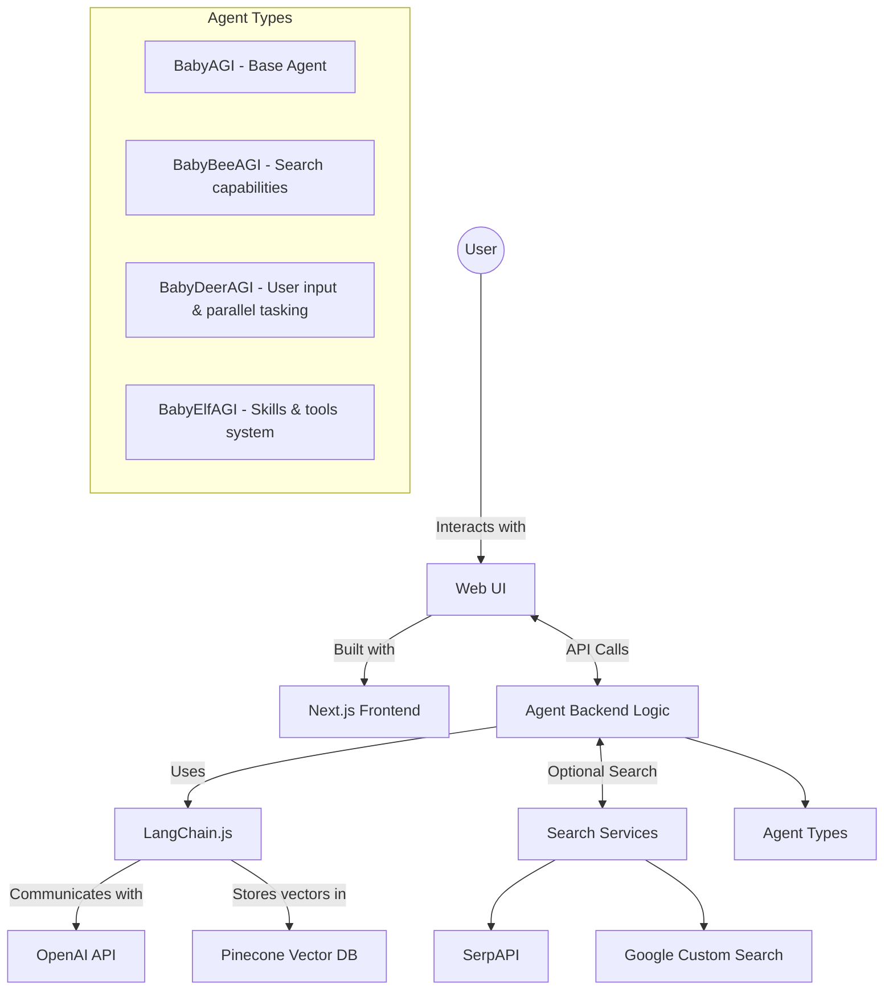
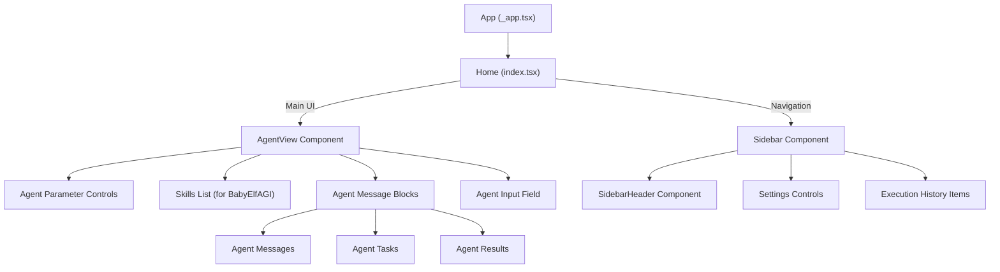
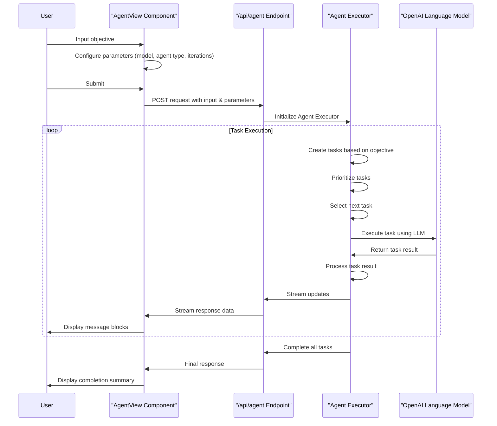
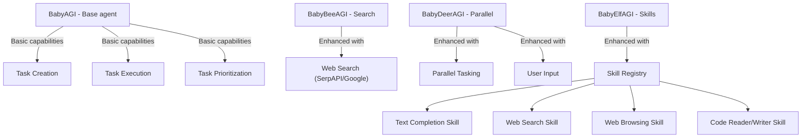
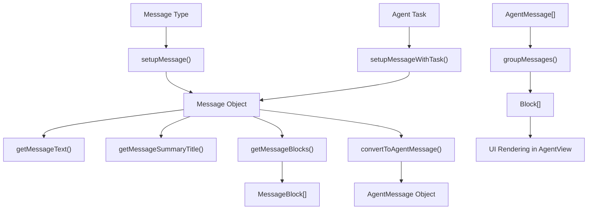
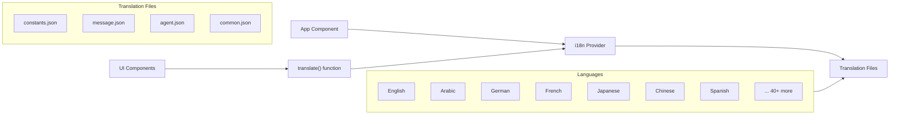

<!-- source: DeepWiki mcp.deepwiki.com · repo miurla/babyagi-ui · page 1 BabyAGI-UI Overview · fetched 2026-10-27 -->

# BabyAGI-UI Overview

<details>
<summary>Relevant source files</summary>

The following files were used as context for generating this wiki page:

- [README.md](README.md)
- [package-lock.json](package-lock.json)
- [package.json](package.json)
- [public/favicon.ico](public/favicon.ico)
- [public/images/screenshot-230722.png](public/images/screenshot-230722.png)
- [public/images/serpapi-logo.svg](public/images/serpapi-logo.svg)
- [public/og-image.png](public/og-image.png)
- [src/components/Sidebar/ExtraButton.tsx](src/components/Sidebar/ExtraButton.tsx)
- [src/components/Sidebar/SidebarHeader.tsx](src/components/Sidebar/SidebarHeader.tsx)
- [src/pages/_app.tsx](src/pages/_app.tsx)
- [src/pages/index.tsx](src/pages/index.tsx)
- [src/utils/translate.ts](src/utils/translate.ts)

</details>


This document provides an introduction to BabyAGI-UI, a web application designed to offer a user-friendly interface for interacting with autonomous AI agents based on the BabyAGI framework. It covers the system's purpose, architecture, key components, and how users can interact with it.

For more detailed information about specific components, please refer to other pages in this wiki:
- For detailed UI components, see [User Interface Components](#2)
- For in-depth agent architecture, see [Agent Architecture](#3)
- For API documentation, see [API Endpoints](#5)

## Purpose and Status

BabyAGI-UI is a port of the [original BabyAGI](https://github.com/yoheinakajima/babyagi) project that uses Langchain.js instead of the Python implementation. It creates a ChatGPT-like web interface that makes it easier to run, develop, and experiment with autonomous AI agents.

> **Note**: As of 2023, this project has been archived. Its role of allowing users to easily try out AI Agent technology has concluded as the field has advanced to the next phase.

Sources: [README.md:8-11]()

## System Architecture

BabyAGI-UI follows a modern web application architecture built around Next.js, with frontend components for user interaction and backend logic for agent execution.

### High-Level Architecture Diagram



Sources: [README.md:11-13](), [package.json:12-67]()

### Technology Stack

BabyAGI-UI is built on a modern JavaScript stack:

| Layer | Technologies |
|-------|--------------|
| Frontend | Next.js, React, Tailwind CSS, Radix UI components |
| AI Services | LangChain.js, OpenAI API |
| Data Storage | Pinecone (vector database) |
| Optional Tools | SerpAPI, Google Custom Search (for web search capability) |
| Internationalization | i18next, next-i18next (40+ languages) |

Sources: [package.json:12-67](), [README.md:21-27]()

## Core Components

### UI Component Structure

The application interface is organized into two main areas: a sidebar for navigation and an agent view for interaction.



Sources: [src/pages/index.tsx:1-11](), [src/pages/index.tsx:76-91](), [src/components/Sidebar/SidebarHeader.tsx:1-6]()

### Agent Execution Flow

The typical flow of agent execution in BabyAGI-UI:



Sources: [README.md:11-12]()

## Agent Types

BabyAGI-UI supports several types of agents, each with different capabilities:



| Agent Type | Key Features |
|------------|-------------|
| BabyAGI | Base agent with task creation, prioritization, and execution |
| BabyBeeAGI | Adds web search capabilities using SerpAPI or Google Custom Search |
| BabyDeerAGI | Adds user input and parallel task execution capabilities |
| BabyElfAGI | Adds a skill system that allows the agent to use different tools |

Sources: [README.md:29-38]()

## Message System

Messages are a core part of BabyAGI-UI, representing various types of agent communication and activity that are displayed to the user.



Sources: [README.md:12]()

## Internationalization

BabyAGI-UI features comprehensive internationalization support with over 40 languages.



The translation system is implemented through the `translate` utility function:

```typescript
// Translation usage example
import { translate } from '@/utils/translate';

// Basic translation
const text = translate('KEY');

// Translation with namespace
const text = translate('KEY', 'agent');
```

Sources: [src/utils/translate.ts:1-13](), [src/pages/_app.tsx:8-9](), [src/components/Sidebar/SidebarHeader.tsx:5](), [src/components/Sidebar/ExtraButton.tsx:5]()

## Getting Started

To set up BabyAGI-UI locally:

1. Clone the repository:
   ```bash
   git clone https://github.com/miurla/babyagi-ui
   ```

2. Navigate to the project directory:
   ```bash
   cd babyagi-ui
   ```

3. Install dependencies:
   ```bash
   npm install
   ```

4. Create and configure environment variables:
   ```bash
   cp .env.example .env
   ```
   
   You need to set up:
   - OpenAI API key
   - Pinecone API key and index
   - SerpAPI key (optional, for web search)

5. Start the development server:
   ```bash
   npm run dev
   ```

Sources: [README.md:42-75]()

## Warning

This application is designed to be run continuously as part of a task management system. Running it continuously can result in high API usage, so please use it responsibly. Additionally, the script requires the OpenAI API to be set up correctly.

Sources: [README.md:85-89]()

## Official Sponsor

[SerpApi](https://serpapi.com/) provides the search API credits for requests made on the demo site of this project.

Sources: [README.md:91-97](), [public/images/serpapi-logo.svg:1-89]()

---

