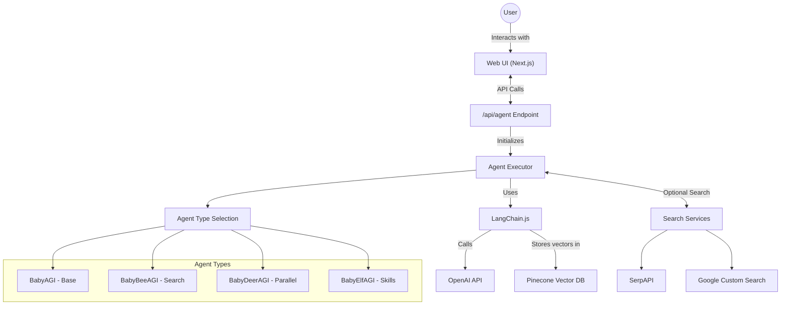
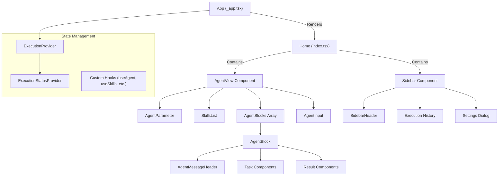
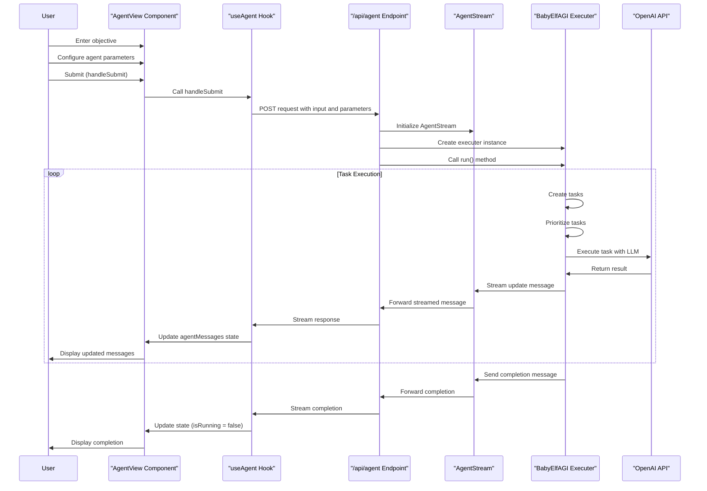
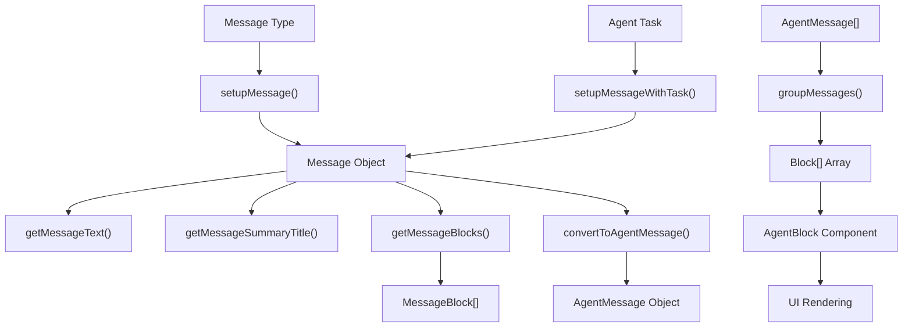
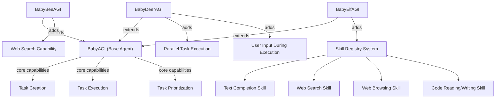
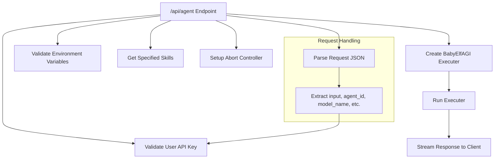

<!-- source: DeepWiki mcp.deepwiki.com · repo miurla/babyagi-ui · page 1.2 System Architecture · fetched 2026-10-27 -->

# System Architecture

<details>
<summary>Relevant source files</summary>

The following files were used as context for generating this wiki page:

- [README.md](README.md)
- [package-lock.json](package-lock.json)
- [package.json](package.json)
- [public/favicon.ico](public/favicon.ico)
- [public/images/screenshot-230722.png](public/images/screenshot-230722.png)
- [public/images/serpapi-logo.svg](public/images/serpapi-logo.svg)
- [public/og-image.png](public/og-image.png)
- [src/components/Agent/AgentView.tsx](src/components/Agent/AgentView.tsx)
- [src/components/Sidebar/ExtraButton.tsx](src/components/Sidebar/ExtraButton.tsx)
- [src/components/Sidebar/SidebarHeader.tsx](src/components/Sidebar/SidebarHeader.tsx)
- [src/hooks/useAgent.ts](src/hooks/useAgent.ts)
- [src/pages/_app.tsx](src/pages/_app.tsx)
- [src/pages/api/agent/index.ts](src/pages/api/agent/index.ts)
- [src/pages/index.tsx](src/pages/index.tsx)
- [src/utils/translate.ts](src/utils/translate.ts)

</details>


This document provides a comprehensive overview of the BabyAGI-UI system architecture. It describes the core components, their interactions, and the data flow between frontend, backend, and external services. For information about getting started with the system, see [Getting Started](#1.1).

## Core Architecture Overview

BabyAGI-UI is a web application built with Next.js that provides a user-friendly interface for interacting with autonomous AI agents. The system is architected as a modern web application with a clear separation between frontend UI components and backend agent processing logic.



The system consists of the following major components:
- A Next.js frontend providing the user interface
- An API endpoint that handles agent execution
- Multiple agent implementations with different capabilities
- Integration with external services like OpenAI API and Pinecone
- Optional search capabilities through SerpAPI or Google Custom Search

Sources: [README.md:11-12](), [package.json:23-56](), [src/pages/api/agent/index.ts:11-34]()

## Frontend Architecture

The frontend architecture is implemented using React components with Next.js. The main application structure starts with the `_app.tsx` component, which sets up global providers for themes, internationalization, and execution state management.



The Home component (`index.tsx`) manages the main UI structure and state:
- It renders the `AgentView` for the main UI area
- It renders the `Sidebar` for navigation
- It manages the UI state like sidebar visibility

The `AgentView` component is the heart of the user interface:
- It maintains the agent state and messages
- It manages user interactions and agent execution
- It renders agent parameters, skills, message blocks, and input

Sources: [src/pages/_app.tsx:11-32](), [src/pages/index.tsx:13-95](), [src/components/Agent/AgentView.tsx:37-251]()

## Agent Execution Flow

The execution flow represents how a user objective is processed by the system, from input to completed task.



Key steps in this process:
1. User inputs objective and configures parameters in the UI
2. The `AgentView` component captures the input and passes it to the `useAgent` hook
3. The hook sends a POST request to the `/api/agent` endpoint
4. The endpoint initializes an AgentStream for real-time communication
5. The endpoint creates a BabyElfAGI executer instance and runs it
6. The executer creates, prioritizes, and executes tasks
7. Results are streamed back to the UI in real-time via the AgentStream
8. The `AgentView` component updates the UI with the messages received

Sources: [src/components/Agent/AgentView.tsx:75-102](), [src/hooks/useAgent.ts:37-273](), [src/pages/api/agent/index.ts:11-34]()

## Message Processing System

The message system handles the transformation of agent tasks and responses into structured UI components.



The message system:
1. Converts agent tasks into Message objects using utility functions
2. Processes Messages to extract text, generate titles, and create message blocks
3. Converts Messages to AgentMessages for UI rendering
4. Groups AgentMessages into Blocks that represent coherent units of information
5. Renders Blocks in the UI through the AgentBlock component

In the `useAgent` hook, incoming messages from the API are parsed and stored in the `agentMessages` state, which is then used by the `AgentView` component to render the UI.

Sources: [src/hooks/useAgent.ts:117-155](), [src/components/Agent/AgentView.tsx:173-186]()

## Agent Types and Skills

BabyAGI-UI implements different types of agents with varying capabilities:



Each agent type builds on the base BabyAGI functionality:
- **BabyAGI**: Basic task creation, execution, and prioritization
- **BabyBeeAGI**: Adds web search capabilities through integration with search services
- **BabyDeerAGI**: Adds parallel task execution and user input during execution
- **BabyElfAGI**: Adds a skill registry system that allows the agent to use different tools and skills

The skills system used by BabyElfAGI allows it to perform actions such as text completion, web search, web browsing, and code manipulation.

Sources: [README.md:29-34](), [src/pages/api/agent/index.ts:22-32]()

## Integration with External Services

BabyAGI-UI integrates with several external services to provide its functionality:

| Service | Purpose | Integration Point |
|---------|---------|-------------------|
| OpenAI API | Powers the language models used by the agents | LangChain.js |
| Pinecone | Vector database for storing and retrieving task context | LangChain.js |
| SerpAPI | Web search capability for BabyBeeAGI and search skills | Agent executers |
| Google Custom Search | Alternative web search provider | Agent executers |

The integration with these services is managed through environment variables and configuration settings, which must be properly set up for the system to function correctly.

Sources: [README.md:23-26](), [README.md:62-65]()

## Internationalization Architecture

BabyAGI-UI includes extensive internationalization support:

```mermaid
graph TD
    App["App Component"] --> I18nProvider["i18n Provider (next-i18next)"]
    I18nProvider --> Translations["Translation Files"]
    
    subgraph "Translation Files"
        Constants["constants.json"]
        Message["message.json"]
        Agent["agent.json"]
        Common["common.json"]
    end
    
    subgraph "Language Support"
        English["English"]
        Arabic["Arabic"]
        German["German"]
        Japanese["Japanese"]
        Chinese["Chinese"]
        OtherLanguages["40+ other languages"]
    end
    
    Translations --> TranslateFunction["translate() Function"]
    Components["UI Components"] --> TranslateFunction
    TranslateFunction --> LocalizedText["Localized Text in UI"]
    
    Language Support --> Translations
```

The internationalization system:
1. Uses `next-i18next` for i18n support
2. Provides translation files for different aspects of the application (constants, messages, agent-related text, common UI elements)
3. Supports over 40 languages
4. Uses a `translate()` utility function that components call to get localized text

Sources: [src/utils/translate.ts:1-13](), [src/pages/_app.tsx:8-9](), [src/pages/index.tsx:97-109]()

## API Architecture

The primary API endpoint in BabyAGI-UI is the `/api/agent` endpoint, which handles agent execution requests:



The API endpoint:
1. Receives POST requests from the frontend
2. Validates environment variables and user API keys
3. Determines which skills to use based on the agent type
4. Sets up an abort controller for request cancellation
5. Creates a BabyElfAGI executer with the appropriate parameters
6. Runs the executer and streams the response back to the client

Sources: [src/pages/api/agent/index.ts:11-64]()

## Conclusion

BabyAGI-UI is a modern web application built with Next.js that provides a user-friendly interface for interacting with autonomous AI agents. The architecture is designed to be modular, flexible, and extensible, allowing for easy addition of new agent types and capabilities.

The system's core strengths include:
- Clear separation of frontend and backend concerns
- Real-time communication through streaming responses
- Support for different agent types with varying capabilities
- Extensive internationalization support
- Integration with external services for enhanced functionality

This architecture enables users to easily experiment with different AI agent configurations and use them for a variety of tasks.

---

