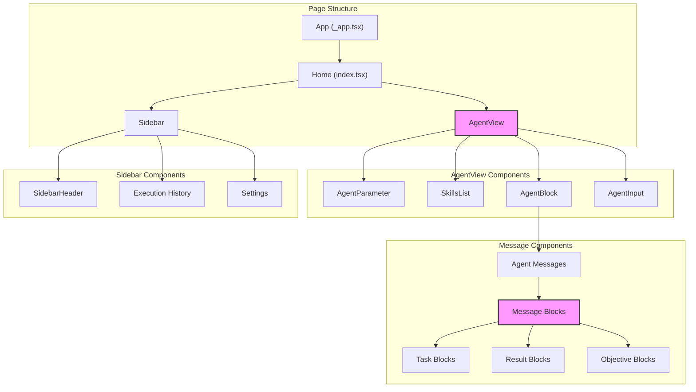
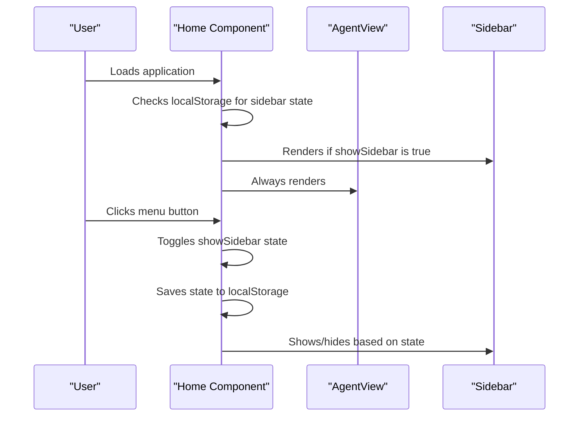
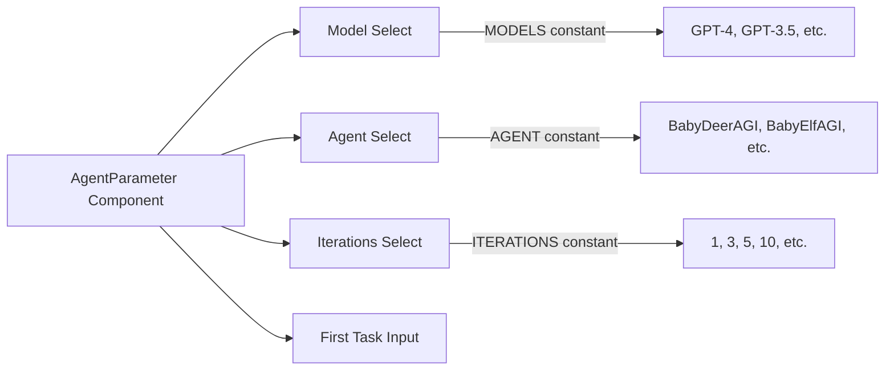
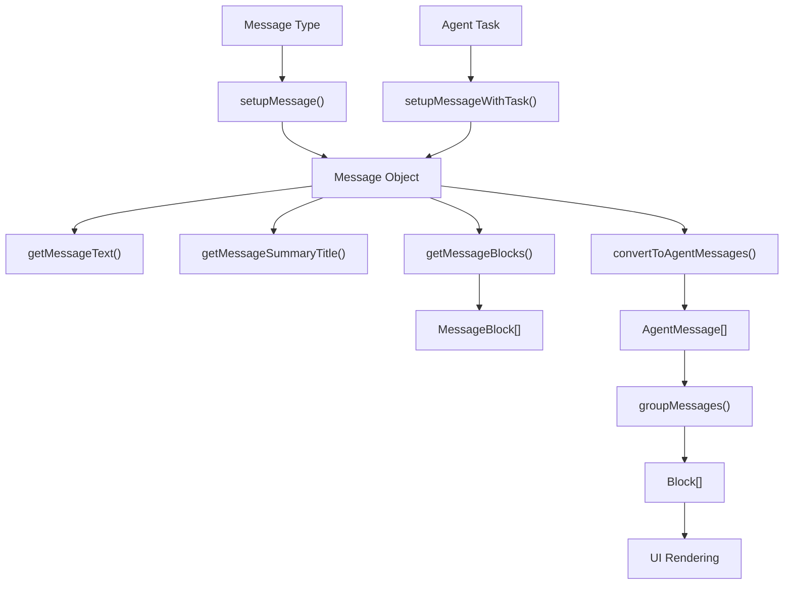
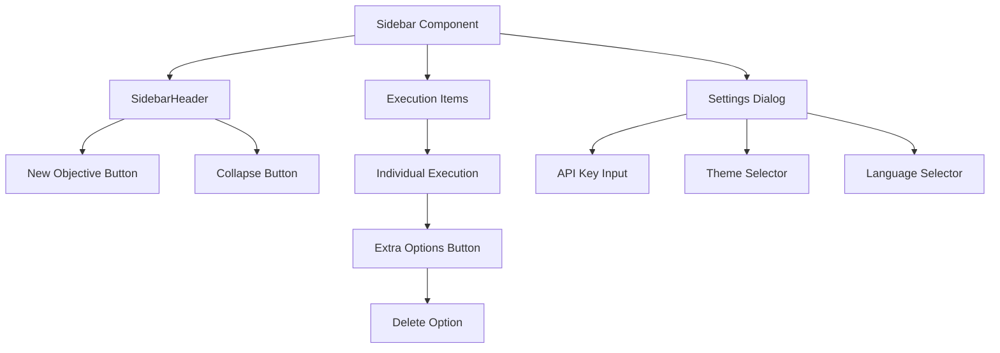
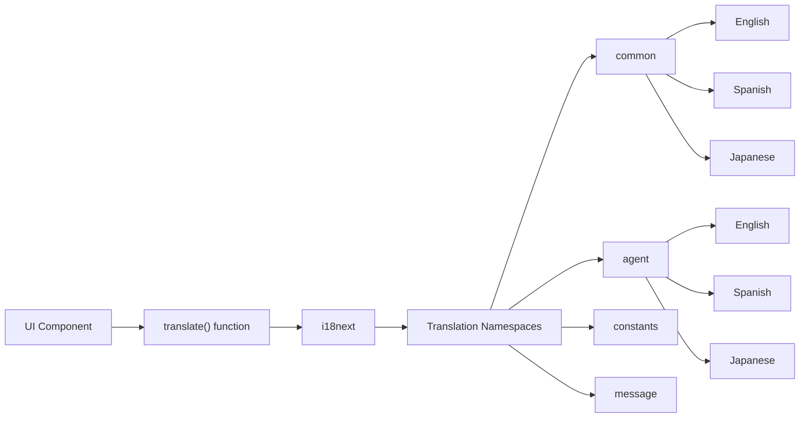
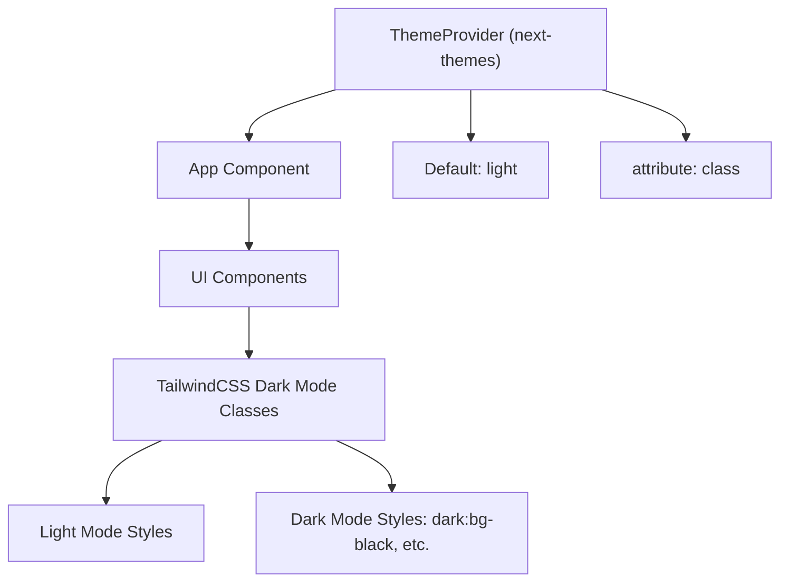
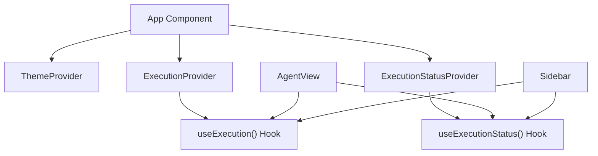

<!-- source: DeepWiki mcp.deepwiki.com · repo miurla/babyagi-ui · page 2 User Interface Components · fetched 2026-10-27 -->

# User Interface Components

<details>
<summary>Relevant source files</summary>

The following files were used as context for generating this wiki page:

- [package-lock.json](package-lock.json)
- [package.json](package.json)
- [src/components/Agent/AgentParameter.tsx](src/components/Agent/AgentParameter.tsx)
- [src/components/Sidebar/ExtraButton.tsx](src/components/Sidebar/ExtraButton.tsx)
- [src/components/Sidebar/SidebarHeader.tsx](src/components/Sidebar/SidebarHeader.tsx)
- [src/pages/_app.tsx](src/pages/_app.tsx)
- [src/pages/index.tsx](src/pages/index.tsx)
- [src/types/index.ts](src/types/index.ts)
- [src/utils/constants.ts](src/utils/constants.ts)
- [src/utils/message.ts](src/utils/message.ts)
- [src/utils/translate.ts](src/utils/translate.ts)

</details>


The User Interface Components in BabyAGI-UI provide a structured, responsive way for users to interact with AI agents. This document covers the core UI architecture, component hierarchy, and the message display system that powers the interface. For information about the Agent architecture itself, see [Agent Architecture](#3), and for details on the underlying message formatting utilities, see [Message Formatting Utilities](#4.1).

## UI Component Architecture Overview

BabyAGI-UI uses a React-based UI built with Next.js, styled with Tailwind CSS, and enhanced with component libraries like Radix UI and Headless UI. The interface is designed to be responsive, with appropriate layouts for both desktop and mobile devices.



Sources: [src/pages/_app.tsx:1-33](), [src/pages/index.tsx:1-112](), [src/components/Agent/AgentParameter.tsx:1-96]()

## Main Page Structure

The UI is organized around two primary components:

1. **AgentView**: The main workspace where users interact with agents
2. **Sidebar**: Navigation and configuration panel

The visibility of the sidebar is controlled through state management, allowing users to toggle it on smaller screens.



Sources: [src/pages/index.tsx:13-45]()

## AgentView Component

The AgentView is the central interface component where users interact with agents. It contains several key sub-components:

1. **AgentParameter**: Controls for configuring the agent (model, iterations, etc.)
2. **Agent Block**: Displays agent messages, tasks, and results
3. **Agent Input**: Allows users to enter their objective

### AgentParameter Component

This component provides a UI for configuring the agent before execution. It allows selection of:

- **Model**: The language model to use (GPT-4, GPT-3.5 Turbo)
- **Agent Type**: The agent implementation (BabyDeerAGI, BabyElfAGI, etc.)
- **Iterations**: Number of task iterations for the agent to perform
- **First Task**: The initial task for certain agent types



Sources: [src/components/Agent/AgentParameter.tsx:1-96](), [src/utils/constants.ts:1-92]()

## Message System

The message system is a core part of the UI, transforming agent outputs into structured, visual elements. The BabyAGI-UI has a sophisticated message handling system that processes different types of messages (objectives, tasks, results) and displays them appropriately.

### Message Types and Structure

The UI supports various message types defined in the `MessageType` enum:

```mermaid
classDiagram
    class Message {
        id?: number
        text: string
        type: MessageType
        icon?: string
        title?: string
        bgColor?: string
        status?: AgentStatus
        open?: boolean
        dependentTaskIds?: number[]
    }
    
    class MessageType {
        <<enumeration>>
        objective
        task-list
        next-task
        task-result
        task-output
        task-result-summary
        search-logs
        loading
        end-of-iterations
        session-summary
        done
        complete
        failed
        user-input
        task-execute
        final-result
    }
    
    class MessageBlock {
        id?: number
        messages: Message[]
        status?: "complete" | "incomplete" | "running"
        type?: MessageType
    }
    
    class AgentMessage {
        id?: string
        content: string
        type?: string
        title?: string
        icon?: string
        taskId?: string
        style?: "text" | "log"
        status?: "complete" | "incomplete" | "running"
        options?: { [key: string]: string }
    }
    
    class Block {
        id?: string
        messages: AgentMessage[]
        status?: "complete" | "incomplete" | "running"
        style?: "label" | "task"
    }
    
    Message --> MessageType: has
    MessageBlock o-- Message: contains
    Block o-- AgentMessage: contains
```

Sources: [src/types/index.ts:1-166]()

### Message Processing Flow

Messages go through several transformation steps before being displayed in the UI:



Sources: [src/utils/message.ts:14-516]()

## Message Display Components

The UI renders different message components based on the message type and status:

1. **ObjectiveBlock**: Displays the user's objective
2. **TaskBlock**: Shows individual tasks with status indicators
3. **ResultBlock**: Presents task results and summaries
4. **LoadingBlock**: Indicates active processing

Each message type has specific styling, icons, and formatting to visually distinguish them in the interface.

### Icon and Title Mapping

Messages are displayed with appropriate icons and titles based on their type:

| Message Type | Icon | Title Translation Key |
|--------------|------|------------------------|
| objective | 🎯 | OBJECTIVE |
| task-list | 📝 | TASK_LIST |
| next-task | 👉 | NEXT_TASK |
| task-result | ✅ | TASK_RESULT |
| loading | ⏳ | LOADING |
| complete | 🏁 | FINISHED |

Special tools also have their own icons:
- Web search: 🔍
- Web scrape: 📄
- Text completion: 🤖
- User input: 🧑‍💻

Sources: [src/utils/message.ts:14-115](), [src/utils/message.ts:360-397]()

## Sidebar Components

The sidebar provides navigation and access to saved executions and settings:



Sources: [src/components/Sidebar/SidebarHeader.tsx:1-34](), [src/components/Sidebar/ExtraButton.tsx:1-43]()

## Internationalization Support

The UI components support multiple languages through the i18next internationalization framework. Text elements use the `translate()` function to fetch localized strings.



Sources: [src/utils/translate.ts:1-14]()

## Theme Support

The application provides light and dark themes using the `next-themes` library. Theme settings are persisted and respected based on user preferences and system settings.



Sources: [src/pages/_app.tsx:1-33]()

## UI Component Communication

Components in BabyAGI-UI communicate through a combination of:

1. **Props**: Direct parent-child communication
2. **Context Providers**: Shared state across component trees
3. **Hooks**: Custom state management and API interactions



Sources: [src/pages/_app.tsx:11-30]()

## UI Responsiveness

The interface adapts to different screen sizes using Tailwind CSS responsive classes. On smaller screens, the sidebar can be collapsed to provide more space for the main content area.

The UI state, including sidebar visibility, is persisted in the browser's localStorage to maintain consistent user experience across page reloads.

Sources: [src/pages/index.tsx:14-34]()

## Conclusion

The BabyAGI-UI interface components create a cohesive system for interacting with AI agents. The component architecture separates concerns effectively, with dedicated components for agent configuration, message display, and navigation. The message system is particularly sophisticated, transforming structured data into visually meaningful representations of agent tasks and results.

For detailed information about the agent implementation itself, see [Agent Architecture](#3), and for the utilities that power the message formatting, see [Message Formatting Utilities](#4.1).

---

