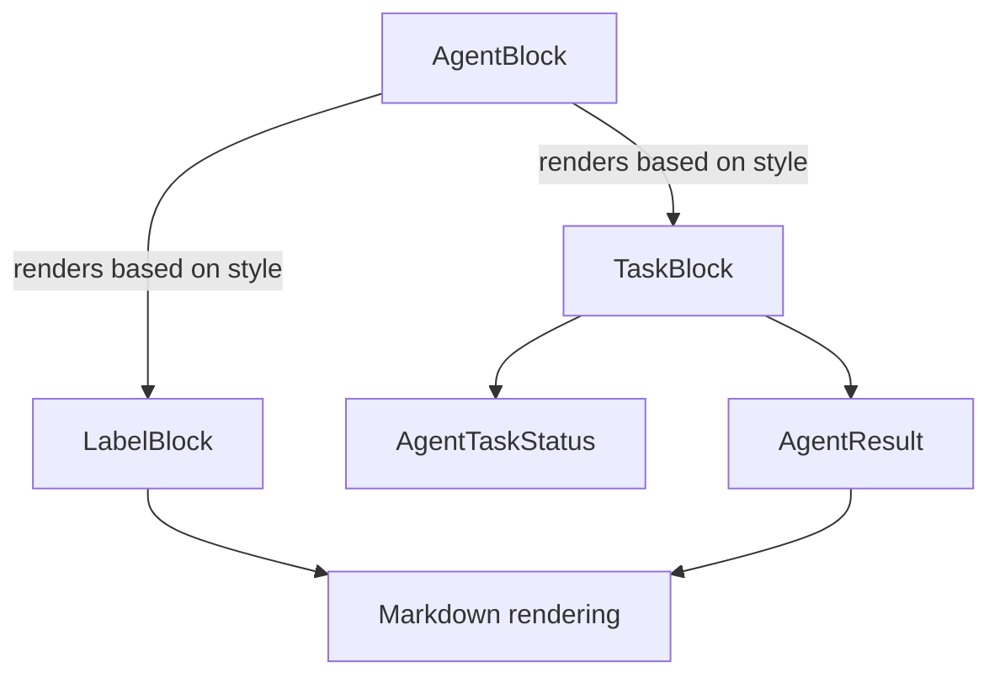
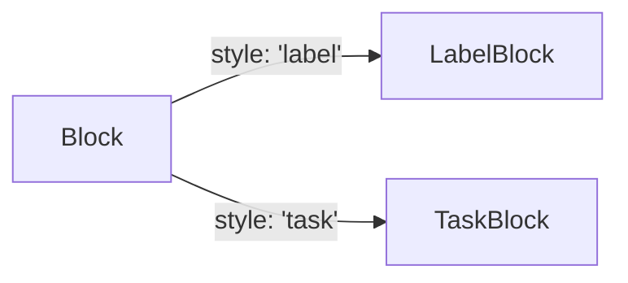
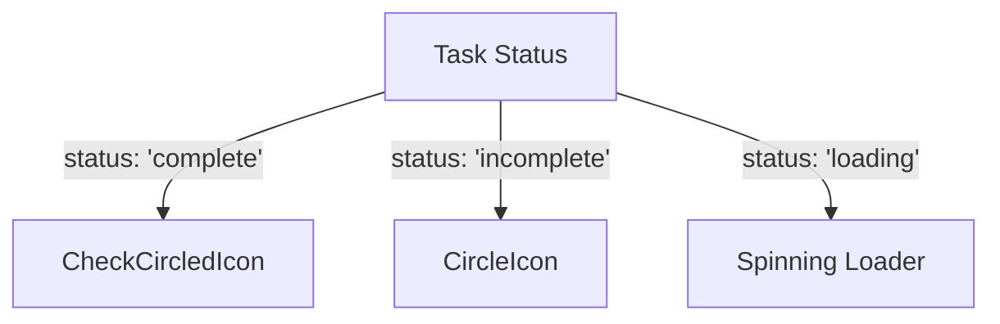
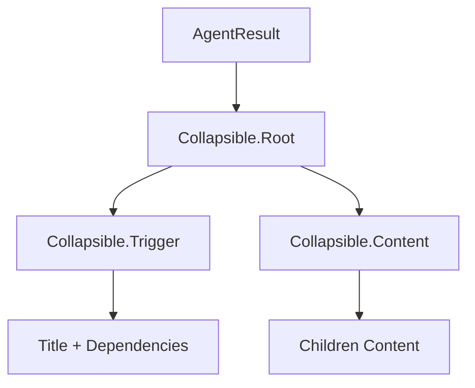
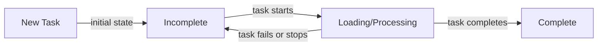
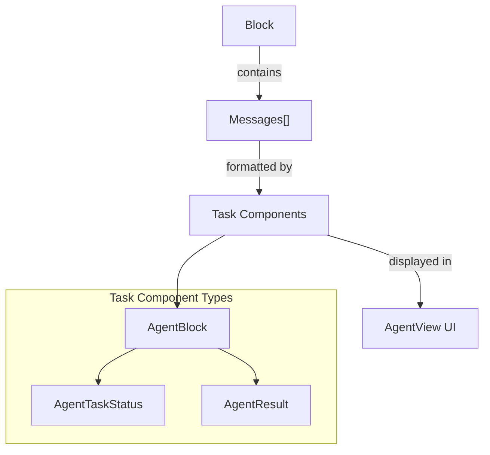
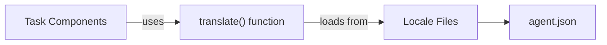

<!-- source: DeepWiki mcp.deepwiki.com · repo miurla/babyagi-ui · page 2.3 Agent Task Components · fetched 2026-10-27 -->

# Agent Task Components

Relevant source files

The following files were used as context for generating this wiki page:

- [public/locales/en/agent.json](public/locales/en/agent.json)
- [src/components/Agent/AgentBlock.tsx](src/components/Agent/AgentBlock.tsx)
- [src/components/Agent/AgentLoading.tsx](src/components/Agent/AgentLoading.tsx)
- [src/components/Agent/AgentResult.tsx](src/components/Agent/AgentResult.tsx)
- [src/components/Agent/AgentTastStatus.tsx](src/components/Agent/AgentTastStatus.tsx)
- [src/components/Agent/LabelBlock.tsx](src/components/Agent/LabelBlock.tsx)
- [src/components/Agent/Markdown.tsx](src/components/Agent/Markdown.tsx)

This document details the components used for visualizing agent tasks, their status, and results in the BabyAGI-UI system. These components are essential for displaying the agents' work, progress, and outputs in a structured and readable format within the user interface. For information about the overall agent message system, see [Agent Message System](#2.2).

## Component Overview

The agent task components form a hierarchy of React components that work together to visualize different aspects of agent tasks:

Sources: [src/components/Agent/AgentBlock.tsx](), [src/components/Agent/TaskBlock.tsx](), [src/components/Agent/LabelBlock.tsx]()

## AgentBlock Component

The `AgentBlock` component serves as the primary wrapper for displaying agent tasks and messages. It determines which specialized component to render based on the block's style.

The component takes a `Block` object as input and renders either a `LabelBlock` or a `TaskBlock` based on the `style` property.

Sources: [src/components/Agent/AgentBlock.tsx:10-20]()

## Task Visualization Components

### TaskBlock Component

While not directly visible in the provided files, the `TaskBlock` component is referenced in `AgentBlock.tsx`. It's responsible for rendering task blocks with their status and results.

### LabelBlock Component

The `LabelBlock` component displays message blocks that contain informational labels rather than tasks. It handles special formatting for different message types, including session summaries.

Key features:
- Renders an emoji icon based on the message type
- Displays a title and content using markdown formatting
- Includes special handling for session summary messages, with a download option

Sources: [src/components/Agent/LabelBlock.tsx:8-73]()

## Task Status Visualization

### AgentTaskStatus Component

The `AgentTaskStatus` component displays the current status of a task using appropriate visual indicators:

The component visually represents three possible states:
- Complete: Displayed with a green check circle
- Incomplete: Displayed with an empty circle
- Loading/in-progress: Displayed with a spinning loader animation

Sources: [src/components/Agent/AgentTastStatus.tsx:1-20]()

## Task Result Visualization

### AgentResult Component

The `AgentResult` component is a collapsible container that displays task results. It provides a clean interface for showing or hiding detailed task outputs.

Key features:
- Collapsible interface with toggle control
- Shows task title and optional dependencies
- Dependencies can be displayed as links to other tasks
- Can be configured to be initially open or closed

Sources: [src/components/Agent/AgentResult.tsx:6-52]()

## Helper Components

### AgentLoading Component

The `AgentLoading` component displays a loading indicator with a message while an agent is processing or performing tasks.

Key features:
- Displays an animated spinning icon
- Shows a custom loading message
- Provides visual feedback during agent processing

Sources: [src/components/Agent/AgentLoading.tsx:4-25]()

### Markdown Component

The `Markdown` component is a simple wrapper around `ReactMarkdown` that renders markdown content with GitHub Flavored Markdown support. It's used throughout the task components to display formatted text.

Sources: [src/components/Agent/Markdown.tsx:1-14]()

## Task Status Flow

The following diagram illustrates how a task transitions between different status states:

Sources: [src/components/Agent/AgentTastStatus.tsx:8-19]()

## Integration with Message System

The task components integrate with the broader message system to display task-related information within the UI:

The agent task components translate the abstract message and block data structures into visual UI elements that help users understand the agent's activities and progress.

Sources: [src/components/Agent/AgentBlock.tsx](), [src/components/Agent/AgentTastStatus.tsx](), [src/components/Agent/AgentResult.tsx]()

## Internationalization Support

The task components include internationalization support for user-facing text, enabling localized experiences:

Task-related messages that can be translated include:
- Task completion notifications
- Download prompts
- Execution status messages

Sources: [src/components/Agent/LabelBlock.tsx:52](), [public/locales/en/agent.json:1-7]()

## Summary

The agent task components form a cohesive system for visualizing agent activities in the BabyAGI-UI interface. By breaking down complex agent tasks into visual elements with clear status indicators and collapsible results, these components make it easier for users to understand and interact with autonomous AI agents. The components are designed to be flexible, supporting different types of task outputs and integrating with the broader message system and internationalization framework.

---

