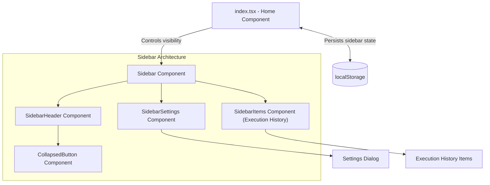
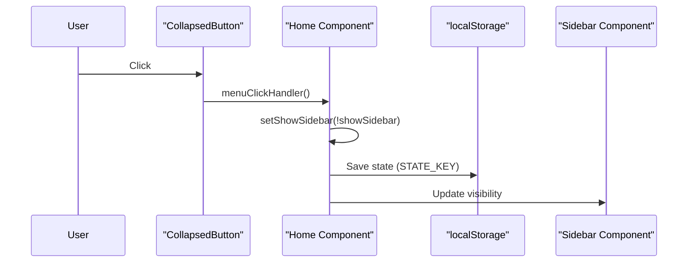
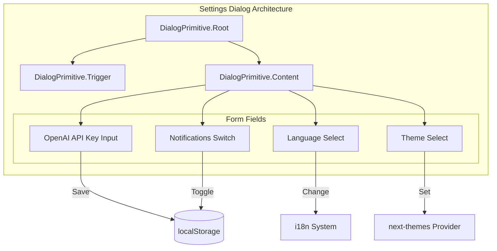
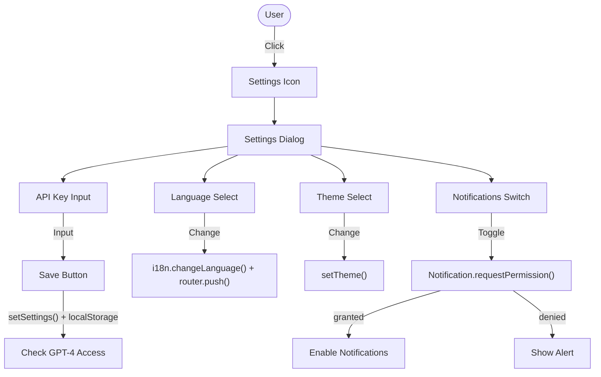
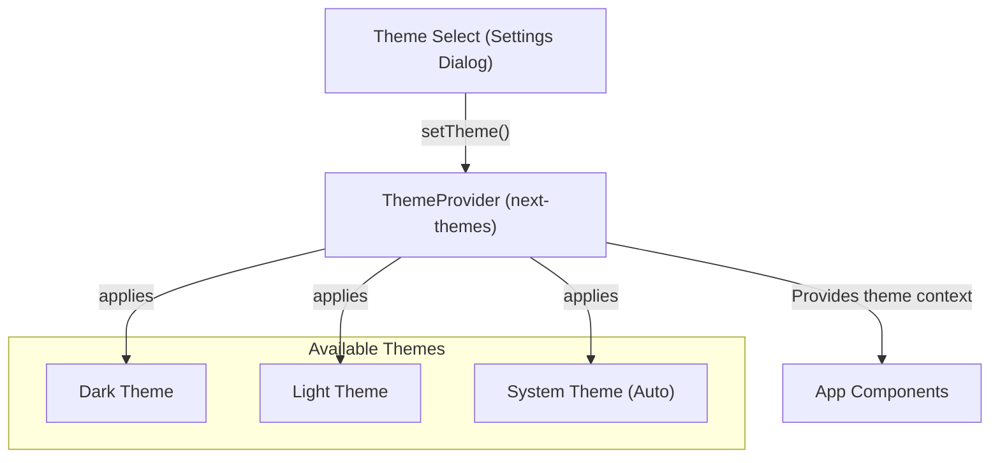
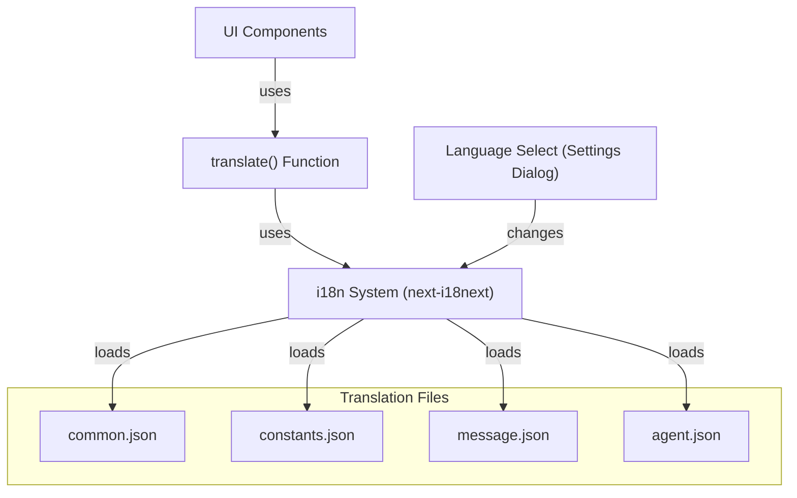
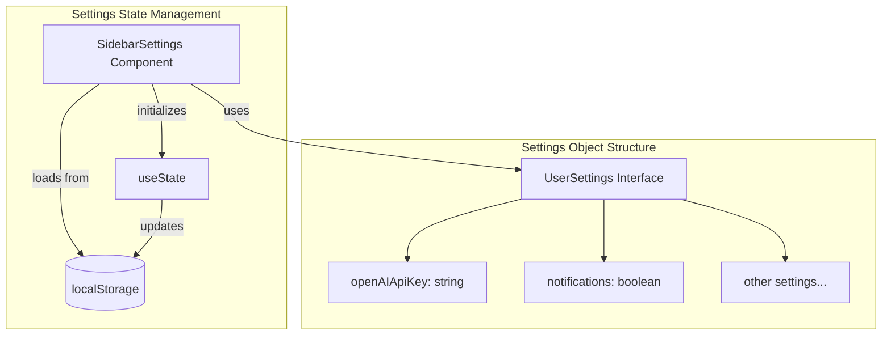
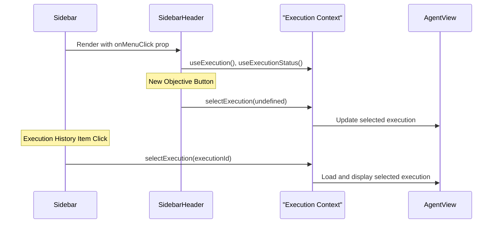
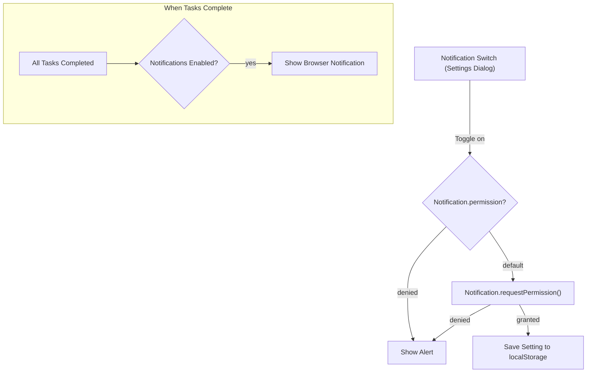

<!-- source: DeepWiki mcp.deepwiki.com · repo miurla/babyagi-ui · page 2.5 Sidebar and Settings · fetched 2026-10-27 -->

# Sidebar and Settings

Relevant source files

The following files were used as context for generating this wiki page:

- [package-lock.json](package-lock.json)
- [package.json](package.json)
- [public/locales/en/constants.json](public/locales/en/constants.json)
- [public/locales/gb/agent.json](public/locales/gb/agent.json)
- [public/locales/gb/common.json](public/locales/gb/common.json)
- [public/locales/gb/constants.json](public/locales/gb/constants.json)
- [public/locales/gb/message.json](public/locales/gb/message.json)
- [src/components/Sidebar/ExtraButton.tsx](src/components/Sidebar/ExtraButton.tsx)
- [src/components/Sidebar/SidebarHeader.tsx](src/components/Sidebar/SidebarHeader.tsx)
- [src/components/Sidebar/SidebarSettings.tsx](src/components/Sidebar/SidebarSettings.tsx)
- [src/pages/_app.tsx](src/pages/_app.tsx)
- [src/pages/index.tsx](src/pages/index.tsx)
- [src/utils/translate.ts](src/utils/translate.ts)

This page documents the Sidebar and Settings components in BabyAGI-UI. The Sidebar provides navigation and quick access to configuration options, while the Settings dialog allows users to customize their experience through various preferences.

For information about the main agent interface, see [AgentView Component](#2.1). For agent configuration options, see [Agent Configuration Components](#2.4).

## 1. Sidebar Architecture

The Sidebar in BabyAGI-UI serves as a navigation panel that can be toggled on and off. It contains three primary sections:

1. **Header** - Contains the "New objective" button and collapse control
2. **Settings** - Provides access to the settings dialog
3. **Execution History** - Lists previous agent executions

The sidebar visibility state is persisted in localStorage, allowing the application to remember the user's preference across sessions.

Sources: [src/pages/index.tsx:14-44](). [src/components/Sidebar/SidebarHeader.tsx:12-33]()

### Sidebar Toggle Mechanism

The sidebar's visibility can be toggled using a button in the top-left corner of the application. When the sidebar is hidden, clicking this button makes it visible, and vice versa.

Sources: [src/pages/index.tsx:41-44](), [src/pages/index.tsx:85-91]()

## 2. Settings Dialog

The Settings dialog is accessed through the Sidebar and provides a central location for configuring application preferences. It is implemented using Radix UI's Dialog primitive with a custom styled overlay and content area.

### Available Settings

| Setting | Description | Storage |
|---------|-------------|---------|
| OpenAI API Key | Used for accessing OpenAI models | localStorage (SETTINGS_KEY) |
| Language | UI language selection (40+ languages) | Managed by next-i18next |
| Theme | UI theme (Dark, Light, System) | Managed by next-themes |
| Notifications | Browser notifications when tasks complete | localStorage (SETTINGS_KEY) |

Sources: [src/components/Sidebar/SidebarSettings.tsx:18-134](), [src/components/Sidebar/SidebarSettings.tsx:180-289]()

### Settings Dialog Flow

When a user interacts with the Settings dialog, the application takes specific actions depending on the setting changed:

Sources: [src/components/Sidebar/SidebarSettings.tsx:34-123]()

## 3. Theme System

BabyAGI-UI supports three theme options:

1. **Dark** - Dark background with light text
2. **Light** - Light background with dark text
3. **System** - Follows the user's system preferences

The theme system is implemented using the `next-themes` library, which provides a React context for managing theme preferences. The theme setting is persisted automatically by the library.

Sources: [src/pages/_app.tsx:11-32](), [src/components/Sidebar/SidebarSettings.tsx:255-273]()

## 4. Internationalization

The Sidebar and Settings components use the `next-i18next` library for internationalization. The translation system allows users to switch between over 40 languages, with translation files organized by feature domain.

### Translation System

Translations are managed through JSON files in the `public/locales/<language_code>/` directory, with separate files for different domains:

- `common.json` - General UI text
- `constants.json` - Constants and fixed values
- `message.json` - Message-related text
- `agent.json` - Agent-related text

The `translate` utility function is used throughout the components to translate text based on the current language setting.

Sources: [src/utils/translate.ts:1-13](), [src/components/Sidebar/SidebarSettings.tsx:227-246](), [public/locales/en/constants.json:1-26](), [public/locales/gb/common.json:1-26]()

## 5. User Settings Storage

User settings are stored in the browser's localStorage under a key defined by `SETTINGS_KEY`. The settings are managed through the React `useState` hook in the `SidebarSettings` component.

Sources: [src/components/Sidebar/SidebarSettings.tsx:26-32](), [src/components/Sidebar/SidebarSettings.tsx:95-107]()

## 6. Sidebar-Agent Interaction

The Sidebar interacts with the agent system through the `useExecution` and `useExecutionStatus` hooks, which provide access to the current execution state and control functions.

Sources: [src/components/Sidebar/SidebarHeader.tsx:13-18]()

## 7. Notification System

The Settings dialog includes an option to enable browser notifications when all agent tasks are completed. This feature uses the Browser Notifications API and requires user permission.

Sources: [src/components/Sidebar/SidebarSettings.tsx:74-93]()

This comprehensive documentation of the Sidebar and Settings components provides developers with a clear understanding of the navigation and configuration systems in BabyAGI-UI, including their architecture, state management, internationalization capabilities, and interactions with other parts of the application.

---

