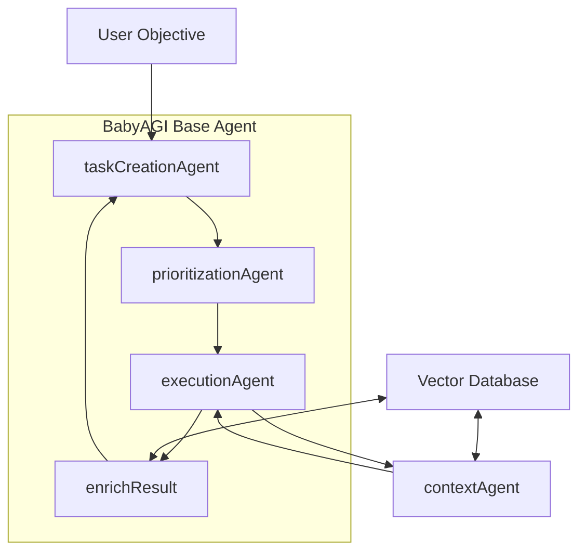
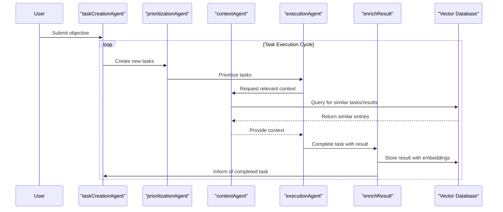
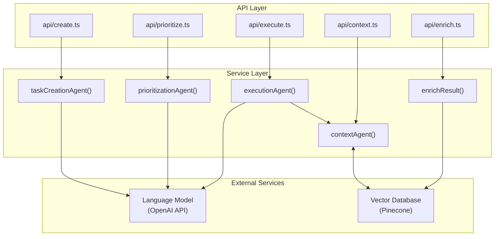
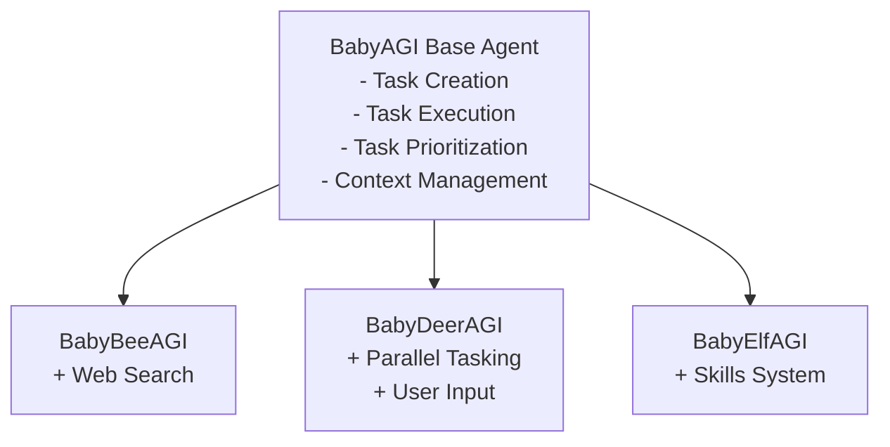

<!-- source: DeepWiki mcp.deepwiki.com · repo miurla/babyagi-ui · page 3.1 BabyAGI Base Agent · fetched 2026-10-27 -->

# BabyAGI Base Agent

Relevant source files

The following files were used as context for generating this wiki page:

- [src/pages/api/context.ts](src/pages/api/context.ts)
- [src/pages/api/create.ts](src/pages/api/create.ts)
- [src/pages/api/enrich.ts](src/pages/api/enrich.ts)
- [src/pages/api/execute.ts](src/pages/api/execute.ts)
- [src/pages/api/prioritize.ts](src/pages/api/prioritize.ts)
- [tailwind.config.js](tailwind.config.js)

## Purpose and Scope

This document describes the BabyAGI Base Agent, which serves as the foundation for all agent types in the BabyAGI-UI system. The base agent implements the core autonomous task management functionality including task creation, execution, prioritization, and context management. Other agent implementations like BabyDeerAGI ([BabyDeerAGI](#3.2)) and BabyElfAGI ([BabyElfAGI](#3.3)) extend this base agent with additional capabilities.

## Core Architecture

The BabyAGI Base Agent follows a task-based autonomous agent architecture that breaks down user objectives into manageable tasks, executes them sequentially, and learns from completed tasks to inform future actions.

**Core Components of BabyAGI Base Agent**

Sources: [src/pages/api/create.ts:1-33](), [src/pages/api/execute.ts:1-21](), [src/pages/api/prioritize.ts:1-24](), [src/pages/api/context.ts:1-27](), [src/pages/api/enrich.ts:1-19]()

## Task Management System

The BabyAGI Base Agent implements a complete task management cycle with four main components:

**BabyAGI Task Execution Flow**

Sources: [src/pages/api/execute.ts:1-21](), [src/lib/agents/babyagi/service.ts](main service implementation not shown in the provided files)

### Task Creation

The task creation component is responsible for generating new tasks based on:
- The original user objective
- Results from previously completed tasks
- Current incomplete tasks

Task creation uses the language model to intelligently identify what tasks are needed to accomplish the user's objective.

Sources: [src/pages/api/create.ts:8-32]()

### Task Prioritization

The prioritization component ranks tasks based on their importance to the overall objective. It ensures that the most critical tasks are executed first, optimizing progress toward the goal.

Sources: [src/pages/api/prioritize.ts:8-23]()

### Context Retrieval

Before executing a task, the agent retrieves relevant context from the vector database. This allows the agent to use information from previously completed tasks to better inform the current task execution.

Sources: [src/pages/api/context.ts:8-26](), [src/pages/api/execute.ts:12-13]()

### Task Execution

The execution component is responsible for actually performing the task using the language model. It receives the task details, relevant context, and produces a result.

Sources: [src/pages/api/execute.ts:13-14]()

### Result Enrichment

After a task is completed, its result is processed, embedded, and stored in the vector database for future reference. This creates a knowledge base that grows as more tasks are completed.

Sources: [src/pages/api/enrich.ts:8-16]()

## Service Implementation

The BabyAGI Base Agent's functionality is exposed through several API endpoints that correspond to the core components of the agent:

| API Endpoint | Function | Purpose |
|--------------|----------|---------|
| `/api/create.ts` | `taskCreationAgent` | Creates new tasks based on objective and results |
| `/api/prioritize.ts` | `prioritizationAgent` | Ranks tasks by importance to the objective |
| `/api/execute.ts` | `executionAgent` | Executes tasks with relevant context |
| `/api/context.ts` | `contextAgent` | Retrieves context from the vector database |
| `/api/enrich.ts` | `enrichResult` | Stores task results with embeddings |

Each of these endpoints is implemented as a Next.js Edge API route that:
1. Receives parameters from the client request
2. Calls the corresponding service function
3. Returns the results to the client

Sources: [src/pages/api/create.ts:1-33](), [src/pages/api/execute.ts:1-21](), [src/pages/api/prioritize.ts:1-24](), [src/pages/api/context.ts:1-27](), [src/pages/api/enrich.ts:1-19]()

## Integration with LLM and Vector Database

**BabyAGI Service Architecture**

Sources: [src/pages/api/create.ts:1-33](), [src/pages/api/execute.ts:1-21](), [src/pages/api/prioritize.ts:1-24](), [src/pages/api/context.ts:1-27](), [src/pages/api/enrich.ts:1-19]()

### Language Model Integration

The BabyAGI Base Agent relies heavily on language models (primarily through the OpenAI API) for:

1. **Task Creation**: Using the model to generate relevant new tasks based on the objective and previous results
2. **Task Prioritization**: Using the model to determine the relative importance of tasks
3. **Task Execution**: Using the model to actually perform the task and generate a result

Each of these components passes relevant information to the language model and uses its response to drive the agent's behavior.

Sources: [src/pages/api/create.ts:18-25](), [src/pages/api/prioritize.ts:11-16](), [src/pages/api/execute.ts:13-14]()

### Vector Database Integration

The BabyAGI Base Agent uses a vector database (typically Pinecone) for two primary purposes:

1. **Context Retrieval**: Finding relevant information from previously completed tasks to inform the current task execution
2. **Result Storage**: Storing the results of completed tasks with their vector embeddings for future reference

This integration enables the agent to maintain a growing knowledge base and learn from previous task results.

Sources: [src/pages/api/context.ts:13-19](), [src/pages/api/enrich.ts:10-11]()

## BabyAGI Base Agent vs Extended Agents

The BabyAGI Base Agent provides the core task management functionality that other agent types build upon:

**BabyAGI Agent Hierarchy**

While the BabyAGI Base Agent provides foundational autonomous task management capabilities, extended agent types add specialized features:

- **BabyBeeAGI**: Adds web search capabilities to enhance task execution with internet information
- **BabyDeerAGI**: Adds parallel task execution and interactive user input capabilities
- **BabyElfAGI**: Implements a skills-based system allowing agents to use specialized tools

For more information about these extended agent types, see [BabyDeerAGI](#3.2) and [BabyElfAGI](#3.3).

Sources: System architecture diagrams provided in the introduction

## Limitations and Considerations

The BabyAGI Base Agent has several key limitations to be aware of:

1. **Sequential Execution**: Tasks are performed one at a time, which can be inefficient for complex objectives
2. **Limited Memory**: While the vector database provides some memory, it's still limited compared to human-like contextual understanding
3. **No User Interaction**: The base agent does not support user interaction during task execution
4. **No External Tools**: The base agent cannot use specialized tools or APIs beyond the language model itself

These limitations are addressed by the extended agent types in the BabyAGI-UI system.

---

