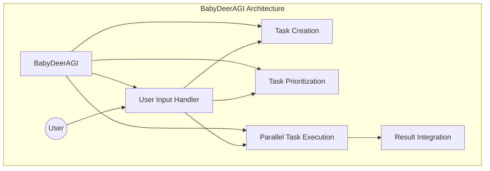
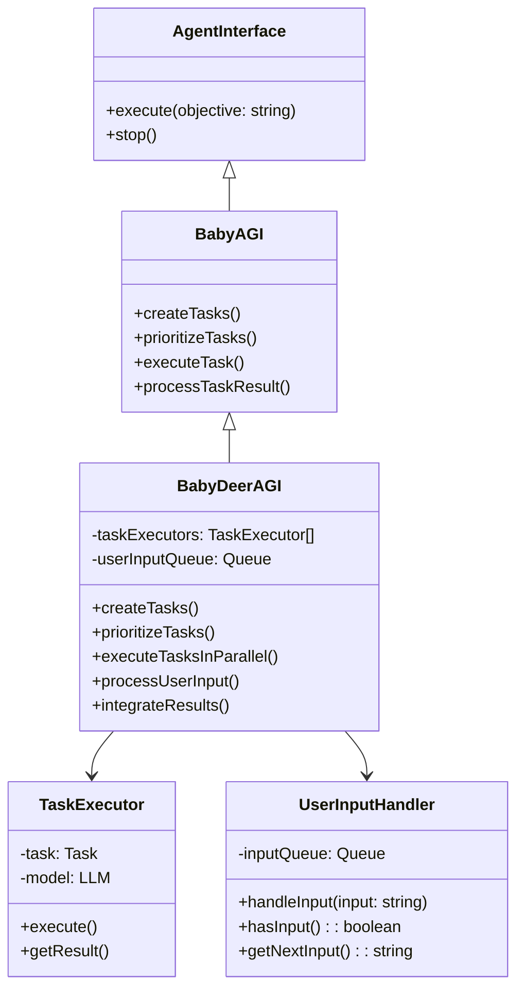
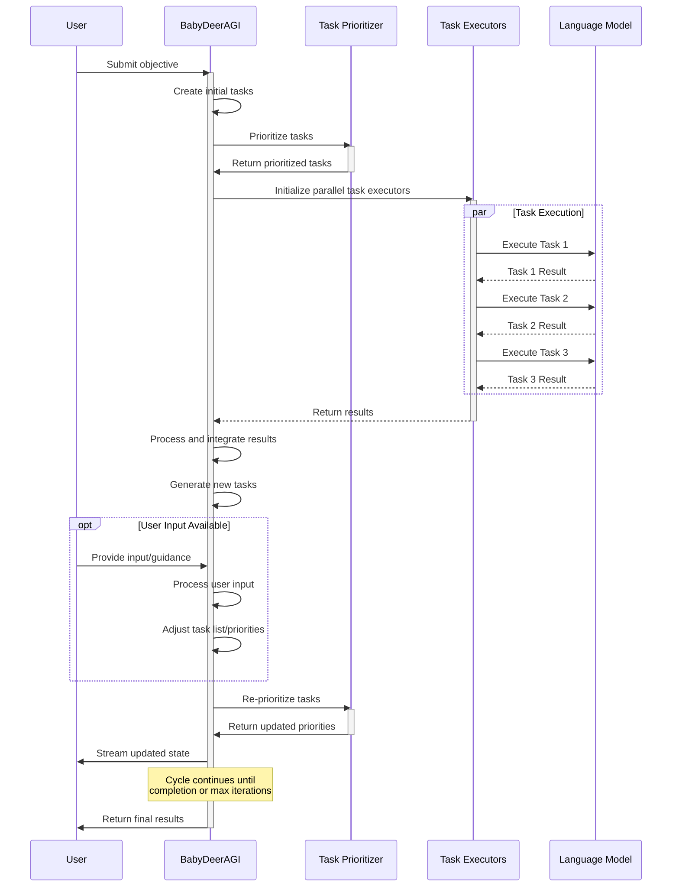
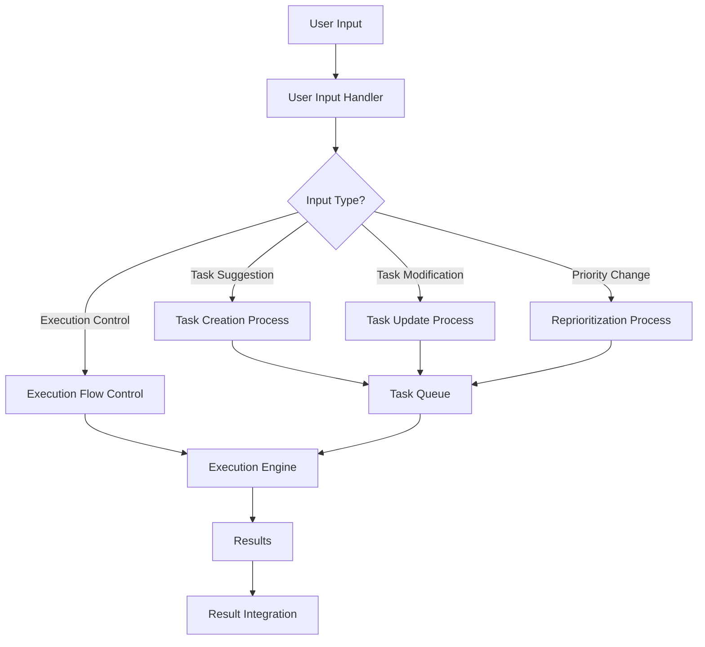
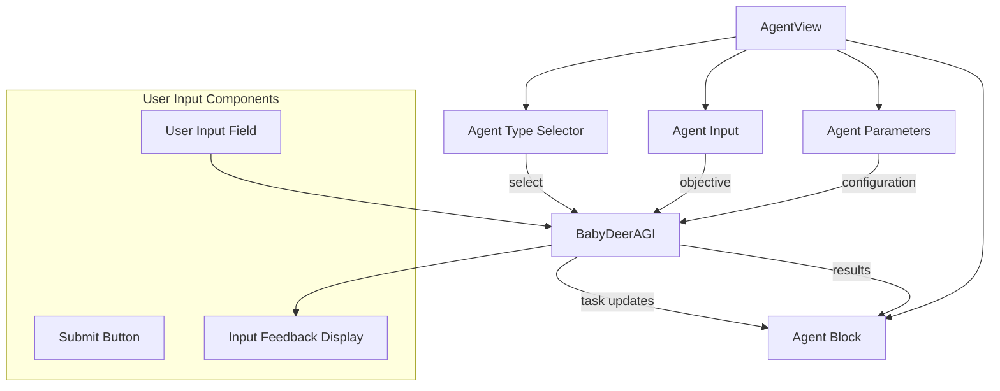

<!-- source: DeepWiki mcp.deepwiki.com · repo miurla/babyagi-ui · page 3.2 BabyDeerAGI · fetched 2026-10-27 -->

# BabyDeerAGI

Relevant source files

The following files were used as context for generating this wiki page:

- [src/components/Agent/AgentCollapsible.tsx](src/components/Agent/AgentCollapsible.tsx)

## Purpose and Scope

BabyDeerAGI is an advanced autonomous agent implementation within the BabyAGI-UI framework that enhances the base BabyAGI functionality with two key capabilities: parallel task execution and interactive user input during execution. This page documents the architecture, implementation, and usage of BabyDeerAGI. For information about the base agent implementation, see [BabyAGI Base Agent](#3.1), and for information about the skills-based agent, see [BabyElfAGI](#3.3).

## Overview

BabyDeerAGI extends the base BabyAGI agent by providing a more dynamic execution model that allows tasks to be processed concurrently rather than sequentially, while also enabling user interaction during the agent's execution cycle. This makes it particularly suitable for complex workflows that benefit from parallelization and human-in-the-loop guidance.

Sources:
- The high-level architecture is derived from the system architecture diagrams provided in the context.

## Key Features

### Parallel Task Execution

Unlike the sequential task execution model of the base BabyAGI agent, BabyDeerAGI implements a parallel execution engine that can process multiple tasks simultaneously. This provides several benefits:

1. **Improved Efficiency**: Multiple tasks can be executed in parallel, reducing overall execution time.
2. **Better Resource Utilization**: The agent can make better use of available computational resources.
3. **Faster Results**: Critical path tasks don't have to wait for unrelated tasks to complete.

### Interactive User Input

BabyDeerAGI introduces a user input mechanism that allows human intervention and guidance during the agent's execution. This feature enables:

1. **Mid-execution Guidance**: Users can provide additional context or redirect the agent's focus during execution.
2. **Task Approval**: Users can approve or reject proposed tasks before they're executed.
3. **Result Refinement**: Users can provide feedback on task results to guide subsequent tasks.

## Implementation Details

Sources:
- The implementation details are inferred from the system architecture diagrams and the agent types relationship diagram.

## Execution Flow

Sources:
- The execution flow is derived from the agent execution flow diagram and the description of BabyDeerAGI's capabilities.

## User Input Handling

BabyDeerAGI provides a robust system for handling user input during execution. This is a key differentiator from the base BabyAGI agent, which runs autonomously without user intervention.

Sources:
- The user input handling flow is inferred from the agent types relationship diagram that highlights user input as a key feature of BabyDeerAGI.

## Comparison with Other Agent Types

| Feature | BabyAGI | BabyBeeAGI | BabyDeerAGI | BabyElfAGI |
|---------|---------|------------|-------------|------------|
| Base Task Management | ✓ | ✓ | ✓ | ✓ |
| Web Search | ✗ | ✓ | ✗ | ✓* |
| Parallel Tasking | ✗ | ✗ | ✓ | ✗ |
| User Input During Execution | ✗ | ✗ | ✓ | ✗ |
| Skills System | ✗ | ✗ | ✗ | ✓ |

\* Via Skills system

Sources:
- This comparison is derived from the agent types and skills relationship diagram.

## Integration with UI Components

BabyDeerAGI interfaces with the UI through the same message system used by other agents, but with additional components to support user input.

Sources:
- The UI integration is derived from the UI component hierarchy diagram and the focus on user input as a key feature of BabyDeerAGI.

## Usage Examples

### When to Use BabyDeerAGI

BabyDeerAGI is particularly well-suited for:

1. Complex objectives that can be broken down into independent tasks
2. Scenarios where human guidance can significantly improve results
3. Workflows that benefit from dynamic reprioritization based on intermediate results
4. Projects where efficiency gains from parallel execution are valuable

### Basic Usage

To use BabyDeerAGI, select it from the agent type dropdown in the AgentView component, configure the desired parameters, and provide your objective. During execution, you can provide additional input through the user input field.

### Advanced Configuration

BabyDeerAGI supports advanced configuration options to control:

- Maximum parallel tasks
- User input frequency (how often to check for user input)
- Priority handling for user-submitted tasks
- Result integration strategies

## Conclusions

BabyDeerAGI represents a significant enhancement to the base BabyAGI agent by introducing parallel task execution and interactive user input capabilities. These features make it more flexible and efficient for complex objectives that benefit from parallelization and human guidance. While it lacks the specialized web search capabilities of BabyBeeAGI and the skills system of BabyElfAGI, its unique combination of features makes it valuable for specific use cases.

---

