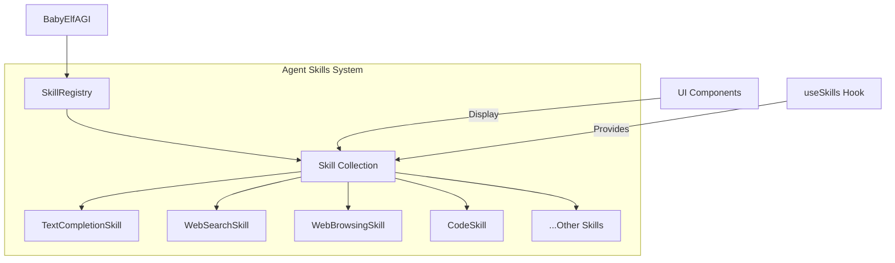
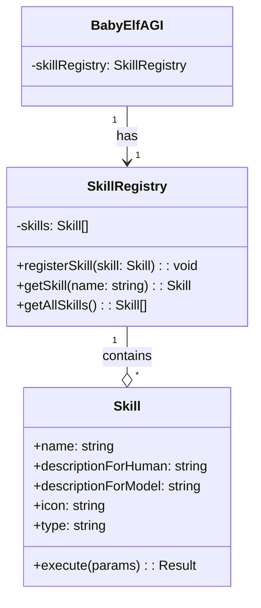
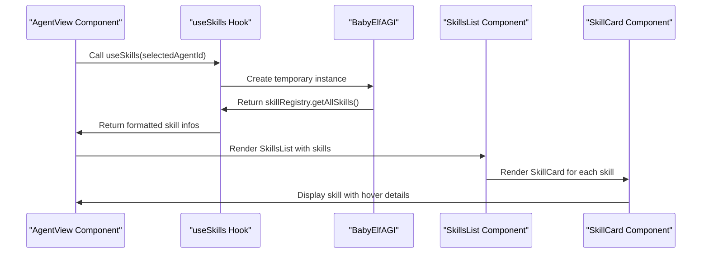
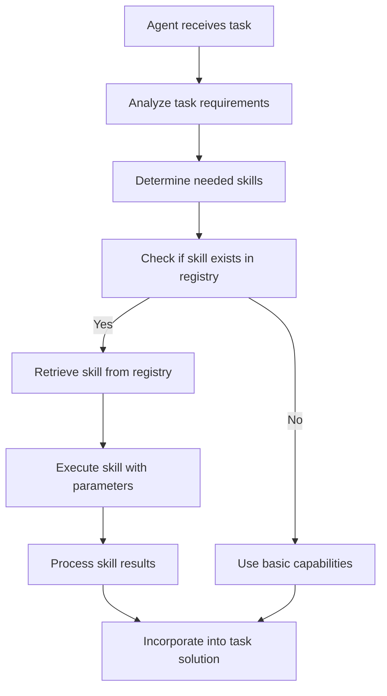
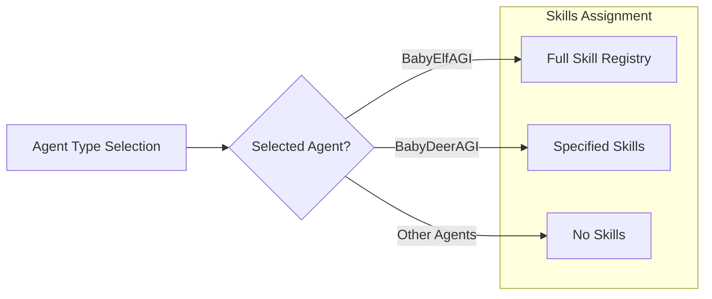
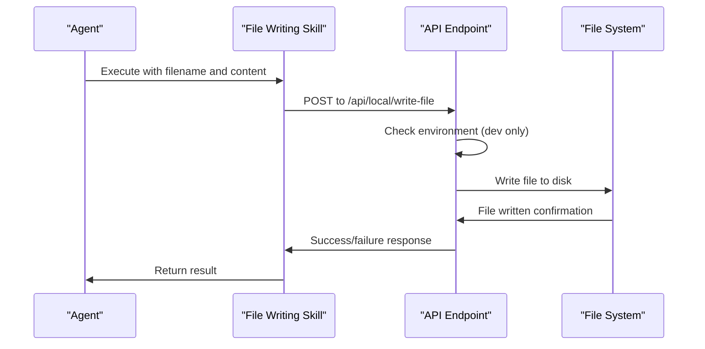

<!-- source: DeepWiki mcp.deepwiki.com · repo miurla/babyagi-ui · page 3.4 Agent Skills System · fetched 2026-10-27 -->

# Agent Skills System

<details>
<summary>Relevant source files</summary>

The following files were used as context for generating this wiki page:

- [src/components/Agent/SkillCard.tsx](src/components/Agent/SkillCard.tsx)
- [src/components/Agent/SkillList.tsx](src/components/Agent/SkillList.tsx)
- [src/hooks/useSkills.tsx](src/hooks/useSkills.tsx)
- [src/pages/api/local/write-file.ts](src/pages/api/local/write-file.ts)

</details>


This document covers the Agent Skills System in BabyAGI-UI, which provides a framework for agents to utilize specialized capabilities. While the skills system is primarily used by BabyElfAGI, some skills can also be specified for other agent types. For information about BabyElfAGI itself, see [BabyElfAGI](#3.3).

## Overview

The Agent Skills System enables autonomous agents to access and utilize a variety of specialized tools and capabilities. Similar to how humans develop skills to solve problems, this system allows agents to select and employ the most appropriate skill for a given task.



Sources: [src/hooks/useSkills.tsx:18-30]()

## Skill Registry Architecture

The Skill Registry serves as a central repository for all available skills. It provides methods for registering, retrieving, and managing skills that agents can use.



The BabyElfAGI agent initializes and maintains a SkillRegistry, which it can access during task execution to utilize the appropriate skills based on the task requirements.

Sources: [src/hooks/useSkills.tsx:15-31]()

## Skill Properties

Each skill in the system has several key properties:

| Property | Description |
|----------|-------------|
| name | Unique identifier for the skill (e.g., "web_search") |
| descriptionForHuman | Human-readable description of what the skill does |
| descriptionForModel | Description tailored for the AI model to understand skill usage |
| icon | Emoji or icon representing the skill in the UI |
| type | Skill type category (e.g., "normal", "experimental") |
| execute | The function that performs the skill's action |

Skills are displayed in the UI with formatted names (converting snake_case to Title Case) and appropriate badges for non-normal skill types.

Sources: [src/components/Agent/SkillCard.tsx:10-19](), [src/hooks/useSkills.tsx:31-39]()

## Skill Types and Capabilities

The BabyAGI-UI system includes various skill types that extend agent capabilities:

1. **Text Completion**: Generate text based on prompts
2. **Web Search**: Search the internet for information
3. **Web Browsing**: Navigate and extract information from websites
4. **Code Reading/Writing**: Analyze and generate code
5. **File Manipulation**: Read and write files (in development environment)

Some skills may be marked as "experimental" with a special badge, indicating they are still under development or might have limitations.

## Integration with UI

The skills system is integrated into the UI through dedicated components:

1. **SkillsList**: Displays all available skills in alphabetical order
2. **SkillCard**: Renders an individual skill with its icon, name, and optional badge



When a user hovers over a skill in the UI, a detailed description is shown via a hover card to help users understand the skill's capabilities.

Sources: [src/components/Agent/SkillList.tsx:10-38](), [src/components/Agent/SkillCard.tsx:20-50](), [src/hooks/useSkills.tsx:12-44]()

## Skill Selection Flow

When an agent needs to accomplish a task, it follows this general flow to utilize skills:



This process allows agents to leverage specialized capabilities when needed, falling back to basic reasoning abilities when no matching skill is available.

## Specified Skills for Different Agents

While BabyElfAGI has access to the full skill registry, other agent types can be configured to use specific skills. For example, BabyDeerAGI can be configured with a limited set of skills from the `SPECIFIED_SKILLS` constant.



Sources: [src/hooks/useSkills.tsx:15-18]()

## File Write Skill Example

One example of a skill in the system is the file writing capability, which is implemented as an API endpoint:



This skill is limited to development environments for security reasons, preventing file manipulation in production deployments.

Sources: [src/pages/api/local/write-file.ts:5-31]()

## UI Representation

Skills are visually represented in the UI with a standardized format:

1. An emoji icon representing the skill
2. The skill name in Title Case format
3. An optional badge for special skill types (e.g., "EXPERIMENTAL")
4. A hover card with a detailed description

The skills list is displayed in a scrollable container with a maximum height, showing the count of available skills.

Sources: [src/components/Agent/SkillList.tsx:17-36](), [src/components/Agent/SkillCard.tsx:20-49]()

## Using the Skills System

Developers who want to access the skills system in their components can use the `useSkills` hook:

```javascript
const skillInfos = useSkills(selectedAgentId);
```

This hook returns an array of skill information objects that can be used for display or other purposes. The `selectedAgentId` parameter can be used to filter skills for specific agent types.

Sources: [src/hooks/useSkills.tsx:12-44]()

## Conclusion

The Agent Skills System provides a modular and extensible framework for enhancing agent capabilities. By separating specialized functionalities into distinct skills, the system allows for easier maintenance, clearer organization, and the ability to selectively apply capabilities based on the agent type and task requirements.

---

