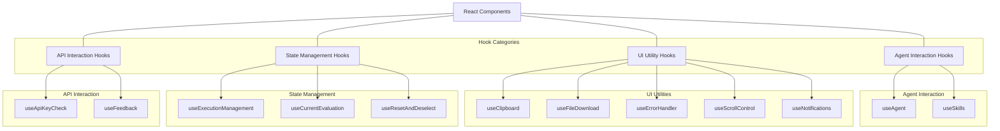
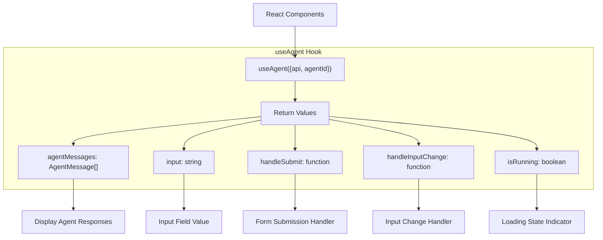
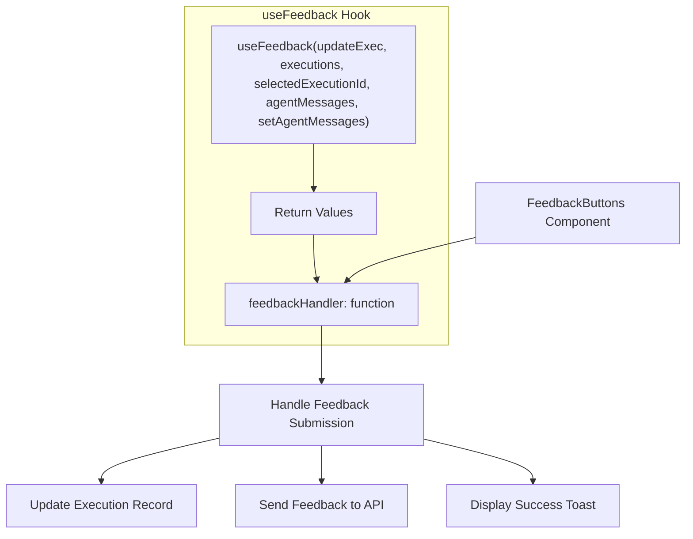
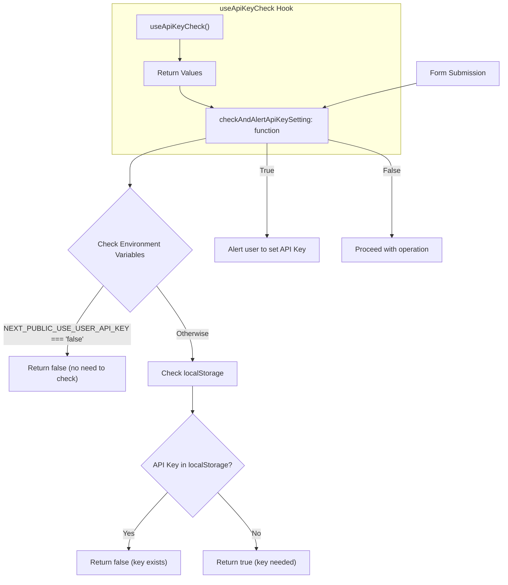
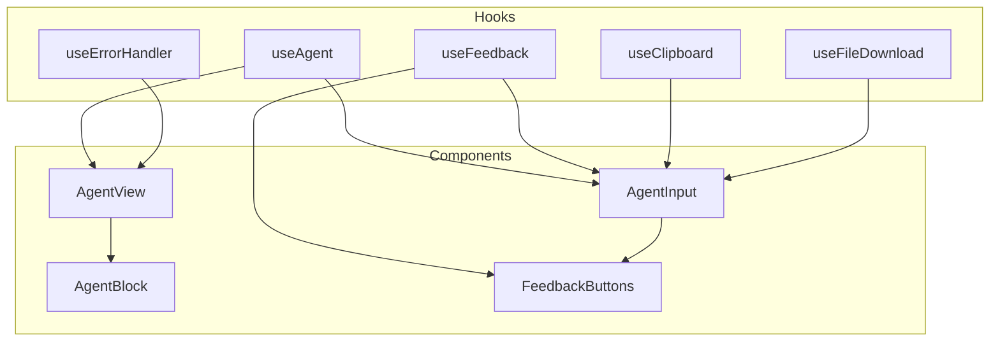

<!-- source: DeepWiki mcp.deepwiki.com · repo miurla/babyagi-ui · page 4.2 Hook Utilities · fetched 2026-10-27 -->

# Hook Utilities

<details>
<summary>Relevant source files</summary>

The following files were used as context for generating this wiki page:

- [src/components/Agent/AgentInput.tsx](src/components/Agent/AgentInput.tsx)
- [src/components/Agent/FeedbackButtons.tsx](src/components/Agent/FeedbackButtons.tsx)
- [src/components/Agent/FirstTimeMessage.tsx](src/components/Agent/FirstTimeMessage.tsx)
- [src/hooks/index.ts](src/hooks/index.ts)
- [src/hooks/useApiKeyCheck.ts](src/hooks/useApiKeyCheck.ts)
- [src/hooks/useClipboard.tsx](src/hooks/useClipboard.tsx)
- [src/hooks/useCurrentEvaluation.ts](src/hooks/useCurrentEvaluation.ts)
- [src/hooks/useErrorHandler.ts](src/hooks/useErrorHandler.ts)
- [src/hooks/useExecutionManagement.tsx](src/hooks/useExecutionManagement.tsx)
- [src/hooks/useFeedback.ts](src/hooks/useFeedback.ts)
- [src/pages/example/headless/index.tsx](src/pages/example/headless/index.tsx)
- [src/pages/example/ui/index.tsx](src/pages/example/ui/index.tsx)

</details>


## Purpose and Scope

This document details the custom React hooks used in BabyAGI-UI for state management and side effects. These hooks encapsulate reusable functionality, promoting cleaner components and better code organization. For information about message formatting utilities, see [Message Formatting Utilities](#4.1).

## Overview of Hook Architecture

BabyAGI-UI employs various custom hooks that handle different aspects of the application, from agent interactions to UI utilities and state management. These hooks serve as the bridge between React components and application logic.



Sources: [src/hooks/index.ts:1-12]()

## Core Agent Interaction Hooks

### useAgent

The central hook for agent interactions, providing state and methods for submitting objectives and handling agent responses.



**Usage Example:**
```typescript
const { 
  agentMessages, 
  input, 
  handleSubmit, 
  handleInputChange, 
  isRunning 
} = useAgent({
  api: '/api/agent',
  agentId: 'babydeeragi'
});
```

Sources: [src/pages/example/headless/index.tsx:2-8](), [src/pages/example/ui/index.tsx:3-13]()

## UI Utility Hooks

### useClipboard

Provides functionality for copying text to the clipboard.

| Method | Description | Parameters | Return |
|-|-|-|-|
| `copyToClipboard` | Copies text to clipboard and shows success toast | `text: string` | `void` |

Sources: [src/hooks/useClipboard.tsx:1-14]()

### useErrorHandler

Handles error display and tracking with Vercel Analytics.

| Method | Description | Parameters | Return |
|-|-|-|-|
| `errorHandler` | Displays error toast and tracks error | `error: Error` | `void` |

Sources: [src/hooks/useErrorHandler.ts:1-13]()

### useFeedback

Manages user feedback on agent execution results with thumbs up/down actions.



Sources: [src/hooks/useFeedback.ts:1-61](), [src/components/Agent/FeedbackButtons.tsx:1-37]()

## State Management Hooks

### useExecutionManagement

Manages the creation, selection, and updating of agent executions.

| Method | Description | Parameters | Return |
|-|-|-|-|
| `saveNewData` | Creates and selects a new execution | `input, model, iterations, firstTask, selectedAgent, agentMessages` | `execution` |
| `updateExec` | Updates an execution | `execution` | `void` |
| `selectExecution` | Selects an execution | `id: string` | `void` |

Also provides:
- `executions`: Array of all executions
- `selectedExecutionId`: ID of the currently selected execution

Sources: [src/hooks/useExecutionManagement.tsx:1-55]()

### useCurrentEvaluation

Retrieves the evaluation status for the selected execution.

| Method | Description | Parameters | Return |
|-|-|-|-|
| `currentEvaluation` | Gets evaluation of selected execution | None | `'good' \| 'bad' \| undefined` |

Sources: [src/hooks/useCurrentEvaluation.ts:1-18]()

## API Interaction Hooks

### useApiKeyCheck

Checks and validates API key settings.



Sources: [src/hooks/useApiKeyCheck.ts:1-32]()

## Hook Integration Patterns

### Headless Example

The headless example demonstrates a minimal implementation using `useAgent`:

```tsx
// Example from headless implementation
const { agentMessages, input, handleSubmit, handleInputChange } = useAgent({
  api: '/api/agent',
  agentId: 'babydeeragi',
});

// Render just the input and messages
return (
  <div>
    <form onSubmit={handleSubmit}>
      <input
        value={input}
        placeholder="Input your objective..."
        onChange={handleInputChange}
      />
    </form>
    {agentMessages.map((m) => (
      <div key={m.id}>
        {m.type}: {m.content}
      </div>
    ))}
  </div>
);
```

Sources: [src/pages/example/headless/index.tsx:1-28]()

### UI Example with Message Grouping

The UI example shows a more complete integration that groups messages into blocks:

```tsx
// Example from UI implementation
const { agentMessages, input, handleSubmit, handleInputChange, isRunning } =
  useAgent({
    api: '/api/agent',
    agentId: 'babydeeragi',
  });

// Group messages for display
useEffect(() => {
  const newGroupedMessages = groupMessages(agentMessages, isRunning);
  setAgentBlocks(newGroupedMessages);
}, [agentMessages, isRunning]);

// Render with AgentBlock component
return (
  <div>
    <form onSubmit={handleSubmit}>
      <input
        value={input}
        placeholder="Input your objective..."
        onChange={handleInputChange}
      />
    </form>
    {agentBlocks.map((block, index) => (
      <AgentBlock block={block} key={index} />
    ))}
  </div>
);
```

Sources: [src/pages/example/ui/index.tsx:1-37]()

## Integration with Agent Components

Custom hooks integrate closely with agent-related components to provide a cohesive user experience.



Sources: [src/components/Agent/AgentInput.tsx:1-182](), [src/components/Agent/FeedbackButtons.tsx:1-37]()

## Hook Export Pattern

The application uses a centralized export pattern for hooks, making them easily accessible to components.

| Hook | Primary Purpose |
|-|-|
| `useAgent` | Agent interaction handling |
| `useSkills` | Skill management for agents |
| `useExecutionManagement` | Execution history management |
| `useApiKeyCheck` | API key validation |
| `useNotifications` | System notifications |
| `useErrorHandler` | Error handling and reporting |
| `useResetAndDeselect` | State reset functionality |
| `useClipboard` | Clipboard operations |
| `useFileDownload` | File download functionality |
| `useFeedback` | User feedback handling |
| `useScrollControl` | Scroll behavior management |
| `useCurrentEvaluation` | Execution evaluation status |

Sources: [src/hooks/index.ts:1-12]()

## Summary

The hook utilities in BabyAGI-UI provide a clean separation of concerns between UI components and business logic. They encapsulate reusable functionality, making the codebase more maintainable and components cleaner. The hooks handle everything from agent interactions to UI utilities, state management, and API interactions.

The system follows React best practices by isolating side effects and state management into custom hooks, allowing components to focus on rendering and user interaction.

---

