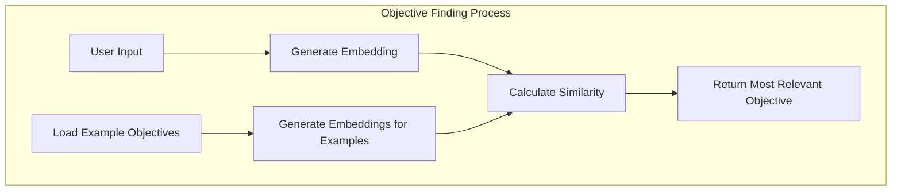
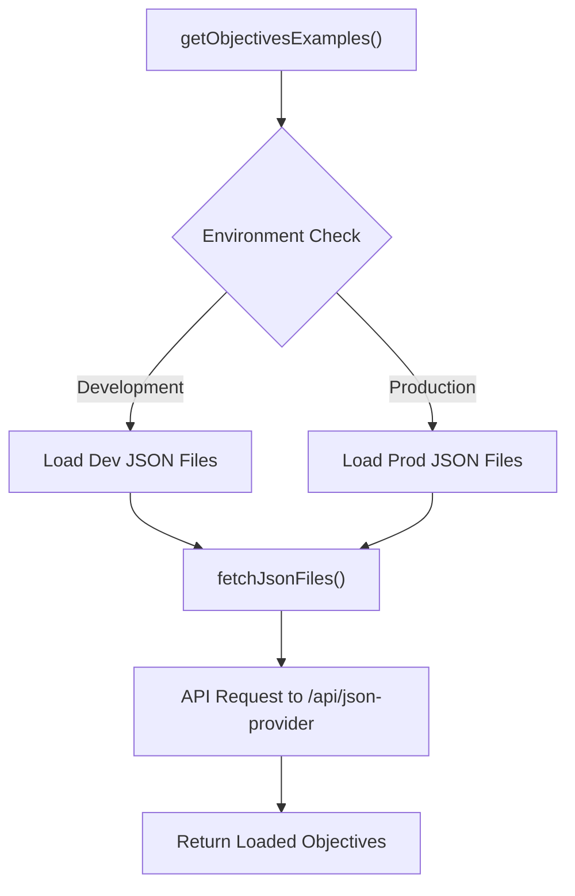
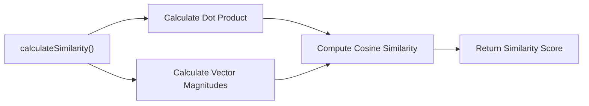
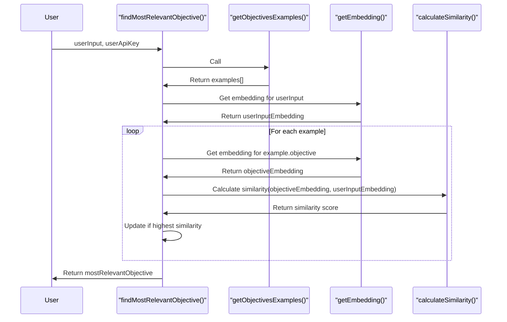
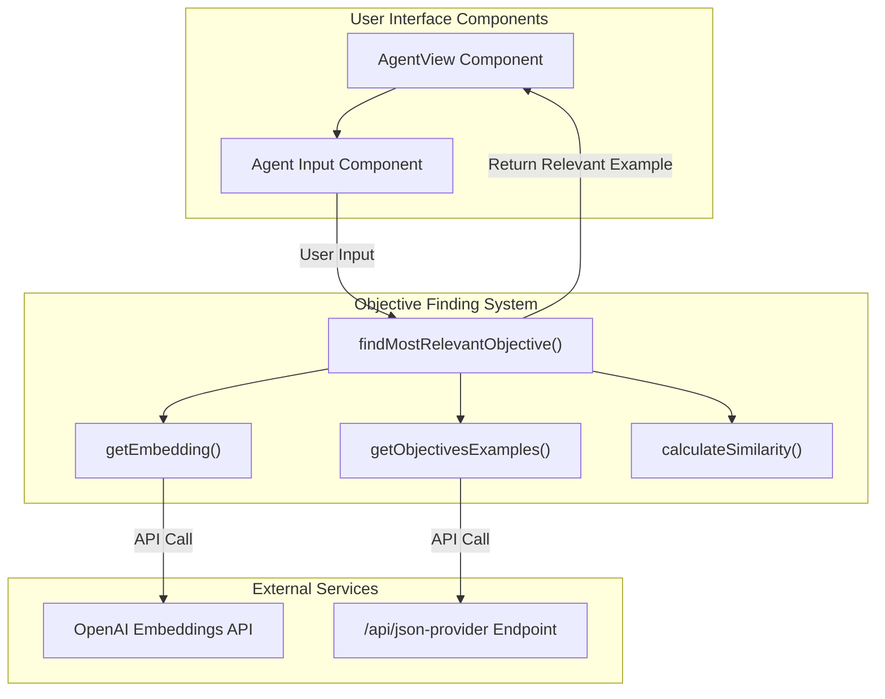

<!-- source: DeepWiki mcp.deepwiki.com · repo miurla/babyagi-ui · page 4.3 Objective Finding Utilities · fetched 2026-10-27 -->

# Objective Finding Utilities

<details>
<summary>Relevant source files</summary>

The following files were used as context for generating this wiki page:

- [src/utils/objective.ts](src/utils/objective.ts)

</details>


## Purpose and Scope

The Objective Finding Utilities provide functionality for retrieving and identifying the most relevant objective examples for users based on semantic similarity. These utilities leverage OpenAI's embedding models to compare user input against pre-defined examples, helping users discover appropriate templates for their tasks. This document details the core components, workflow, and implementation of these utilities.

## Overview

The Objective Finding Utilities serve as a recommendation system that helps match user inputs with the most semantically similar pre-defined objective examples. This functionality enhances user experience by providing relevant starting points based on natural language queries.



Sources: [src/utils/objective.ts:75-117]()

## Key Components

The objective finding system consists of several key functions that work together to load examples, generate embeddings, and find the most relevant objectives.

### JSON Example Provider

This component fetches pre-defined objective examples from JSON files stored in the system.



Sources: [src/utils/objective.ts:13-43]()

### Embedding Generation

This component converts text into vector embeddings using OpenAI's embedding models.


Sources: [src/utils/objective.ts:45-59]()

### Similarity Calculation

This component calculates the cosine similarity between two embedding vectors.



Sources: [src/utils/objective.ts:61-73]()

## Core Function: findMostRelevantObjective

The main function that orchestrates the entire process of finding the most relevant objective.



Sources: [src/utils/objective.ts:75-117]()

## Implementation Details

### Example Objective Files

The system defines two sets of JSON files for examples:
- Production environment: 'example3', 'example4', 'example_deer'
- Development environment: Additional files including 'example_code', 'example_code_review'

```
// JSON files for production
const JSON_FILES = ['example3', 'example4', 'example_deer'];

// JSON files for development (includes additional examples)
const JSON_FILES_FOR_DEV = [
  'example3',
  'example4',
  'example_deer',
  'example_code',
  'example_code_review',
];
```

Sources: [src/utils/objective.ts:3-10]()

### Function Signatures and Flow

| Function | Parameters | Return Type | Purpose |
|----------|------------|-------------|---------|
| `fetchJsonFiles` | `targetJsonFiles: string[]` | `Promise<any[]>` | Fetches JSON files from API and parses them |
| `getObjectivesExamples` | None | `Promise<any[]>` | Gets the appropriate example objectives based on environment |
| `getEmbedding` | `text: string, modelName: string, userApiKey?: string` | `Promise<number[]>` | Generates vector embedding for input text |
| `calculateSimilarity` | `embedding1: number[], embedding2: number[]` | `number` | Calculates cosine similarity between embeddings |
| `findMostRelevantObjective` | `userInput: string, userApiKey?: string` | `Promise<any>` | Finds the most similar objective to user input |

Sources: [src/utils/objective.ts:13-117]()

## Technical Implementation

### Embedding Generation

The system uses OpenAI's text-embedding-ada-002 model to generate embeddings:


Sources: [src/utils/objective.ts:45-59]()

### Cosine Similarity Calculation

The similarity between embeddings is calculated using the cosine similarity formula:

```
similarity = dot_product(embedding1, embedding2) / (magnitude(embedding1) * magnitude(embedding2))
```

Where:
- dot_product is the sum of the products of corresponding elements
- magnitude is the square root of the sum of squared elements

Sources: [src/utils/objective.ts:61-73]()

## Integration with BabyAGI-UI

The Objective Finding Utilities are primarily used in the agent initialization process to suggest relevant examples based on user input. When a user provides an objective, the system can use these utilities to find and suggest the most similar predefined example from its library.



Sources: [src/utils/objective.ts:75-117]()

## Special Cases and Error Handling

The system includes several error handling mechanisms:

1. Error handling during JSON file fetching and parsing
2. Error catching during embedding generation
3. Validation to ensure embeddings are properly defined before similarity calculation
4. Special handling for the project's demo site (babyagi-ui.vercel.app)

Sources: [src/utils/objective.ts:21-32](), [src/utils/objective.ts:56-58](), [src/utils/objective.ts:62-64](), [src/utils/objective.ts:85-87]()

## Summary

The Objective Finding Utilities provide a semantic search capability that helps users discover relevant task templates based on natural language input. By leveraging OpenAI's embedding models and cosine similarity calculations, the system can effectively match user intentions with pre-defined examples, enhancing the user experience and providing helpful starting points for various tasks.

---

