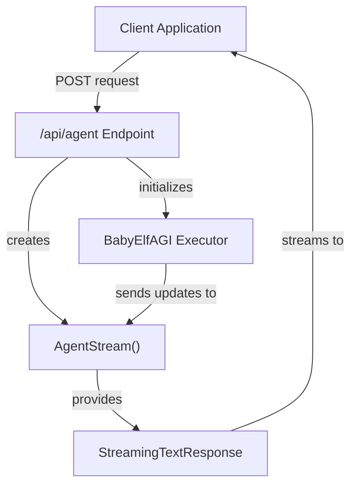
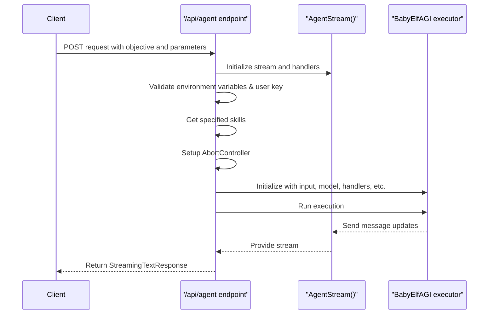
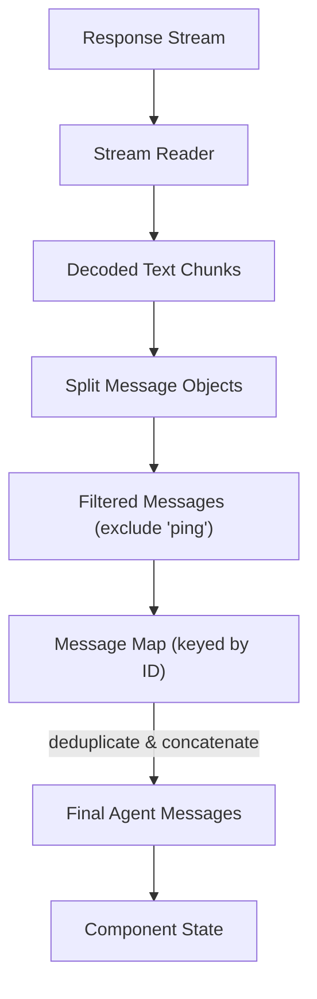
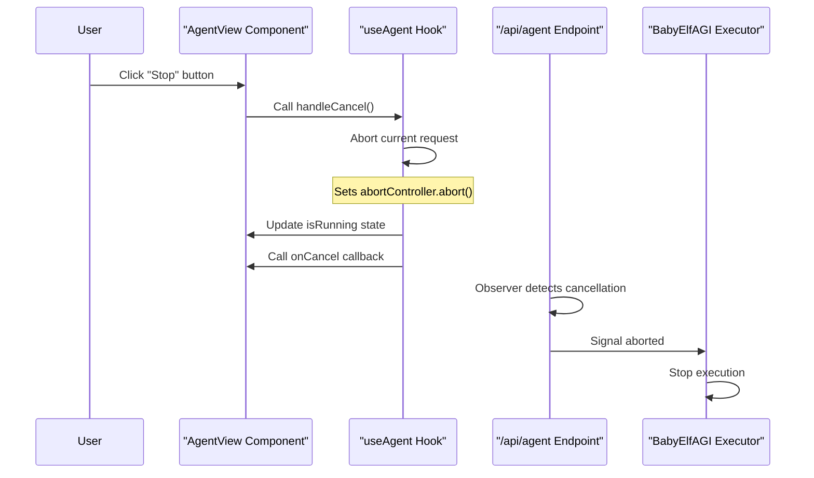
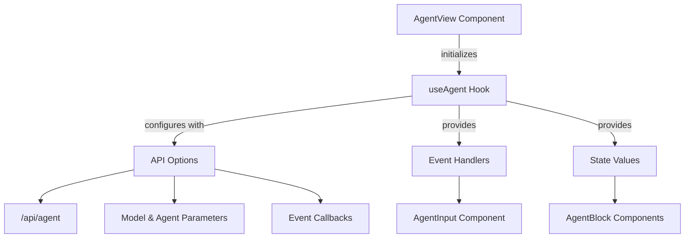

<!-- source: DeepWiki mcp.deepwiki.com · repo miurla/babyagi-ui · page 5.1 Agent API · fetched 2026-10-27 -->

# Agent API

<details>
<summary>Relevant source files</summary>

The following files were used as context for generating this wiki page:

- [src/components/Agent/AgentView.tsx](src/components/Agent/AgentView.tsx)
- [src/hooks/useAgent.ts](src/hooks/useAgent.ts)
- [src/pages/api/agent/index.ts](src/pages/api/agent/index.ts)
- [tailwind.config.js](tailwind.config.js)

</details>


The Agent API is the backend interface that powers BabyAGI-UI's autonomous agent execution. This document details how to interact with the API, its architecture, request/response formats, and the relationship between the frontend hook and backend endpoint.

For information about utility API endpoints that support specific agent operations, see [Agent Utility APIs](#5.2).

## Overview

The Agent API provides a streaming interface for executing autonomous agents. It accepts user objectives and agent parameters, then streams back real-time updates as the agent executes tasks. The API is implemented as a Next.js Edge API route and uses event streaming to provide continuous updates.



Sources: [src/pages/api/agent/index.ts:1-35]()

## API Endpoint

### Endpoint Details

- **URL**: `/api/agent`
- **Method**: POST
- **Runtime**: Edge Runtime

### Request Parameters

| Parameter    | Type     | Required | Description                                         |
|--------------|----------|----------|-----------------------------------------------------|
| `input`      | string   | Yes      | The objective or task for the agent to accomplish   |
| `agent_id`   | string   | Yes      | Identifier of the agent type to use                 |
| `model_name` | string   | Yes      | Name of the language model to use                   |
| `language`   | string   | No       | Language code (defaults to 'en')                    |
| `verbose`    | boolean  | No       | Whether to include verbose output                   |
| `user_key`   | string   | Conditionally | User's API key (required if `NEXT_PUBLIC_USE_USER_API_KEY` is 'true') |

### Response

The API returns a streaming response containing agent execution updates. Each message in the stream is a JSON object with the following structure:

```json
{
  "id": "unique-message-id",
  "type": "message-type",
  "content": "message content",
  "status": "message status",
  "style": "message style"
}
```

Message types include:
- `task-list`: List of tasks
- `thinking`: Agent thinking process
- `task`: Task execution details
- `result`: Task result
- `finish`: Final message indicating completion
- `error`: Error message

Sources: [src/pages/api/agent/index.ts:1-35](), [src/hooks/useAgent.ts:85-163]()

## API Implementation

The API endpoint is implemented as a Next.js Edge function that creates a streaming response:



Sources: [src/pages/api/agent/index.ts:11-35]()

## useAgent Hook

The `useAgent` hook provides a convenient way for frontend components to interact with the Agent API. It handles request submission, streaming response processing, and state management.

### Hook API

```typescript
function useAgent({
  api = '/api/agent',
  agentId,
  modelName,
  onResponse,
  onError,
  onFinish,
  onSubmit,
  onCancel,
  verbose = false,
}: UseAgentOptions): UseAgentHelpers
```

### Return Values

The hook returns an object with:

| Property           | Type                   | Description                                      |
|--------------------|------------------------|--------------------------------------------------|
| `agentMessages`    | AgentMessage[]         | Array of received agent messages                 |
| `setAgentMessages` | Function               | State setter for agent messages                  |
| `handleCancel`     | Function               | Function to cancel ongoing execution             |
| `handleInputChange`| Function               | Handler for input field changes                  |
| `handleSubmit`     | Function               | Handler for form submission                      |
| `input`            | string                 | Current input value                              |
| `setInput`         | Function               | State setter for input                           |
| `isRunning`        | boolean                | Flag indicating if agent is currently running    |
| `reset`            | Function               | Resets all state to initial values               |

Sources: [src/hooks/useAgent.ts:7-35](), [src/hooks/useAgent.ts:262-273]()

## Message Processing Flow

The hook implements sophisticated message processing to handle streaming updates:



Key aspects of message processing:
1. Stream chunks are read and decoded into text
2. Text is split into individual message objects
3. Messages are filtered (excluding 'ping' type messages)
4. Messages are stored in a map, with existing messages updated (content concatenated)
5. The full collection of messages is used to update component state

Sources: [src/hooks/useAgent.ts:86-163]()

## Error Handling

The API and hook include comprehensive error handling:

1. **API-side validation**:
   - Validates environment variables
   - Validates user API keys when required
   - Provides appropriate error responses

2. **Hook-side error handling**:
   - Detects API errors from response stream
   - Handles abort operations gracefully
   - Calls provided `onError` callback with error information
   - Resets state on critical errors

Sources: [src/pages/api/agent/index.ts:37-50](), [src/hooks/useAgent.ts:173-202]()

## Cancellation Support

Both the API and hook support cancellation of in-progress operations:



The cancellation system works through:
1. An AbortController in the useAgent hook
2. An observer system in the API endpoint
3. Signal propagation to the agent executor

Sources: [src/hooks/useAgent.ts:233-244](), [src/pages/api/agent/index.ts:56-64]()

## Integration with AgentView Component

The AgentView component demonstrates how to use the Agent API through the useAgent hook:



The component:
1. Initializes the hook with the `/api/agent` endpoint
2. Provides event handlers and callbacks
3. Manages agent parameters and configuration
4. Processes and displays agent messages as blocks

Sources: [src/components/Agent/AgentView.tsx:126-135](), [src/components/Agent/AgentView.tsx:235-248]()

## Example Usage

Here's a simplified example of how to use the useAgent hook:

```jsx
const MyAgentComponent = () => {
  const {
    agentMessages,
    handleSubmit,
    handleInputChange,
    handleCancel,
    input,
    isRunning,
    reset
  } = useAgent({
    api: '/api/agent',
    agentId: 'babyelfagi',
    modelName: 'gpt-4',
    onSubmit: () => console.log('Agent started'),
    onFinish: () => console.log('Agent finished'),
    onError: (error) => console.error('Error:', error)
  });

  return (
    <div>
      <div className="messages">
        {agentMessages.map(message => (
          <div key={message.id}>{message.content}</div>
        ))}
      </div>
      <form onSubmit={handleSubmit}>
        <input value={input} onChange={handleInputChange} />
        <button type="submit" disabled={isRunning}>Submit</button>
        {isRunning && <button onClick={handleCancel}>Cancel</button>}
        <button onClick={reset}>Reset</button>
      </form>
    </div>
  );
};
```

Sources: [src/components/Agent/AgentView.tsx:126-135](), [src/hooks/useAgent.ts:262-273]()

---

