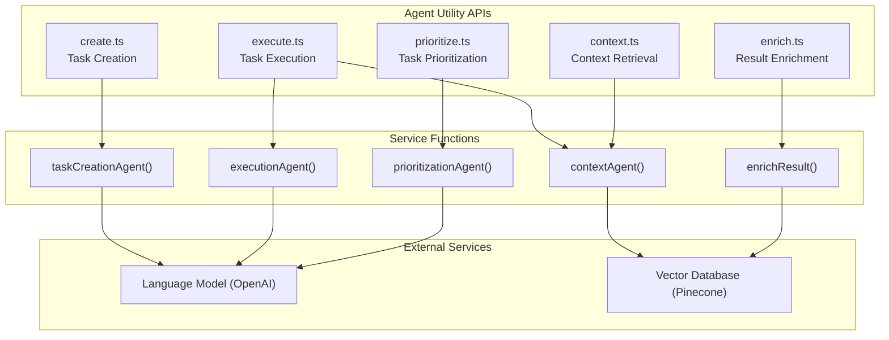
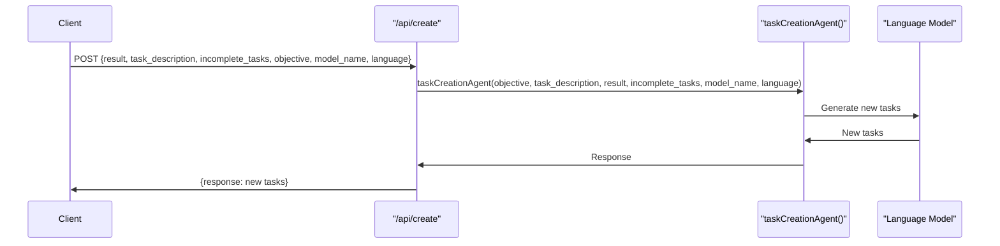
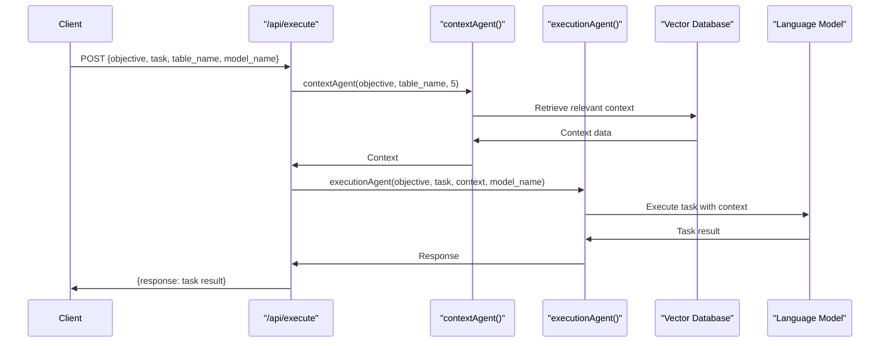
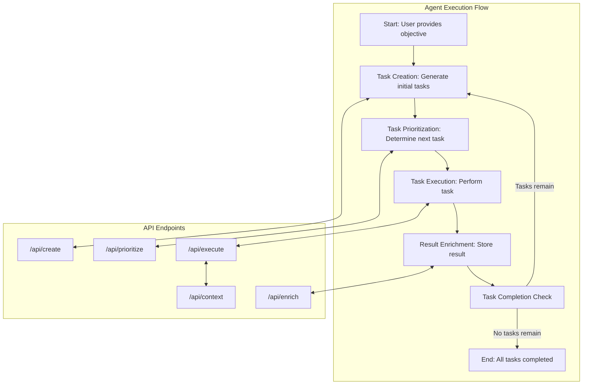

<!-- source: DeepWiki mcp.deepwiki.com · repo miurla/babyagi-ui · page 5.2 Agent Utility APIs · fetched 2026-10-27 -->

# Agent Utility APIs

<details>
<summary>Relevant source files</summary>

The following files were used as context for generating this wiki page:

- [src/pages/api/context.ts](src/pages/api/context.ts)
- [src/pages/api/create.ts](src/pages/api/create.ts)
- [src/pages/api/enrich.ts](src/pages/api/enrich.ts)
- [src/pages/api/execute.ts](src/pages/api/execute.ts)
- [src/pages/api/prioritize.ts](src/pages/api/prioritize.ts)

</details>


This document provides a detailed overview of the utility API endpoints used for specific agent operations in the BabyAGI-UI system. These endpoints support the core functionality of agents by handling individual components of the agent execution process, such as task creation, execution, prioritization, context retrieval, and result enrichment.

For information about the main agent API that orchestrates the entire agent execution process, see [Agent API](#5.1).

## Overview of Agent Utility APIs

The BabyAGI-UI system includes several utility API endpoints, each responsible for a specific aspect of agent operations. These endpoints are implemented as Next.js Edge API routes and interface with the agent service functions.



**Diagram: Agent Utility APIs and their relationship to service functions**

Sources: [src/pages/api/create.ts](), [src/pages/api/execute.ts](), [src/pages/api/prioritize.ts](), [src/pages/api/context.ts](), [src/pages/api/enrich.ts]()

## API Endpoints

### Task Creation API

The Task Creation API creates new tasks based on a result and objective.

**Endpoint:** `/api/create`

**Request Parameters:**
- `result`: The result of a completed task
- `task_description`: Description of the completed task
- `incomplete_tasks`: List of tasks that are not yet completed
- `objective`: The main objective of the agent
- `model_name`: The language model to use
- `language`: The language for task creation

**Response:**
- `response`: New tasks generated by the task creation agent

**Implementation:**


**Diagram: Task Creation API flow**

Sources: [src/pages/api/create.ts:8-32]()

### Task Execution API

The Task Execution API executes a task in the context of an objective.

**Endpoint:** `/api/execute`

**Request Parameters:**
- `objective`: The main objective of the agent
- `task`: The task to execute
- `table_name`: The name of the table in the vector database
- `model_name`: The language model to use

**Response:**
- `response`: The result of executing the task

**Implementation:**


**Diagram: Task Execution API flow**

Sources: [src/pages/api/execute.ts:8-20]()

### Task Prioritization API

The Task Prioritization API prioritizes tasks based on an objective.

**Endpoint:** `/api/prioritize`

**Request Parameters:**
- `objective`: The main objective of the agent
- `task_names`: List of task names to prioritize
- `task_id`: The ID of the current task
- `model_name`: The language model to use

**Response:**
- `response`: The prioritized list of tasks

**Implementation:**
The endpoint calls the `prioritizationAgent` function to prioritize tasks based on the objective.

Sources: [src/pages/api/prioritize.ts:8-23]()

### Context Retrieval API

The Context Retrieval API retrieves context relevant to an objective from the vector database.

**Endpoint:** `/api/context`

**Request Parameters:**
- `objective`: The main objective of the agent
- `table_name`: The name of the table in the vector database
- `namespace`: The namespace in the vector database
- `query_embedding`: Optional embedding vector for the query

**Response:**
- `response`: Relevant context for the objective

**Implementation:**
The endpoint calls the `contextAgent` function to retrieve context from the vector database.

Sources: [src/pages/api/context.ts:8-26]()

### Result Enrichment API

The Result Enrichment API stores task results in the vector database for future context retrieval.

**Endpoint:** `/api/enrich`

**Request Parameters:**
- `task`: The task that was completed
- `result`: The result of the completed task
- `index`: The index in the vector database
- `namespace`: The namespace in the vector database
- `vector_values`: The vector representation of the result

**Response:**
- `response`: Success status

**Implementation:**
The endpoint calls the `enrichResult` function to store the result in the vector database.

Sources: [src/pages/api/enrich.ts:8-18]()

## Integration with Agent Execution Flow

The utility APIs play crucial roles at different stages of the agent execution flow. The following diagram illustrates how these APIs are integrated into the overall agent operation:



**Diagram: Integration of Utility APIs in the Agent Execution Flow**

Sources: [src/pages/api/create.ts](), [src/pages/api/execute.ts](), [src/pages/api/prioritize.ts](), [src/pages/api/context.ts](), [src/pages/api/enrich.ts]()

## API Usage and Configuration

All utility API endpoints are implemented as Next.js Edge API routes, which provide fast, low-latency execution. Each endpoint follows a similar pattern:

1. Define the Edge runtime configuration
2. Create a handler function that processes the request
3. Call the appropriate service function
4. Return the response

**Common Configuration:**

```javascript
export const config = {
  runtime: 'edge',
};
```

This configuration enables the Edge runtime for all utility API endpoints, providing better performance for these server-side operations.

**Example Error Handling Pattern:**

All the utility API endpoints use a similar error handling pattern:

```javascript
try {
  // Process request and call service function
  return NextResponse.json({ response: result });
} catch (error) {
  return NextResponse.error();
}
```

Sources: [src/pages/api/create.ts:4-6](), [src/pages/api/execute.ts:4-6](), [src/pages/api/prioritize.ts:4-6](), [src/pages/api/context.ts:4-6](), [src/pages/api/enrich.ts:4-6]()

## Conclusion

The Agent Utility APIs provide specialized functionality for different aspects of agent operation. These endpoints work together to create tasks, prioritize them, execute them, retrieve relevant context, and store results. They form an essential part of the BabyAGI-UI system, supporting the core agent functionality that drives the autonomous task execution process.

These APIs are designed to be modular, allowing the main agent execution process to call them as needed based on the current state of the agent's execution flow. This modular design makes the system more maintainable and allows for easier customization or extension of specific agent capabilities.

---

