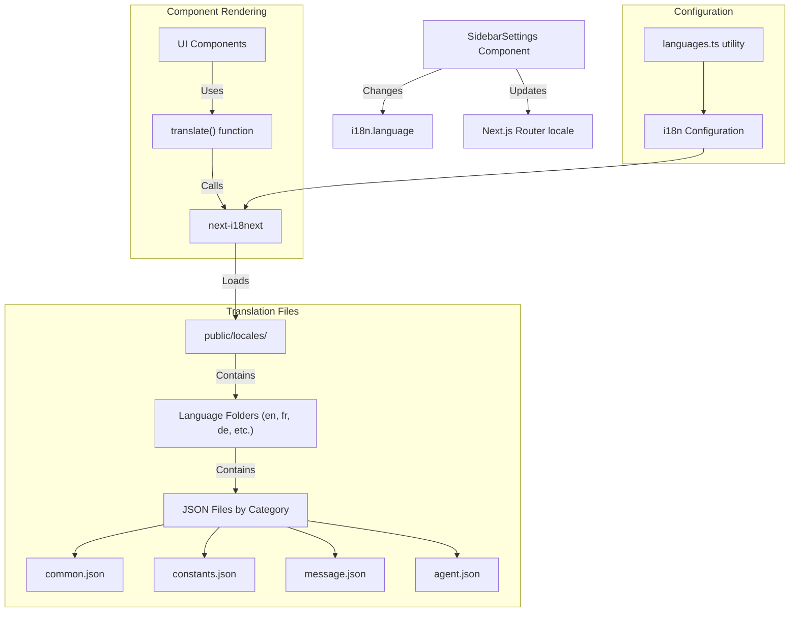
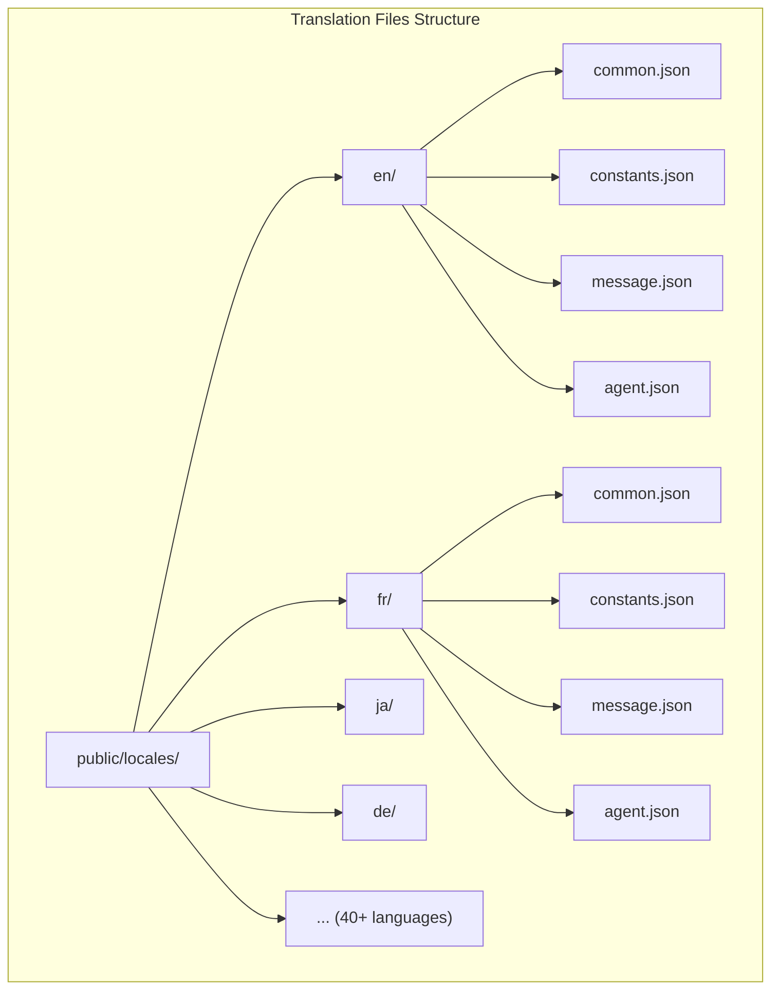
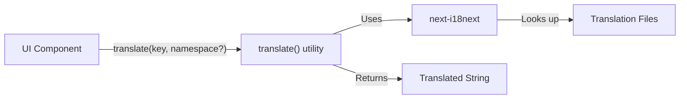
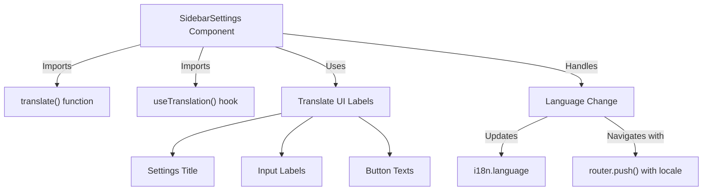
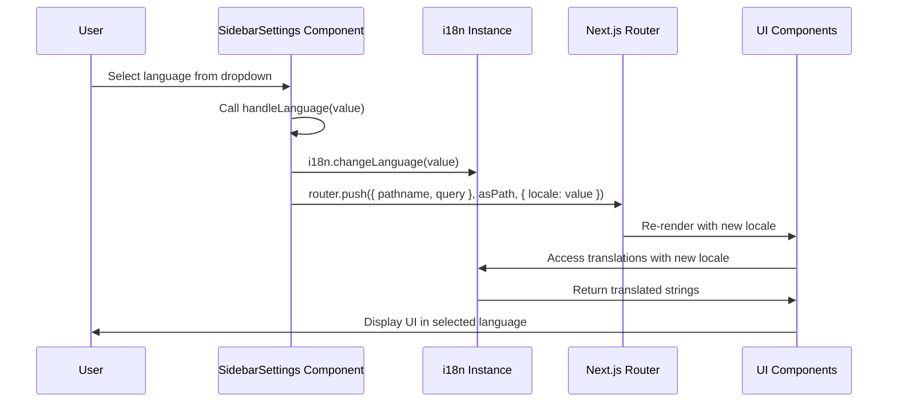

<!-- source: DeepWiki mcp.deepwiki.com · repo miurla/babyagi-ui · page 6.2 Translation System · fetched 2026-10-27 -->

# Translation System

<details>
<summary>Relevant source files</summary>

The following files were used as context for generating this wiki page:

- [public/locales/en/constants.json](public/locales/en/constants.json)
- [public/locales/gb/agent.json](public/locales/gb/agent.json)
- [public/locales/gb/common.json](public/locales/gb/common.json)
- [public/locales/gb/constants.json](public/locales/gb/constants.json)
- [public/locales/gb/message.json](public/locales/gb/message.json)
- [src/components/Sidebar/SidebarSettings.tsx](src/components/Sidebar/SidebarSettings.tsx)

</details>


This page documents the internationalization (i18n) system used in BabyAGI-UI. It covers how translations are organized, loaded, and used throughout the application, enabling support for multiple languages. The system allows for seamless language switching and provides a framework for adding new languages or translation keys.

## Architecture Overview

BabyAGI-UI implements a comprehensive internationalization system using next-i18next, a popular i18n solution for Next.js applications. The translation system consists of several key components:

1. JSON translation files organized by language and category
2. A translation utility function for accessing translated strings
3. Integration with Next.js routing for locale-aware navigation
4. A language selection UI component in the settings panel

The following diagram illustrates the high-level architecture of the translation system:



Sources: [src/components/Sidebar/SidebarSettings.tsx:19-304]()

## Translation Files Structure

Translation files are organized in a hierarchical structure based on language codes and categories.

### File Organization

The translation files are stored in the `public/locales/` directory, with each supported language having its own subdirectory. Within each language directory, there are separate JSON files for different categories of translations.



Sources: [public/locales/en/constants.json:1-26](), [public/locales/gb/constants.json:1-27](), [public/locales/gb/message.json:1-33](), [public/locales/gb/agent.json:1-7](), [public/locales/gb/common.json:1-26]()

### Translation Categories

The translation files are divided into several categories, each addressing a specific area of the application:

| File | Purpose | Example Keys |
|------|---------|--------------|
| common.json | General UI elements and settings | "SETTINGS", "LANGUAGE", "SAVE", "THEME" |
| constants.json | System constants and notifications | "DARK", "LIGHT", "SYSTEM", "NOTIFICATION" |
| message.json | Agent messages and task status | "CREATING", "EXECUTING", "TASK_RESULT" |
| agent.json | Agent-specific notifications | "TASK_COMPLETED_TOAST", "EXECUTION_STOPPED" |

Sources: [public/locales/gb/common.json:1-26](), [public/locales/gb/constants.json:1-27](), [public/locales/gb/message.json:1-33](), [public/locales/gb/agent.json:1-7]()

### Example Translation File

Here's an excerpt from the English `constants.json` file showing the structure of translation keys and values:

```json
{
  "GPT_4_WARNING": "🚨 USING GPT-4 POTENTIALLY EXPENSIVE SO MONITOR YOUR COSTS!",
  "INFINITY": "Infinity",
  "UNTIL_ALL_TASKS_COMPLETED": "Until All tasks completed",
  "DARK": "Dark",
  "LIGHT": "Light",
  "SYSTEM": "System",
  "NOTIFICATION": "Notification",
  "NOTIFICATION_LABEL": "🔔 All task completed"
}
```

Sources: [public/locales/en/constants.json:1-26]()

## Translation Utility Function

The application uses a custom `translate()` utility function to access translated strings throughout the codebase. This function abstracts the details of the i18n implementation and provides a consistent interface for accessing translations.



The function can be imported and used in components like this:

```typescript
import { translate } from '@/utils/translate';

// Basic usage (uses 'common' namespace by default)
const settingsLabel = translate('SETTINGS');

// With explicit namespace
const notificationLabel = translate('NOTIFICATION', 'constants');
```

Sources: [src/components/Sidebar/SidebarSettings.tsx:8](), [src/components/Sidebar/SidebarSettings.tsx:76](), [src/components/Sidebar/SidebarSettings.tsx:138](), [src/components/Sidebar/SidebarSettings.tsx:270]()

## Usage in Components

The translation system is integrated throughout the application's UI components. Here's how the SidebarSettings component uses translations:



In the SidebarSettings component, translations are used for various UI elements:

1. Component labels and titles: `translate('SETTINGS')`
2. Form field labels: `translate('OPENAI_API_KEY')`
3. Theme options: `translate(item.name, 'constants')`
4. Notification texts: `translate('NOTIFICATION', 'constants')`

The component also handles language changes through the language selector dropdown, updating both the i18n instance and the Next.js router with the new locale.

Sources: [src/components/Sidebar/SidebarSettings.tsx:21-72](), [src/components/Sidebar/SidebarSettings.tsx:138](), [src/components/Sidebar/SidebarSettings.tsx:186](), [src/components/Sidebar/SidebarSettings.tsx:270](), [src/components/Sidebar/SidebarSettings.tsx:280]()

## Language Selection and Switching

The application provides a language selector in the settings panel that allows users to switch between different languages. This is implemented in the SidebarSettings component.



When a user selects a new language:

1. The `handleLanguage` function is called with the selected language code
2. The i18n instance's language is changed using `i18n.changeLanguage(value)`
3. The Next.js router navigates to the same page with the new locale
4. All components re-render with the new translations

Sources: [src/components/Sidebar/SidebarSettings.tsx:64-72](), [src/components/Sidebar/SidebarSettings.tsx:227-246]()

## Adding New Languages or Translation Keys

To add a new language to the system:

1. Create a new directory in `public/locales/` with the appropriate language code
2. Add the required JSON files (common.json, constants.json, message.json, agent.json)
3. Translate all keys from the English versions
4. Add the language to the `languages` array in the languages utility file

To add new translation keys:

1. Add the key and its English translation to the appropriate JSON file in `public/locales/en/`
2. Add the same key with appropriate translations to all other language folders
3. Use the key in components with the `translate()` function

## Summary

BabyAGI-UI's translation system provides a robust framework for internationalizing the application. By organizing translations into structured JSON files by language and category, and using a consistent translation utility function, the system enables:

1. Support for 40+ languages with consistent translations
2. Clean separation of UI text from code
3. Easy addition of new languages or translation keys
4. Runtime language switching without page reloads

This approach ensures that BabyAGI-UI can be used by a global audience, with a localized experience that feels native to each user's language.

Sources: [src/components/Sidebar/SidebarSettings.tsx:21-304](), [public/locales/en/constants.json:1-26](), [public/locales/gb/constants.json:1-27](), [public/locales/gb/message.json:1-33](), [public/locales/gb/agent.json:1-7](), [public/locales/gb/common.json:1-26]()

---

