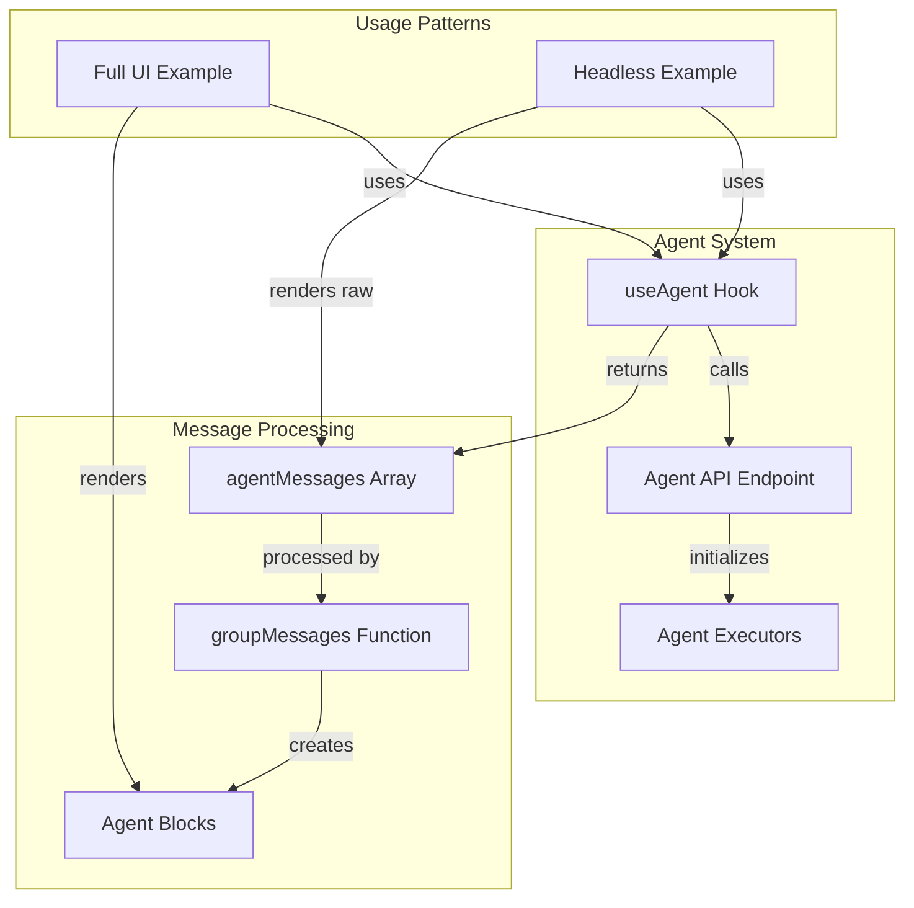
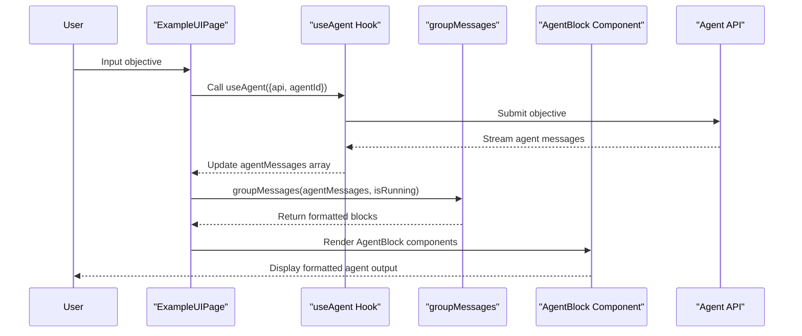
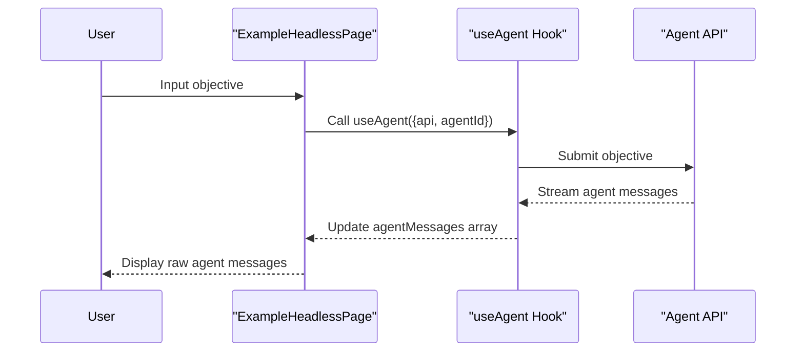
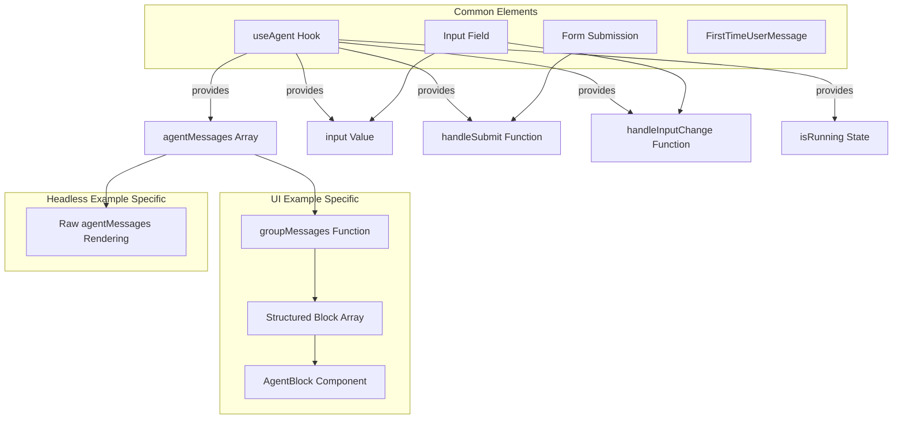
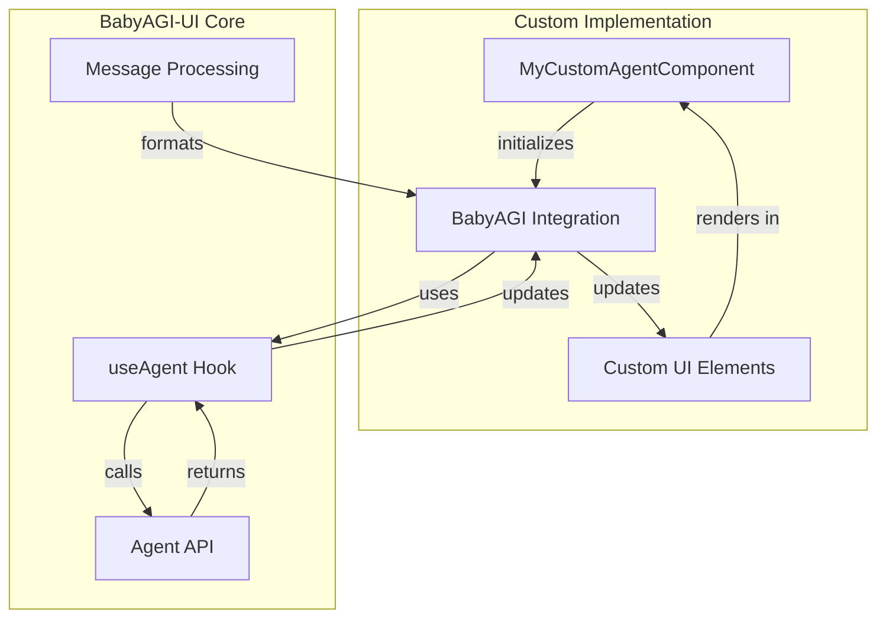

<!-- source: DeepWiki mcp.deepwiki.com · repo miurla/babyagi-ui · page 7 Examples and Usage · fetched 2026-10-27 -->

# Examples and Usage

<details>
<summary>Relevant source files</summary>

The following files were used as context for generating this wiki page:

- [src/components/Agent/FirstTimeMessage.tsx](src/components/Agent/FirstTimeMessage.tsx)
- [src/pages/example/headless/index.tsx](src/pages/example/headless/index.tsx)
- [src/pages/example/ui/index.tsx](src/pages/example/ui/index.tsx)

</details>


This document provides practical examples and usage patterns for the BabyAGI-UI system. It demonstrates how to interact with and integrate the autonomous agent capabilities in both full UI and headless/minimal contexts. For information about customizing or extending BabyAGI-UI, see [Development and Customization](#8).

## Usage Patterns Overview

BabyAGI-UI can be used in two primary ways:

1. **Full UI Mode** - Utilizing the complete user interface with agent blocks, task visualization, and interactive configuration.
2. **Headless Mode** - Using BabyAGI-UI with minimal UI components for custom integrations or simplified interfaces.

The following diagram illustrates how the examples connect to the agent system:



Sources: [src/pages/example/ui/index.tsx](), [src/pages/example/headless/index.tsx]()

## UI Example

The UI example demonstrates how to integrate BabyAGI-UI with a richer user interface experience, including properly formatted agent blocks for better visualization.



### UI Example Implementation

The UI example uses the `useAgent` hook to connect to the agent system and the `groupMessages` utility to format the agent messages into blocks for display:

1. The component initializes the agent connection with the `useAgent` hook
2. Agent messages are processed with `groupMessages` to create structured blocks
3. The blocks are rendered using the `AgentBlock` component

Key code:

[src/pages/example/ui/index.tsx:9-18]()

This example provides a more sophisticated UI with formatted agent blocks, making it suitable for applications where visual presentation is important.

Sources: [src/pages/example/ui/index.tsx]()

## Headless Example

The headless example demonstrates a minimal integration of BabyAGI-UI, suitable for custom interfaces or when you want to handle the presentation layer yourself.



### Headless Example Implementation

The headless example directly renders the raw agent messages without additional formatting:

1. The component initializes the agent connection with the `useAgent` hook
2. Agent messages are rendered directly in a simple format
3. No additional message processing or formatting is applied

Key code:

[src/pages/example/headless/index.tsx:5-8]()

[src/pages/example/headless/index.tsx:18-22]()

This approach is ideal for:
- Custom integrations where you want to handle message formatting yourself
- Simpler applications that don't need the full UI components
- Headless or API-only services that use BabyAGI-UI's agent capabilities

Sources: [src/pages/example/headless/index.tsx]()

## Common Elements Between Examples

Both the UI and headless examples share certain common elements:



Sources: [src/pages/example/ui/index.tsx](), [src/pages/example/headless/index.tsx](), [src/components/Agent/FirstTimeMessage.tsx]()

### The useAgent Hook

The core of both examples is the `useAgent` hook, which provides:

- Connection to the agent API
- Management of the input state
- Handling form submission
- Processing and streaming agent messages

Usage pattern:

```jsx
const { 
  agentMessages,  // Array of messages from the agent
  input,          // Current input field value
  handleSubmit,   // Function to handle form submission
  handleInputChange, // Function to handle input changes
  isRunning       // Boolean indicating if the agent is running
} = useAgent({
  api: '/api/agent',   // API endpoint for the agent
  agentId: 'babydeeragi' // ID of the agent to use
});
```

This pattern is identical in both examples, showing how the `useAgent` hook provides a consistent interface regardless of the UI approach.

Sources: [src/pages/example/ui/index.tsx:9-13](), [src/pages/example/headless/index.tsx:5-8]()

## Usage Scenarios

Here are some common usage scenarios for BabyAGI-UI:

| Scenario | Recommended Approach | Agent Type | Notes |
|----------|---------------------|------------|-------|
| Research task with multiple subtasks | Full UI | BabyDeerAGI | Best for visualizing complex task hierarchies |
| Simple query processing | Headless | BabyAGI | Minimal interface for straightforward queries |
| Web research with integrated search | Full UI | BabyBeeAGI | Visualize search results and agent reasoning |
| Tool-using workflows | Full UI | BabyElfAGI | See which skills the agent is using for each task |
| Integration into existing applications | Headless | Any | Customize the presentation layer while leveraging BabyAGI capabilities |
| Interactive user guidance | Full UI | BabyDeerAGI | Leverage user input capabilities with clear task visualization |

### Implementation Considerations

When implementing BabyAGI-UI in your own applications, consider:

1. **API Endpoint**: Both examples use `/api/agent` as the endpoint, but you can configure this to point to a custom endpoint.
2. **Agent Type**: The examples use 'babydeeragi', but you can select any of the available agent types.
3. **UI Components**: For full UI applications, leverage the `AgentBlock` component and `groupMessages` utility.
4. **First-time User Experience**: Both examples include the `FirstTimeUserMessage` component to guide new users.

Sources: [src/pages/example/ui/index.tsx](), [src/pages/example/headless/index.tsx](), [src/components/Agent/FirstTimeMessage.tsx]()

## Custom Implementation Example

Here's a diagram showing how you might implement a custom UI that combines elements from both examples:



This pattern allows you to:

1. Use the core agent capabilities through the `useAgent` hook
2. Implement custom UI components for presentation
3. Select which message processing utilities to use
4. Create a tailored user experience while leveraging BabyAGI-UI's agent capabilities

The key is to leverage the `useAgent` hook as the bridge between your custom UI and the BabyAGI-UI agent system.

Sources: [src/pages/example/ui/index.tsx](), [src/pages/example/headless/index.tsx]()

---

