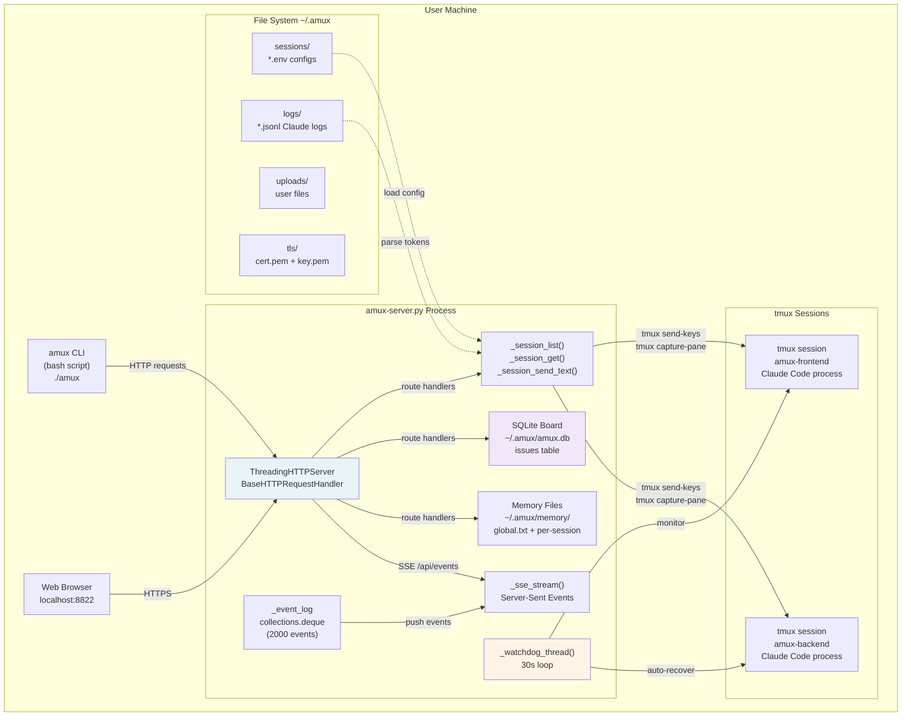
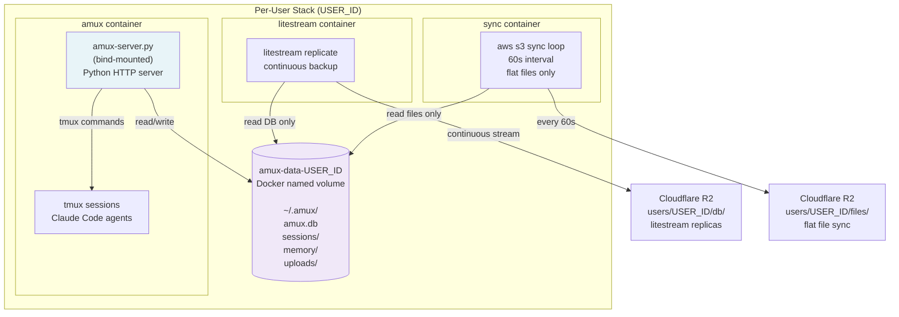
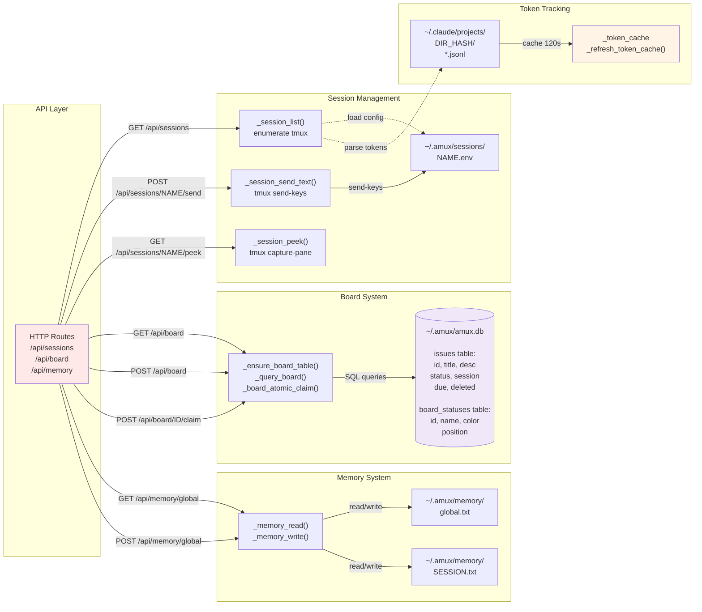

<!-- source: DeepWiki mcp.deepwiki.com · repo mixpeek/amux · page 1.2 Architecture Diagram · fetched 2026-10-27 -->

# Architecture Diagram

<details>
<summary>Relevant source files</summary>

The following files were used as context for generating this wiki page:

- [.github/workflows/backup-cloud.yml](.github/workflows/backup-cloud.yml)
- [.github/workflows/deploy-cloud.yml](.github/workflows/deploy-cloud.yml)
- [amux](amux)
- [amux-server.py](amux-server.py)
- [cloud/docker/docker-compose.template.yml](cloud/docker/docker-compose.template.yml)
- [cloud/gateway/gateway.py](cloud/gateway/gateway.py)
- [cloud/setup.sh](cloud/setup.sh)
- [templates/README.md](templates/README.md)
- [templates/content-creator/CLAUDE.md](templates/content-creator/CLAUDE.md)
- [templates/content-creator/template.json](templates/content-creator/template.json)
- [templates/fitness-tracker/CLAUDE.md](templates/fitness-tracker/CLAUDE.md)
- [test.mjs](test.mjs)

</details>


This page presents the high-level system architecture of amux, showing the two deployment modes (local OSS and cloud multi-tenant) and how core components interact. For detailed information about the core server implementation, see [Core Server (amux-server.py)](#2). For cloud-specific orchestration details, see [Gateway & Multi-Tenancy](#3).

---

## Deployment Modes

amux supports two deployment architectures that share the same codebase:

| Mode | Entry Point | Use Case | Key Components |
|------|-------------|----------|----------------|
| **Local OSS** | `./amux serve` | Individual developers running on localhost or Tailscale | `amux-server.py` on port 8822, local tmux sessions, self-signed TLS |
| **Cloud Multi-Tenant** | `cloud.amux.io` | Multiple users with isolated containers | `gateway.py` + per-user Docker containers running `amux-server.py`, Clerk auth, R2/S3 backups |

The same `amux-server.py` file ([amux-server.py:1-2050]()) runs in both modes without modification, enforced by development rules in `CLAUDE.md`. Differentiation occurs through environment variables and HTTP headers.

**Sources:** [amux-server.py:1-97](), [cloud/gateway/gateway.py:1-11](), [amux:1-20]()

---

## Local Deployment Architecture

### Diagram: Local OSS Components



### Key Components

| Component | Location | Purpose |
|-----------|----------|---------|
| `ThreadingHTTPServer` | [amux-server.py:21]() | HTTP server handling concurrent requests |
| `_session_list()` | [amux-server.py:1129-1245]() | Enumerates tmux sessions, parses Claude JSONL logs for token counts |
| `_session_send_text()` | [amux-server.py:1313-1370]() | Sends messages to Claude via `tmux send-keys` |
| `amux.db` | [amux-server.py:1618-1642]() | SQLite database storing board issues, statuses, notes |
| `_watchdog_thread()` | [amux-server.py:1805-1988]() | 30-second monitoring loop for auto-recovery (context exhaustion, corruption detection) |
| `_event_log` | [amux-server.py:106-127]() | In-memory ring buffer (2000 events) for structured logging |
| `CC_SESSIONS` | [amux-server.py:50]() | Directory `~/.amux/sessions/` storing session configs as `.env` files |

**Sources:** [amux-server.py:1-80](), [amux-server.py:1129-1370](), [amux-server.py:1618-1988]()

---

## Cloud Multi-Tenant Architecture

### Diagram: Cloud Gateway + Container Orchestration

```mermaid
graph TB
    subgraph "Internet"
        Users["Multiple Users<br/>web + mobile clients"]
    end
    
    subgraph "Gateway VM (5.161.66.217)"
        Gateway["gateway.py<br/>HTTPServer<br/>Port 8080"]
        GatewayDB[("gateway.db<br/>SQLite<br/>users table<br/>org_invites table")]
        ClerkVerify["verify_clerk_token()<br/>JWT validation"]
        ContainerOps["start_container()<br/>stop_container()<br/>_write_compose()"]
        IdleReaper["_reaper() thread<br/>60s loop<br/>stop idle containers"]
        ProxyFn["proxy() helper<br/>urllib.request"]
    end
    
    subgraph "Docker Host"
        subgraph "User ABC123 Stack"
            DC1["docker-compose.yml<br/>from template"]
            AmuxC1["amux container<br/>amux-user-abc123<br/>port 9000"]
            LiteC1["litestream container<br/>replicate to R2"]
            SyncC1["sync container<br/>aws s3 sync"]
            Vol1[("amux-data-abc123<br/>Docker volume")]
        end
        
        subgraph "User DEF456 Stack"
            DC2["docker-compose.yml<br/>from template"]
            AmuxC2["amux container<br/>amux-user-def456<br/>port 9001"]
            Vol2[("amux-data-def456<br/>Docker volume")]
        end
        
        SharedMount["/opt/amux-cloud/app/<br/>amux-server.py<br/>bind-mounted read-only"]
    end
    
    subgraph "Cloudflare R2"
        R2Bucket["amux-cloud-users<br/>users/USER_ID/db/<br/>users/USER_ID/files/"]
    end
    
    Users -->|HTTPS + JWT| Gateway
    Gateway -->|verify| ClerkVerify
    Gateway -->|query/update| GatewayDB
    Gateway -.->|alloc_port()<br/>_write_compose()| ContainerOps
    ContainerOps -->|docker compose up| DC1
    ContainerOps -->|docker compose up| DC2
    Gateway -->|proxy() requests| AmuxC1
    Gateway -->|proxy() requests| AmuxC2
    IdleReaper -.->|docker compose stop| DC1
    IdleReaper -.->|after 3600s idle| DC2
    
    SharedMount -.->|bind mount :ro| AmuxC1
    SharedMount -.->|bind mount :ro| AmuxC2
    
    DC1 -->|spawns| AmuxC1
    DC1 -->|spawns| LiteC1
    DC1 -->|spawns| SyncC1
    AmuxC1 -->|writes| Vol1
    LiteC1 -->|reads| Vol1
    SyncC1 -->|reads| Vol1
    
    LiteC1 -->|replicate DB| R2Bucket
    SyncC1 -->|sync files| R2Bucket
    
    style Gateway fill:#ffe8e8
    style GatewayDB fill:#f0e8f8
    style AmuxC1 fill:#e8f4f8
    style AmuxC2 fill:#e8f4f8
```

### Gateway Components

| Component | Location | Purpose |
|-----------|----------|---------|
| `gateway.py` | [cloud/gateway/gateway.py:1-890]() | Authenticates users, allocates ports, orchestrates Docker containers |
| `verify_clerk_token()` | [cloud/gateway/gateway.py:335-347]() | Validates Clerk JWT using cached JWKS, returns `(user_id, email)` |
| `gateway.db` | [cloud/gateway/gateway.py:26](), [cloud/gateway/gateway.py:165-201]() | SQLite database storing user records, org invites, org members |
| `alloc_port()` | [cloud/gateway/gateway.py:204-209]() | Allocates next available port starting from `PORT_BASE=9000` |
| `_write_compose()` | [cloud/gateway/gateway.py:217-231]() | Generates per-user `docker-compose.yml` from template with variable substitution |
| `start_container()` | [cloud/gateway/gateway.py:261-271]() | Runs `docker compose up -d`, waits for health check, restores files from R2 |
| `_reaper()` | [cloud/gateway/gateway.py:377-393]() | Background thread stopping idle containers after `IDLE_SECONDS=3600` |
| `proxy()` | [cloud/gateway/gateway.py:397-457]() | Forwards HTTP requests to user container, handles SSE streaming with last_seen refresh |

**Sources:** [cloud/gateway/gateway.py:1-457](), [cloud/docker/docker-compose.template.yml:1-71]()

---

## Docker Container Architecture

### Diagram: Per-User Three-Container Stack



### Container Details

| Container | Image | Purpose | Config |
|-----------|-------|---------|--------|
| `amux` | `ghcr.io/mixpeek/amux:latest` | Runs `amux-server.py`, manages tmux sessions | [cloud/docker/docker-compose.template.yml:5-27]() |
| `litestream` | `litestream/litestream:latest` | Continuously replicates `amux.db` to R2 | [cloud/docker/docker-compose.template.yml:29-43]() |
| `sync` | `amazon/aws-cli:latest` | Syncs flat files (`sessions/`, `memory/`, `uploads/`) to R2 every 60 seconds | [cloud/docker/docker-compose.template.yml:45-64]() |

**Key Architectural Decision:** All user containers bind-mount the same `amux-server.py` from `/opt/amux-cloud/app/` read-only. This enables zero-downtime updates: deploying a new `amux-server.py` to the host immediately affects all running containers on their next auto-restart.

**Sources:** [cloud/docker/docker-compose.template.yml:1-71](), [.github/workflows/deploy-cloud.yml:26-33]()

---

## Core Data Flow

### Diagram: Session, Board, and Memory Interactions



### Data Locations

| Data Type | Storage Location | Format | Access Pattern |
|-----------|------------------|--------|----------------|
| Session configs | `~/.amux/sessions/NAME.env` | Shell env vars | Read on session start, list endpoints |
| Board issues | `~/.amux/amux.db` → `issues` table | SQLite with tombstones | Full scan for list, indexed by `id` for updates |
| Board statuses | `~/.amux/amux.db` → `board_statuses` table | SQLite | Read-heavy, cached in frontend |
| Memory (global) | `~/.amux/memory/global.txt` | Plain text | Read/write via API |
| Memory (session) | `~/.amux/memory/SESSION.txt` | Plain text | Read/write via API |
| Token counts | `~/.claude/projects/HASH/*.jsonl` | JSONL (Claude format) | Tail scan, cached 120s |
| Uploads | `~/.amux/uploads/` | Binary files | Write once, read via `/api/uploads/FILENAME` |

**Sources:** [amux-server.py:49-64](), [amux-server.py:789-802](), [amux-server.py:1129-1245](), [amux-server.py:1618-1723]()

---

## Request Flow: Cloud vs Local

### Cloud Request Flow

1. User → `https://cloud.amux.io/api/sessions` with `Authorization: Bearer <JWT>`
2. `gateway.py` receives request on port 8080
3. `verify_clerk_token()` validates JWT ([cloud/gateway/gateway.py:335-347]())
4. `gateway.db` queried for user record, `last_seen` updated ([cloud/gateway/gateway.py:673-685]())
5. If container not running, `start_container()` called ([cloud/gateway/gateway.py:261-271]())
6. `proxy()` forwards request to `http://127.0.0.1:PORT/api/sessions` ([cloud/gateway/gateway.py:397-457]())
7. User's `amux-server.py` instance handles request
8. Response proxied back to user with SSE streaming support

### Local Request Flow

1. User → `https://localhost:8822/api/sessions`
2. `amux-server.py` receives request on port 8822
3. Route handler executes (e.g., `_session_list()` for GET `/api/sessions`)
4. Response sent directly to user

**Key Difference:** Cloud adds authentication layer and container orchestration; local runs as single process.

**Sources:** [cloud/gateway/gateway.py:535-685](), [amux-server.py:1989-2050]()

---

## Deployment Workflow

### Local Deployment

```bash
# Clone repo
git clone https://github.com/mixpeek/amux
cd amux

# Make executable
chmod +x amux

# Register a session
./amux register myproject --dir ~/code/myproject

# Start server (auto-generates TLS cert)
./amux serve
```

Server listens on `https://localhost:8822` with auto-generated TLS certificate (Tailscale → mkcert → self-signed fallback).

**Sources:** [amux:1-640](), [amux-server.py:2-3]()

### Cloud Deployment

Automated via GitHub Actions ([.github/workflows/deploy-cloud.yml:1-69]()):

1. **amux-server.py deployment:**
   - `rsync --inplace` to `/opt/amux-cloud/app/amux-server.py`
   - `touch` file to trigger inode modification
   - All running containers auto-restart (bind-mounted file changed)

2. **gateway.py deployment:**
   - `rsync` to `/opt/amux-cloud/gateway/gateway.py`
   - `systemctl restart amux-gateway`

3. **docker-compose template deployment:**
   - `rsync` template to `/opt/amux-cloud/docker/docker-compose.template.yml`
   - Regenerate all per-user compose files with variable substitution
   - `docker compose up -d --no-recreate` for each user

**Sources:** [.github/workflows/deploy-cloud.yml:1-69](), [cloud/setup.sh:1-192]()

---

## Key Architectural Patterns

### Single Codebase, Multiple Deployments

The same `amux-server.py` runs unmodified in both local and cloud modes. Differentiation achieved through:

- **Environment variables:** `AMUX_PORT`, `ANTHROPIC_API_KEY` set differently in local vs Docker
- **HTTP headers:** Gateway injects `X-Amux-User-Email` for display purposes
- **File paths:** Same relative paths (`~/.amux/`) work in both contexts

**Enforced by:** Development rules in `CLAUDE.md` prohibit cloud-specific code branches in `amux-server.py`.

### Zero-Downtime Updates via Bind Mounts

All user containers share a single read-only bind mount of `amux-server.py` from the host. Deploying a new version updates all users simultaneously without container recreation. File modification timestamp triggers auto-restart mechanisms in long-running Python processes.

**Sources:** [cloud/docker/docker-compose.template.yml:12](), [.github/workflows/deploy-cloud.yml:26-33]()

### Atomic Board Operations

Board claims use SQL CAS (Compare-And-Swap) to prevent duplicate work:

```sql
UPDATE issues SET status='doing', session='agent-name'
WHERE id='PROJ-5' AND status='todo'
```

Returns 1 row affected only if the issue was still `todo` when the update executed.

**Sources:** [amux-server.py:1708-1723]()

### In-Memory Event Log

Structured events stored in `_event_log` (collections.deque, 2000 max length) enable:
- Real-time SSE streaming to dashboards
- Post-hoc debugging without parsing log files
- Event classification (http, session, board, memory, file, system)

**Sources:** [amux-server.py:104-186]()

---

