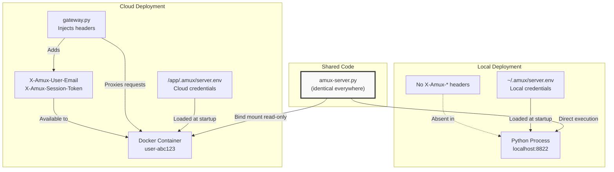
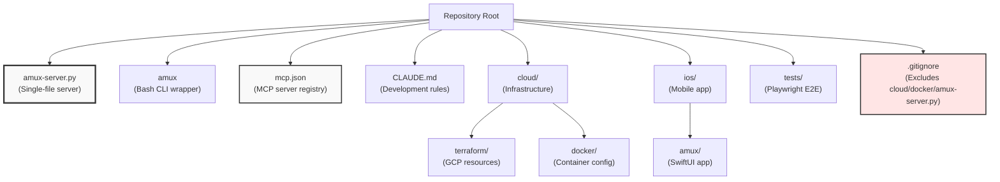
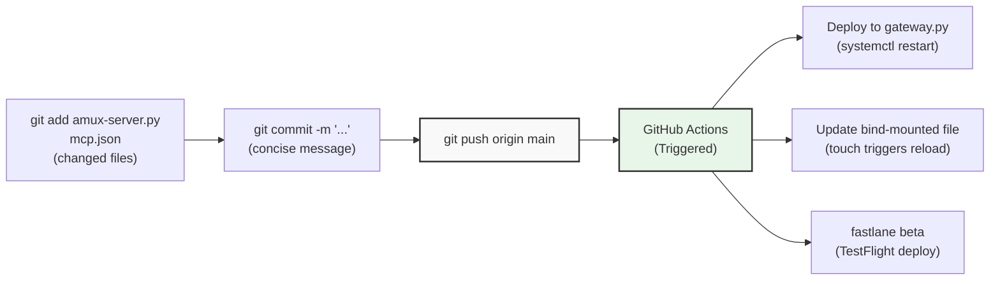
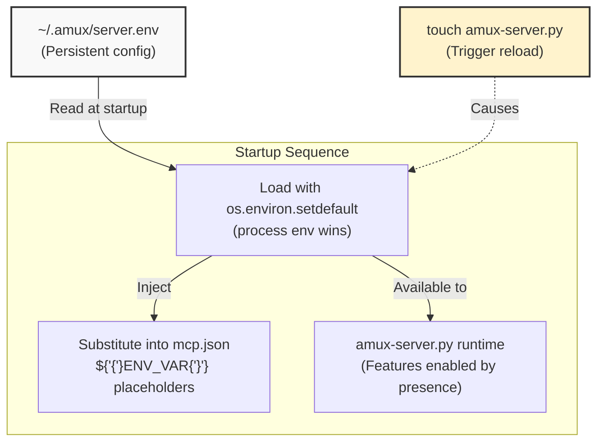
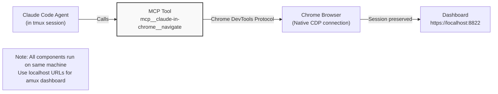

<!-- source: DeepWiki mcp.deepwiki.com · repo mixpeek/amux · page 10.1 Development Rules · fetched 2026-10-27 -->

# Development Rules

<details>
<summary>Relevant source files</summary>

The following files were used as context for generating this wiki page:

- [CLAUDE.md](CLAUDE.md)

</details>


This document defines the development philosophy, constraints, and workflow practices for contributing to the amux codebase. It covers the single-codebase architecture principle, commit practices, deployment procedures, and configuration management patterns that maintain consistency across local and cloud deployments.

For operational deployment procedures, see [Cloud Deployment](#4). For CI/CD automation, see [CI/CD Pipelines](#10.4). For testing practices, see [Testing](#10.2).

---

## Single-Codebase Philosophy

The **most critical architectural constraint** in amux is that `amux-server.py` must be identical across all deployment environments. No code branches, feature flags, or conditional logic may differentiate between local (OSS) and cloud deployments.

### Enforcement Rules

| Rule | Implementation | Violation Example |
|------|----------------|-------------------|
| No environment-based branching | All deployment differences via headers/env vars | ❌ `if IS_CLOUD:` or `if os.environ.get('CLOUD')` |
| Gateway-driven differentiation | Cloud features use `X-Amux-User-Email` headers | ✅ `request.headers.get('X-Amux-User-Email')` |
| Configuration presence detection | Features enabled by config existence | ✅ `if os.environ.get('AMUX_S3_BUCKET'):` |
| Forbidden auto-generated files | `cloud/docker/amux-server.py` is in `.gitignore` | ❌ Committing deployment-specific versions |

**Rationale**: This ensures that:
1. Local developers test the exact code running in production
2. Cloud deployments can be updated atomically via bind mounts ([Diagram 2](#diagram-2-multi-tenant-cloud-architecture-deep-dive))
3. Feature parity is maintained automatically
4. No drift occurs between deployment targets

### Differentiation Mechanisms

The system achieves deployment-specific behavior through three patterns:



**Diagram: Single Codebase with Environment-Driven Differentiation**

**Sources**: [CLAUDE.md:24-30]()

---

## Project Structure

The amux codebase follows a minimal file layout with strict separation of concerns:



**Diagram: Repository File Organization**

### Core Files

| File | Purpose | Shared? |
|------|---------|---------|
| `amux-server.py` | Python HTTP server + inline HTML/CSS/JS dashboard | ✅ Yes |
| `mcp.json` | Centralized MCP server configuration | ✅ Yes |
| `amux` | Bash CLI wrapper for local usage | Local only |
| `cloud/docker/docker-compose.template.yml` | Per-user container template | Cloud only |
| `cloud/gateway.py` | Multi-tenant orchestration service | Cloud only |

The `amux-server.py` file contains the entire web application as a single Python file with embedded web assets. This architecture simplifies deployment, hot-reloading, and atomic updates.

**Sources**: [CLAUDE.md:1-9]()

---

## Development Workflow

### Commit Practice

Every completed task must be committed immediately with a concise message. Do not batch multiple tasks into one commit.

```mermaid
sequenceDiagram
    participant Dev as Developer
    participant File as amux-server.py
    participant Git as Git Repository
    participant Server as Running Server
    
    Note over Dev,Server: Task Completion
    Dev->>File: Edit code (bug fix, feature, refactor)
    Dev->>Dev: Verify syntax: python3 -c "import ast; ..."
    
    Note over Dev,Git: Immediate Commit
    Dev->>Git: git add amux-server.py
    Dev->>Git: git commit -m "Fix board claim race condition"
    
    Note over File,Server: Auto-Restart
    File->>Server: mtime changed (file save)
    Server->>Server: os.execv(sys.executable, [sys.executable, __file__])
    Server->>Server: Reload with new code
    
    Note over Dev: Changes live immediately
```

**Diagram: Single-Task Commit Workflow**

**Command sequence**:
```bash
# After completing a task
python3 -c "import ast; ast.parse(open('amux-server.py').read())"  # Verify syntax
git add amux-server.py
git commit -m "Add context exhaustion auto-compact"
```

### Auto-Restart Mechanism

The server monitors its own file modification time and restarts automatically when `amux-server.py` changes:

```python
# Conceptual implementation (not actual code)
if os.path.getmtime(__file__) > startup_mtime:
    os.execv(sys.executable, [sys.executable, __file__])
```

This enables a tight edit-test loop: save the file and the server reloads within 1 second. In cloud deployments, touching the bind-mounted file restarts all user containers simultaneously.

**Sources**: [CLAUDE.md:11-15]()

---

## Deployment Pipeline

When deploying changes, run the complete three-step pipeline:



**Diagram: Three-Step Deployment Process**

### Manual Deploy Command

```bash
git add amux-server.py mcp.json
git commit -m "Add session cloning endpoint"
git push origin main
```

The GitHub Actions workflows handle:
1. **Gateway updates**: `rsync` + `systemctl restart amux-gateway`
2. **Container updates**: `rsync` to `/opt/amux-cloud/app/` + `touch amux-server.py`
3. **iOS builds**: `fastlane beta` with code signing via Match

**Sources**: [CLAUDE.md:17-23]()

---

## Configuration Management

### Server Environment Variables

Persistent configuration lives in `~/.amux/server.env`, loaded at server startup. This file survives `os.execv` restarts because it's read from disk each time.



**Diagram: Configuration Loading System**

### Example Configuration

```bash
# ~/.amux/server.env
AMUX_S3_BUCKET=ethan-personal
AMUX_S3_KEY=amux/calendar.ics
AMUX_S3_REGION=us-east-2

GDRIVE_CLIENT_ID=123456789.apps.googleusercontent.com
GDRIVE_CLIENT_SECRET=GOCSPX-...
GDRIVE_REDIRECT_URI=http://localhost:8822/oauth2callback

MIXPEEK_API_KEY=mpk_...
```

### Configuration Update Workflow

```bash
# 1. Edit configuration
vim ~/.amux/server.env

# 2. Trigger reload
touch amux-server.py

# Server restarts with new config within 1 second
```

**Process-level environment variables always win** over `server.env` values (implemented via `os.environ.setdefault`), allowing temporary overrides for testing.

**Sources**: [CLAUDE.md:32-43]()

---

## Integration Guidelines

### Browser Automation

Always use the `claude-in-chrome` MCP server for browser tasks. Do not use Playwright or other browser automation tools unless explicitly required.



**Diagram: Browser Automation Architecture**

**Rationale**: `claude-in-chrome` connects directly to the user's Chrome browser and preserves session state across navigations. This is essential for authenticated workflows and multi-step tasks.

**Sources**: [CLAUDE.md:59-62]()

### iCal Calendar Sync

Board items with `due` dates are automatically exported as an iCal feed. The system supports both local access and public S3 URLs for calendar subscriptions.

| Environment Variable | Purpose | Example |
|---------------------|---------|---------|
| `AMUX_S3_BUCKET` | S3 bucket for public feed | `ethan-personal` |
| `AMUX_S3_KEY` | Object key path | `amux/calendar.ics` |
| `AMUX_S3_REGION` | AWS region | `us-east-2` |

**Auto-upload behavior**: The feed uploads to S3 on every board write operation (`POST`/`PATCH`/`DELETE` to `/api/board`), ensuring calendar clients see updates within their sync interval.

**Local access**: `GET /api/calendar.ics` always works, regardless of S3 configuration.

**Public URL format**: `https://{BUCKET}.s3.{REGION}.amazonaws.com/{KEY}`

**Sources**: [CLAUDE.md:45-56]()

---

## Development Constraints

### Forbidden Patterns

The following practices violate the single-codebase rule and must never appear in `amux-server.py`:

```python
# ❌ FORBIDDEN: Environment-based branching
if IS_CLOUD:
    do_cloud_thing()
else:
    do_local_thing()

# ❌ FORBIDDEN: Build-time flags
if os.environ.get('CLOUD'):
    cloud_feature()

# ❌ FORBIDDEN: Deployment-specific imports
if sys.platform == 'linux':
    import cloud_only_lib
```

### Approved Patterns

```python
# ✅ APPROVED: Header-driven behavior
user_email = request.headers.get('X-Amux-User-Email')
if user_email:
    # Cloud-specific feature (gateway injects header)
    log_user_action(user_email)

# ✅ APPROVED: Configuration presence detection
if os.environ.get('AMUX_S3_BUCKET'):
    # S3 sync enabled (works local and cloud)
    upload_to_s3(data)

# ✅ APPROVED: Optional feature activation
mcp_config = load_mcp_config()  # Works if mcp.json exists
if mcp_config:
    initialize_mcp_servers(mcp_config)
```

### File Modification Rules

| File | Commit? | Generated? | Notes |
|------|---------|------------|-------|
| `amux-server.py` | ✅ Always | No | Single source of truth |
| `mcp.json` | ✅ Always | No | Shared config |
| `cloud/docker/amux-server.py` | ❌ Never | Yes | Auto-copied during deploy |
| `~/.amux/server.env` | ❌ Never | No | User-specific credentials |
| `cloud/gateway.py` | ✅ Always | No | Cloud orchestration |

**Sources**: [CLAUDE.md:24-30]()

---

## Summary

The amux development model enforces strict architectural discipline to maintain a single codebase that serves both local and cloud deployments. Key principles:

1. **No environment branching** in `amux-server.py`
2. **Immediate commits** after task completion
3. **Three-step deployment** via `git add` → `commit` → `push`
4. **Configuration via `server.env`** with process env override
5. **Auto-restart on save** for rapid iteration
6. **Browser automation via claude-in-chrome** only

These constraints enable atomic updates across all user containers, guarantee feature parity, and prevent deployment drift. All deployment-specific behavior is achieved through headers, environment variables, or configuration file presence.

**Sources**: [CLAUDE.md:1-63]()

---

