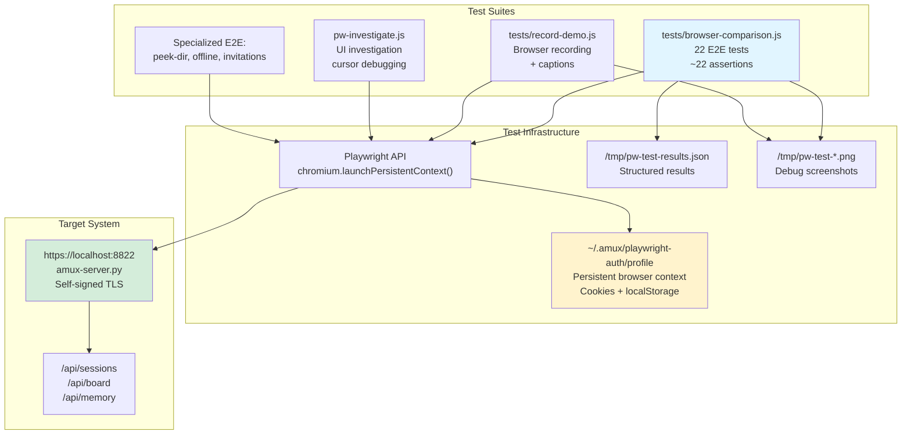
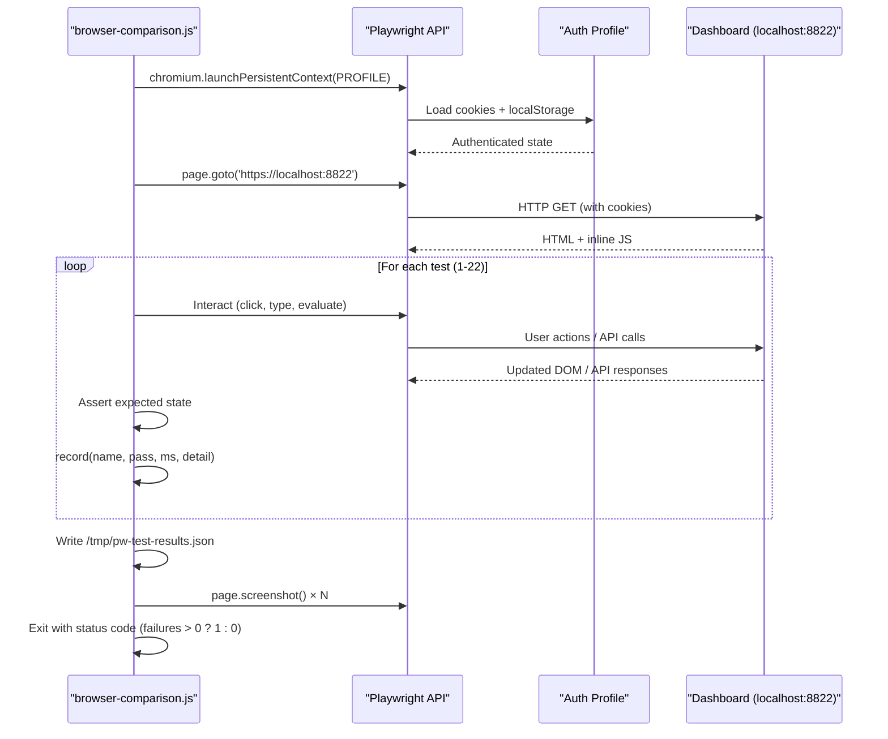
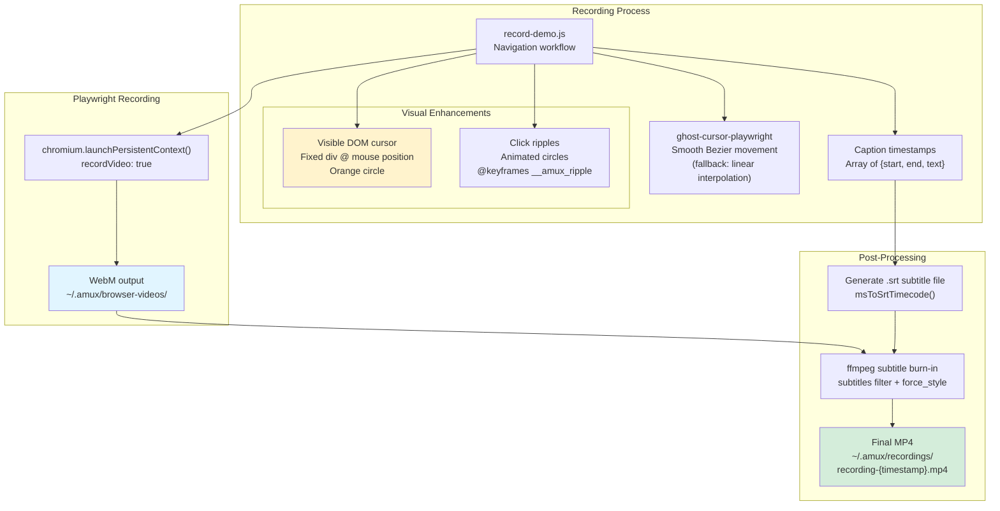
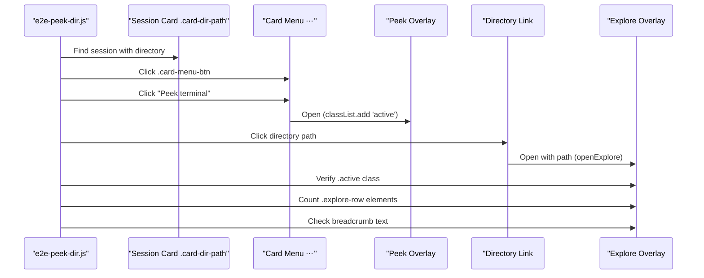

<!-- source: DeepWiki mcp.deepwiki.com · repo mixpeek/amux · page 10.2 Testing · fetched 2026-10-27 -->

# Testing

<details>
<summary>Relevant source files</summary>

The following files were used as context for generating this wiki page:

- [cloud/docker/Dockerfile](cloud/docker/Dockerfile)
- [cloud/docker/amux-server.py](cloud/docker/amux-server.py)
- [package.json](package.json)
- [pw-investigate.js](pw-investigate.js)
- [pw-invitations-ui.js](pw-invitations-ui.js)
- [pw-invitations.js](pw-invitations.js)
- [pw-invite-final.js](pw-invite-final.js)
- [tests/browser-comparison.js](tests/browser-comparison.js)
- [tests/e2e-peek-dir.js](tests/e2e-peek-dir.js)
- [tests/pw-investigate.js](tests/pw-investigate.js)
- [tests/pw-offline-debug.js](tests/pw-offline-debug.js)
- [tests/record-demo.js](tests/record-demo.js)

</details>


## Purpose and Scope

This document describes the Playwright-based end-to-end testing infrastructure for the amux web dashboard. It covers the main test suite, browser recording system, investigation tools, and authentication strategies. For information about development rules and constraints, see [Development Rules](#10.1). For CI/CD automation of these tests, see [CI/CD Pipelines](#10.4).

---

## Test Infrastructure Overview

The amux testing system is built on **Playwright** for browser automation, providing comprehensive coverage of the web dashboard at `https://localhost:8822`. Tests run in headless Chromium with a persistent authentication profile to maintain login state across test sessions.



**Sources:** [tests/browser-comparison.js:1-313](), [package.json:1-11](), [tests/record-demo.js:1-432]()

---

## Main Test Suite

The primary test suite `tests/browser-comparison.js` contains 22 automated tests covering core dashboard functionality. Tests are numbered sequentially and record timing, pass/fail status, and detail messages.

### Test Categories

| Category | Tests | Coverage |
|----------|-------|----------|
| **Navigation** | 1 | Dashboard load, title verification |
| **Session Management** | 2-4, 10-14 | Card rendering, names, peek overlay, send input |
| **Board System** | 5-6 | Tab switching, column rendering |
| **Theming** | 8-9, 22 | Light/dark mode toggle, background colors |
| **Workspace** | 15-16 | Multi-pane grid view, background verification |
| **Responsive** | 17 | Mobile viewport (390×844) |
| **API Integration** | 19 | Client-side fetch() calls |
| **Accessibility** | 20 | Aria snapshot generation |
| **Zoom Handling** | 21 | Peek overlay at reduced viewport height |

### Test Execution Flow



**Sources:** [tests/browser-comparison.js:26-313]()

### Test Result Structure

Each test emits a structured result object:

```javascript
{
  name: "Navigate to dashboard",
  pass: true,
  ms: 2450,
  detail: 'title="amux"'
}
```

Results are stored in `/tmp/pw-test-results.json` with aggregate statistics:

```json
{
  "results": [...],
  "totalMs": 18234,
  "passed": 22,
  "failed": 0
}
```

**Sources:** [tests/browser-comparison.js:20-24](), [tests/browser-comparison.js:305-307]()

### Example Test Implementation

Test #3 counts session cards on the dashboard:

```javascript
// ── 3: Session cards ──
{
  const t = Date.now();
  try {
    const count = await page.$$eval('.card', cards => cards.length);
    record('Count session cards', count > 0, Date.now() - t, `${count} cards`);
  } catch (e) { 
    record('Count session cards', false, Date.now() - t, e.message); 
  }
}
```

This pattern is used throughout: wrap test logic in try-catch, time execution, and call `record()` with pass/fail status.

**Sources:** [tests/browser-comparison.js:58-64]()

---

## Browser Recording System

The `tests/record-demo.js` script demonstrates end-to-end browser workflows with **visible cursor tracking**, **click ripples**, and **burned-in SRT captions**. It produces MP4 videos suitable for documentation or bug reproduction.

### Recording Architecture



**Sources:** [tests/record-demo.js:1-432]()

### Visible Cursor Injection

A DOM-based cursor element is injected via `ctx.addInitScript()`, ensuring it appears in every page and is captured in the video:

```javascript
const CURSOR_AND_RIPPLE_SCRIPT = `
(function() {
  const CURSOR_ID = '__amux_cursor__';
  
  function attachCursor() {
    if (document.getElementById(CURSOR_ID)) return;
    const el = document.createElement('div');
    el.id = CURSOR_ID;
    el.style.cssText = [
      'position:fixed', 'pointer-events:none', 'z-index:2147483647',
      'width:20px', 'height:20px', 'border-radius:50%',
      'border:2.5px solid rgba(255,80,0,0.92)',
      'background:rgba(255,80,0,0.18)',
      'transform:translate(-50%,-50%)',
      // ... more styles
    ].join(';');
    document.body.appendChild(el);
    return el;
  }
  
  document.addEventListener('mousemove', (e) => {
    const cursor = attachCursor();
    cursor.style.left = e.clientX + 'px';
    cursor.style.top  = e.clientY + 'px';
  });
})();
`;
```

**Sources:** [tests/record-demo.js:64-133]()

### Caption System

Captions are stored with millisecond offsets from recording start:

```javascript
function addCaption(text, durationMs = 3500) {
  const startMs = Date.now() - recordingStartMs;
  const endMs = startMs + durationMs;
  captions.push({ start: startMs, end: endMs, text });
}

// Convert to SRT format
function msToSrtTimecode(ms) {
  const h = Math.floor(ms / 3600000);
  const m = Math.floor((ms % 3600000) / 60000);
  const s = Math.floor((ms % 60000) / 1000);
  const mil = ms % 1000;
  return `${String(h).padStart(2,'0')}:${String(m).padStart(2,'0')}:${String(s).padStart(2,'0')},${String(mil).padStart(3,'0')}`;
}
```

**Sources:** [tests/record-demo.js:39-62]()

### FFmpeg Post-Processing

The script converts WebM to MP4 with burned-in subtitles using the `libass` subtitle filter:

```javascript
const srtEscaped = srtPath.replace(/\\/g, '\\\\').replace(/:/g, '\\:').replace(/'/g, "\\'");
const subtitleFilter = `subtitles='${srtEscaped}':force_style='FontSize=24,PrimaryColour=&H00FFFFFF,OutlineColour=&H00000000,Outline=2,Shadow=1,Alignment=2,MarginV=40'`;

const ffResult = spawnSync('ffmpeg', [
  '-i', webmPath,
  '-vf', subtitleFilter,
  '-c:v', 'libx264', '-crf', '18', '-preset', 'fast',
  '-pix_fmt', 'yuv420p',
  '-c:a', 'aac',
  '-movflags', '+faststart',
  '-y', mp4Path,
]);
```

If subtitle burn-in fails (e.g., `libass` not available), it falls back to MP4 conversion without captions.

**Sources:** [tests/record-demo.js:369-412]()

---

## Investigation Tools

### UI Debugging Script

The `pw-investigate.js` script is a lightweight tool for inspecting UI state and taking targeted screenshots:

```javascript
const page = await ctx.newPage();
await page.goto('https://localhost:8822', { waitUntil: 'domcontentloaded' });
await page.waitForTimeout(2000);
await page.click('#tab-files');
await page.waitForTimeout(1500);
await page.screenshot({ path: '/tmp/pw-files.png' });
```

This script pattern is used for quick iteration during UI debugging—no assertions, just screenshots and DOM inspection.

**Sources:** [pw-investigate.js:1-16]()

### Cursor State Inspection

The `tests/pw-investigate.js` variant checks computed and inline `cursor` styles across selectors:

```javascript
const cursors = await page.evaluate(() => {
  const sel = [
    'body', 'html', '.card', '.cards', '#sessions-view',
    '.tab-bar', '.tab-bar button', 'button', 'input',
    '.card-drag-handle', '[data-session]'
  ];
  return sel.map(s => {
    const el = document.querySelector(s);
    if (!el) return { sel: s, cursor: null, note: 'not found' };
    const computed = window.getComputedStyle(el).cursor;
    const inline = el.style.cursor;
    return { sel: s, computed, inline: inline || null };
  });
});
console.log('Cursor on Sessions tab:', JSON.stringify(cursors, null, 2));
```

This is useful for diagnosing drag-and-drop issues or ensuring pointer cursors appear on interactive elements.

**Sources:** [tests/pw-investigate.js:16-30]()

---

## Specialized E2E Tests

### Peek Overlay Navigation

`tests/e2e-peek-dir.js` verifies that clicking the directory path in the peek overlay opens the explore (file browser) overlay:



**Sources:** [tests/e2e-peek-dir.js:1-126]()

### Offline Mode Testing

`tests/pw-offline-debug.js` tests IndexedDB persistence and offline fallbacks:

```javascript
// Load files while online
await page.evaluate(() => loadFiles('/Users/ethan/Dev/amux'));
await page.waitForTimeout(2000);
await page.evaluate(() => openFilePreview('/Users/ethan/Dev/amux/README.md'));

// Go offline
await ctx.setOffline(true);

// Attempt to load cached data from IndexedDB
await page.evaluate(() => loadFiles('/Users/ethan/Dev/amux'));
```

This ensures the **Progressive Web App (PWA)** features work correctly when the server is unreachable.

**Sources:** [tests/pw-offline-debug.js:1-63]()

### Invitation Flow E2E

Three separate test scripts (`pw-invitations.js`, `pw-invitations-ui.js`, `pw-invite-final.js`) verify the organization invitation feature:

1. **Backend API**: `POST /v1/private/organizations/invitations/{email}`
2. **Proxy API**: `GET /api/organizations/user-invitations`
3. **UI Rendering**: Invitation cards on `/create-organization` page
4. **Accept Flow**: `POST /api/organizations/user-invitations/accept`

These tests use **PropelAuth magic links** to authenticate a fresh test user and verify the invitation UI renders correctly.

**Sources:** [pw-invitations.js:1-293](), [pw-invitations-ui.js:1-271](), [pw-invite-final.js:1-252]()

---

## Authentication & Persistence

### Persistent Browser Context

All tests use `chromium.launchPersistentContext()` with a fixed profile directory:

```javascript
const PROFILE = `${homedir()}/.amux/playwright-auth/profile`;

const ctx = await chromium.launchPersistentContext(PROFILE, {
  headless: true,
  viewport: { width: 1440, height: 900 },
  ignoreHTTPSErrors: true,
});
```

This profile stores:
- **Cookies**: Session tokens from `https://localhost:8822`
- **localStorage**: Theme preference (`amux_theme`), session state
- **IndexedDB**: Offline file cache (for PWA)

**Sources:** [tests/browser-comparison.js:30-34]()

### TLS Certificate Trust

The dashboard uses self-signed TLS certificates. Tests bypass certificate validation via `ignoreHTTPSErrors: true`, allowing headless Chromium to connect to `https://localhost:8822` without manual cert trust.

**Sources:** [tests/browser-comparison.js:33]()

### Multiple Profiles

The recording system supports named profiles for testing multi-account scenarios:

```javascript
const PROFILES_DIR = `${homedir()}/.amux/playwright-auth/profiles`;

// Use: node tests/record-demo.js gmail
const profilePath = PROFILE_ARG === 'default'
  ? DEFAULT_PROFILE
  : `${PROFILES_DIR}/${PROFILE_ARG.replace(/[^a-zA-Z0-9_-]/g, '')}`;
```

Each profile is isolated, allowing tests to authenticate as different users without interference.

**Sources:** [tests/record-demo.js:26-33]()

---

## Test Execution

### Running the Main Suite

```bash
# Install Playwright (first time only)
npm install

# Run all 22 tests
node tests/browser-comparison.js

# Results written to:
# - /tmp/pw-test-results.json (structured data)
# - /tmp/pw-test-*.png (screenshots)
```

Exit codes:
- `0`: All tests passed
- `1`: One or more tests failed

**Sources:** [tests/browser-comparison.js:306-307]()

### Recording a Demo

```bash
# Record with default profile
node tests/record-demo.js

# Record with named profile (e.g., gmail)
node tests/record-demo.js gmail

# Output:
# - ~/.amux/browser-videos/*.webm (raw recording)
# - ~/.amux/recordings/recording-{timestamp}.mp4 (final)
# - ~/.amux/recordings/recording-{timestamp}.srt (captions)
```

**Sources:** [tests/record-demo.js:184-431]()

### Investigation & Debugging

```bash
# Quick screenshot investigation
node pw-investigate.js

# Cursor state inspection
node tests/pw-investigate.js

# Screenshots saved to /tmp/pw-*.png
```

**Sources:** [pw-investigate.js:1-16](), [tests/pw-investigate.js:1-91]()

### Test Dependencies

| Dependency | Version | Purpose |
|------------|---------|---------|
| `playwright` | ^1.58.0 | Browser automation |
| `@playwright/mcp` | ^0.0.28 | MCP integration (unused in tests) |
| `ghost-cursor-playwright` | ^2.1.0 | Smooth mouse movement for recordings |

**Sources:** [package.json:1-11]()

---

## Test Output & Debugging

### Screenshot Naming Convention

| Pattern | Source | Purpose |
|---------|--------|---------|
| `/tmp/pw-test-*.png` | `browser-comparison.js` | Per-test snapshots |
| `/tmp/pw-files.png` | `pw-investigate.js` | Files tab investigation |
| `/tmp/pw-investigate-cursor-*.png` | `tests/pw-investigate.js` | Cursor debugging |
| `/tmp/e2e-*.png` | `tests/e2e-peek-dir.js` | Peek overlay flow |
| `/tmp/record-demo-*.png` | `tests/record-demo.js` | Recording checkpoints |
| `/tmp/pw-invite-*.png` | Invitation tests | Invitation flow debugging |

### Console Output Format

```
══ amux Playwright UI Tests ══

  ✓ Navigate to dashboard (2450ms) — title="amux"
  ✓ Take screenshot (180ms)
  ✓ Count session cards (95ms) — 3 cards
  ✓ Read session names (120ms) — api-dev, frontend, docs
  ...

══ Results: 22/22 passed (18234ms) ══
```

Failed tests print additional details:

```
Failures:
  ✗ Click Board tab: timeout waiting for selector
```

**Sources:** [tests/browser-comparison.js:22-24](), [tests/browser-comparison.js:298-303]()

### Structured Test Results

The JSON output provides machine-readable results for CI integration:

```json
{
  "results": [
    {
      "name": "Navigate to dashboard",
      "pass": true,
      "ms": 2450,
      "detail": "title=\"amux\""
    },
    {
      "name": "Count session cards",
      "pass": true,
      "ms": 95,
      "detail": "3 cards"
    }
  ],
  "totalMs": 18234,
  "passed": 22,
  "failed": 0
}
```

This format supports automated test reporting and failure analysis.

**Sources:** [tests/browser-comparison.js:305]()

---

## Test Coverage Summary

| Component | Test Count | Coverage |
|-----------|------------|----------|
| Session Cards | 3 | Rendering, names, count |
| Board System | 2 | Tab switch, column rendering |
| Peek Overlay | 6 | Open, content, input, close, zoom |
| Workspace | 2 | Grid mode, styling |
| Theming | 3 | Light/dark toggle, backgrounds |
| Responsive | 1 | Mobile viewport |
| API Integration | 1 | Client-side fetch |
| Accessibility | 1 | Aria snapshot |
| Offline Mode | 1 | IndexedDB fallback |
| File Browser | 1 | Peek → Explore navigation |
| Invitations | 3 | Backend, proxy, UI |

**Total**: ~25 automated tests across 7 test files

**Sources:** [tests/browser-comparison.js:38-277](), [tests/e2e-peek-dir.js:1-126](), [tests/pw-offline-debug.js:1-63](), [pw-invitations.js:1-293]()

---

