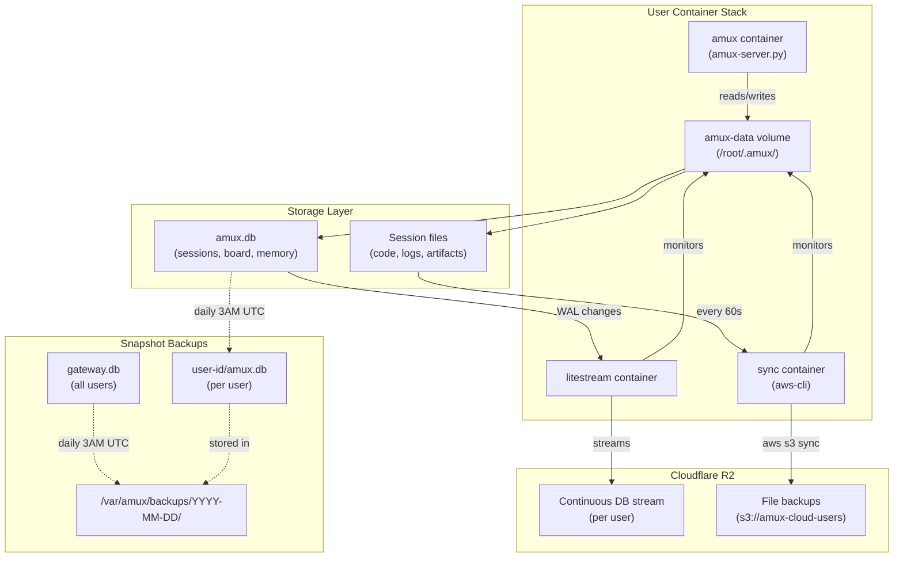
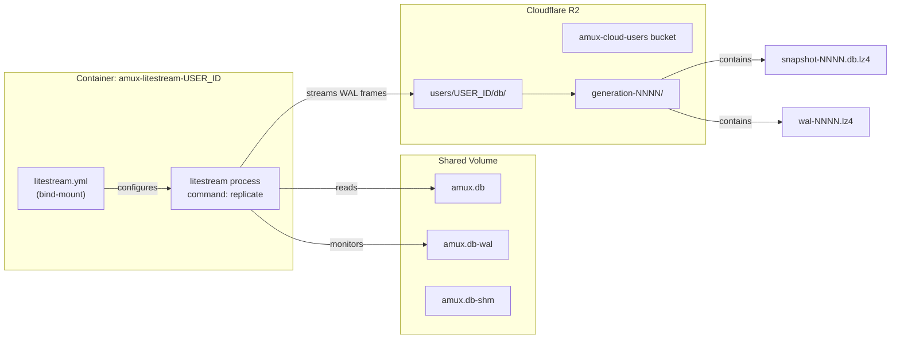
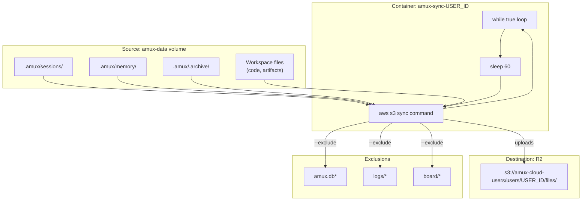
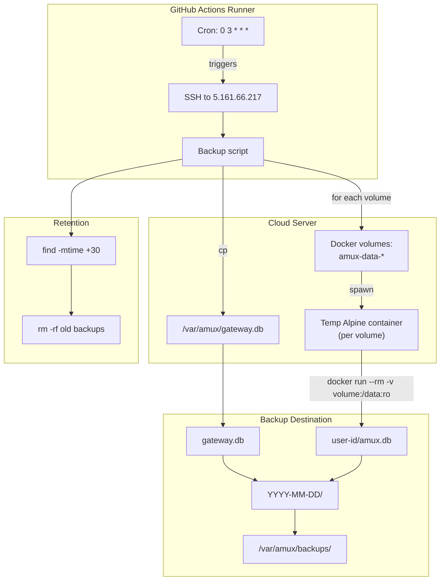

<!-- source: DeepWiki mcp.deepwiki.com · repo mixpeek/amux · page 11.2 Backup & Recovery · fetched 2026-10-27 -->

# Backup & Recovery

<details>
<summary>Relevant source files</summary>

The following files were used as context for generating this wiki page:

- [.github/workflows/backup-cloud.yml](.github/workflows/backup-cloud.yml)
- [.github/workflows/deploy-cloud.yml](.github/workflows/deploy-cloud.yml)
- [cloud/docker/docker-compose.template.yml](cloud/docker/docker-compose.template.yml)
- [templates/README.md](templates/README.md)
- [templates/content-creator/CLAUDE.md](templates/content-creator/CLAUDE.md)
- [templates/content-creator/template.json](templates/content-creator/template.json)
- [templates/fitness-tracker/CLAUDE.md](templates/fitness-tracker/CLAUDE.md)

</details>


This document details the multi-layered backup strategy for amux deployments, including continuous database replication, periodic file synchronization, and daily snapshot backups. It covers the architecture of backup containers, storage destinations, and recovery procedures for both cloud and local deployments.

For monitoring backup health and metrics, see [Monitoring & Metrics](#11.1). For cloud infrastructure setup, see [Docker Architecture](#4.1) and [Infrastructure as Code](#4.3).

---

## Backup Architecture Overview

amux employs a three-tier backup strategy for cloud deployments:

1. **Continuous replication** - Litestream streams SQLite database changes to Cloudflare R2 in real-time
2. **Periodic file sync** - AWS CLI syncs working directory files to S3 every 60 seconds
3. **Daily snapshots** - GitHub Actions creates point-in-time backups of all databases at 3 AM UTC



**Three-Container Design per User**

| Container | Purpose | Backup Target | Frequency |
|-----------|---------|---------------|-----------|
| `amux-user-${USER_ID}` | Runs amux-server.py | None (produces data) | N/A |
| `amux-litestream-${USER_ID}` | Replicates amux.db | Cloudflare R2 | Real-time (WAL streaming) |
| `amux-sync-${USER_ID}` | Syncs working files | Cloudflare R2 (S3 API) | Every 60 seconds |

**Sources:** [cloud/docker/docker-compose.template.yml:1-71]()

---

## Continuous Replication (Litestream)

### Architecture

The `litestream` container monitors the SQLite database's Write-Ahead Log (WAL) and streams changes to Cloudflare R2 continuously. This provides near-zero data loss in case of container or volume failure.



### Container Configuration

The litestream container is defined in the per-user docker-compose stack:

- **Image**: `litestream/litestream:latest`
- **Volume mount**: `amux-data:/root/.amux` (read-only access to database)
- **Config mount**: `./litestream.yml:/etc/litestream.yml:ro`
- **Environment variables**:
  - `LITESTREAM_ACCESS_KEY_ID` - R2 access key
  - `LITESTREAM_SECRET_ACCESS_KEY` - R2 secret key
  - `USER_ID` - used in R2 path construction

**Sources:** [cloud/docker/docker-compose.template.yml:29-43]()

### Database Replication Target

Litestream replicates to Cloudflare R2 using S3-compatible API:

- **Endpoint**: `https://${CF_ACCOUNT_ID}.r2.cloudflarestorage.com`
- **Bucket**: `amux-cloud-users`
- **Path pattern**: `users/${USER_ID}/db/`
- **Database**: `amux.db` (sessions, board, memory, issues)

### What Gets Replicated

Litestream continuously replicates the main SQLite database containing:

- Session registry (UUIDs, names, working directories, status)
- Board issues (tasks, statuses, assignments, metadata)
- Global memory (API documentation, shared context)
- Per-session memory (context files, agent state)
- Event logs (structured logs from watchdog)

### What Gets Excluded

The sync container explicitly excludes database files from S3 sync to avoid conflicts:

- `amux.db` - replicated by Litestream only
- `amux.db-shm` - SQLite shared memory file
- `amux.db-wal` - Write-Ahead Log (Litestream streams this)
- `logs/*` - ephemeral log files
- `board/*` - legacy board storage (deprecated in favor of SQLite)

**Sources:** [cloud/docker/docker-compose.template.yml:60]()

### Dependency Chain

The litestream container has a health check dependency on the amux container:

```yaml
depends_on:
  amux:
    condition: service_healthy
```

This ensures Litestream starts only after amux-server.py is running and the database exists.

**Sources:** [cloud/docker/docker-compose.template.yml:42-43]()

---

## File Synchronization

### Sync Container Architecture

The `sync` container runs an infinite loop that periodically uploads working directory files to S3-compatible storage.



### Sync Container Definition

The sync container runs AWS CLI in a continuous loop:

**Image**: `amazon/aws-cli:latest`

**Volume mount**: `amux-data:/root/.amux` (full access to working directory)

**Environment variables**:
- `AWS_ACCESS_KEY_ID` - R2 access key (same as Litestream)
- `AWS_SECRET_ACCESS_KEY` - R2 secret key
- `R2_ENDPOINT` - Cloudflare R2 endpoint URL

**Sources:** [cloud/docker/docker-compose.template.yml:45-64]()

### Sync Command

The entrypoint runs a shell loop that syncs every 60 seconds:

```bash
while true; do
  sleep 60
  aws s3 sync /root/.amux/ \
    s3://amux-cloud-users/users/${USER_ID}/files/ \
    --endpoint-url ${R2_ENDPOINT} \
    --exclude 'amux.db' \
    --exclude 'amux.db-shm' \
    --exclude 'amux.db-wal' \
    --exclude 'logs/*' \
    --exclude 'board/*' \
    --quiet
done
```

The `--quiet` flag suppresses output to avoid container log bloat.

**Sources:** [cloud/docker/docker-compose.template.yml:57-61]()

### Sync Behavior

The `aws s3 sync` command:

- Uploads new files
- Overwrites changed files (based on size and timestamp)
- Does NOT delete remote files if deleted locally (one-way sync)
- Skips files that already exist with matching size/timestamp

This provides incremental backup without full re-uploads.

### What Gets Synced

All files in `/root/.amux/` except exclusions:

- **Session configurations**: `.amux/sessions/NAME.env`
- **Memory files**: `.amux/memory/global/`, per-session memory
- **Archived sessions**: `.amux/.archive/NAME/`
- **Workspace files**: User code, artifacts, generated files
- **MCP configuration**: `.amux/mcp.json`
- **Server environment**: `.amux/server.env`

---

## Daily Snapshot Backups

### GitHub Actions Workflow

A scheduled GitHub Actions workflow creates daily point-in-time backups of all databases at 3:00 AM UTC.



### Workflow Configuration

The workflow runs on schedule or manual dispatch:

```yaml
on:
  schedule:
    - cron: '0 3 * * *'  # 3:00 AM UTC daily
  workflow_dispatch:       # Manual trigger
```

**Sources:** [.github/workflows/backup-cloud.yml:3-7]()

### Backup Process

The workflow SSHs to the cloud server and executes a backup script:

1. **Create date-stamped directory**:
   ```bash
   BACKUP_DIR="/var/amux/backups/$(date +%Y-%m-%d)"
   mkdir -p "$BACKUP_DIR"
   ```

2. **Back up gateway database**:
   ```bash
   cp /var/amux/gateway.db "$BACKUP_DIR/gateway.db"
   ```
   
   The gateway database contains:
   - User registry (Clerk user IDs)
   - Port allocations (9000-9999)
   - Organization memberships
   - Invite tokens

3. **Extract per-user databases from Docker volumes**:
   ```bash
   for vol in $(docker volume ls --format '{{.Name}}' | grep '^amux-data-'); do
     user_id="${vol#amux-data-}"
     dest="$BACKUP_DIR/$user_id"
     mkdir -p "$dest"
     docker run --rm \
       -v "$vol:/data:ro" \
       -v "$dest:/backup" \
       alpine sh -c 'cp /data/amux.db /backup/amux.db 2>/dev/null || true'
   done
   ```
   
   This uses ephemeral Alpine containers to read from named volumes without stopping user containers.

4. **Prune old backups**:
   ```bash
   find /var/amux/backups -maxdepth 1 -type d -mtime +30 -exec rm -rf {} +
   ```
   
   Keeps only the last 30 days of backups.

**Sources:** [.github/workflows/backup-cloud.yml:21-48]()

### Backup Directory Structure

```
/var/amux/backups/
├── 2024-01-15/
│   ├── gateway.db
│   ├── user-abc123/
│   │   └── amux.db
│   ├── user-def456/
│   │   └── amux.db
│   └── user-xyz789/
│       └── amux.db
├── 2024-01-16/
│   └── ...
└── 2024-02-14/  ← Latest backup
    └── ...
```

### Why Snapshots + Litestream?

The dual-layer strategy provides different recovery guarantees:

| Backup Type | Recovery Point | Use Case |
|-------------|----------------|----------|
| **Litestream** | Last WAL frame (seconds old) | Recover from container crash, volume corruption |
| **Snapshots** | Last 3 AM UTC | Recover from accidental data deletion, restore to known-good state |

Litestream provides **continuous protection** against infrastructure failures, while snapshots provide **point-in-time recovery** for logical errors.

---

## Recovery Procedures

### Restoring from Litestream

To restore a user's database from Litestream replication:

1. **Stop the user's container stack**:
   ```bash
   cd /var/amux/users/<user-id>/
   docker compose down
   ```

2. **Locate the Litestream replica**:
   - Bucket: `amux-cloud-users`
   - Path: `users/<user-id>/db/`
   - Database: `amux.db`

3. **Use Litestream CLI to restore**:
   ```bash
   docker run --rm \
     -v amux-data-<user-id>:/root/.amux \
     -e LITESTREAM_ACCESS_KEY_ID=<key> \
     -e LITESTREAM_SECRET_ACCESS_KEY=<secret> \
     litestream/litestream restore \
     -replica <replica-name> \
     -o /root/.amux/amux.db \
     s3://<bucket>/users/<user-id>/db/amux.db
   ```

4. **Restart the container stack**:
   ```bash
   docker compose up -d
   ```

### Restoring from Daily Snapshots

To restore from a point-in-time snapshot:

1. **Identify the target backup date**:
   ```bash
   ls -l /var/amux/backups/
   ```

2. **Stop the user's container stack**:
   ```bash
   cd /var/amux/users/<user-id>/
   docker compose down
   ```

3. **Copy the snapshot into the volume**:
   ```bash
   docker run --rm \
     -v amux-data-<user-id>:/data \
     -v /var/amux/backups/<date>/<user-id>:/backup:ro \
     alpine sh -c 'cp /backup/amux.db /data/amux.db'
   ```

4. **Restart the container stack**:
   ```bash
   docker compose up -d
   ```

### Restoring Gateway Database

The gateway database controls user-to-port mappings and authentication state. To restore:

1. **Stop the gateway service**:
   ```bash
   systemctl stop amux-gateway
   ```

2. **Restore from backup**:
   ```bash
   cp /var/amux/backups/<date>/gateway.db /var/amux/gateway.db
   ```

3. **Restart the gateway**:
   ```bash
   systemctl start amux-gateway
   ```

**Warning**: Restoring the gateway database may cause port allocation conflicts if new users were added after the backup date. Review port assignments in `gateway.db` and reconcile with running containers.

### Recovering Workspace Files

Workspace files are synced to S3 but not included in daily snapshots. To recover:

1. **Use AWS CLI to download from R2**:
   ```bash
   aws s3 sync \
     s3://amux-cloud-users/users/<user-id>/files/ \
     /tmp/restore-<user-id>/ \
     --endpoint-url https://<account-id>.r2.cloudflarestorage.com
   ```

2. **Copy into the user's volume**:
   ```bash
   docker run --rm \
     -v amux-data-<user-id>:/data \
     -v /tmp/restore-<user-id>:/restore:ro \
     alpine sh -c 'cp -r /restore/* /data/'
   ```

---

## Data Persistence & Volume Structure

### Named Volumes per User

Each user gets two named Docker volumes:

| Volume Name | Purpose | Size | Backed Up |
|-------------|---------|------|-----------|
| `root-home-${USER_ID}` | Root home directory (~/.ssh, etc.) | Small | No |
| `amux-data-${USER_ID}` | amux working directory | Variable | Yes (Litestream + S3 sync) |

**Sources:** [cloud/docker/docker-compose.template.yml:66-70]()

### Volume Contents

The `amux-data` volume contains:

```
/root/.amux/
├── amux.db              ← SQLite (sessions, board, memory) - Litestream
├── amux.db-wal          ← Write-Ahead Log
├── amux.db-shm          ← Shared memory
├── server.env           ← Server environment variables - S3 sync
├── mcp.json             ← MCP server config - S3 sync
├── sessions/            ← Session configs (.env files) - S3 sync
├── memory/              ← Global & per-session memory - S3 sync
│   ├── global/
│   └── <session-name>/
├── .archive/            ← Archived sessions - S3 sync
└── logs/                ← Ephemeral logs - NOT backed up
```

### What Survives Container Recreation

When containers are recreated (e.g., during deployment):

- ✅ **Survives**: All data in `amux-data` volume (databases, configs, files)
- ✅ **Survives**: Session state (tmux sessions persist across container restarts)
- ❌ **Lost**: Container logs (use `docker compose logs` to view before recreation)
- ❌ **Lost**: Ephemeral `/tmp` data inside containers

### Bind Mounts vs. Named Volumes

The docker-compose stack uses both:

- **Bind mounts** (read-only): Code and assets from host (`/opt/amux-cloud/app/`)
  - `amux-server.py` - enables zero-downtime updates
  - Icons and static assets
  
- **Named volumes** (read-write): User data
  - `amux-data` - persistent working directory
  - `root-home` - user home directory state

Bind mounts allow updating `amux-server.py` on the host and having all containers pick up changes instantly via auto-restart.

**Sources:** [cloud/docker/docker-compose.template.yml:9-16](), [.github/workflows/deploy-cloud.yml:26-33]()

---

## Local Deployment Backups

For local (non-cloud) deployments, users must implement their own backup strategy:

### Recommended Approach

1. **Database backups**:
   ```bash
   cp ~/.amux/amux.db ~/.amux/backups/amux-$(date +%Y-%m-%d).db
   ```

2. **Full directory backup**:
   ```bash
   tar czf ~/amux-backup-$(date +%Y-%m-%d).tar.gz ~/.amux/
   ```

3. **Automated backups via cron**:
   ```bash
   # Add to crontab
   0 3 * * * cp ~/.amux/amux.db ~/.amux/backups/amux-$(date +\%Y-\%m-\%d).db
   ```

### Cloud Storage Integration

Users can configure Litestream manually for local deployments:

1. Install Litestream:
   ```bash
   curl -fsSL https://packages.litestream.io/install.sh | sh
   ```

2. Configure replication:
   ```yaml
   # ~/.litestream.yml
   dbs:
     - path: /home/user/.amux/amux.db
       replicas:
         - url: s3://<bucket>/amux.db
   ```

3. Run as background service:
   ```bash
   litestream replicate &
   ```

---

## Summary: Backup Coverage Matrix

| Data Type | Litestream | S3 Sync | Daily Snapshot | Manual |
|-----------|------------|---------|----------------|--------|
| Session registry (amux.db) | ✅ Real-time | ❌ | ✅ 3 AM | ❌ |
| Board issues (amux.db) | ✅ Real-time | ❌ | ✅ 3 AM | ❌ |
| Memory (amux.db) | ✅ Real-time | ❌ | ✅ 3 AM | ❌ |
| Session configs (.env) | ❌ | ✅ Every 60s | ❌ | ❌ |
| Workspace files | ❌ | ✅ Every 60s | ❌ | ❌ |
| Memory files | ❌ | ✅ Every 60s | ❌ | ❌ |
| MCP config | ❌ | ✅ Every 60s | ❌ | ❌ |
| Gateway DB | ❌ | ❌ | ✅ 3 AM | ❌ |
| Container logs | ❌ | ❌ | ❌ | ✅ |
| Local deployments | ❌ | ❌ | ❌ | ✅ |

**Sources:** [cloud/docker/docker-compose.template.yml:1-71](), [.github/workflows/backup-cloud.yml:1-49]()

---

